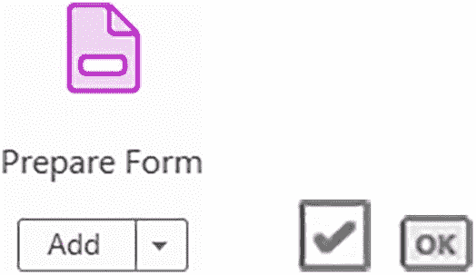
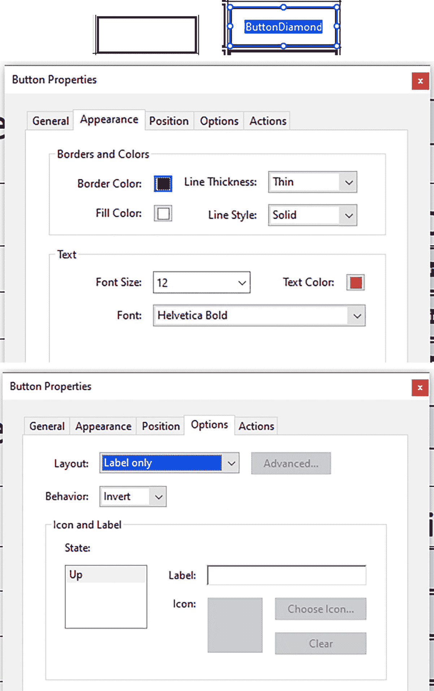
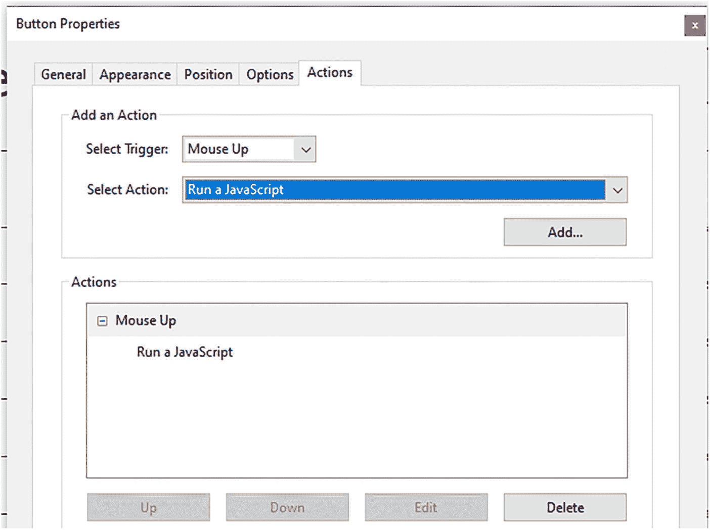
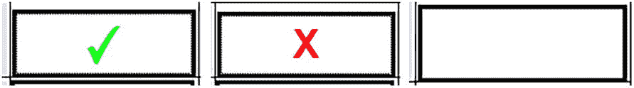
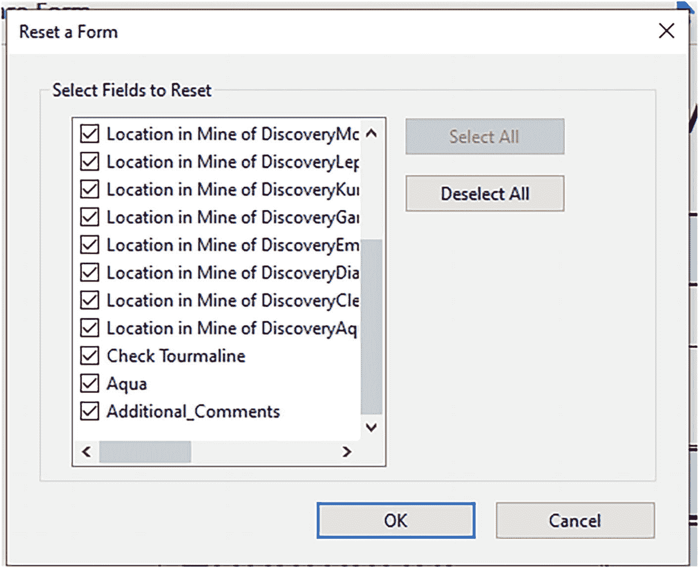
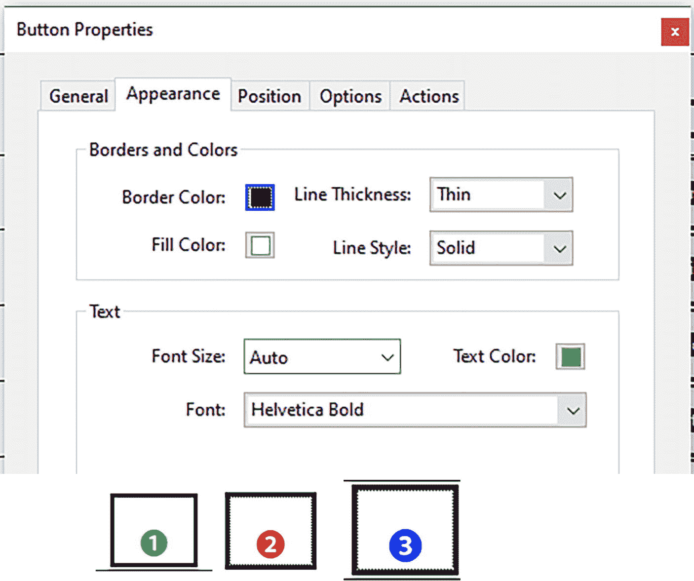
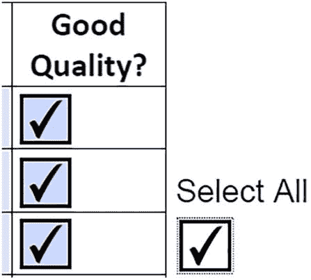
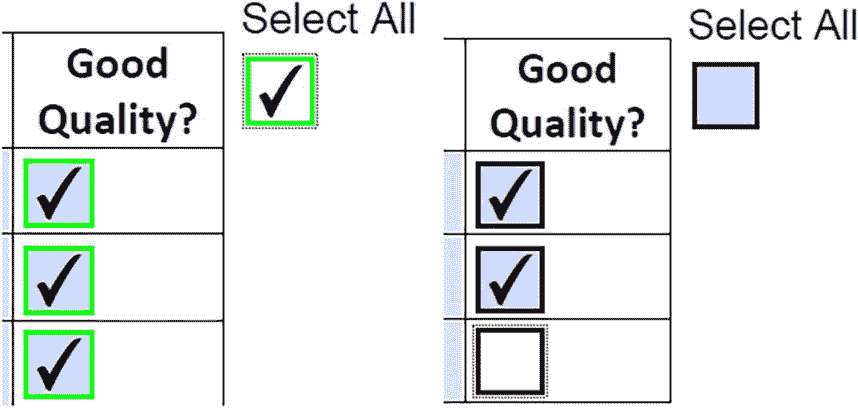
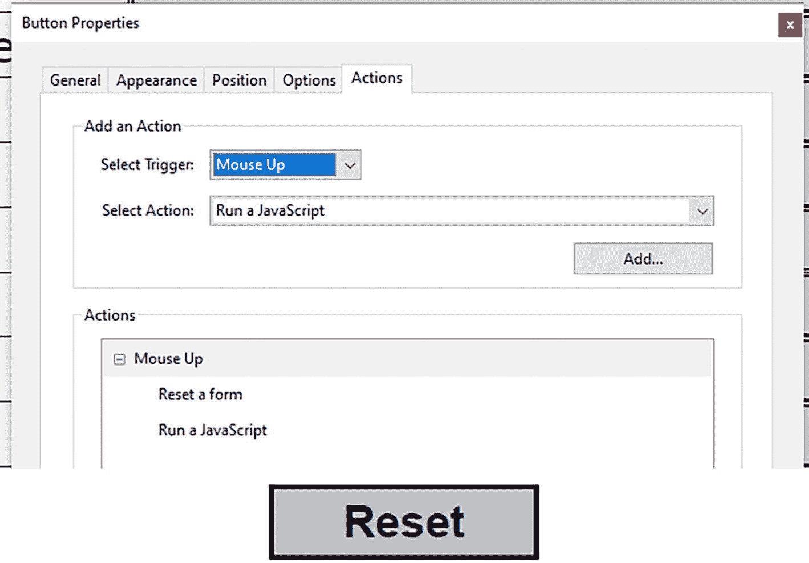

# 16. 多状态复选框

**本章目标：** 当文档空间有限时，能够将多个状态合并到一个字段中通常很有帮助。例如，假设你有一个表单，希望能在其中将设置从空白更改为复选标记（表示“是”），或更改为 X 或叉号标记（表示“否”或“错误”）。或者，你可能拥有代表不同级别的多个符号。随着填写表单的用户技能提升，他们需要按特定顺序频繁更新其状态。在本章中，你将学习如何使用按钮字段创建一种多状态复选框。

稍后，你还将了解如何一次选中多个复选框。

## 多状态复选框的问题

如果空间足够大，你可以用单选按钮实现以下效果：

你喜欢我们的新闻简报吗？ • `是` ❍ `否` ❍ `未决定`

```
• 等级 1  ❍ 等级 2  ❍ 等级 3
```

正如你在 Acrobat 中所发现的，单选按钮以组的形式出现，你只能选择其中一个选项。它们也只呈现两种状态（`开` • 或 `关` ❍）；没有第三个或第四个选项。

你也可以使用复选框来节省空间。`是`可以表示已勾选，而`否`则表示未勾选。然而，这同样没有第三个选项，填写表单的人可能不确定未勾选究竟表示`否`还是`未决定`。

你喜欢我们的新闻简报吗？ ❏ `是` ❏ `否` 或 ✓ `是` ✓ `否（我喜欢，但是……）`。

✓ `等级 1` ✓ `等级 2` ❏ `等级 3`。这里我可能希望别人知道我现在是等级 2，但这占用了很多空间。

为了节省空间，一个更直观的复选框提示方式如下：

你喜欢我们的新闻简报吗？

*   ❏ - 这表示我尚未回答

*   ✔ - 这表示是的，我喜欢

*   ✘ - 这表示不，我不喜欢

*   或当前等级

*   ❶

*   ❷

*   ❸

使用 Acrobat 复选框，你可以选择多个选项。但遗憾的是，它们无法具备三种或更多状态，只能处于开或关。

### 实现多状态目标的最佳方法

实现多状态目标的最佳方法是使用按钮字段和 JavaScript 动作来模拟复选框。请参考图 16-1。



一张屏幕截图展示了准备表单图标，以及添加选项卡、一个复选框和一个确定按钮。

**图 16-1** *用于使按钮看起来像复选框的“准备表单”工具*

> **注意**
>
> 如果你想在本课程中同步操作或查看最终结果，请从引言中的链接下载第 16 章的文件。标有“Start”的文件是未包含代码的文件，标有“End”的文件是最终结果。你还会找到包含原始 MS Word 和 PDF 文件的文件夹，以便进行编辑，以及一个包含原始脚本的文件夹，以便将其添加到你自己的 PDF 表单中。
>
> 如果你是从原始 PDF 创建表单，请参考第 1 章的“表单回顾”部分。
>
> 请记住，要查看字段的属性，你必须选择**准备表单**工具；只有这样才能右键单击或双击字段来查看其属性。

让我们从修改按钮的**外观**选项卡开始，使其看起来像一个复选框。如果需要填充特定区域，你也可以进一步调整其大小。请参考本章文件夹中的文件 `TMC_mineralchecklist_End.pdf`。查看名为 `ButtonDiamond` 的属性按钮字段。请参考图 16-2。



按钮属性对话框和顶部带有文本“button diamond”的文本字段的两张屏幕截图。上图中，“外观”选项卡已打开，包含边框和颜色、文本部分。下图中，“选项”选项卡已打开，其中布局设置为“仅标签”已选中，还有行为、图标和标签部分。

**图 16-2** *“外观”和“选项”选项卡中的按钮属性*

该按钮有一个边框使其看起来像复选框，并且当前没有文本。**选项**选项卡保持默认的**布局**设置（**仅标签**）、**行为**设置（**反向**）和**状态**设置（**向上**），并且你不为按钮指定标签名称；你将让**动作**选项卡上的 JavaScript 动作来处理这个问题。

**动作**选项卡的最后一个步骤是选择**鼠标释放**和**运行 JavaScript** 动作。然后点击**添加**并输入以下脚本，或者在此情况下选择该动作并点击**编辑**进行查看。参考图 16-3。



一张按钮属性对话框的屏幕截图，列出了“动作”选项卡下的选项，包含“添加动作”部分，其中触发器选择为“鼠标释放”，动作选择为“运行 JavaScript”，以及一个“动作”部分。

**图 16-3** *“鼠标释放”触发器和“运行一个 JavaScript”动作*

在编辑器中查看 JavaScript 代码。

```
if (event.target.buttonGetCaption()=="\u2714"){
event.target.buttonSetCaption("X");
event.target.textColor = color.red;
}
else if (event.target.buttonGetCaption()=="X"){
event.target.buttonSetCaption("");
}
else if (event.target.buttonGetCaption()==""){
event.target.buttonSetCaption("\u2714");
event.target.textColor = color.green;
}
```

当你通过单击按钮进行测试时，你会看到现在拥有了图 16-4 中所示的状态，并且它看起来非常像一个复选框。



一张包含两个矩形按钮（分别带有勾号和叉号）以及一个空白矩形按钮的屏幕截图。

**图 16-4** *三种按钮状态：一个勾号、一个叉号以及一个模拟复选框的空白状态*

以下 `if/else` 条件语句中使用了三种条件：

*   绿色勾号的符号或 Unicode 字符 `\u2714`

*   红色叉号或 X 的符号

*   一个空白状态，可以用直接引号连在一起（`""`）或直接引号之间加一个空格（`" "`）来表示

使用空白状态的原因是，与其他表单字段不同，Acrobat 不允许你使用**重置**按钮来重置另一个按钮的字段状态，因此必须在每个按钮内部创建一个清除状态作为切换的一部分。

代码在 `buttonGetCaption` 和 `buttonSetCaption` 之间循环。当一个标题出现（`Get`）后，你点击以设置下一个标题，依此类推。

> **注意**
>
> 你无法选择或取消选择按钮字段。当你在**重置表单**对话框中搜索时，它不会显示为可以重置的字段。参考图 16-5。
>
> 
>
> 一张“重置表单”对话框的屏幕截图，列出了“选择要重置的字段”下的选项，其中有几个已启用的字段和一个高亮的“确定”按钮。
>
> **图 16-5** *当你尝试在“重置表单”对话框的“动作”选项卡上添加动作时，找不到按钮字段的*重置选择*

> **注意**
>
> 在本书中，你看到过使用 `event.value`、`event.target.value` 甚至 `event.target.textColor` 的例子。什么时候适合使用 `event.target` 或者仅仅使用 `event`？对于 `event.value`，它代表文本字段的新输入值，这个值总是在变化；但当我们说 `event.target.value` 或 `event.target.textColor` 时，我们正在定位一个属性，该属性现在将代表字段的当前或设定值。这可以应用于单选按钮或复选框的情况，其中已经设置了导出值为开或关，然后被调用。例如，如果我们想在某个特定复选框的**鼠标释放**触发器上改变其颜色（基于开或关状态），我们会使用以下 JavaScript 代码。
>
> ```
> if (event.target.value !="Off"){
> event.target.fillColor=color.red;
> }
> else{
> event.target.fillColor=color.green;
> }
> ```
>
> 使用 `event.target.textColor`，你可以通过条件语句改变属性。当状态为开（非 Off）时，颜色为红色；当状态为关（Off）时，颜色为绿色。但在另一个涉及文本字段的例子中，输入文本总是在变化，你可以将字段设置为**数字格式**，然后在**验证**选项卡上添加以下自定义验证代码，以便在数字为负数或正数时将其颜色从黑色切换为红色。这里我们使用了 `event.value`：
>
> ```
> event.target.textColor = event.value < 0 ? color.red : color.black;
> ```

学习何时使用 `event.target.value` 的最佳方法是参考 Acrobat 在线参考文档，并尝试本书中的不同示例。

在我们的项目中继续推进，随着每次点击满足一个 `if/else` 条件，您将切换至下一状态，并循环回到初始状态。

# 按钮字段的高级用法

您还可以通过颜色来区分勾选标记与叉号标记。

```javascript
event.target.textColor = color.red;
event.target.textColor = color.green;
```

空白状态无需设置颜色，因为该字段中没有任何内容。

作为最后的说明，让我们看看使用级别符号时代码是什么样的。请参考名为`Button Quartz`的按钮字段的属性。

在表单中，如果只使用常规数字，文本字段或下拉菜单就可以了。然而，当使用具有精确顺序的特殊符号时，这可能是切换至正确选择的更佳方案：

- ❶ 使用 `\u2776`
- ❷ 使用 `\u2777`
- ❸ 使用 `\u2778`

```javascript
if (event.target.buttonGetCaption()=="\u2776"){
    event.target.buttonSetCaption("\u2777");
    event.target.textColor = color.red;
}
else if (event.target.buttonGetCaption()=="\u2777"){
    event.target.buttonSetCaption("\u2778");
    event.target.textColor = color.blue;
}
else if (event.target.buttonGetCaption()=="\u2778"){
    event.target.buttonSetCaption("");
}
else if (event.target.buttonGetCaption()==""){
    event.target.buttonSetCaption("\u2776");
    event.target.textColor = color.green;
}
```

在“外观”选项卡中，将字号调整为`Auto`，如果符号看起来被截断或未在按钮上居中，此设置将更好地使其居中。您也可以根据需要稍微调整字段的宽度。请参考图 16-6。



按钮属性对话框的截图，其中列出了外观选项卡下的选项，包括边框和颜色，以及文本，字号设置为自动。图中包含 3 个按钮，分别标有 1、2、3，尺寸依次增大。

当字号设置为`Auto`时，它在按钮中的显示效果如下。

## 额外功能：星级评分思路

也许您想对某个想法或产品进行评分。图 16-7 展示了按钮字段`Button1`。


左侧为“给我评分”按钮的截图，右侧为五星评分图标，其中有一颗星被着色。

一个带有五星评分选项的按钮。

以下是一个星级评分按钮可能的代码示例，使用了黑白星的 Unicode 符号：

```javascript
if (event.target.buttonGetCaption()=="\u2605 \u2606 \u2606 \u2606 \u2606") {
    event.target.buttonSetCaption("\u2605 \u2605 \u2606 \u2606 \u2606");
    event.target.textColor = color.yellow;
    // 1 星
}
else if (event.target.buttonGetCaption()=="\u2605 \u2605 \u2606 \u2606 \u2606") {
    event.target.buttonSetCaption("\u2605 \u2605 \u2605 \u2606 \u2606");
    event.target.textColor = color.yellow;
    // 2 星
}
else if (event.target.buttonGetCaption()=="\u2605 \u2605 \u2605 \u2606 \u2606") {
    event.target.buttonSetCaption("\u2605 \u2605 \u2605 \u2605 \u2606");
    event.target.textColor = color.yellow;
    // 3 星
}
else if (event.target.buttonGetCaption()=="\u2605 \u2605 \u2605 \u2605 \u2606") {
    event.target.buttonSetCaption("\u2605 \u2605 \u2605 \u2605 \u2605");
    event.target.textColor = color.yellow;
    // 4 星
}
else if (event.target.buttonGetCaption()=="\u2605 \u2605 \u2605 \u2605 \u2605") {
    event.target.buttonSetCaption("给我评分");
    // 返回空白状态（表示第 5 次点击）
}
else if (event.target.buttonGetCaption()=="给我评分") {
    event.target.buttonSetCaption("\u2605 \u2606 \u2606 \u2606 \u2606");
    event.target.textColor = color.yellow;
}
```

在将表单提交给他人之前，务必对其进行测试。

有关`buttonGetCaption`和`buttonSetCaption`字段方法的更多信息，请参考以下链接：

[`https://opensource.adobe.com/dc-acrobat-sdk-docs/library/jsapiref/JS_API_AcroJS.html?highlight=checkthisbox#buttongetcaption`](https://opensource.adobe.com/dc-acrobat-sdk-docs/library/jsapiref/JS_API_AcroJS.html?highlight=checkthisbox#buttongetcaption)

[`https://opensource.adobe.com/dc-acrobat-sdk-docs/library/jsapiref/JS_API_AcroJS.html?highlight=checkthisbox#buttonsetcaption`](https://opensource.adobe.com/dc-acrobat-sdk-docs/library/jsapiref/JS_API_AcroJS.html?highlight=checkthisbox#buttonsetcaption)

有关 Unicode 符号的更多信息，请参见以下参考链接：

[`https://en.wikipedia.org/wiki/Dingbat`](https://en.wikipedia.org/wiki/Dingbat)

[`https://en.wikipedia.org/wiki/Star_(glyph)`](https://en.wikipedia.org/wiki/Star_(glyph))

请注意，在编写 Unicode 时，您在查看这些链接时可能会看到它被写成`U+2606`这样的形式。在您的代码中，您需要将其更改为`\u2606`。当更改为新的 Unicode 符号时，请确保清除“选项”选项卡的“标签”区域的内容，以便将其重置为空白状态，以防您发现按钮无法正确循环使用。并非所有现代 Unicode 符号都能按预期显示，例如那些包含字母和数字的 Unicode 符号，因此测试按钮非常重要。

请注意，在 Acrobat 中，您无法使用 Unicode 彩色表情符号，因为它们只会显示为项目符号。请仅使用带有数字 Unicode 的黑白装饰符号，并通过 JavaScript 为它们着色。

## 一键全选或取消全选复选框

如果表单中有大量复选框需要勾选，能一次性全部选中岂不是很好？请参考图 16-8 及以下说明。



一幅优质字段的截图，下方有三个复选框，其右下角勾选了“全选”选项。

**图 16-8** 通过一个主复选框一键全选所有复选框。

你可能注意到了，Acrobat 并没有提供创建复选框来选中某集合中所有其他复选框的选项。你可以使用本章下载文件夹中 `TMC_mineralchecklist_End_selectAll.pdf` 文件里包含的代码。以下是“操作”选项卡中“鼠标释放”触发器对应的“全选”复选框代码：

## 复选框全选

```javascript
/*复选框全选*/
var otherCheckBoxes = ["CheckBox1", "CheckBox2", "CheckBox3"];  // 等等
if (this.getField("Select All").value!="Off") {
for (var i in otherCheckBoxes) {
this.getField(otherCheckBoxes[i]).checkThisBox(0,true);
}
}
else{
for (var i in otherCheckBoxes){ this.getField(otherCheckBoxes[i]).checkThisBox(0,false);
}
}
```

这段代码的含义是：当主复选框“全选”为“非关闭”状态（即开启状态）时，其组内的所有其他复选框都应被选中。

每个复选框均按顺序在一种对象数组中编号（0、1、2、3），尽管字段名称不必从 0 开始；这样做是为了让 `for…in` 循环语句能查找到所有复选框，以便选中或取消选中。有关 `for()` 循环的示例，请参考第 10 章和第 13 章。不过，本示例中我们使用的是 `for..in` 循环。我们首先声明变量索引 (`i`)，然后指明该对象 `otherCheckBoxes` 中显示了多少个字段。该语句会遍历对象的所有可枚举字符串属性。

请确保你的复选框名称与关联语法/对象（方括号 `[]`）中名为 `otherCheckBoxes` 的名称一致。如果不一致，它们将无法根据 0 索引被选中（`true`）或取消选中（`false`）。我们在第 13 章中曾见过 `.checkThisBox` 的示例。

有关 `for..in` 循环的更多信息，请参见以下链接：

[`https://developer.mozilla.org/en-US/docs/Web/JavaScript/Reference/Statements/for...in`](https://developer.mozilla.org/en-US/docs/Web/JavaScript/Reference/Statements/for...in)

此外，如果你想进一步扩展此示例，可以在脚本中添加格式设置，当所有复选框都被选中时，通过将“全选”复选框设置为只读，来影响复选框的描边颜色。当“全选”取消勾选时，复选框则独立运作。向脚本中添加几行代码（以粗体显示），并参考图 16-9 及文件 `TMC_mineralchecklist_End_selectAll_2.pdf`。



一幅包含两个优质字段的截图。左侧：下方有三个已勾选的复选框，其右上方有已勾选的“全选”选项。右侧：下方有两个已勾选的复选框和一个未勾选的复选框，其右上方有未勾选的“全选”选项。

**图 16-9** 通过一个主复选框一键全选所有复选框后，它们会变为绿色且只读；或者逐个单独勾选

```javascript
var otherCheckBoxes = ["CheckBox1", "CheckBox2", "CheckBox3"]; // 等等
if (this.getField("Select All").value!="Off") {
for (var i in otherCheckBoxes){
this.getField(otherCheckBoxes[i]).checkThisBox(0,true);
this.getField(otherCheckBoxes[i]).strokeColor = color.green;
this.getField(otherCheckBoxes[i]).readonly = true;
}
event.target.strokeColor = color.green;
}
else{
for (var i in otherCheckBoxes){
this.getField(otherCheckBoxes[i]).checkThisBox(0,false);
this.getField(otherCheckBoxes[i]).strokeColor = color.black;
this.getField(otherCheckBoxes[i]).readonly = false;
}
event.target.strokeColor = color.black;
}
```

同样，如果你担心后续使用重置按钮重置字段颜色，可以将以下代码添加到重置按钮上，并结合“操作”选项卡中的“重置表单”功能，以查看字段重置效果。请参考图 16-10。



一幅按钮属性对话框的截图，列出了“操作”选项卡下的选项，包括“添加操作”，其中“选择触发器”为“鼠标释放”，“操作”为“运行 JavaScript”，“操作”字段中突出显示了重置按钮。

**图 16-10** 当需要重置颜色并将只读属性也设为 false 时，向重置按钮添加脚本

```javascript
var otherCheckBoxes = ["CheckBox1", "CheckBox2", "CheckBox3"]; // 等等
if (this.getField("Select All").value =="Off") {
for (var i in otherCheckBoxes){
this.getField(otherCheckBoxes[i]).checkThisBox(0,false);
this.getField(otherCheckBoxes[i]).strokeColor = color.black;
this.getField(otherCheckBoxes[i]).readonly = false;
}
this.getField("Select All").strokeColor = color.black;
}
```

## 本章小结

在本章中，你了解了一种使用按钮字段创建多状态复选框的方法。你还发现，添加 JavaScript 后，单个复选框字段可以选中其他复选框。通过对代码稍作修改，你可以使一种类型的字段模拟另一种字段。
