# 13. 使用列表框

**章节目标：** 你将探索的最后一种主要表单字段类型是列表框。根据我的经验，列表框是最被低估的表单字段。虽然它们可能不如下拉列表紧凑，但它们对于帮助组织优先事项列表非常有用。让我们探索在各种项目中使用列表框的一些想法。请参阅图 13-1。

**注意**

如果你想在本课程中一起操作或查看最终结果，请从引言中的链接下载第 13 章的文件。标记为“开始”的文件是没有代码的文件，标记为“结束”的文件是最终结果。你还可以找到包含原始 MS Word 和 PDF 文件的文件夹（如果你想要编辑它们），以及一个包含原始脚本的文件夹（如果你想要将它们添加到自己的 PDF 表单中）。

如果你正在从一份不包含表单字段的原始 PDF 创建表单，请参阅第 1 章中的“表单回顾”部分。

请记住，要查看字段的属性，你必须选择 `准备表单` 工具；只有这样你才能右键单击或双击一个字段来查看其属性。


## 带控制按钮的列表框优先级列表

图 13-1 展示了列表框（参见文件 `TMC_PriorityList_End.pdf`）。如您所见，这里有列表框和五个按钮。我稍后会讨论下方的文本字段和按钮。

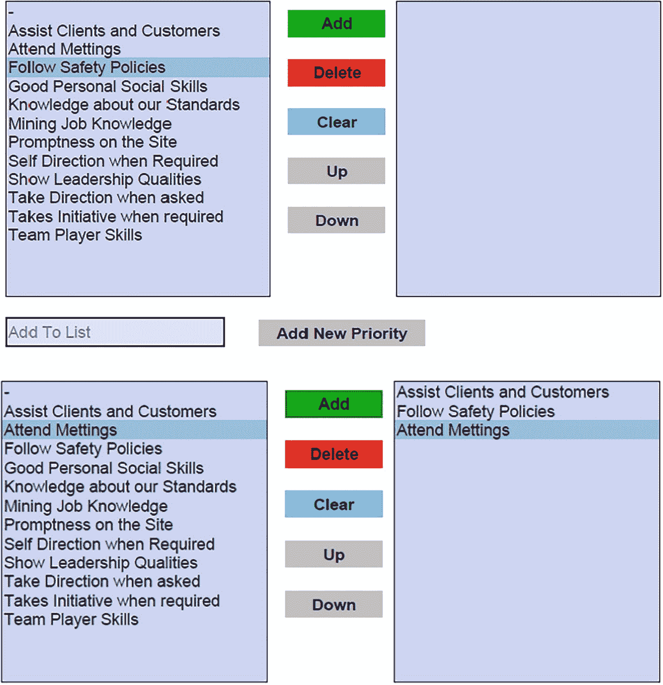

一个包含 12 个短语列表的矩形框，其右侧有一个空白框，两者之间是添加、删除、清除、上移和下移按钮。下方的右侧框已添加了 3 个短语，这些短语在左侧框中高亮显示。“添加到列表”字段和“添加新优先级”按钮位于上下两个框之间。

**图 13-1** — 带按钮的列表框优先级项目，以及一个带按钮的自定义表单字段，用于将自定义优先级添加到最终列表

`Add` 按钮可将所选短语逐个传输到右侧列表框中。`Delete` 按钮可从右侧列表中删除所选短语。`Clear` 按钮可重置整个表单。`Up` 和 `Down` 按钮可向上或向下重新排序所选短语。您可以完全控制您的优先级列表。

其工作原理如下。首先从一些全局文档 JavaScript 开始。请参考图 13-2。

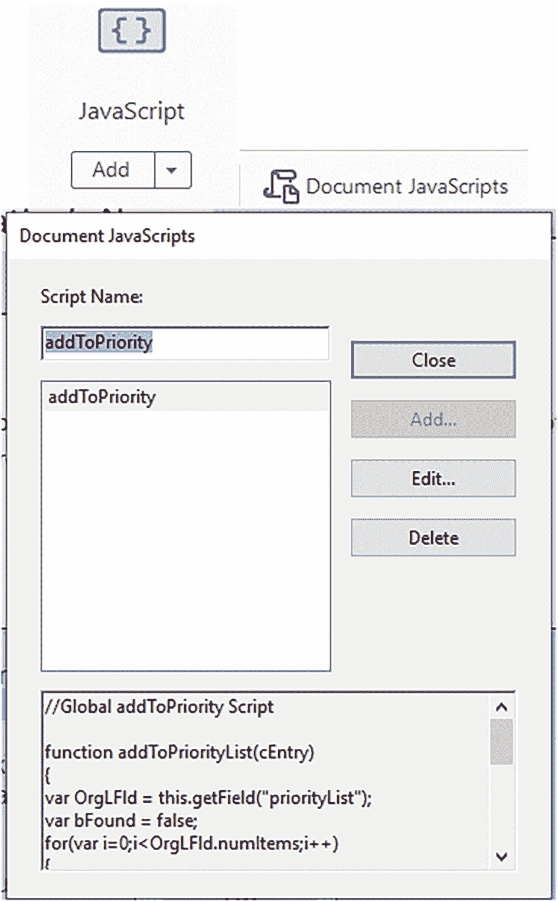

一个 JavaScript 图标和一个添加按钮。下方文档 JavaScript 上的对话框显示脚本名称为“add to priority”，并且相同的名称已输入到下方的文本框中。全局“add to priority”脚本的代码位于脚本名称下方的编辑器窗口中。“关闭”按钮处于高亮状态。

**图 13-2** — 使用 JavaScript 工具和对话框添加到 PDF 项目中的文档 JavaScript

添加到编辑器中的这个 JavaScript 被称为 `addToPriority`：

```javascript
//全局 addToPriority 脚本
function addToPriorityList(cEntry){
var OrgLFld = this.getField("priorityList");
var bFound = false;
for(var i=0;i<OrgLFld.numItems;i++){
if(OrgLFld.getItemAt(i,false) == cEntry){
bFound = true;
break;
}
}
if(!bFound){
OrgLFld.insertItemAt({cName:cEntry, nIdx:-1});}
}
```

在此 `addToPriorityList` 函数中，您通过 `cEntry` 从 `qualityList` 列表框表单字段中选择项目，并使用按钮将这些项目移至 `priorityList` 列表框表单字段。请注意，您使用了一个 `for()` 循环来遍历在 `qualityList` 中找到的所有关联语法（参见第 9 章和第 12 章）的对象字面量。当找到某个项目并通过 `Add` 按钮添加时，它会被跳出循环并插入到 `priorityList` 中，但仅限一次。您可以通过变量 `bFound` 看到这一点：当尝试再次添加同一项目时，它被设置为 `true`，然后设置为 `false`。只有在该项目从 `priorityList` 字段中被清除或删除后，才能再次添加。

`qualityList` 列表框表单字段已在 **选项** 选项卡上按此方式设置，已添加其项目，但未设置导出值，并且已勾选“排序项目”以进行字母排序。没有脚本直接应用于它；它仅在需要时被调用。

`priorityList` 也是如此；但是，在 **选项** 选项卡上，`priorityList` 不包含任何条目，并且“排序”保持未勾选状态，以便您可以按自己想要的顺序继续排列列表中的条目。请参考图 13-3、13-4 和 13-5。

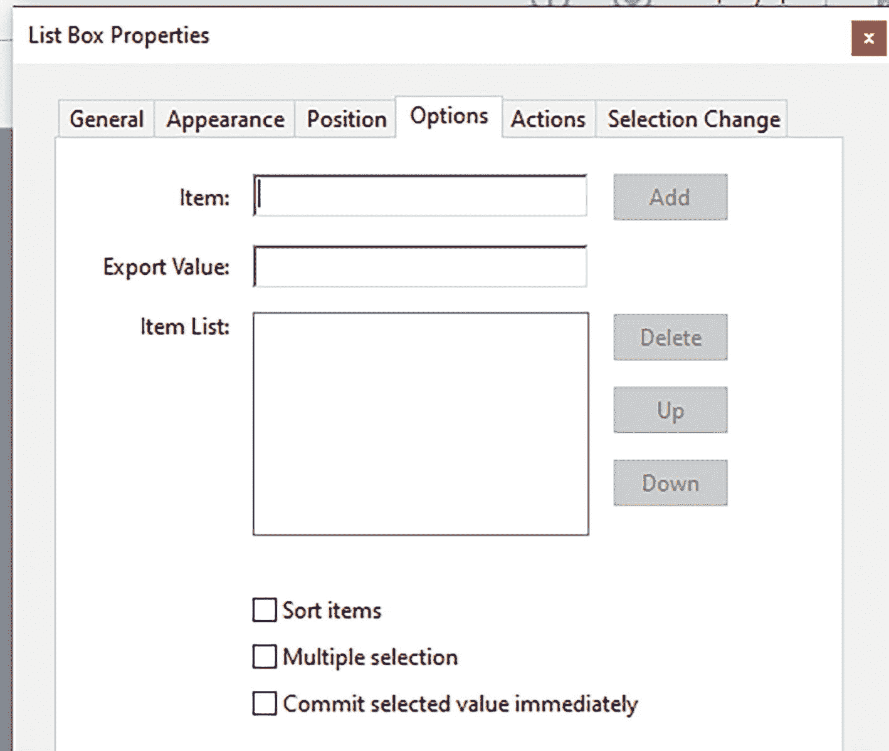

列表框属性对话框。“项目”、“导出值”和“项目列表”为空白。下方有三个复选框：排序项目、多重选择、和立即提交选定的值。四个按钮：添加、删除、上移和下移处于禁用状态。

**图 13-5** — `priorityList` 的 **选项** 选项卡上的“列表框属性”对话框，“排序项目”未勾选

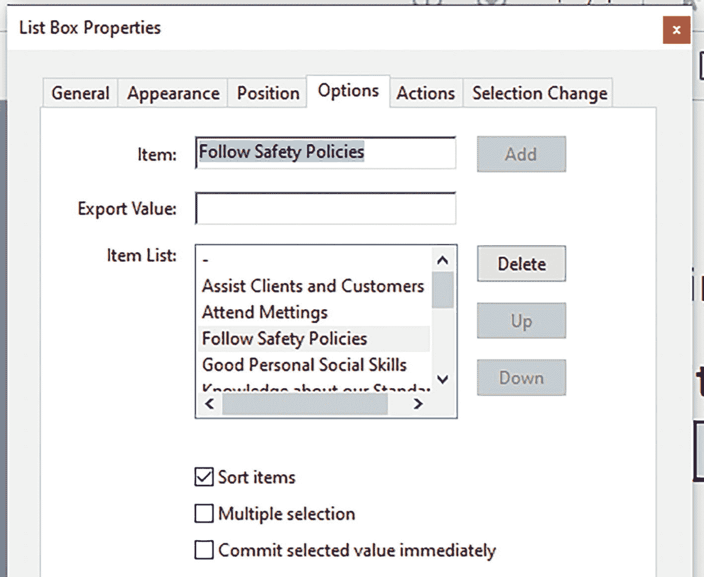

列表框属性对话框，包含选项卡：常规、外观、位置、选项、动作和选项更改，其中“选项”被选中。项目名称已输入为“follow safety policies”。已基于优先级列表创建了一个项目列表。“排序项目”已勾选。

**图 13-4** — `qualityList` 的 **选项** 选项卡上的“列表框属性”对话框，“排序项目”已勾选

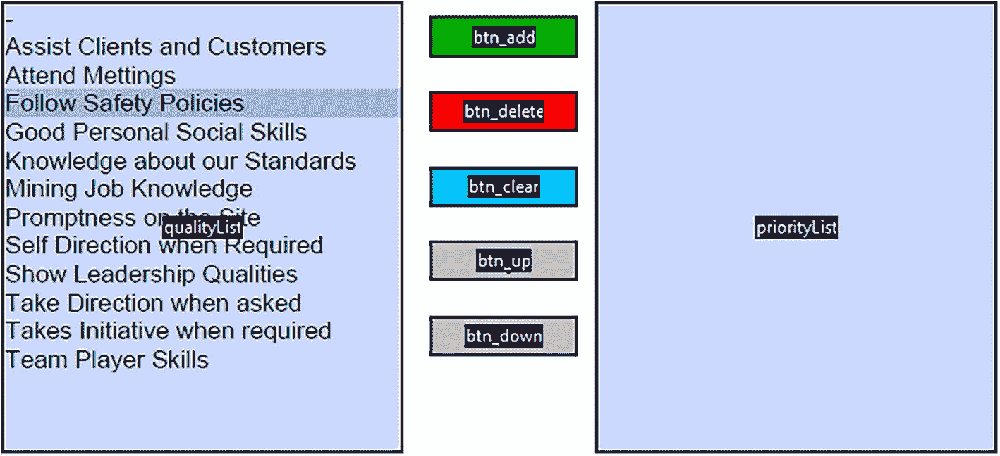

一个包含 12 个优先级任务和文本字段“quality list”的矩形框，其右侧有一个空白框，该空白框的中间有一个文本字段“priority list”。四个按钮：添加、删除、清除、上移和下移位于两个框之间。

**图 13-3** — **准备表单** 编辑工具中的列表框和按钮

在这些字段中，我让 **“多重选择”** 保持未勾选状态，因为我们一次只选择一个项目，并且由于我们不进行实际的值计算，属性 **“立即提交选定的值”** 也保持未勾选状态。

只有按钮在 **动作** 选项卡上的 **鼠标释放** 触发器中包含操作，因为它们控制两个列表框之间的交互。这里我们看到 **运行 JavaScript** 的动作。请参考图 13-6。

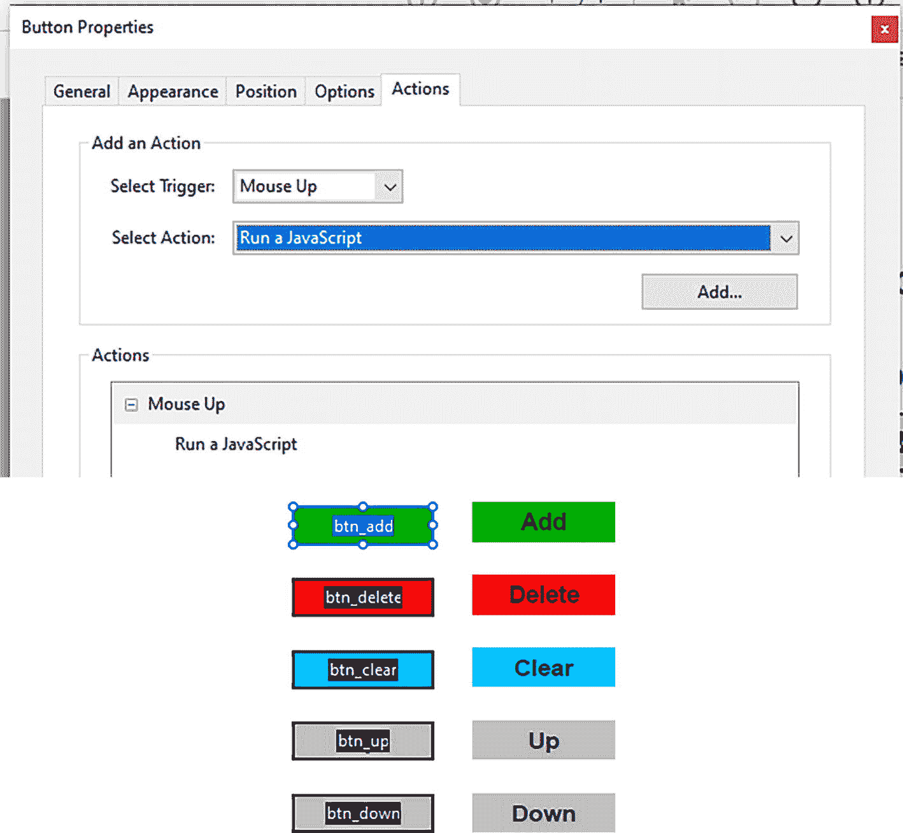

按钮属性对话框，显示“动作”选项卡。“添加动作”部分提供了选项：将触发器选择为“鼠标释放”，并将动作选择为“运行一个 JavaScript”。五个按钮：添加、删除、清除、上移和下移，在动作部分的活动和正常状态下显示在文本字段中。

**图 13-6** — 按钮的 **动作** 选项卡上的“列表框属性”对话框，以及按钮在 **准备表单** 视图和正常状态下的显示方式

### 添加按钮

请参考图 13-7 和 **动作** 选项卡。


一个高亮矩形框图标，上面有文本“add”。

**图 13-7** — 添加按钮可将项目添加到右侧的列表框中

```javascript
// 添加按钮
var OrgLFld = this.getField("qualityList");
if(OrgLFld){
var cEntry = OrgLFld.getItemAt(OrgLFld.currentValueIndices,false);
addToPriorityList(cEntry);
}
```

请注意它如何通过 `cEntry` 调用函数 `addToPriorityList`，从 `qualityList` 获取项目，并将项目添加到 `priorityList` 字段，仅限一次且不能重复。您会发现 `currentValueIndices` 方法经常出现在与列表或下拉/组合框交互以设置值的代码中。

### 删除按钮

请参考图 13-8 和 **动作** 选项卡。


一个高亮矩形框图标，上面有文本“delete”。

**图 13-8** — 删除按钮可从优先级列表中删除列表项

```javascript
// 删除按钮
var OrgLFld = this.getField("priorityList");
var prev = OrgLFld.currentValueIndices;
if(OrgLFld.currentValueIndices > -1){
OrgLFld.deleteItemAt(OrgLFld.currentValueIndices);
if(OrgLFld.numItems > prev){
OrgLFld.currentValueIndices = prev;}
else if(OrgLFld.numItems > 0){
OrgLFld.currentValueIndices = prev-1;}
}
```

删除按钮的脚本会检查之前已添加或刚选中的内容。当点击 `Delete` 按钮时，任何当前选中的项目都会从 `priorityList` 列表框表单字段中移除。


### 清除或重置按钮

请参见图 13-9 和“操作”选项卡。


一个高亮矩形框的图标，上面有文字“清除”。

图 13-9

清除按钮用于重置/清除优先级列表

你可能已经通过操作简单地将表单重置，而无需编写任何 JavaScript 代码。然而，有时你只想清除某个特定列表，仅靠重置是不够的。

```
// 清除按钮
this.getField("priorityList").clearItems();
```

`.clearItems()` 方法充当 `priorityList` 的重置功能，你在第 12 章处理下拉列表时曾见过此代码的示例。

### 上移按钮

上移按钮可将列表中的项目向上移动。请参见图 13-10 和“操作”选项卡。


一个高亮矩形框的图标，上面有文字“上移”。

图 13-10

上移按钮将项目在列表中向上移动

```
//上移按钮
OrgLFld = this.getField("priorityList");
if(OrgLFld){
var prevIdx = OrgLFld.currentValueIndices;
if(prevIdx > 0){
var curValue = OrgLFld.getItemAt(prevIdx);
OrgLFld.deleteItemAt(prevIdx);
OrgLFld.insertItemAt({cName:curValue, nIdx:prevIdx-1});
OrgLFld.currentValueIndices = prevIdx - 1;
}
}
```

它像一个组织器或索引一样工作。例如，在数组或关联语法中，第一个项目或对象字面量是 0，然后是 1，接着是 2，依此类推。对于一个在列表中排名为 2 的项目，要向上移动，它必须变为排名 1 或最高排名（此例中为 0）。如果该项目大于零，就可以向上移动。通过使用 `prevIdx - 1`，你是在告诉按钮将此项目从当前位置向后或向更高位置移动一位。其他方法如 `getItemAt`、`deleteItemAt` 和 `insertItemAt` 也协同工作，帮助项目在列表中向上移动。

### 下移按钮

下移按钮的作用相反，可将列表中的项目向下移动。请参见图 13-11 和“操作”选项卡。


一个高亮矩形框的图标，上面有文字“下移”。

图 13-11

下移按钮将优先级项目在列表中向下移动

```
//下移按钮
OrgLFld = this.getField("priorityList");
if(OrgLFld){
var prevIdx = OrgLFld.currentValueIndices;
if( (prevIdx >= 0) && (prevIdx < (OrgLFld.numItems -1)) ){
var curValue = OrgLFld.getItemAt(prevIdx);
OrgLFld.deleteItemAt(prevIdx);
OrgLFld.insertItemAt({cName:curValue, nIdx:prevIdx+1});
OrgLFld.currentValueIndices = prevIdx + 1;
}
}
```

这一次，如果某个项目排名为 2，在可能的情况下它将变为排名 3。在 `if` 条件语句中，会进行检查：该项目是否大于（`>`）或等于（`=`）零，并且（`&&`）是否小于（`<`）且不是列表中的最后一个项目。通过使用 `prevIdx + 1`，你是在告诉按钮将此项目在 `priorityList` 列表框中向前或向较低位置移动一位，直到它无法再向下移动为止。同样，你会发现类似于上移按钮中使用的方法，如 `get`、`delete`，然后 `insert`，根据当前值将项目插入新位置。

### 添加新优先级按钮

添加新优先级按钮允许用户添加一个可能不在原始列表中的自定义优先级。与允许用户输入自定义文本的下拉列表不同，你无法直接将文本添加到列表框。与任何列表项一样，它可以被删除。请注意，如同在第 9 章等早期课程中一样，你可以向文本字段 `customAdd` 添加一个默认文本的自定义格式脚本，使其始终被填充。相同的词不会输入两次。

```
if(!event.value){
event.value="添加到列表";
event.target.textColor=color.gray;
}
else{
event.target.textColor=color.black;
}
```

该按钮包含以下代码，仅在添加后重置文本字段。请参见图 13-12。

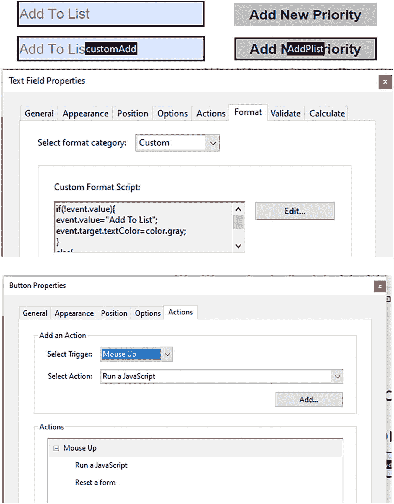

两个文本字段的截图，用于添加到列表。两个按钮用于添加新优先级。文本字段属性对话框，显示“格式”选项卡，在“自定义格式”类别下设有自定义格式脚本。按钮属性对话框，显示“操作”选项卡，包含鼠标松开触发和运行 JavaScript 操作。

图 13-12

此文本字段允许你输入新的优先级，而“添加新优先级”按钮允许你将该优先级添加到列表中。你可以看到文本字段属性对话框的“格式”选项卡设置为“自定义”，以及按钮字段属性对话框的“操作”选项卡

以下是按钮字段 `AddPlist` 的鼠标松开“运行 JavaScript”代码：

```
var textValue = this.getField("customAdd").value;
var listField = this.getField("priorityList");
if (textValue) {
listField.insertItemAt(textValue, textValue, -1);
}
```

使用同一个按钮，表单中的文本字段 `customAdd` 会被重置。请参见图 13-13。

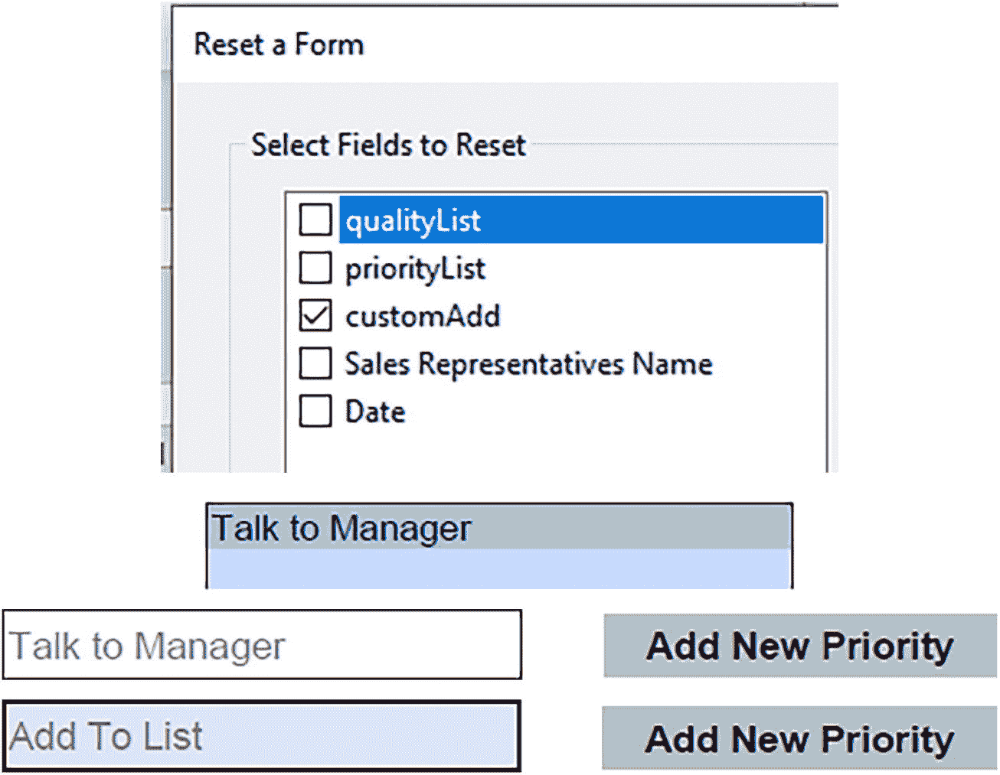

重置表单对话框。要重置的选定字段选项包括质量列表、优先级列表、自定义添加、销售代表姓名和日期，其中自定义添加已被勾选。下方的文本字段包含输入文本“与经理沟通”，用于添加到列表，旁边有“添加新优先级”按钮。

图 13-13

文本字段中的输入文本在添加到列表框后会被重置。使用“重置表单”对话框中的“操作”选项卡

列表框是组织和排序优先级的一种有用且富有创意的方式。你将在本章后续部分进一步完善此列表。


## 复选框、下拉列表和列表框：示例 1

单个列表框可与其他表单字段项结合使用。请参阅文件 `TMC_FreeNewsletterComboEnd_option1.pdf`。参考图 13-14。

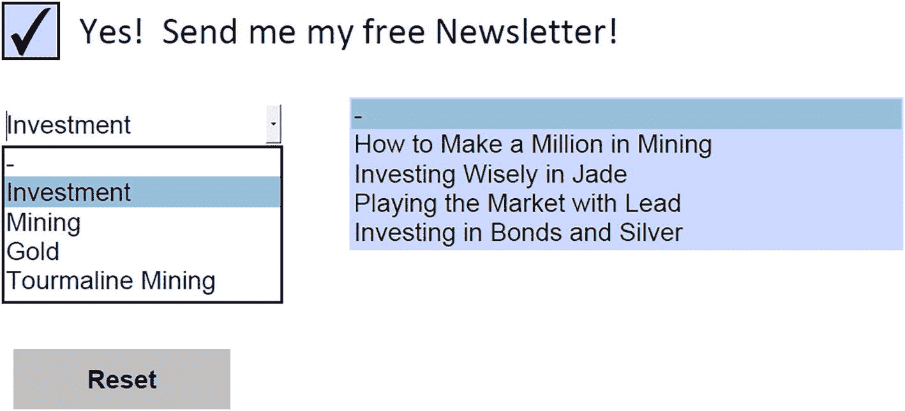

一个带有文本的已勾选选项的截图，文本为“是的，请给我发送免费新闻通讯”。从下拉菜单中选择了“投资”选项，该菜单旁边列出了 4 个相关主题。底部有一个禁用的“重置”按钮。

**图 13-14**

此项目允许您在下拉列表中进行选择后，选择一份免费新闻通讯。下拉列表仅在您勾选复选框后出现，并且您只有在做出选择后才能访问列表中的项目。

此示例使用复选框来显示一个下拉列表。当下拉列表中的某个项目被选中时，它会显示列表框中的二级选择项。请参考图 13-15。

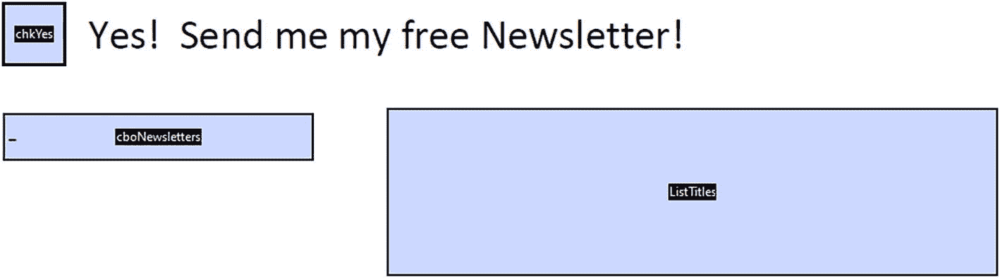

3 个文本字段的截图，分别显示“chk yes”、“cbo newsletters”和列表标题，文本位于框中央。第一个字段旁边有文本“是的，请给我发送我的免费新闻通讯”。

**图 13-15**

“准备表单”编辑视图中的免费新闻通讯字段选项

这里从一个名为 `SetTitleEntries` 的全局文档级 JavaScript 开始。请参考图 13-16。

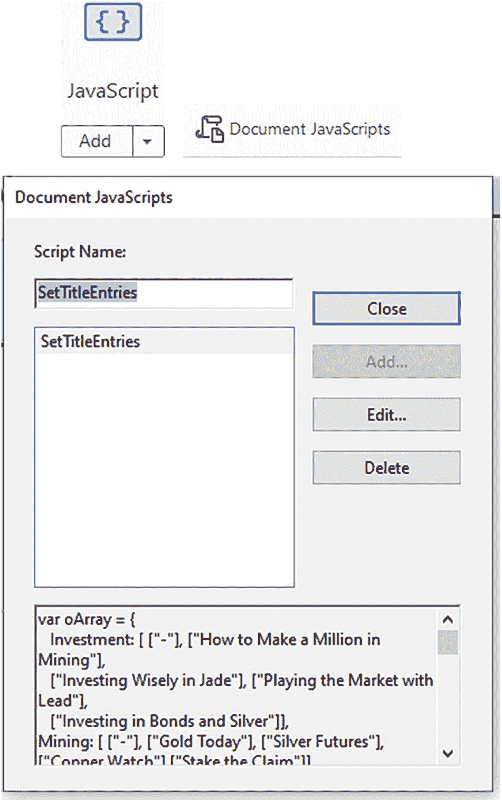

一个带有“添加”选项的 JavaScript 图标。文档级 JavaScript 对话框中的脚本名称为“set title entries”，下方文本框中显示相同内容。编辑器窗口中提到了用于输入与投资相关主题的 JavaScript 代码。“关闭”按钮被高亮显示。

**图 13-16**

对话框中免费新闻通讯 PDF 文件的文档级 JavaScript

我添加了以下代码：

```
//Set Title Enteries
var oArray = {
Investment: [ ["-"], ["How to Make a Million in Mining"],
["Investing Wisely in Jade"], ["Playing the Market with Lead"],
["Investing in Bonds and Silver"]],
Mining: [ ["-"], ["Gold Today"], ["Silver Futures"], ["Copper Watch"],["Stake the Claim"]],
Gold:  [ ["-"], ["Global Annual Gold Festival"],
["Gold Watch"], ["All that Glitters"],
["Fool's Gold"]],
"Tourmaline Mining":  [ ["-"], ["Tourmaline Queen"],
["Waltermelon Gem"], ["Pick and Shovel"],
["Rocks and Gems"]],
};
function SetTitleEntries(){
if(event.willCommit){
var list = oArray[event.value];
if( (list != null) && (list.length > 0) ){
this.getField("ListTitles").setItems(list);
}
else{
this.getField("ListTitles").clearItems();
}
}
}
```

请注意，如同之前的下拉列表示例一样，您使用了一个名为 `oArray` 的关联语法/对象，来包含 `cboNewsletters` 下拉字段中的所有下拉项，以及将放入名为 `ListTitles` 的列表框字段中的子项。根据下拉列表中的选择，不同的子选择项会出现在列表框中。关联语法中的名称必须与“选项”标签中输入的下拉列表名称相匹配，这一点非常重要。这些名称是 `Investment`、`Mining`、`Gold` 和 `Tourmaline Mining`。否则，可能会产生错误，并且这些字段将无法正常工作。务必仔细检查您的工作，以避免错误。

与第 12 章一样，当关联语法中的名称由两个单词组成时，请务必为其加上引号，例如 `Tourmaline Mining`；如果是一个单词，则无需引号，例如 `Mining`。但是，将出现在方括号 `[]` 中以及随后出现在列表框中的标题，无论何种情况都应用引号括起来。如果下拉列表中没有选中任何项目（或者在此情况下选择的是 `0`，在“选项”标签中由上横线 `-` 表示），则列表框将被清空。

复选框 `chkYes` 应用了一个脚本来显示和隐藏字段。您也可以使用无脚本操作来进行显示和隐藏。然而，在某些情况下，您需要编写 JavaScript 来确认在执行开启和关闭操作时，是否获得了期望的结果——在本例中，即当“选项”标签中的 `event.target.value` 设置为 `Yes` 时。请参考图 13-17。

以下代码添加在“操作”标签的“鼠标释放”事件上：

```
//Check Box JavaScript
var topicFld = this.getField("cboNewsletters");
var clistT = this.getField("ListTitles");
if (event.target.value == "Yes"){
topicFld.display = display.visible;
clistT.display = display.visible;
}
else {
topicFld.display = display.hidden;
clistT.display = display.hidden;
}
```

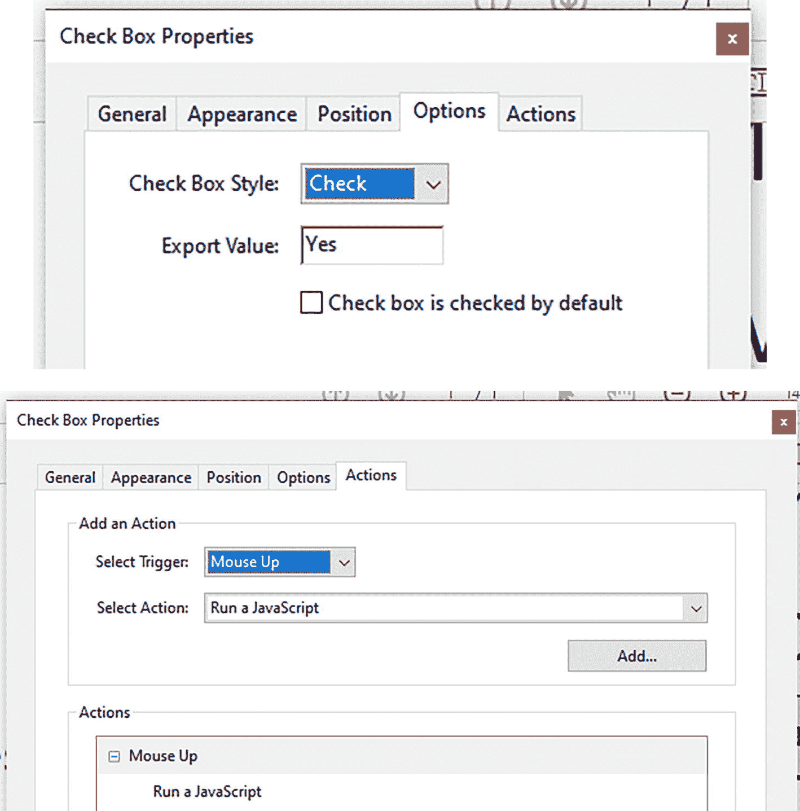

两个复选框属性对话框，分别选中了“选项”和“操作”标签。复选框样式选择了“勾选”，导出值设置为“yes”。在“操作”标签的视图中，选择了“鼠标释放”触发器和“运行 JavaScript”动作。

**图 13-17**

“复选框属性”对话框，显示了“选项”标签的“导出值”设置和“操作”标签的“运行 JavaScript”设置

对于下拉列表 `cboNewletters`，请确保在“选项”标签上勾选“提交选中的值立即生效”，这样一旦做出选择，列表框中的项目就会立即出现。如前所述，这些项目名称（包括横线 `-`）是在首次创建下拉列表时输入并添加的，并且已检查确保其名称与 JavaScript 中的相匹配。这些项目没有“导出值”设置。

脚本的最后一部分是下拉列表中“格式”标签上的自定义按键脚本。请参考图 13-18。

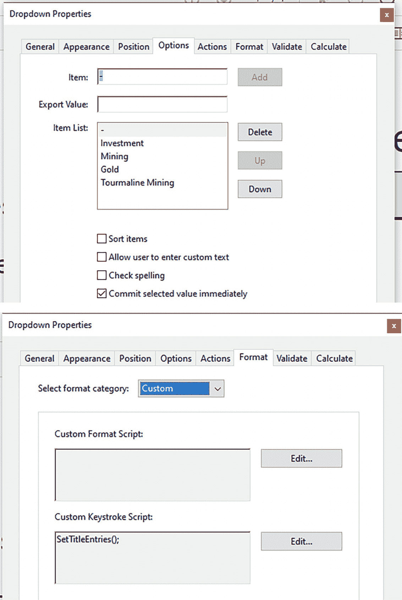

两个下拉列表属性对话框，分别选中了“选项”和“格式”标签。已勾选“提交选中的值立即生效”。项目列表包含选项：投资、采矿、黄金和电气石开采。在“格式类别”中选择了“自定义”，“自定义按键脚本”设置为“set title entries”。

**图 13-18**

“下拉列表属性”对话框的“选项”和“格式”标签

```
//dropdown script custom format script
SetTitleEntries();
```

这里它调用了文档级 JavaScript，以帮助在做出选择时正确地填充列表框。

在被调用之前，列表框 `ListTitles` 将保持空白，因为下拉列表中的默认选择是横线（`-`）。此外，没有向列表框应用任何脚本；它仅在需要时才被调用。请参考图 13-19。

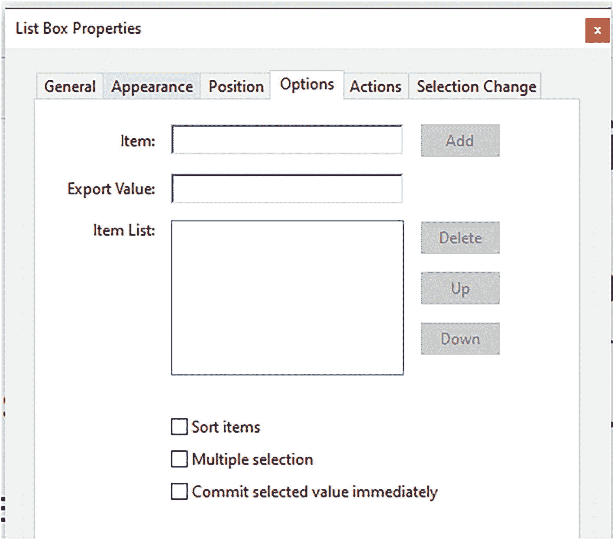

一个显示列表框属性“选项”标签的对话框。项目、导出值和项目列表字段均为空白。“排序项目”、“多选”和“提交选中值立即生效”未勾选。“添加”、“删除”、“上移”和“下移”按钮被禁用。

**图 13-19**

“列表框属性”对话框的“选项”标签被留空处理

### 重要说明

在 2006 年之前，如果您想显示或隐藏一个字段，您会这样写：

`genreFld.hidden = false;`

`genreFld.hidden = true;`

此方法已被弃用，应按照以下示例所示的方式编写。

`genreFld.display = display.visible;`

`genreFld.display = display.hidden;`

`a.display = display.noPrint // 字段文本在屏幕上可见，但不打印`

`a.display = display.noView // 字段文本在屏幕上隐藏，但会打印`

在此示例中，如果您取消勾选复选框并重新勾选，之前的选择将保持不变。对于您自己的项目，您可能希望在取消勾选时重置这些字段，如其他章节所示。您可以使用“操作”标签并添加“重置表单”的操作。然后在对话框中选择复选框、下拉列表、列表和列表框字段进行重置。最后，单击“确定”确认。您还可以为此按钮添加选定字段的显示和隐藏功能。


## 复选框、列表框和多下拉菜单：示例 2

作为这种主题的变体，您可以尝试以相反的顺序进行操作。之前，您是从下拉列表开始的，那么现在就从列表框开始。根据所选内容的不同，列表框会显示包含各种选项的下拉列表。您可能更喜欢其中一种方式，所以我将两种都展示给您。请参阅 `TMC_FreeNewsletterComboEnd_option2.pdf` 文件。参考图 13-20。

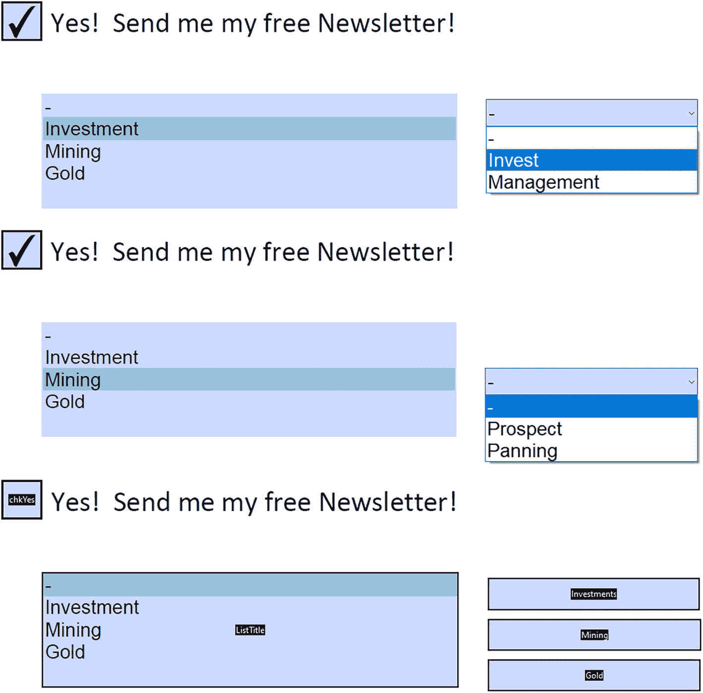

三个列表框截图，其中包含一段已勾选的文本，“是的，请将我的免费简报发送到顶部”，以及一个相邻的下拉列表。在两个列表中分别选中了“投资”和“采矿”，并对应显示了“投资与管理”以及“前景与挖掘”的下拉选项。第三个截图显示了相同的文本字段。

**图 13-20** 第二个免费简报项目的列表框和下拉列表选项

这次，根据我设置文件的方式，并没有文档级别的 JavaScript。参考图 13-21。

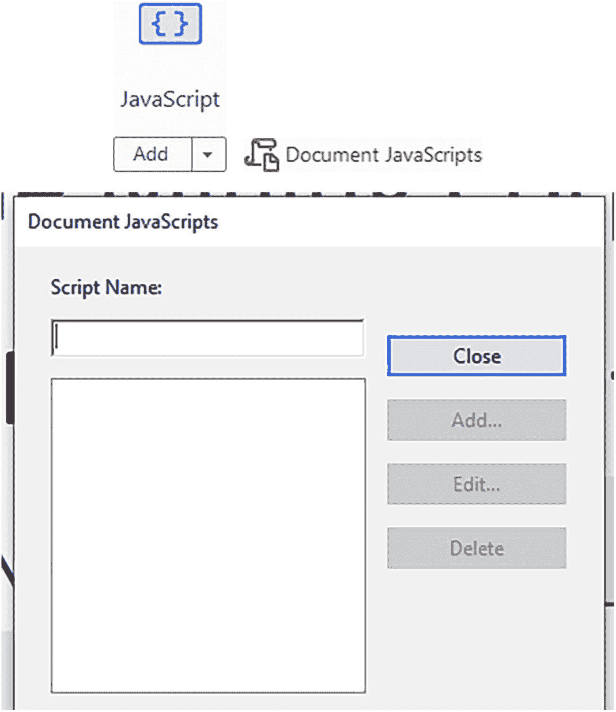

一个带有“添加”选项的 JavaScript 图标和一个“文档 JavaScript”图标。一个“文档 JavaScript”对话框，其中有脚本名称的空白区域，并且“关闭”按钮的边框被高亮显示。

**图 13-21** 如对话框中所示，此项目不包含文档级别的 JavaScript

复选框 `chkYes` 的设置方式与前一个示例中的“选项”面板相同，但它在“动作”选项卡上包含此修改后的脚本来显示和隐藏项目。参考图 13-22。

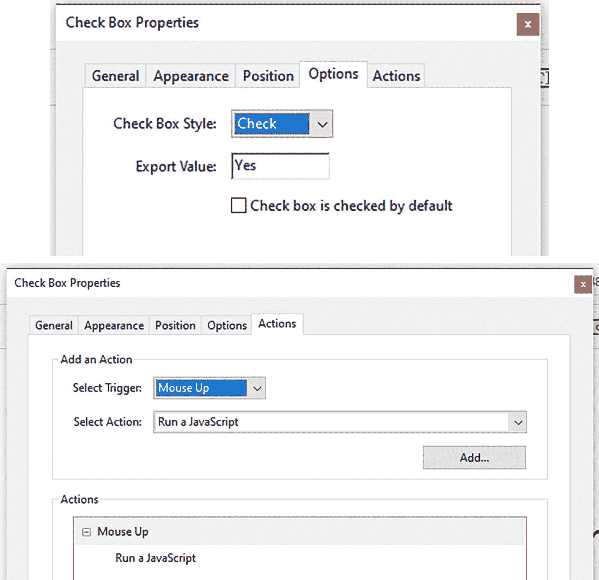

两个复选框属性对话框，分别展开了“选项”和“动作”选项卡。复选框样式选择为“勾选”，导出值为“是”。选择触发器为“鼠标松开”，动作为“运行一个 JavaScript 脚本”。

**图 13-22** “选项”和“动作”选项卡上的复选框属性

```
//复选框 JavaScript
var listT = this.getField("ListTitle");
var investments = this.getField("Investments");
var mining = this.getField("Mining");
var gold = this.getField("Gold");
if (event.target.value == "Yes"){
listT.display = display.visible;
}
else {
listT.display = display.hidden;
investments.display = display.hidden;
mining.display = display.hidden;
gold.display = display.hidden;
}
```

请注意，根据具体情况，会有更多项目需要显示或隐藏。您可以使用 `if/else` 条件语句选择要显示或隐藏的内容。如果您需要复习 `if/else` 语句，请参阅本书的第二部分。但是，请注意这段代码并未使用 `display.visible` 来显示下拉列表；它只会隐藏列表。我们接下来将在另一个字段和选项卡中讨论这一点。

现在，让我们进入名为 `ListTitle` 的列表框字段。

与早期的下拉列表不同，名为 `ListTitle` 的列表框中的项目确实具有导出值，您稍后将看到这一点。参考图 13-23 和图 13-24。

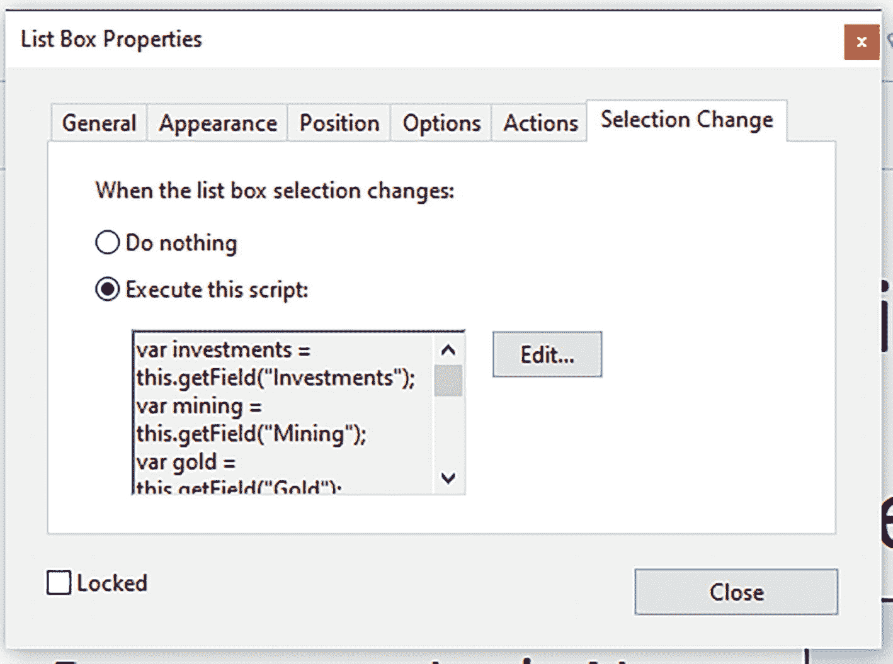

一个“列表框属性”对话框，其中展开了“选择更改”选项卡。在选中的“执行此脚本”选项下方的编辑器窗口中包含一段 Java 代码。

**图 13-24** “列表框属性”对话框中的“选择更改”选项卡

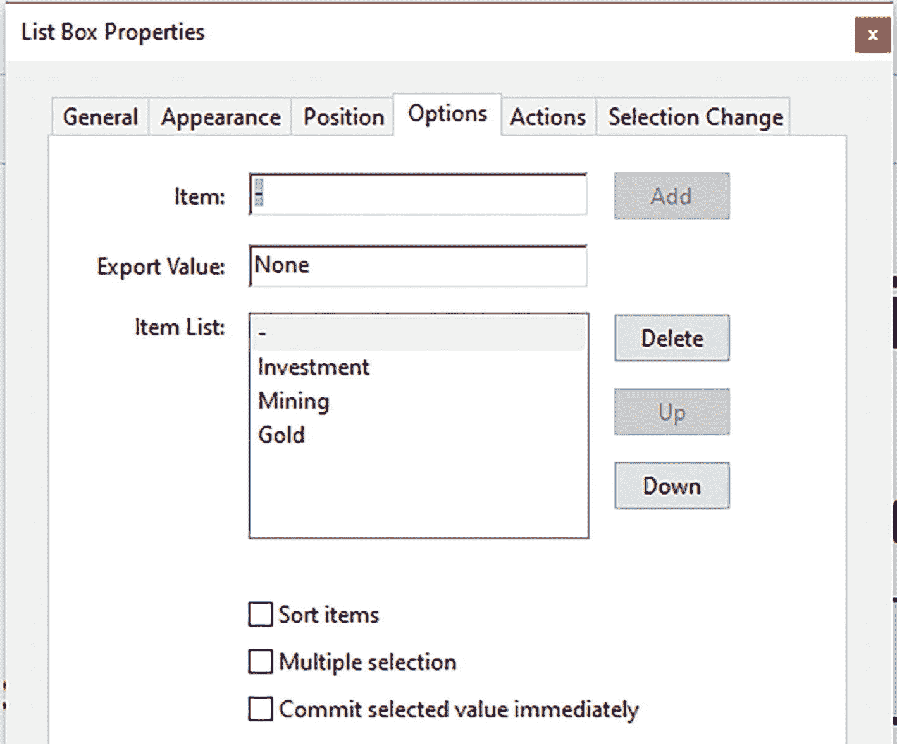

一个“列表框属性”对话框，其中显示了“选项”选项卡。项目为一个点，导出值为“无”，项目列表包括“投资”、“采矿”和“黄金”。“排序项目”、“多项选择”和“立即提交所选值”均未勾选。“删除”和“下移”按钮已启用。

**图 13-23** “列表框属性”对话框中的“选项”选项卡

这一次，脚本被添加到了一个不同的选项卡中。当您将“选择更改”选项卡中的操作从“不执行任何操作”更改为“执行此脚本”，并单击“编辑”添加脚本，然后在“JavaScript 编辑器”中单击“确定”确认时，脚本便在此处受到控制。

列表框没有“验证”、“计算”或“格式”选项卡，因此“自定义格式”设置不是一个选项；脚本必须在“选择更改”选项卡上进行控制。这类似于自定义按键。

执行此脚本：

```
// 组合框选择更改文本示例
var investments = this.getField("Investments");
var mining = this.getField("Mining");
var gold = this.getField("Gold");
if (event.changeEx == "IV"){
investments.display = display.visible;
mining.display = display.hidden;
gold.display = display.hidden;
this.resetForm(["Mining", "Gold"]);
this.getField("chkYes").checkThisBox(0,true);
}
else if (event.changeEx == "MN"){
investments.display = display.hidden;
mining.display = display.visible;
gold.display = display.hidden;
this.resetForm(["Investments", "Gold"]);
this.getField("chkYes").checkThisBox(0,true);
}
else if (event.changeEx == "GD"){
investments.display = display.hidden;
mining.display = display.hidden;
gold.display = display.visible;
this.resetForm(["Investments", "Mining"]);
this.getField("chkYes").checkThisBox(0,true);
}
else if (event.changeEx == "None"){
investments.display = display.hidden;
mining.display = display.hidden;
gold.display = display.hidden;
this.resetForm(["Investments", "Mining", "Gold"]);
this.getField("chkYes").checkThisBox(0,true);
}
```

再次，您添加了更多的 `if/else` 条件语句。请注意这段代码完全围绕如何根据列表框中的导出值和下拉列表的名称来隐藏或显示下拉列表。我还添加了 `this.resetForm()` 来重置方括号内的选定字段，而不是像之前示例和第 9 章中对复选框那样使用默认的“重置表单”动作。如果在列表框中进行了新选择，其他下拉列表会自行重置，不会保留最近的选择。如果需要，您也可以使用条件语句将此重置方法应用于复选框。

为了防止在更改选择时复选框变为未选中状态，我特意添加了一些代码以确保其保持选中或为“真”状态。在您自己的项目中，您可能会遇到这样的情况：当更改选择时，复选框在重置过程中将自己设置为 `false` 或未选中状态。这对于单个复选框来说效果很好。

请参考图 13-25 和图 13-26 查看列表框项目及其相关导出值的示例，这些值会影响下拉列表。

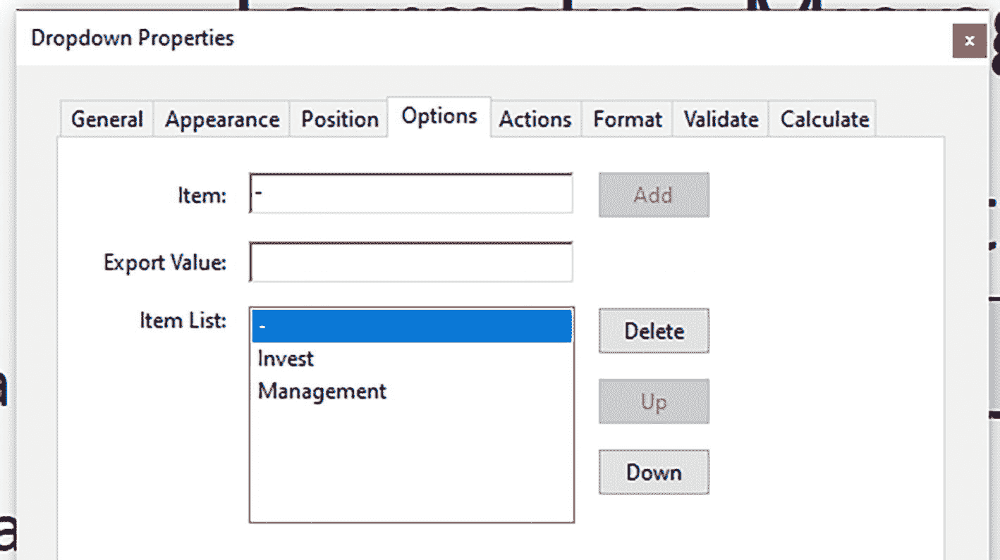

一个“下拉列表属性”对话框。项目为一个点，导出值为空白，项目列表有一个高亮显示的点、“投资”和“管理”。“添加”和“上移”按钮已禁用，而“删除”和“下移”选项处于活动状态。

**图 13-26** “选项”选项卡上的“下拉列表属性”对话框

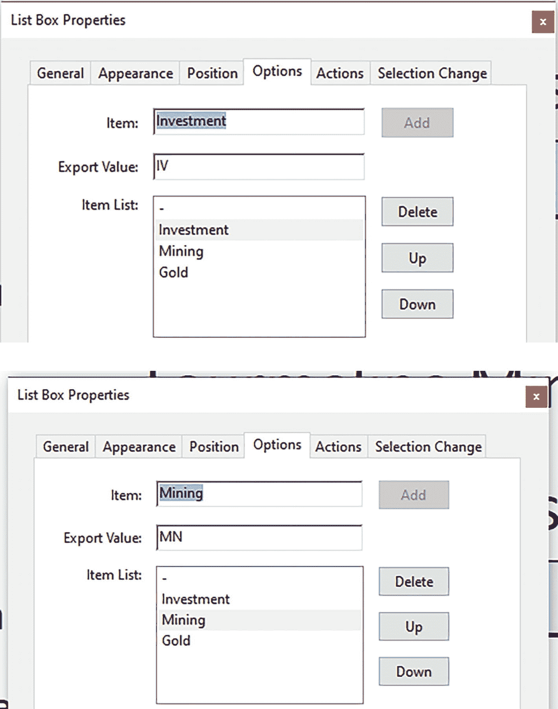

两个“列表框属性”对话框，显示“选项”选项卡。项目名称分别为“投资”和“采矿”。项目列表包括“投资”、“采矿”和“黄金”，对应的项目被高亮显示。导出值分别为 `I V` 和 `M N`。“删除”、“上移”和“下移”按钮已启用。

**图 13-25** “列表框属性”对话框的“选项”选项卡，显示项目及其值

这次，下拉列表没有应用任何格式；它们只是被调用而已。但是，它们并非使用文档级别的 JavaScript 来创建关联语法，而是包含其项目，我是通过“选项”选项卡输入的，并且没有预设值。这些下拉列表仅通过列表框的选择更改来引用。

> **注意**


虽然选项 1 和 2 的“结束”示例并非必需，但我还是添加了一个重置按钮，这样即使复选框未被关闭，您仍然可以重置所有表单字段，包括隐藏可能仍处于选中状态的列表框和下拉列表。如果需要查看相关内容，请参阅“操作”选项卡上的`ResetBtn`字段。

### 按钮幻灯片展示变体

最后一个关于列表框的示例也可用于包含图像的只读按钮，如果您希望为客户创建一种幻灯片展示，其中图形根据选择显示和隐藏。您可以在额外的幻灯片展示项目文件夹中的`TMC_MineralIdentifier_End.pdf`文件中找到此示例。请参考图 13-27。

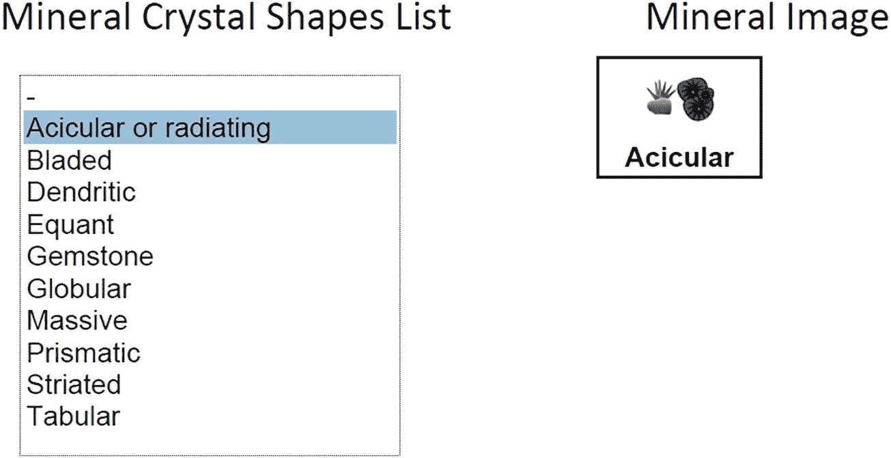

一个包含 10 种矿物晶体形状的列表框，其中“针状/放射状”被高亮显示。其旁边的针状矿物图像也一并显示。列出的各种形状包括：针状、叶片状、树枝状、等轴状、宝石状、球状、块状、柱状、条纹状和板状。

图 13-27

使用列表框和按钮创建可变化的参考图像列表

请自行进一步探索此文件，并根据您的需要设置其格式。对于长列表，“选择更改”选项卡上 JavaScript 变量的顺序必须始终与“选项”选项卡中从上到下的选项顺序完全一致；否则很可能出现错误。如果您希望项目按字母顺序排列，请确保勾选“选项”选项卡上的“排序”选项。在此示例中，按钮的“布局”设置为“图标在顶部，标签在底部”，“行为”设置为“反转”，“状态”设置为“向上”。但是，在“常规”选项卡上，我将它们都设置为只读，这样它们的状态就不会受到影响。关于“选项”选项卡的设置，请参考图 13-28。

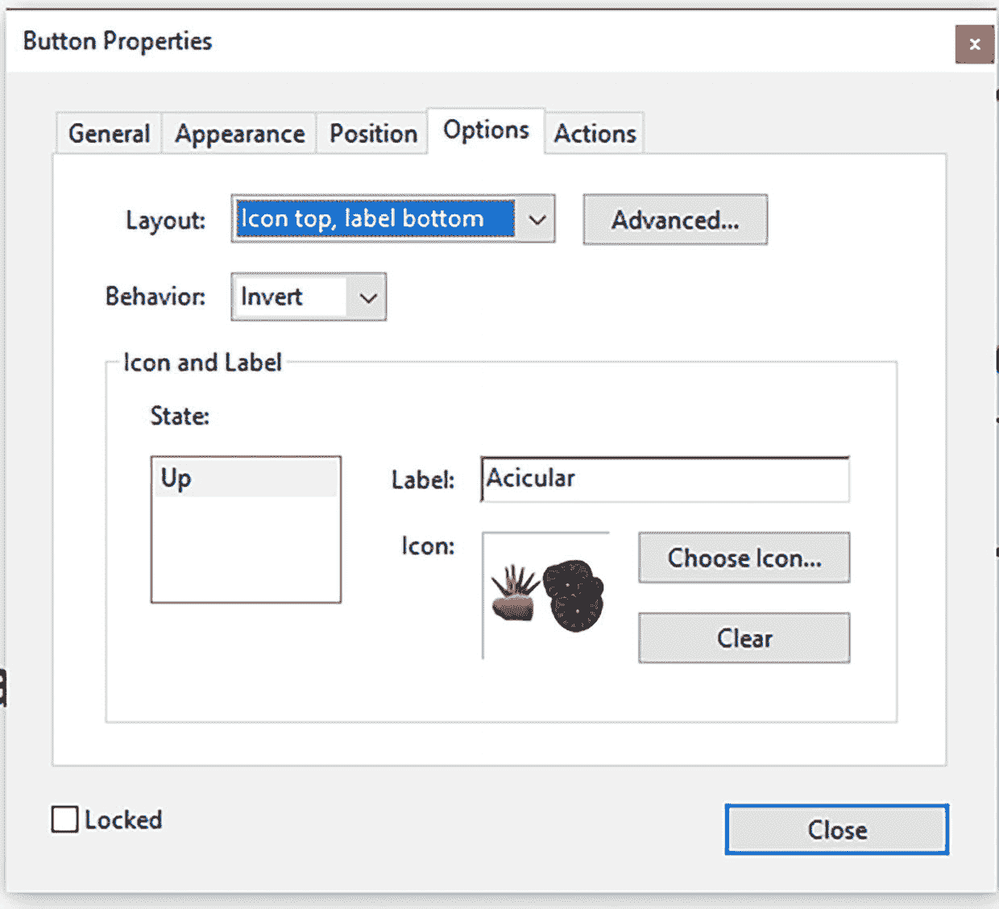

一个显示按钮属性对话框的界面，其中“选项”选项卡已展开。在“布局”下拉菜单中选择了“图标在顶部，标签在底部”。“反转”行为已被选中。标签为“针状”，其图标显示在“图标和标签”区域中“向上”状态旁边的框中。“关闭”按钮被高亮显示。

图 13-28

“按钮属性”对话框的“选项”选项卡

#### 额外的示例：改进的优先级列表

现在您已经了解了关于列表框的一些知识，让我们看看如何改进本项目前面讨论过的优先级列表。您可以在图 13-29 中看到此交互可能的工作方式，并且您可以添加一个文本框来描述演讲者的主题，以便帮助您的组织。要查看完整的代码，请转到`TMC_PriorityList_End_GuestSpeakers.pdf`文件。

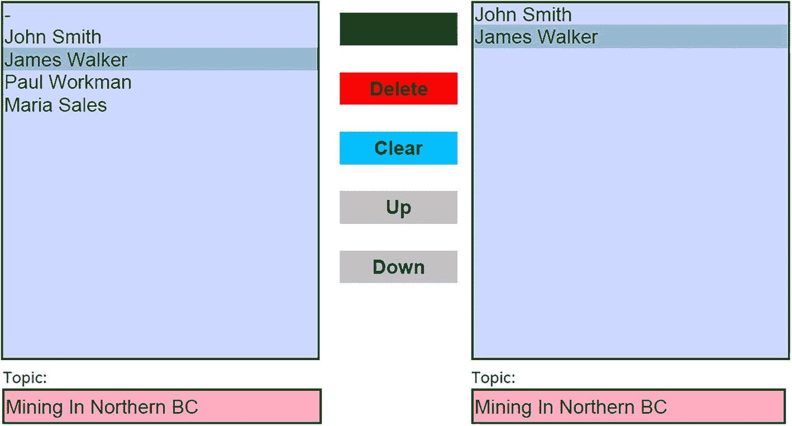

两个包含姓名列表的矩形框。左侧：John Smith、James Walker、Paul Workman、Maria Sales。右侧：John Smith、James Walker。在两个框的下方，一个文本字段中显示主题“在卑诗省北部采矿”。添加、删除、清除、上移和下移按钮位于两个列表的中间。

图 13-29

一个包含演讲者及其主题文本字段的列表框项目示例

按钮的代码将保持不变，除了列表框的名称：`speakerList`替换了`qualityList`，`orderTalkList`替换了`priorityList`。但是，文档级 JavaScript 将被更改，现在它被命名为`talkExport`。请参考图 13-30。

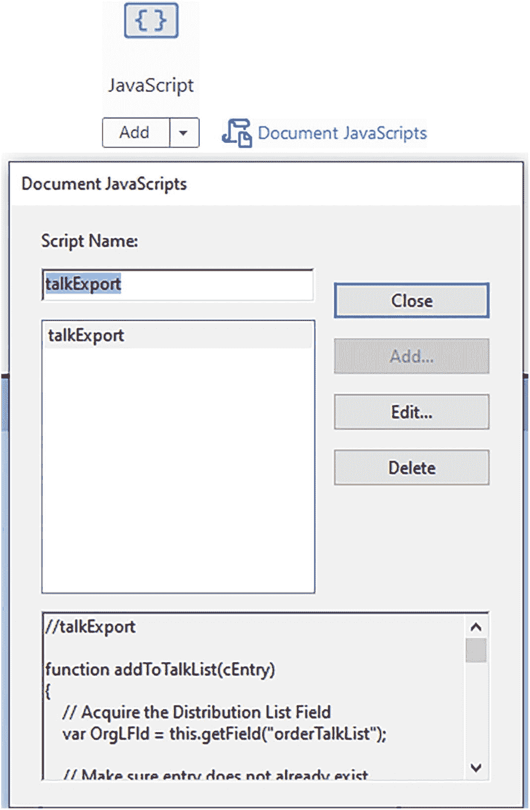

一个带有“添加”按钮的 JavaScript 图标和一个文档 JavaScript 图标。一个文档 JavaScript 对话框显示脚本名称为“talk export”，下面的框中内容相同。“关闭”选项被高亮显示。下方的编辑器窗口包含用于“talk export”的 JavaScript 代码，其中包括`addToTalkList`函数。

图 13-30

在对话框中看到的添加到 PDF 文件中的文档级 JavaScript

```
function addToTalkList(cEntry){
// 获取分发列表字段
var OrgLFld = this.getField("orderTalkList");
// 通过比较确保条目不存在于现有条目中
var bFound = false;
for(var i=0;i<OrgLFld.numItems;i++){
if(OrgLFld.getItemAt(i,false) == cEntry){
bFound = true;
break;
}
}
if(!bFound){
// 在列表末尾插入条目
OrgLFld.insertItemAt({cName:cEntry, nIdx:-1});
}
}
function GetMasterExport(cEntry){
// 获取主列表字段
var OrgLFld = this.getField("speakerList");
for(var i=0;i<OrgLFld.numItems;i++){
// 如果项目匹配，则返回导出值
if(OrgLFld.getItemAt(i,false) == cEntry){
return OrgLFld.getItemAt(i,true);
}
}
return null;
}
```

您添加了一个额外的函数脚本`GetMasterExport`来处理将用作演讲者主题的值。您希望将此信息也传递到右侧，因此添加了此函数。如果一切正确或为真，它将帮助显示该值或演讲者主题；否则，将不显示任何内容。

图 13-31 展示了左列表框中（称为`speakerList`）的情况。请注意，这次每个项目都有一个导出值。

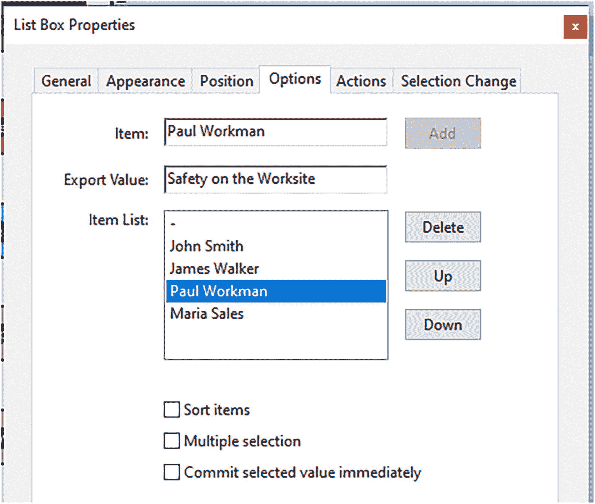

一个显示列表框属性对话框的界面，其中“选项”选项卡可见。项目为“Paul Workman”，导出值为“worksite safety on the”。项目列表包含姓名：John Smith、James Walker、Paul Workman、Maria Sales，其中“Paul Workman”被高亮显示。“删除”、“上移”和“下移”按钮已启用。

图 13-31

左侧列表框`speakerList`的“选项”选项卡属性

右侧名为`orderTalkList`的列表框应保持空白。但是，请确保在“选项”选项卡上勾选了“提交后立即记录所选值”选项，否则这些值将无法在文本框中正确提交。请参考图 13-32。

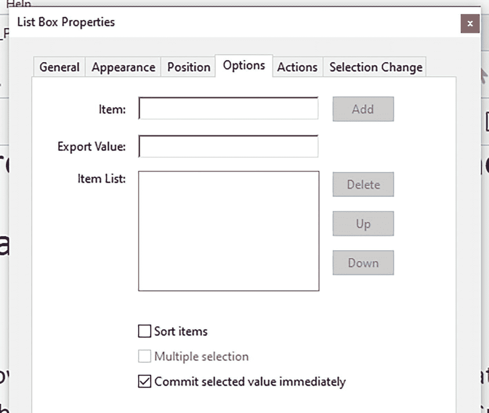

一个显示列表框属性对话框的界面，其中“选项”选项卡可见。“项目”、“导出值”和“项目列表”区域均为空白。“排序项目”未勾选。“多项选择”已禁用。“提交后立即记录所选值”选项已勾选。“添加”、“删除”、“上移”和“下移”按钮已禁用。

图 13-32

右侧列表框`orderTalkList`的“选项”选项卡属性


## 最终脚本位于此次“选择更改”选项卡的列表框中。请参考图 13-33。

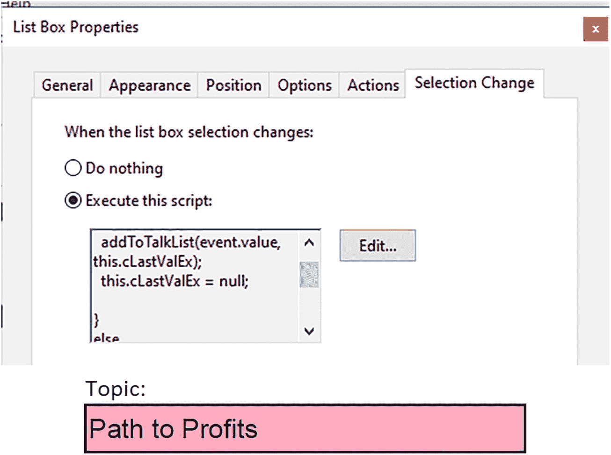

一个显示列表框属性对话框的视图，其中“选择更改”选项卡可见。当列表框选择发生更改时，会执行此脚本的选项已被选中，选项下方写有 JavaScript 代码。其下方的文本字段中，主题为“通往盈利之路”。

**图 13-33** – 列表框属性对话框，JavaScript 已添加到“选择更改”选项卡，且值显示在文本字段中

对于左侧的列表框 `speakerList`，其代码如下：

```javascript
//Selection Change for First List box
if(event.willCommit){
addToTalkList(event.value, this.cLastValEx);
this.cLastValEx = null;
}
else{
this.getField("Topic1").value = event.changeEx;
}
```

这将把值作为文本添加到文本字段 `Topic1` 中，同时也控制了无需使用“添加”按钮，仅通过选中最后一个选项并按 Tab 键移出即可移动该选项及其值的能力。对于您的项目而言，这可能是优点也可能不是。如果您不喜欢这个选项，只需注释掉这一行即可。现在，只有“添加”按钮才能添加或移动演讲者，按 Tab 键移出列表框将不再生效。

```javascript
// addToTalkList(event.value, this.cLastValEx);
```

对于右侧的列表框 `orderTalkList`，“选择更改”选项卡上的代码如下：

```javascript
//Selection Change for Second List Box
if(event.willCommit){
if(event.value){
this.getField("Topic2").value = GetMasterExport(event.value);}
else{
this.getField("Topic2").value = "";}
}
```

这将在值被导出到右侧后，将其作为文本添加到文本字段 `Topic2` 中。

如果您希望实现更多交互，在我创建的额外示例中，您还可以向此文件添加一个文本字段和按钮，以便用户添加临时的嘉宾演讲者及其主题。请参阅文件 `TMC_PriorityList_End_GuestSpeakers_extra_3.pdf`。参考图 13-34。

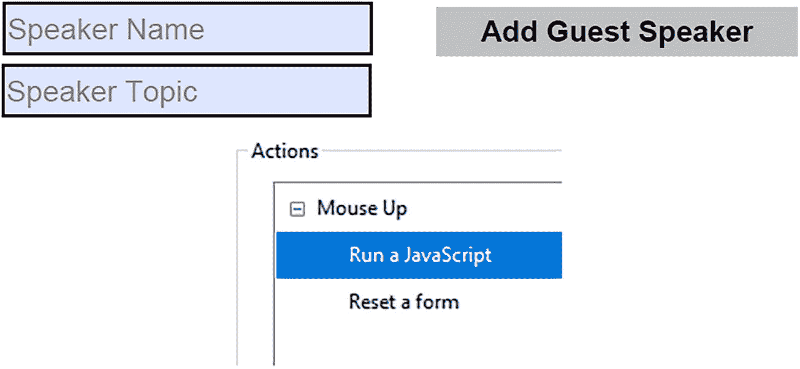

一个包含两个文本字段的截图，用于填写演讲者姓名和演讲主题。“添加嘉宾演讲者”按钮位于其旁边。“操作”对话框指示“鼠标松开”时运行一个 JavaScript，该脚本已被高亮显示。

**图 13-34** – 将嘉宾演讲者及其主题添加到左侧列表框和文本字段，随后也可以自动添加到右侧列表框和文本字段，并进行重新排序。该操作已添加到按钮的“操作”选项卡中

在此示例中，按钮 `AddSpeaker` 允许您将嘉宾演讲者添加到两个列表框中。此外，您可以使用“重置表单”操作，并从相关对话框中选择这些字段，来重置输入后的文本字段 `SpeakerName` 和 `SpeakerTopic`。对于输入，您必须在点击按钮前同时填写演讲者姓名（项目）和演讲主题（导出值）；否则，左侧的任意一个列表框中都不会添加任何内容。一旦被选中，新的演讲者和主题就会被添加到左侧和右侧的列表框及文本字段中。以下是用于按钮“操作”选项卡的代码：

```javascript
//Add Custom Item
var textValue = this.getField("SpeakerName").value;
var textValue2 = this.getField("SpeakerTopic").value;
var listField = this.getField("speakerList");
if (textValue,textValue2) {
listField.insertItemAt(textValue, textValue2, -1);
}
```

**注意**

在前一个示例中，如果您保存了文件，您需要手动清除左侧列表框“选项”选项卡中的任何新条目，因为它们会被永久添加到列表中。您可以自行创建另一个隐藏的删除按钮，以帮助您从“演讲者”列表框中选中并删除不再需要的条目。

## 最后思考

如您所见，组织列表框没有绝对的正确或错误方法。您还可以使用它们与文本框交互，甚至与复选框、按钮或单选按钮结合使用。根据表单的不同，列表框总会有某种方式帮助您达成目标。

### 隐藏字段

**注意**

对于更熟悉 JavaScript 的人来说，如果表单中的额外计算需要隐藏功能，按钮和文本字段也可以用作隐藏的对象字段。虽然本章中没有示例，但像双击列表项以将其转移，或者您不想让客户看到的复杂计算（请参阅之前的发票表单示例），这些字段可以在“常规”选项卡中设置为隐藏，或者在“外观”选项卡中设置为无颜色（透明），以避免表单界面杂乱。请参考图 13-35。

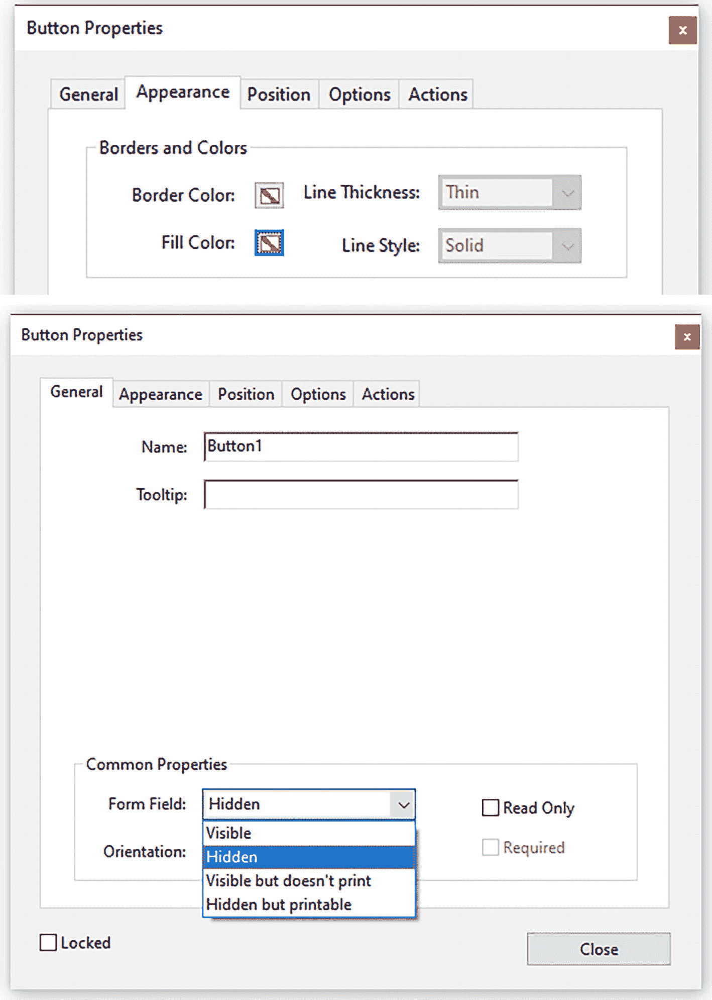

两个关于按钮属性的对话框，分别显示“外观”和“常规”选项卡。“边框和填充颜色”选项已被选中。线条粗细预设为“细”，线条样式预设为“实线”。在表单字段中选中了“隐藏”选项，名称被插入为“Button 1”。

**图 13-35** – 隐藏按钮可以在“外观”选项卡中将填充和边框颜色设置为“无”，或者在“常规”选项卡中设置为“隐藏”

### 使用列表框进行数字评分

可以使用两个或多个列表框将值相加到最终的文本字段中。但是，我发现此方法存在缺陷，并且它不允许将多个选择值相加。如前所述，列表框不包含“格式”选项卡，因此最终的文本字段只能控制该值作为真实数字的计算输出。当处理特定的多项数字选择时，应使用下拉列表或文本框来代替列表框。

### 关于更改列表框自定义格式的说明

正如我们所看到的，列表框与下拉列表或组合框类似，但没有那么多选项。不过，您可以使用“外观”选项卡进行类似的属性更改。列表框可以添加格式的位置包括“文档 JavaScript”对话框、“操作”选项卡和“选择更改”选项卡，因为它没有“格式”、“验证”或“计算”选项卡。

第 10 章提供了有关可用于设置列表框样式的以下属性的更多详细信息：它们包括 `fillColor`、`strokeColor`、`lineWidth`、`borderStyle`、`textColor`、`textFont`、`textSize` 和旋转。您不能使用 `FontFamily`，因为它用于支持富文本的注释或文本框。此外，您不能使用对齐功能（例如，使文本居中），默认情况下文本将保持左对齐。

如第 12 章所述，您可以在编写代码时使用 `\t` 表示制表符，使用 `\n` 表示换行符来拆分文本，但只有在您按 Tab 键移出所选内容后，它才会以这种方式显示。此外，如前所述，您不能使用富文本格式。有关更多详细信息，请参阅此页面：

[`https://opensource.adobe.com/dc-acrobat-sdk-docs/library/jsdevguide/JS_Dev_AcrobatForms.html#53749`](https://opensource.adobe.com/dc-acrobat-sdk-docs/library/jsdevguide/JS_Dev_AcrobatForms.html#53749)

## 总结

如您所见，列表框可以与其他类型的表单字段结合使用。您可以使用它们将信息从一个列表框传输到另一个列表框，或传输到下拉列表或文本框。您甚至可以将它们与按钮结合使用来创建图片幻灯片。

在下一章中，您将了解一种在 Acrobat 中您可能从未听说过，甚至不知道可以创建的下拉菜单类型：弹出菜单。


