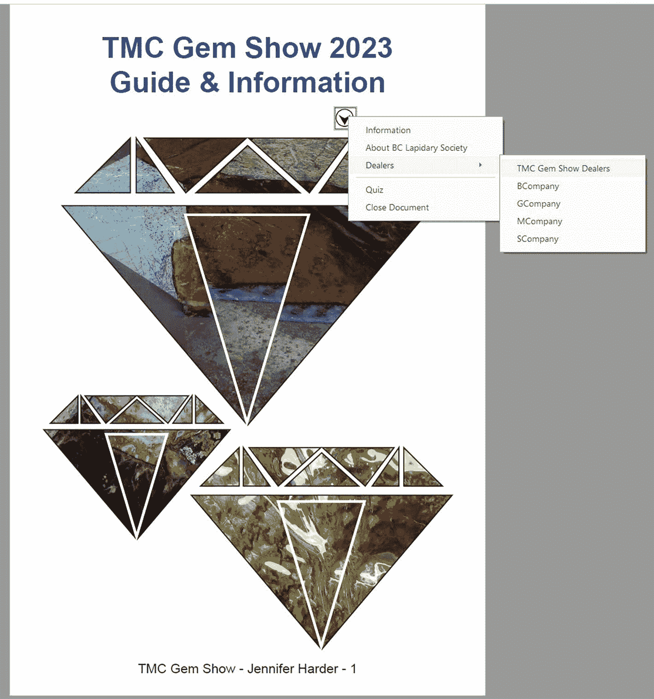
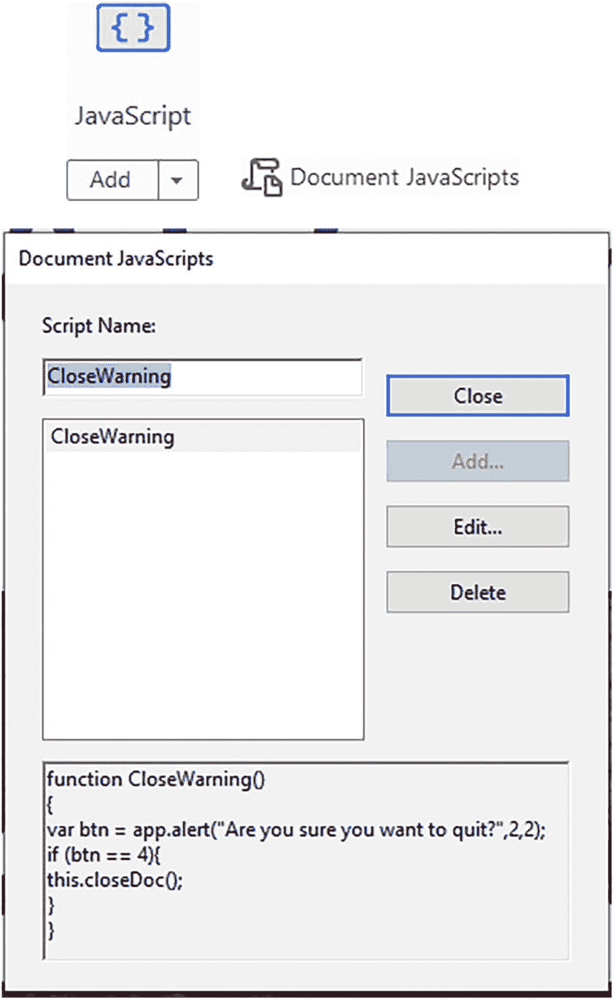
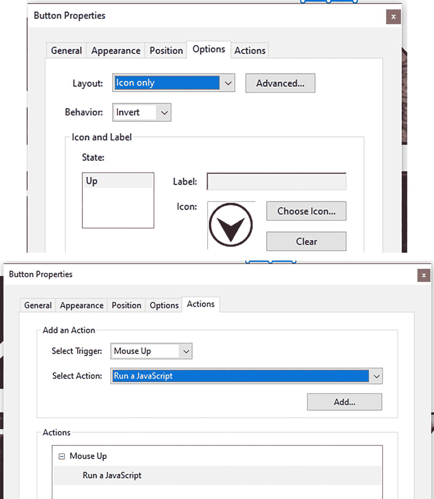
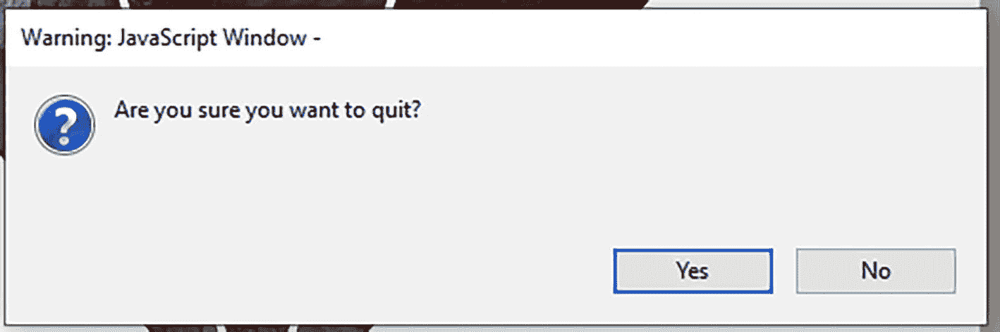
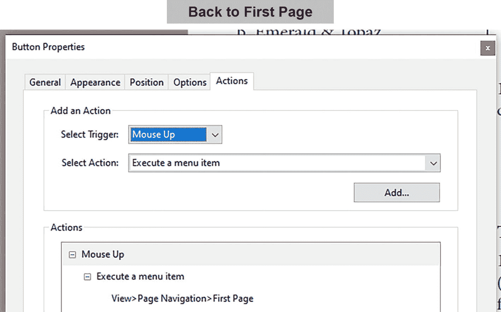
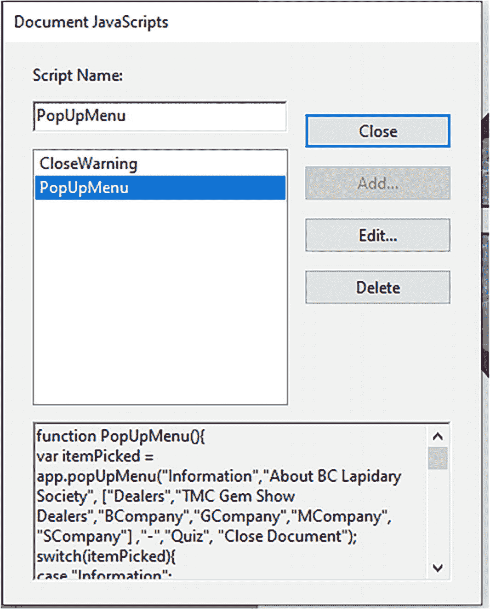
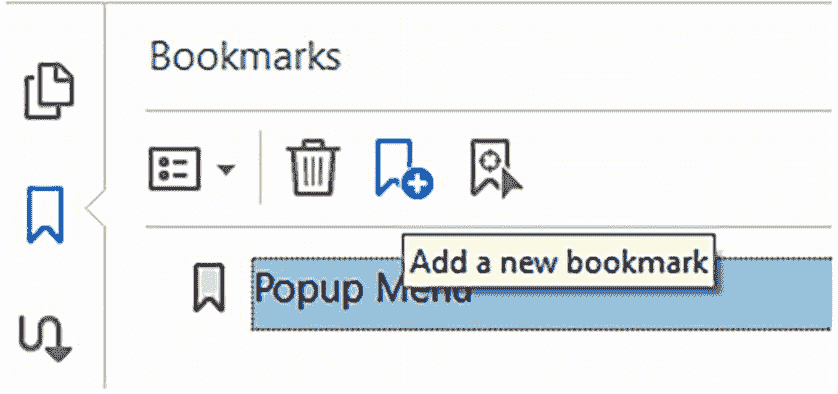
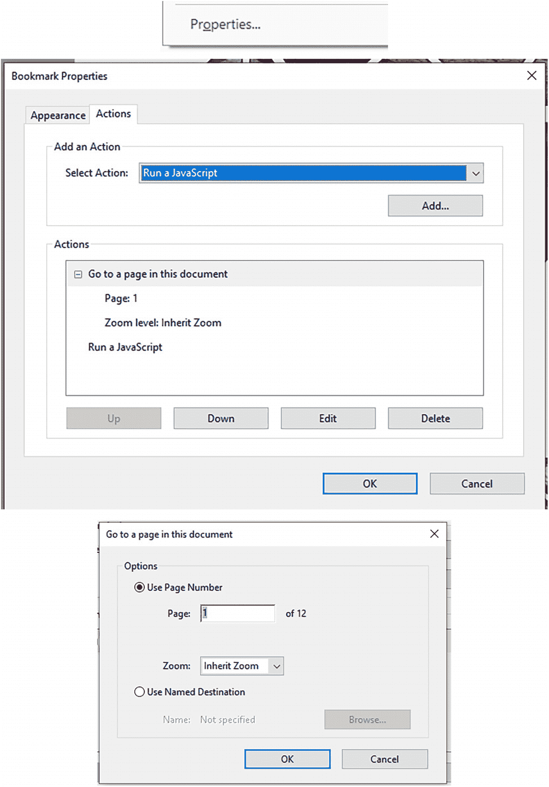
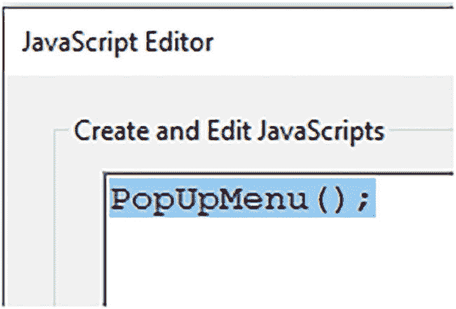
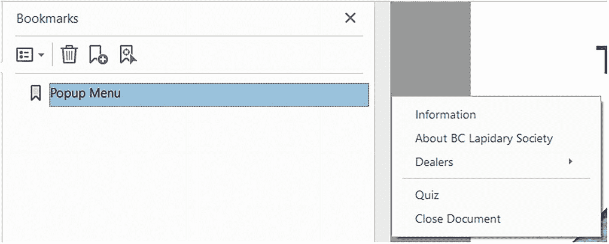

# 14. 高级导航：弹出菜单

**本章目标：** 你将看到关于按钮和导航的最后一个示例：弹出菜单。弹出菜单是一种很棒的非表单方式，用于在文档中从一个页面跳转到另一个页面，并且可以像目录一样发挥作用，如图 14-1 所示。本示例可在本章下载文件夹中的 `GemShow_inDesign_booklet_2023_End.pdf` 文件中找到。

> **注意**  
> 如果你想在本课中同步操作或查看最终结果，请从引言中的链接下载第 14 章的文件。标有“起始”的文件是不含代码的文件，标有“结束”的文件是最终结果。你还将找到一个包含原始图像文件和原始 Adobe InDesign 文件（`.indd`）的文件夹（如果你想编辑它们），以及一个包含原始脚本的文件夹（如果你想将它们添加到自己的 PDF 表单中）。

请记住，要查看字段的属性，你必须选择“准备表单”工具；只有这样，你才能右键单击或双击一个字段来查看其属性。

  
*图 14-1 —— PDF 文件中的弹出菜单示例*

## 弹出菜单示例

在本示例中，你将使用一个与 `if/else` 类似的条件语句。这个语句编写起来更简单，被称为 `switch case break` 或 `switch` 语句。与之前的示例一样，它非常适合用来遍历关联语法及其在方括号（`[]`）内的对象。首先，添加一个名为 `CloseWarning` 的文档级 JavaScript。请参考图 14-2。

  
*图 14-2 —— 对话框中含有关闭警告信息的文档级 JavaScript*

现在，将以下 JavaScript 添加到编辑器中，或单击“编辑”以查看“结束”示例中的脚本：

```
// 全局关闭警告
function CloseWarning(){
    var btn = app.alert("你确定要退出吗？",2,2);
    if (btn == 4){
        this.closeDoc();
    }
}
```

这段 JavaScript 在下来菜单中创建了一个用于关闭文档的选项。根据你想让它在关联语法中出现的位置，它基于数字来确定。在本例中，我选择了 `4`，因为它是索引为 `0–4` 的列表中的第五个项目，但你可能需要在你的列表中调整这个数字。你还可以在第 1 页的“操作”选项卡上，通过选择“鼠标释放”触发器和“运行 JavaScript”，将一个警报消息附加到按钮字段 `btn`。请参考图 14-3 查看“选项”和“操作”选项卡的设置。

  
*图 14-3 —— “选项”和“操作”选项卡中的按钮属性*

按钮本身包含以下 JavaScript 和关联语法：

```
var itemPicked = app.popUpMenu("信息","关于 BC 宝石协会", ["经销商","TMC 宝石展经销商","B 公司","G 公司","M 公司",
"S 公司"] ,"-","测验", "关闭文档");
switch(itemPicked){
    case "信息":
        this.pageNum = 1;
        break;
    case "关于 BC 宝石协会":
        this.pageNum = 3;
        break;
    case "TMC 宝石展经销商":
        this.pageNum = 5;
        break;
    case "B 公司":
        this.pageNum = 6;
        break;
    case "G 公司":
        this.pageNum = 7;
        break;
    case "M 公司":
        this.pageNum = 8;
        break;
    case "S 公司":
        this.pageNum = 9;
        break;
    case "测验":
        this.pageNum = 10;
        break;
    case "关闭文档":
        CloseWarning();
        break;
    //可选
    default:
        app.alert("此处未找到。");
        break;
}
```

该脚本帮助你导航 `app.popUpMenu`。关联语法帮助你导航到所需的页面。请记住，`5` 实际上对应的是第 6 页。和数组一样，它们从 0 开始计数，所以第 1 页实际上是第 0 页。因此，请确保在操作过程中测试你的弹出菜单，以保证能导航到你想要的页面。子项，例如“经销商”，被放在括号（`[]`）中，你必须使用连字符（`-`）创建一个水平分隔线。但是，不要将子菜单的主标题或连字符作为条件 `switch case break` 语句的一部分。每个菜单项之间用逗号分隔。

`switch` 语句会计算一个表达式，将表达式的值与一系列 `case` 子句（菜单项）进行匹配，在本例中即匹配 `itemPicked`。它在第一个匹配 `case` 子句后执行语句，直到遇到 `break` 语句，或者在本例中是直到选定的菜单项。请参考此链接：

[`https://developer.mozilla.org/zh-CN/docs/Web/JavaScript/Reference/Statements/switch`](https://developer.mozilla.org/zh-CN/docs/Web/JavaScript/Reference/Statements/switch)

查看代码中的这几行：

```
case "关闭文档":
    CloseWarning();
    break;
```

这里调用的是文档级 JavaScript 函数，而不是像其他情况一样调用数字。你希望当用户在弹出的问题警告框中点击“是”按钮时，文档能够关闭。请参考图 14-4。

  
*图 14-4 —— 询问是否要退出并关闭文档的 JavaScript 警报*

对于 `switch` 语句，你可以选择添加一个 `default` 语句。如果在列表中未找到或未选择任何内容，则会弹出一个警报：

```
app.alert("此处未找到。");
```

你并非必须向 `switch` 表达式添加这一部分；它是可选的，如果你不希望出现警报，可以注释掉这行代码。

在最后一页（参见第 12 页），创建一个“返回”按钮以回到顶部。如果愿意，你也可以在其他页面放置这样的项目。请参考图 14-5。

  
*图 14-5 —— “返回首页”按钮在“操作”选项卡中的按钮属性。选择菜单项“视图 ➤ 页面导航 ➤ 首页”*

如你所见，“返回”按钮不需要任何 JavaScript，但为了导航方便，它还是很有用的。

> **注意**  
> 除了通过 `app.popUpMenu` 进行的自定义外，你无法像使用 `app.alert` 那样更改其颜色或字体；这些都是应用程序内置的。


## 使用书签添加弹出式菜单

虽然将导航功能绑定到第 1 页的按钮上效果不错，但在其他情况下，你可能希望在不位于第 1 页时也能访问菜单进行导航。

正如我们在第 4 章中所见，你可以创建书签作为一种导航形式。然而，在这种情况下，你可能希望将已创建的导航附加到单个书签上，这样当用户点击该书签时，他们可以随时看到导航，并能快速跳转到第 1 页。如果客户想要打印文档，这样做也能消除按钮造成的杂乱。

在此案例中，请参考文件 `GemShow_inDesign_booklet_2023_End_2.pdf`。

在本例中，我将按钮上的所有代码移到了文档 JavaScript 工具区域，并在编辑器中将其放入一个名为 `PopUpMenu` 的函数中。请参考图 14-6。



文档 JavaScript 对话框的截图，脚本名称为弹出式菜单，函数名称为弹出式菜单（在下方框中高亮显示），以及一个脚本字段。其中有一个高亮显示的关闭按钮。

图 14-6

添加了新脚本的文档 JavaScript 对话框

```
function PopUpMenu(){
//此处插入按钮 JavaScript 代码
}
```

点击“确定”退出编辑器，点击“关闭”按钮退出对话框，然后关闭 JavaScript 工具。

接着，在我的书签导航窗格中，我创建了一个名为“弹出式菜单”的新书签。请参考图 14-7。



书签面板的截图，导航窗格中包含多个图标，其中有一个高亮显示的弹出式菜单。顶部有一个高亮显示的“添加新书签”图标。

图 14-7

添加到书签面板的新书签

然后我右键点击该书签，并在“操作”选项卡中调整其属性。请参考图 14-8。



书签属性对话框的截图，其中列出了“操作”下的选项，并添加了“运行 JavaScript”作为一项操作。它还包含一个“跳转到本文档中的页面”弹出对话框，其中启用了“使用页码”选项。

图 14-8

访问书签属性对话框的“操作”选项卡以及“跳转到本文档中的页面”对话框

默认情况下，它必须设置为“跳转到本文档中的页面”。你可以编辑此操作，将其设置为第 1 页。然后在对话框中调整缩放级别，点击“确定”确认（图 14-8）。接着，你可以点击“运行 JavaScript”，并添加对文档 JavaScript 的引用。在 JavaScript 编辑器中，添加 `PopUpMenu();`，然后点击“确定”退出编辑器，再退出书签属性对话框。然后再次点击“确定”。请参考图 14-9。



JavaScript 编辑器的截图，其中包含“创建和编辑 JavaScript”字段，文本为弹出式菜单括号分号。

图 14-9

在“操作”选项卡上为书签添加的 JavaScript 编辑器中的函数引用

之后我保存了文件。现在，当用户点击书签图标时，他们可以位于第 1 页并访问下拉菜单以跳转到新页面。无论你当前位于哪一页，书签窗格始终显示在左侧。请参考图 14-10。



书签对话框的截图，其中有一个高亮显示的书签“弹出式菜单”，右键导航窗格中包含关于 BC 宝石学会、经销商、测验和关闭文档的信息。

图 14-10

该书签可以访问弹出式菜单

在其他情况下，一些用户可能更倾向于使用 `app.popUpMenuEx` 来启动一个 URL。同样，这类代码必须放在文档 JavaScript 中作为一个函数来实现全局引用。虽然使用这种数组对象的弹出式菜单可以悬停并最初显示在页面上，但我发现要再次调出该菜单比较困难；而且，右键单击选项似乎也无法再次调出该菜单。不过，如果你希望查看代码示例并自行修改，可以参考以下页面：

[`https://opensource.adobe.com/dc-acrobat-sdk-docs/library/jsapiref/JS_API_AcroJS.html?highlight=popupmenu#popupmenuu`](https://opensource.adobe.com/dc-acrobat-sdk-docs/library/jsapiref/JS_API_AcroJS.html?highlight=popupmenu#popupmenuu)

## 最后思考

希望你喜欢这些课程。我还在第四部分中包含了以下额外课程：

- 使用操作向导通过 JavaScript 创建任务（第 15 章）
- 伪多状态复选框（第 16 章）
- 五星评级按钮（第 16 章）
- 将图像导入按钮（第 17 章）
- 数字的批量格式设置（第 18 章）
- 数字签名和条形码（第 19 章）
- 电子签名表单和 Web 表单（第 20 章）

与此同时，请先练习前面的课程，以积累你的 JavaScript 知识。如果你想要一些额外的练习，也可以跳到第五部分（第 21 章），那里有四项作业，分别涉及本书的第 1 至第 12 章以及第 18 章。

## 本章小结

在本章中，你了解了弹出式菜单以及它们如何通过按钮或书签来改善文档中的导航。你还学习了 JavaScript 的 `switch case break` 语句。

