# 19. 数字签名与条形码

章节目标：我尚未深入讨论 JavaScript 中的两种表单字段：数字签名和条形码。因此，本章将重点介绍它们。首先，让我们看看它们以及其他字段与安全性的关系。

注意：如果你想跟着本课程一起操作或查看最终结果，请从引言中的链接下载第 19 章的文件。标有“开始”的是不含代码的文件，标有“结束”的是最终结果。如果你希望将这些文件添加到自己的 PDF 表单中，你还会找到包含原始文件和脚本的文件夹。

如果你是从原始 PDF 创建表单，请参考第 1 章中的“表单回顾”部分。

请记住，要查看字段的属性，你必须选择“准备表单”工具；只有这样你才能右键单击或双击某个字段来查看其属性。

## 数字签名与安全性

可以对文本字段添加基本的安全性。请参阅文件 `TMC_Password_Access_Example_End.pdf` 中的示例。参考图 19-1 和图 19-2。

图 19-2 — 输入正确的密码即可解锁字段并显示按钮。你也可以将所有字段重置为只读状态。

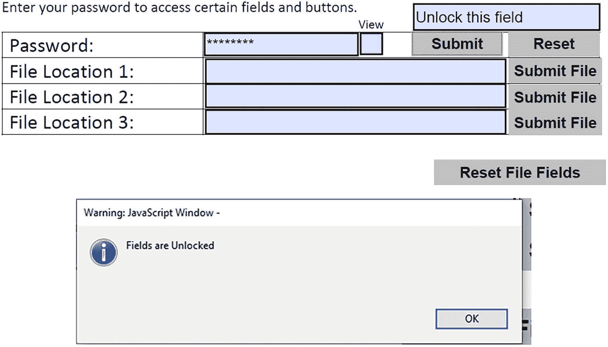

图 19-1 — 如果你不知道密码，就无法解锁字段并显示允许你添加文件位置链接的按钮。

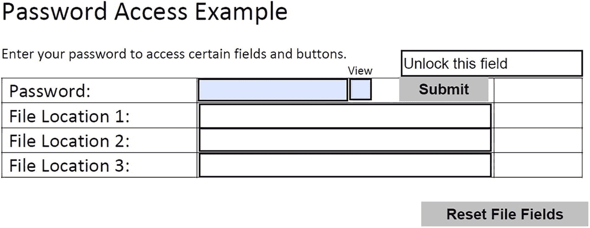

在你在 `Text1Password` 字段中输入密码并点击提交按钮之前，除密码字段和复选框之外的所有文本字段，在“常规”选项卡上都设置为只读状态。

`Text1Password` 字段在“选项”选项卡上设置有“密码”属性，如图 19-3 所示。此设置将只显示一系列星号（`***`）；实际文本将保持隐藏状态。没有其他 JavaScript 代码直接应用于此字段。

图 19-3 — “选项”选项卡上设置了“密码”属性，以便隐藏实际文本。

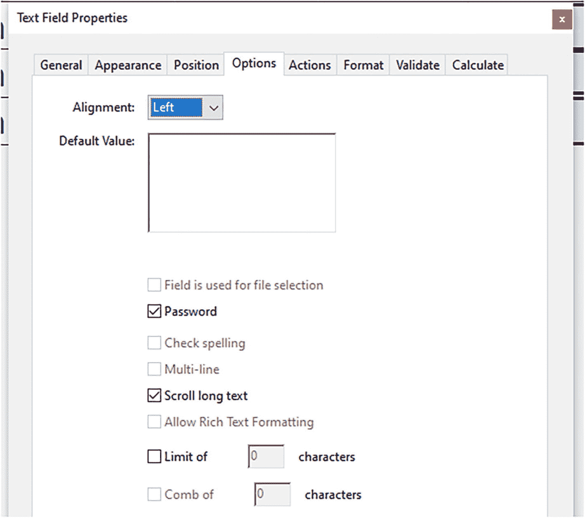

以下是“操作”选项卡上提交按钮在选择了“鼠标释放”触发器和“运行 JavaScript”后的 JavaScript 代码：

```javascript
//提交密码按钮
var b=this.getField("Text1Password");
var c=this.getField("Text2");
var file1=this.getField("SubmitFile");
var btn1=this.getField("Submitfilebtn");
var d=this.getField("Reset");
if(b.value=="password"){
c.readonly =false;
file1.readonly=false;
btn1.display=display.visible;
d.display=display.visible;
app.alert("字段已解锁",3,0);
}
else{
app.alert("密码错误");
b.value="";
}
```

只有当你输入值为 `password` 时，你才能访问其他字段和按钮。点击提交按钮后，如果值正确，只读字段（`Text2`、`SubmitFile.1`、`SubmitFile.2`、`SubmitFile.3`）将变为可编辑状态，并且隐藏的按钮（`SubmitFilebtn.1`、`SubmitFilebtn.2`、`SubmitFilebtn.3` 和 `Reset`）将显示。你还会收到一个提示，表明字段已解锁。请注意，在此示例中，你不需要命名末尾带有句点和数字的所有按钮或字段；只要它们在句点之前具有相同的起始名称，它们就被包含为一种数组对象的一部分。

但是，如果你输入了错误的值并点击提交，你将收到一个密码错误的提示，并且该字段将重置自身，因此你必须重试。参考图 19-4。

图 19-4 — 如果密码不正确，密码字段将恢复为空白。

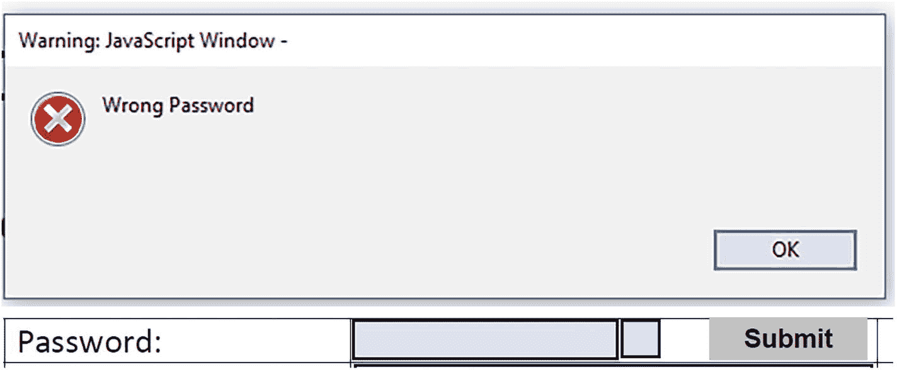

## 通过复选框切换密码显示

然而，有些人在输入密码时，当看到密码显示为星号（`***`）会感到困难。为了帮助他们，你可以添加一个复选框，让他们可以开启或关闭密码的显示。这样，他们就能在点击提交按钮之前检查自己输入的密码是否正确。

对于名为 `Check Box1` 的复选框字段，我在“动作”选项卡中输入了以下代码，并选择了“鼠标松开”触发器：

```javascript
// Show/Hide the password
if(event.target.value != "Off"){
    this.getField("Text1Password").password=false;
}
else{
    this.getField("Text1Password").password=true;
}
```

如同 `readonly` 属性一样，`password` 是另一个可以像布尔值 `true` 和 `false` 一样访问的属性。在这个例子中，如果 `!= "Off"` 或复选框被勾选（即开启），则将 `password` 设为 `false` 以显示实际文本。当复选框未被勾选时，将其设为 `true` 以显示密码设置。请参考图 19-5。

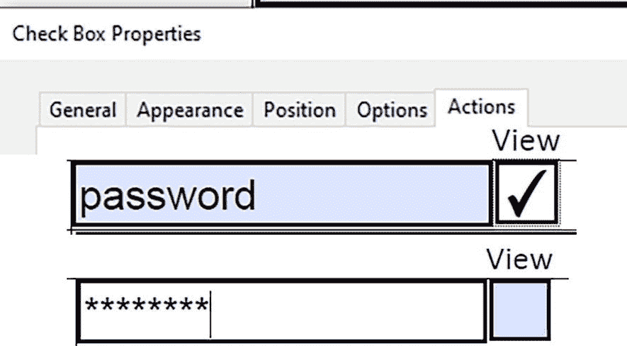

图 19-5 使用“动作”选项卡上的代码通过复选框动作来隐藏和显示密码

如果密码输入正确，一旦“重置”按钮变为可见，你就可以重置表单、将文本字段设置为只读，并隐藏某些按钮。请参考图 19-6。

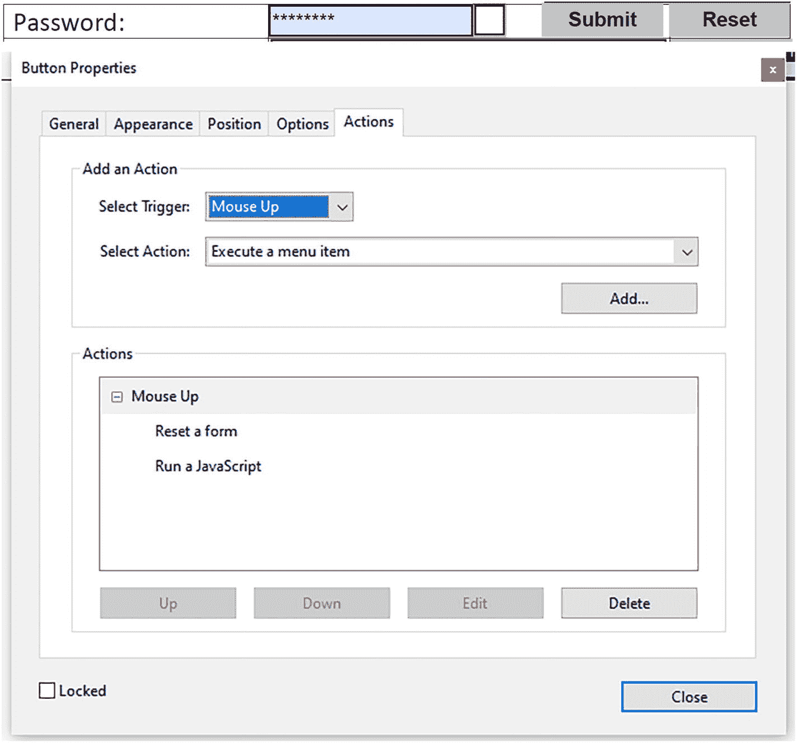

图 19-6 “重置”按钮在“动作”选项卡上有两个动作

对于“鼠标松开”事件上的“重置”按钮，除了使用“重置表单”动作来重置表单的五个文本字段和复选框之外，你还可以在编辑器中为“运行 JavaScript”动作添加以下代码：

```javascript
// Reset Password Field with check box setting, File Fields and Button
var b=this.getField("Text1Password");
var c=this.getField("Text2");
var file1=this.getField("SubmitFile");
var btn1=this.getField("Submitfilebtn");
var d=this.getField("Reset");
if(b.value==""){
    c.readonly =true;
    file1.readonly =true;
    btn1.display =display.hidden;
    app.alert("Fields are Locked again",3,0);
    d.display= display.hidden;
    b.password = true;
}
```

这不仅会锁定（设为只读）、隐藏、重置字段和密码属性，你还会收到一个提示消息，说明字段已被再次锁定。请参考图 19-7。

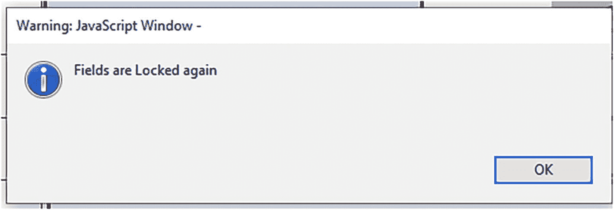

图 19-7 重置时，字段再次被锁定后出现的提示

> **注意**
>
> 在提示对话框中点击“确定”后，“重置”按钮会隐藏，并且密码会被重置。这些是条件语句中必须满足的最后几项。当你在设置代码顺序时，如果注意到代码没有按预期顺序激活，这一点需要始终牢记。在这种情况下，你可能需要在“动作”选项卡或编辑器中将某行代码或某个动作上移或下移到另一个动作的上方或下方，才能使其按预期运行。

在这些示例中，我们使用了“锁定”一词来指代一个被设为只读的字段。这与我们在对话框中通过勾选“锁定”复选框来锁定字段属性是不同的。请参考图 19-6 的左下角。当此选项被勾选时，你仍然可以在字段中输入文本，但当你查看属性和选项卡时，它们会显示为灰色，你无法更改包括“动作”选项卡在内的任何属性。如果你发现任何字段不再允许你编辑属性，请确保取消勾选“锁定”复选框。

虽然这不属于安全性的一部分，但你可以在“动作”选项卡上为“提交文件”按钮的“鼠标松开”触发器和“运行 JavaScript”设置添加以下代码：

```markdown
### 使用数字签名与其他 Adobe 安全工具

关于签名与安全，我推荐阅读丽莎·弗里德玛（Lisa Fridsma）和布丽·金西尔德（Brie Gyncild）所著的 *Adobe Acrobat DC Classroom in a Book*，尤其是其中关于签名与安全的章节。我认为该书提供了关于安全加密签名的最新 PDF 信息，这些签名适用于需要专业认证和身份识别的公司。同样，如果你需要证书或任何类似的安全服务，也可以联系 Adobe。

虽然与本主题无关，但如果你在工作流程中涉及安全，建议进一步了解 Adobe 中位于`表单与签名`和`保护与标准化`下的某些工具。这些工具包括`证书`、`填写与签名`、`保护`和`编辑`。还有其他电子签名表单选项，我们将在第 20 章中进一步讨论。请参考图 19-9。

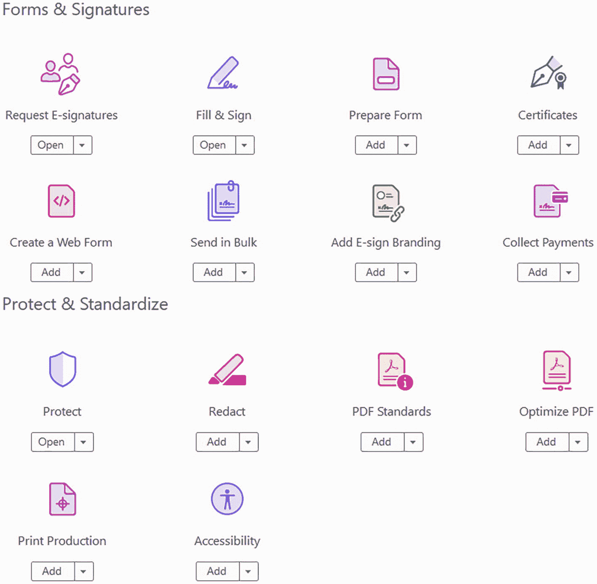

**图 19-9** 其他 Adobe 安全工具

请注意，虽然这些工具不直接与 JavaScript 配合使用，但如果你的表单是为视障人士准备的，你可能需要使用`无障碍`工具来准备表单字段以及其他阅读选项。这是一个更高级的话题，并非本书必备。你可以访问 [`helpx.adobe.com/cn/acrobat/using/create-verify-pdf-accessibility.html`](https://helpx.adobe.com/cn/acrobat/using/create-verify-pdf-accessibility.html) 了解有关无障碍、标签和阅读顺序的更多信息。请参考图 19-10。

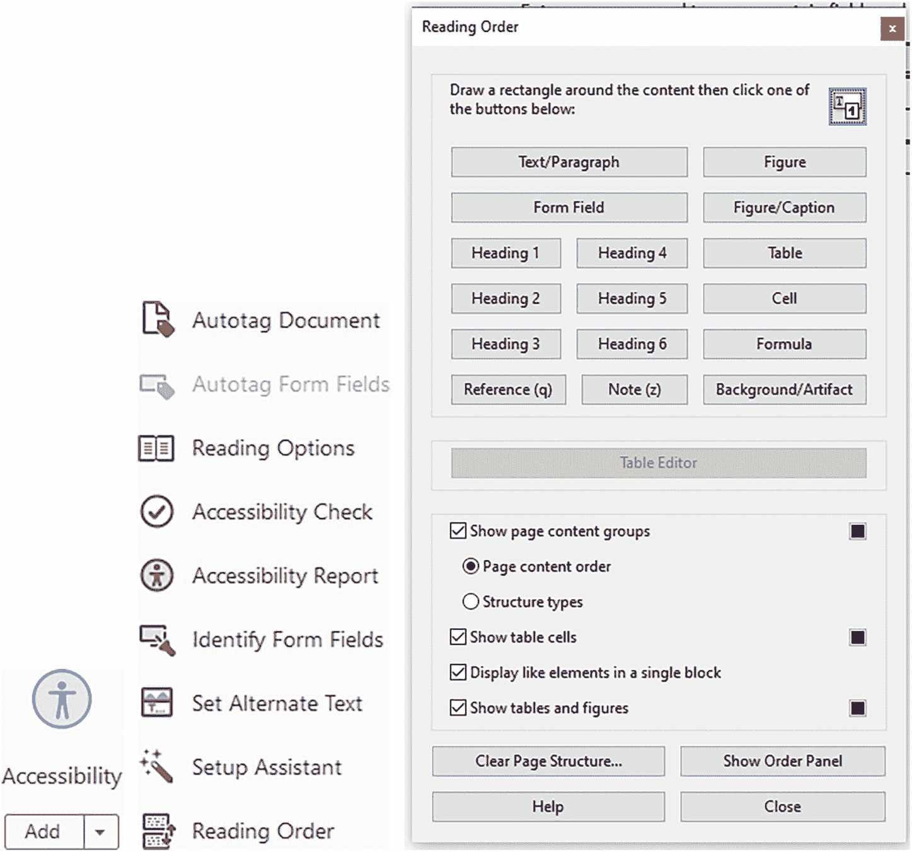

**图 19-10** 显示与表单字段相关部分选项的无障碍工具

然而，在本章中，由于表单不需要高级别的安全，我在本章文件夹中包含了一个文件（`TMC_Signature_Agreement_End.pdf`），该文件对数字签名启用了 JavaScript，你可以自行探索。此文件结合使用了签名字段和按钮，以实现以下功能：

-   当你在字段中输入签名时，使与签名相关的文本字段变为只读，然后你可以点击`提交给主管`按钮。
-   点击按钮时显示或隐藏字段。
-   通过点击特定按钮重置部分或整个表单。

在`数字签名属性`字段的`employee.signature`中，请花一点时间查看该字段的`签名后`选项卡。该选项卡仅在配置了数字 ID 后才对数字签名可用。与其他文本字段不同，数字签名没有`格式`、`验证`和`计算`选项卡，因此你可以添加操作的唯一位置是`操作`和`签名后`选项卡。你也可以使用全局文档 JavaScript 区域进行格式化。请参考图 19-11、19-12 和 19-13。

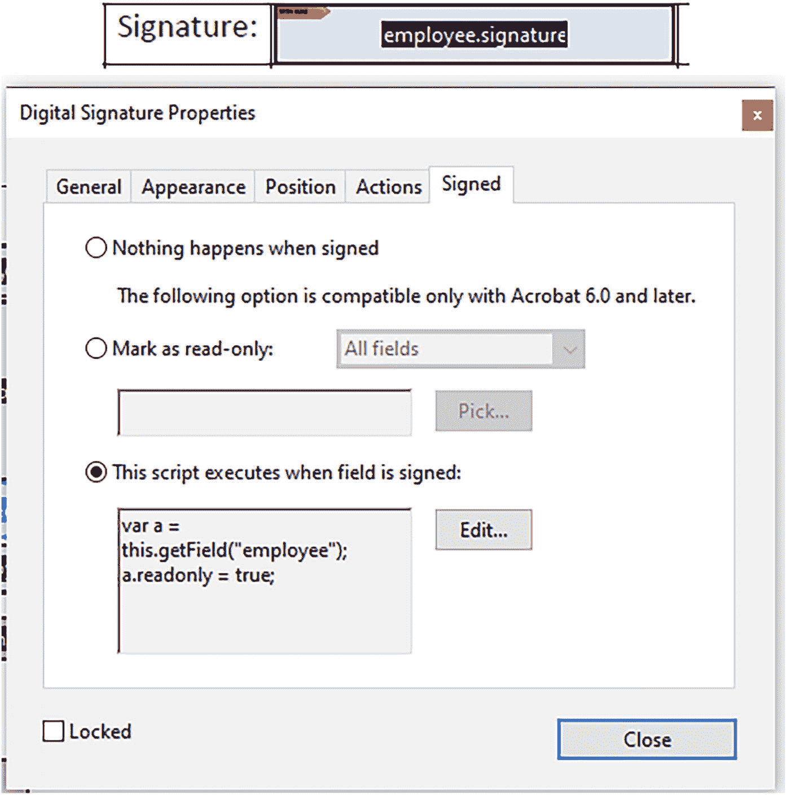

**图 19-13** 当选中“对字段签名时执行此脚本”时，数字签名属性显示在“签名后”选项卡上的情况

## 数字签名属性与示例

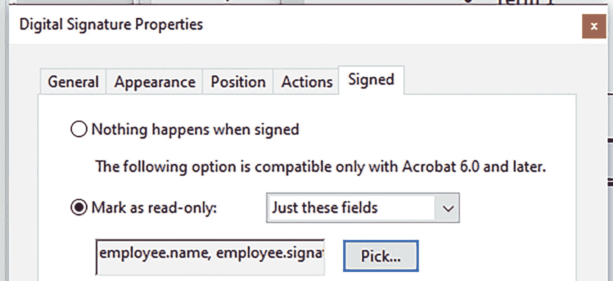

**图 19-12** 数字签名示例，在“已签名”选项卡上设置为“标记为只读”，并从列表中选择“仅这些字段”。

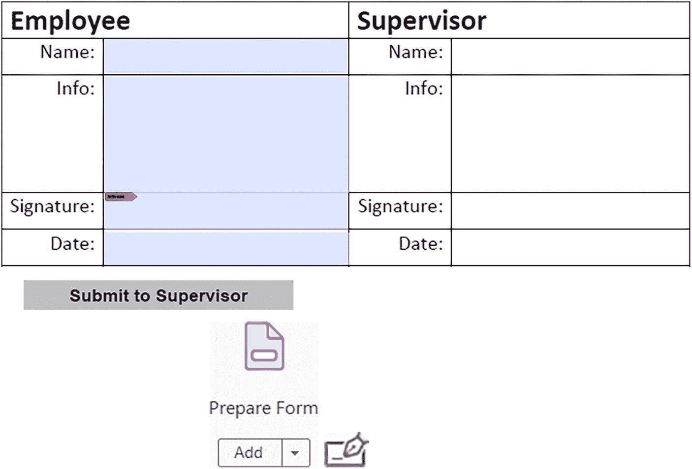

**图 19-11** 在“准备表单”工具中找到的数字签名示例

基本上，当员工填写一个签名并点击`提交给主管`按钮时，下一个签名就会对下一级主管可用。该示例与使用字段和按钮组合进行显示和隐藏的方法相同。虽然这是一种低级安全性，但它提供了一种确保文件按正确顺序签署的方法。它还对谁可以重置哪些字段进行了限制。这种方法比简单地选择“标记为只读”更精确。

以下是一些用于签名和按钮的代码示例。

以下内容可以应用于“已签名”选项卡上的数字签名字段`employee.signature`：

```javascript
//Employee Signature Field
var a = this.getField("employee");
a.readonly = true;
```

以下内容可以应用于“操作”选项卡上的按钮`employee1.submitForm`，作为鼠标松开触发器，并选择“运行 JavaScript”：

```javascript
//Submit to Supervisor button
var a = this.getField("supervisor");
a.display = display.visible;
```

然后，我向该按钮添加了一个额外的鼠标松开时的显示/隐藏字段操作，以隐藏名为`employee1.resetForm`的按钮。

以下内容可以应用于按钮`employee1.resetForm`。起初，我添加了 JavaScript 操作，其中（`a`）在这种情况下指的是所有名称为`employee`的字段，但请注意它也可能是其他字段。所以，我注释掉了那行代码。或者，正如你在第 9 章中看到的，你可以为你想要隐藏的字段设置单独的操作，或者将代码更改为`this.resetForm(["employee"]);`以获取所有以`employee`开头但不包括`employee1`的字段。请参考图 19-14。

```javascript
//Employee Reset Button
var a = this.getField("employee");
//this.resetForm(a);
this.resetForm(["employee"]);
```

以下内容可以应用于“操作”选项卡上的按钮字段`supervisor.submitForm`：

```javascript
//Submit to HR Button
var a = this.getField("supervisor");
var b = this.getField("employee1.submitForm");
var c = this.getField("employee1.resetForm");
a.display = display.visible;
b.display = display.hidden;
c.display = display.hidden;
```

以下内容可以应用于“操作”选项卡上的按钮字段`supervisor.resetonly`。然后，你可以只重置主管字段。
```

# 数字签名与表单字段控制

```javascript
//Only Supervisor Button
var a = this.getField("supervisor");
this.resetForm(["supervisor"]);
```

以下内容可以应用于“操作”选项卡上的按钮字段`supervisor.resetForm`，以同时重置员工和主管字段。

```javascript
// Supervisor Reset Button
var a = this.getField("supervisor");
var b = this.getField("employee");
this.resetForm(["employee","supervisor"]);
```

以下内容可以应用于“操作”选项卡上的按钮字段`reset`：

```javascript
//Reset the whole form Button
var a = this.getField("supervisor");
var b = this.getField("employee1.submitForm");
var c = this.getField("employee1.resetForm");
var d = this.getField("employee");
a.display = display.hidden;
b.display = display.visible;
c.display = display.visible;
this.resetForm(["employee","supervisor"]);
```

Adobe 中用于插入用户签名的空间截图。

`图 19-14`

“签名协议”PDF 文件中的数字签名字段

请注意，就像在第 13 章中一样，你使用了`display.hidden`和`display.visible`来隐藏和显示某些字段。员工签名字段中的只读属性（`.readonly`）是一个布尔值，可以设置为`true`或`false`，并决定该字段是否为只读。此脚本仅在字段被签名后执行一次，员工无法撤消，然后只有主管才能重置该字段。

## 签名字段格式设置

与文本字段一样，你也可以使用“外观”选项卡或“文档 JavaScript”对话框来更改数字签名外观属性。例如，使用第 10 章中的`f.type == "signature"`或第 8 章中的`cFieldType: "signature"`。你可以影响诸如`strokeColor`、`fillColor`、`lineWidth`、`borderStyle`、`textFont`和`textColor`之类的格式。但是，你不能更改`textSize`，因为它已被禁用并设置为自动，因此请确保字段的大小足以正确显示签名。有关这些属性的更多详细信息，请参阅第 10 章。

有关创建数字 ID 步骤的更多知识，请参考以下页面：

[`https://helpx.adobe.com/acrobat/using/digital-ids.html`](https://helpx.adobe.com/acrobat/using/digital-ids.html)

[`https://www.adobe.com/acrobat/how-to/fill-sign-pdf-forms-electronically.html`](https://www.adobe.com/acrobat/how-to/fill-sign-pdf-forms-electronically.html)

此页面还将提供有关在 JavaScript 中使用签名的更多信息：

[`https://opensource.adobe.com/dc-acrobat-sdk-docs/library/jsapiref/JS_API_AcroJS.html?highlight=signature`](https://opensource.adobe.com/dc-acrobat-sdk-docs/library/jsapiref/JS_API_AcroJS.html?highlight=signature)

> **警告**
>
> 在某些情况下，当 PDF 被客户端或主机使用数字 ID 或证书签名后，他们可以锁定整个 PDF 以防止在签名后对文档进行更改。虽然添加签名的签名者可以为你移除签名，但作为设计者，你可能无法做到这一点，并且你将无法使用“准备表单”工具编辑表单字段，也无法编辑锁定文档的其他部分。这就是为什么在构建表单时，始终保留一份未签名的副本作为备份，以防你需要编辑表单以进行未来修订。有关此主题及解决方案的更多详细信息，请参考以下链接：
>
> [`https://helpx.adobe.com/acrobat/kb/edit-signed-PDF.html`](https://helpx.adobe.com/acrobat/kb/edit-signed-PDF.html)

### 创建安全谜题

你可能会发现，通过单选按钮将字段设置为只读，并创建一种游戏或谜题是很有趣的：只有选中正确的单选按钮，文本字段才能从只读状态解锁；或者在另一种变体中，如果你在一行中复制了一个单选按钮，就会触发警告；又或者，当输入正确的文本时，按钮上的文字会从“锁定”变为“解锁”。我将一些此类示例放在了一个名为 `PDF_Puzzles.pdf` 的文件中。请参考`图 19-15`。

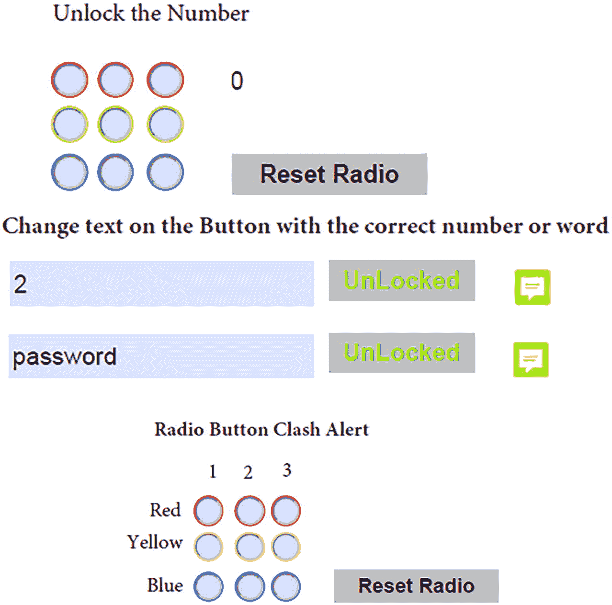

`图 19-15`

9 个圆形点表示，解锁数字选项，其旁边是重置单选按钮。提供了空格，用于通过正确的数字或单词更改按钮上的文本。单选按钮冲突警报以 3 种不同颜色突出显示，并带有一个重置单选按钮。

你可以使用表单字段和 JavaScript 代码中的只读设置来创建谜题。

在一些示例中，操作被添加到“验证”选项卡，而在其他示例中，则被添加到“操作”选项卡。

第一个单选按钮示例仅在“验证”选项卡上对 `text2` 字段应用了以下文本。

```javascript
var a= this.getField("Text2");
if(event.value==6){
a.readonly=false;
}
else{
a.readonly=true;
}
```

然后你可以在“计算”选项卡上计算总和。重置按钮仅重置这些字段。请参考`图 19-16`。

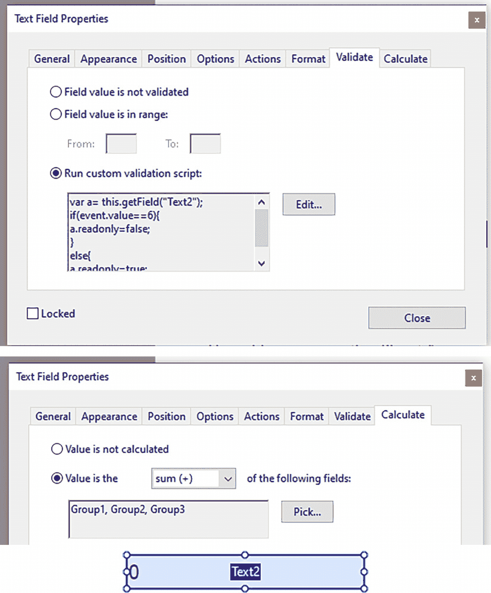

`图 19-16`

文本字段属性的 2 个对话框。选中了“变量”选项卡，并且选中了“运行自定义验证脚本”。计算了组 1、组 2 和组 3 的总和值。

“验证”和“计算”选项卡上的文本字段属性设置

同样，像 `Text5` 和 `Text6` 这样的字段也可以在“验证”选项卡上应用脚本，与特定按钮交互，以锁定按钮或将其设置为只读或解锁。请参考`图 19-17`。

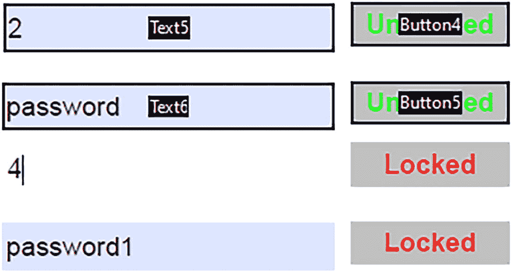

`图 19-17`

使用文本字段根据输入内容锁定或解锁

提供了 4 个空白区域用于输入密码，旁边的按钮用于锁定或解锁密码。

```javascript
var b = this.getField("Button4");
if(event.value==2){
b.readonly=false;
b.textColor=color.green;
b.buttonSetCaption("UnLocked");
}
else{
b.readonly=true;
b.textColor=color.red;
b.buttonSetCaption("Locked");
}
```

如**粗体**代码所示，只需编辑第二个文本框中的前两行，它就可以接受一个单词而非数字作为输入值。

```javascript
var b = this.getField("Button5");
if(event.value=="password"){
//其余代码
```

你可以看到 `if/else` 语句的重复出现，这同样可以应用于触发警告的单选按钮。然而，处理起来会变得越来越复杂。花些时间查看 `PDF_Puzzles` 文件中的这部分内容，观察代码是如何重复自身，但对于每个单选按钮又略有不同，以便满足条件且互不冲突。

以下是一个单选按钮操作的示例：

```
var g = this.getField("Group4");
g.readonly= true;
//冲突修正
var one= this.getField("Group5");
var one1= this.getField("Group6");
var sec = event.target;
var msg="已选择第一种颜色";
if (one.value=="Yellow1"){
app.alert(msg);
one.value="Yellow1";
one.readonly = true;
sec.value="";
sec.readonly = false;
}
//冲突修正 2
else if (one1.value=="Blue1"){
app.alert(msg);
one1.value="Blue1";
one1.readonly = true;
sec.value="";
sec.readonly = false;
}
```

你可以查看其他八个单选按钮，了解每个“操作”选项卡上的代码如何变化。最后，在简短的游戏结束后，你应该默认重置单选按钮，并且还需要使用“操作”选项卡上的以下代码来设置“重置单选按钮 2”：

```
var a = this.getField("Group4");
var b = this.getField("Group5");
var c = this.getField("Group6");
a.readonly=false;
b.readonly=false;
c.readonly=false;
```

我希望这能激发你创建自己的 PDF 安全游戏。

### 条形码

最后，关于条形码，当它引用表单中的各个字段时，此自定义 JavaScript 会影响条形码的视觉显示方式。扫描条形码时，此信息会被软件程序收集并输入到数据库中以供日后查看。如果你计划购买条形码读取器/扫描仪或传真机以配合 Acrobat PDF 文件使用，请先联系公司，询问其读取器能解读哪些类型的与 PDF 条形码相关的 JavaScript 代码。该公司或许能提供文档，或允许你在购买前测试扫描仪。此外，要参考 Adobe 的条形码纸质表单解决方案，你可能需要直接联系 Adobe。请参考图 19-18。

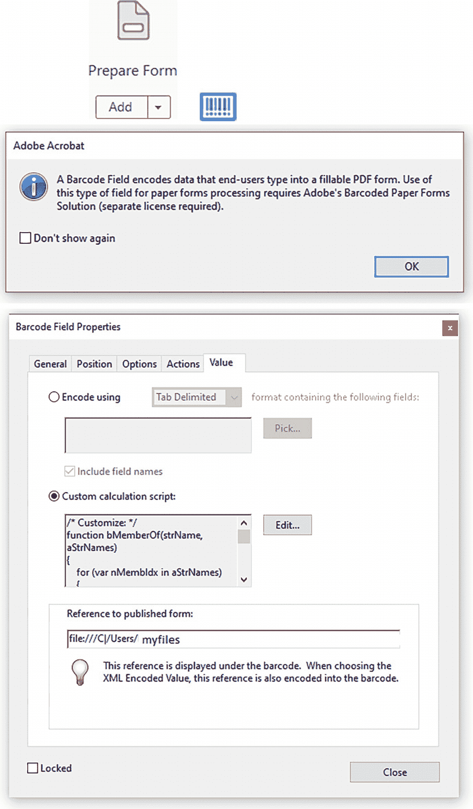

一个带有“添加”选项的“准备表单”图标。一个来自 Adobe Acrobat 的警告框。一个显示“值”选项卡的条形码字段属性窗口。在提供的空白区域中编写了自定义计算脚本中的代码。

图 19-18

条形码字段属性位于“准备表单”工具中。当你选择条形码字段时，可能会看到此处显示的警报。你可以在“值”选项卡的“自定义计算脚本”字段中添加或编辑 JavaScript。

条形码的 JavaScript 在“操作”或“值”选项卡中输入。与其他表单字段不同，条形码字段没有“外观”选项卡，因此不允许使用 `.type` 格式化或通过脚本进行复制。更改条形码的类型需要在“选项”选项卡的符号系统中进行；但是，如果你考虑在文档或表单中添加与非表单相关的二维码或条形码，请参考本书的第 3 章。请参考图 19-19。

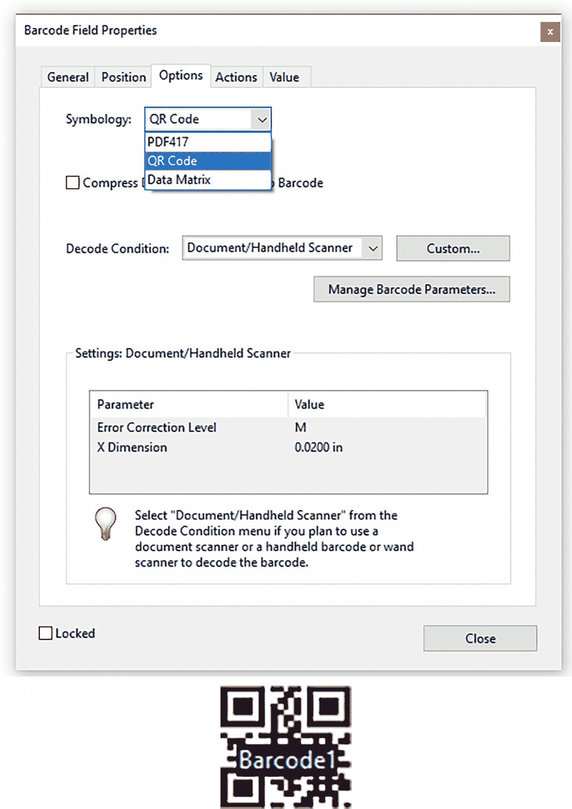

一个显示“选项”选项卡的条形码字段属性对话框。使用的符号系统是插入二维码。解码条件是文档或手持扫描仪。底部有一个带有标签“条形码 1”的二维码。

图 19-19

“条形码字段属性”对话框的“选项”选项卡，符号系统选项设置为二维码

你可以在 [`https://helpx.adobe.com/acrobat/using/pdf-barcode-form-fields.html`](https://helpx.adobe.com/acrobat/using/pdf-barcode-form-fields.html) 找到关于 Acrobat PDF 条形码的更多信息。

## 本章小结

在本章中，你了解了使用文本字段、复选框、单选按钮、签名域和条形码的基本安全性。带有 JavaScript 的签名域可用于基本的安全目的；然而，除非与其他安全 ID 和证书结合使用，否则它们并非最安全的 PDF 选项。正确使用条形码需要条形码读取器或扫描仪。

在下一章中，我们将介绍电子签名表单和网页表单及其相关工具。
```
