# 20. 什么是电子签名表单和网页表单？

**章节目标：** 在本章中，我们将探讨 Acrobat Pro 中一些较新的表单工具，以及它们与前几章讨论的 JavaScript 表单之间的关系。

虽然本章并非专门介绍使用 JavaScript 的 Acrobat 表单，但了解 Acrobat 中的其他新增可选工具以及可与应用程序连接以创建各种电子表单的外部链接仍然很重要。我们将研究两个相关的示例以及您可以在 Adobe Acrobat 官网上找到的其他资源。请参考图 20-1 和图 20-2。

一张窗口截图，显示了“表单和签名”下的 Adobe Acrobat 工具。包括`请求电子签名`、`填写和签名`、`准备表单`、`证书`、`创建网页表单`、`批量发送`、`添加电子签名品牌`和`收款`。

**图 20-2** – 工具“表单和签名”部分中的新表单工具

一张 Adobe Acrobat 工具栏截图，显示了“主页”和“工具”选项。在“工具”选项下方有一个搜索栏。

**图 20-1** – Acrobat Pro 工具选项卡

> **注意：** 要完成本章的作业，请务必从前言中的链接下载第 20 章的文件夹。

您也可以通过主菜单中的`电子签名`下拉列表找到本章讨论的一些选项。这些设置的外观可能会因您使用的 Acrobat Pro 版本而异。您可以参考以下页面了解更多详情：`https://helpx.adobe.com/acrobat/using/send-for-signature-new-experience-a.html`。请参考图 20-3。

一张窗口截图，展示了`电子签名`工具下的一个下拉列表。列表中包含`请求电子签名`、`自己填写和签名`、`创建网页表单`、`批量发送`、`添加电子签名品牌`、`收款`、`准备协议`和`管理所有协议`。

**图 20-3** – 主菜单`电子签名`下拉选项

## 快速了解请求电子签名及相关资源

电子签名是一种数字或电子签名，您可以利用它让客户在线签署表单。在某些情况下，客户无需与其它表单字段交互，只需签署文档的数字签名部分即可。在这些情况下，当签名的重要性超过其他字段的需求，且您需要通过电子邮件以表单形式安全地收集多个签名时，电子签名表单是一个非常有用的工具。

在第 19 章中，我们简要探讨了`准备表单`工具中数字签名字段的重要性。请参考图 20-4。

一张字段名称弹出框的截图。它显示了一个空白字段，准备添加`签名 1`。一条注释写道：“添加数字签名，从属性视图中添加签名选项。” 包含一个“必填字段”复选框，以及一个“所有属性”链接。

**图 20-4** – 常规表单允许您添加数字签名

对于此类表单字段，我们可以在其属性区域的`操作`和`已签名`选项卡中应用 JavaScript。请参考图 20-5。

一张数字签名属性对话框的截图。它显示了“已签名”选项卡下的选项。“签名后无反应”选项已被选中。

**图 20-5** – 显示`已签名`选项卡的数字签名属性对话框

正如我们在前几章中所了解到的，其他表单字段，例如文本字段、下拉列表、单选按钮和复选框，都可以在其属性对话框的不同选项卡中添加操作。

然而，如前所述，有些类型的表单更侧重于收集数字签名，而非进行计算或仅输入文本。这些被称为电子签名或电子签名请求。

使用我们过去使用的 Acrobat 表单时，通常需要借助其他工具来完成签名过程，例如`填写和签名`和`证书`。请参考图 20-6。

两张截图，分别显示`填写和签名`工具图标及其下方的“打开”按钮，以及`证书`工具图标及其下方的“添加”按钮。

**图 20-6** – 表单工具`填写和签名`与`证书`

您可以在以下页面了解更多信息：

`https://helpx.adobe.com/acrobat/using/signing-pdfs.html`

`https://helpx.adobe.com/acrobat/kb/certificate-signatures.html`

`https://helpx.adobe.com/acrobat/using/securing-pdfs-certificates.html`

然而，随着表单构建流程越来越侧重于多个客户或参与者的签名，`准备表单`工具已添加了特定类型的表单字段，以便独立于我们在本书中讨论的传统 Acrobat 表单来构建此类表单。请参考图 20-7。

一张`准备表单`工具图标及其下方的“添加”按钮的截图。

**图 20-7** – `准备表单`工具

在选择`准备表单`工具后，当您选定一个 PDF 文件并勾选“此文档需要签名”选项，然后单击`开始`按钮时，即可启用此类表单及其选项。并且，与之前的示例一样，请确保表单字段自动检测功能处于`开启`状态。请参考图 20-8。

一张窗口截图，显示了一个待扫描以开始文件的文档，位于“单个文件”选项下。已勾选“此文档需要签名”选项并选中了`开始`按钮。

**图 20-8**

## 为单个选定文件准备表单工具设置

请注意，如果文件中已存在某些字段，系统可能会提示您先另存一份文档副本，然后再继续添加字段。

但是，如果您从一个没有字段的单个文件开始，选择**新建**并从头开始创建一个空白文档，或创建一个新表单，则系统不会要求您先保存文件。在这种情况下，您只需在完成表单字段调整后再保存文件。请参考图 20-9。

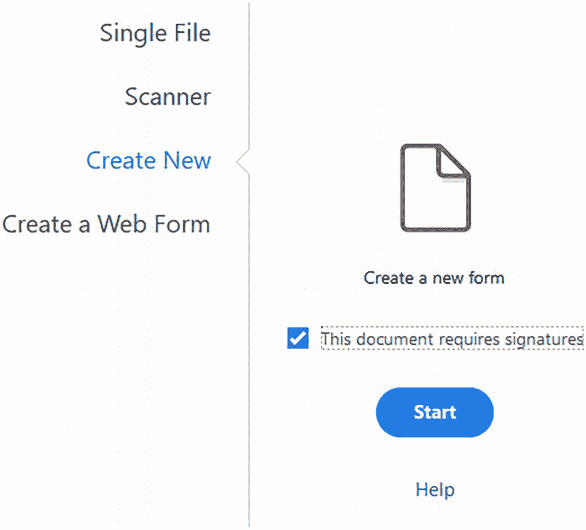

屏幕截图显示一个窗口，其中有一个空白区域，用于在**新建**选项下创建文档。同时选中了**本文档需要签名**选项和**开始**按钮。

**图 20-9** — 为新的空白文件准备表单工具设置

> **注意：** **扫描仪**选项适用于您直接处理当前放在扫描仪平板上的扫描文档的情况。我们将在本章的“什么是 Web 表单”部分介绍**创建 Web 表单**选项。请参考图 20-9。

在本例中，我将使用一个在 Word 中创建，然后转换为 PDF 并添加了表单字段的工时表。如果您想比较常规 PDF 表单与需要签名的表单，我还提供了原始 Word 和 PDF 表单。您可以打开名为 `Timesheet_End.pdf` 和 `Timesheet_esign_End.pdf` 的文件，并根据练习需要重命名它们。打开新文件，点击**准备表单**工具，逐个查看每个示例中的字段。不过，目前重点是电子签名表单。请参考图 20-10。

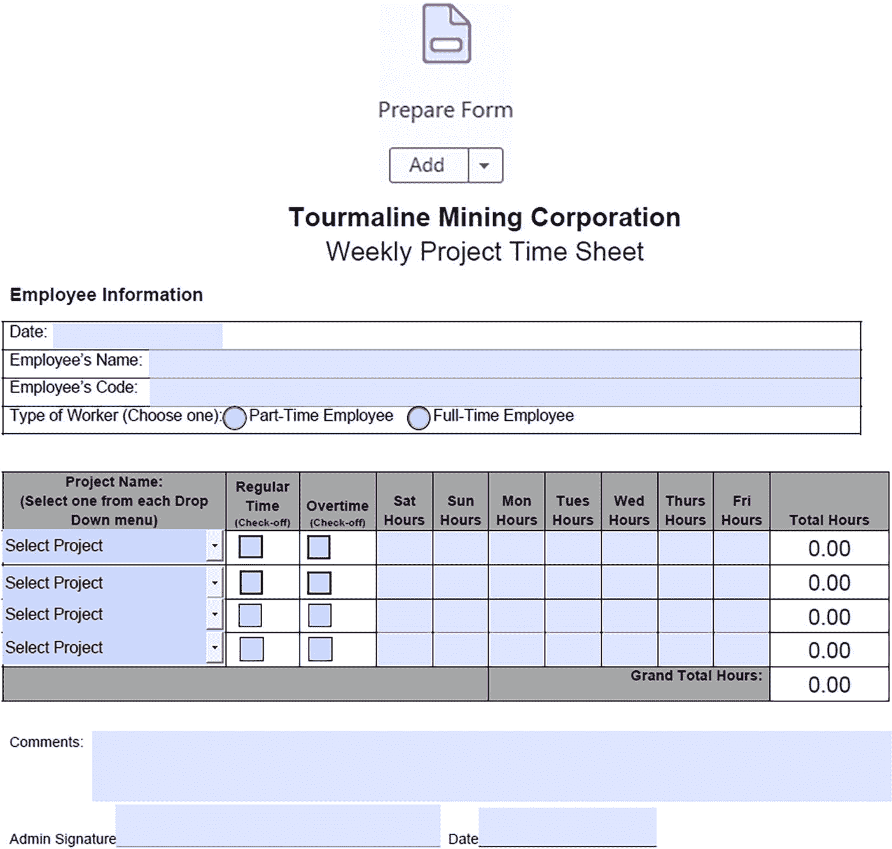

屏幕截图显示一个窗口，其中呈现了**准备表单**工具图标，下方有一个**添加**按钮。它显示了一个名为**图尔玛琳矿业公司每周项目工时表**的表格。该表格列出了员工信息，底部有备注、**管理员签名**和日期字段。

**图 20-10** — 准备表单工具以及一个包含签名和其他字段的 PDF 工时表

这些表单字段的属性将仅限于签名分配。如果您从头开始构建此表单并要求签名，则无法在属性中添加自定义 JavaScript 或任何形式的操作。您可以通过右键单击字段并从弹出列表中选择**属性**来打开此对话框。请参考图 20-11。

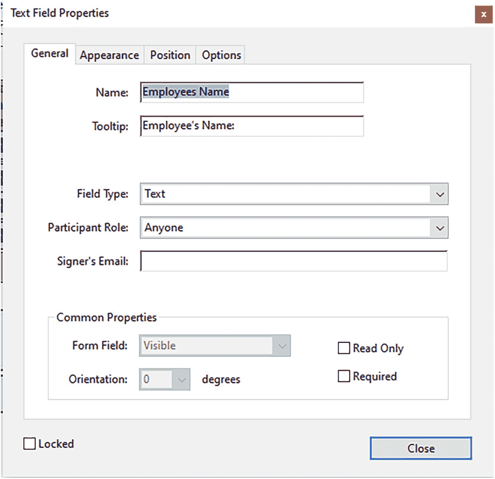

**文本字段属性**对话框的屏幕截图显示了**常规**选项卡下的选项。它显示了名称和工具提示为**employee's name**、字段类型、参与者角色、签名者电子邮件以及带有表单字段和方向选项的常见属性。**关闭**按钮位于底部。

**图 20-11** — 文本字段属性对话框的常规选项卡

在**文本字段属性**对话框中，您只能使用**常规**、**外观**、**位置**和**选项**选项卡。

这里没有用于创建计算、添加验证或向文本字段添加自定义操作的设置。**外观**、**位置**和**选项**选项卡中的属性与创建常规 Acrobat 表单时找到的属性相同。

不过，我将指出**常规**选项卡上的一些关键区别。

图中的**字段类型**列表已从下拉列表中设置为**文本字段**。您可以选择其他一些**文本字段**类型选项，包括**文本**、**签名**、**签名块**、**姓名缩写**、**职务**、**公司**、**姓名**、**电子邮件**和**日期**。请参考图 20-12。

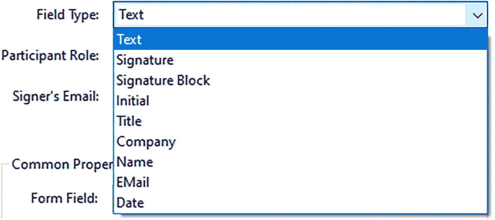

屏幕截图显示了**字段类型**下的下拉列表，其中**文本**选项已被选中。其他选项包括：**签名**、**签名块**、**姓名缩写**、**职务**、**公司**、**姓名**、**电子邮件**和**日期**。

**图 20-12** — 下拉列表中常规选项卡的字段类型选项

与其从列表中选择，不如直接在“`准备表单`”子工具区域中找到这些相同的域选项图标，同时还有用于下拉列表、复选框和单选按钮的附加图标，我们稍后将对此进行进一步讨论。请参阅图 20-13。


一张屏幕截图，展示了在“`准备表单`”子工具下的 17 个域选项图标。

**图 20-13**

电子签名表单的选项

相关的签名字段可以属于任何字段类型类别，如图 20-12 所示。

但是，当您在“`字段类型`”下拉列表中将字段类型从“`文本`”更改为其他选项时，这将会向字段编辑视图中显示的名称标签添加额外的代码。例如 `Employees Name_es_:signature`。请参阅图 20-14。

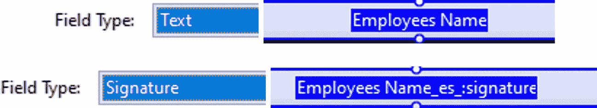

一张窗口屏幕截图，展示了字段类型如何从文本更改为其他选项。“`文本`”已更改为“`Employees name`”，“`签名`”已更改为“`Employees name e-signature`”。

**图 20-14** 根据字段类型，字段名称在编辑视图中会发生变化

然而，这样做并不会更改“`常规`”选项卡上的字段名称，如图 20-11 所示。

在“`常规`”选项卡上，您可以设置签署人的“`参与者角色`”选项，例如“`任何人`”、“`发送者`”、“`签署者`”、“`签署者 1`”至“`6`”或“`预填`”，以确定谁需要签署此字段，并设置签署人的电子邮件（此时为可选）。请参阅图 20-15。

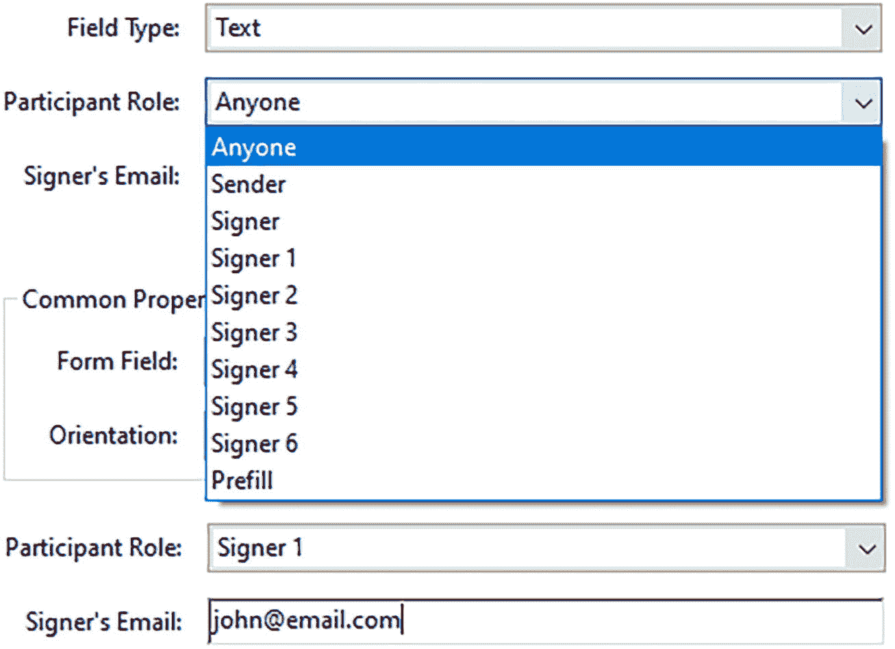

一张屏幕截图，展示了“`常规`”选项卡下“参与者角色”选项的下拉列表。已选中文本“`anyone`”。列表中的其他选项有：“`发送者`”、“`签署者`”、“`签署者 1`”至“`6`”和“`预填`”。

**图 20-15** 用于“`文本域`”设置的“`常规`”选项卡，称为“`参与者角色`”

其他可以设置的字段包括复选框、单选按钮和下拉列表。在“`常规`”选项卡上，这些字段类型将变灰并禁用，因此您无法对其进行编辑。此外，对于单选按钮，您将无法更改“`参与者角色`”和“`签署人电子邮件`”设置。请参阅图 20-16。

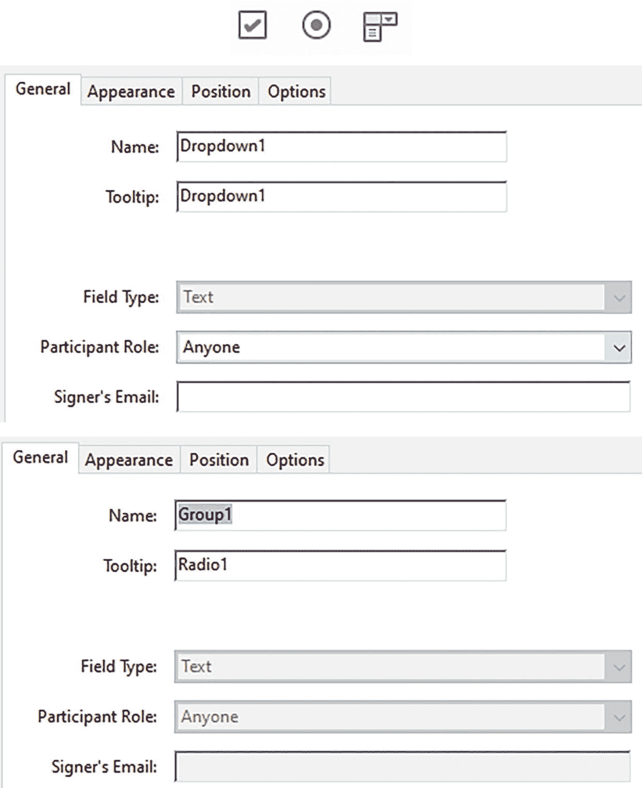

两张屏幕截图展示了“`常规`”选项卡下的选项，顶部带有复选框、单选按钮和下拉列表图标。它们分别显示名称为 `dropdown 1` 及相应工具提示，以及第二个截图中的 `group 1` 和 `radio 1`，以及禁用的字段类型、参与者角色和签署人电子邮件。

**图 20-16** 复选框、单选按钮和下拉列表在“`常规`”选项卡中能够设置的字段有限制

没有列表框或按钮、图像或条形码字段可用。但是，在“`准备工具`”区域，您仍然可以选择字段（双击即可编辑）的选项。您也可以编辑文本和图像，以及添加文本框。请参阅图 20-17。


一张显示“选择”、“编辑文本和图像”以及“添加文本框”图标的屏幕截图。

**图 20-17** 这些“`准备表单`”工具选项允许您修改表单中的文本

当您单击页面以添加新的表单字段时，这些相同的选项将在进入属性面板并在“`常规`”选项卡上设置它们之前出现。请参阅图 20-18。

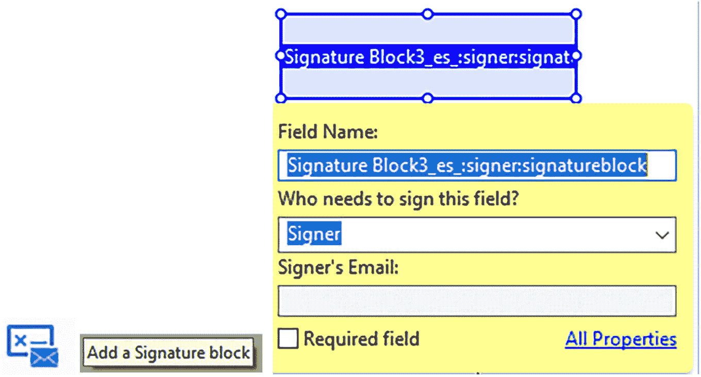

一张弹出框的屏幕截图。它显示了文本字段，其中需要添加选项名称、谁需要签署此字段以及签署人电子邮件。选择每个选项时，其下方会出现一条注释。左下角有一个占位符用于添加签名块。

**图 20-18** 添加新表单字段时出现的选项

预览字段后，关闭“准备表单”工具。保存文件后，即可请求电子签名并发送表单以供签名。请参考图 20-19。

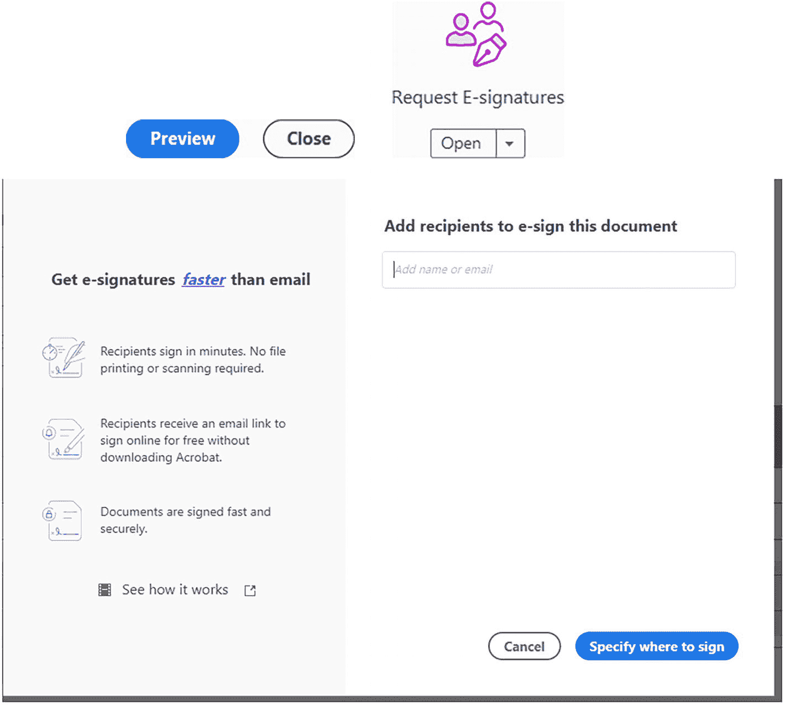

> 预览窗口的屏幕截图显示“请求电子签名”选项下的内容，带有一个打开按钮。文本显示“添加收件人以电子签署此文档”，并有一个用于输入姓名或电子邮件的文本字段。按钮“指定签名位置”已被选中。

**图 20-19** 表单完成后，即可开始请求电子签名流程。

此较新的工具位于“工具”选项卡的“表单和签名”区域。但是，在“准备表单”工具中处理表单时，也可以通过右下方面板访问它。请参考图 20-20 和图 20-21。

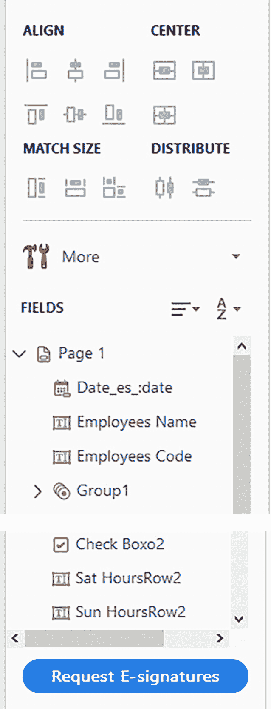

> 列表的屏幕截图展示了以下图标下的编辑选项：对齐、居中、匹配大小和分布，以及更多工具选项。它显示“字段”选项下的列表，其中“请求电子签名”按钮已被选中。

**图 20-20** 也可以在表单编辑模式下启动电子签名请求。

最初，您将进入“填写和签名”工具。但是，添加收件人并单击“更多选项”按钮后，您将进入“请求电子签名”工具。请参考图 20-21。

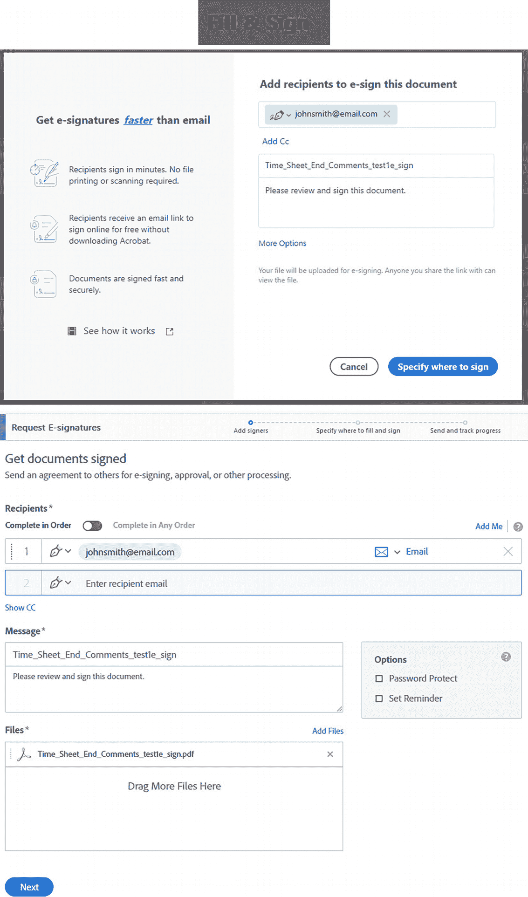

> 窗口的屏幕截图显示“填写和签名”下的选项，其中“指定签名位置”按钮被选中。它显示一个“获取文档签名”页面，包含收件人、消息和文件字段，位于请求电子签名下添加签名者的第一阶段。

**图 20-21** 在测试文件上启动电子签名请求。

根据您单击的按钮，这两个选项的布局和顺序略有不同。因此，这里提供一些进一步资源的链接，以便您在您的`Acrobat Pro`版本外观与我的略有不同时，继续此流程：

-   [`https://helpx.adobe.com/acrobat/using/creating-distributing-pdf-forms.html`](https://helpx.adobe.com/acrobat/using/creating-distributing-pdf-forms.html)
-   [`https://helpx.adobe.com/acrobat/using/send-for-signature.html`](https://helpx.adobe.com/acrobat/using/send-for-signature.html)

单击“下一步”（图 20-21）后，您将进入下一步，指定填写和签名的位置。也可以通过之前找到的名为“指定签名位置”的按钮访问此相同步骤。然后，您将继续处理表单，根据需要调整收件人设置并添加和编辑字段。可以右键单击字段，然后从弹出菜单中选择“编辑”选项。接着，单击右侧面板中的“发送”按钮进行发送，并跟踪进度以及接收确认通知。这将创建一种 Web 表单协议，您可以在您的`Adobe Acrobat`主页上根据需要取消和在线删除它，或继续在线编辑。它们也可以作为模板保存，用于其他项目。我们将在本章后面部分更详细地研究其中一些与在线使用 Web 表单编辑字段相关的步骤。您在下一节中学到的内容也可以应用于“请求电子签名”工具。请参考图 20-22。

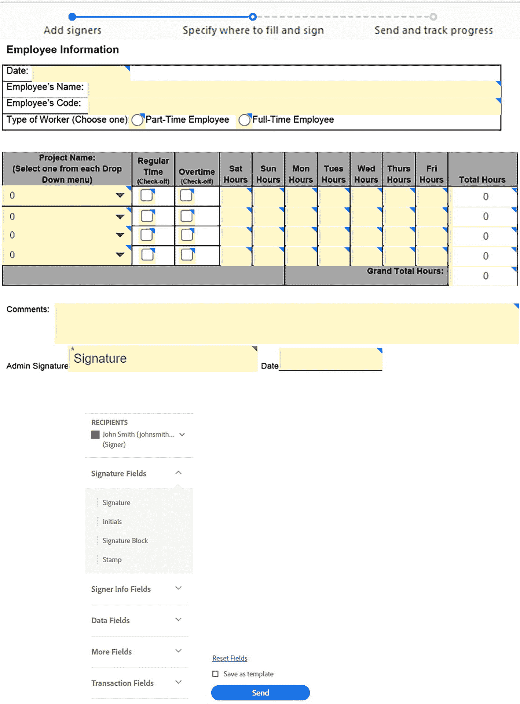

> 屏幕截图显示签署文档的第二步。它呈现一份员工信息表，带有管理员签名选项，并列出签名字段下的下拉菜单，其中包含签名、缩写、签名块和印章选项。底部有一个选中的“发送”按钮。

**图 20-22** 在测试文件上启动电子签名请求，并指定填写和签名的位置以及审核字段。

如果需要在不保存更改的情况下进行编辑，可以单击此工具右上角的“关闭”按钮。

如前所述，诸如“填写和签名”和“证书”之类的工具通常与常规的`Acrobat`表单一起使用以完成签名过程。但是，也有一些新的相关工具，例如“创建 Web 表单”（我们接下来将简要介绍），以及其他在线选项，如“批量发送”、“添加电子签名品牌”和“收款”。请参考图 20-23。

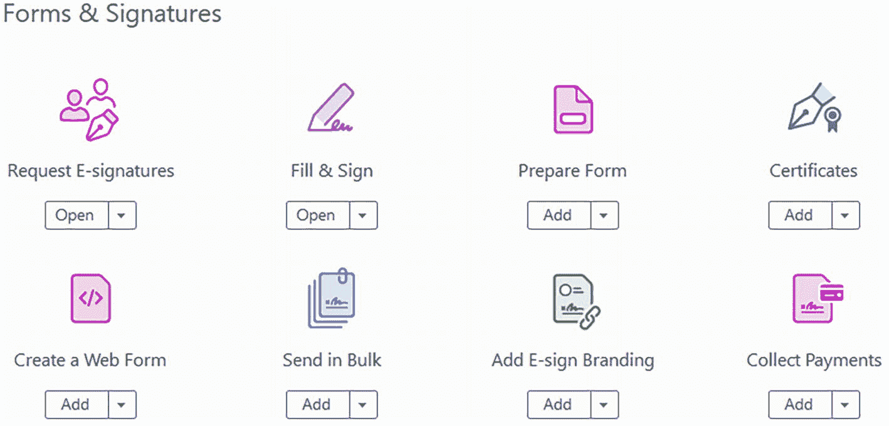

> 窗口屏幕截图显示“表单和签名”下的`Adobe Acrobat`工具。包括：请求电子签名、填写和签名、准备表单、证书、创建 Web 表单、批量发送、添加电子签名品牌和收款。

**图 20-23** “表单和签名”部分中的工具概览。

在“准备表单”工具中处理表单时，如果任何时候您发现这不是您想要创建的表单类型，请使用右侧的“更多”下拉菜单，恢复到像过去章节中那样创建`Acrobat`表单。请参考图 20-24。


> “更多工具”图标下的“恢复到 Acrobat 表单”选项的屏幕截图。

**图 20-24** 使用“准备表单”工具时，使用“更多”菜单恢复到`Acrobat`表单。

当前表单已准备好进行电子签名。请参考图 20-25。


> “更多工具”图标下的“准备表单以供电子签名”选项的屏幕截图。

**图 20-25** 使用“更多”菜单准备表单进行电子签名。

但是，请注意，在`Acrobat`表单和电子签名表单之间来回切换可能会移除或隐藏您访问先前创建的自定义`JavaScript`的功能。如本例所示，您无法访问“计算”选项卡，尽管“总小时数”列和“总计”小时数的计算仍然有效。原始`Acrobat`表单中的一个按钮被移除，并且在此设置生效前会显示两条警告消息。在第一个警报中，单击“下一步”，然后在第二个警报中单击“确定”。请参考图 20-26。

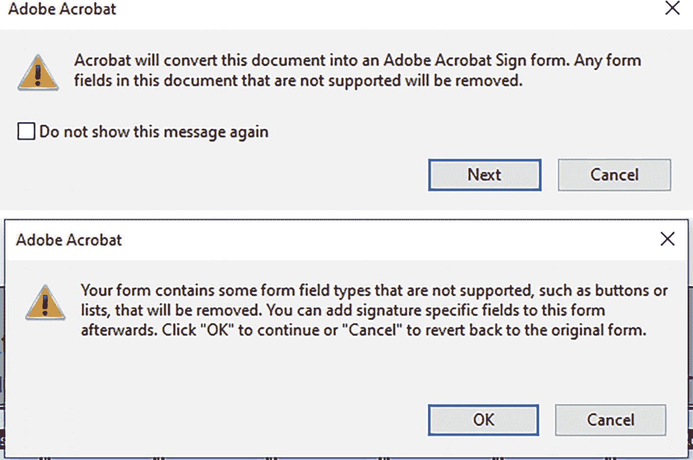

# 什么是网页表单？

另一个直接涉及表单的工具是新建“创建网页表单”工具。网页表单类似于我们之前创建的“请求电子签名协议”表单。它们需要签名，并且这些表单可以嵌入到你的网站中，或通过电子邮件中的链接发送，以便多人可以访问该表单或文档。我们无需使用 `Acrobat Pro` 构建整个表单，而是可以继续在 `Acrobat` 主页上在线构建它。现在，我们将简要概述网页表单的创建过程。这使你能够将表单添加到网站，并共享链接以在线收集数据。当你在未选定特定表单的情况下选择“创建网页表单”选项时，也可以通过“准备表单”工具访问此区域。请参见图 20-27。

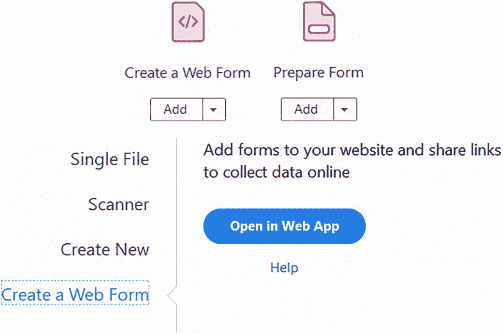

**图 20-27** 你可以使用“准备表单”工具中的此选项，或从工具本身开始，从头创建一个网页表单。

如果你已登录账户，当你点击此工具或“在 Web 应用中打开”按钮时，它将带你进入 `acrobat.adobe.com`，你可以在此上传你之前创建的现有表单之一。请参见图 20-28。

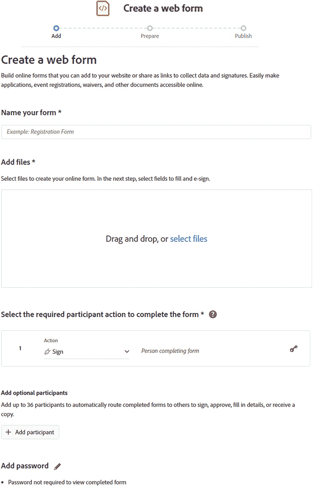

**图 20-28** 创建网页表单及相关设置。

首先，你可以为表单命名。请参见图 20-29。


**图 20-29** 通过命名开始创建网页表单。

然后，你从电脑中选择要添加的一个或多个文件。请参见图 20-30。

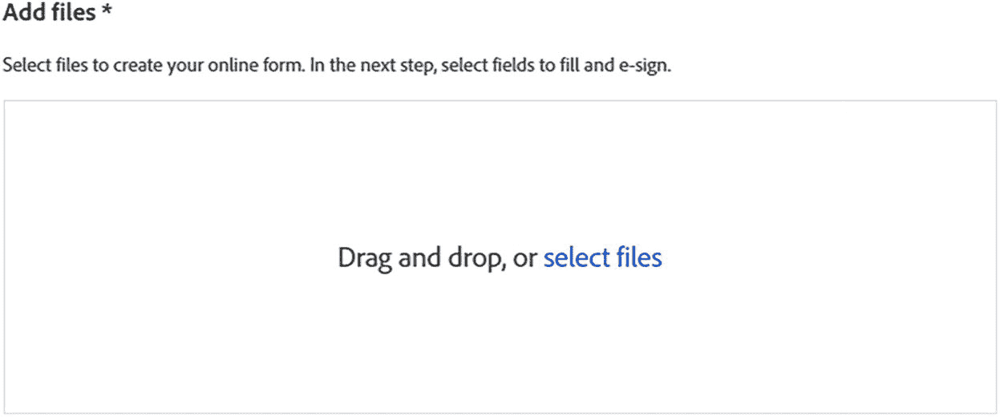

**图 20-30** 在电脑上选择你想要作为网页表单一部分的文件。

如果你想练习，可以使用我在本章中提供的文件。首先点击“选择文件”链接，然后点击“我的电脑”选项卡。接着，从你的设备上点击“添加一个文件”（例如，我已重命名的文件或你自己的文件），在桌面上定位一个 PDF 文件。点击“打开”，它就会被添加到列表中。请参见图 20-31。

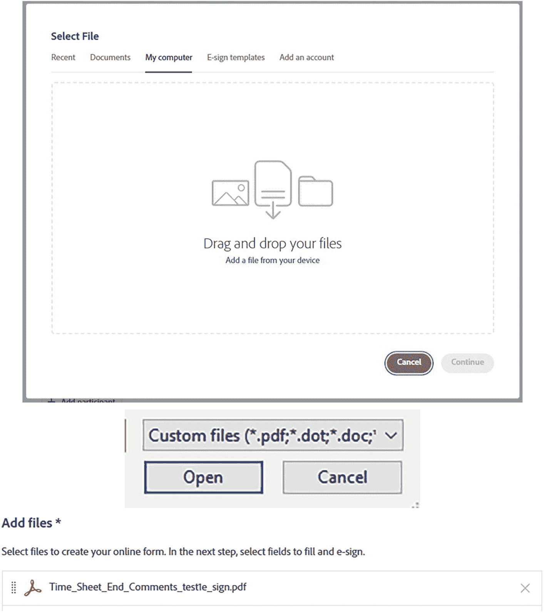

**图 20-31** 定位一个或多个文件并添加到列表中。

你可以添加的文件类型可以是仅用于电子签名的 PDF 文件，但你也可以使用你一直在本书中创建的常规 `Acrobat` 表单 PDF。

然而，请记住，并非所有表单域都能像在 `Acrobat Pro` 中的 PDF 格式那样正常工作，因此你可能需要修改或移除某些域，如本章前面所述。例如，数字签名在上传后可能会变成电子签名。稍后我将展示一个示例。

其他会被移除的域类型包括按钮、列表框和图像域。条码域会部分显示为一个空白方块。因此，在上传常规 `Acrobat` 表单（而非电子签名表单）之前，要考虑这些域是否是完成表单所必需的，是否应该移除，或者是否应该用其他域替换。例如，列表框域可能可以被下拉列表替换。你应该先对表单副本手动进行这些编辑。请参见图 20-32。


**图 20-32** 以下类型的域——按钮、条码和列表框——不适用于电子表单，但下拉列表除外。

稍后我们会看到，图像域在线上环境中如果消失，可以重新添加。请参见图 20-33。


**图 20-33** 图像域可以在线上构建时稍后添加，但首次上传时会消失。

同样，你也可以从其他格式开始，例如 Microsoft Word（`.doc` 和 `.docx`）、Excel（`.xls`、`.xlsx`）、PowerPoint（`.ppt`、`.pptx`）以及其他图形格式（`.html`、`.bmp`、`.jpg`、`.tiff`）。请参见图 20-34。


**图 20-34** 可以组合各种文件格式来创建网页表单。

然而，请记住，除 PDF 外，其他格式在上传到在线文件之前，可能无法保留某些预设的表单域，你需要进行自动检测。自动检测虽然有用，但并非在所有情况下都能提供你所需的所有表单域，你可能需要随后删除或添加所需的域。这就是为什么如果你需要在电脑桌面上对表单进行某些特定的编辑时，最初先在 `Acrobat` 中构建表单可能是更好的解决方案。我们稍后会讨论这一部分。请参见图 20-35。

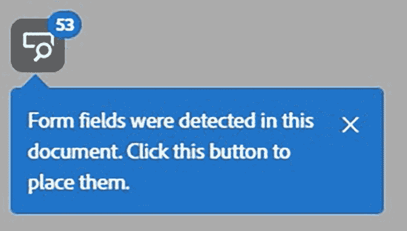

**图 20-35** 文件被添加和上传后，`Acrobat` 可以检测可能的域区域。

回到“添加”步骤，在第一步中添加一个或多个文件后，你可以设置参与者的操作以完成表单，并通过密码进行身份验证。

*   **签署**：签署表单，也可能输入数据。
*   **审批**：审核并批准表单；也可能输入数据或签署。
*   **填写表单**：输入所需数据并提交表单，但通常不签署。
*   **抄送**：在表单完成过程中接收通知。此项不会出现在初始列表中。

添加最多 36 个参与者，你将按顺序列出他们以完成表单及其操作。添加他们的电子邮件地址以便进行路由，第一个参与者除外；在这种情况下，你将在表单完成阶段输入其电子邮件地址。如果你需要进一步了解某些设置以及参与者的密码验证，可以查看各种信息按钮。请参见图 20-36。

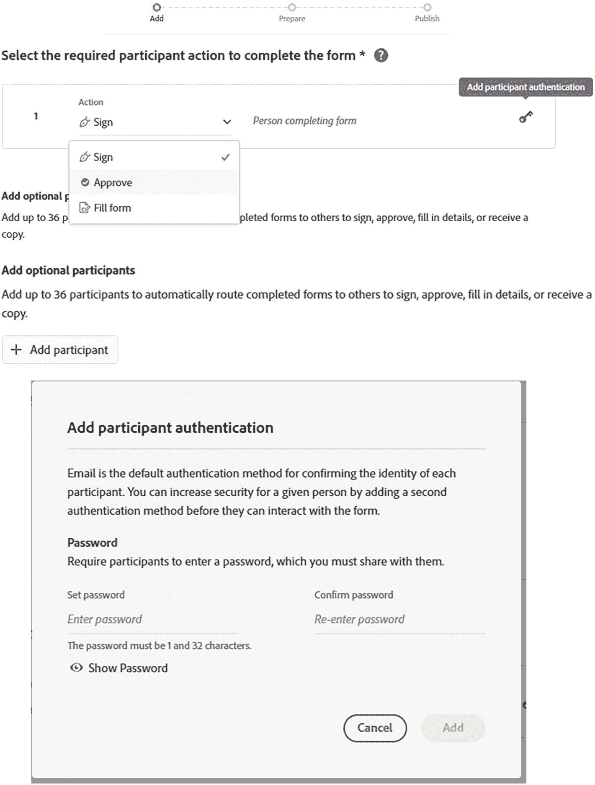

**图 20-36** 向你的 Web 表单添加更多参与者，并决定他们的操作以及身份验证方式。

此外，如有需要，你可以添加访问密码，但查看已完成的表单则无需密码。点击 `Next` 进入下一步。请参考图 20-37。

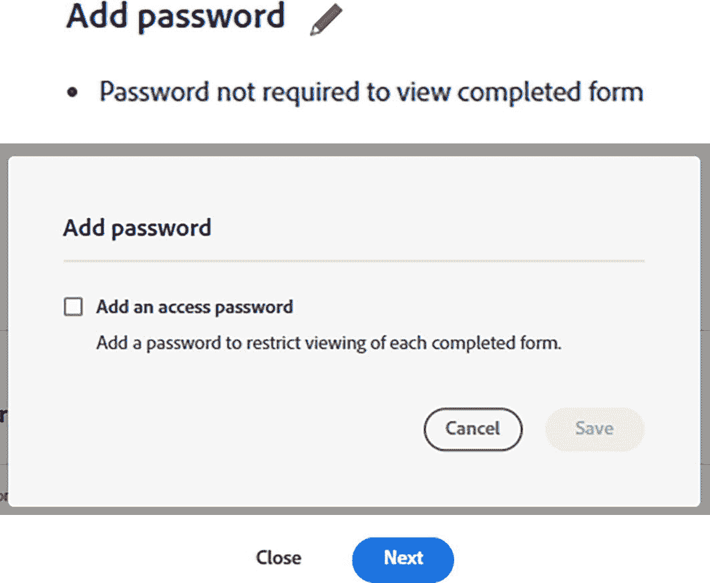

**图 20-37** 为特定表单添加密码（可选）并点击 `Next` 继续。

## 向 Web 表单添加参与者

接着，你将进入准备文档的步骤，在此步骤中，你可以向在线文档添加或编辑表单字段。请参考图 20-38。

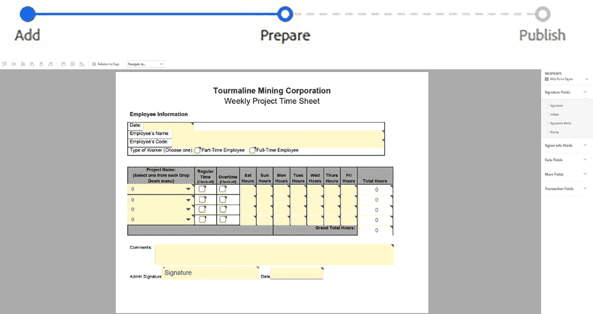

**图 20-38** 查看并准备你的 Web 表单。

在此处你可以编辑每个字段。右侧显示的收件人签名，指明了谁可以稍后签署文档以及与各个表单字段进行交互。右上角三角形内分配给字段的颜色，将指示该字段影响哪位收件人。请参考图 20-39。

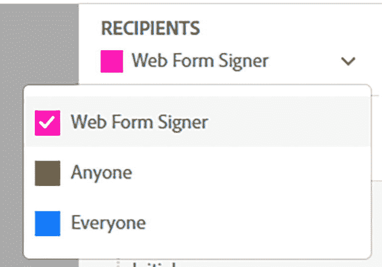

**图 20-39** 预览当前的收件人是谁。

在此 Web 表单中，其他属性选项将变为可用，类似于你在 `Acrobat` 中使用“请求电子签名”工具时所看到的情形。你可以使用文本字段来创建数值计算。你可以在右侧窗格中查看这些类型的字段。请参考图 20-40。

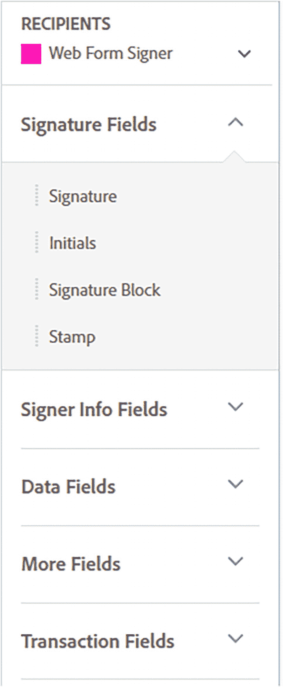

# 在表单中使用JavaScript

一张“收件人”弹出框的截图，其中显示了“Web 表单签署人”下的选项。它列出了“签名”字段下的一个下拉菜单，内容为：签名、首字母、签名块和印章。

**图 20-40** 在右侧窗格中查看各种字段选项。

那么，这种表单是否允许你使用 JavaScript 呢？

虽然在你上传或添加表单时，最初似乎无法编写任何自定义的 JavaScript 或代码，但一旦表单上线并进入“准备表单”阶段，你可以通过右键单击单个字段，然后从弹出菜单中选择该选项来进行编辑，就像你之前使用“请求电子签名”工具时一样。然后，你可以设置各种验证设置以及参与者可能需要填写的条件，以完成表单。请参考图 20-41。

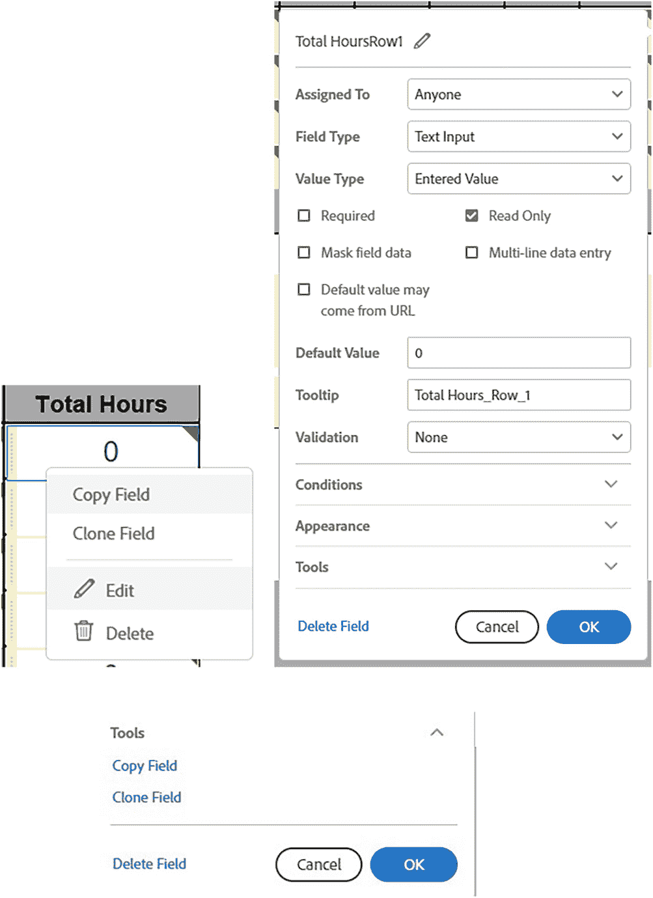

一张“总工时”字段下编辑选项的截图。其中第 1 行显示为：分配给、字段类型、值类型、默认值、工具提示、验证、条件、外观和工具，并突出显示了 `OK` 按钮。

**图 20-41** 右键单击字段并选择“编辑”即可查看该字段的属性。

当你从弹出菜单中选择 `Edit` 时，其他选项包括 `Copy`、`Clone` 和 `Delete`。

选择“编辑”选项后，你可以设置属性。这些属性可能包括设置验证或各种类型的条件，这些条件会导致字段显示、隐藏、启用或禁用。你还可以在“工具”选项卡上调整字段的外观，以复制、克隆或删除某个字段选项。请参考图 20-42。

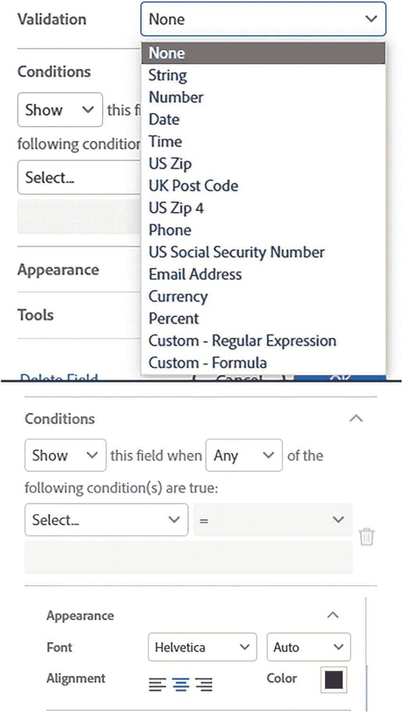

一张验证设置下的截图，其中有一个下拉列表，并突出显示了 `None`。还包括条件和外观的设置。

**图 20-42**

## 文本字段可用的各种属性

然而，在计算示例中上传 Acrobat 表单时，某些设置可能会丢失，你将需要重新设置计算条件才能使表单正常工作。我在本节末尾提供了一些链接，供你更详细地了解这段代码。图 20-43 展示了对于需要相加的文本字段，其界面可能的样子。

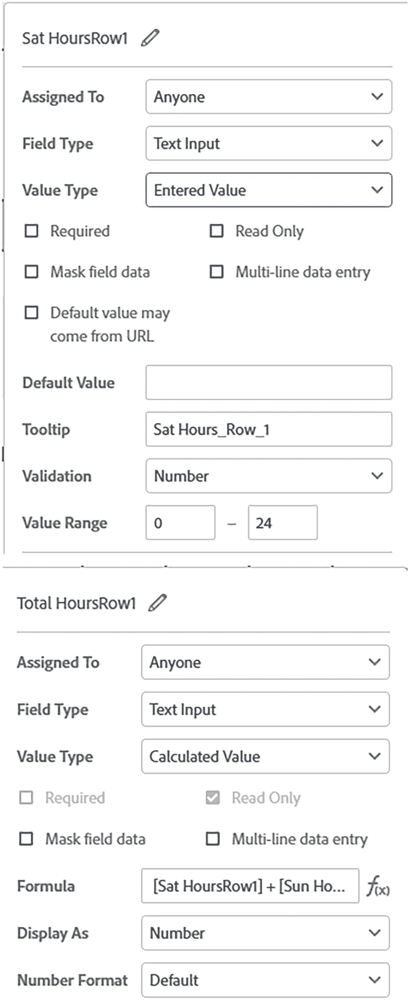

这是“周六工时第 1 行”和“总工时第 1 行”下的字段设置截图。其中包含以下设置选项：分配对象、字段类型、值类型、默认值、工具提示、验证、值范围、公式、显示方式以及数字格式。

**图 20-43** — 将值类型从“输入值”更改为“计算值”并输入新公式

当我点击公式`f(x)`图标时，会弹出一个对话框，我可以开始创建公式。这个区域同样适用于验证自定义公式。我发现这个区域比 Acrobat Pro 的常规区域详细得多，并且在某些方面与 MS Excel 相似。在使用“请求电子签名”工具时，你也可以进入这个区域。一旦你选择了所需的字段和函数来构建公式，就可以点击**检查语法**按钮（该按钮充当公式的调试器），或者重置公式以清除内容。请参阅图 20-44。

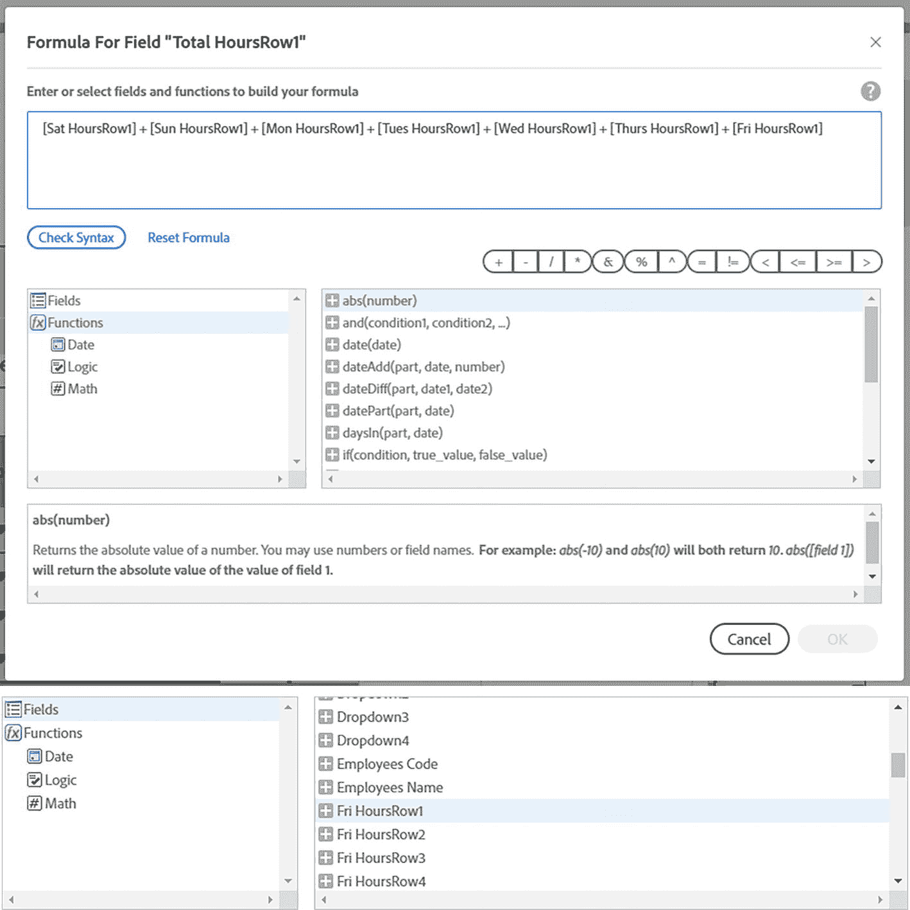

三张截图展示了在工作表中构建公式的步骤：选择所需的行字段，以及日期、逻辑和数学函数。其中有一个空白区域用于输入包含函数的公式，并且“检查语法”按钮被高亮显示。

**图 20-44** — 使用对话框添加公式

点击字段或函数旁边的加号键，可以将该项添加到公式中。此外，还有一些额外的运算符，你可以通过点击来进行字段的加、减、乘、除，以及大于或小于等其他条件操作。当然，你也可以直接手动输入文本。

点击按钮检查语法后，如果证明语法有效，你可以点击**确定**退出对话框，或者点击**取消**不保存任何更改。请参阅图 20-45。

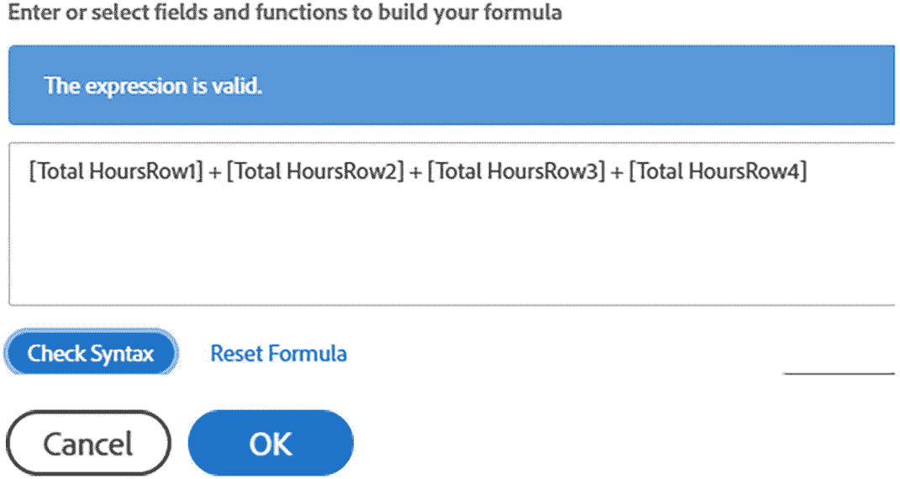

一张截图展示了如何使用“检查语法”按钮检查公式语法。如果输入的公式正确，会显示消息“表达式有效”，并且**确定**按钮会被高亮显示。

**图 20-45** — 检查公式语法是否有效，然后点击**确定**

> **注意**
>
> 对话框下方的文本区域会提供一些关于日期、逻辑和数学等函数的实用说明。请参阅图 20-46。

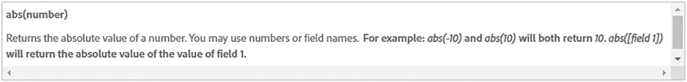

一张关于绝对值数学函数信息的截图。内容如下：`abs()` 用于数字，返回一个数字的绝对值。`abs(-10)` 和 `abs(10)` 都会返回 10。`abs(field1)` 会返回 `field1` 值的绝对值。

**图 20-46** — 对话框有助于解释某些公式函数（`fx`）及其用途

条件同样可以为单选按钮、复选框和下拉列表设置，但似乎没有提供允许特殊验证格式的属性。不过，单选按钮和复选框可以成为计算值类型的一部分。请参阅图 20-47。

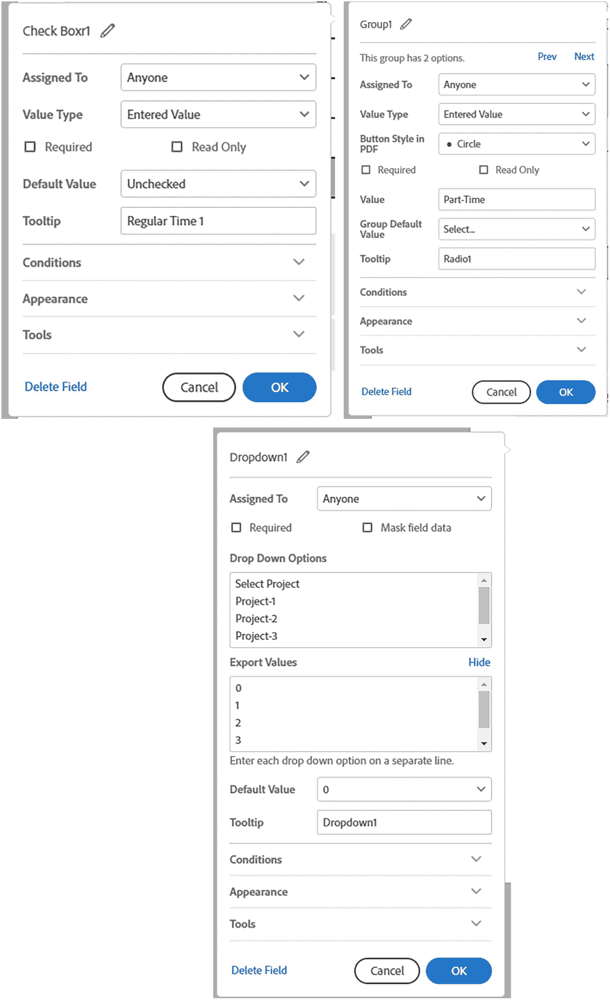

三张弹出框的截图。每个弹出框都展示了在“复选框 1”、“组 1”和“下拉列表 1”下的字段设置选项，例如分配对象、值类型、默认值、工具提示、下拉选项、导出值、条件、外观和工具，其中**确定**按钮被高亮显示。

**图 20-47**

## 复选框、单选按钮组和下拉列表的属性选项

点击 `OK` 提交更改，或在输入完特定字段的属性后点击 `Cancel` 退出。

如前所述，如果你的图片字段在上传过程中丢失，你仍可以通过右侧的 `Data Field` 选项，再次为表单添加图像框。但列表框或按钮没有可用的选项。在此处，你可以访问更多字段，例如 `Text Input`（文本输入）、`Drop Down`（下拉列表）、`Check Box`（复选框）和 `Radio Button`（单选按钮）。请参考图 20-48。

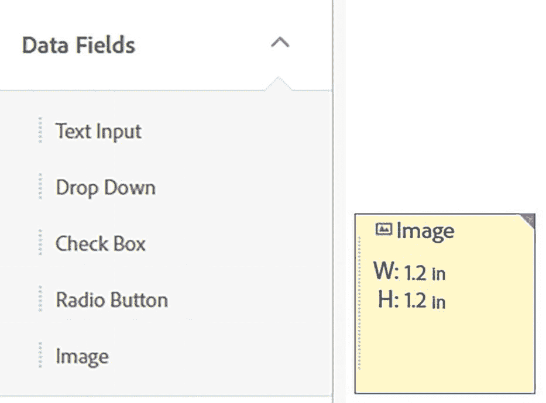

`Data Fields` 选项下拉菜单的截图。菜单中包含 `text input`、`drop-down`、`check box`、`radio button` 和 `image`。图像预览显示其高度和宽度为 1.2 英寸。

**图 20-48**

`Data Field` 选项以及新的 `Image` 字段在页面上的预览效果，以及其他数据字段

以下是后续可以添加并拖入表单的其他字段。

* **签名域（Signature Fields）**：用于使用 `Signature`（签名）、`Initials`（姓名首字母）、`Signature Block`（签名块，包含签名和电子邮件）和 `Signature Stamp`（签名印章）进行签署。请参考图 20-49。

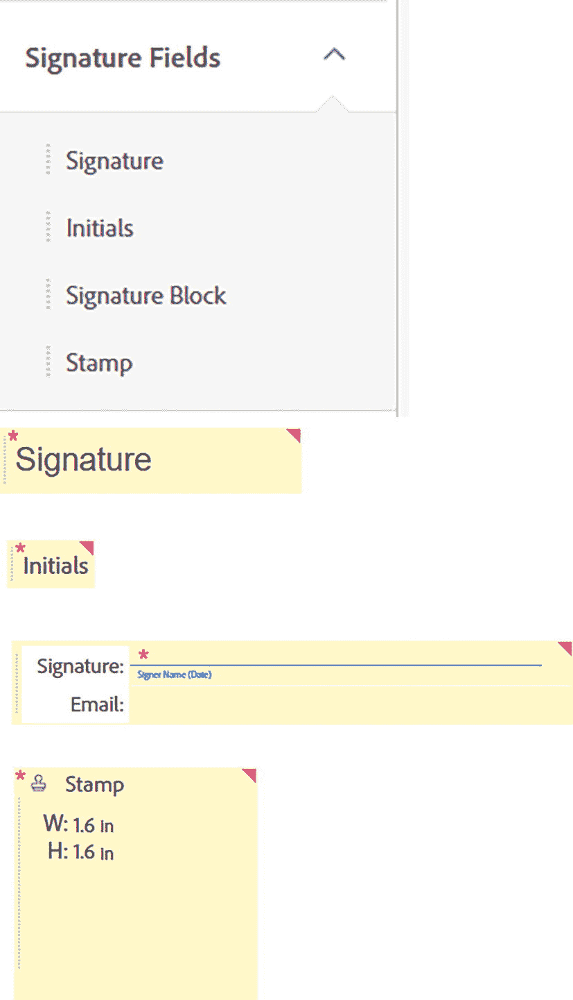

`Signature fields` 选项下拉菜单的截图。菜单中包含 `signature`、`initials`、`signature block` 和 `stamp`。每个签名域选项的预览图及其参数一并显示。

**图 20-49**

`Signature Field` 选项及其在页面上的预览效果

* **签署人信息域（Signer Info Fields）**：这是供签署人添加附加信息的区域，包括 `Job Title`（职位）、`Company Name`（公司名称）、`Full Name`（全名）、`Email`（电子邮件）和 `Date`（日期）设置。`Name`（姓名）是签署人，可能已知，因此该字段可能已设置或为只读。对于 `Date` 字段，它作为一种时间戳，例如当前日期。这与经过日期验证的 `text input` 数据字段不同。请参考图 20-50。

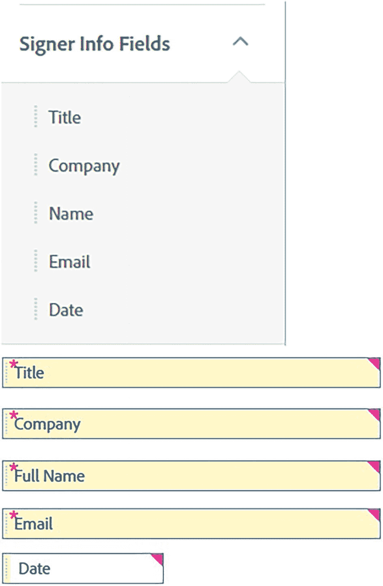

`Signer Info fields` 选项下拉菜单的截图。菜单中包含 `title`、`company`、`name`、`email` 和 `date`。每个签署人信息字段选项的预览图一并显示。

**图 20-50**

`Signer Info Fields` 选项及其在页面上的预览效果

> **注意**
>
> 当你计划上传一个在 `Acrobat Pro` 中创建的电子表单以供在线发布时，需要确保 `属性（Properties）` > `常规（General）` 字段中的参与者角色设置正确。否则，你可能会在上传表单时发现某些字段丢失。我发现，当我把字段从 `Signer` 更改为 `Sender` 或 `Prefill` 等选项时就会出现这种情况。这些字段不会显示在右侧窗格的 `Recipients`（收件人）区域，也无法通过像图 20-50 中那样带有三角形的颜色协调字段选项来选择。`Anyone` 选项是能正常工作的。请参考图 20-15 和 20-39。

* **数据字段（Data Fields）**：正如我们目前所见，数据字段包括 `Text Input`（文本输入）、`Drop Down`（下拉列表）、`Check Box`（复选框）、`Radio Button`（单选按钮）和 `Image`（图像）。

* **更多字段（More fields）**：这些用于 `File Attachment`（文件附件）和 `Hyperlink`（超链接，即文档内的 URL 或页面）。请参考图 20-51。

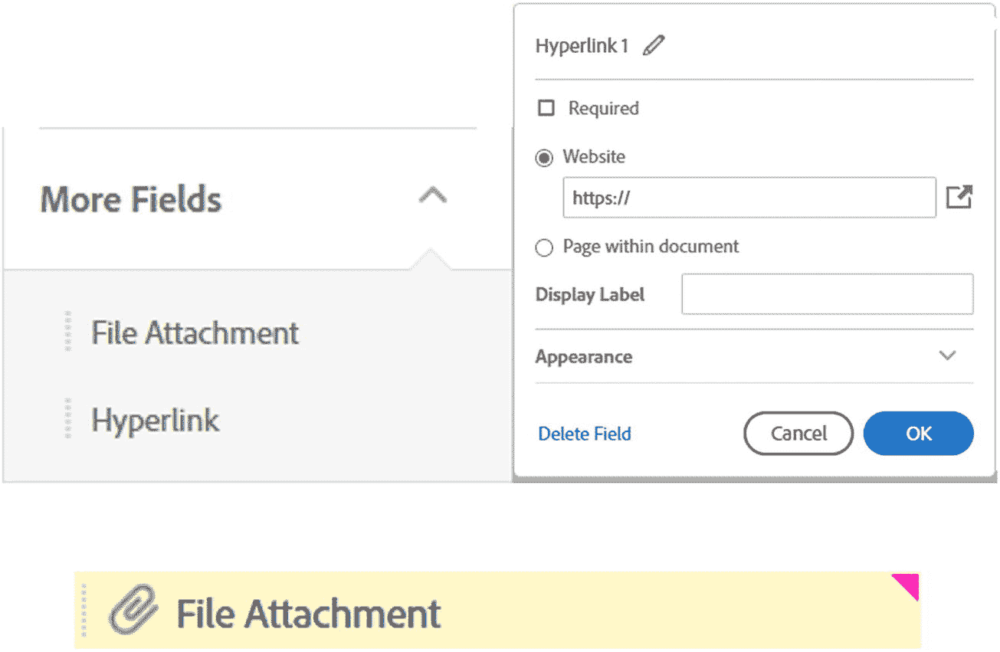

`More fields` 选项下拉菜单的截图，包含 `file attachment` 和 `hyperlink`。下方显示了 `file attachment` 选项的预览图及其回形针图标。`hyperlink` 选项则是一个弹出框，用于设置网站、显示标签和外观。

**图 20-51**

`More Field` 选项及其在页面上的预览效果

## 交易字段（Transaction Fields）

这些包括 `Participation Stamp`（参与印章）和 `Acrobat Sign Transaction Number`（Acrobat Sign 交易编号）。请参考图 20-52。

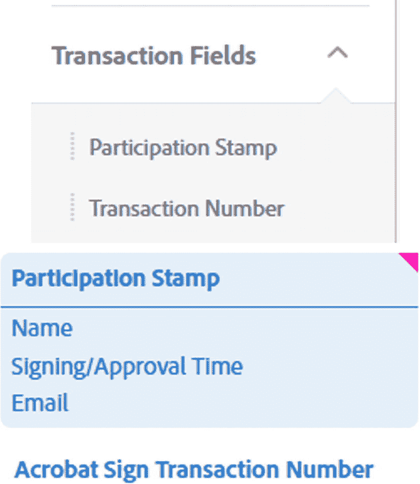

在**事务字段**选项下的下拉菜单截图显示了参与戳记和交易编号。屏幕上显示了包含姓名、签署或批准时间以及电子邮件设置的参与戳记预览，以及 Acrobat Sign 交易编号。

**图 20-52**

事务字段选项及其在页面上的预览效果

将各种表单字段拖放到表单上后，您可以通过移动或缩放其边缘来调整它们（当光标变为箭头时）。请参考图 20-53。


一张截图展示了如何通过拖动光标来调整字段大小。它显示了一个带有方向箭头的矩形框，并展示了不同方向的双向箭头和四向箭头。

**图 20-53**

当光标变为箭头时，可以移动或调整字段大小

按住 `Shift` 键并点击可以选择多个字段，您可以使用左上角的**对齐**选项来相对其他字段或页面进行对齐或分布，操作方式与在 Acrobat Pro 应用中一致。请参考图 20-54。


一张截图展示了如何选中多个字段。图中两个矩形字段处于选中状态，下方有 9 个图标用于对齐所选字段或相对于页面进行对齐，旁边是一个包含 `Sat Hours Row 2` 的下拉菜单。

**图 20-54**

可以使用图标对齐多个选中字段

您还可以使用右上角的下拉列表导航到特定的表单字段，以帮助您选中该字段。请参考图 20-55。

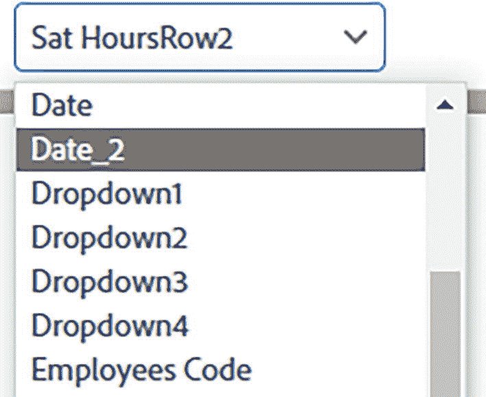

字段 `Sat Hours Row 2` 下方的下拉菜单截图显示：`date`、`date_underscore 2`、`dropdown 1`、`dropdown 2`、`dropdown 3`、`dropdown 4` 和 `employees code`，其中 `date_underscore 2` 被选中。

**图 20-55**

从下拉列表中定位选中的字段

在此窗格的右下方，您还可以将字段重置到上次保存的版本。请参考图 20-56。

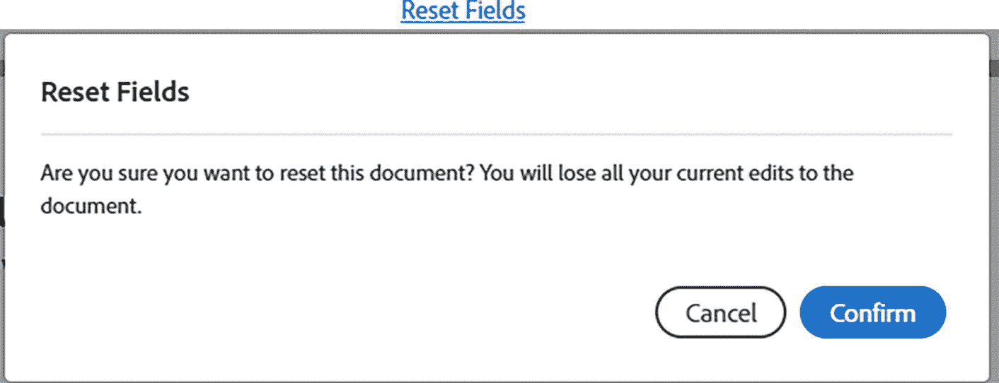

重置字段弹出框的截图。它显示警告信息：重置文档会导致用户丢失当前对文档的所有编辑，并询问用户是否要重置该文档，其中**确认**按钮高亮显示。

**图 20-56**

如果出现错误，可重置字段

下方区域还包含当前页面的导航。请参考图 20-57。


一个深色行显示导航图标的截图。它具有向上箭头、向下箭头、页码、放大和缩小选项。

**图 20-57**

导航到表单中的其他页面，或在表单中放大或缩小以查看特定字段

如果导入表单时出现任何错误（例如下拉列表中的值不足），您将在顶部或**属性**对话框中看到一条红色警告信息。您必须在发布前纠正此错误。图 20-58 展示了一个示例，说明错误可能如何出现在下拉列表中（其中下拉值和导出值均缺失），以及错误被纠正后的情况。请参考图 20-58。

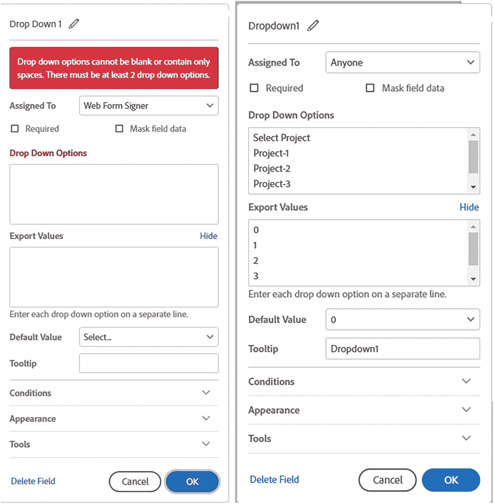

**Drop Down 1** 窗口的两张截图。窗口 1 显示下拉选项和导出值的空白区域，并带有错误消息：至少需要 2 个选项，并且不能为空或仅包含空格。窗口 2 显示包含 4 个选项的下拉值和导出值。

**图 20-58**

纠正下拉列表属性中选项和导出值的错误

必须字段会以星号（`*`）标记。请参考图 20-59。

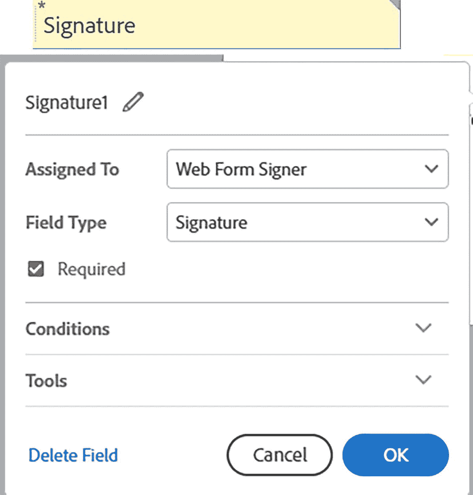

*图 20-59 设置签名字段的必填项*

准备表单并添加字段后，您可以点击`Create`按钮将其发布以进入最后一步。请参考图 20-60。


*图 20-60 点击`Create`按钮发布您的表单*

表单现已准备就绪，一旦您获得 Web 表单的`URL`，即可将其发布到您的网站上。此外，您还可以复制`iframe`的`HTML`或`JavaScript`代码并将其嵌入到您的网页中。链接可以作为`URL`与其他人共享（例如通过电子邮件发送），或者将代码嵌入到您网站的某个位置。请参考图 20-61。


*图 20-61 查看您的`URL`及其他推荐操作，并点击`Done`*

表单填写完成后，每位参与者将收到一份`PDF`副本或电子邮件链接，您可以在`Documents`列表中跟踪您的活动，或预览刚刚创建的表单。然后，您可以在该阶段查看其他推荐操作，例如预览 Web 表单。

现在，点击`Done`，该文件将被添加到您`Adobe`主页上用于共享和审阅的列表中。请参考图 20-62。

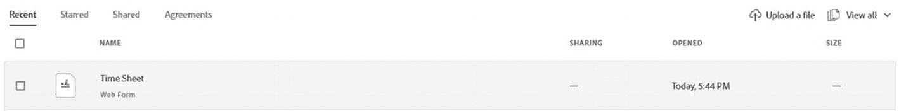

*图 20-62 新创建的表单被添加到 Adobe Acrobat 主页*

由于该区域会不断更新并添加新功能，以下是一些链接和资源，可帮助您继续学习过程，以及关于如何格式化字段的参考：

*   [`https://www.adobe.com/sign.html`](https://www.adobe.com/sign.html)
*   [`https://www.adobe.com/sign/features/web-forms.html`](https://www.adobe.com/sign/features/web-forms.html)
*   [`https://helpx.adobe.com/sign/config/web-forms.html`](https://helpx.adobe.com/sign/config/web-forms.html)
*   [`https://helpx.adobe.com/sign/power-user/web-form/create.html`](https://helpx.adobe.com/sign/power-user/web-form/create.html)
*   [`https://helpx.adobe.com/sign/power-user/web-form/edit.html`](https://helpx.adobe.com/sign/power-user/web-form/edit.html)
*   [`https://helpx.adobe.com/sign/power-user/web-form/disable.html`](https://helpx.adobe.com/sign/power-user/web-form/disable.html)
*   [`https://helpx.adobe.com/sign/power-user/web-form/hide.html`](https://helpx.adobe.com/sign/power-user/web-form/hide.html)
*   [`https://helpx.adobe.com/sign/power-user/web-form/find-code.html`](https://helpx.adobe.com/sign/power-user/web-form/find-code.html)
*   [`https://helpx.adobe.com/sign/power-user/web-form/url-parameters.html`](https://helpx.adobe.com/sign/power-user/web-form/url-parameters.html)
*   [`https://helpx.adobe.com/sign/using/reference-guides.html`](https://helpx.adobe.com/sign/using/reference-guides.html)
*   [`https://helpx.adobe.com/sign/using/authoring-tools-create-forms.html`](https://helpx.adobe.com/sign/using/authoring-tools-create-forms.html)
*   [`https://helpx.adobe.com/sign/using/field-types.html`](https://helpx.adobe.com/sign/using/field-types.html)
*   [`https://helpx.adobe.com/lu_en/sign/using/automatic-field-detection.html`](https://helpx.adobe.com/lu_en/sign/using/automatic-field-detection.html)

此链接将帮助您开始使用计算公式：

*   [`https://helpx.adobe.com/sign/using/calculated-fields.html`](https://helpx.adobe.com/sign/using/calculated-fields.html)

在`Adobe`网站上发布的表单始终可以返回并进行编辑：点击主页列表中表单的缩略图，编辑后再次点击`Save and Publish`。然后使用`Acrobat`图标返回主页。请参考图 20-63。

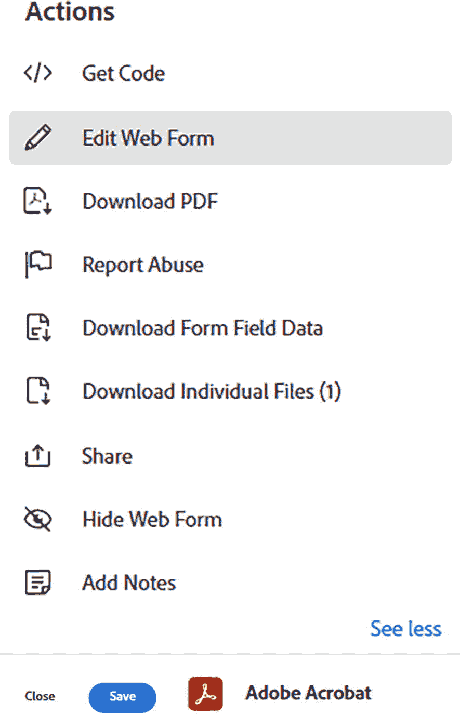

*图 20-63 编辑 Web 表单的操作*

完成后，您可以关闭浏览器。

收到来自`Adobe Acrobat Sign`的电子邮件后，您可以点击其中的`URL`，系统将带您进入该表单。请参考图 20-64。


*图 20-64 电子邮件中用于查看在线表单并签名的链接*

这是一种测试和预览表单的好方法，这样您就可以看到您的计算字段和签名字段是否按预期工作。请参考图 20-65。

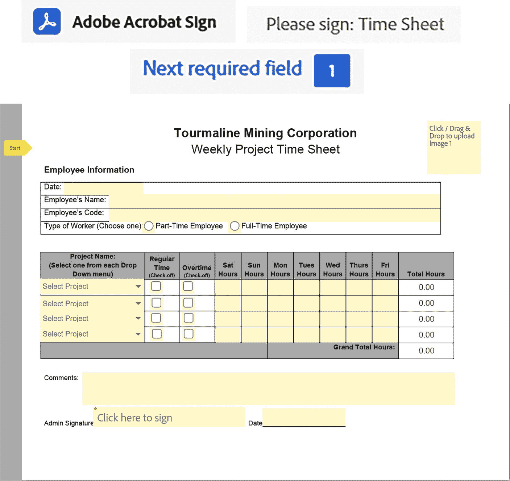

*图 20-65 表单已准备好，可使用 Adobe Acrobat Sign 设置进行签名*

如果不行，您可以按照前面提到的，在`Adobe`主页上再次打开表单，然后编辑并重新发布。只要表单保持在线且处于活动状态，同一个链接将继续有效。

> **注意：** 请记住，这些表单现在是在线的，如果您需要进行大量的文本编辑，则需要返回计算机上的原始`PDF`进行编辑，然后重新上传带有字段的表单。

有关使用`Tools`选项中（如`Send in Bulk`、`Add E-Sign Branding`和`Collect Payments`）的详细信息，请参考以下链接。同样，您也可以在`acrobat.adobe.com`的`Home`选项卡下的`Tools`中找到其他工具。请参考图 20-66 和图 20-67。

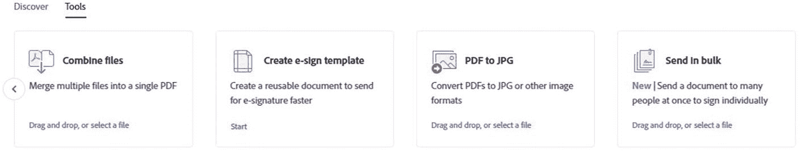

*图 20-67 Adobe Acrobat 在线 Tools 区域中的其他工具*

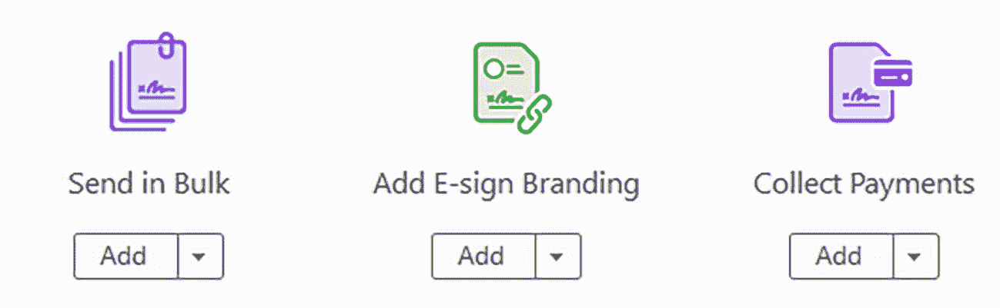

*图 20-66 您可以在客户端和您的 Acrobat 表单中使用的其他工具*

*   **批量发送**: 将文档一次性发送给多人，供其单独签名。

```
- [`https://helpx.adobe.com/sign/using/pdf-pack-send-in-bulk.html`](https://helpx.adobe.com/sign/using/pdf-pack-send-in-bulk.html)
```

添加电子签名品牌：将您的公司名称和自定义网址添加到电子签名协议中（请确保您位于“品牌设置”选项卡）：

- [`https://helpx.adobe.com/sign/using/upload-logo-to-account.html`](https://helpx.adobe.com/sign/using/upload-logo-to-account.html)

收款：设置一个 Braintree 账户，用于向签署人收款。

- [`https://helpx.adobe.com/sign/using/collect-online-payments.html`](https://helpx.adobe.com/sign/using/collect-online-payments.html)

在线工具还允许您创建电子签名模板。这是一种可重复使用的常用表单字段模板。您可以创建一个签名模板，并将其用于发送待签协议。有关更多详细信息，请参阅此链接：[`https://helpx.adobe.com/document-cloud/help/create-template.html`](https://helpx.adobe.com/document-cloud/help/create-template.html)

> **注意**
> 网络表单被视为一份协议。如果您需要了解如何删除它，请参见以下信息链接，因为删除过程有点复杂。不过，如果文件被标记为“协议”，您可以勾选它，然后在“操作”窗格中单击“取消”，再单击“删除”来移除它。如果您只是在练习使用“请求电子签名”（正如我们在本章前面所见），这将非常有用。请参阅图 20-68。

[`https://helpx.adobe.com/sign/kb/to-delete-a-document-from-manage-Page.html`](https://helpx.adobe.com/sign/kb/to-delete-a-document-from-manage-Page.html)
[`https://helpx.adobe.com/sign/using/sign-cancel-agreement.html`](https://helpx.adobe.com/sign/using/sign-cancel-agreement.html)
[`https://helpx.adobe.com/document-cloud/help/delete-restore-agreement.html`](https://helpx.adobe.com/document-cloud/help/delete-restore-agreement.html)
[`https://community.adobe.com/t5/adobe-acrobat-sign-discussions/looking-for-an-option-to-delete-document-from-adobe-sign-we-can-help-you/td-p/11035932`](https://community.adobe.com/t5/adobe-acrobat-sign-discussions/looking-for-an-option-to-delete-document-from-adobe-sign-we-can-help-you/td-p/11035932)

对于网络表单，虽然您当前无法直接删除它，但如果您不想再在最近列表中看到它或访问它，可以在“操作”窗格中选择隐藏该网络表单。

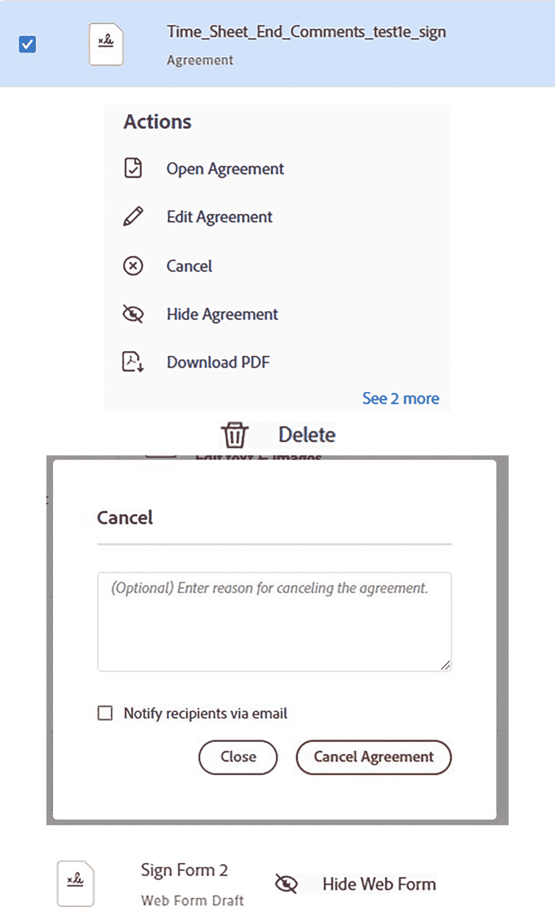

*一张已创建时间表的截图，显示包含打开协议、编辑协议、取消、隐藏协议和下载 PDF 等选项的操作下拉列表。还包含删除、取消、隐藏和签署网络表单等选项。取消选项的预览中有一个用于输入原因的框和一个取消协议按钮。*

**图 20-68** 使用预设操作在 Adobe Acrobat 主页上取消并删除协议或隐藏网络表单

> **提示**
> 正如您在第 15 章中所见，您可以使用“动作向导”工具来加速重复性任务。现在，“动作向导”不仅允许您在“转到”部分为“创建网络表单”工具添加操作工具，还可以访问本章提到的、最近添加到 Acrobat Pro 的其他新工具，包括“请求电子签名”。如果您必须处理文件夹中多个需要相同操作的文件，这可能会很有用。

## 总结

本章探讨了 Acrobat 为完善表单而提供的一些额外选项，特别适用于表单需要参与者多方在线签名的情况。然而，对于这些表单，除非将其作为网络表单在线编辑，或者使用“请求电子签名”工具创建一份稍后可在线上传的协议，否则无法直接在字段中编程自定义代码。

在由第 21 章组成的第五部分中，您将通过一系列额外的家庭作业将所学知识付诸实践，以锻炼您的技能。
