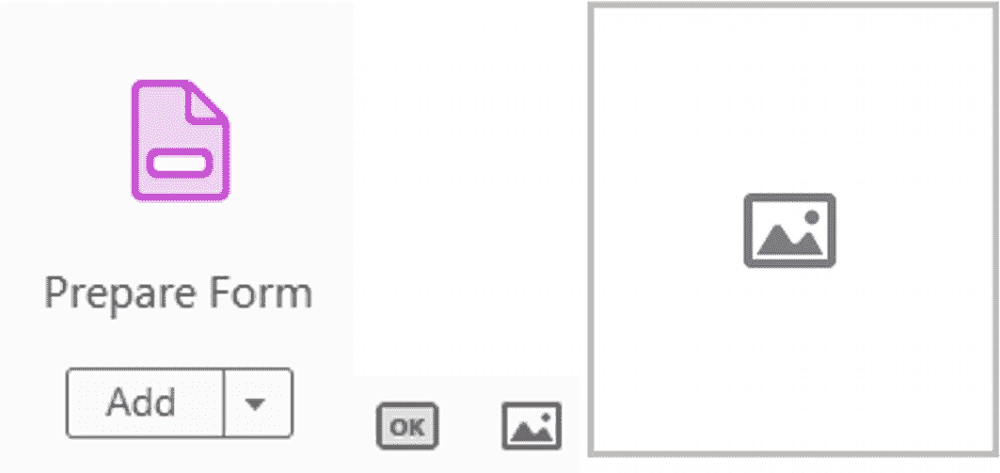
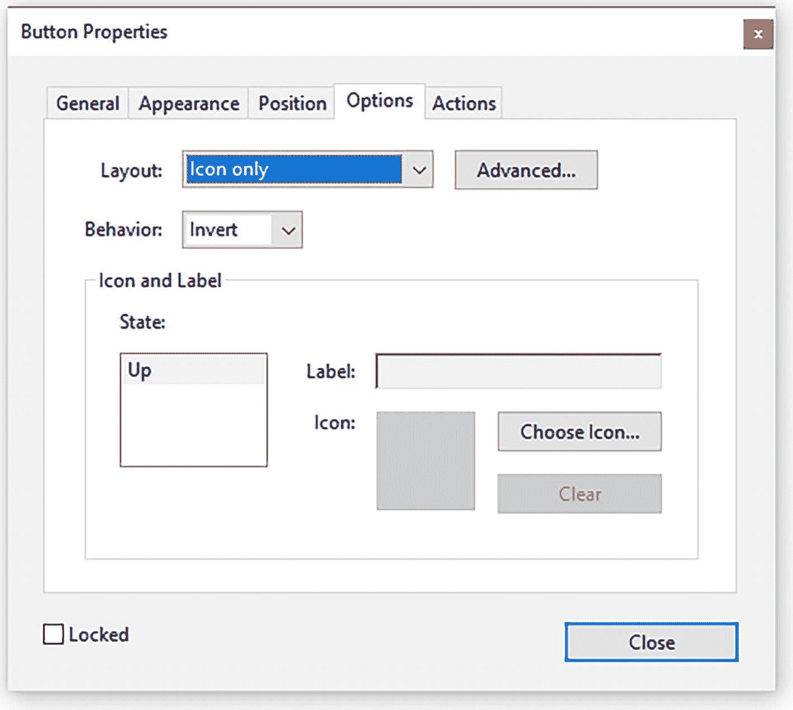
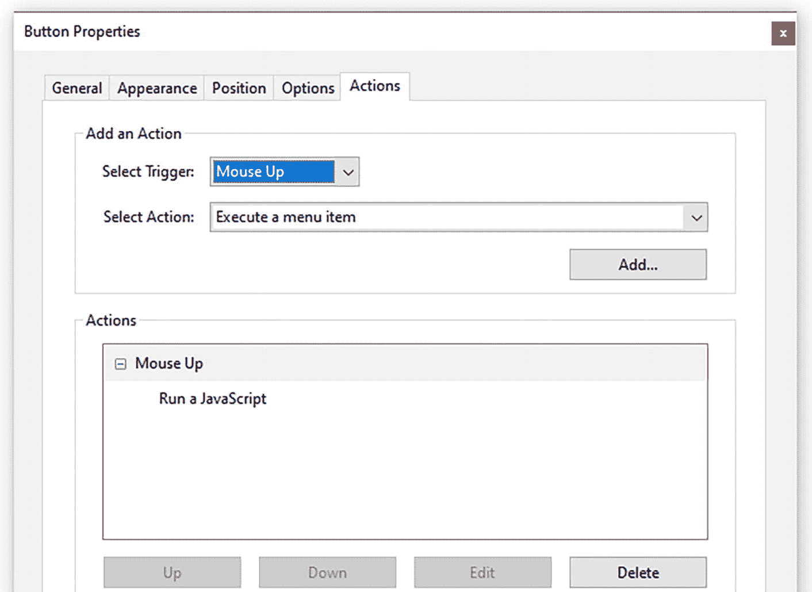
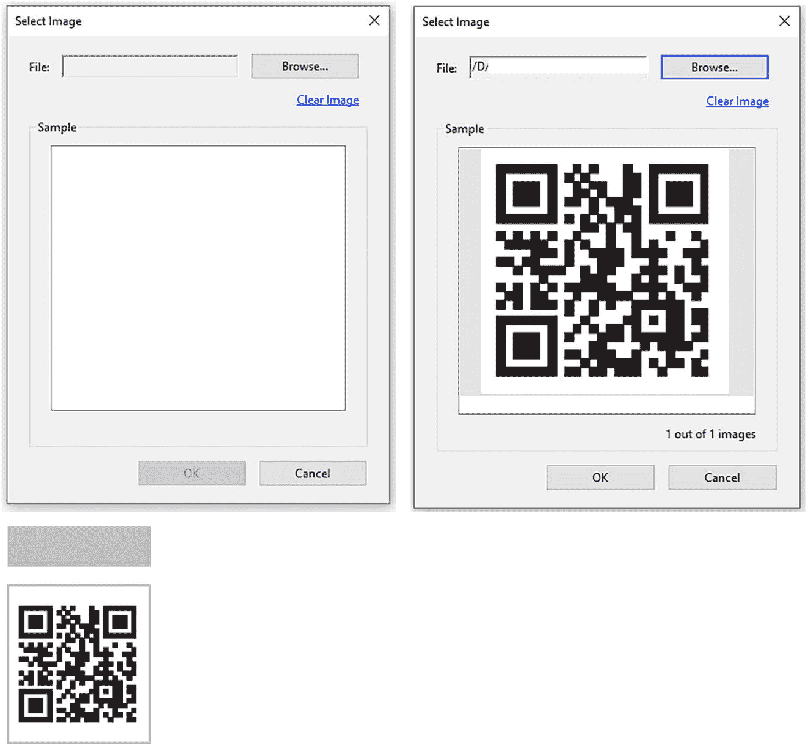

# 17. 向按钮中导入图像

**章节目标：** 你将创建一个按钮，该按钮能通过脚本导入图标图像。这对于希望将图像或照片附加到表单中的客户非常有用。

你可以在最新版本的 Acrobat Pro 中，通过按钮字段属性或“图像字段”按钮（如图 17-1 所示）完成本章的所有步骤。



一幅“准备表单”工具的截图，工具图标是一张折叠的纸，下方有一个“添加按钮”。旁边依次排列着一个小的“确定”按钮、一个小的“图像”按钮以及一个大的空白图像字段框。

**图 17-1** “准备表单”工具子菜单中新增的“添加图像字段”图标

**注意**

如果你想按照本课程内容同步操作，或查看最终结果，请从引言中的链接下载第 17 章文件。标记为“Start”的文件是未包含代码的起始文件，标记为“End”的文件是最终结果。此外，如果你希望将这些文件添加到自己的 PDF 表单中，你还会找到一个包含原始脚本和图像的文件夹。

如果你是使用原始 PDF 创建表单，请参考第 1 章的“表单审查”部分。

请记住，要查看字段的属性，你必须先选择“准备表单”工具；只有在此之后，你才能右键单击或双击字段来查看其属性。

## 创建按钮

在页面中插入一个`Button`图标字段或`添加图像字段`图标。请参考图 17-1。

确保`选项`选项卡中的`布局`字段设置为“仅图标”。将`行为`设置为`反转`，`状态`设置为`向上`，如图 17-2 所示。



按钮属性对话框。已选中选项选项卡。在图标和标签部分，布局为仅图标，行为为反转，状态为向上，标签和图标为空白。关闭按钮高亮显示。

图 17-2

为`选项`选项卡中的`布局`字段选择“仅图标”

请注意，`添加图像字段`图标的外观相同；两者都将默认显示按钮属性。请参考图 17-3。但是，`图像`字段的`操作`选项卡上会预先添加带有`鼠标释放`触发器的 JavaScript 代码。



按钮属性窗口。已选中操作选项卡，并选择鼠标释放选项作为触发器。所选操作是执行菜单项。操作区域显示鼠标释放选项用于运行 JavaScript 脚本。向上、向下和编辑选项已禁用。

图 17-3

在`操作`选项卡上运行 JavaScript 操作

然后添加以下代码；如果尚未添加，请单击`编辑`按钮查看以下代码：

```
// 按钮的鼠标释放脚本
event.target.buttonImportIcon();
```

当用户单击空白按钮时，将出现`选择图标`对话框。请参考图 17-4。



选择图像的对话框。文件和示例区域为空白。在相邻的选择图像对话框中，示例区域中存在一个二维码。第一个框下方有一个较小尺寸的二维码。

图 17-4

单击按钮后，可以导入您选择的图像或图标

然后用户可以在其计算机上浏览图像，并根据 Reader 或 Pro 中可用的文件格式（如`.png`、`.jpg`或`.pdf`）选择正确的图像，也可以从示例区域中清除图像。

单击`确定`按钮，图像将作为按钮内的图像导入，或单击`取消`退出而不导入图标。随后用户应保存文件，以便将图像保留在 PDF 内部。如果需要查看示例，可以参考我的文件`Tourmaline Mining Corporation_mineralchecklist_End.pdf`。

**注意**

如果您知道客户将要导入特定尺寸的图像以便清晰显示，则可能需要预先调整`图像`字段的大小。

过去，如果您不希望 Acrobat Reader 用户输入图像，可以在 Acrobat Pro 中使用 JavaScript 预设指向驱动器中图像文件的链接或路径，前提是用户在同一文件位置拥有该图像。这适用于其他属性，例如`buttonSetIcon`或`buttonImportIcon`。例如，您可以像这样输入路径：

```
event.target.buttonImportIcon("/C/Users/names/Desktop/Test/Apress_QRCode.jpg");
```

这是一个更高级的主题；您可以在 Acrobat 在线开发指南中找到更多详细信息。

[`https://opensource.adobe.com/dc-acrobat-sdk-docs/library/jsdevguide/JS_Dev_AcrobatForms.html#28613`](https://opensource.adobe.com/dc-acrobat-sdk-docs/library/jsdevguide/JS_Dev_AcrobatForms.html#28613)

然而，在最新版本的 Acrobat Pro 中，这样做会在单击图标时在调试器控制台中引发错误。错误信息会指示这样做可能存在安全风险，并且不是一个受信任的函数，需要更高级的特权方法。因此，作为初学者的表单创建者，最好的做法是让用户通过按钮自行输入图像并保存文件，或者在发送给客户之前，先将图像放置在按钮中并保存文件。现在，只需在按钮字段中使用以下代码：

```
event.target.buttonImportIcon();
```

## 总结

在本章中，您学习了如何将图像导入到按钮中。您还发现了`添加图像字段`图标，当代码已为您预先添加时，执行此操作很容易。此外，您还了解了如果在 JavaScript 中直接为图像字段添加直接路径会产生的安全风险警告。

在下一章中，我们将学习如何处理多种格式，特别是数字格式。