# 18. 多种格式设置

**章节目标：** 我发现，在 Acrobat 中创建表单时，最繁琐的任务之一就是将许多文本字段格式化为数字。如果 Acrobat 能像 MS Excel 一样，让你一次性格式化所有字段，那该多好？如果你需要重新格式化它们呢？你想一个一个地处理吗？如果你能快速更新它们呢？

在 Acrobat 推出解决方案之前，有两种方法可以处理这个问题：自行解决或寻求专业人士帮助。本章将讨论这两种选项，并向您展示如何为货币和非货币数字添加自定义符号。

## 多重格式设置问题

当仅选中一个文本字段时，访问格式设置非常直接。您可以逐个选择每个文本字段或下拉列表字段，并执行此任务，如图 18-1 所示。

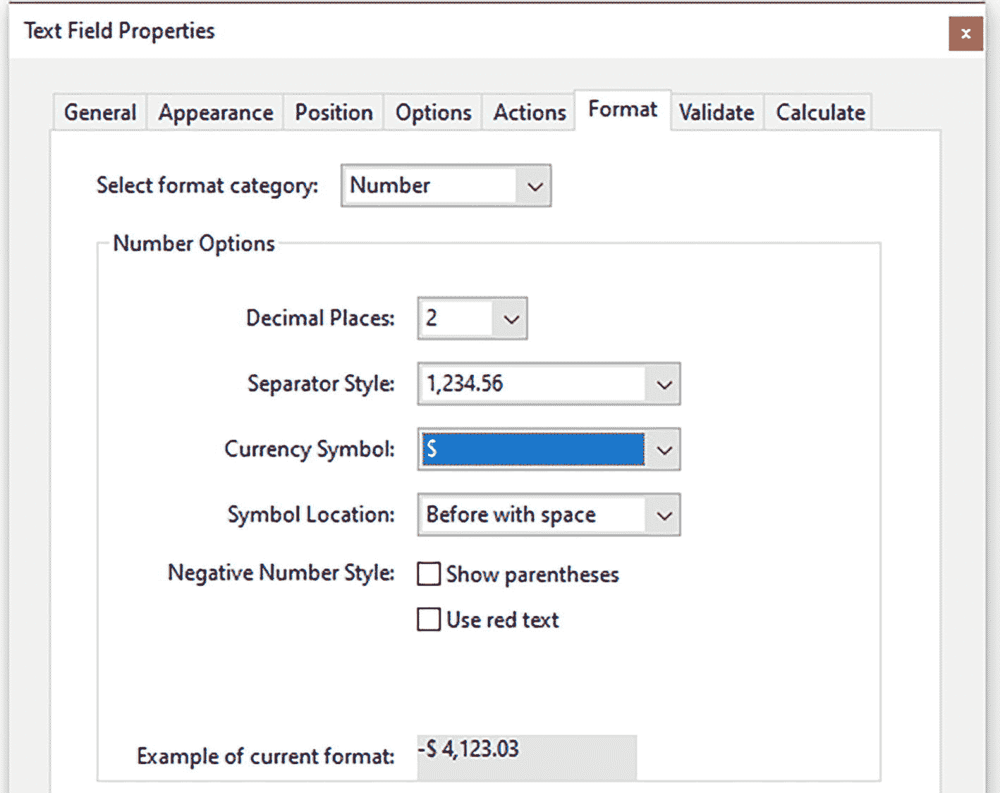

文本字段属性对话框。已选中“格式”选项卡。在“格式类别”中已选中“数字”选项。小数位数设置为最多 2 位。符号位置选择“之前带空格”。货币符号使用美元符号。

图 18-1

“格式”选项卡上的文本字段属性

然而，当您`Shift+click`同时选中多个文本字段，并右键单击从弹出菜单中选择“属性”时，格式、验证和计算选项卡会消失。请参考图 18-2。

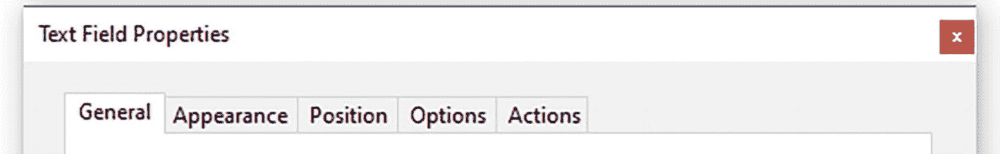

文本字段属性对话框的放大视图，显示常规、外观、位置、选项和操作五个选项卡。其中“常规”选项卡被选中。

图 18-2

文本字段属性对话框的选项卡区域，由于选中了多个字段，三个选项卡已消失

因此，您只能逐个对它们进行格式设置。请参考图 18-3。

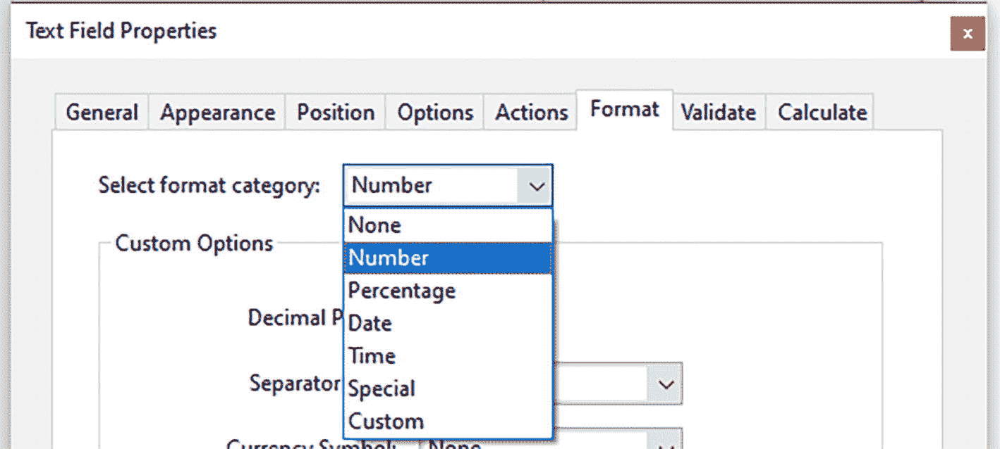

文本字段属性对话框。已选中“格式”选项卡。“格式类别”中的下拉菜单高亮显示了“数字”选项。列表中的其他选项包括：无、数字、百分比、日期、时间、特殊和自定义。

图 18-3

“格式”选项卡仅在单个字段选中时可用

我能理解为什么 Acrobat 开发者可能会移除“验证”和“计算”选项卡，因为这些区域包含自定义脚本，您通常不希望在大规模转换时覆盖它们。同理，“操作”选项卡也应被移除，但它却保留了下来。如果两个字段的操作略有不同，“鼠标松开”触发器会显示“`Varies`（有变化）”，并且在两个字段同时选中的情况下，您无法编辑任一操作。请参考图 18-4。

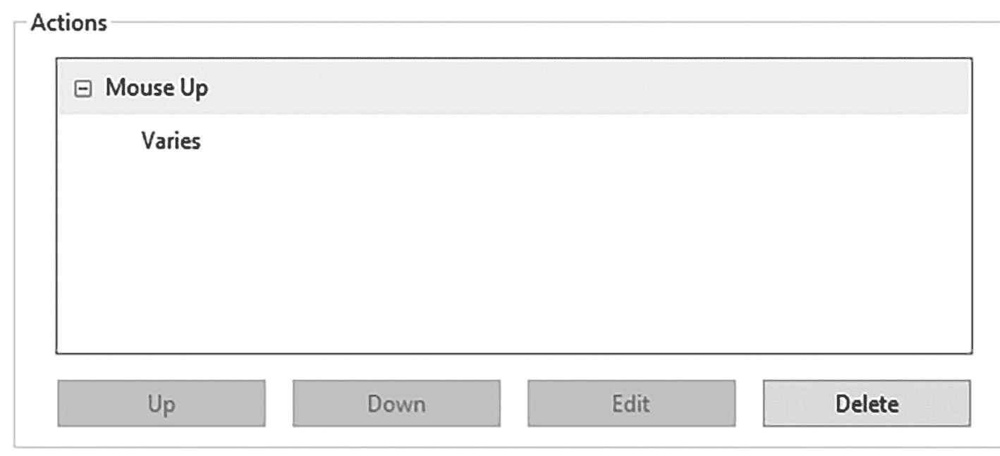

操作对话框的截图。“鼠标松开”标题旁的文本框中显示“有变化”。上移、下移和编辑按钮已禁用，删除按钮已启用。

图 18-4

选中两个具有不同操作的字段时，文本字段属性对话框的“操作”选项卡

在所有情况下，为您的字段赋予唯一名称都至关重要。请参考图 18-5 以及文件`TestingForm_format_test_End.pdf`。

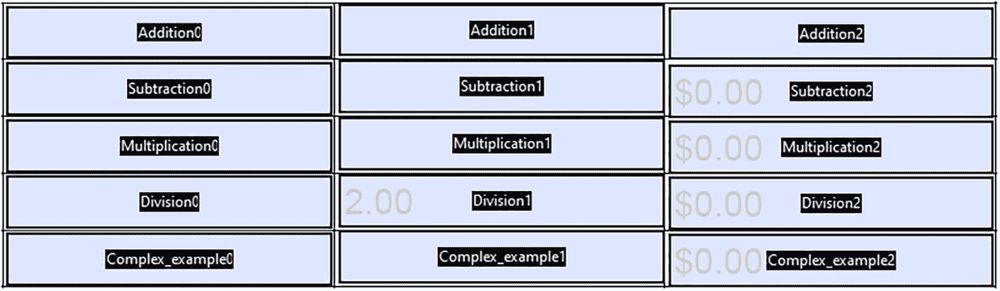

文本字段常规样式的截图，包含加法、减法、乘法、除法和复杂示例五行的内容，以及数字 0、1、2。

图 18-5

表单模式下的文本字段及其在编辑模式下的唯一名称

**备注**

如果您想在本课中同步操作或查看最终结果，请从引言中的链接下载第 18 章的文件。标记为“Start”的文件是未包含代码的文件，标记为“End”的文件是最终结果。如果您希望将原始脚本添加到自己的 PDF 表单中，还会找到一个包含这些脚本的文件夹。

如果您是从原始 PDF 创建表单，请参考第 1 章的“表单回顾”部分。

请记住，要查看字段的属性，必须先选择“准备表单”工具；只有这样，才能通过右键单击或双击字段来审阅其属性。

### 选项 1：手动操作

如前几章所述，当您需要对全局产生影响时，需要创建文档级 JavaScript。请参考图 18-6。

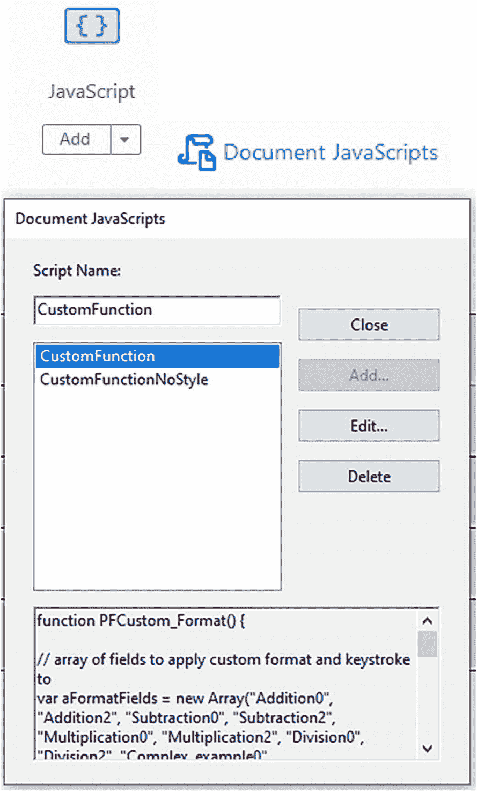

一个带有两个花括号的图标，下方有“添加”选项以及“文档级 JavaScript”图标。一个“文档级 JavaScript”对话框显示脚本名称为“custom function”，并在下方列表框中选中了该名称。下方的编辑器包含`PFCustom_Format`函数的代码。

图 18-6

用于数字格式设置的“文档级 JavaScript”对话框

本例中有两个脚本。`CustomFunction`确保数字带有价格（`$`）符号，而`CustomFunctionNoStyle`则不带价格符号。

以下是两个脚本及其使用的函数。

#### 价格脚本

价格脚本如下：

```
function PFCustom_Format() {
// 要应用自定义格式和按键的字段数组
var aFormatFields = new Array("Addition0", "Addition2", "Subtraction0", "Subtraction2", "Multiplication0", "Multiplication2", "Division0", "Division2", "Complex_example0", "Complex_example2");
// 定义自定义数字格式和按键的变量
var nDecimal = "2"; // 小数位数
var separStyle = "0"; // 分隔符样式
var negativeStyle = "0"; // 负数显示样式
var currencyStyle = "0"; // 货币样式
var symCurrency = "\"$\""; // 货币符号
var symCurrencyPrepend = "true"; // 是否前置（添加于之前）货币符号的逻辑值
// 构建格式字符串
var strFormat = nDecimal + ", " + separStyle + ", " + negativeStyle + ", " + currencyStyle +", " + symCurrency + ", " + symCurrencyPrepend;
// 为字段设置自定义格式和按键
for (i = 0; i < aFormatFields.length; i++) {
this.getField(aFormatFields[i]).setAction("Format", "AFNumber_Format(" + strFormat + ")");
this.getField(aFormatFields[i]).setAction("Keystroke", "AFNumber_Keystroke("+ strFormat + ")");
} // 结束 for 循环
return;
} // 结束自定义格式函数
```

#### 无价格脚本

以下是无价格脚本：

```javascript
function PFCustom_Format2() {
// 需要应用自定义格式和按键事件的字段数组
var aFormatFields2 = new Array("Addition1", "Subtraction1", "Multiplication1","Division1", "Complex_example1");
// 定义自定义数字格式和按键事件的变量
var nDecimal = "2"; // 小数位数
var separStyle = "0"; // 分隔符样式
var negativeStyle = "0"; // 负数显示样式
var currencyStyle = "0"; // 货币样式
var symCurrency = "\"\""; // 货币符号
var symCurrencyPrepend = "false"; // 是否将货币符号前置（添加在数字前）
// 构建格式字符串
var strFormat2 = nDecimal + ", " + separStyle + ", " + negativeStyle + ", " + currencyStyle +", " + symCurrency + ", " + symCurrencyPrepend;
// 为字段设置自定义格式和按键事件
for (i = 0; i < aFormatFields2.length; i++) {
this.getField(aFormatFields2[i]).setAction("Format", "AFNumber_Format(" + strFormat2 + ")");
this.getField(aFormatFields2[i]).setAction("Keystroke", "AFNumber_Keystroke("+ strFormat2 + ")");
} // 结束 for 循环
return;
} // 结束自定义格式函数
```

第二个脚本用粗体标出了与第一个脚本不同的部分。作为预防措施，我更改了一些变量和数组的名称，以避免这两个函数发生冲突。

以下变量都是内置于控制此“格式”选项卡的底层格式脚本（`AFNumber_Format` 和 `AFNumber_Keystroke`）中的：

*   `var nDecimal = "2"; // 小数位数`

*   `var separStyle = "0"; // 分隔符样式`

*   `var negativeStyle = "0"; // 负数显示样式`
*   `var currencyStyle = "0"; // 货币样式`
*   `var symCurrency = "\"\""; // 货币符号`
*   `var symCurrencyPrepend = "false"; // 是否将货币符号前置（添加在数字前）`

`nDecimal` 控制小数位数。请参考图 18-7。

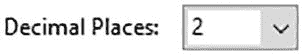

用于选择小数位数的下拉菜单片段。已选择 2。

**图 18-7** 设置小数位数格式

`separStyle` 是千位分隔符和小数点的分隔样式。请参考图 18-8。

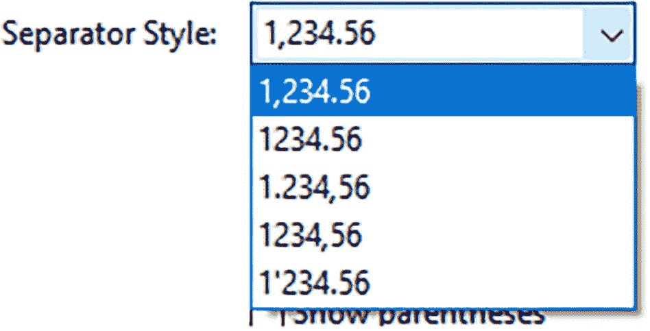

用于选择分隔符样式的下拉菜单片段。它包含多种数字和小数分隔的样式。已选择 1 逗号 234 点 5 6。

**图 18-8** 设置分隔符样式格式

```
0 ="," 千位分隔符逗号，小数点用点号 示例：1,000.00
1= "." 仅用点号作为小数点，无逗号分隔 示例：1000.00
2 = "." 小数点用点号，千位分隔符用逗号 示例：1.000,00
3 = "," 仅用逗号 示例：1000,00
4 =" ' " 引号作为千位分隔符，点号作为小数点 示例：1'000.00
```

`negativeStyle` 控制负数的显示样式。请参考图 18-9。


负数样式片段包含两个复选框，用于显示括号和使用红色文本。

**图 18-9** 设置负数样式格式

```
0 = 黑色 "-" 号
1 = 负数显示为红色文本
2 = 黑色括号
3 = 红色括号
```

`currencyStyle` 指的是货币样式，设置为 0（大多数情况下未使用；这是一个保留功能）。

`symCurrency` 指的是用于货币的符号类型。请参考图 18-10。

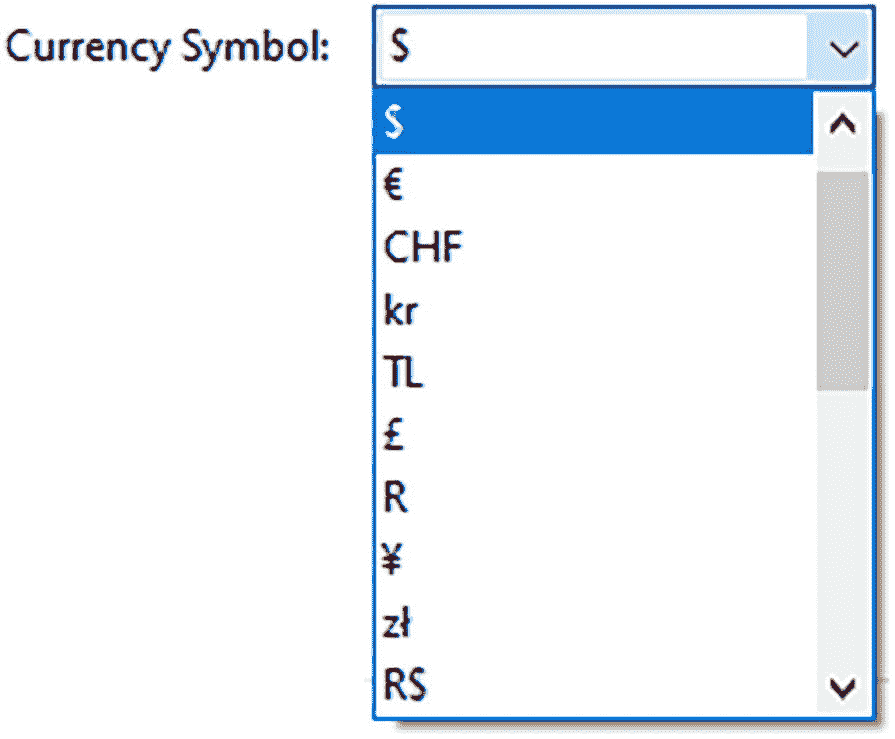

用于选择货币符号的下拉菜单片段。下拉列表包含不同的货币符号，其中选择了美元符号。

**图 18-10** 设置货币符号格式

在此示例中，使用 `\"$\"` 表示美元符号，使用 `\"\"` 表示无符号。如果你使用外币，可能需要查找用于创建该符号的 Unicode 编码。以下是一些示例：

*   欧元符号 €: `\u20AC`
*   英镑符号 £: `\u00A3`
*   日元符号 ¥: `\u00A5`
*   韩元符号 ₩: `\u20A9`

参考 [`https://en.wikipedia.org/wiki/Currency_Symbols_(Unicode_block)`](https://en.wikipedia.org/wiki/Currency_Symbols_(Unicode_block))。

如果你想使用不同的 Unicode 编码，可能需要查找并测试它；本章后面会介绍一个非货币符号。此外，在“外观”选项卡和自定义格式中选择的字体也会影响符号的显示方式。

`symCurrencyPrepend` 被设置为 `true`（显示为 $1.00）表示符号在数字前面，或设置为 `false`（显示为 1.00$）表示符号在数字后面，具体取决于你希望符号放置的位置。在 `symCurrency` 变量中的 Unicode 符号内添加一个空格，将提供额外的前置或后置空格。请参考图 18-11。

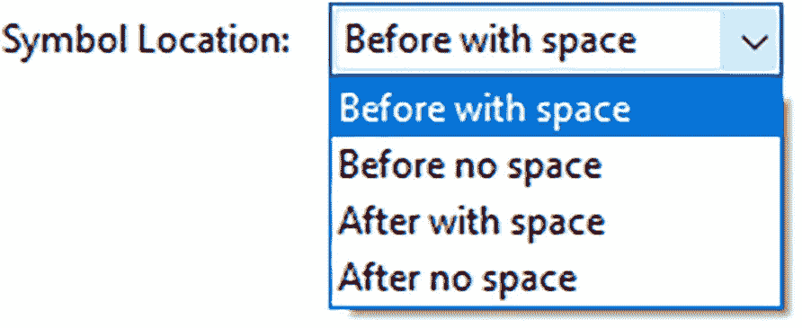

选择符号位置的截图。下拉列表中的选项包括：前置带空格、前置无空格、后置带空格、后置无空格。当前选中了“前置带空格”。

**图 18-11** 格式化前置空格

> **注意**
>
> 虽然这在视觉上是正确的，但你在编辑 JavaScript 时可能会注意到，“格式”选项卡显示的是“后置带空格”而不是“前置无空格”。不要在这里更改此格式设置，只在文档 JavaScript 中进行更改，因为这样做会解除此字段与全局格式的链接。我们将在本章后面介绍如何重新链接格式。

在两个函数中，你将关联语法和对象字面量放在新数组的圆括号 `()` 中，并将需要格式化的字段分到两个函数中：带美元符号和不带美元符号。这可以避免混淆并保持条理清晰。之后，它们将根据需要被索引到方括号 `[i]` 中。

接下来，变量字符串 `strFormat2` 设置顺序：

```javascript
var strFormat2 = nDecimal + ", " + separStyle + ", " + negativeStyle + ", " + currencyStyle +", " + symCurrency + ", " + symCurrencyPrepend;
```

然后，每个函数的 `for()` 循环遍历数组，按正确顺序分发信息。请参考第 10、13 和 16 章中的 `for()` 循环语句。

```javascript
for (i = 0; i < aFormatFields2.length; i++) {
this.getField(aFormatFields2[i]).setAction("Format", "AFNumber_Format(" + strFormat2 + ")");
this.getField(aFormatFields2[i]).setAction("Keystroke", "AFNumber_Keystroke("+ strFormat2 + ")");
}
```

`.setAction()` 方法用于设置数组对象中索引字段的自定义格式的格式化和按键操作。

最后的 `return` 关键字允许关联语法/对象中的信息正确显示在各个字段中。

如果你在此刻测试表单，可能会发现一个错误。某些字段会保持“无”格式，或者在修改后没有变化。请参考图 18-12。

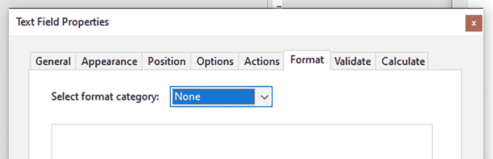

文本字段属性对话框的放大截图，包含常规、外观、位置、选项、操作、格式、验证和计算选项卡。当前选中了“格式”选项卡。在“格式类别”中选中了“无”选项。

**图 18-12** 格式类别设置为“无”

为什么会这样？

要使表单正常工作，在这种情况下，你需要刷新格式。每个函数只需要执行一次，这样访问其函数的其他字段（使用关联语法）才能正常工作。如果你对函数进行了重大更改，请始终记住需要刷新才能影响其他字段。例如，选择一个你确信属于 `PFCustom_Format` 函数的字段，在本例中是一个带有价格符号的字段。例如字段 `Addition0`。选择“格式”选项卡上的“自定义”，而不是“数字”格式类别。请参考图 18-13。

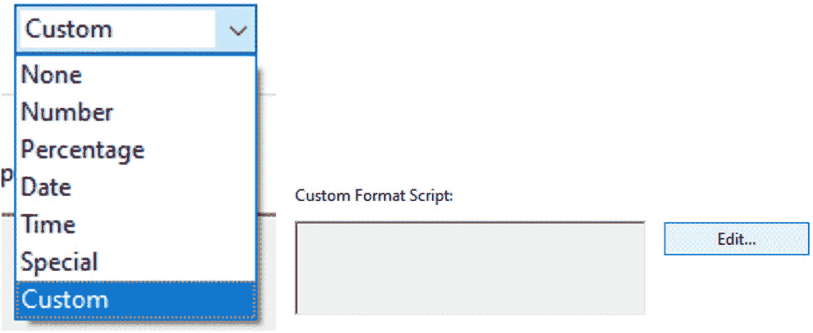

一个带有“自定义”选项的下拉菜单截图。下拉列表中的选项包括：无、数字、百分比、日期、时间、特殊和自定义。自定义格式样式有一个空白的矩形框，以及一个高亮的“编辑”按钮。

**图 18-13** 在“格式”选项卡上选择“自定义”

在“自定义格式脚本”框中，单击“编辑”按钮。然后在 JavaScript 编辑器中输入以下内容：

```javascript
PFCustom_Format();
```

单击“确定”按钮确认并退出。然后格式将自动切换到“数字”。请参考图 18-14。

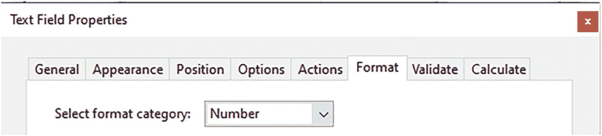

一个关于文本字段属性的对话框，包含常规、外观、位置、选项、操作、格式、验证和计算选项卡。当前选中了“格式”选项卡。在“选择格式类别”选项中选中了“数字”类别。

**图 18-14** 在“格式”选项卡上，类别自动更改为“数字”

以下是可能需要在相应字段上应用一次的另一个函数：

```javascript
PFCustom_Format2();
```

完成后，关闭“属性”面板，所有使用这两个函数的字段应该会自动设置好，你无需逐一进入每个字段。此时测试你的表单。

> 注意：虽然这不属于本课内容，但我也在一些字段的“计算”选项卡中添加了自定义 JavaScript，以计算类似于第 5 章和第 6 章中完成的结果。

#### 添加度数符号和设置格式范围

同样地，你无需局限于仅使用货币符号；正如我们在第 16 章中看到的，还有许多可用的 **Unicode** 符号。我发现一个很有用的符号是度数符号。它主要有两种应用场景：输入温度或角度。过去，我只能确保在表单外部添加度数符号。但现在，你可以在输入数字时将其作为表单字段的一部分。接下来的示例使用红色文本表示负值样式。

以下代码展示了如何在文档级 *JavaScript* 中实现。请参考图 18-15。

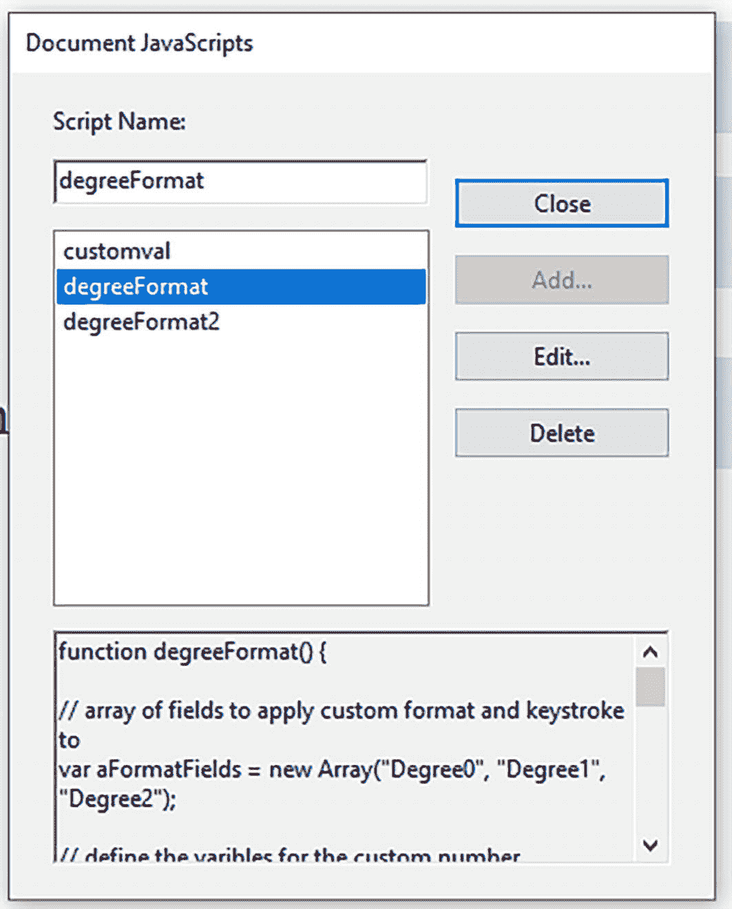

文档 `JavaScript` 的对话框。脚本名称为 `degree format`。在下方框的列表中选中了 Degree format。下方列中有一个编辑器，其中包含用于度数格式的函数代码。突出显示了“关闭”按钮。

**图 18-15**

对话框中的文档 `JavaScript`（用于度数）

请看 `degreeFormat` 脚本：

```
function degreeFormat() {
var aFormatFields = new Array("Degree0", "Degree1", "Degree2");
var nDecimal = "2"; // 小数位数
var separStyle = "1"; // 分隔符样式
var negativeStyle = "1"; // 负值显示样式
var currencyStyle = "0"; // 货币样式
var symCurrency = "\"\u00b0\""; // 度数符号
var symCurrencyPrepend = "false"; // 是否前置（在数字前添加）货币符号的逻辑值
var strFormat = nDecimal + ", " + separStyle + ", " + negativeStyle + ", " + currencyStyle +", " + symCurrency + ", " + symCurrencyPrepend;
for (i = 0; i < aFormatFields.length; i++) {
this.getField(aFormatFields[i]).setAction("Format", "AFNumber_Format(" + strFormat + ")");
this.getField(aFormatFields[i]).setAction("Keystroke", "AFNumber_Keystroke("+ strFormat + ")");
} // 结束 for 循环
return;
} // 结束自定义格式函数
```

或者，如果你只想给一两个字段添加度数符号，可以在文档 `JavaScript` 中编写一个较短的版本，如脚本 `degreeFormat2` 所示：

```
function degreeFormat2()
{
AFNumber_Format (2,1,1,0,"\u00b0",false);
AFNumber_Keystroke(2,1,1,0,"\u00b0",false);
}
```

在任一示例中，转到选择文本字段，然后将格式设置为“自定义”，并添加对函数名称的引用，就像之前看到的那样。对于简短的示例，你需要逐个设置每个字段，但你可能会发现这更简单，因为你只需将这行代码复制粘贴到每个字段的“自定义格式脚本”框中即可。请注意，如果你更改了负数的样式设置，当输入负数时颜色可能最初不符合预期，此时需检查“外观”面板，因为它可能被设置为红色文本颜色，你需要将其调整回黑色。请参考图 18-16。

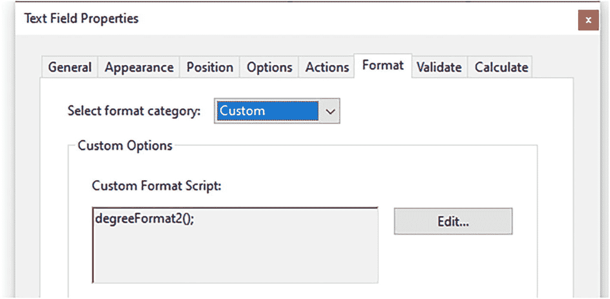

文本字段属性对话框，选中了“格式”选项卡。已选择“自定义格式”类别。自定义格式脚本框中写入了 `degreeFormat2` 代码。旁边有一个“编辑”按钮。

**图 18-16**

在“格式”选项卡上设置自定义 `JavaScript`

然后，你可以在文档 `JavaScript` 中设置自定义范围，例如“如果小于 0”或“大于 360”，并显示警告。

```
function customval(){
if (event.value 360 ){
app.beep(0);
app.alert("无效输入：度数值必须在 0 到 360 之间。");
event.rc = false;
}
}
```

> **注意：** 添加 `app.beep` 方法是可选的，因为无论是否添加，警告消息都会发出提示音。

然后，你可以将其添加到每个字段的“验证”选项卡中，作为自定义验证脚本，并引用函数 `customval();`。请参考图 18-17。

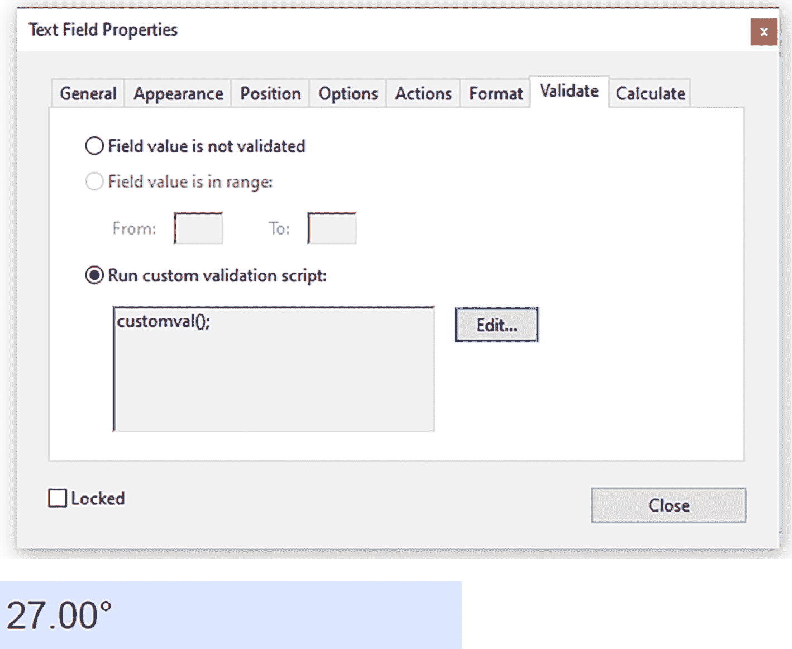

文本字段属性对话框，展开了“验证”选项卡。启用了“运行自定义验证脚本”，并在框中输入了 `customval();`。突出显示了“编辑”按钮。下方高亮的矩形框中显示文本：27.00 degrees。

**图 18-17**

带有自定义验证引用的“验证”选项卡

你必须在“验证”选项卡上执行此操作的原因是，“字段值在范围内”选项将无法使用。如果不需要范围限制，则无需将其应用于“验证”选项卡。如果输入不正确，字段将在退出警告后自动重置。

你可以参考图 18-17 和我的文件 `Degree_FormatExamples.pdf`。

> **注意：** 在我的示例中，我使用了较长的描述来说明各种格式变量，以便于理解。但是，你可能会在网上找到其他文档，其中的变量名称写法如下：
>
> `AFNumber_Format(nDec, sepStyle, negStyle, currStyle, strCurrency, bCurrencyPrepend);`
> `AFNumber_Keystoke(nDec, sepStyle, negStyle, currStyle, strCurrency, bCurrencyPrepend);`
>
> 这两种变量名称写法都有效，但请确保在函数其余部分匹配变量名称。
>
> 其他不那么常用的 `AF` 格式和按键事件，你可能需要自行研究，包括 `AFDate_Format(cFormat)`、`AFTime_Format(pft)`、`AFPercent_Format(nDec, sepStyle)` 和 `AFSpecial_Format(psf)`。

### 选项 2：联系专业人士

虽然“数字格式”示例既快速又能消除错误，但如果还有一种更快的方式，甚至包含对话框，那就更好了。幸运的是，经过大量研究，我找到了一位 JavaScript 开发者，他投入了大量时间来解决这个问题。

他叫 **Gilad Denneboom**（用户名 **Try67**）。他在自己的网站上为 Acrobat 创建了一个扩展程序，名为“将格式应用于多个文本字段”。你可以在此获取：[`https://www.try67.com/tool/acrobat-apply-format-to-multiple-text-fields`](https://www.try67.com/tool/acrobat-apply-format-to-multiple-text-fields)。

图 18-18 展示了它的界面。

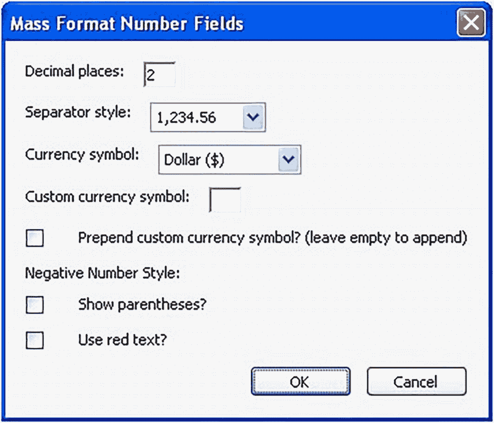

批量格式数字字段对话框。小数位数选为 2。货币符号选为美元。其他选项是分隔符样式和自定义货币符号。

**图 18-18**

“批量格式数字字段”对话框

他的格式化工具还允许你批量格式化以下类型：

*   百分比

*   日期

*   时间

*   特殊

如果你认为自己会经常进行此类格式化，我认为他售价 60 美元的产品是值得的。

他还有其他产品，例如 [`www.try67.com/tool/acrobat-mass-edit-fields-actions`](https://www.try67.com/tool/acrobat-mass-edit-fields-actions) 提供的“Acrobat 批量编辑字段操作”。这个工具甚至允许你通过他的对话框将格式应用于“验证”和“计算”等选项卡区域。

在购买之前，如果你对这些程序有疑问，例如哪个产品最好、它是否适用于你的 Acrobat Pro 版本、或者如何安装，请先咨询他。他非常乐于助人；在我撰写本书时，他帮我解答了几个问题。他也经常在 Adobe 和 Acrobat 用户论坛中回答问题。

## 本章小结

在本章中，你了解了如何使用数字格式对多个文本字段进行格式化。虽然你可以轻松地为一个文档设置数字格式，但如果必须创建大量包含数字的表单，找到最佳方案就很重要。你的选择是：自行操作或联系专业人士。