# 21. 家庭作业

**章节目标：** 本章汇集了一系列家庭作业，您可以尝试通过这些作业来提升技能并将所学知识付诸实践。

> **注意**  
> 要完成本章的四项作业，请务必从引言中的链接下载第 21 章文件夹。该文件夹包含原始文件、脚本文件以及每项作业对应的“开始”和“结束”PDF 文件。


## 作业 1：显示与隐藏

请复习第 1 章、第 2 章、第 4 章和第 9 章。

使用文件 `Assignment1_showhide_start.pdf`；该文档共有两页。之后你可以查看“最终”文件，以便与自己的结果进行比较。

本作业将复习显示与隐藏操作。不过，本次你将使用“是”和“否”单选按钮，而非复选框和常规按钮。尝试以不同方式完成类似项目是个好习惯，这样可以找出最得心应手的解决方案。根据你创建的表单，某种方式可能优于另一种。请记住，单选按钮总是成组出现。大部分字段已经为你创建好，你只需为其添加正确的操作即可。

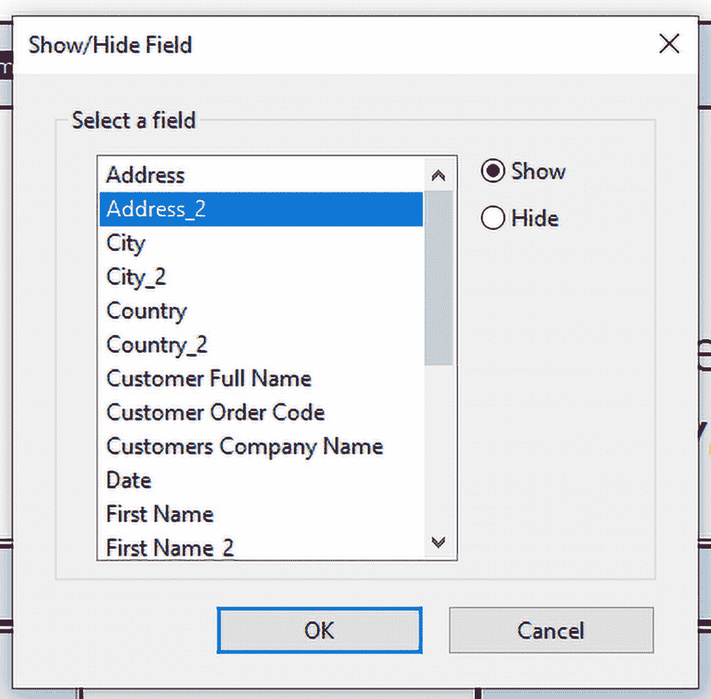

*截图显示了“显示或隐藏”字段，其中列出了“选择字段”下的选项（高亮显示“地址 2”），两个用于“显示”和“隐藏”的单选按钮，以及一个选中的“确定”按钮。*

**图 21-18** — 单选按钮的操作：显示或隐藏。使用对话框更改切换操作，以显示或隐藏特定字段

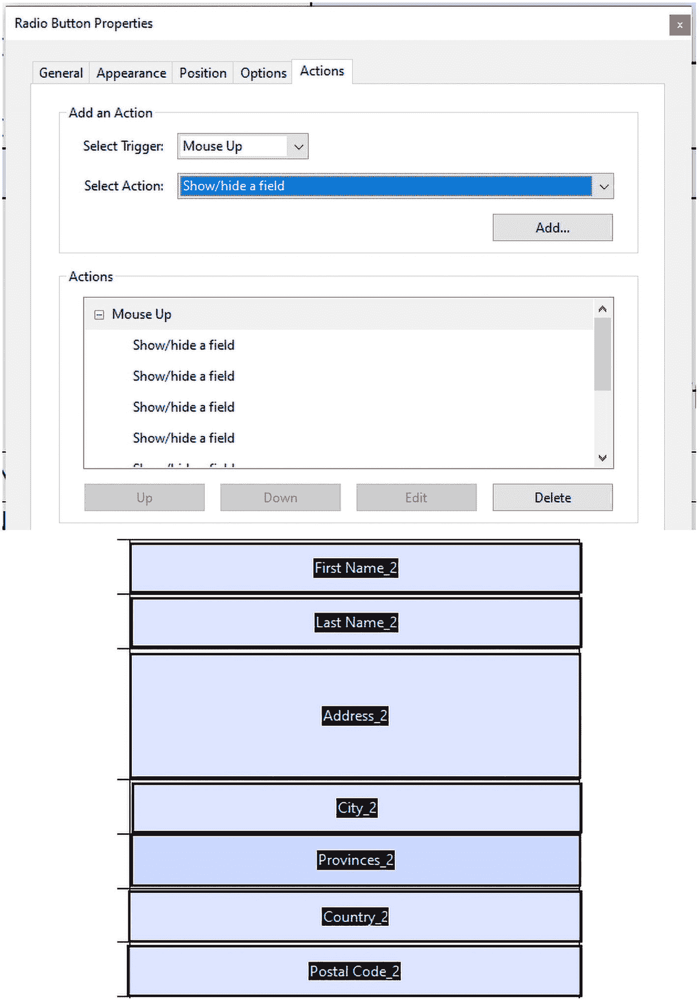

*截图显示了“单选按钮属性”对话框，其中在“操作”选项卡下列出了“添加操作”和“操作”选项，以及多个文本字段，标签分别为“名字 2”、“姓氏 2”、“地址 2”、“城市 2”、“省份 2”、“国家/地区 2”和“邮政编码 2”。*

**图 21-17** — 将影响右侧文本字段的单选按钮操作

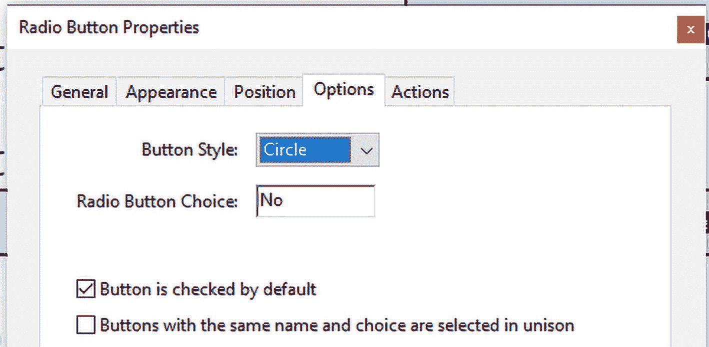

*截图显示了“单选按钮属性”对话框，其中在“选项”选项卡下列出了“按钮样式”、“单选按钮选择”以及一个已选中的复选框：“按钮默认选中”。*

**图 21-16** — “选项”选项卡，选择了“否”

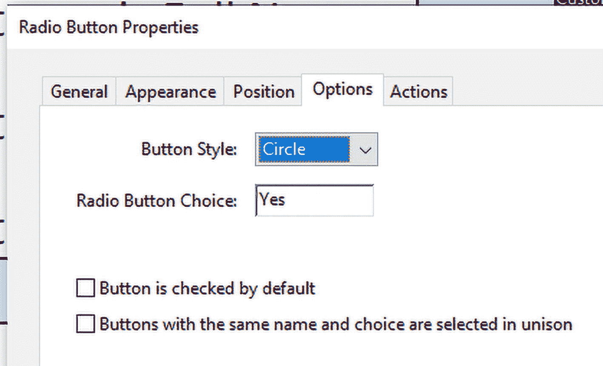

*截图显示了“单选按钮属性”对话框，其中在“选项”选项卡下列出了“按钮样式”和“单选按钮选择”。*

**图 21-15** — “选项”选项卡，选择了“是”


*截图显示了文字：“收货地址不同”，以及“是”和“否”单选按钮。*

**图 21-14** — 收货信息区域右上角的“是”和“否”单选按钮

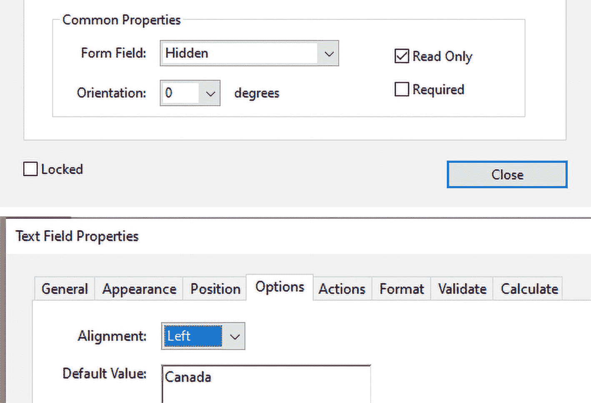

*文本字段属性对话框的两张截图。上方列出了“通用属性”下的选项，下方列出了“选项”选项卡下的“对齐方式”和“默认值”。*

**图 21-13** — 右侧的“国家/地区”字段在“常规”选项卡中被设置为“隐藏”和“只读”，并在“选项”选项卡中添加了默认值文本

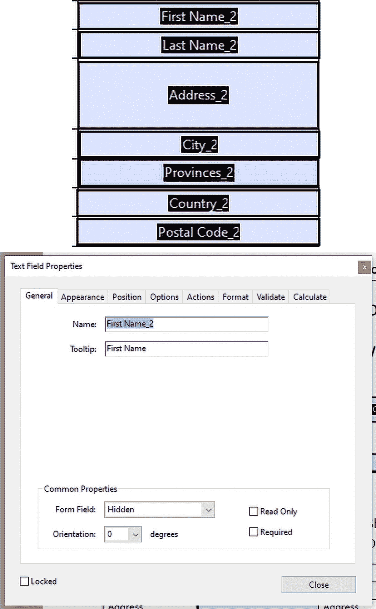

*截图显示了多个文本字段，包括“名字 2”、“姓氏 2”、“地址 2”、“城市 2”、“省份 2”、“国家/地区 2”和“邮政编码 2”。同时显示了“文本字段属性”对话框，其中在“常规”选项卡下列出了“名称”、“工具提示”和“通用属性”选项。*

**图 21-12** — 收货信息中右侧的文本字段被设置为“隐藏”

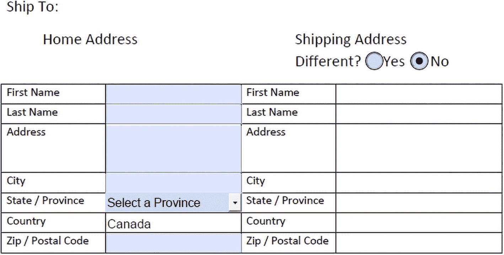

*页面截图显示了家庭地址信息，包括名字、姓氏、地址、城市、州、国家和邮政编码，并且在收货地址信息中选择了“否”选项。*

**图 21-11** — 作业 1 第 2 页的下半部分，收货信息中选择了“否”

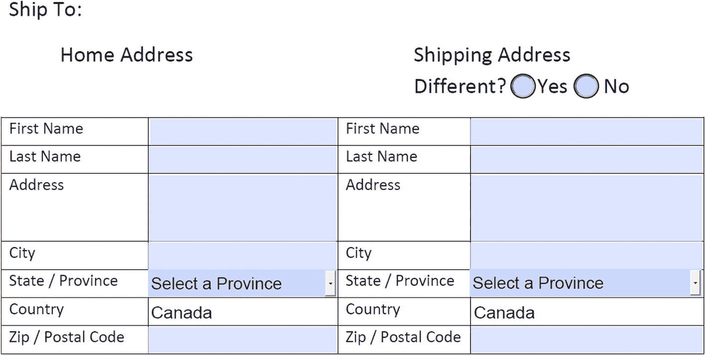

*页面截图显示了家庭和收货地址信息，包括名字、姓氏、地址、城市、州、国家和邮政编码。*

**图 21-10** — 作业 1 第 2 页的下半部分，收货信息

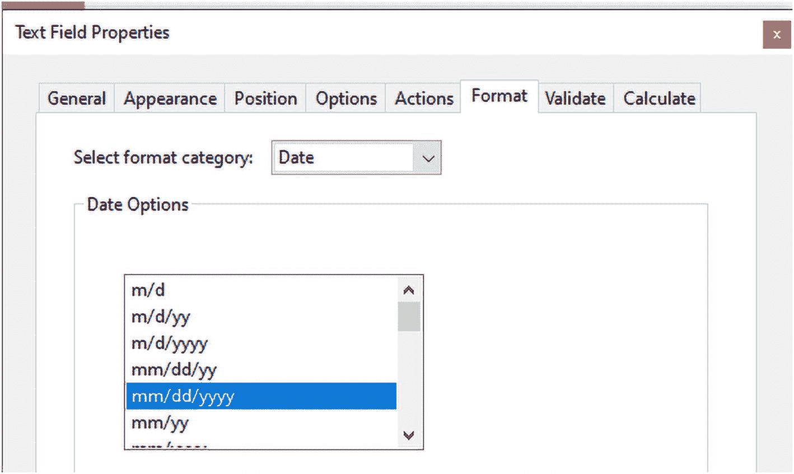


### 排版后的内容

文本字段属性对话框的截图，列出了格式下的选项，包含选择格式类别和日期选项。

#### 图 21-9
##### 设置了特定日期格式的“格式”选项卡

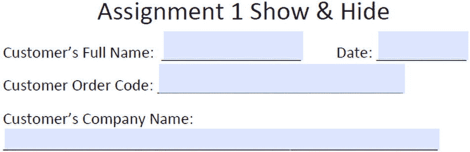

“作业 1：显示与隐藏”页面的截图，显示了客户全名、日期、客户订单代码和客户公司名称。

#### 图 21-8
##### 作业 1 第 2 页的上半部分


左侧“预览”按钮和右侧“编辑”按钮的代码片段。

#### 图 21-7
##### “预览”和“编辑”按钮

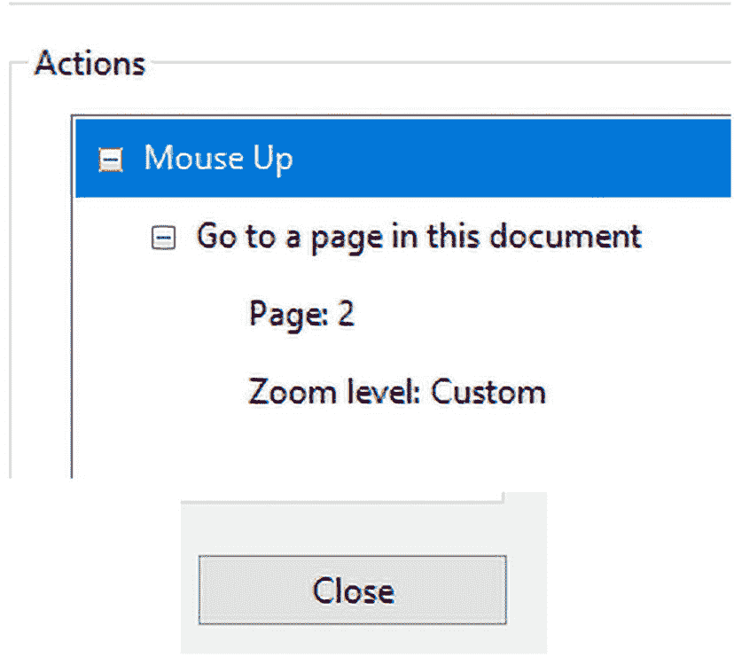

截图展示了“操作”选项卡，其中选择了“鼠标松开”菜单、本文件中的第 2 页页面以及缩放级别。

#### 图 21-6
##### 最终操作集已添加到“操作”选项卡

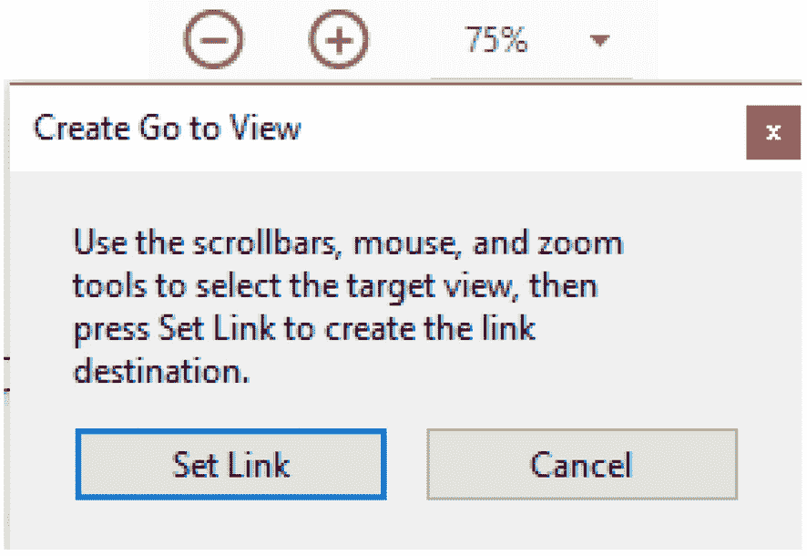

截图展示了“创建视图跳转”对话框，其中包含一些文本：“请使用滚动条、鼠标和缩放工具选择目标视图”。并有一个高亮显示的“设置链接”按钮。

#### 图 21-5
##### 跳转到第 2 页后，点击“设置链接”按钮

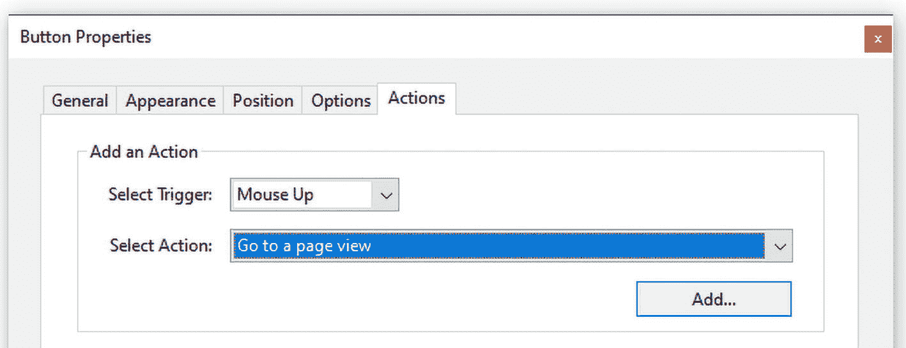

截图展示了按钮属性对话框，在“操作”下列出了添加操作的选项。其中包括“鼠标松开”触发器和“跳转到页面视图”操作选项。

#### 图 21-4
##### 在“操作”选项卡上，点击“添加”按钮

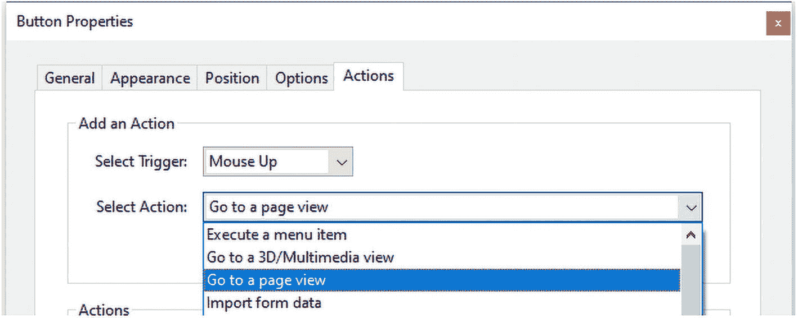

截图展示了按钮属性对话框，在“操作”下列出了添加操作的选项。其中包括选择触发器和选择操作选项。

#### 图 21-3
##### “操作”选项卡上的按钮属性

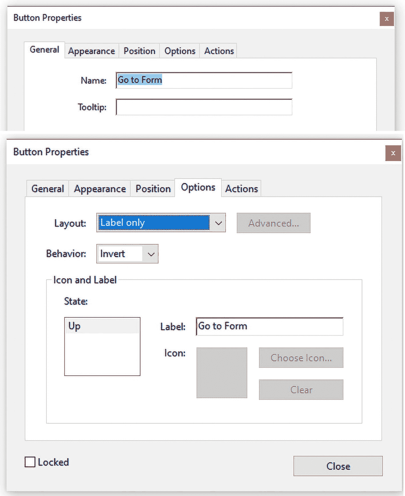

两张截图展示了按钮属性对话框。上方列出了“常规”下的选项，包含名称和工具提示。下方列出了“选项”下的选项卡，包含布局、行为、图标和标签。

#### 图 21-2
##### “常规”和“选项”选项卡中的按钮属性。您还可以添加工具提示文本。标签布局为“仅标签”。将“行为”设置为“反转”，“状态”设置为“向上”，并将标签设置为“转到表单”

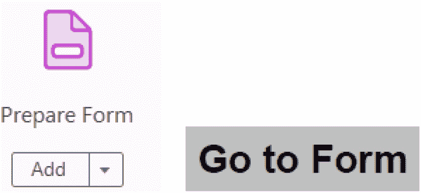

截图展示了“准备表单”图标，以及“添加”和“转到表单”选项。

#### 图 21-1
##### 在第 1 页上添加一个按钮

1.  转到`准备表单`工具。请参考图 21-1。

在文档的第 1 页上，在页面底部的空白区域添加一个`转到表单`按钮。这将帮助读者跳转到包含表单的页面。当文档包含很多页面，并且您希望读者快速访问特定页面时，便捷的导航非常有用。

2.  为`常规`和`选项`选项卡添加以下属性。请参考图 21-2。

3.  对于`操作`选项卡，执行以下操作：

    选择`触发器`：`鼠标松开`

    选择`操作`：`跳转到页面视图`

    请参考图 21-3。

4.  现在点击`添加`按钮。请参考图 21-4。

5.  在屏幕上显示这些说明的同时，跳转到文档的第 2 页。确保表单缩放到 75%，以便您可以看到整个表单。当您对大小满意时，点击`设置链接`按钮。请参考图 21-5。

6.  完成后，您的`操作`属性应与图 21-6 类似。

7.  完成后，点击属性对话框中的`关闭`按钮。

8.  点击`准备表单`工具右上角的`预览`按钮，以确保`转到表单`按钮正常工作。请参考图 21-7。

9.  要返回编辑状态，请点击`编辑`按钮。请参考图 21-7。

现在，您将在第 2 页上操作。请参考图 21-8。


10.  在右上角区域，请确保“`Date`”（日期）字段的格式设置为“`mm/dd/yyyy`”。否则，请保持此区域的字段不变，不要进行任何额外的更改或操作。请参考图 21-9。

接下来，我们看一下表单中需要处理的下一个区域。请参考图 21-10。

与第 4 章中的情况类似，当选中“`No`”（否）单选按钮时，右侧的字段将被隐藏。当选中“`Yes`”（是）单选按钮时，右侧的字段将变为可见。与按钮示例一样，如果你之后发现地址相同，可以再次单击“`No`”单选按钮，隐藏所有右侧字段并将其重置为空白。请参考图 21-11。

11.  左侧字段已经设置好。从右侧字段开始，确保其“`General`”（常规）选项卡属性设置为“`Form Field: Hidden`”（表单字段：隐藏）。请参考图 21-12。

12.  只有“`Country_2`”字段应设置为“`Read Only`”（只读）。并且，通过“`Options`（选项）选项卡添加了一些“`Default Value`”（默认值）文本，如果你愿意，可以对其进行编辑。请参考图 21-13。

你无需对这些字段进行任何其他调整。

现在，请专注于单选按钮组（`Group 1`），它将负责显示/隐藏和重置操作。请参考图 21-14。

13.  转到“`Yes`”（是）单选按钮的“`Options`”（选项）选项卡。“`Radio Button choice`”（单选按钮选项）为“`Yes`”。请参考图 21-15。

14.  现在转到“`No`”（否）单选按钮的“`Options`”（选项）选项卡。“`Radio Button Choice`”（单选按钮选项）设置为“`No`”。启用“`Button is checked by default`”（按钮默认选中）选项。

请参考图 21-16。

15.  对于“`Yes`”和“`No`”的“`Actions`”（操作）选项卡，请参考第 4 章来显示/隐藏字段，并将其应用于右侧每个字段对应的单选按钮。请参考图 21-17。

请记住，“`Yes`”单选按钮将显示这些字段。

16.  确保添加操作以显示以下这些字段：
    *   `First Name_2`
    *   `Last Name_2`
    *   `Address_2`
    *   `City_2`
    *   `Provinces_2`
    *   `Country_2`
    *   `PostalCode_2`

请参考图 21-18。

**注意** 你需要逐个显示并添加这些字段，因为使用对话框一次无法选择多个字段。

“`No`”（否）单选按钮将隐藏并重置表单字段。

1.  确保添加操作以隐藏以下这些字段：
    *   `First Name_2`
    *   `Last Name_2`
    *   `Address_2`
    *   `City_2`
    *   `Provinces_2`
    *   `Country_2`
    *   `PostalCode_2`

**注意** 你需要逐个隐藏并添加这些字段，因为使用对话框一次无法选择多个字段。

2.  最后，对于“`No`”单选按钮，你需要在列表底部选择并添加“`Reset a Form`”（重置表单）操作。请参考图 21-19。

3.  然后，你需要选择需要重置的项目，这一步可以通过一个操作完成。请参考图 21-20。
    *   `First Name_2`
    *   `Last Name_2`
    *   `Address_2`
    *   `City_2`
    *   `Provinces_2`
    *   `Country_2`
    *   `PostalCode_2`
    *   `Group1`

请记住在重置操作中包含你的`Group 1`（是/否）单选按钮，因为如果它们被设置回原始状态，需要进行刷新。

完成后，关闭属性，预览你的结果，并确保单选按钮功能正常。如果你不记得如何操作，请参考图 21-7。

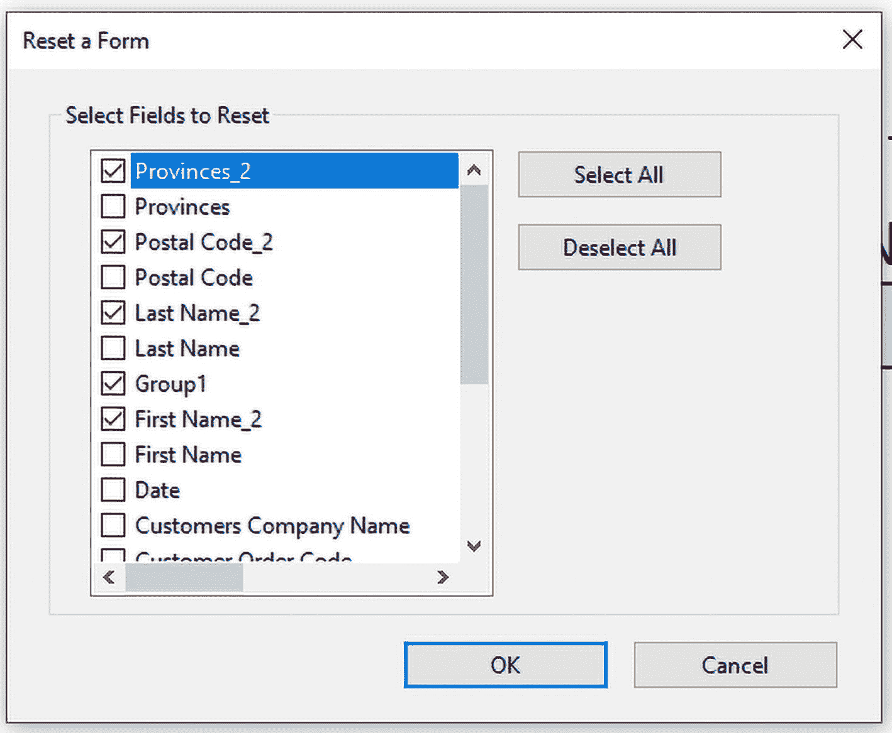

一张“重置表单”对话框的截图，该对话框在“选择要重置的字段”下列出了选项，其中`Provinces_2`被高亮显示，并且选中了“确定”按钮。

**图 21-20**  
“`No`”（否）单选按钮的“`Reset a Form`”（重置表单）对话框的“`Actions`”（操作）选项卡，以及将被重置的字段选择

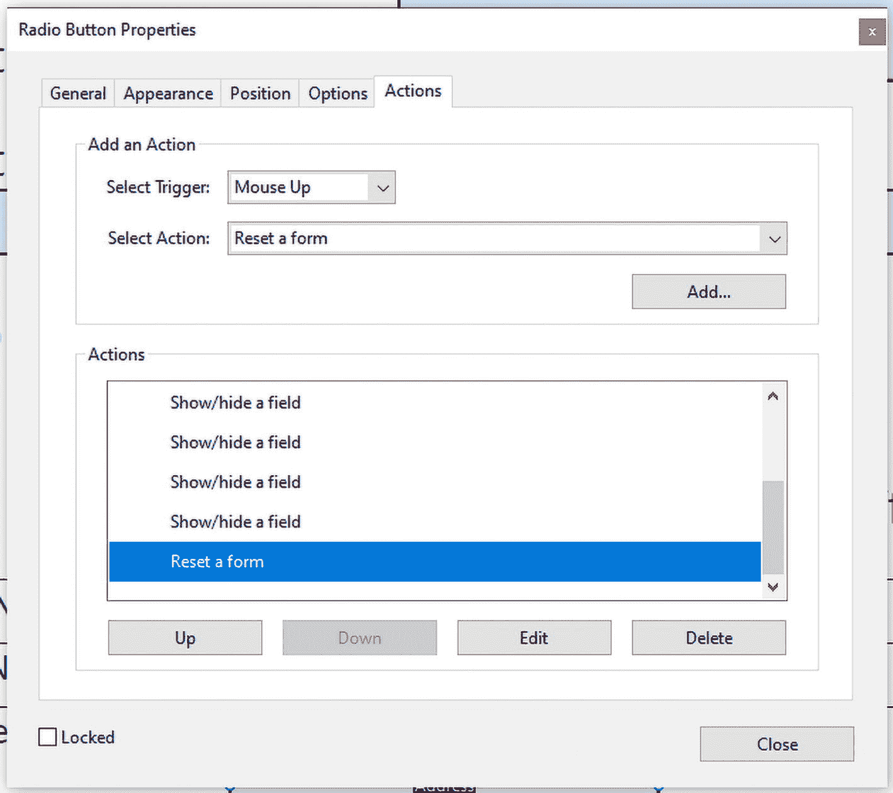

一张截图显示了单选按钮属性对话框，该对话框在“操作”下列出了选项，其中“添加操作”包含了“选择触发器和操作”选项，并且操作列表中高亮显示了“重置表单”。

**图 21-19**  
“`No`”（否）单选按钮的“`Actions`”（操作）选项卡，最后添加了重置操作

**注意** 或者，你可以使用第 9 章的内容，了解如何通过 JavaScript 利用单选按钮自行显示和隐藏这些相同的字段。

最后一项是在第 2 页底部添加一个“`Print this Document`”（打印此文档）按钮。请参考图 21-21。

1.  确保在“`General`”（常规）选项卡上将按钮命名为“`Print`”。在“`Options`”（选项）选项卡上添加一个标签，如图 21-21 所示。

2.  对于“`Actions`”（操作）选项卡，选择“`Execute a Menu Item`”（执行菜单项），单击“`Add`”（添加），选择“`File ➤ Print`”（文件 ➤ 打印），然后单击“`OK`”（确定）。请参考图 21-22。

这将会打印两页。如果只想打印一页，你需要使用第 10 章中的 JavaScript 代码。

3.  测试按钮。当用户单击“`Print`”时，他们将自动进入“打印”对话框。


“打印此文档”选项卡的片段。

**图 21-21**  
“`Print this Document`”（打印此文档）按钮

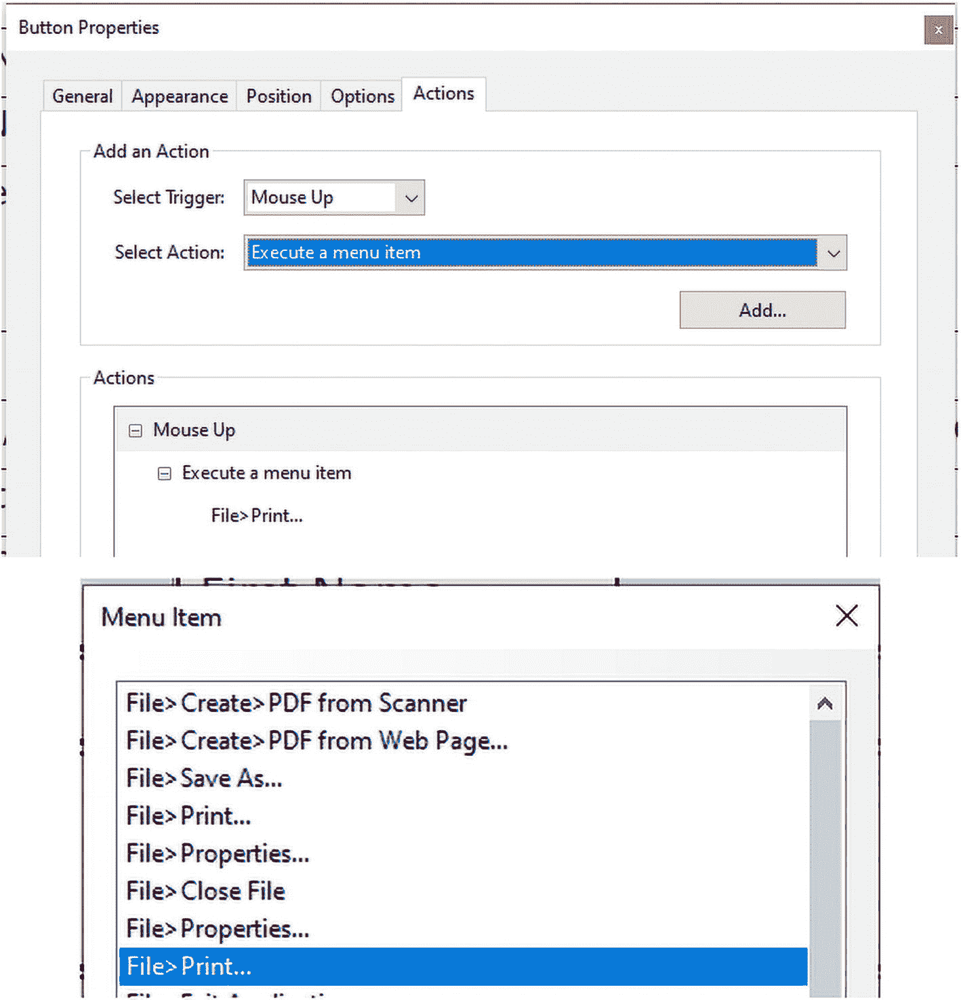

一张按钮属性的截图，该属性在“操作”下列出了选项，其中“添加操作”包含了“选择触发器和操作”。其中还包含了“菜单项”对话框，并高亮显示了“文件 ➤ 打印”按钮。

**图 21-22**  
“`Print`”（打印）按钮的操作

选择“`File ➤ Save`”（文件 ➤ 保存）来保存文档。你现在已完成作业 1。如果你想对比笔记，可以查看我的文件 `Assignment1_showhide_End.pdf` 和 `Assignment1_showhide_End_2.pdf`。

## 家庭作业 2：使用 JavaScript 创建公式

复习第 5 章、第 6 章、第 7 章、第 10 章和第 18 章。

使用文件 `Assignment_2_formulas_Start.pdf` 进行练习。如果你之后需要对比，可以参考“End”（完成版）文件。

请参考图 21-23 使用“`Prepare Form`”（准备表单）工具打开你的表单。


一张“准备表单”图标的截图，其中包含“添加”选项卡。

**图 21-23**  
“`Prepare Form`”（准备表单）工具

对于本作业，你将使用 JavaScript 完成五个公式。实际的公式已给出在每个字段的上方。这些字段已经为你创建好，并在“`Format`”（格式）选项卡上格式化为“`Number`”（数字）类型。右侧的字段也在“`General`”（常规）选项卡上设置为只读（read-only），以防止客户在计算过程中篡改这些字段。请参考图 21-24。

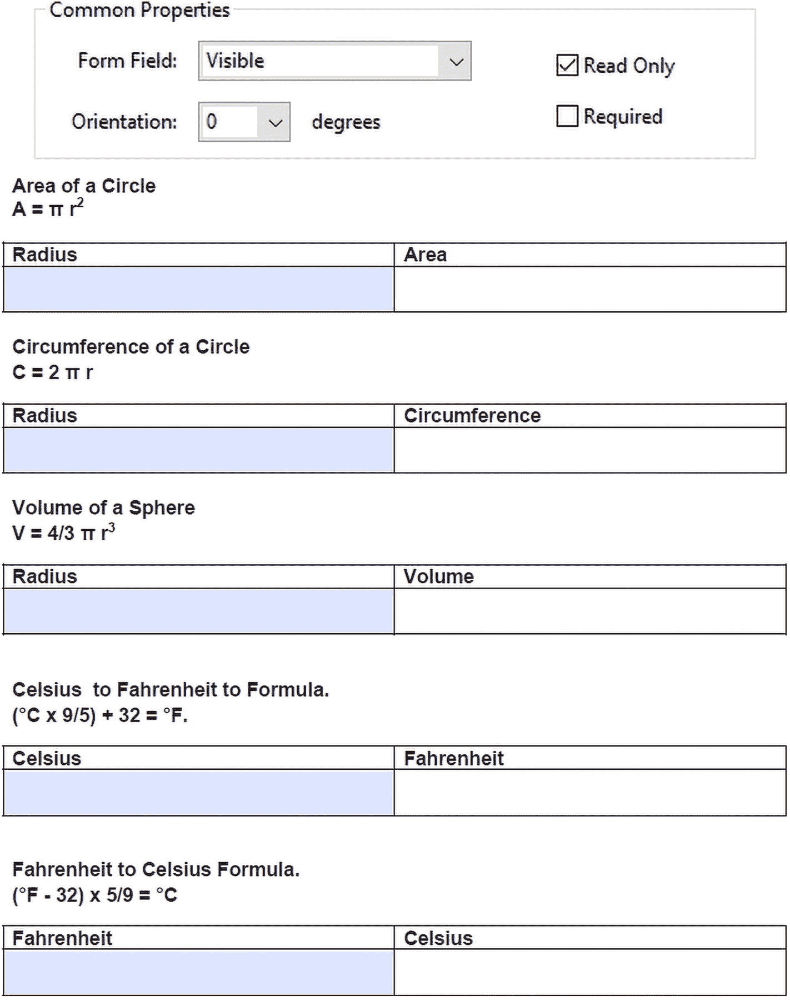

一张页面截图，其中包含文本字段的通用属性，包括：圆的面积、圆的周长、球的体积、摄氏温度转华氏温度公式，以及华氏温度转摄氏温度公式。

**图 21-24**  
作业 2 有五个公式，你可以用它们来为右侧的字段创建计算。请注意，这些字段已设置为只读。

左侧的字段不需要额外的 JavaScript。你只需根据需要，通过变量调用右侧的字段即可。

第一个公式必须按如下方式编写：


### 圆的面积 *A = π r²*

在字段 `AreaRow1` 的“计算”选项卡下的“自定义计算脚本”区域中，输入以下脚本，并参考图 21-25：

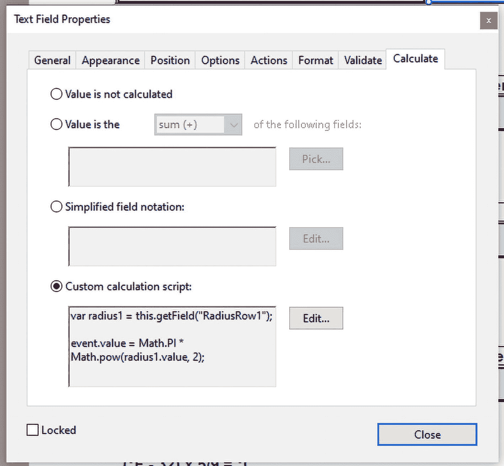

文本字段属性对话框截图，展示了“计算”选项下的“字段的值”、“简化字段表示法”以及选中的“自定义计算脚本”。

图 21-25
文本字段“计算”选项卡上的作业二

```
var radius1 = this.getField("RadiusRow1");
event.value = Math.PI * Math.pow(radius1.value, 2);
```

`Math.pow(radius1.value, 2);` 中的数字 `2` 相当于写 r²。

测试一下，确保公式正常工作，然后继续进行其他四个计算。

如果你不确定从何入手，这里有一个提示：

### 字段：CircumferenceRow1 圆的周长 C = 2 π r

```
var radius2 = this.getField("RadiusRow1_2");
event.value = 2 * _______ * radius2.value;
```

上一个例子中的哪个值应该放在此处以完成公式？

对应的 JavaScript 等价形式是什么？

### 字段：VolumeRow1 球体的体积 V = 4/3 π r³

```
var radius3 = this.getField("RadiusRow1_3");
event.value = (4/3)* _______ * Math.pow(radius3.value, _____);
```

上一个例子中的哪两个值应该放在此处以完成公式？

对应的 JavaScript 等价形式是什么？

### 字段：FahrenheitRow1 摄氏度至华氏度公式。 (°C x 9/5) + 32 = °F。

```
var celsius = this.getField("CelsiusRow1");
event.value = (celsius.value* 9/5)+ _______;
```

上一个例子中的哪个值应该放在此处以完成公式？

对应的 JavaScript 等价形式是什么？

### 字段：CelsiusRow1_2 华氏度至摄氏度公式。 (°F - 32) x 5/9 = °C

```
var fahrenheit = this.getField("FahrenheitRow1_2");
event.value = (fahrenheit.value-_______)*(5/9);
```

上一个例子中的哪个值应该放在此处以完成公式？

对应的 JavaScript 等价形式是什么？

使用 JavaScript 编辑器将正确的公式输入到“计算”选项卡区域后，点击“确定”，然后关闭“属性”对话框。参考图 21-26。


截图显示左侧为选中的“自定义计算脚本”单选按钮，右侧为“关闭”按钮。

图 21-26
“计算”选项卡上的作业二。选择“自定义计算脚本”并点击“关闭”按钮

预览并测试它们以确保其正常工作。有时你需要保存文件、关闭它，然后重新打开它才能生效。

如果功能正常，继续完成作业的下一部分。

在作业的下一部分，你需要在这三个字段的“验证”选项卡中添加一些 JavaScript。参考第 6 章和图 21-27。

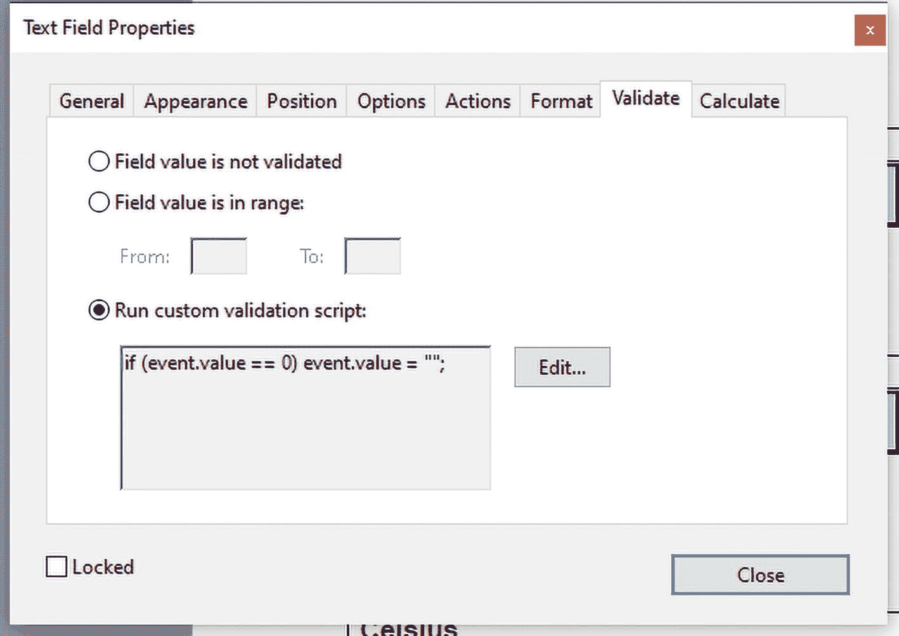

文本字段属性对话框截图，展示了“验证”选项下的三个单选按钮：“字段值未经验证”、“字段值在范围内”和选中的“运行自定义验证脚本”。

图 21-27
带有自定义验证脚本的“验证”选项卡

- `AreaRow1`
- `CircumferenceRow1`
- `VolumeRow1`

选择“运行自定义验证脚本。”

输入以下代码：

```
if (event.value == 0) event.value = "";
```

这是为了确保如果半径字段中未输入任何内容，则该字段保持空白。但是，你可以使用什么替代代码来确保如果在输入字段中输入了 0，则在只读字段中显示 0？

在每个字段中输入脚本后点击“确定”。

对于字段

- `FahrenheitRow1`
- `CelsiusRow1_2`

输入此验证脚本：

```
if (event.value > 0){
event.target.textColor = color.black;
}
else{
event.target.textColor = color.red;
}
```

如果计算结果大于零，文本将为黑色；如果小于零，文本将为红色。如第 10 章所述，如果没有 JavaScript，你无法为这些数字赋予双色选项。

现在，对于这两个字段，以及 `CelsiusRow1` 和 `FahrenheitRow1_2` 这两个字段，我们再进一步。使用第 18 章来弄清楚如何使用文档 JavaScript 在“格式”选项卡上添加度数符号作为自定义格式。参考图 21-28 作为提示。

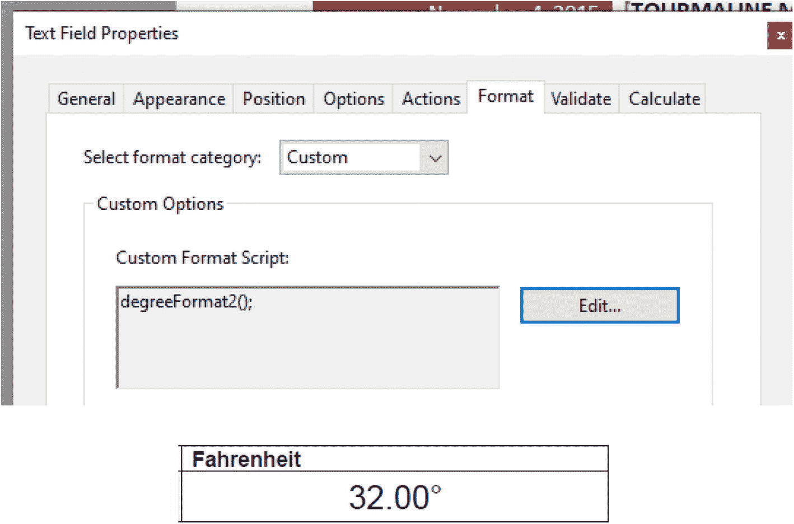

文本字段属性对话框截图，展示了“格式”选项下的“选择格式类别”和“自定义选项”。“自定义选项”包括“自定义格式脚本”。它有一个值为 32.00 华氏度的验证字段。

图 21-28
应用了自定义验证脚本的“验证”选项卡

保存文件并测试它。你已经完成了作业二。


## 作业 3：自定义验证与正则表达式

参考第 8、9、10 和 11 章。

参考文件 `Assignment_3_validation_Start.pdf`，完成本作业后如需复习，可查看"最终版"。

参考图 21-29，使用准备表单工具打开你的表单。

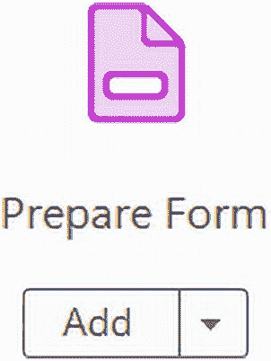

截图显示了带有添加选项的准备表单图标。

图 21-29

准备表单工具

本作业是对自定义验证和正则表达式的复习。参考图 21-30。

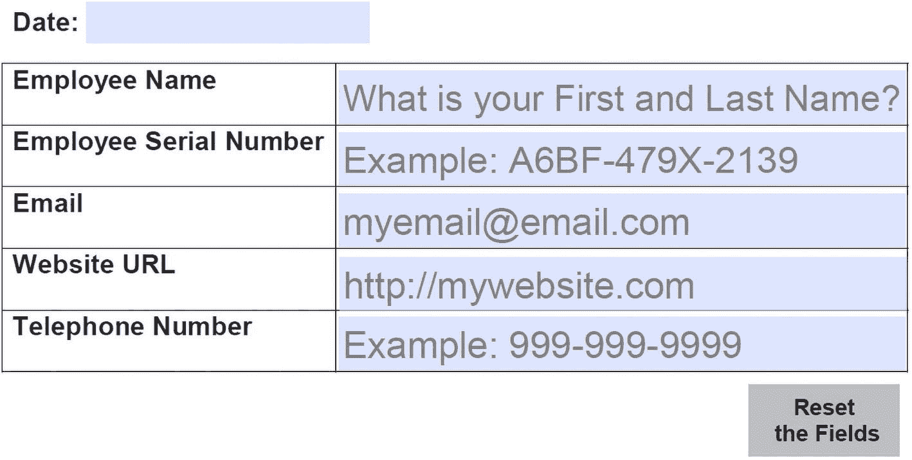

页面显示了一个包含五行内容的表格，分别标注为员工姓名、员工编号、电子邮件、网站 URL 和电话号码，同时包含日期和重置字段选项。

图 21-30

本作业包含格式选项卡上的正则表达式和默认文本

对于日期字段，将格式设置为"无"，因为你将尝试两种格式选项。下一步请参考图 21-31。

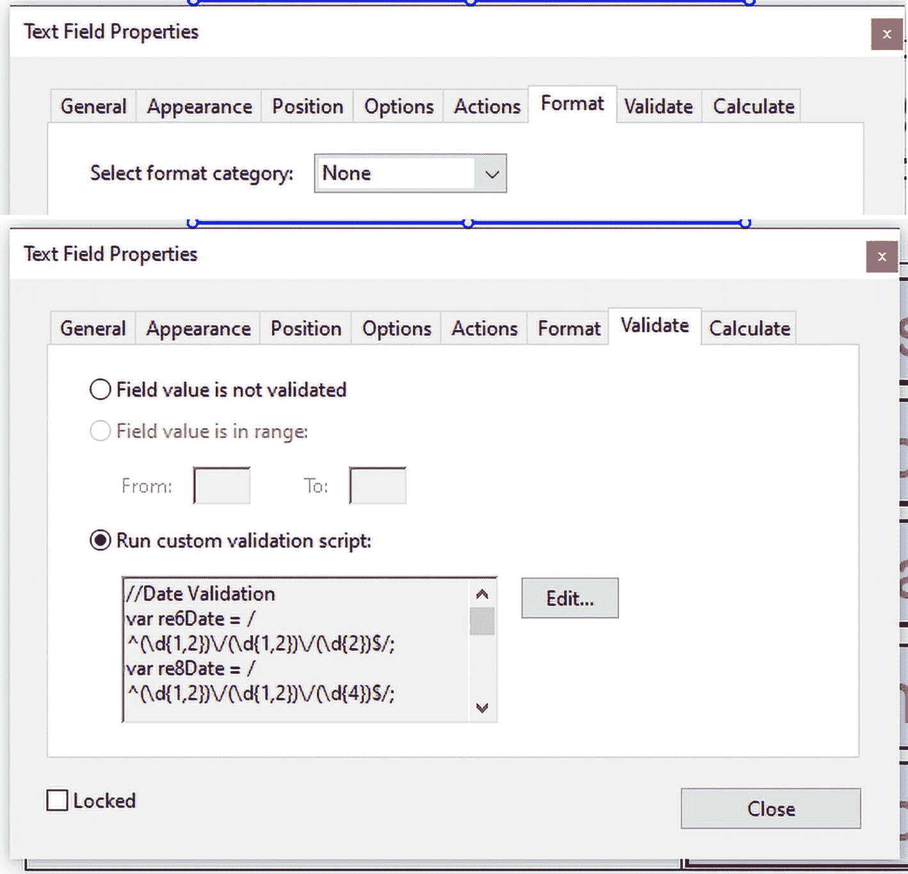

文本字段属性对话框的两个截图。上方列出了格式选项卡下的选项，包含选择格式类别。下方列出了验证选项卡下的选项，包含三个单选按钮用于字段值，以及选中的"运行自定义验证脚本"。

图 21-31

格式选项卡和验证选项卡：运行自定义验证脚本

改为在验证选项卡的"运行自定义验证脚本"区域添加以下验证：

```
//日期验证
var re6Date = /^(\d{1,2})\/(\d{1,2})\/(\d{2})$/;
var re8Date = /^(\d{1,2})\/(\d{1,2})\/(\d{4})$/;
//若字段为空则阻止弹窗
if(event.value !=""){
if(re6Date.test(event.value)== false && re8Date.test(event.value)== false){
app.alert("抱歉，这不是有效格式。必须为 mm/dd/yy 或 mm/dd/yyyy 格式。");
event.rc = false;
}
}
```

关于日期验证和格式化的复习，请参考第 11 章。

对于员工姓名字段，将格式选项卡设置为"自定义"。参考图 21-32。

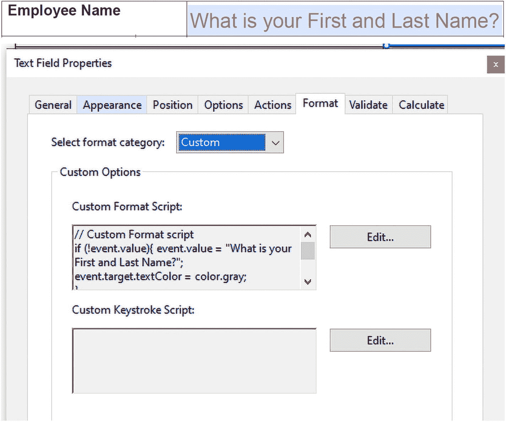

截图显示了带有员工姓名的文本字段以及文本字段属性对话框，下方列出了格式选项卡下的选项，包含选择格式类别和自定义选项。

图 21-32

在格式选项卡上应用自定义格式类别

输入以下自定义格式脚本：

```
// 自定义格式脚本
if (!event.value){
event.value = "请输入您的姓名（名和姓）？";
event.target.textColor = color.gray;
}
else{
event.target.textColor = color.black;
}
```

然后在验证选项卡上点击"运行自定义验证脚本"按钮，并输入以下代码。参考图 21-33。

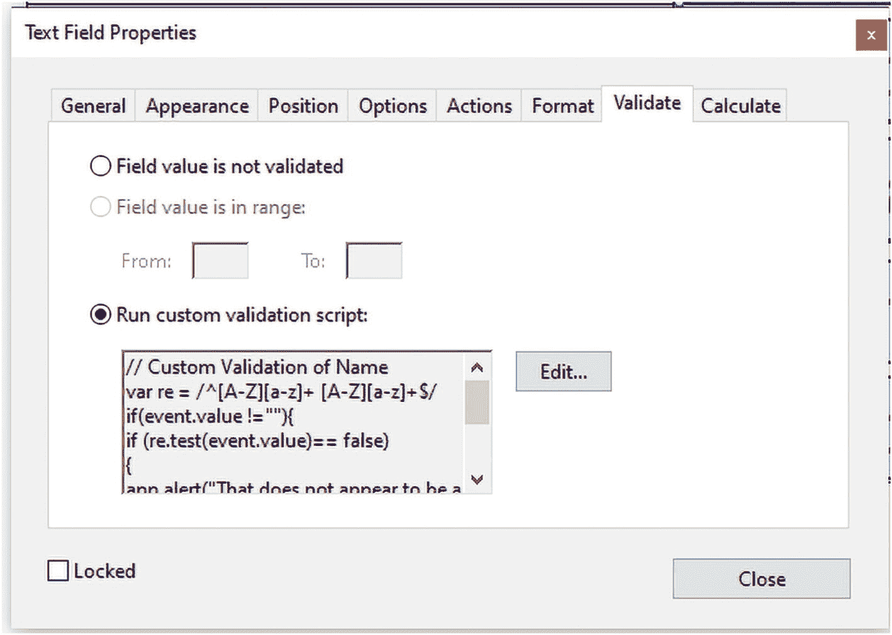

截图显示了文本字段属性对话框，下方列出了验证选项卡下的选项，包含三个单选按钮：不验证字段值、字段值在范围内，以及选中的"运行自定义验证脚本"。

图 21-33

对员工姓名字段应用验证选项卡上的验证

```
// 姓名的自定义验证
var re = /^[A-Z][a-z]+ [A-Z][a-z]+$/;
if(event.value !=""){
if (re.test(event.value)== false){
app.alert("这看起来不是有效的姓名。我需要您提供名和姓。");
event.rc = false;
}
}
```

在查看 JavaScript 时，思考如何修改此代码，使其适用于格式选项卡和验证选项卡上的其他字段。此脚本在第 9 章和第 10 章（默认方法）以及第 11 章中均有涉及。

- 员工编号


- 电子邮件
- 网站网址
- 电话号码

对于电话号码，需在“自定义格式”选项卡上对脚本稍作修改以支持三种颜色，因为原示例只有两种颜色。

```
// 自定义格式脚本
var rgexTele = /^[(]{0,1}[0-9]{3}[)]{0,1}[-\s\.]{0,1}[0-9]{3}[-\s\.]{0,1}[0-9]{4}$/;
if (!event.value){
event.value = "示例：999-999-9999";
event.target.textColor = color.gray;
}
else if(rgexTele.test(event.value)){
event.target.textColor = color.black;
}
else{
event.target.textColor = ["RGB",1,0,0]; //将文本更改为红色
}
```

关于“员工序列号格式”和“验证”选项卡脚本，请参阅第 11 章（使用正则表达式进行文本字段验证）。在此示例中，我对代码做了少许修改。

```
// 自定义格式脚本选项卡
if (!event.value){ event.value = "示例：A6BF-479X-2139";
event.target.textColor = color.gray;
}
else{
event.target.textColor = color.black;
}
// 验证选项卡脚本（账号）
//A6BF-479X-2139
var re = /^[A-Z]\d[A-Z]{2}-\d{3}[A-Z]-\d{4}$/;
if(event.value !=""){
if (re.test(event.value)== false)
{
app.alert("抱歉，这不是有效的账号。");
event.rc = false;
}} (注释：原本缺少一个括号，请确保有两个括号)
```

对于“电子邮件格式”选项卡，请确保调整了默认脚本。对于“验证”选项卡的脚本，请参阅第 11 章。提示：修改以下代码行：

```
var re = /^\w+([\.-]?\w+)*@\w+([\.-]?\w+)*(\.\w{2,3})+$/;
```

此外，请修改您的 `app.alert()` 消息。

对于“网站网址验证”选项卡脚本，请参阅第 11 章。提示：修改以下代码行：

```
var re = /^(http:\/\/www\.|https:\/\/www\.|http:\/\/|https:\/\/)[a-z0-9]+([\-\.]{1}[a-z0-9]+)*\.[a-z]{2,5}(:[0-9]{1,5})?(\/.*)?$/;
```

修改“验证”选项卡上的 `app.alert()` 消息，并调整“格式”选项卡上的默认消息。

对于“电话号码”设置，既然你已经设置好了“格式”选项卡，现在对于“验证”选项卡脚本，请参阅第 11 章以获取正确的脚本；仅使用本章开头处 10 位数字的示例。提示：查找以下代码行：

```
var rgexTele = /^[(]{0,1}[0-9]{3}[)]{0,1}[-\s\.]{0,1}[0-9]{3}[-\s\.]{0,1}[0-9]{4}$/;
```

如果未正确输入数据，应出现诸如图 21-34 所示的警报，但请确保消息与验证条件匹配。

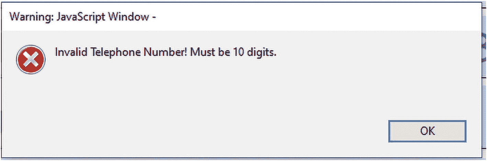

截图显示了一个 JavaScript 警告弹出窗口，其中包含一条警报消息，提示电话号码无效，必须为 10 位数字。

**图 21-34** 自定义验证脚本产生的警报

对于此验证脚本，只需将文本颜色在正确时变为黑色，格式错误时变为红色。

```
if(rgexTele.test(event.value)){
event.target.textColor = color.black; //将文本更改为黑色
}
else
{
event.target.textColor = ["RGB",1,0,0]; //将文本更改为红色
app.alert("无效的电话号码！必须为 10 位数字。");
}
```

在任务结束时，请确保为所有字段添加一个“重置表单”操作，并附加一个标签为“重置字段”的按钮。

最后，需要将此按钮字段`Reset`设置为多行。有关示例，请参阅第 10 章。关于如何设置按钮，请参考图 21-35 和图 21-36。

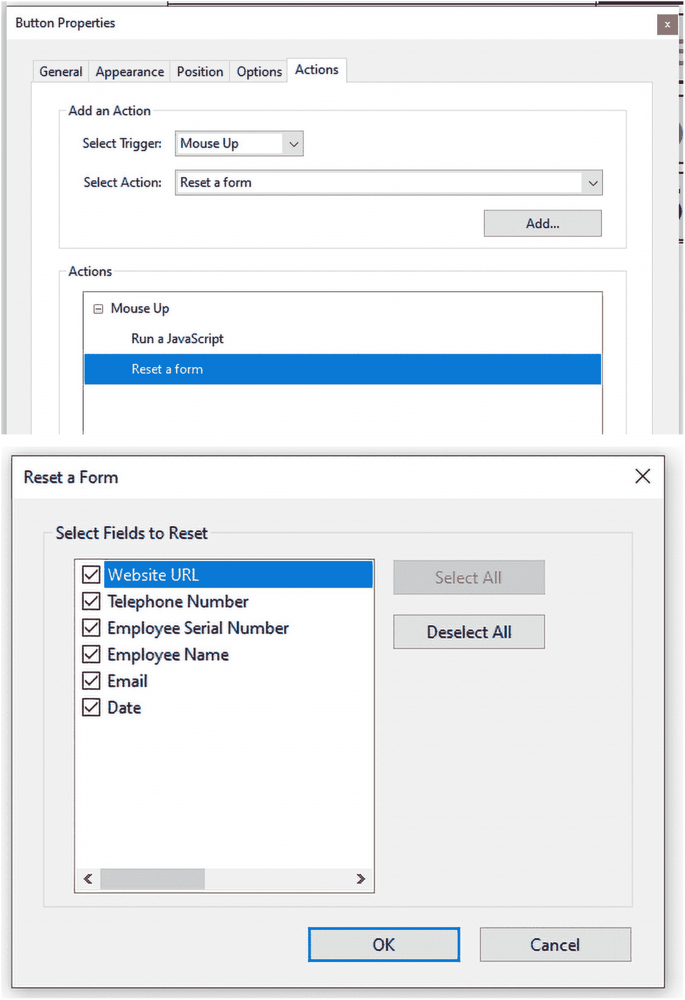

两张截图。上方是按钮属性对话框，在“操作”下列出了选项，包含“添加操作”和“操作”。下方是重置表单对话框，在“选择要重置的字段”下列出了选项，其中高亮显示了网站 URL。

**图 21-36** 重置按钮的“操作”选项卡上的各种属性。选择“运行 JavaScript”以使按钮多行，并使用对话框重置表单中的字段

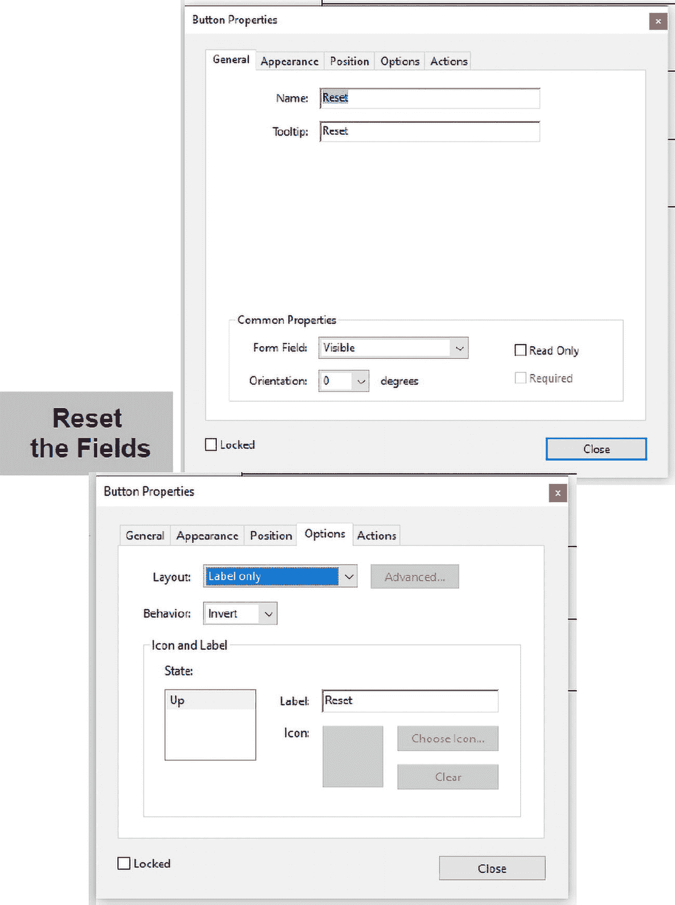

两张按钮属性对话框的截图。上方在“常规”下列出的选项包含名称、工具提示和通用属性。下方在“选项”下列出的选项卡包含布局、行为、图标和标签，其中标签为“重置字段”按钮。

**图 21-35** 按钮的“常规”和“选项”选项卡上的各种属性

在“选项”选项卡中输入标签文本后，选择“运行 JavaScript”并输入以下代码：

```
this.getField("Reset").buttonSetCaption("重置\n 字段");
```

然后重置所有表单字段。单击“确定”并关闭按钮属性。请参考图 21-35。

完成后，保存文件并进行测试。至此，您已完成作业 3。


## 作业 4：个人下拉菜单与定义文本框

请复习第 11 章和第 12 章。

使用文件 `Assignment_4_multiline_dropdown_Start.pdf`，并在需要时参考“End”文件。

参考图 21-37，使用 `准备表单` 工具打开您的表单。

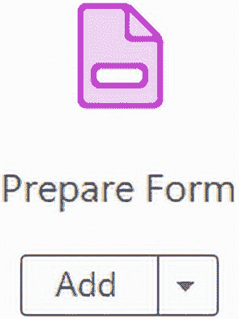

截图展示了带有添加选项的 `准备表单` 图标。

**图 21-37** `准备表单` 工具

这份最终作业在您需要针对某一主题查看更多信息（例如定义）时非常实用。下拉列表默认只能显示单行文本，除非添加正则表达式；但当文本内容较多时，多行菜单是更理想的选择，因此我们将改用文本框来显示。请参考图 21-38。

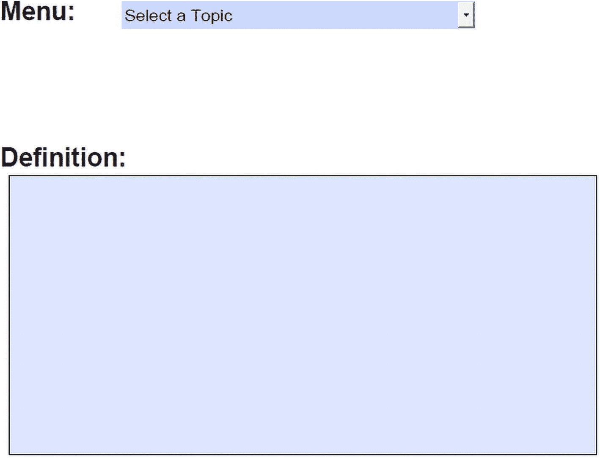

页面展示了一个菜单，其中包含一个用于选择主题的下拉菜单，以及一个用于显示定义的空白文本框。

**图 21-38** 最终作业要求创建一个下拉菜单，其额外信息显示在文本框中

下拉菜单和文本字段已预先设置好。请参考图 21-39。

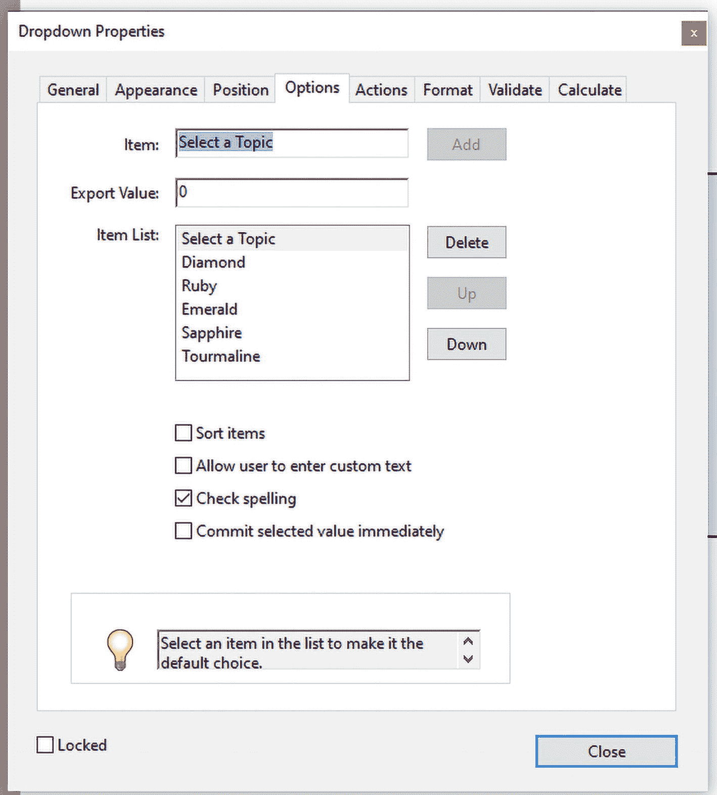

截图展示了 `下拉列表属性` 对话框，其中列出了选项标签页下的项目、导出值、项目列表，以及一个选中的关闭按钮。

**图 21-39** `下拉列表属性` 对话框的“选项”标签页

“选项”标签页提供以下项目：

* 钻石
* 红宝石
* 祖母绿
* 蓝宝石
* 碧玺

请将这些项目的导出值留空，以免干扰 JavaScript。顶部的项目设置“选择主题”应被选中，其导出值为 `0`。请记得勾选“立即提交选中的值”，以便脚本能即时加载到文本框中。取消勾选“检查拼写”。请参考图 21-40。

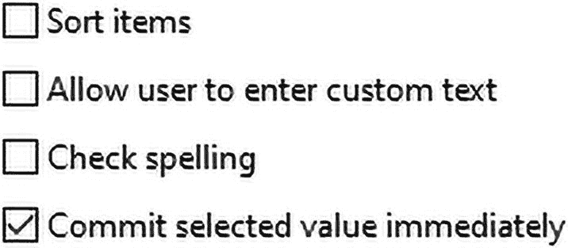

截图展示了带有复选框的选项，包括对项目排序、允许用户输入自定义文本、检查拼写以及立即提交选中的值。

**图 21-40** `下拉列表属性` 对话框的“选项”标签页；选择“立即提交选中的值”

对于文本字段 `Text2` 的“选项”标签页，请确保将其设置为多行，以防评论内容变长。如图 21-41 所示，您可以取消勾选“检查拼写”，因为此选项并非必需。请保持“滚动长文本”选项为启用状态。

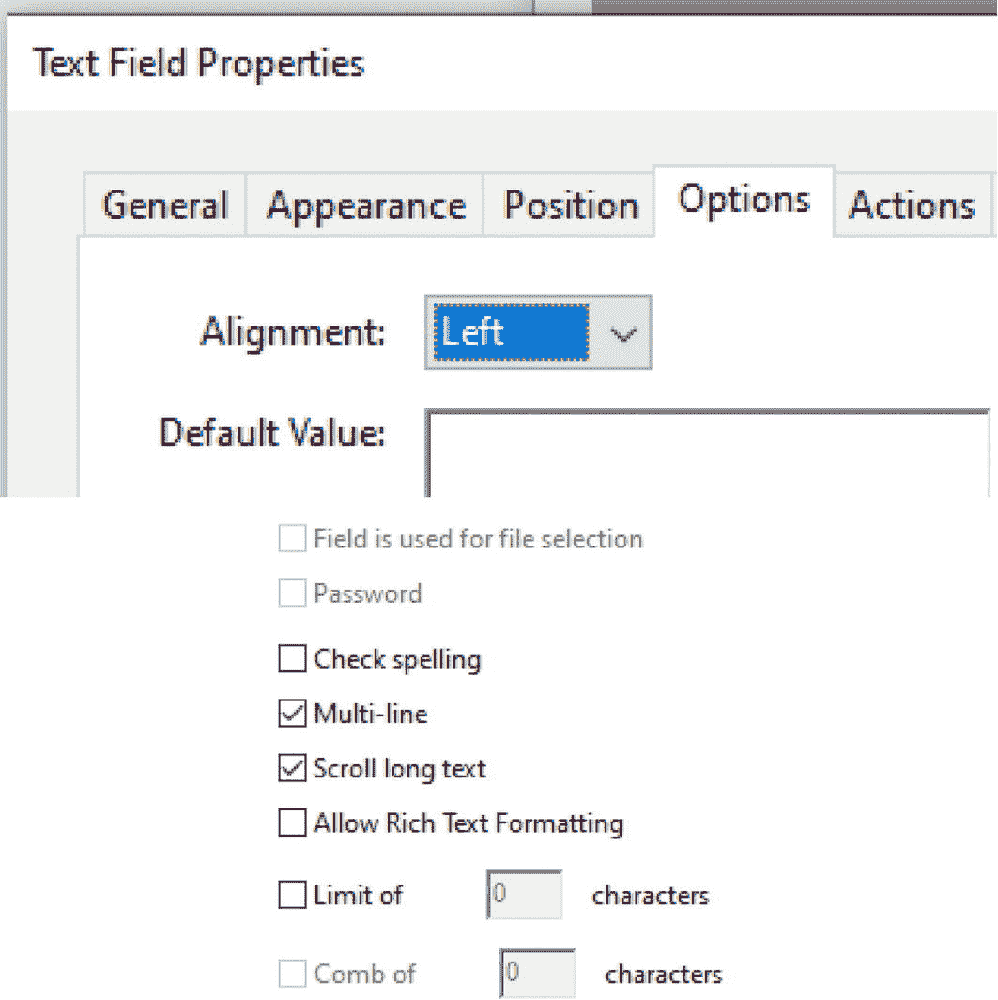

`文本字段属性` 对话框的截图，列出了选项标签页下的对齐方式和默认值。其中包括选中了多行和滚动长文本的选项标签页。

**图 21-41** `文本字段属性` 对话框的“选项”标签页，“检查拼写”未启用

在“常规”标签页中，将文本字段设置为只读。

请勿更改文本字段中的任何其他设置，仅需关注名为 `Dropdown1` 的下拉列表以及文档级 JavaScript。请参考图 21-42。

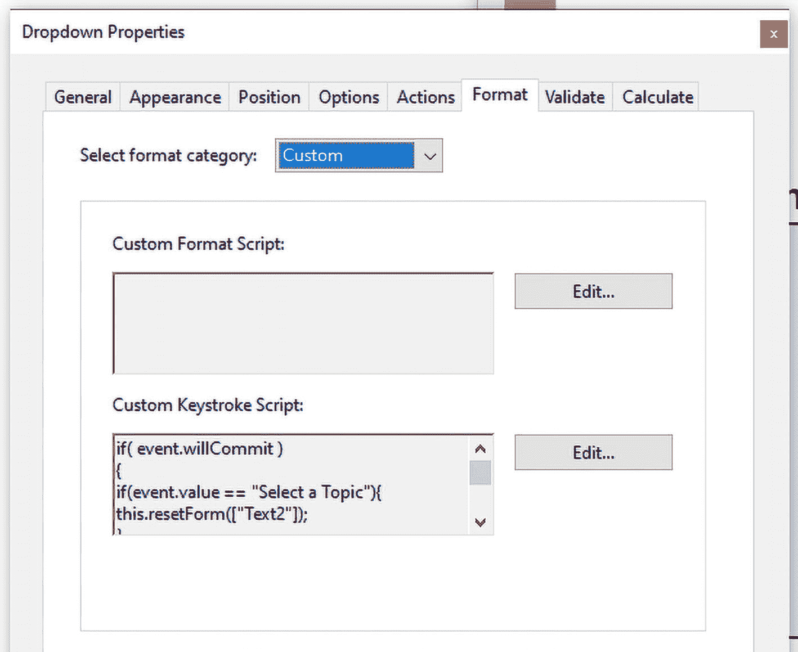

截图展示了 `下拉列表属性` 对话框，其中列出了格式下的选项，包括选择格式类别、自定义格式脚本和自定义击键脚本。

**图 21-42** `下拉列表属性` 对话框的“格式”标签页，包含一个自定义击键脚本

在下拉列表的“格式”标签页中，将其设置为 `自定义`，并将以下 JavaScript 代码添加到“自定义击键脚本”区域，以便为文本字段显示或重置值：

```
if(event.willCommit)
{
if(event.value == "Select a Topic"){
this.resetForm(["Text2"]);
}
else{
SetFieldValues(event.value);
}
}
```

您无需对下拉列表进行任何其他操作。关闭属性对话框。

现在，点击 `关闭` 按钮退出 `准备表单` 工具，然后选择 `工具` ➤ `JavaScript`。请参考图 21-43 和 21-44。


工具栏截图，包含调试、调试器、文档 JavaScript、所有 JavaScript 和文档操作工具。

**图 21-44** 选择 `文档 JavaScript` 子工具以进入对话框

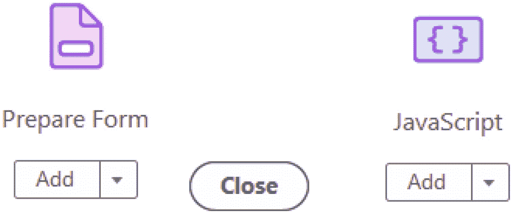

截图展示了左侧的 `准备表单` 图标和右侧的 `JavaScript` 图标，中间为关闭按钮。每个图标都包含添加选项。

**图 21-43** 从 `准备表单` 工具切换到 `JavaScript` 工具

选择 `文档 JavaScript` 子工具。请参考图 21-44。

将脚本命名为 `SetFieldValues` 并点击 `添加` 按钮。请参考图 21-45。

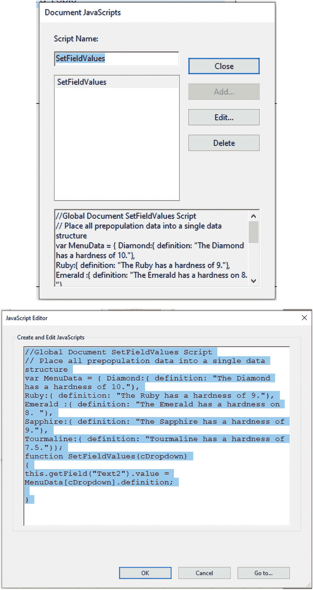

2 张截图。上方为 `文档 JavaScript` 对话框，显示脚本名称和设置字段值；下方为 `JavaScript 编辑器` 对话框，包含创建和编辑 JavaScript 字段。

**图 21-45** 包含 `SetFieldValues` 脚本的 `文档 JavaScript` 对话框。文本已输入到 `JavaScript 编辑器` 中

仅输入此脚本：

```
//Global Document SetFieldValues Script
// Place all prepopulation data into a single data structure
var MenuData = { Diamond:{ definition: "钻石的硬度为 10。"},
Ruby:{ definition: "红宝石的硬度为 9。"},
Emerald :{ definition: "祖母绿的硬度为 8。"},
Sapphire:{ definition: "蓝宝石的硬度为 9。"},
Tourmaline:{ definition: "碧玺的硬度为 7.5。"}};
function SetFieldValues(cDropdown)
{
this.getField("Text2").value = MenuData[cDropdown].definition;
}
```

输入完成后，点击 `确定` 确认，然后点击 `关闭` 关闭 `文档 JavaScript` 对话框。请参考图 21-45。

关闭 `JavaScript` 工具，并从菜单中选择一个名称来测试下拉列表。

当您从下拉列表中松开选择时，定义文本应显示在文本框中。

当您选择顶部的项目“选择主题”时，文本框应重置为空白。

请务必测试下拉列表，以确认菜单的所有部分都正常运行。

请参考图 21-46。

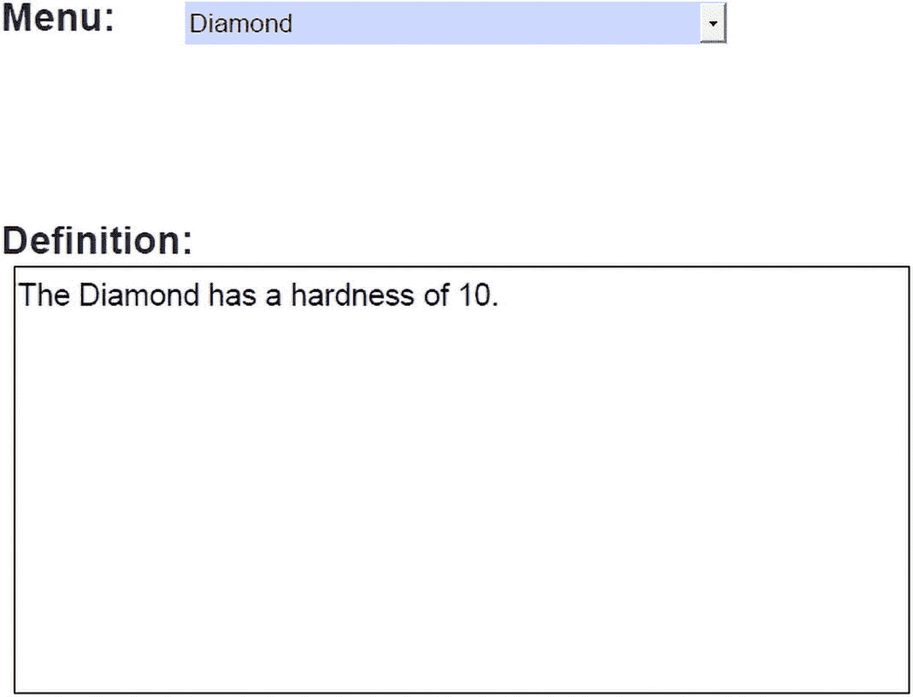

页面展示了一个菜单，其中包含一个已选择钻石的下拉菜单，以及一个用于显示定义的空白文本框，文本框中显示“钻石的硬度为 10”。

**图 21-46** 这是下拉列表和文本字段的最终作业效果

保存您的文件。您已完成最终作业。

> **注意：** 如果您希望获得一份额外的书面作业测试来检验您在课堂环境中的知识掌握情况，可以查看我的文件 `Advanced Adobe Acrobat_test.docx`，作为为学生创建测试的参考。

## 总结

为了帮助应用您从本书中学到的知识，本章为您提供了四个作业。此外，对前几章中的原始示例进行了一些变体，使您能够了解如何根据项目需求修改脚本。


