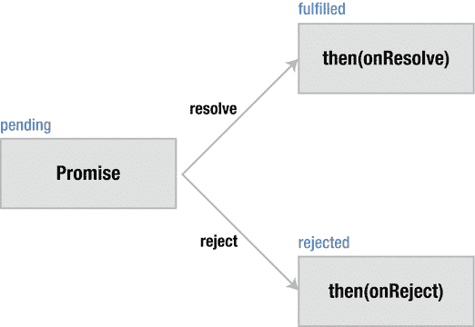

# 9. ES6 中的 Promise

众所周知，JavaScript 在设计上是单线程的。在浏览器中，它使用事件处理来并发管理许多任务。JavaScript 引擎管理一个事件队列，当事件发生时，会调用注册的处理函数。如果你有传统 JavaScript 的经验，那么你很清楚理解异步编程是正确使用 JavaScript 的必备条件。使用异步的主要模式是通过回调函数。ES6 为标准 JavaScript 规范带来了一个新特性 —— Promise（一些新的和最新的 JS 库和框架中已有的特性），它解决了回调（唯一的异步方法）中的许多重大问题。

## Promise 概述

在某些需要等待异步操作完成然后执行任务的情况下，JavaScript 严重依赖回调函数，允许代码执行绕过长时间运行的任务继续进行。您一定已经知道`setTimeout`、`XMLHttpRequest`以及所有基于浏览器的异步函数都是基于回调的。虽然这个概念在理论上简单易懂，但它可能导致一些非常令人困惑且难以理解的代码，尤其是在需要在回调之后进行回调（嵌套回调）的情况下，这通常被称为“回调地狱”。例如，考虑以下代码片段，其中必须先发生 X，然后发生 Y，最后发生 Z：

```
x = getData();
y = getMoreData(x);
z = getMoreData(y);
```

在 ES6 之前，您可以异步获取`x`，然后将其作为参数传递给获取`y`的函数，对`z`也是如此，使用回调的方式如下：

```
getData(function(x){
    getMoreData(x, function(y){
        getMoreData(y, function(z){
            ...
        });
    });
});
```

在实际应用中，当您有大量回调函数时，这可能会变得越来越复杂，从而形成回调金字塔。这些回调金字塔无处不在——在处理 HTTP 请求、数据库操作、动画、进程间通信以及其他各种场景中都会出现。通常，使用回调函数的代码会变得更难理解、重构和测试。

这就是 Promise 的用武之地。Promise 为我们提供了一种更可控的模式来处理异步处理。它们代表了一个可以在未来某个时间点处理的值，并提供了一种摆脱回调地狱的方法。与基于回调的方法相比，Promise 为执行、组合和管理异步操作提供了一种更简单的替代方案。它们还使得代码的逻辑流程更容易理解。

ES6 原生支持 Promise。一个 Promise 是一个等待异步操作完成的对象，当该操作完成时，该 Promise 要么被兑现（fulfilled），要么被拒绝（rejected）。一个 Promise 对象可以处于以下三种状态之一：

*   `fulfilled` – 当 Promise 成功时
*   `rejected` – 当 Promise 失败时
*   `pending` – 当它既未兑现也未拒绝时

一个待定（pending）的 Promise 可能会转换为兑现（fulfilled）或拒绝（rejected）状态，并且当 Promise 被兑现或拒绝时，它被认为已敲定（settled）。需要注意的是，一个已敲定的 Promise 是不可变的，这意味着一旦 Promise 被敲定，就不能重新敲定。

### 创建 Promise

Promise 是使用`new Promise()`构造函数创建的，该构造函数接受一个执行器（一个函数），该函数有两个参数：

*   第一个参数（通常命名为`resolve`）是一个函数，当未来值就绪时，即 Promise 被兑现时，会调用该函数；
*   第二个参数（通常命名为`reject`）是一个函数，如果它无法解决未来值，则调用该函数来拒绝 Promise。

执行器启动一些异步工作，然后一旦完成，就调用`resolve`或`reject`函数来兑现 Promise，或者如果发生错误则拒绝它。

一个简单的 Promise 如下所示：

```
const p = new Promise((resolve, reject) => {
    if (/* some condition */) {
        resolve(/* some value */);  // fulfilled successfully
    } else {
        reject(/* some reason */);  // error, rejected
    }
});
```

第二个方法（`reject`）是可选的，您可以只使用`resolve`方法来创建 Promise，如下面的代码片段所示，其中 Promise 分别被兑现和拒绝：

```
new Promise(resolve => resolve()) // promise is fulfilled
new Promise((resolve, reject) => reject()) // promise is rejected
```

您也可以使用以下方式创建一个立即兑现的 Promise：

```
const sayHello = Promise.resolve("hello!");
```

类似地，您也可以使用`Promise.reject(value)`来拒绝一个 Promise。不带值地兑现或拒绝 Promise 并不十分有用。通常，一个 Promise 会兑现为某个值，该值可能是来自 HTTP 请求、动画或其他异步操作的结果。

一旦创建，一个 Promise 只能被敲定，这意味着它要么被兑现，要么被拒绝。并且如上所述，由于已敲定的 Promise 是不可变的，因此已敲定的值或失败原因不能被更改（该值也可以是`undefined`）。然而，一个对象可以用作已兑现的值，并且对象的属性可能会发生改变。

### 使用`then()`和`catch()`消费 Promise

一旦创建了 Promise，它可以作为一个值传递，本质上表示未来值的占位符。当 Promise 被兑现时，可以使用`.then()`方法来消费这个值。此方法接受一个函数，该函数将在 Promise 被兑现时被传递已兑现的值。例如，考虑以下代码片段：

```
const p = new Promise((resolve, reject) => resolve(42));
p.then((val) => console.log(val)); // 42
```

每个 Promise 都必须有一个`.then()`方法，它实际上接受两个可能的参数。第一个参数是 Promise 被兑现时要调用的函数，第二个参数是 Promise 被拒绝时要调用的函数，如图 9-1 所示。



图 9-1. 一个待定的 Promise 可以被兑现或拒绝，并使用`.then()`方法进行处理

```
p.then((value) => { console.log("Promise Fulfilled:", value) },
       (error) => { console.log("Promise Rejected: ", error) });
```

如果给定的 Promise 总是被解决，我们可以为了简单起见省略第二个参数。查看以下示例，其中顾客在订单下达五秒后收到他的披萨：

```
const pizza = new Promise((resolve) => {
    console.log("Getting your pizza in 5 seconds...");
    setTimeout(() => {
        resolve("Onion Pizza");
    }, 5000);
});
pizza.then(
    (item) => { console.log(`Order Received: ${item}`) },
    (error) => { console.log("Something went wrong with your pizza") }
);
// Getting your pizza in 5 seconds...
// Order Received: Onion Pizza
```

此示例演示了两件事：

*   首先，我们附加到 Promise 上的处理程序是在所有其他代码异步运行之后才被调用的。
*   其次，兑现处理程序仅在 Promise 被兑现时被调用，并传入它被解决时的值（在我们的例子中，是洋葱披萨）。拒绝处理程序也是如此。

这是另一个消费 Promise 的典型示例，其中`getRentalList(location)`是异步的，并使用返回 Promise 的 Web 服务返回给定位置当前可用的租赁房产列表：

```
const housingPromise = getRentalList("London");
housingPromise.then(
(res) => {
if (res.properties && res.properties.length > 0) {
console.log(`We found the houses for you: ${res.properties}`);
} else {
console.log(`Sorry, no housing is available in ${res.location}`);
}
},
(error) => {
console.log(`Something went wrong: ${error}`);
}
);
```

如果您只对拒绝 Promise 感兴趣，可以省略第一个参数并将其传递为`null`。例如，查看以下代码片段：

```
const networkReq = new Promise((resolve, reject) => {
reject("No Server Found");
});
networkReq.then(
null,
(error) => { console.log(error); }
);
```

一方面，如果处理程序在`.then()`调用中返回一个值，它会在返回时自动包装在一个 Promise 中。这些`.then()`调用可以被链式调用。我们将在下一节详细讨论 Promise 链式调用的工作原理。另一方面，您也可以使用`catch()`方法以更紧凑的方式处理被拒绝的 Promise。例如，您可以重写上面的示例如下：

```
networkReq.catch((error) => { console.log(error); });
```

# `catch()` 方法与 Promise 链式调用

`catch()` 方法在 Promise 组合中用于错误处理非常有用。与 `then()` 方法类似，它也会返回一个 Promise，但只处理被拒绝的情况。`catch()` 方法相当于 `then(null, onRejected)` 的简写形式。我们将在本章后面进一步学习如何处理错误。

## Promise 的链式调用

由于 `.then()` 和 `.catch()` 始终返回一个新的 Promise，因此可以轻松地链式调用 Promise，同时高度控制错误处理的方式和位置。链式调用允许将异步操作串联起来，确保它们按照正确且预期的顺序执行，从而使代码看起来几乎是同步的。请看以下示例：

```
const bond = new Promise((resolve, reject) => {
  resolve("Bond");
});
bond.then((str) => `${str}, James ${str}`)
  .then((str) => `Hello, I'm ${str}!`)
  .then((str) => console.log(str));
// Hello, I'm Bond, James Bond!
```

上面是一个简单的示例，展示了链式调用如何帮助按顺序执行不同任务并获得最终结果。让我们看看下面这段更实际的代码片段，它演示了链式调用在处理异步任务时的优势：

```
getPaymentFromUser
  .then(displayTransactionDetails)
  .then(queueTransactionEmail)
  .then(redirectToOrdersPage)
  .catch(logError)
```

这里，`getPaymentFromUser` 返回一个 Promise，链中的每个函数都会在前一个处理器完成后，被调用并传入其返回值。在这个例子中，`displayTransactionDetails()` 会等待 `getPaymentFromUser()` 完成后再开始；`queueTransactionEmail()` 会等待 `displayTransactionDetails()` 完成后再开始，依此类推。需要注意的是，`logError()` 仅在之前的任意一个 Promise 被拒绝时才会执行。这种方式将调用串行化，而不会阻塞主执行线程，并确保这些操作按顺序执行。

### 错误处理

在本章前面，我们讨论了在消费 Promise 时如何处理错误，可以通过以下任意一种方式：

```
somePromise().then(onResolved, onRejected);
// 或者直接使用 catch()
somePromise()
  .then(onResolved)
  .catch(onRejected);
```

但你应该更倾向于哪一种方式，为什么呢？这个问题的答案取决于你的 `onResolved()` 函数是否会抛出错误。`then()` 方法返回的 Promise 可能会被拒绝，但如果使用第一种方式，这个拒绝无法被捕获——导致错误在你的应用中被忽略。而使用第二种方式，无论是来自 `somePromise()` 还是 `onResolved()` 的错误，都可以在 `catch()` 方法中得到处理。如果我们有多个 `then()` 调用，错误会一直传递下去，直到遇到错误处理器。因此，建议在所有 Promise 链的末尾都加上一个 `catch()` 方法。

## 使用 `Promise.all` 组合 Promise

`Promise.all` 接收一个 Promise 数组（或任何可迭代对象），并返回一个 Promise。当可迭代参数中的所有 Promise 都 resolve 时，该返回的 Promise 会 resolve；如果任何一个 Promise 拒绝，它就会以第一个拒绝的 Promise 的原因 reject。

如果传入的任意一个 Promise 被拒绝，那么所有 Promise 会立即以该拒绝的 Promise 的值 reject，并丢弃所有其他 Promise，无论它们是否已 resolve。注意，如果传入一个空数组，该方法会立即 resolve。

```
const p1 = Promise.resolve(3);
const p2 = 42;
const p3 = new Promise((resolve, reject) => {
  setTimeout(resolve, 100, "foo");
});
Promise.all([p1, p2, p3]).then(values => {
  console.log(values); // [3, 42, "foo"]
});
```

然而，在某些情况下，你可能不想等待数组中的所有 Promise 都 resolve，而只是想获取数组中第一个完成的 Promise 的结果。在这种情况下，可以使用 `Promise.race()`。

`Promise.race()` 也接收一个 Promise 数组，但与 `Promise.all()` 不同，它会在数组中第一个 Promise 完成时立即兑现其返回的 Promise。例如，假设我们想从 API 端点获取一些 JSON 数据，但不想无限等待响应。在这种情况下，我们只想使用一个默认值。我们可以使用 `Promise.race()` 来实现这一点：

```
// 一个在给定时间（t）后超时的 Promise
function delay(t) {
  return new Promise((resolve, reject) => {
    setTimeout(resolve, t);
  });
}
// 哪个 Promise 先完成，其结果就会被传递到我们的处理器中
Promise.race([
    fetchData(),
    delay(5000).then(() => { data: "test" })
  ])
  .then((res) => {
    // 如果 fetchData() 耗时超过 5 秒，这里将是 "test"
    console.log("data:", res.data);
  })
  .catch(function(err) {
    console.log("error:", err);
  });
```

在这个例子中，`delay()` 函数返回一个在 `t` 毫秒后 resolve 的新 Promise。然后我们为该返回的 Promise 附加一个处理器，返回默认的用户对象 `{user: "guest"}`。这确保了如果在 5 秒内从服务器获取到用户数据，我们将获得用户详情；否则将使用一个访客用户。

## 总结

Promise 已成为处理大量异步操作的标准方法。在本章中，我们学习了如何正确使用 Promise 来编写易于阅读的代码，这使得它们比传统回调函数更容易调试。它们允许我们组合异步 API，并让我们用真正的 Promise 封装不符合规范的 Promise API 或回调 API。与回调和事件不同，Promise 帮助我们避免竞态条件，并确保其表示的值的不可变性。Promise 让我们能够以同步风格编写异步代码，拥有平坦的缩进和单一的异常处理通道。
