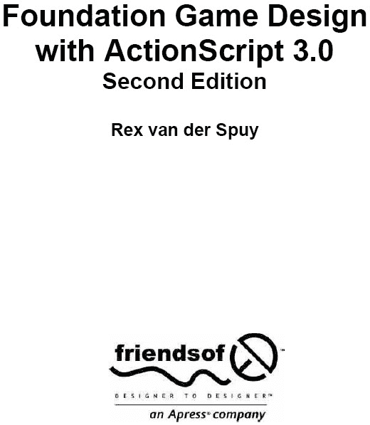

![cover]

**基于 ActionScript 3.0 的基础游戏设计，第二版**

版权所有 © 2012 Rex van der Spuy

保留所有权利。未经版权所有者及出版商事先书面许可，不得以任何形式或任何方式（包括电子或机械方式，如影印、录音或通过任何信息存储或检索系统）复制或传播本作品的任何部分。

ISBN-13（平装本）：978-1-4302-3993-2

ISBN-13（电子版）：978-1-4302-3994-9

本书中可能包含商标名称、徽标和图片。我们不以每次出现商标名称、徽标或图片时都使用商标符号，而是仅在编辑风格中使用这些名称、徽标或图片，以维护商标所有者的利益，且无意侵犯商标权。

本出版物中使用的商品名称、服务标记及类似术语，即使未标明为商标，也不应被视为对其是否受专有权利保护的看法。

本书通过 Springer Science+Business Media New York 在全球图书贸易中发行，地址：233 Spring Street, 6th Floor, New York, NY 10013。电话：1-800-SPRINGER，传真：(201) 348-4505，电子邮件：[`orders-ny@springer-sbm.com`](http://orders-ny@springer-sbm.com)，或访问[`www.springeronline.com`](http://www.springeronline.com)。

有关翻译信息，请发送电子邮件至[`rights@apress.com`](http://rights@apress.com)或访问[`www.apress.com`](http://www.apress.com)。

Apress 和 friends of ED 图书可批量购买，用于学术、企业或促销用途。大多数图书也提供电子版和许可证。如需更多信息，请参考我们的特殊批量销售–电子版许可网页，网址为[`www.apress.com/bulk-sales`](http://www.apress.com/bulk-sales)。

本书中的信息按“现状”提供，不含任何保证。尽管在编写过程中已采取一切预防措施，但作者和 Apress 均不对任何人或实体因本书所含信息直接或间接造成的任何损失或损害承担责任。

作者在本文中引用的任何源代码或其他补充材料，读者可在[`www.apress.com`](http://www.apress.com)获取。有关如何找到本书源代码的详细信息，请访问[`www.apress.com/source-code/`](http://www.apress.com/source-code/)。

**致谢**

| **总裁兼出版商：** Paul Manning

**首席编辑：**
Ben Renow-Clarke

**技术审校：**
Joshua Freeney

**编辑委员会：**
Steve Anglin, Mark Beckner, Ewan Buckingham, Gary Cornell, Morgan Ertel, Jonathan Gennick, Jonathan Hassell, Robert Hutchinson, Michelle Lowman, James Markham, Matthew Moodie, Jeff Olson, Jeffrey Pepper, Douglas Pundick, Ben Renow-Clarke, Dominic Shakeshaft, Gwenan Spearing, Matt Wade, Tom Welsh

**协调编辑：**
Kelly Moritz | **文字编辑：** Mary Behr

**排版：**
Apress（Brigid Duffy）

**制作编辑：**
Brigid Duffy

**索引编制：**
BIM Indexing & Proofreading Services

**插图：**
SPi Global

**封面图片设计：**
Corné van Dooren

**封面设计：**
Anna Ishchenko |

*谨以此书献给我的父亲 Mani van der Spuy，没有他，这本书将无法写成。谢谢你，爸爸，一直相信我。*

