## 第 1 章 - 编程基础：如何制作电子游戏

恭喜你拿起这本书！电子游戏设计是你能用电脑做的最有趣、最有创意的事情之一。你即将踏上一段非凡的旅程，而本书将全程指引你。

那么，如何制作电子游戏呢？虽然制作游戏的方法可能和本书的读者一样多，但一个很好的起点是使用一种名为`Flash`和`ActionScript`的技术。用这些技术学习制作游戏不仅容易，而且如果你有时间和想象力，还能利用它们制作出复杂度高、专业品质好的游戏。你还可以将游戏发布到台式机、笔记本电脑、互联网、手机和平板电脑上，而无需学习任何额外的技能。此外，如果你希望进一步深入学习，在制作`Flash`和`ActionScript`游戏过程中获得的所有技能都可以直接应用于使用其他技术的游戏设计。

使用`Flash`和`ActionScript`学习游戏设计实际上是一个两步的过程。

*   你需要学习如何为游戏制作图形和插画。这通常使用图形设计软件来完成，例如`Adobe Photoshop`、`Illustrator`、`Flash Professional`，或开源软件如`GIMP`（GNU 图像处理程序）。
*   你还需要学习一种名为`ActionScript`的编程语言。编程语言是一种类似于英语的语言，我们人类用它来与计算机交流。

当你创建好图形并编写好游戏程序后，你将在这本书中学到的底层技术就会将它们整合在一起，使你的游戏运行起来。

使用`Flash`和`ActionScript`制作游戏有两种常见方法。

*   你可以使用名为`Flash Professional`的软件，它由`Adobe`公司出品。这款软件允许你仅用一个软件就创建游戏的所有视觉图形并完成所有的计算机编程。
*   第二种方法是使用你喜欢的任何图形设计或插画软件来创建游戏图形，然后使用计算机编程代码编辑器（如`Flash Builder`或`Flash Develop`）来编写`ActionScript`代码，使你的游戏运行起来。

本书采用第二种方法。它更加灵活，因为你可以选择任何你熟悉且用着舒服的图形设计或编程软件。这也意味着你学到的技能不会依赖于`Adobe Flash Professional`软件的任何特定版本（该软件频繁更新），并且让你免于购买或升级它所需的不菲费用，这对于刚入行游戏设计的人来说可能是一个重大障碍。过去，制作`Flash`游戏的唯一方法就是使用`Adobe`的`Flash Professional`软件，但幸运的是，现在情况已不再如此。如今有更灵活得多的工具可用于制作`Flash`游戏，本书将向你展示如何使用它们。

全世界有成千上万的人以使用`Flash`设计游戏为职业。有了这本书并稍加练习，你也能成为他们中的一员。

### 基本要求

令人惊讶的是，电子游戏设计可以是一件技术含量相对较低的事情。以下是使用本书所需的基本设备。

#### 1. 一台电脑

你需要一台相当新式的电脑，运行`Windows`系统或最新版本的`Mac OS X`。

#### 2. 平面设计软件

你需要平面设计软件，例如`Photoshop`、`Photoshop Elements`、`Illustrator`，或者免费开源软件`GIMP`。`Photoshop`是地球上使用最广泛的平面设计软件，所以学习如何使用它非常有用；然而，它的价格也非常昂贵。你可以从`Adobe`的网站`www.adobe.com/products/photoshop.html`下载`Photoshop`。

你也可以使用`Adobe Illustrator`来制作所有的游戏图形，事实上，本书中的大多数游戏图形都是用它创建的。遗憾的是，它也同样昂贵，但如果你认真对待游戏设计，从长远来看，购买它并学习如何使用它绝对是值得的，因为它可能是目前最好的插画软件。你可以在`www.adobe.com/products/photoshop.html`找到`Adobe Illustrator`。

比`Illustrator`或`Photoshop`便宜得多的替代品是`Photoshop Elements`。`Elements`拥有完整版`Photoshop`的所有功能，只是缺少一些高端专业特性。对于创建游戏图形，你可能不需要那些专为摄影和印刷出版定制的高端功能。`Photoshop Elements`可能是一个非常好的选择。你可以从`www.adobe.com/products/photoshopel/`下载并购买它。

或者，你也可以省下这笔钱，下载免费的`GIMP`。就制作游戏图形而言，`GIMP`几乎能完成`Photoshop`能做的所有事情。一个很大的缺点是它的菜单和窗口与`Photoshop`差异巨大，因此你会发现很难按照本书的步骤操作。幸运的是，这个问题有一个很好的解决方案。你可以为`GIMP`安装一个名为`GIMPshop`的软件插件。`GIMPshop`能让`GIMP`的外观和功能与`Photoshop`完全一致。这意味着你可以按照本书以及任何其他`Photoshop`教程中的所有步骤操作，而无需为`Photoshop`那令人望而却步的价格花费一分钱。

你可以在`www.gimp.org/`找到免费的`GIMP`。在`www.gimpshop.com/`可以找到`GIMPshop`。

另一个选择是使用免费的基于网络的软件来创建游戏图形，例如`Aviary`。`www.aviary.com/` `Aviary`拥有许多与`Photoshop`和`Illustrator`相同的基本功能，并且无需你购买或安装任何东西。如果你的电脑上没有安装任何其他的图形设计或插画软件，并且还不确定是否要购买，`Aviary`可能是一个绝佳的起点。

#### 3. 计算机编程软件

你还需要计算机编程软件，要么是`Flash Builder`，要么是`Flash Develop`。这些软件被称为IDE（集成开发环境）。别被这个术语吓到！它们只是专门用来帮助你编写和编辑计算机编程代码的文本编辑器或文字处理器。通常，点击一个按钮，它们就能为你把完成游戏的所有部件整合在一起。

在撰写本文时，如果你是学生或失业的开发者，`Flash Builder`是免费的。但如果你两者都不是，那么全价购买它可能也是值得的，因为它能为你节省大量的时间和麻烦。`Flash Builder`目前有三个版本：教育版、标准版和专业版。使用本书只需要标准版。你可以通过访问`Adobe`的教育网站并按照链接查看自己是否符合免费使用教育版`Flash Builder`的条件。`www.adobe.com/devnet/edu.html`。你可以从`www.adobe.com/products/flash-builder-standard.html`下载并购买`Flash Builder`标准版。

如果你使用的是`Windows`系统，可以考虑使用完全免费且出色的`Flash Develop`。如果你更喜欢使用`Flash Develop`，那么使用它来应用本书中的技术并不会困难。本书中的所有游戏设计技术和编程代码都与`Flash Builder`和`Flash Develop`兼容。但是，如果你决定使用`Flash Develop`，你需要付出更多的努力来安装和使用它。安装和配置的某些方面可能有点棘手，所以除非你非常精通电脑，否则不要考虑一开始就用它。你可以从`www.flashdevelop.org`下载`Flash Develop`。

如果你决定使用`Flash Develop`，你还需要下载并安装两个额外的软件组件。首先，你需要`Adobe`的免费`Flex SDK`（软件开发工具包）。`Flex SDK`实际上是让你所有`Flash`游戏运行的幕后核心大脑。你可以从`Adobe`的网站`http://opensource.adobe.com/wiki/display/flexsdk/Flex+SDK`下载最新版本。

你还需要`Adobe Flash Player`软件的调试版本。你可以在`http://www.adobe.com/support/flashplayer/downloads.html`找到它。下载适用于你系统的、被称为内容调试器的`Flash Player`版本。`Flash Player`是真正运行你的游戏的软件。你需要这个特殊的调试版本，以便`Flash Develop`能在你编程代码出错时提醒你。

然而，如果你的电脑上已经安装了另一个版本的`Adobe Flash Player`，明智的做法是先卸载它，然后再安装新的调试版本。这样做可以防止出现一些奇怪的错误。你可以从`http://kb2.adobe.com/cps/141/tn_14157.html`下载适用于`Windows`的`Flash Player`卸载程序。如果你需要`Mac OSX`的`Flash Player`卸载程序，可以在`http://kb2.adobe.com/cps/909/cpsid_90906.html`找到它。卸载完当前的`Flash Player`版本后，再安装新的调试版本。

# 开发工具选择

除了 `Flash Builder` 和 `Flash Develop` 之外，还有很多其他可以用来编写 `ActionScript` 程序的 IDE，例如 `Eclipse`（适用于 Windows 和 Mac OSX）、`TextMate` 或 `XCode`（仅适用于 Mac OSX）。或者，稍微费点功夫，你也可以使用简陋的 `Notepad`（Windows）或 `TextEdit`（Mac OSX）应用程序。所有这些都需要你自己做一些研究来设置和使用，以制作 Flash 游戏，但许多专业的 Flash 游戏设计师都只使用它们。如果你才刚刚学习编程，我不会推荐其中任何一个，但当你积累一些经验后，或许可以考虑一下它们。

## Adobe Flash Professional

此外，你也可以选择使用 Adobe 的 `Flash Professional`，在同一个软件中同时制作游戏图形和编写编程代码。本书的奖励下载章节“Flash 动画与发布你的游戏”将演示如何做到这一点。从 `www.adobe.com/cfusion/tdrc/index.cfm?product=flash` 下载 `Flash Professional`。

完全使用 `Flash Professional` 制作游戏是本书第一版《Foundation Game Design with Flash》的主题。使用 `Flash Professional` 仍然是制作 Flash 游戏的好方法，而且可能仍然是最快、最简单的方法。但是，学习在不借助它的情况下制作游戏能为你带来诸多优势。这意味着你的技能不会局限于某一种特定的软件或某个软件版本。这意味着你可以自由选择任何你喜欢的软件来编程游戏和制作图形。这也意味着你正在培养的技能和工作风格，在时机成熟时，可以轻松地转移到其他游戏设计或编程技术上。这是我将在本书这一版本中采用的、更灵活的方法。

# 本书使用的软件

本书中的示例和操作说明均使用 Flash Builder、Photoshop（或 Photoshop Elements）以及 Illustrator。选择这些程序是因为它们易于获取、使用简单、无需复杂的安装或配置，并且同时适用于 Windows 和 Macintosh 系统。至少，要充分利用本书，您仅需这些软件即可。

第二章包含如何使用 Photoshop 的入门介绍。您将在第七章中学习如何使用 Illustrator 制作游戏图形。

如果您选择使用其他图形设计或编程软件，请确保在开始学习本书中的项目之前，仔细阅读其文档并熟练使用。

## 你需要了解的内容

本书假设您没有任何游戏图形制作经验或计算机编程经验。您将一步步踏上探索这些迷人世界的旅程。如果您想从零开始学习游戏设计且对此一无所知，那么本书就是您入门所需的一切。

话虽如此，游戏开发和 ActionScript 编程语言是庞大的课题，您甚至可以花费一生时间来学习。没有一本书能提供您在学*过程中可能遇到的所有问题的全部答案。如果您从未接触过专业图形设计软件，我强烈建议您在深入阅读本书之前，额外花些时间学习如何使用 Photoshop、GIMP 或 Illustrator。您将为游戏制作大量图形和插图，如果您能熟练制作图形，那么在处理游戏设计的编程部分时就会更有信心。花一个周末摆弄一下 Photoshop 或 GIMP，当您开始游戏编程时，就能轻松应对。以下是一些帮助您入门的资源。

如果您使用 Photoshop，请通读文档并完成 Adobe 在线帮助系统中的一些练习和示例项目。（要访问这些内容，请从 Photoshop 菜单中选择“帮助”“Photoshop 帮助”。）

如果您使用带有 GIMPshop 插件的 GIMP，则可以跟随任何为 Photoshop 设计的教程。一个不错的起点是 Adobe 的“入门”教程网站，其中包含许多关于基本 Photoshop 使用的实用视频。请访问：

`www.adobe.com/support/photoshop/gettingstarted/`

在网上搜索“Photoshop 初学者教程”也会出现大量教程网站，多到无法在此一一列举，但其中许多都非常优秀。

但是，如果您想立即深入，我也支持您！本书是一个绝佳的起点，也是您唯一需要的资源。

## 你不需要了解的内容

也许更令人眼界大开的是，利用本书您*不必*了解什么。

*   数学（反正不用懂太多！）

*   计算机编程

*   网站设计

*   图形设计

*   其他几乎所有东西！

事实上，我甚至允许您说“我讨厌电脑”，或者让您沉浸在将笨重钝器砸向显示器的幻想中。请放心，我在某个时刻也完全有过同样的感受！

## 一切关乎编程

本书的大部分内容是关于如何编写计算机程序。除了简要介绍如何使用 Photoshop 和 Illustrator 制作简单游戏图形外，我将把游戏设计中图形和插画方面的探索留给您，这些内容在其他资源中有详细介绍。

那么，什么是计算机程序？

计算机程序就像一个电影剧本，它告诉游戏中的角色和对象在特定条件下应该做什么以及如何表现。例如，假设您设计了一个游戏，玩家必须使用键盘上的方向键引导一只鸭子穿过一个充满饥饿鳄龟的池塘。鸭子如何知道按下方向键时它必须移动？您需要编写一个程序来告诉鸭子这样做。

ActionScript 是您将用来为游戏编写程序的计算机编程语言的名称。它是一种非常复杂且功能强大的语言，与 Java 密切相关。ActionScript 目前是第 3 版，简称为 `AS3.0`。它是学习编程的绝佳语言，原因如下：

*   它完全集成在 Flash Builder 和 Flash Develop 中，这意味着您通常可以立即在屏幕上看到代码运行的结果。这使得编程体验非常具体、令人满足，并且比学习许多其他编程语言的抽象程度要低得多。

*   `AS3.0` 的创造者 Adobe 做了大量工作，使得使用 `AS3.0` 编程的体验极其用户友好。它简化了技术障碍，使程序运行成为一键式过程。

*   `AS3.0` 是一种“真正的”编程语言，就像 Java 或 C++。用 `AS3.0` 学习编程的妙处在于，您学到的技能将直接适用于其他编程语言的学习，并且您可以在未来多年中不断构建这些技能。ActionScript 会持续存在，您可以与之共同成长。

*   使用 `AS3.0` 创建的游戏和程序是*跨平台*的，这意味着它们可以在任何计算机操作系统（Windows、Mac OSX 或 Linux）以及 iOS 和 Android 等移动平台上运行，只要该系统安装了 Adobe 的免费 Flash Player 软件。这是一个巨大的优势，因为这意味着您只需要学习一种技术——Flash，而不是多种。Flash 和 `AS3.0` 是目前唯一允许您无需学习任何新内容即可发布到所有这些平台的技术。Flash Player 是有史以来安装最广泛的软件之一，因此您无需为每个系统重写编程代码，即可确保游戏的潜在受众非常庞大。

*   互联网上有一个庞大的、友好的 `AS3.0` 开发者社区，他们投入了大量时间来编写教程并在在线论坛和讨论板上帮助他人。如果您在编写程序时遇到困难，只需在众多 Flash 和 ActionScript 讨论板上提问，您一定会得到有用的回复。

### 编程？但我数学超烂！

本书作者也是如此！非程序员对计算机编程最大的误解之一，就是认为编程等同于某种数学。其实并非如此。它表面看起来可能相似，某些风格也为了方便从数学中借鉴而来，但整个底层系统完全不同。

这并不意味着本课程中完全用不到数学——你确实会用。用多少呢？你会用到加法、减法、乘法、除法，以及一些非常基础的代数（大概是五年级学过的那种）。数学难度仅此而已，而且你并不需要亲自计算。你只需知道如何告诉 `AS3.0` 替你做这些计算，就像使用计算器一样。

当然，如果你想，数学完全可以变得更复杂。在后面章节中，你会用到一点三角学来实现特定的运动效果。不过，你未必需要理解三角学实现这些效果的机制——只需知道如何在你的游戏上下文中使用它。本书在很大程度上是从非数学的角度编写的，因此全球的数学恐惧症患者都欢迎阅读！

*注意：虽然你确实不需要大量数学知识就能立即开始制作很棒的游戏，但深入理解用 `AS3.0` 编程在数学方面的可能性，绝对会让你作为游戏开发者拥有更多选择。有两本非常全面且可读性极强的书，在本书范围之外更详细地涵盖了这一领域：基思·彼得斯（Keith Peters）的《Foundation ActionScript 动画：让物体动起来！》以及多位作者合著的《Flash 数学创意》。这两本书都由 friends of ED 出版，是《Flash 游戏设计基础》的完美伴侣。你可以将书中讨论的所有技巧直接应用到本书的游戏项目中。*

### 我已经会编程了！

本书尽可能做到对初学者友好，不假设读者有任何编程背景。然而，你们中的许多人可能是有经验的程序员，阅读本书是为了了解如何将现有的 `AS3.0` 技能用于创建游戏。别担心；虽然早期章节确实侧重于 Flash 和 ActionScript 的新手，但后面章节会涉及相当高级的面向对象编程领域，为你提供足够“啃”的内容。

如果你已经是程序员，我建议你直接跳到第 4 章，这是从头到尾使用编程技术构建完整游戏的第一章。如果觉得有点复杂，或者遇到不理解的术语和概念，就回退一两章，直到找到让你感到舒适的程度。否则，如果第 4 章看起来难度合适，那就直接开干吧！从编程角度看，从那一章开始，内容会变得有趣得多。

游戏设计中涉及的许多技术都非常专业化。即使你可能对 ActionScript 或编程了解不少，但如何运用这些技能来构建游戏，并不总是显而易见。本书的重点是游戏设计的架构，而非编程的具体细节。如果你有丰富的编程经验，本书将向你展示如何将这些技能用于完整的游戏开发中。

#### 我能制作什么样的游戏？

本书讲述如何制作二维动作、冒险和街机游戏；同时也涉及益智和逻辑游戏。Flash 是创建这类游戏的绝佳媒介。每一章都会指导你完成设计过程的每一步，但项目非常开放，鼓励你提出自己的原创方式，将技巧运用到你的游戏中。

本书不包含 3D 游戏，因为 3D 是一个庞大的主题，值得单独用一整本书来讲述。好在你在 2D 中学习到的大部分游戏设计技巧，尤其是游戏结构，都可以直接应用于 3D 游戏，几乎无需修改。不过，为了简化学习过程并确保材料尽可能聚焦和清晰，我决定专注于 2D 游戏。

#### 学习新术语

像任何大型专业领域一样，编程也伴随着大量需要学习的新术语。本书会尽量避开行话，采用稍长但具体的描述。然而，有些术语使用极为广泛，你应该努力记住它们，因为不了解可能会妨碍你从其他来源进一步学习。本书将在正文中解释所有新术语。

#### 打好基础

作为游戏开发者，你可以把自己想象成建筑师。任何大小或形状的建筑都有一些基本共同点：它们都有地基、墙壁和屋顶。无论你的房子是大是小、是简陋还是豪华，你都需要挖地基、砌墙、盖屋顶。之后，才能开始真正有趣的部分：设计室内布局、做景观、买家具、办暖房派对。

在本章剩余部分，你将编写一个非常简单的程序，它将为你在本书后续章节中创建的所有游戏和程序打下基础。如果你之前从未做过编程，或者刚刚开始掌握 AS3.0，本章就是为你准备的。

如果你有编程经验，你可能想跳到本章末尾，看看有多少技术和概念性内容是你熟悉的。请确保你熟悉了用于构建游戏和程序的结构，但如果一切看起来都很简单，你也可以自由跳过本章。

为了致敬计算机编程的历史，你将编写一个名为 `Hello World` 的程序。传统上，这是新手程序员在学习一种新编程语言时编写的第一个程序，因为它是最简单的完整程序。它做的事情很简单：只是输出 “Hello World! Can you read this?” 这句话。仅此而已！

这个程序可能看起来很初级，但通过编写它，你将实现两件非常重要的事情。

*   你将构建一个稳健且灵活的程序设计系统，它将成为本书所有项目的核心，并且很可能在你未来数年的个人项目中为你提供良好支持。

*   你将完成一次 AS3.0 编程速成课，为后续章节中一些非常重要的概念和技巧打下基础。

害怕编程？哈！怎么可能有你！在本章中，你将抓住编程这头“野兽”的犄角，把它摔倒在地！

### 使用 Flash Builder

`Flash Builder` 是一款用于编写 AS3.0 程序和制作 Flash 游戏的综合性软件。接下来的几节将引导您了解如何设置和使用它的一些基础知识，为您阅读本书后续内容并编写游戏程序打下坚实的基础。

如果您使用的 `Flash Builder` 是随 `Adobe Creative Suite 5.5` 捆绑安装的，请注意它有一个奇怪的 bug。`Flash Builder` 需要 `Flash Player` 的调试版本来向您显示程序是否存在问题，并显示称为 `跟踪输出` 的特殊消息。当您安装 `Adobe Creative Suite` 时，`Flash Player` 的调试版本会自动安装，但出于某些奇怪的原因，当您尝试运行程序时，`Flash Builder` 有时会找不到它。相反，您会看到一条消息：`Installed Flash Player is not a debugger.`

解决这个问题的方法是卸载当前版本的 `Flash Player`，然后重新安装特殊的调试版本。要卸载当前版本，您需要一个可以从 Adobe 网站下载的特殊 `Flash Player` 卸载程序。

您可以在以下地址找到适用于 Windows 的 `Flash Player` 卸载程序：

`http://kb2.adobe.com/cps/141/tn_14157.html`

您可以在以下地址找到适用于 Mac OSX 的 `Flash Player` 卸载程序：

`http://kb2.adobe.com/cps/909/cpsid_90906.html`

一旦卸载了当前的 `Flash Player`，请退出正在运行的 `Flash Builder` 和您的网络浏览器，然后下载并安装最新版本的 `Flash Player` 调试版本，您可以在以下地址找到它：

`www.adobe.com/support/flashplayer/downloads.html`

如果您在项目工作中遇到了此问题，请从 `Flash Builder` 的代码编辑窗口中复制所有代码，并将其粘贴到一个具有新名称的新 ActionScript 项目中。之后一切应该都能正常运行。

Adobe 发布了一份关于如何使用 `Flash Builder` 的全面在线手册。您可以在以下地址找到它：

`http://help.adobe.com/en_US/flashbuilder/using/`

如果您对本章未涵盖的用法还有其他疑问，请务必参考该手册。

### 在 Flash Builder 中设置工作环境

在开始编写您的 Hello World 程序之前，让我们对 `Flash Builder` 的设置做一些调整，以便它更易于使用。

1.  启动 `Flash Builder`。您将看到一个起始页面，如图 1-1 所示。

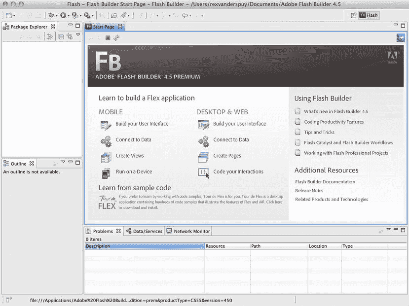

**图 1-1**. Flash Builder 主页面

图 1-1 显示了 `Flash Builder` 4.5 的界面，这是本书撰写时的当前版本。

*如果您使用的是未来不同的 `Flash Builder` 版本，例如 5 或 6，此处描述的一些具体细节可能会略有不同，但总体概念是相同的。如果您遇到无法解决的问题，请务必查阅 Adobe 针对您所用版本的最新文档。您可以在* `http://help.adobe.com/en_US/flashbuilder/using` *找到它。*

如果这是您第一次接触 `Flash Builder`，请不要被它吓到！您可能不理解此屏幕上的任何内容，但这并不重要。您只需要使用和理解 `Flash Builder` 大约 5% 的功能就可以开始制作 Flash 游戏了。这 5% 甚至更多的内容将在本章中介绍。另外的 95% 是专门的功能，很可能您在作为游戏程序员的整个职业生涯中都无需担心。

#### 创建一个新的空白 ActionScript 项目

现在，您将创建您的第一个 AS3.0 项目。`Flash Builder` 中的项目是包含您游戏所有编程代码的 AS3.0 文件夹和文件的集合。`Flash Builder` 会自动为您创建所有初始文件和文件夹。方法如下：

2.  在打开的 `Flash Builder` 中，选择“文件”  “新建”，然后选择“ActionScript 项目”。图 1-2 展示了在 Mac OSX 上运行的 `Flash Builder` 中此操作的样子。

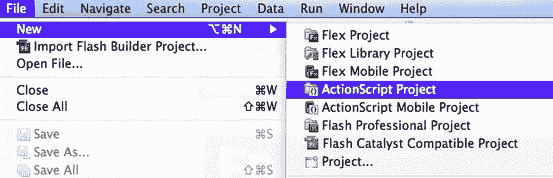

**图 1-2.** 创建一个 ActionScript 项目

将出现一个“新建 ActionScript 项目”对话框，如图 1-3 所示。

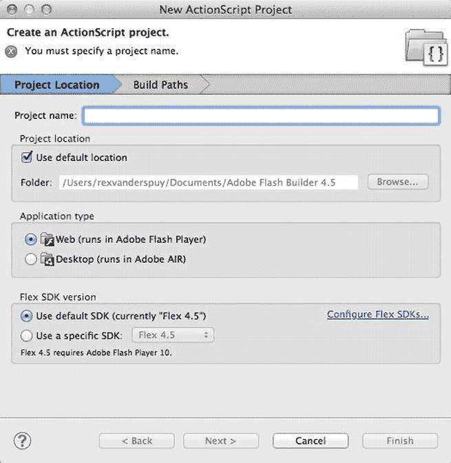

**图 1-3.** “新建 ActionScript 项目”对话框

您需要做的第一件事是给项目命名。您将其命名为 “HelloWorld”。

在“项目名称”字段中，输入“HelloWorld”（图 1-4）。注意 “Hello” 和 “World” 之间没有空格。这一点很重要，我稍后会解释原因。


**图 1-4.** 命名项目

如果这是您第一次运行 `Flash Builder`，您会注意到“使用默认位置”复选框已被选中，在其下方您会看到类似这样的内容：

`/Users/rexvanderspuy/Documents/Adobe Flash Builder 4.5/HelloWorld`

这是 `Flash Builder` 保存您工作的位置。当然，在您的计算机上会略有不同，但主要的是 `Flash Builder` 会将 `HelloWorld` 项目保存在您“文档”文件夹中名为 `Adobe Flash Builder 4.5` 的文件夹内。

`Flash Builder` 会自动为您选择此位置，但这可能不是保存您工作的最方便位置。让我们更改一下，以便将 `HelloWorld` 项目保存在名为 `FlashGames` 的文件夹中。

如果“使用默认位置”复选框已选中，请取消选中，如图 1-5 所示。

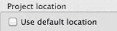

**图 1-5.** 不使用默认位置

现在，您可以将保存位置更改为计算机上您选择的任何位置。

更改保存位置，使 `HelloWorld` 项目位于名为 `FlashGames` 的文件夹中，如图 1-6 所示。再次注意，“Flash”和“Games”之间应该没有空格。图 1-6 显示了文本字段可能的样子。

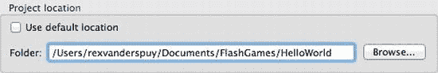

**图 1-6.** 您自己选择的位置

您也可以使用“浏览”按钮浏览到硬盘上您想要保存工作的任何位置。

3.  单击对话框右下角附近的“完成”按钮（图 1-7）。


**图 1-7.** 单击“完成”按钮

单击“完成”按钮后，`Flash Builder` 会生成一个新屏幕，看起来像 图 1-8。

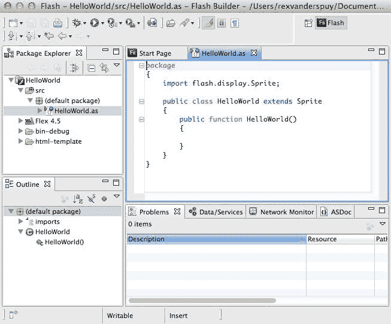

**图 1-8.** 项目屏幕

如果您是编程或 `Flash Builder` 的新手，这可能看起来像是一堆混乱的技术术语。可以这样理解：您实际上是在看一个用于编写计算机代码的文字处理器。只是有很多小按钮可以帮助您更轻松地工作，我会在本书的过程中逐步介绍其中大部分按钮的工作原理。到本章结束时，您将了解此屏幕的几乎所有内容。

您需要关注的主要区域是您编写代码的地方，我在 图 1-9 中突出显示了该区域。

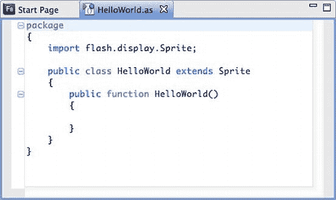

**图 1-9.** 编写代码的区域

这里是你编写所有计算机代码的地方。`Flash Builder` 已经自动在这个框中填充了一些它认为对你有用的起始代码。这些代码确实有用，但为了学习目的，我需要你将其全部删除，以便从一个完全空白的页面开始。

选中代码编辑窗口中的所有文本，如图 Figure 1-10 所示。

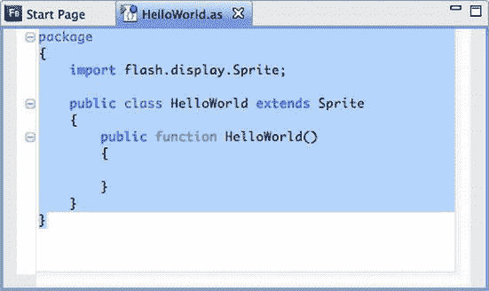

**图 1-10.** 选中预设代码

全部删除，使窗口完全清空，如图 Figure 1-11 所示。

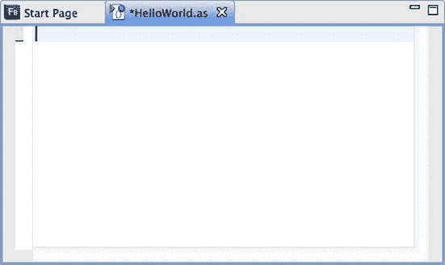

**图 1-11.** 完全空白的代码编辑窗口

现在你拥有了一个完全空白的代码编辑窗口。这就是你将编写第一个计算机程序的地方。

接下来，你需要对 `Flash Builder` 的配置进行一个小改动，告诉它在 `Flash Player` 窗口中直接运行你的程序，而不是在网页浏览器中。

### 告诉 `Flash Builder` 在 `Flash Player` 中运行你的程序

当你使用 `Flash Builder` 创建游戏时，它会获取你在编辑器中编写的编程代码，并在 `Flash Player` 软件中运行它。当你安装 `Flash Builder` 时，`Flash Player` 软件会自动安装在你的计算机上。然而，当你首次安装 `Flash Builder` 时，其设置会使它在网页浏览器中运行 `Flash Player`。这样既缓慢又低效，因为每次测试游戏时，你都必须等待浏览器窗口弹出。更好的方式是让 `Flash Builder` 在 `Flash Player` 窗口中直接运行你的游戏。幸运的是，只需对 `Flash Builder` 的配置进行一个小改动，就能轻松实现这一点。

1.  从屏幕顶部的 `Flash Builder` 主菜单中选择 `项目`  `属性`，如图 Figure 1-12 所示。

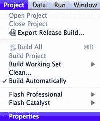

**图 1-12.** 选择 `属性` 选项

2.  一个新的项目属性窗口将会打开。从左侧菜单中选择 `ActionScript 编译器`，你应该会在右侧看到相关选项，如图 Figure 1-13 所示。

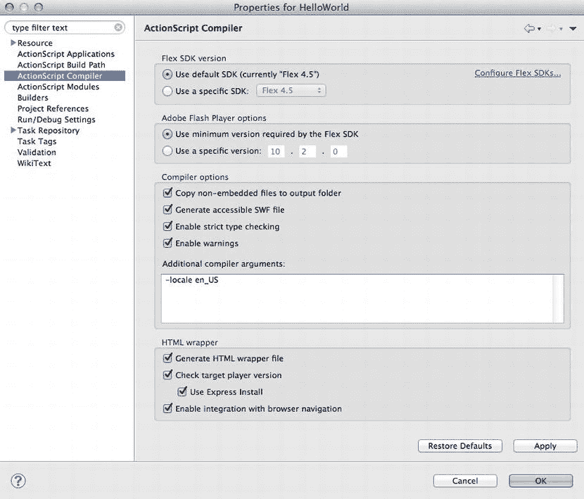

**图 1-13.** `ActionScript 编译器` 选项

3.  找到此屏幕底部附近的 HTML 包装器部分。取消选中名为 `生成 HTML 包装器文件` 的选项。现在它应该看起来像 Figure 1-14。

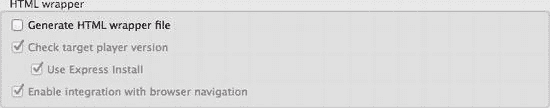

**图 1-14.** 不生成 HTML 包装器文件

这个选项会自动在网页浏览器中打开你的游戏。通过取消选中它，`Flash Builder` 将直接在 `Flash Player` 中打开你的游戏。

4.  选择 `确定` 按钮以保存此更改。

现在你已经准备好编写你的第一个 AS3.0 计算机程序了！

### 编写你的第一个程序

现在，你已经具备了开始编写第一个程序所需的大部分要素。在接下来的几个步骤中，你将执行以下操作：

1.  学习如何创建具有 `.as` 文件扩展名的 `ActionScript` 文件。

2.  创建一个 `包`，将所有代码整齐地组织在一起。

3.  导入显示文本和图像所需的图形功能。

4.  创建一个 `类`，作为你程序的第一个构建块。

5.  创建一个 `构造方法`，触发程序中的首批操作运行。

6.  创建一个 `指令`，即你希望程序执行的实际操作。

7.  导入 `Flash` 内置的 `Sprite` 类，以帮助你的程序显示输出。

8.  发布完成的 `Flash` 文件，以查看你所有辛勤工作的实际输出。

这个过程看似工作量很大，但完成后，你将拥有一个完整的系统框架，这将成为本书其余所有项目的基础，并为你自己构建程序和游戏提供一个灵活的根基。

### `ActionScript` 文件与 `.as` 文件扩展名

`ActionScript` 计算机程序是控制整个游戏的核心。它精确地告诉所有游戏角色和元素应该如何表现。`ActionScript` 程序是游戏最重要的组成部分，本书的大部分内容都致力于解释如何编写和理解它们。

`ActionScript` 程序本质上就是一个包含特殊单词和字符的文本文件。当你编写 `ActionScript` 计算机程序时，你只是在计算机上创建一个带有 `.as` 扩展名的简单文本文件。具有 `.as` 扩展名的文件被称为 `ActionScript` 文件或 `AS` 文件。

你可以在 `Flash Builder` 中通过查看代码编辑窗口的顶部来确认这一点。如果你按照本章的说明操作，代码编辑窗口顶部高亮显示的标签栏会显示 `HelloWorld.as`。Figure 1-15 显示了这一点。

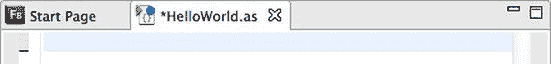

**图 1-15.** `Flash Builder` 中代码编辑窗口顶部高亮显示的标签栏告诉你，你正在创建一个具有 `.as` 扩展名的 `ActionScript` 文件。

查看代码编辑窗口的左侧，你会找到包资源管理器，如图 Figure 1-16 所示。`HelloWorld.as` 文件将会被高亮显示。

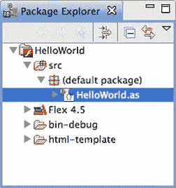

**图 1-16.** 包资源管理器显示项目中正在使用的文件和文件夹。

包资源管理器显示了你 `ActionScript` 项目中所有正在使用的文件和文件夹。目前你无需担心其中任何一个，除了 `HelloWorld.as` 文件。重要的是要知道，包资源管理器实际上显示的是 `Flash Builder` 在你的计算机上自动为你创建的真实文件和文件夹。包资源管理器告诉你，`HelloWorld.as` 文件位于一个名为 `src` 的文件夹中，而这个文件夹又位于一个名为 `FlashGames` 的文件夹中。

这些文件夹和文件在你的计算机上位于何处？

你可能还记得，当你在 `Flash Builder` 中创建 `HelloWorld` 项目时，你告诉它将项目保存在这里：

`/Users/rexvanderspuy/Documents/FlashGames/HelloWorld`

这意味着 `HelloWorld` 项目应该位于一个名为 `FlashGames` 的文件夹中，而这个文件夹又应该位于计算机的“文档”文件夹中。

真的是这样吗？让我们验证一下。

Figure 1-17 展示了我在计算机上打开“文档”文件夹时看到的情况。

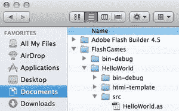

**图 1-17.** `HelloWorld.as` 文件以及 `Flash Builder` 所需的所有其他 `ActionScript` 项目文件，都已在您指定的位置自动创建。

是的，没错！

`HelloWorld.as` 文件位于一个名为 `src` 的文件夹中，`src` 是**源文件**的缩写。这些是包含计算机编程代码的文件。传统上，计算机程序员将他们的程序存储在名为 `src` 的文件夹中。你所有的 `ActionScript` 程序都将存储在名为 `src` 的文件夹中。`Flash Builder` 会自动为你完成此操作。

而 `src` 文件夹又存储在一个名为 `HelloWorld` 的父文件夹中，这是你项目的名称。`HelloWorld` 文件夹又存储在一个名为 `FlashGames` 的文件夹中。

这意味着，包资源管理器向你展示的是存储在计算机上的真实文件和文件夹。请记住，每当你对 `Flash Builder` 代码编辑窗口中的 `AS` 文件进行任何更改时，你都是在对你计算机上可以找到的真实文件进行真实更改。

### 这个我要带走！

上一节介绍了 `Flash Builder` 中的包资源管理器。它能帮你找到游戏项目中使用的所有文件和文件夹。但什么是包呢？

包是 AS3.0 程序的第一个基本构建块。它将所有 AS3.0 编程代码的片段组合在一起，并将所有代码包裹在 `package` 中。一个包由三部分组成。

* **关键字**：这个关键字被恰如其分地命名为 `package`。关键字是 AS3.0 能够理解并执行特殊任务（例如创建包！）的特殊单词。当你在程序中输入关键字时，`Flash Builder` 会将它们染成紫色和蓝色，以便你在代码中识别它们。

* **标识符**：标识符可以是任何你想给包起的名字。（它是可选的，本书中你不会使用包标识符。）

* **花括号**：花括号长这样：

```
{
}
```

> 它们用来将里面的内容保持在一起。你可以把它们想象成捆扎包的绳子。下面是一个简单的例子：

```
{
  两个花括号之间的任何内容都保持在一起
}
```

让我们为你的 Hello World 程序创建包。

1. 打开包含你在前面步骤中创建的空白 `HelloWorld.as` 文件的 AS3.0 编辑窗口。

2. 在编辑窗口中输入以下文本：

```
package
{

}
```

你的 ActionScript 编辑窗口现在应该看起来像 图 1-18。

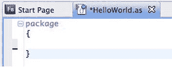

**图 1-18.** 在 `HelloWorld.as` 文件中创建一个包。

*请注意，你在左花括号和右花括号之间留了一个空行。这是因为你将在后续步骤中在该行插入一些内容。*

你刚刚创建的东西是程序员称之为 **块语句** 的东西。块语句定义了程序的特定部分，用于将花括号之间的所有代码组合在一起。在这种情况下，包块语句完全是空的，因为花括号之间除了一个空行什么也没有。但别担心；它不会空很久！

然而，在继续之前，值得更仔细地审视你究竟创建了什么。

当你在 ActionScript 编辑窗口开始输入代码时，你注意到单词 "package" 被编辑器自动染成了紫色。这是编辑器的一种有用的提示方式，告诉你刚刚输入的 是一个关键字——一个它能理解的单词。关键字也被称为 *保留字*。这意味着这些单词属于 ActionScript，而且只属于 ActionScript；你不能将它们用作包、类、变量或方法的名字（稍后将详细介绍）。`package` 关键字只是告诉 Flash："嘿，我正在创建一个包！" 这不太难，对吧？

在 `package` 关键字之后，是我们亲爱的小伙伴——花括号：

```
{
}
```

很可爱，不是吗？目前，它们完全是空的，里面什么也没有。但这很快就会改变。很快你就会往里面放些东西 `{就像这样！}`。

## 精灵的一点魔法

精灵（Sprites）是超自然的生物——比如小精灵、仙女或宁芙——它们居住在森林溪流岸边附近的林地幽谷中，以及苍老的古橡树和柳树旁。奇怪的是，它们也住在 Flash 和 ActionScript 里。如果你想在屏幕上显示文本或图形，你必须召唤 AS3.0 的精灵。

AS3.0 的精灵住在一个叫库（library）的地方。库是一个庞大的计算机代码仓库，在你安装 Flash Builder 时它会自动安装。这个库包含数百段预先编写好的计算机代码，你可以在自己的程序中自由使用。精灵由库中的计算机代码片段构成，它们的工作是显示文本和图形。

这个库实际上是 Flex SDK 的一部分，它是所有 AS3.0 程序的大脑。当你从库中请求一些代码时，Flash Builder 会进入 SDK，在各个堆栈中翻找，并带回你正在寻找的东西，以便你可以在程序中使用它。它包含了使你的 Flash 游戏运行的核心计算机代码。你可以在 Flash Builder 安装目录下找到一个名为 `sdks` 的文件夹中找到 SDK。

同样重要的是要知道，Flash Builder 实际上只是与 SDK 交互的一个界面。制作 Flash 游戏真正需要的只是 SDK 和 Flash Player 的调试版本。只要你拥有这两个组件，你就可以使用 Flash Develop、TextMate、Eclipse、Xcode 或任何其他 IDE 来制作 Flash 游戏。

SDK 的一个伟大之处在于，如果 Adobe 推出了一个包含你想在游戏中使用的酷炫新功能的新版本 SDK，你只需在 Flash Builder 中下载并安装那个新 SDK 即可。SDK 是免费的，你不需要花任何钱来升级到新版本的 Flash Builder。

库是一个很大的地方，它被分成许多不同的部分。精灵住在哪里？它们住在库中一个叫做 **display** 的部分，而该部分又在库中一个更大的叫做 **flash** 的部分里。你可以通过以下路径找到它们：

```
flash.display.Sprite
```

每个单词之间的点表示库的一个新部分。这表明 `display` 部分是 `flash` 部分的一部分，而 `Sprite` 部分是 `display` 部分的一部分。这就像在说："从 `flash` 部分开始，然后跟着指示牌到 `display` 部分。在 `display` 部分你会找到精灵。" 但这还不够。你必须使用一个名为 `import` 的特殊关键字来显式地告诉程序调用精灵。`import` 关键字用于从库中取出代码，以便你可以在程序中使用它。

以下是导入精灵的方法：

```
import flash.display.Sprite;
```

这条指令告诉程序去库的 `flash.display` 部分获取一个 `Sprite`。这行代码被称为 **导入语句**。当你想使用库中的专用代码时，你会在你的 AS3.0 程序和游戏中使用许多导入语句。

请注意，在导入语句的最末尾有一个分号（`;`）。这是一个编程标点符号，意思是"执行我刚才告诉你的！" 你将在后续的示例中看到更多分号。

另外，非常重要的一点是，请注意 `Sprite` 中的 "S" 是大写的。我将在本书后面详细解释原因，但现在你只需知道，当你在 AS3.0 程序中使用 `Sprite` 这个词时，它必须是大写的。

现在你已经知道了什么是 `Sprite`，在哪里找到它，以及为了在程序中使用它需要编写的代码行，去获取一个 `Sprite` 吧！

1. 在代码编辑窗口中输入以下粗体文本。确保你将其输入在 *两个花括号之间*。

```
package
{
  import flash.display.Sprite;
}
```

注意这个新文本相对于左边缘是缩进的。当你添加新文本时，代码编辑器会自动为你做这件事。本书中的代码示例使用两个空格的缩进级别，但 ActionScript 编辑器窗口会以四个空格缩进你的代码，这完全没问题。

缩进表明你刚刚添加的新代码 *在* 包的花括号 *内部*。你很快就会发现像这样缩进代码是多么重要。

你可以通过按 Tab 键强制任何代码行进行缩进。

现在，你已经掌握了 AS3.0 精灵的魔力，可以随心所欲地显示文本和图形了！

你的代码编辑窗口现在应该看起来像 图 1-19。

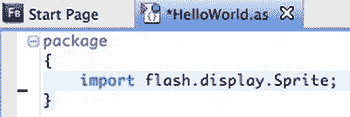

**图 1-19.** 从库中导入一个 `Sprite` 以帮助你显示文本和图像。

### 不要翘课！

现在你已经创建了一个包并导入了`Sprite`，下一步就是在该包内部创建一个**类**。你可以将类视为构建 ActionScript 程序的基本模块。

2. 保持你的 ActionScript 编辑器窗口打开，直接在包的尖括号内，添加以下粗体显示的文本：

```
package
{
  import flash.display.Sprite;

  public class HelloWorld extends Sprite
  {
  }
}
```

在`import`语句和新代码之间有一行空行。这是可选的，但正如你将在后续示例中看到的，它会使你的程序更易于阅读。

与`import`语句一样，新代码也从左边界缩进，以表明它位于包的尖括号内。

图 1-20 显示了你代码编辑窗口现在应有的样子。

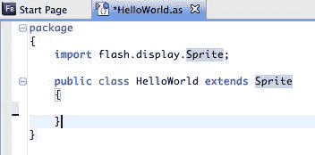

**图 1-20.** 在包内部创建一个类。

那么你刚刚做了什么？

你创建了一个名为`HelloWorld`的类。你是在包内部创建它的。`public`、`class`和`extends`这些词会显示为蓝色和紫色，表明它们是 AS3.0 识别的保留关键字。

你编写的任何 ActionScript 程序都必须至少包含一个类，但你在本书中将构建的大多数程序和游戏都会包含多个类。快速看一下这段新代码。

```
public class HelloWorld extends Sprite
{
}
```

这段代码被称为**类定义**。和包一样，类定义也有一对空的花括号悬空在那里。这表明，像包一样，它也是一个块语句。这些花括号目前是空的，所以这个类还做不了任何事情。这种情况很快就会改变。

类定义主要做三件事。

*   它创建了类。关键字`class`告诉 Flash 你正在创建一个类。就这么简单！

*   它赋予类一些要遵守的规则。这应该是显而易见的：你们中有多少人经历过没有规则的课堂？这段代码告诉 Flash 你正在创建的类是 **public（公共的）**。这意味着它所包含的信息可以被属于同一包或程序可能使用的任何其他包的其他任何类所共享。该类包含的信息对所有人都完全可用。（虽然本书大部分内容都使用公共类，但有时你可能希望阻止类之间共享信息，就像学校的足球队不想与竞争学校分享其战术一样。在这种情况下，你可以将类定义为 **internal（内部的）**。内部类只与驻留在同一包中的其他类共享信息。）

*   它赋予类一个标识符，即一个名称，可以是您选择的任何名称。在这个例子中，该类被命名为`HelloWorld`。

你并不是在经历既视感！你之前见过`HelloWorld`这个短语。它是你正在处理的 AS 文件的名称：`HelloWorld.as`。这并非巧合。当你创建一个类时，它必须保存在一个与类名完全相同的文件中。你创建的每一个新类，都必须创建一个与之共享相同类名的新 AS 文件。

*   最后，它**扩展（extends）** 了另一个类。这意味着它正在使用其他类来帮助其完成工作。在这种情况下，它使用了你在前一行代码中导入的那个大名鼎鼎的`Sprite`的魔力。关键字`extends`告诉`HelloWorld`类使用`Sprite`的魔力来使文本和图像可见。

这里涉及的内容很多，所以让我们用通俗易懂的英语来简化这一行新代码，以便你更好地理解它在说什么。

```
public class HelloWorld extends Sprite
{
}
```

它在说这些：“创建一个公共类，让你编写的其他代码可以轻松访问。这个新类的名称是`HelloWorld`。它扩展了另一个名为`Sprite`的类，这赋予了它显示文本和图像的魔法能力。”

图 1-21 阐释了这段新代码的含义。

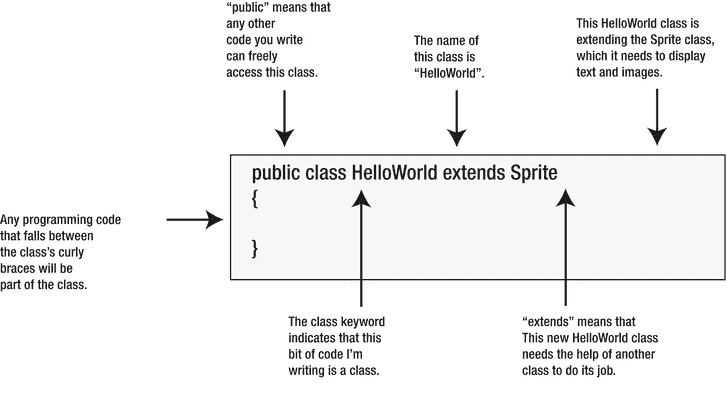

**图 1-21.** 类将容纳你程序的大部分代码，即游戏和程序的核心，位于它的两个花括号之间。

类定义的小小花括号仍然是空的。让我们来利用它们！

### 使用构造方法

**构造方法**是程序中让事情发生的一部分。具体来说，一旦类被告知开始工作，它就会立即将类投入运行。它所包含的任何编程代码都会立即执行。如果单独的类定义只是一个空壳，那么构造方法就像它的心脏和肺。

3\. 让我们为`HelloWorld`类创建构造方法。将粗体显示的代码添加到你已经编写的代码中。

```
package
{
  import flash.display.Sprite;

  public class HelloWorld extends Sprite
  {
    public function HelloWorld()
    {

    }
  }
}
```

你的 ActionScript 编辑窗口现在应该看起来像图 1-22。

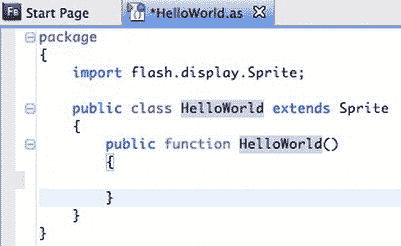

**图 1-22.** 在类内部添加构造方法。

如你所见，构造方法仅仅是一个带有空花括号的块语句，看起来和类定义非常相似。事实上，它具有相同的名称：`HelloWorld`。这并非偶然：所有类都需要具有与类名完全相同的构造方法。

你还会识别的另一个东西是关键字`public`。

```
public function HelloWorld()
{
}
```

与类定义一样，使用`public`一词告诉 Flash，构造方法可以自由地被来自不同包的不同类使用。（然而，AS3.0 语言的一个奇怪特性是，构造方法只能永远是公共的。）

这里有一个新东西是`function`关键字。

```
public function HelloWorld()
{
}
```

它告诉 Flash 你正在创建一个**函数定义**。函数定义就是执行动作的块语句。它们在你的程序中完成所有工作。你可以将函数定义想象成尽职的仆人，一旦你召唤他们，他们就会按照预先安排的杂务清单立刻行动起来。构造方法将始终是你创建类时编写的第一个函数定义，它有一个特殊的任务：一旦类被调用，并且在任何你可能使用的其他方法开始工作之前，立即运行它包含的任何动作。构造方法有点像首席仆人，天刚亮就起床，把所有其他仆人叫下床，在你还没找到拖鞋之前，就用一壶新沏的茶和早报来迎接你。

关于构造方法，你最后应该注意到的是方法名后面的括号，这里用粗体突出显示：

`HelloWorld()`

这些空的括号允许你在方法需要时，为其提供额外的信息，称为**参数**。你很快就会详细了解方法参数，但就目前而言，你只需要知道在创建函数定义时必须提供一对括号，即使这些括号是空的。

### 对齐代码

你可能已经注意到代码格式中有一个有趣的模式正在形成。就像一套空心木制俄罗斯套娃一样，`HelloWorld` 构造方法位于 `HelloWorld` 类内部，而该类又位于 `package` 块语句内部。每个项目都位于外层项目的一对花括号内，现在你有了三个层次的块语句。判断一个块语句在哪里结束、另一个从哪里开始的唯一方法，就是看块语句的花括号是打开还是闭合。

正如你所见，这很容易导致花括号产生混乱的纠结。如果你不能完全确定哪对花括号属于哪个块语句，你就可能在错误的地方添加新代码，并在尝试运行程序时遇到各种错误。

Flash Builder 自动为你做的代码格式化，在一定程度上有助于解决这种潜在的混乱。我建议你在本书的项目中使用这种格式化风格。图 1-23 展示了你可以在一个块语句的开括号和闭括号之间画一条假想的线。它非常清晰地显示了你应该在哪个缩进级别添加代码。

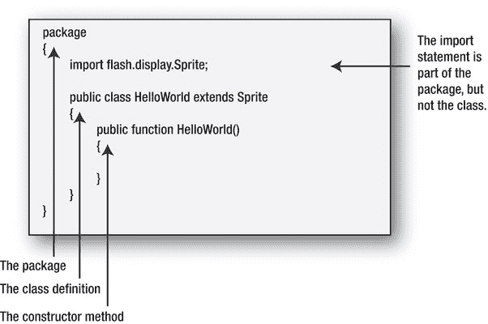

**图 1-23.** 通过保持每个块语句的开括号和闭括号沿一条假想线对齐，你可以确保在正确的位置添加代码。

从图 1-23 可以清楚地看到，`import` 语句是 `package` 的一部分，而不是类的一部分。你还可以看到，构造方法是类的一部分，因为它包含在类的花括号内。这要归功于缩进。

还有另一种可视化代码组织方式的方法。我一直在大量使用“块语句”这个术语。这个术语实际上非常具体地描述了如何使用缩进和花括号来组织代码。你可以把每一对花括号想象成一个空盒子或块。每次你创建另一个带有自己花括号对的语句时，你就在第一个块内部创建了一个新块。图 1-24 展示了到目前为止你在程序中创建了三个代码块。每个块都嵌套在另一个块内部。

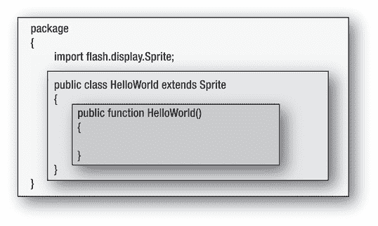

**图 1-24.** 每一对花括号包含一个代码块。块可以包含其他块。

编写代码时一个常见的困惑是不确定一个块语句在哪里结束，另一个在哪里开始。如果你使用这种建议的格式，并在编写时能看到这些假想的划分，这将真正帮助你防止意外地在错误的地方添加一行代码。

如果你在使用 Flash Builder，你可以使用其“大纲”窗口来查看程序中的所有代码块，以及你当前正在哪个块中工作。你可以在代码编辑窗口的左下方找到“大纲”窗口。图 1-25 展示了如果你已按照本章的指示操作到现在，你的“大纲”窗口会是什么样子。

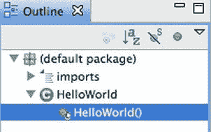

**图 1-25.** “大纲”窗口显示了你程序中的所有代码块。

“大纲”窗口清晰地显示你有三个块：`package`、类定义和构造方法。它甚至还添加了一些可爱的小图标来示意它们。`import` 语句是 `package` 块的一部分，因为它处于相同的缩进级别。

“大纲”窗口和代码编辑窗口是关联的。如果你点击“大纲”窗口中的一个块，代码编辑窗口会高亮显示同一个块，反之亦然。例如，如果你点击“大纲”窗口中的构造方法块，代码编辑窗口中的构造方法也会被高亮显示，如图 1-26 所示。

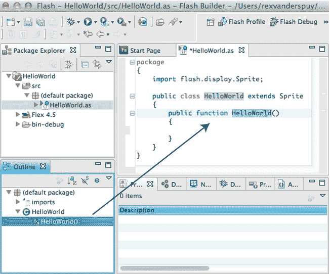

**图 1-26.** 如果你在“大纲”窗口中选择一个代码块，编辑窗口中相同的代码块会被高亮显示，反之亦然。

在长程序或复杂程序中，你可以使用“大纲”窗口快速找到你想要处理的代码块。

### 指令是什么？

你的程序需要的下一段代码是一条**指令**。计算机编程的一大乐趣在于能够像你是自己个人银河游轮的船长一样，随意抛出诸如“构造方法”和“指令”这样的术语。很简单，指令是你要程序执行的单个操作。它告诉你的程序：“现在就做这个！”方法由一个或多个指令组成，有了它们，程序就活了起来。

4\. 你将添加到构造方法中的指令将告诉程序，在程序运行时在控制台窗口中显示“Hello World!”字样。将以下粗体文本添加到你的程序中：

```
package
{
  import flash.display.Sprite;

  public class HelloWorld extends Sprite
  {
    public function HelloWorld()
    {
trace("Hello World! Can you read this?");
    }
  }
}
```

你的代码编辑窗口现在应该看起来像图 1-27。

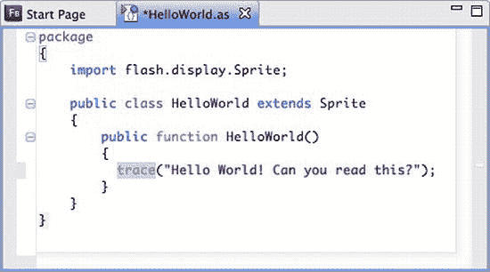

**图 1-27.** 将新的 `trace` 方法添加到你的代码中。它会显示引号内位于其括号之间的任何文本。

这是你编写的新代码行：

```
trace("Hello World! Can you read this?");
```

这被称为**trace 方法**。这是一种特殊的指令，告诉你的程序在调试时将括号内的任何内容发送到 Flash Builder 的控制台窗口。你还没看到控制台窗口，但很快你就会看到了！在这个例子中，`trace` 方法会将“Hello World! Can you read this?”这些文字发送到控制台窗口。这里的关键词是 `trace`。

如果你想使用 `trace` 向控制台窗口发送一些文本，该文本需要用引号括起来。AS3.0 有很多内置方法，比如 `trace`，你可以用它们来做各种有趣的事情，并且你将在本书的过程中详细了解其中的许多方法。

指令以分号（`;`）结尾。分号是一个基本的标点符号，让程序知道“指令结束了！执行这个任务！”它就像句子末尾的句号。每当你看到一行代码末尾有分号，你就知道这是一条指令。它告诉程序执行一个特定的操作。你之前在那行从库中导入 `Sprite` 的代码中也使用了分号。那行代码也是一条指令。

*如果你忘记在指令末尾添加分号，Flash Builder 会宽宏大量地假设你本意是要加一个。没有分号，你的程序仍然可以完美运行。谢谢你，Flash Builder！但为了良好的编程风格，你应该始终添加分号。如果你以后学习其他不那么宽容的编程语言（大多数都不宽容），你将已经养成了一个优秀的习惯。*

图 1-28 展示了在运行和调试程序时，`trace` 如何工作以在控制台窗口中显示文本，这是你在接下来的步骤中将要做的。

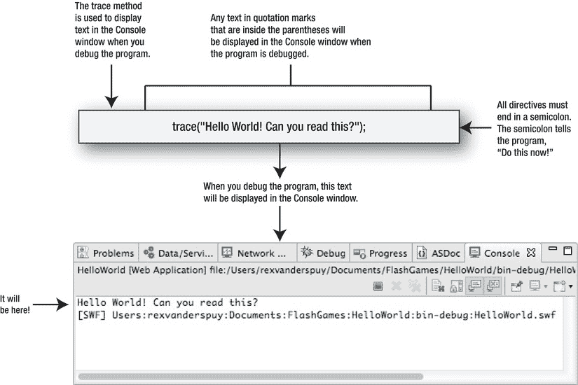

**图 1-28.** 在运行和调试程序时，使用 `trace` 方法在控制台窗口中显示文本。

但是，现在先别去控制台窗口找那段文字！直到你调试程序时才会看到它。你将在接下来的步骤中做这件事。

## 为代码添加注释

在查看程序实际功能之前，我们先为它增加一个新特性：`注释`。编写计算机程序时，经常需要为某段代码的功能写下简短说明。当你解决了一个复杂的编程问题，不确定下次再看代码时是否能理解时，注释尤其有用。它也能帮助其他可能阅读你代码的人更好地理解。

添加注释有两种方式。第一种是使用两个正斜杠（`//`）。在这两个正斜杠之后同一行添加的任何文本，都不会被 AS3.0 解释为编程代码。你可以写任何你喜欢的内容；程序运行时这些内容会被忽略。示例如下：

```
//Hi mom!! This is a comment. You can write whatever you like here.
```

有时你可能想写一段无法轻松塞进一行的长注释。这时可以创建`多行注释`。多行注释的写法如下：

```
/*
Anything between the opening and
closing multiline comment characters
will not be interpreted as
programming code.
*/
```

多行注释以字符序列 `/*` 开头，以字符序列 `*/` 结尾。你可以在它们之间任意多行上写任何内容。

除了给自己留笔记，注释在你想测试程序在缺少某些代码时的行为时，也非常适合用于禁用代码段。

1. 为了熟悉使用注释，在你的程序中添加一条注释。用以下粗体行修改你的代码：

```
package
{
  import flash.display.Sprite;

  public class HelloWorld extends Sprite
  {
    public function HelloWorld()
    {
      //The next line displays some text
      trace("Hello World! Can you read this?");
    }
  }
}
```

在继续之前，确保你的程序看起来如图 1-29 所示。

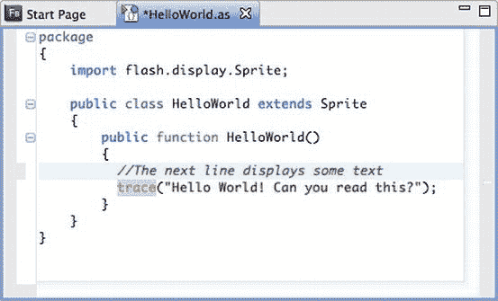

**图 1-29.** 在代码中添加一条注释。

ActionScript 编辑器窗口将注释显示为绿色，以便你轻松将其与编程代码区分开。

2. 最后，如果一切正常，保存 `HelloWorld.as` 文件。

现在你已经准备好查看程序运行的结果了。

## 运行程序并编译 SWF 文件

到目前为止，你只处理了一个文件，即 `HelloWorld.as` 文件。这是你的 ActionScript 程序，它被称为 AS 文件。这是你完成所有工作的文件，但它并非最终产品。

你的最终产品将是一个 SWF 文件。这是一个扩展名为 `.swf` 的文件。它是在 Web 浏览器的 Flash Player 中运行的文件，也是你可以上传到互联网或与他人共享的文件。创建 SWF 文件的行为被称为*编译*它。（这也被称为*构建*它，Flash Builder 正是由此得名。）

在 Flash Builder 中有两种编译 SWF 文件的方法。

* 你可以从 Flash Builder 的主菜单中选择“运行” “运行”，或点击工具栏中的绿色播放图标。执行此操作时，Flash Builder 会为你构建 SWF 文件到项目目录的 `bin-debug` 文件夹中，然后在 Flash Player 中启动它。

* 你可以从主菜单中选择“运行” “调试”，或点击工具栏中的小甲虫图标。这是一个更好的选择。它执行的操作与普通“运行”命令相同，但还会打开“控制台”窗口。“控制台”窗口会显示你在程序中使用的所有 `trace` 指令。它还会在“问题”窗口中给出错误消息，告诉你程序中是否犯了一些错误。当你选择“调试”选项时，它实际上会运行程序并启动调试器。一箭双雕！

在制作游戏时，你几乎只会使用“调试”选项，因为它在“控制台”和“问题”窗口中提供的信息极其有用。让我们通过调试程序并观察会发生什么来了解这点！

*从现在起，我将把调试选项称为**编译**。每当我在本书中要求你编译程序时，请点击那个小甲虫按钮。*

1. 从主菜单中选择“运行” “调试”，或点击工具栏中的小甲虫图标，如图 1-30 所示。Flash Builder 可能会询问你是否要在继续之前保存工作。如果你之前已经为此程序运行过调试器，它可能会询问你是否要终止任何现有的调试会话。在这两种情况下，都点击“确定”按钮。它还可能会询问你是否要打开 Flash Builder 的`调试透视图`。如果是，请选择“否”。（你将在本章末尾附近了解什么是调试透视图以及如何切换到它。）

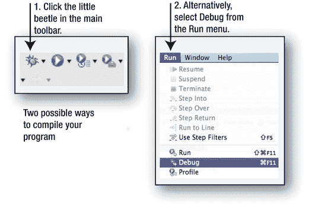

**图 1-30.** 选择两种编译程序的方式之一。

如果 Flash Builder 安装正确，并且你严格按照本章的所有说明操作，将会发生以下情况：

* Flash Builder 将启动一个 Flash Player 窗口。它会是空白的。这完全没问题，本就该如此！（如果你没有在“项目属性”面板中取消选中“生成 HTML 包装文件”选项，则会打开一个空白网页。请参阅本章开头附近的“告诉 Flash Builder 在 Flash Player 中运行你的程序”一节来防止这种情况发生。）

* Flash Builder 还将打开“控制台”窗口。你应该会在“控制台”窗口中看到“Hello World! Can you read this?”字样。图 1-31 展示了你应该看到的内容。“控制台”窗口还会显示一些技术信息，确认它已创建了 SWF 文件，即你的最终作品。

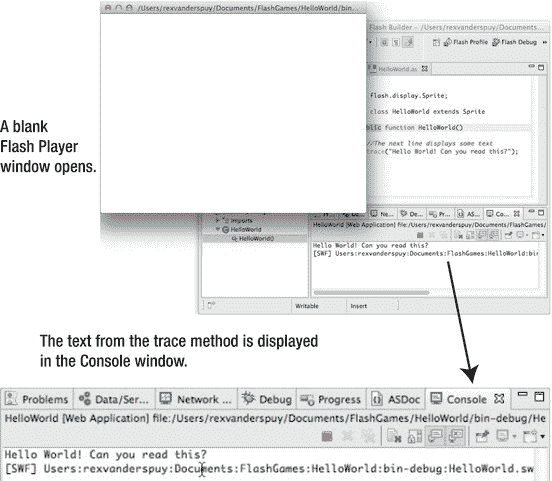

**图 1-31.** 编译你的程序，并在“控制台”窗口中查看结果。

如果你编译程序时发生了这种情况，那么恭喜你，你已经编程并运行了你的第一个计算机程序！如果这没有发生，而你收到了一些无法理解的奇怪错误消息，请继续阅读，看看能否找出问题所在。

### 当你编译程序时发生了什么

我们暂时假设你的程序完美运行，你看到了我在上一节中描述的结果，并且没有收到任何错误消息。以下是实际发生的情况：

当你点击调试（Debug）按钮时，Flash Builder 会将你的程序发送给一个名为`编译器`（compiler）的组件。编译器是 Flex SDK 中的一个软件，它的任务是将 AS3.0 代码转换为可在 Flash Player 中查看的 SWF 文件。同时，它还会检查你的代码中是否存在错误。如果有错误，它会发出警告；如果错误严重，则会阻止代码运行。

但如果代码运行正常，那么编译器会在控制台（Console）窗口中显示你的`trace`消息，并在`HelloWorld`项目目录的`bin-debug`文件夹中为你创建一个 SWF 文件。让我们验证一下它是否真的做到了。打开你的`bin-debug`文件夹查看一下。你的`HelloWorld`项目目录应该类似于图 1-32。

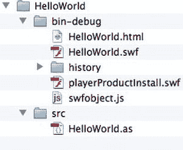

**图 1-32.** 当你编译程序时，AS3.0 编译器会在项目文件夹中为你创建一个 SWF 文件。

你感兴趣的是`HelloWorld.swf`文件。与你的项目同名的 SWF 文件将包含你在后续章节中制作的最终游戏。

但该目录下还有几个其他的文件和文件夹。它们对于本书中的任何项目都不是必需的，它们都是所谓的 **HTML 包装器**（HTML wrapper）的一部分。如果你希望将任何项目上传到互联网，这些文件是你需要的。即使你已告诉 Flash Builder 不要生成 HTML 包装器，这些文件仍然会被创建，只不过 Flash Builder 不会用它们来在网页浏览器中启动你的程序。让我们看看这些文件的作用——它们可能在某些时候对你有用。

*   `HelloWorld.html`：这是一个 HTML 文件（一个网页），当你运行和调试程序时，编译器会自动为你生成它。它包含播放 SWF 文件的代码。你可以使用这个 HTML 文件以及此目录中的其他文件，作为创建可发布到互联网的网页的基础，以便其他人能玩你的游戏。

*   `swfObject.js`：这是一个 JavaScript（JS）文件，它负责将 SWF 文件嵌入到 HTML 页面中，并检查通过互联网查看你游戏的用户是否安装了 Flash Player。

*   `playerProdcutinstall.swf`：这是一个 Flash 应用程序，如果用户当前的 Flash Player 版本与你的游戏不兼容，它会提示用户下载最新版本。

*   `History`：此文件夹包含专门的代码，允许用户使用浏览器的前进和后退按钮来导航你的游戏或网页应用程序。

详细介绍如何为网络发布 HTML 文件已超出了本书的范围，但理论上，你只需要将这五个文件和`History`文件夹上传到一个网址（URL），世界上的任何人都能玩你的游戏。你可以在 Adobe 网站上找到更多关于 Flash Builder 的 HTML 包装器的信息，网址是：

`http://help.adobe.com/en_US/flashbuilder/using/index.html`

以上就是当一切正常工作时你会看到的情况。但万一……

### 它没起作用怎么办？

可能有一小部分不幸的读者没有看到图 1-31 所示的输出。事实上，如果这是你第一次进行任何计算机编程，那么你几乎肯定会在某个地方犯一个小错误，从而阻止程序正常运行。别灰心！有很多可能出错的地方，而能够找出问题所在是学习过程中至关重要的一部分。

如果这是你第一次使用 Flash Builder 编译程序，那么很有可能 Flash Builder 没有正确安装，或者你没有安装调试版本的 Flash Player。如果你看到一条错误消息说“Installed Flash Player is not a debugger”，那么这很可能就是原因。请按照本章开头“使用 Flash Builder”部分的说明来解决这个问题。

如果 Flash Builder 安装正确，那么只需仔细检查你编写的代码，问题就能轻松解决。首先，当你点击调试按钮时，你可能会看到一个名为“Errors in Workspace”的对话框，如图 1-33 所示。

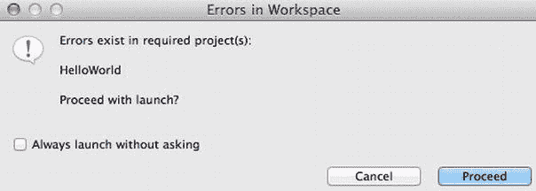

**图 1-33.** 编译程序时，Flash Builder 会告诉你代码中是否存在问题。

如果你看到这个对话框，请点击取消（Cancel）。这一点很重要，因为如果你点击继续（Proceed），即使代码中存在错误，Flash Builder 仍会尝试创建 SWF 文件。这可能会让你错误地认为你的程序运行正常，而实际上并非如此。在一个有数百行代码的复杂游戏项目中，这可能会让你忽视代码中的错误，而这些错误最终会表现为难以解决或检测的复杂 bug。

取消 SWF 的启动后，请查看 Flash Builder 工作区底部的“Problems”窗口。Problems 窗口会告诉你它认为你的代码中有多少个错误。点击“Errors”旁边的小三角形，你会看到一个列表，详细列出 Flash Builder 认为的问题所在。图 1-34 展示了一个例子。

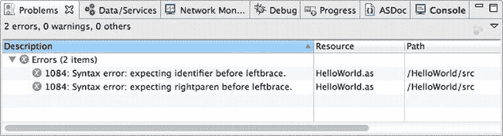

**图 1-34.** 点击 Problems 窗口中“Errors”旁边的三角形，可以查看程序中可能存在的错误。

我可以向你保证，它告诉你的内容在你看来可能完全是天书！你需要花费大量时间使用 Flash Builder，才能逐渐理解这些错误信息试图告诉你什么。然而，“语法错误”（syntax error）这个术语很重要。它意味着你编写了一些 AS3.0 语言无法理解的代码。这是 AS3.0 在说：“啊？”。这通常表明你打错了字或拼写错了某个东西。也可能意味着你忘记打开或关闭某个花括号或圆括号。或者你只是不小心遗漏了某些内容。这些消息的另一件令人困惑的事情是，Flash Builder 实际上并不知道问题出在哪里。错误信息很模糊。它们通常不会指向真正的问题所在，因此你必须运用你的推理能力来找出可能出错的地方。

但 Flash Builder 不会只给你留下模糊的错误信息；它会指出它认为问题存在于代码的哪个位置。如果你查看编辑器窗口的左侧，你会看到一个带有 X 的小红圈。Flash Builder 认为问题出在那行代码上。图 1-35 展示了一个例子。

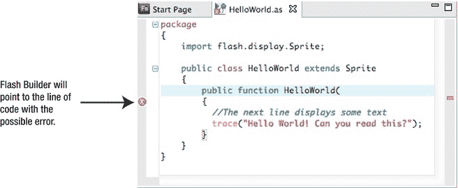

**图 1-35.** Flash Builder 会指出可能存在错误的代码行。

*注意：如果遇到一个不太严重但最好修复的小问题，Flash Builder 会用一个三角的黄色警告标志来提示你。这不会影响程序的正常运行，但如果放任不管，后续可能会引发更严重的问题。*

Flash Builder 高亮显示的那一行代码是一个重要线索！然而，这也很容易产生误导，因为 Flash Builder 只是指出了它无法理解你代码的那个位置。通常，真正的问题出现在*紧挨着这一行之前的位置*。

这可能会让人困惑！这里有个更具体的例子：想象你在森林里散步，被树根绊倒，头撞到了石头上。Flash Builder 会指出石头是问题所在。但你知道，真正的问题是那根树根。

仔细看看图 1-35，并将其与你在上一节中编写的最终代码进行比较。Flash Builder 指向的那一行看起来有什么问题吗？不，它完全没问题。

但看看紧挨着它的上一行。它看起来是这样的：

```
public function HelloWorld(
```

你发现什么问题了吗？是的！缺少了右括号。这行代码应该是这样的：

```
public function HelloWorld()
```

这类简单的错误非常容易犯，尤其是在你刚开始学习编程，对这一切都还完全不熟悉的时候。

但是，Flash Builder 并没有告诉你这就是问题所在。它指向的是它撞到的石头，而不是绊倒它的树根。不过，它确实为你指明了查找的方向。如果你修复了这段代码并再次调试程序，程序就会完美运行，所有的错误信息都会消失。

不幸的是，编译器并不知道你希望你的代码做什么；它只能告诉它期望什么以及它不理解什么。如果运气好，它能精确定位问题所在。但更多时候，它只是给你一个大致的查找方向和线索。这有点像两岁小孩指着自己的大脚趾喊疼。你知道问题出在那里，但究竟是图钉扎了、被蜜蜂蜇了，还是仅仅另一种“上次我这样做你给了我巧克力”的说法，补救措施则取决于经验、审慎的调查和周密的诊断。你需要自己明智地去分析，错误信息试图告诉你什么，以及你可能需要修复或更改什么，才能让程序正常运行。

如果不确定程序的问题出在哪里，问问自己是否可能遇到了以下一个或多个问题：

-   所有内容的拼写和大小写是否正确？

-   文件是否保存在正确的位置？文件夹和文件的拼写及大小写是否与包名和类名匹配？（如果你使用的是 Flash Builder，通常不会有这个问题，因为它会自动处理这些事情；但使用其他 IDE 则可能发生。）

-   所有 AS3.0 关键字（例如 `import`、`package` 和 `function`）是否显示为蓝色或紫色？如果某个关键字不是这种颜色，那就清楚地表明你可能拼写或大小写有误。

-   是否闭合了所有的花括号和圆括号？

-   你去厨房再倒一杯咖啡时，你的猫有没有跳到键盘上？

下面还有一些在调试程序时需要时刻牢记的通用指导原则：

-   如果收到多条错误信息，总是先修复第一条。后续的错误通常是由于部分代码依赖于前面的代码段正确运行所致。修复第一个错误，修正效果会级联传递，通常能奇迹般地修复其余错误。

-   检查*紧挨着 Flash 认为出问题的代码行的上一行*。通常，上一行的小错误自身可能不足以产生编译错误，但却足以导致下一行代码出错。

-   *在重新编译之前，一定要保存正在编辑的 AS 文件！*我必须强调，忽视这一点是常见疏忽。程序员发现并修复了一个错误，但重新发布 SWF 文件时却得到完全相同的错误信息。这是因为修复后没有保存文件，Flash 实际编译的是之前保存的旧版本文件。如果你使用 Flash Builder，这不是问题，因为它会在尝试运行代码前自动为你保存 AS 文件；但大多数其他 IDE 不会这样做。

-   在重新编译并测试程序之前，只做一处修改。如果你的程序之前运行正常，但在做了这次修改后突然停止工作，那么你就确切知道是什么导致了问题。如果你一口气做了五处修改后才运行和调试，程序出了问题，你就无法知道是这五处中的哪一处导致了故障。

-   最后，程序员的普适法则：尽早测试，频繁测试。多做测试，尽早解决大量微小的、可控的问题，以避免日后不得不处理那些能使项目停滞不前的巨大棘手问题。

除少数特殊情况外，这是本书最后一次对调试问题进行如此详细的讨论。从这以后，你就得靠自己了，但你越早获得调试自己代码的实践经验就越好。在这一领域，经验决定一切，而没有一个比棘手的调试问题更能磨砺你编程技能的磨刀石了。

另外，要习惯使用“问题”窗口——你会经常用到它！它将成为你查找和追踪问题时最亲密的盟友。

#### 常见错误消息

本节列出了一些在初次调试时可能遇到的常见错误消息，并针对问题可能的原因给出了建议。

- `1087：语法错误：程序结束后发现额外字符。`
  您可能忘记打开或关闭某个花括号。

- `1116：用户定义的命名空间属性只能在类定义的顶层使用。`
  您在类定义中拼错了一个关键字。例如，将“public”拼成了“pulbic”。

- `1071：语法错误：在属性 public 之后应为定义关键字（如 function），但实际为 clas。`
  您将单词“class”拼写成了“clas”。当拼错关键字时，通常会出现此错误。

- `1084：语法错误：在 exteds 之前应包含左花括号。`
  您拼错了单词“extends”。

- `1017：未找到基类 Sprie 的定义。`
  您拼错了单词“Sprite”。

- `1017：未找到基类 Sprite 的定义。`
  您拼错了以下代码行中的某个单词，例如“flash”或“display”：
  ```
  import flash.display.Sprite;
  ```
  您也可能遗漏了单词之间的某个点号。

- `1114：public 属性只能在包中使用。`
  您可能拼错了单词“package”。

- `1153：构造函数只能声明为 public。`
  您在构造函数方法中拼错了单词“public”。

- `1071：语法错误：在属性 public 之后应为定义关键字（如 function），但实际为 functon。`
  您拼错了单词“function”。

- `在源路径‘HelloWorld’中找到的文件，其名称必须与文件‘HeloWorld’内部的类定义名称相同。`
  您在类定义中将“HelloWorld”拼写成了“HeloWorld”。

- `1008：函数‘HeloWorld’的返回值没有类型声明。`
  您在构造函数方法中将“HelloWorld”拼写成了“HeloWorld”。

- `1084：语法错误：在左花括号之前应包含标识符。`
  您忘记关闭一个括号。

- `1180：调用了可能未定义的方法 trae。`
  您将“trace”拼写成了“trae”。

- `1084：语法错误：在分号之前应包含右括号。`
  您忘记关闭一个括号。

别被这些错误消息吓到！您很快就会理解它们想要传达的信息，通过仔细检查代码，您总能找到问题的根源。

#### 对照原始源文件确认程序

如果您对本书中的任何代码有疑问，可以下载我编写的原始源文件，并与您的代码进行核对。您可以从本书的下载页面 [`www.apress.com`](http://www.apress.com) 下载这些文件。打开您正在学习的章节的文件夹，您会发现文件夹和文件的组织结构与我书中所描述的一致。您可以在 Flash Builder 中直接打开任何单个文件，或者将整个文件夹作为 Flash Builder 项目打开。

要将源文件作为项目打开，请从主菜单中选择“文件”“导入 Flash Builder 项目”。会打开一个新对话框，询问您是要导入文件还是项目文件夹。选择“项目文件夹”，然后点击“完成”。该项目将被导入到 Flash Builder 中，之后您就可以像运行和调试自己的程序一样，对它进行运行和调试。

如果您要导入的项目文件夹与 Flash Builder 中当前打开的项目同名，请在导入之前重命名该项目文件夹。

### 关于 Flash Builder 的更多信息

Flash Builder 是一款复杂的软件，包含的功能远多于您平时可能用到的。让我们快速了解一下其中一些最实用的功能。

#### 编辑窗口的特性与怪癖

ActionScript 编辑窗口有一些高级功能，不幸的是，对于初学者来说，如果您不了解它们，这些功能可能会导致一些令人沮丧的怪现象。它们可能让您的工作看起来好像消失了，或者无法正常运行。然而，随着经验积累，您会发现这些功能其实非常有用。

##### 折叠代码

首先，编辑窗口允许您*折叠*代码。请看窗口最左侧，您会看到一些小的减号。每个代码块旁边都有一个减号。如果您点击其中一个减号，该代码块就会折叠成一行。看起来您的代码完全消失了，但实际上并没有。点击代码块旁边新出现的加号，您的代码就会再次显示出来。如果您正在处理一个非常长的程序，并希望暂时隐藏部分代码以免干扰您处理其他部分，这个功能就很有用。图 1-36 对此进行了说明。

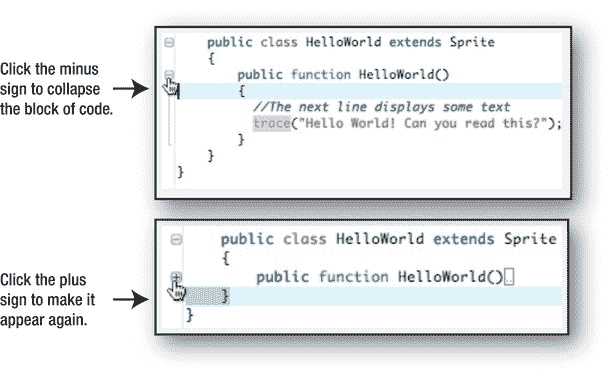

**图 1-36.** 如果您想清理编辑窗口的杂乱，可以折叠当前不处理的代码块。

### 断点

如果你正在处理一个复杂的程序，只想测试其中一部分而非全部，可以在代码中添加一个**断点**。添加断点后，代码将在该位置停止运行。如果你知道后面某处存在错误，但只想测试到确认无误的代码段为止，这非常有用。

不过，如果不经意地在左侧边距上双击，也很容易意外地添加断点。作为初学者，你可能不会注意到这些断点的存在，只会发现程序无法正常运行。虽然不会收到任何错误提示，但程序似乎会在中途停止。如果遇到这种情况，请检查并确保没有意外添加任何断点，如果有则将其删除。

通过在编辑窗口的左侧边距上双击，即可在代码中添加断点。你会看到出现一个蓝色的小圆点，如图 1-37 所示。

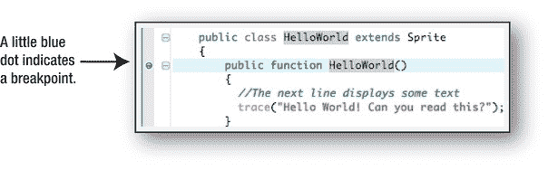

**图 1-37.** 在代码中添加断点将使其在断点处停止运行。这对于检查代码中哪些部分正常工作、哪些部分有问题非常有用。

添加断点后，当运行并调试代码时，程序会在该处停止。这意味着它不会执行紧随其后的跟踪语句，你将在控制台窗口中只看到一条消息，提示 SWF 文件已创建。

要移除断点，只需再次双击它。完成此操作后，重新运行并调试程序，程序应能顺利执行完毕。

然而，有时你可能想利用断点来检查哪些代码段工作正常，哪些有问题。在这种情况下，可以保留断点，并打开“断点”视图窗口。通过选择“运行”  “调试”  “其他” 可以使“断点”视图可见。此时会打开一个新的“显示视图”窗口。打开“调试”文件夹，选择“断点”，然后单击“确定”按钮，如图 1-38 所示。

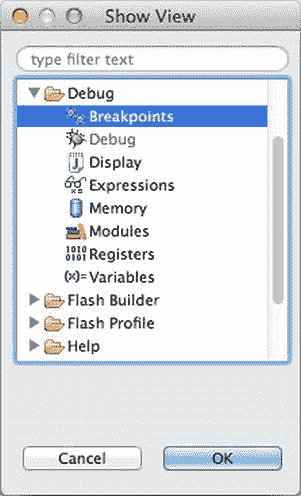

**图 1-38.** 显示“断点”视图窗口以帮助管理断点。

现在，Flash Builder 工作区底部会出现一个新的“断点”窗口，如图 1-39 所示。其中将显示代码中的所有断点。

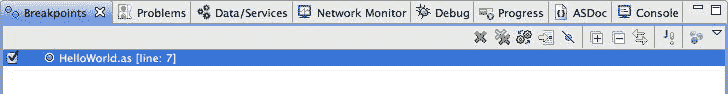

**图 1-39.** 显示“断点”窗口以查看代码中断点的位置。

“断点”窗口的右上角自带菜单栏。你可以通过取消勾选来停用某个断点。如果双击某个断点，代码编辑窗口中的光标将跳转到你添加该断点的位置。你可以选中断点，然后单击菜单栏中的 X 按钮来移除它们。其中许多选项同样可以在 Flash Builder 的“运行”菜单中找到。

如果在带有断点的情况下运行和调试代码，并且想查看程序从该点继续执行会发生什么，可以选择“项目”菜单中的“恢复”命令，如图 1-40 所示。

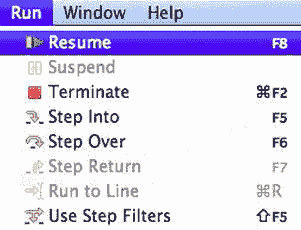

**图 1-40.** 从断点处恢复运行，可显示程序从该点继续执行后的情况。

在同一个“运行”菜单中，你还可以*单步跳过*断点。如果你在某一行（你认为包含错误的那一行）设置了断点，并希望在不执行该行的情况下测试程序，这一功能就很有用。它会从程序中忽略有疑问的那一行，并显示没有该行时程序将如何运行。

断点还有一些更高级的功能，比如设置条件断点。你可以在 Adobe Flash Builder 文档中“Flash Builder 中的调试工具”一章找到更多相关信息，网址为：

`http://help.adobe.com/en_US/flashbuilder/using/index.html`

当你开始编写冗长、复杂的程序时，就会逐渐体会到断点在帮助测试以及将代码中正常工作部分与问题部分区分开来时有多么实用。断点是必不可少的调试工具。

### 透视

# Flash Builder 透视与发布

Flash Builder 有一个名为`透视`的功能，它可以改变工作区中窗口的排列方式。如果你刚安装并开始使用 Flash Builder，很可能使用的是名为`Flash`的透视。Flash 透视以我在本书中描述的方式排列工作区，即编辑窗口左侧为包资源管理器和大纲窗口，底部为控制台和问题窗口。

没有理由更改这个透视，但了解如果你愿意，是完全可以更改的，这一点很重要。此外，在探索 Flash Builder 的过程中，你可能意外切换了透视，导致无法回到我一直介绍的标准 Flash 透视。

Flash Builder 工具栏的右上角有用于切换透视的按钮，如图 1-41 所示。

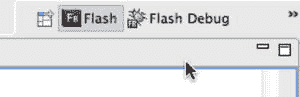

**图 1-41.** 通过切换透视来改变 Flash Builder 工作区中窗口的排列方式。

当前选中的透视将通过凹陷的按钮显示。图 1-40 显示当前选中的是 Flash 工作区。如果选择 Flash 调试透视会怎样？图 1-42 展示了它的外观。

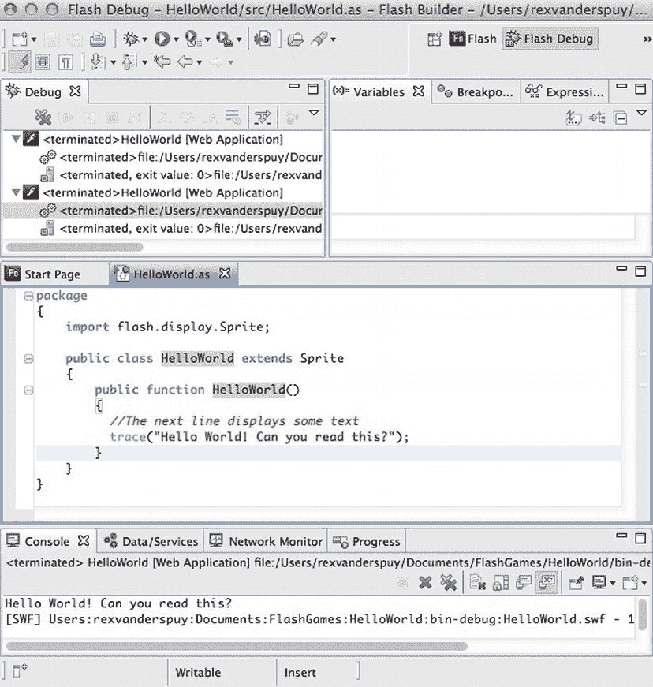

**图 1-42.** `Flash`调试透视

所有用于解决问题和调试程序的窗口都以合理的布局呈现，且易于访问。“断点”窗口位于右上角，此外还有两个新窗口：“变量”和“表达式”。

Flash Builder 还包含许多其他透视。你可以通过单击“打开透视”按钮，然后单击“其他”来找到它们，如图 1-43 所示。

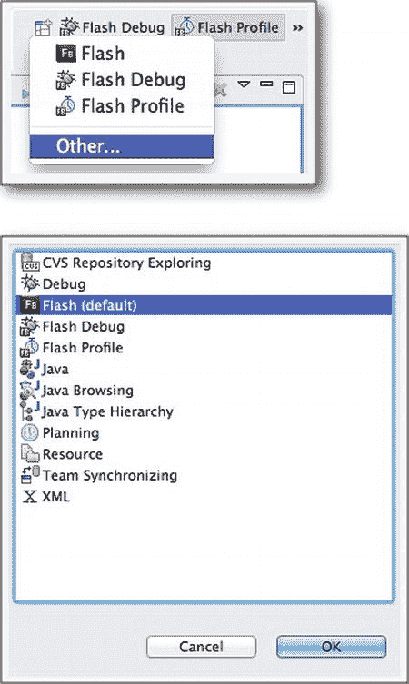

**图 1-43.** 如果需要，有许多透视可供选择。

你应该了解这些透视的存在，但在完成本书的项目时，很可能不需要用到它们。

另一个需要记住的问题是，如果你双击任何窗口的标题栏，它将会展开至充满整个工作区。再次双击它即可使其缩小。

## 创建程序的干净编译

有时你编译程序时，尽管没有出现错误消息，但程序的行为似乎并不符合预期。你对程序所做的最近更改似乎没有生效，而且你完全找不到代码中的错误。

如果发生这种情况，你需要通过对程序进行干净编译来重置编译器。为此，请选择“项目”  “清理”。选择要清理的项目，然后单击“确定”按钮。编译器将从头开始重新编译你的程序。

### 创建 SWF 文件的发布版本

当你的程序或游戏完全完成后，最好创建一个`发布版本`。这个 SWF 文件比你在运行和调试程序时创建的 SWF 文件体积略小。体积更小的原因是它不包含任何调试信息或 `trace` 语句。发布版本的 SWF 应该是你的最终产品。

要创建发布版本的 SWF 文件，请从 Flash Builder 的主菜单中选择 `项目`  `导出发布版本`。系统将打开一个新窗口，其中包含一些你很可能永远不需要更改的选项。点击 `完成` 按钮，Flash Builder 就会为你生成 SWF 文件。

完成后，你会在项目文件夹中一个名为 `bin-release` 的文件夹里找到发布版 SWF，如图 Figure 1-44 所示。

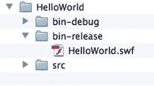

**图 1-44.** 创建一个发布版 SWF，其体积小于调试过程中创建的 SWF 文件。

## 关于 AS3.0 和 Flash Player 的更多内容

在这一过程结束时，你会得到一个 SWF 文件。只要同一台电脑上也安装了 Flash Player，你就可以将它带到任何电脑上运行。SWF 文件需要借助 Flash Player 才能运行，这一事实非常重要。作为游戏设计师，你需要知道为什么会这样，以及这可能给你带来哪些限制。让我们更深入地看看发布 SWF 文件时后台究竟发生了什么。

AS3.0 是一种`高级编程语言`。像 Java、C++ 和 Visual Basic 这样的高级编程语言，是为了方便人类轻松阅读、编写和理解而设计的。它们使用真正的英语词汇，例如 `function` 和 `class`，并使用英语语法元素，如引号和分号。但计算机并不理解英语。如果你今晚试图请电脑帮你洗碗，我猜你只会得到一片沉默。（如果不是这样，请务必告知相关人员，最好是专业人士！）

在最基本的层面上，计算机只理解由 1 和 0 组成的二进制语言。所有 AS3.0 代码都必须被翻译成二进制代码，计算机才能理解。幸运的是，你不需要手动完成这项工作，所以可以收起笔和纸了。Flash 内置了一个编译器（一种翻译代码的软件组件）来为你完成这个任务。

请记住，与用 C++ 或 Visual Basic 等语言编写程序不同，Flash 的编译器不会将你的代码编译成计算机中央处理器（CPU，即计算机的主要“大脑”）可以直接读取的形式。它编译代码的目的仅仅是让 Flash Player 软件能够读取。

在运行任何 AS3.0 程序之前，你的系统上必须安装 Flash Player 软件，因为 Flash Player 的职责就是向 CPU 解释你的代码。正因如此，AS3.0 和 Java 一样，被称为`解释型编程语言`。解释型语言使用一种称为`虚拟机`的软件，它在 CPU 和你的程序之间充当解释器。Flash Player 就是 AS3.0 的虚拟机。

与直接编译到 CPU 的语言相比，解释型语言有许多优势。最重要的是，这意味着你的程序可以在任何安装了 Flash Player 的操作系统（Windows、Linux 或 Mac OS X）上完美且完全一致地运行。你只需编写一次代码，而为了每个可用操作系统编写的 Flash Player 会负责确保你的代码正确运行。另一个优势是，Flash Player 保护其运行的计算机免受你可能编写的、意外导致系统冻结或崩溃的代码的影响。所有这些都使得解释型语言成为非常方便和可靠的编程语言。

然而，解释型语言的一个主要缺点在于性能方面。`性能`是一个计算机术语，基本上是指你的程序运行效率或速度。想象一下去一个你不会说当地语言的外国，但有一位翻译陪同，他辛苦地翻译你说的每一个字，然后再把每个回答翻译回英语。这将是一个非常缓慢和繁琐的过程。不幸的是，当你运行 AS3.0 程序时，Flash Player 和 CPU 之间发生的情况正是如此。到底有多慢？确切数字很难获得，但一个合理的估计是，比代码被编译为二进制机器语言并直接在 CPU 上运行慢 10 到 20 倍。（这里说的 `慢`，是指 CPU 处理你程序要求它执行的每条指令或计算的快慢程度。）

Adobe 在 Flash Player 的每一代迭代中都做了大量工作来提升性能，但对于那些依赖榨干系统每一分处理能力来最大化游戏性能的游戏开发者来说，这仍然是一个主要障碍。这就是需要大量处理能力来计算几何图形的 3D Flash 游戏，为何难以与游戏主机（如 Xbox、PlayStation 和 Wii）上丰富的 3D 图形辉煌相抗衡的原因。游戏主机使用定制的编译器，将所有游戏代码优化后，直接作为机器语言在其特定处理器上运行。

不过，如果你最终考虑进入主机游戏设计领域，使用 Flash 仍然会让你处于相当有利的位置：当你准备迈出那一步时，通过使用 AS3.0 编程所学的技能可以直接应用于主机编程。AS3.0 编程环境也可能是一个你能学到的、最用户友好的编程环境。而且，嘿，用 Flash 制作一个游戏，把它发布到网上，你就拥有了一个潜在的全球受众——这就是力量！

## 命名规范

在本章结束之前，我们来快速了解一下编程实践中的一个方面：`命名规范`。你可能已经注意到，你为文件、类和方法所起的名称有些特别之处。看看为 AS 文件选择的文件名：`HelloWorld`。

它看起来是不是有点奇怪？确实如此。你会注意到 `H` 和 `W` 是大写的，而且两个单词之间没有空格。这是一种程序员们亲切地称为`驼峰命名法`（也被称为`驼峰式记法`）的命名风格。你能猜出为什么叫这个名字吗？我相信你一定能！

使用驼峰命名法，你可以使用多个单词来编写复合短语。单词之间不用空格分隔，但你和 AS3.0 仍然可以轻松地阅读这个短语。在复合名称中间使用空格，对于编程来说就像鸡舍里进了狐狸——无论如何都要避免！当 AS3.0 代码编译器在不应出现空格的地方遇到空格时，它会直接报错，因此程序员们发明了驼峰命名法，作为一种无需空格就能高效编写复合单词或短语的方式。同时，你也应避免在文件夹名称中使用空格，因为如果你使用了 Flash Builder 以外的 IDE，底层的 Flex SDK 在编译代码时将无法处理包含空格的路径。

驼峰命名法是命名规范的一个重要特征。命名规范是程序员在开始项目之前约定的一套规则，用于创建包、变量、类、对象、方法和文件的命名风格。通过严格遵守这些命名规范，程序员能够更好地避免因拼写错误或代码中元素大小写不正确而导致的常见错误。此外，他们仅凭命名的大小写方式，就能轻松判断出所处理的是哪种编程对象。

本书中你将用到两种驼峰命名法：

- **小驼峰命名法**：`startsWithLowerCaseLetter`。你将把它用于包名、变量、方法和实例。

- **大驼峰命名法**：`StartsWithUpperCaseLetter`。你将把它用于类名和构造方法名。同时也会用于 AS 类文件的名称，例如 `HelloWorld.as` 和 `Main.as`，这些文件的名称必须与它们在文件中定义的类名完全一致。

由于 ActionScript 是一种区分大小写的编程语言，请记住 `helloWorld` 与 `HelloWorld` 不同，而它们与 `helloworld` 也各不相同。确保你严格按照文本中出现的格式遵循所有大小写规则，否则你的程序将无法运行。如果你写了一个看似方方面面都完美无缺但就是无法运行的程序，请检查你的拼写和大小写！这是新手程序员最常犯的错误之一，而且很多程序员都能讲出一些令人头疼的调试故事——一直调试到凌晨 4 点，最终揪出的罪魁祸首竟然只是一个拼写错误或大小写错误。对于这一点，本书作者拒绝评论！

### 本章总结

做得好！你已经编写并发布了你的第一个 AS3.0 程序！其实没那么难，对吧？事实上，恭喜你通过了本书中最困难的章节之一。我已经为后续所有的游戏和项目打下了编程基础，你会发现，在你作为游戏设计师的职业生涯中，你将反复使用同样的格式来搭建程序。

本章涵盖了大量的理论内容，如果你刚接触编程，可能会觉得有些部分有点晦涩难懂。我理解你的感受！但你不必完全理解所有理论才能制作游戏。最重要的是，你知道需要用什么编程代码来获得你想要的结果。更深层次的理解会随着时间的推移而来，通过大量的试错，并尽可能多地在自己的项目中进行实验，你自然会领悟。

大多数程序员通常不愿与外界分享的一个深藏的秘密是：世界上大量软件都是建立在一点点理解和大量复制粘贴之上的。这本身就是学习过程的一部分。当然，你需要确切地知道需要复制粘贴哪些代码片段，以及如何修改它们来获得你想要的结果，而这只有经验（以及本书！）才能教会你。但随着时间推移，你会很快识别出那些常见的代码段，并像最优秀的程序员一样熟练地复制粘贴。

我鼓励你重温本章中那些第一遍读时可能有点模糊的部分，在继续深入学习之前，力求对它们有扎实的理解。如果你还没完全掌握，也不必担心！只要你成功让那个小小的 Hello World 程序运行起来，并且大致理解了它为何能工作，那么你就已经入行了！

在下一章中，你将暂时告别编程，学习如何使用 Photoshop 为你的游戏制作图形。在第 3 章中，你将看到如何运用本章学到的技能，结合这些图形，开始编程你的第一个交互式游戏世界。


