## 第 2 章

### 制作游戏图形

在接下来的两章中，你将学习视频游戏设计的两项最核心技能：如何制作游戏图形，以及如何为它们编写程序。游戏设计中所有最重要的核心技术都涵盖在这两章中。正是这些技术，将成为你在本书后续制作其余游戏项目时的基础。

`Flash Builder` 仅用于编写程序代码，而非制作游戏所需的图形。因此，你需要使用一些图形软件来制作这些图形。本章将介绍如何使用 Photoshop 制作游戏图形。在下一章中，我将向你展示如何使用 AS3.0 程序代码为这些图形编程，使它们实现完全交互。

*本章假定你几乎没有或完全没有使用过 Photoshop 或任何其他图形设计软件的经验。它将从最基础的内容讲起，涵盖所有基本知识。如果你在计算机图形制作方面经验丰富，可以快速浏览本章，了解一下需要制作哪些图形、它们应使用的文件名以及保存的位置和方式。虽然本章重点介绍使用最广泛的图形设计软件 Photoshop，但你可以使用任何你喜欢的能生成 `PNG` 文件的软件：Fireworks、GIMP、Illustrator，或任何其他你用得顺手的软件。*

到本章结束时，你将创建出图 2-1 中所示的背景游戏世界。

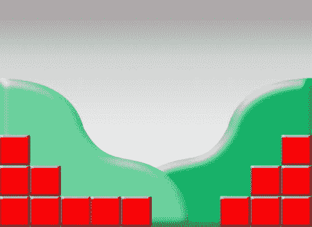

**图 2-1.** 背景游戏世界

你还将使用基本形状创建一个游戏角色，如图 2-2 所示。


**图 2-2.** 游戏角色

此外，你还会制作一些用于控制该角色的按钮图形，如图 2-3 所示。

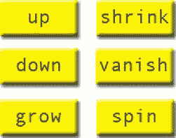

**图 2-3.** 用于控制游戏角色的按钮

所有这些图形都将用 Photoshop 制作，并保存为名为 `PNG`（便携式网络图形）的文件格式。对于 Flash 游戏来说，`PNG` 图像文件通常是最佳选择。

以下是本章你将学到的内容：

*   如何在 Photoshop 中打开新文件。

*   如何使用 Photoshop 工具创建基本形状。

*   如何使用图层来组织形状。

*   如何为图形应用特殊效果。

*   如何将图形保存为 `PNG` 文件，以便随后使用 AS3.0 进行编程。

那么，让我们开始构建一个游戏世界吧！

*Photoshop 是一款复杂的软件，拥有成千上万种可供更改和自定义的设置。而且，稍不注意，你很容易不小心“自定义”界面布局，几次无意的点击就会导致窗口、面板和工具消失——而且似乎是永久消失。如果你是 Photoshop 新手，正在探索该软件，这个问题尤其突出。你可能会将某个窗口拖拽或点击到无影无踪。*

*幸运的是，让所有这些窗口重新出现在正确的位置相当容易。Photoshop 使用了一种名为`工作区`的概念，它是一组窗口和工具面板的集合，根据你正在做的工作类型，这些窗口和面板会以不同的排列方式分组。当你首次安装并启动 Photoshop 时，它会加载一个名为`基本功能`的工作区。没有理由更改这个工作区，我建议你在学习期间使用它，因此本书中的操作说明也是基于这个工作区编写的。*

*以下是确认你正在基本功能工作区中操作的方法。你也可以通过从 Photoshop 主菜单中选择“窗口”“工作区”来确认。你应该会看到“基本功能”旁边有一个对勾。在同一个菜单的下方，你会看到一个名为“复位基本功能”的选项。这就是神奇选项！如果你丢失了任何窗口或工具面板，并且到处都找不到，选择“复位基本功能”，它们就会全部弹回到你首次启动 Photoshop 时所处的位置。你还会在工作区左上角附近看到一个名为“基本功能”的大按钮。如果它看起来是按下的状态，说明你正在“基本功能”工作区中工作。*

*你还可以从 Photoshop 工作区顶部主菜单栏的“窗口”菜单中有选择地隐藏或显示窗口和工具面板。所有在工作区中可见的窗口和面板旁边都会有一个对勾。如果你正在寻找某个窗口，但在屏幕上找不到，请从“窗口”菜单中选中它。*

### 创建游戏世界背景

在第一部分中，你将创建一个背景游戏环境，你的角色将居住在其中。我将一步步地引导你完成整个过程，最后你将制作出一张看起来像图 2-4 一样的图片。

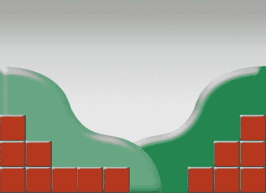

**图 2-4.** 游戏世界

#### 在 Photoshop 中创建新文件

首先，启动 Photoshop 并设置一个新文件，用于绘制背景场景。

1.  启动 Photoshop。

2.  从主菜单中选择“文件”“新建”。将打开一个对话框，询问你正在创建的新文件的名称以及你想要设置的图像尺寸。以下是需要更改的选项：

    *   名称：`background`

    *   宽度：550 像素

    *   高度：400 像素

你可以保留所有其他设置不变。完成后，“新建”文件对话框应该看起来像图 2-5 这样。

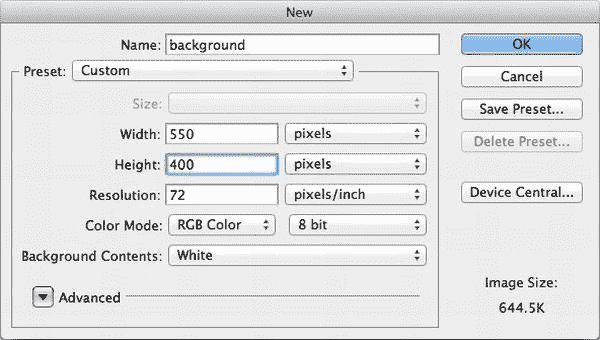

**图 2-5.** “新建”文件对话框应该看起来像这样。

*如果你看到的“新建”文件对话框与此不完全相同，很可能是你使用的 Photoshop 版本与我的略有不同。本书编写时使用的是 Photoshop CS 5.1，这是出版时的最新版本。如果你使用的是更早或更新的版本，你看到的一些选项可能不完全相同，或者位置稍有不同。不过，我可以向你保证，它们肯定都在那里！请运用你的判断力和智慧去寻找它们。*

*Adobe 在每个版本之间都会对工具和菜单项的布局和位置进行微小的调整，但很少进行大刀阔斧的改动。事实上，在我使用 Photoshop 的 20 年里，本章将要描述的基本功能几乎没有太大变化。这是一件好事，因为这意味着你投入学习 Photoshop 的时间往往是一项不错的长期投资。这也意味着，如果你使用的是更老版本的 Photoshop，哪怕是像 Photoshop 5 这样已有 10 年历史的版本，你仍然可以遵循本章的大部分说明，制作出很棒的游戏图形。*

点击“确定”按钮，会打开一个全新的空白窗口，这就是你将用来绘制背景的窗口。这被称为`画布`。图 2-6 显示了你会看到的内容。

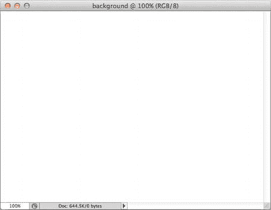

**图 2-6.** 用于绘制背景场景的空白画布

#### 什么是像素？

当你创建新的空白画布时，你为其指定了宽度 550 像素和高度 400 像素。那么什么是像素呢？

像素是构成计算机图形的微小方块，是你在屏幕上能看到的最小单位。没有任何东西能比像素更小。如果你放大计算机图形，你会看到它是由无数微小的方块组成的，这些方块就是像素。图 2-7 展示了一个示例。

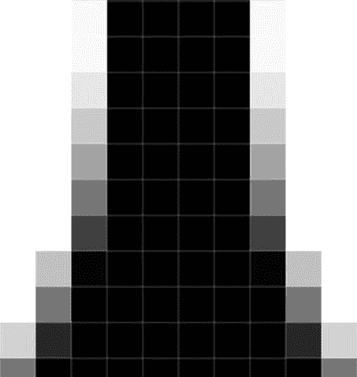

**图 2-7.** 像素是构成计算机图形的微小方块。

需要明确的是，你创建的新空白画布实际上就是这些微小方块构成的网格。目前你还看不到它们，因为它们全是白色的，但它们确实存在。这张看似平淡无奇、在未经训练的人眼中毫无特色的新画布，实际上是由 22 万个白色像素组成的。图 2-8 对此进行了说明。

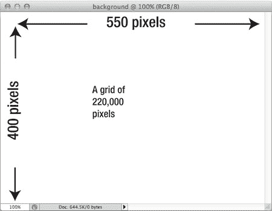

**图 2-8.** 看似空白的画布，实际上是由称为像素的微小白色方块组成的网格。

将这块画布视为像素网格来思考非常重要。在下一章中，你将看到如何访问和控制这个隐形网格中每一个点上所有游戏元素的位置。

*注：像素是计算机图形的基本构件，但并非唯一。还有另一种使用`矢量`制作计算机图形的方法。使用`矢量`制作的图形，其最基本元素是线条而不是方块。Photoshop 专精于使用像素创建图形，而 Illustrator 和 Flash Professional 等软件则使用`矢量`。在后面的章节中，你将学习如何利用`矢量`为你的游戏制作精美的插图。*

*Photoshop 的图形工具也使用`矢量`作为其基本构件。*

## 绘制天空

在 Photoshop 工作区的左侧，你可以找到工具箱。Photoshop 的大多数绘图工具都在这里。工具箱有一个可能让人困惑的特点：许多工具是隐藏的，只有在某个按钮上按住鼠标左键时才会显示出来。操作后会显示一个列表，列出该按钮组中所有分组的工具。然后你可以从列表中选择你需要的工具。你需要一些练习和经验才能找到并记住哪些工具属于哪些按钮组，但你会逐渐掌握的。图 2-9 显示了大多数重要的绘图工具隐藏的位置。如果在后续指示中你找不到我要求你使用的工具，可以回头参考这张插图。

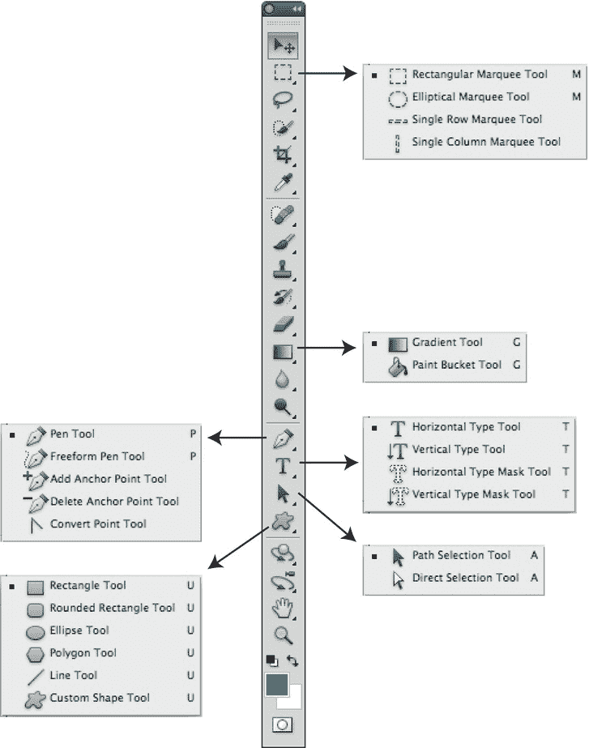

**图 2-9.** 在任何按钮组上按住鼠标左键，即可显示 Photoshop 的隐藏工具。

你要绘制的第一个东西是一片蓝色的天空，它将构成场景其余部分的背景。在接下来的步骤中，你将学习如何使用`矩形工具`绘制一个方块，为其填充颜色，并使用渐变赋予其自然的深度感。

在工具箱中选择`矩形工具`。当你在工具箱中看到它的图标显示为按下的按钮时，就表示已正确选中，如图 2-10 所示。

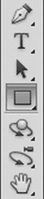

**图 2-10.** 选择`矩形工具`。

接下来，你要为矩形选择一种颜色。有两个地方可以操作。在工具箱的左下角，你会看到两个重叠的方块。选择上方的方块可以选取对象的前景色。选择后面的方块可以选取其背景色。如果需要，你可以点击弯曲的箭头图标来交换这些颜色。图 2-11 对此进行了说明。

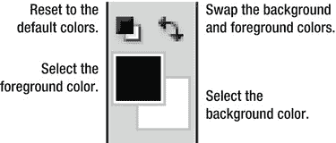

**图 2-11.** 选择对象的前景色或背景色。

Photoshop 还有一个沿着工作区顶部排列的`选项栏`。它是*上下文相关的*，这意味着你在此处看到的按钮和设置会根据你选择的工具而变化。通过一些经验，你将逐渐了解在不同工具激活状态下可以在此选择哪些工具和选项。当`矩形工具`处于激活状态时，你可以在`选项栏`中更改其颜色，如图 2-12 所示。

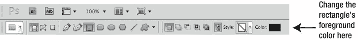

**图 2-12.** 上下文相关的`选项栏`允许你更改许多工具选项，包括颜色。

*注：如果出于某种原因你找不到`选项栏`，它可能被隐藏了。要显示它，请从 Photoshop 的主菜单中选择“窗口”  “选项”。“选项”旁边应有一个勾选标记。*

*在`选项栏`正上方是应用程序栏。你可以使用它来更改画布的缩放百分比，以及修改 Photoshop 显示面板和窗口的方式。*

按照前述方法，点击工具箱或`选项栏`中的前景色选择框。

颜色选择器窗口会打开，让你选择一种颜色。使用窗口中间的滑块选择一种颜色，然后在其左侧的大方块中选择该颜色的深浅（亮度）。标记为“新的”方框会显示新颜色看起来的样子，并与当前所选颜色进行对比。如果觉得选择太多，可以点击“颜色库”按钮，加载一组预选的颜色供你选择。图 2-13 显示了颜色选择器的外观。

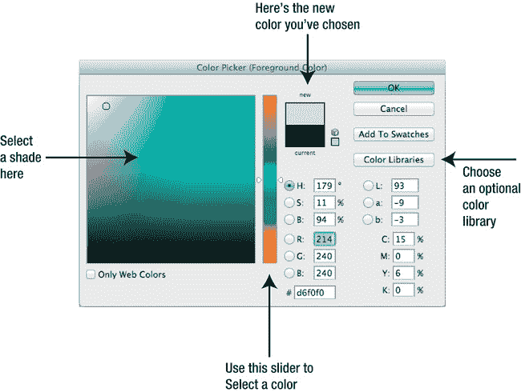

**图 2-13.** 在颜色选择器中选择一种颜色。

除了使用颜色选择器，你也可以从工作区右侧的“颜色”或“色板”面板中选择颜色。点击“色板”选项卡，会显示许多小色块（称为色板）供你选择。当鼠标悬停在某个色板上时，鼠标指针会变成吸管图标，这是一种巧妙的提示，表明你可以吸取颜色用于绘制。当你用吸管选择一种颜色后，它会显示在颜色选择器窗口的“新建”框中，如图 2-14 所示。

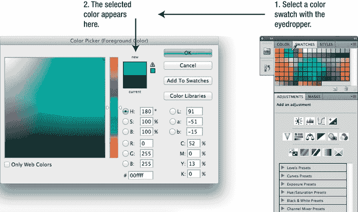

**图 2-14.** 也可以从“色板”面板中选择颜色。

你也可以直接点击色板，无需打开颜色选择器。该颜色会直接应用到当前处理的矩形或其他形状上。

“色板”面板中默认显示的色板已经涵盖了不错的起始颜色选择，但还有更多颜色可用。点击面板最右侧那个像列表旁边带向下箭头的小按钮，会弹出一个颜色合集列表供你选择。找到一个你喜欢的合集。如果想恢复默认色板，从同一列表中选择`重置色板`即可。

接下来你要绘制天空背景，所以选择一种亮蓝色。完成后点击颜色选择器窗口中的“确定”按钮。你选择的新颜色会出现在工具面板底部的前景色色框中。

返回空白画布。按住鼠标左键并拖动，绘制一个正方形或矩形，如图 2-15 所示。它的颜色应与上一步选择的颜色一致。

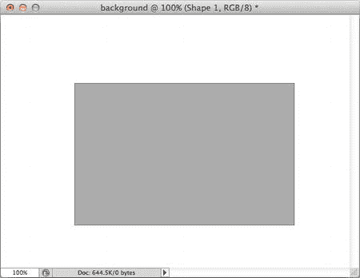

**图 2-15.** 在新工作区中绘制一个矩形。

这样还不错，但你真正想要的是让蓝色矩形填满整个屏幕。让我们在下一步中解决这个问题。

选择工具面板顶部的“移动工具”。移动工具允许你在画布上移动对象，以及调整其大小或旋转对象。一旦选中它，选项栏会提供一些你需要更改的选项。其中有一项非常重要：一个名为`显示变换控件`的复选框。

确保`显示变换控件`已被勾选。如果没有勾选此选项，你将无法轻松调整对象大小或旋转对象。图 2-16 展示了移动工具按钮和选项栏应有的样子。

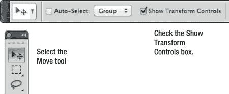

**图 2-16.** 选择移动工具，并确保选项栏中的`显示变换控件`复选框已被选中。

一旦你选择了已勾选`显示变换控件`的移动工具，你会注意到你绘制的矩形四个角、各边以及中心出现了小方块。这些称为拖拽手柄。当移动工具处于选中状态时，你可以用鼠标拖拽这些手柄来调整矩形的大小和旋转角度。

当鼠标移动到其中一个手柄上时，你会看到两种图标之一出现。对角指向的箭头表示你可以调整矩形大小（这也称为缩放）。弯曲的箭头表示你可以旋转它。图 2-17 展示了如何使用这些拖拽手柄来改变矩形的大小或方向。

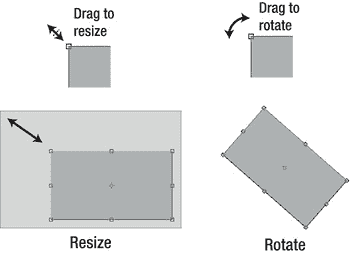

**图 2-17.** 使用移动工具调整对象大小或旋转对象。

像这样改变绘图对象的大小和方向，在 Photoshop 的术语中被称为变换。你可以通过从 Photoshop 主菜单选择`编辑`  `变换路径`或`编辑`  `变换`来找到更多变换选项。你会在其中找到以下选项：`缩放`（调整大小）、`旋转`、`斜切`、`扭曲`、`透视`和`变形`。你还可以找到按固定量翻转和旋转对象的选项。

使用移动工具和拖拽手柄调整矩形大小，使其填满整个画布，如图 2-18 所示。此时画布应完全变为蓝色。

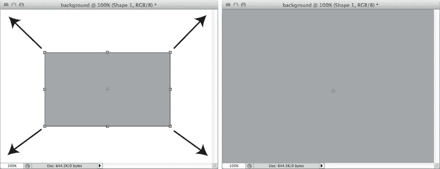

**图 2-18.** 调整矩形大小以填满整个画布。

调整大小完成后，按下 `Enter` 键。这会应用变换，并且你需要在此操作之后才能再次激活 Photoshop 的许多选项。你也可以通过再次选择移动工具来应用变换。Photoshop 会弹出一个对话框询问你是否要应用变换，点击“确定”即可接受。

当你正在调整形状或选区的大小或旋转时，Photoshop 会禁用主菜单中的大部分选项以及右侧面板中的许多按钮。如果你发现自己在操作时遇到按钮看似冻结或菜单选项莫名变灰，很可能是因为你忘记了应用正在处理的形状上的变换。按 `Enter` 键立即应用，或者选择移动工具打开确认窗口。之后一切都会正常运作！

现在你已经拥有一个蓝色背景，它将作为天空的基础。保持原样也可以，但让我们通过添加渐变使其更具层次感，从而让效果更好。

### 添加渐变

渐变是一种逐渐变化的颜色，可以从浅到深，也可以从一种颜色过渡到另一种。在接下来的步骤中，你将给矩形添加渐变，使其顶部为深蓝色，底部为浅蓝色。这将营造出天空消失于地平线的视觉效果。

当你使用 Photoshop 的形状（如圆形和矩形）时，可以通过“图层样式”菜单为其应用渐变。选择“图层” “图层样式” “渐变叠加”（图 2-19）。

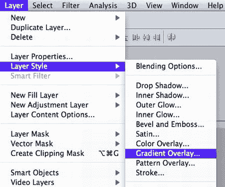

图 2-19. 选择“渐变叠加”图层样式。

一旦选中“渐变叠加”，矩形将被填充一个简单的渐变，同时“图层样式”窗口将打开，并且自动选中“渐变叠加”选项，如图 2-20 所示。

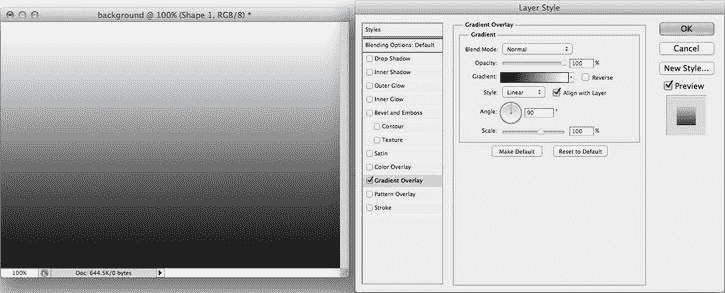

图 2-20. “图层样式”窗口让你可以在形状上创建和编辑渐变。

要编辑渐变，请单击“图层样式”窗口中的渐变框。此时会打开“渐变编辑器”窗口，如图 2-21 所示。

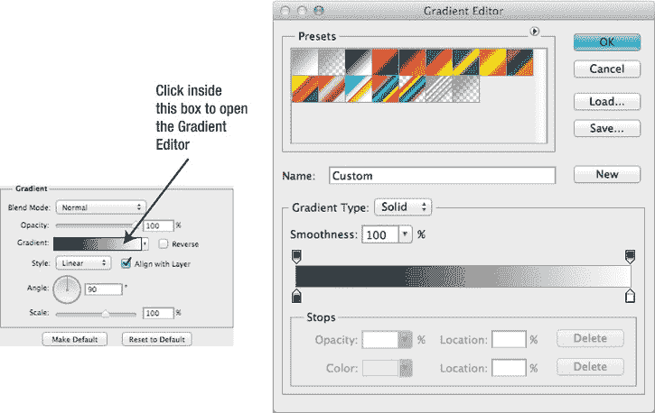

图 2-21. 单击渐变框内部。

你可以通过选择和移动`色标`来更改渐变的颜色和透明度。`色标`指的是窗口下半部分那根长渐变条四个角上的小方块。底部的色标决定渐变的颜色，顶部的色标决定其透明度（即`不透明度`）。图 2-22 对此进行了说明。

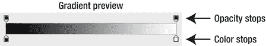

图 2-22. 使用渐变预览条中的色标来自定义渐变。

色标是比较灵巧的东西。你需要稍微摆弄一下才能掌握它们的使用方法。你可以来回滑动它们来改变渐变的起始和结束位置。你可以在渐变预览条的顶部或底部任意位置单击来添加新的色标，也可以通过将色标拖离来删除它们。

顶部的色标控制渐变的不透明度。当你单击一个不透明度色标时，“渐变编辑器”中的`不透明度`选项会被激活，你就可以控制该渐变区域的透明度。`0%` 的不透明度表示完全透明，`100%` 则表示完全不透明（实色），因此 `50%` 会使渐变在该色标位置处于半透明状态。图 2-23 对此进行了说明。

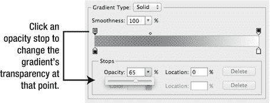

图 2-23. 如果选中一个不透明度色标，你可以通过更改其不透明度百分比来控制渐变在该点的透明度。

你会注意到，如果更改了`不透明度`值，渐变下方会出现棋盘格图案。这是 Photoshop 在向你表示颜色是透明的。

`位置`选项决定了色标应放置在渐变的哪个百分比位置。它只是用鼠标拖动色标的另一种替代方式。

底部的色标控制渐变中的颜色。如果双击一个颜色色标，会打开“拾色器”窗口，让你可以选择该部分渐变的颜色。我们下一步就来操作。

双击渐变预览条左侧的颜色色标。“拾色器”窗口就会打开（Photoshop 称之为`选择色标颜色`窗口）。选择一种漂亮的浅蓝色，可以从“拾色器”窗口中选择，也可以从“色板”面板中选择，如图 2-24 所示。

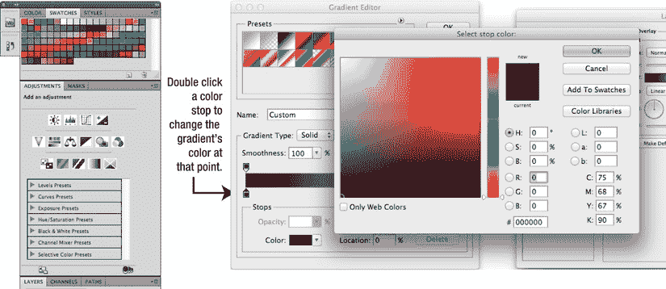

图 2-24. 更改渐变的颜色。

在`选择色标颜色`窗口中单击`确定`。你选择的新颜色将应用到该色标位置的渐变上。

接下来要做的是更改颜色中点，它决定了渐变的中心位置。颜色中点是渐变预览条底部的一个小圆圈。为了得到更自然的天空渐变效果，请将颜色中点圆点向左滑动，直到`位置`选项显示约为 `25%`，如图 2-25 所示。

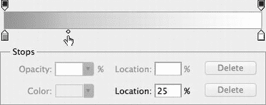

图 2-25. 更改渐变的中间点。

当你对渐变的显示效果满意时，请在“渐变编辑器”窗口中单击`确定`。现在你应该拥有一个看起来像图 2-26 那样的渐变。

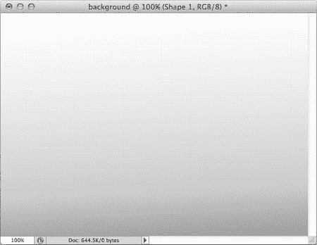

图 2-26. 目前得到的渐变。

这幅图有点问题！你的天空实际上是上下颠倒的。所以你需要将渐变的方向旋转 90 度，让深色部分位于顶部，浅色部分位于底部。

“图层样式”窗口应该仍然处于打开状态。找到`角度`选项，将渐变的角度设置为 `-90`，可以直接在文本框中输入数值，或者用鼠标转动`角度`滚轮，如图 2-27 所示。矩形的渐变会随之旋转，天空现在看起来就正过来了。

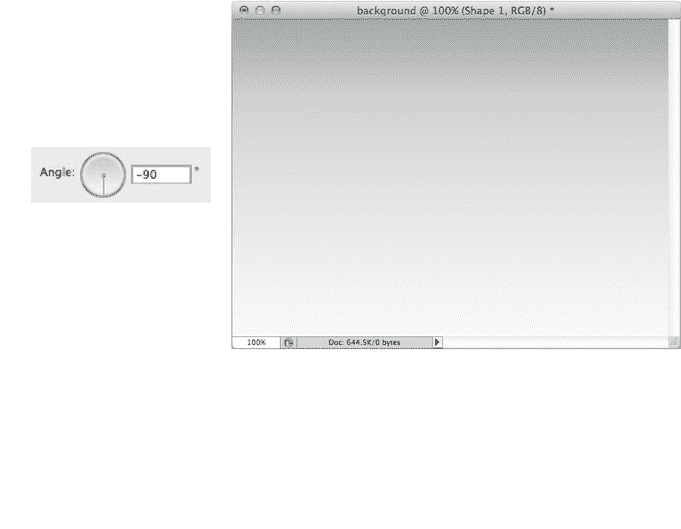

图 2-27. 将渐变角度旋转 90 度。

单击“图层样式”窗口中的`确定`按钮，将渐变应用到矩形上。

除了旋转渐变，你也可以使用移动工具旋转矩形形状本身。

“图层样式”窗口还允许你将渐变类型从本例中使用的`线性`，更改为`径向`、`角度`、`对称的`或`菱形`。`径向`渐变对于为圆形形状创建伪 3D 效果特别有用。图 2-28 展示了这些不同渐变类型的效果。

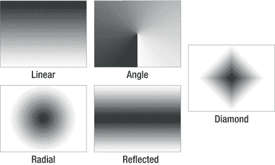

图 2-28. Photoshop 中不同的渐变样式。

渐变在 Photoshop 中是一个复杂的话题，学习它们的最佳方法是创建一些形状，并在“渐变编辑器”中试验各种设置，看看能产生什么样的效果。如果你创建了一个特别喜欢的渐变，“渐变编辑器”允许你保存它，以便以后将其载入到另一个形状中。

### 绘制山丘

天空完成后，是时候为场景添加一些绿色的背景山丘了。你需要在天空的前方绘制山丘。但在开始之前，你必须了解一项重要的 Photoshop 技术：如何使用图层来组织对象在画布上的深度位置。

#### 理解图层

图层能让你组织图形，使其位于其他图形的上方或下方。`图层`面板位于 Photoshop 工作区的右下角。如果你按照本章之前的说明操作，现在应该有两个图层：一个空白背景图层和你在前面步骤中绘制的矩形形状。

每个图层旁边都有看起来像眼睛的图标。点击这些图标，可以暂时让该图层在画布上不可见，从而让你看到下方的图层。（再次点击眼睛图标即可让图层重新可见。）

如果某个图层旁边有锁图标，表示该图层无法编辑。背景图层将始终处于锁定状态。你也可以通过选中图层并点击`图层`面板顶部附近的“锁定”按钮来锁定任意图层。如果你在该图层上进行了大量图形工作，并希望防止意外搞砸，锁定图层会非常有用。

你可以通过选中图层并调整不透明度滑块，来单独更改每个图层的不透明度（透明度）。如果将图层的不透明度设置为低于 100%，你将能够看到其下方的图层。

你可以使用`图层`面板底部的按钮来创建和删除图层。图 2-29 展示了这些基本功能及其所在位置。

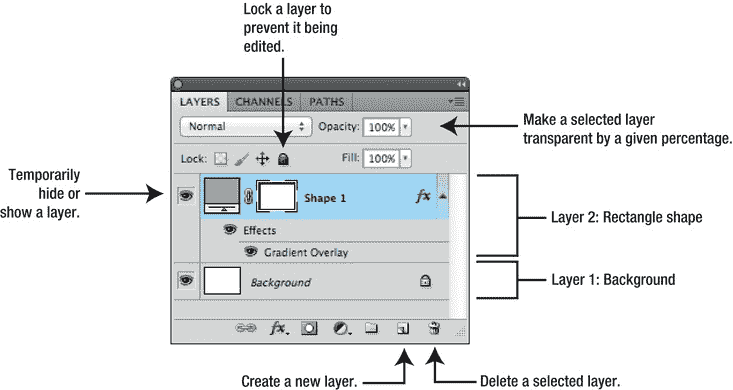

图 2-29。`图层`面板让你能够组织图形，使其位于其他图形的上方或下方。

每个图层还会告诉你关于该图层上内容的大量信息。你可以看到第二个图层上有一个形状；那就是你的天空矩形。你可以看到它应用了一个特殊的图层效果，`fx`图标就说明了这一点。你还可以看到它是一个渐变叠加效果。实际上，如果你想编辑渐变效果，只需双击`图层`面板中的`渐变叠加`，就会弹出`图层样式`窗口，让你对渐变进行任意修改。你可以通过点击效果名称旁边的眼睛图标，暂时隐藏你已创建的效果。你也可以通过点击`效果`旁边的眼睛图标，来隐藏一个图层上的所有效果。

如果你想为图层添加任何其他特殊效果，可以点击面板底部的小`FX`按钮，然后从列表中选择一个效果。图 2-30 展示了`图层`面板的这些功能。

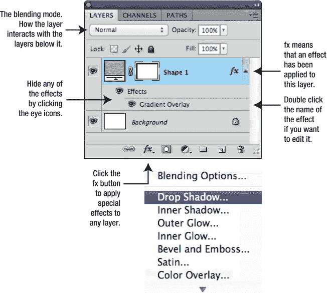

图 2-30。`图层`面板让你能够添加、编辑或隐藏可能应用于图形的任何效果。

工作时，请特别留意你从`图层`面板左上角选项菜单中选择的混合模式。混合模式决定了一个图层如何与其下方的图层进行交互。如果你使用非“正常”的混合模式，可以产生一些有趣且通常很漂亮的图层效果。然而，对于简单的游戏图形，你可能不需要用到这些，因此你很可能希望始终将混合模式设置为“正常”。

不过，你工作时总有可能会意外更改混合模式。如果你注意到你的游戏图形突然变得暗淡、透明、出现奇怪的轮廓或疯狂的迷幻效果，那很有可能是不小心切换了图层的混合模式。

如你所见，`图层`面板让你对工作成果拥有极大的控制权。不过，虽然在创建自己的游戏图形时你可能会用到所有这些功能，但眼下你无需担心其中的大部分。最重要需要了解的是：上方图层上的任何内容都会遮盖下方图层上的内容。

在开始在新图层上绘制之前，先给天空图层命名并锁定它，以防止意外选中或更改它。

双击`图层`面板中的“形状 1”文字。这会使文本处于可编辑状态。将其改为“天空”。（按 Enter 键应用名称更改。）给图层命名是一个好习惯，这样你可以轻松找到它们。当你在处理包含 20 或 30 个图层的复杂图形时，你会体会到这个习惯的好处。

点击挂锁按钮来锁定图层。同样，在完成图层上的工作后锁定它们也是一个好习惯，这样你在上方的新图层上工作时就不会意外选中或更改它们。（你可以通过再次选中锁定的图层并点击挂锁按钮来轻松解锁图层以便再次编辑。）现在，你的“天空”图层应该看起来像图 2-31 所示。

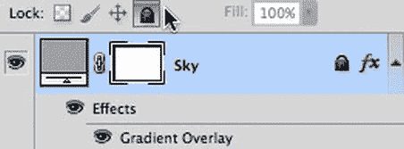

图 2-31。为图层命名并锁定它，以防止意外更改。

这里还有很多我没有提及的非常高级的图层功能。你在创建本书中的游戏图形时不需要用到它们中的任何一个，因为其中许多功能是专门用于照片编辑的。但要全面了解它们的功能，请参考 Adobe 最新的在线文档，网址为：

`http://help.adobe.com/en_US/photoshop/cs/using/index.html`

浏览到名为“图层”的章节。

让我们为你的游戏世界场景创建一些丘陵，这样你就能实际看到这个概念的应用。

## 使用钢笔工具绘图

Photoshop 的`钢笔工具`允许你创建复杂的形状。尽管它被称为钢笔，但它的工作方式并不像已知宇宙中存在的任何钢笔。最好将`钢笔工具`视为一种制作点，然后用直线连接这些点的方法。将足够多的点连接起来，你就有了一个形状。然后你可以弯曲形状中的线条，以制作出带有曲线的真正复杂的形状。学会正确使用`钢笔工具`是你能够掌握的最强大、最灵活的图形设计技巧之一。

### 锚点与路径

你将要在游戏世界中创建两座小山。每座山将位于不同的图层上。对于第一座山，请点击“图层”面板底部的“创建新图层”按钮（它看起来像一个折了一角的新页面）。一个新图层将出现在“天空”图层上方。双击这个新图层的名称，将其命名为“Hill 1”。图 2-32 展示了你的新图层应有的样子。

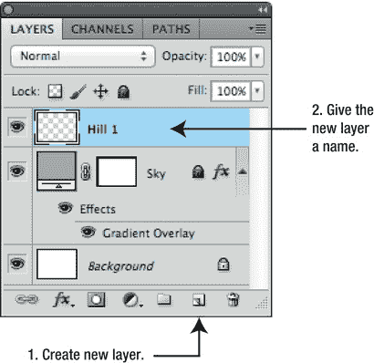

**图 2-32.** 创建一个新图层来绘制小山。

现在你有三个图层了，你将要在这新的“Hill 1”图层上进行下一步绘制。

从“工具”面板中选择`钢笔工具`（图 2-33）。

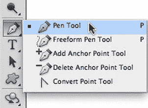

**图 2-33.** 钢笔工具

你将使用`钢笔工具`，通过创建一系列点并用直线连接它们，来粗略地绘制出山的轮廓。在后续步骤中，你将通过添加曲线来优化它。

选择`钢笔工具`后，在画布上的任意位置单击一次（你现在正在“Hill”图层上绘制）。会出现一个黑色方块，这被称为**锚点**；它是你形状的起点。


**图 2-34.** 使用钢笔工具单击以添加一个锚点

以锯齿状的方式，向下并向第一个点的左侧单击，以添加更多锚点，如图 2-35 所示。你会注意到，每次添加一个点，它都会通过一条线与前一个点连接起来。这被称为**路径**。

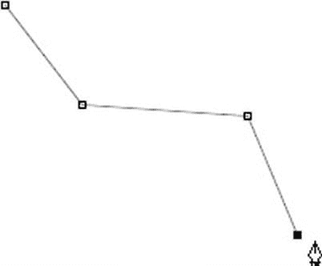

**图 2-35.** 通过单击添加更多锚点来创建路径。

如果在 Photoshop 中操作失误想要撤销操作，老办法 `编辑`  `撤销` 或 `CRTL+Z`（Windows）或 `Command+Z`（Mac OS X）可以撤销你上一步的操作。

然而，Photoshop 默认只设置成撤销上一步的操作，并不能多步撤销。如果你已经做了好几步操作，然后意识到需要返回并撤销五六步，可以打开 Photoshop 的“历史记录”面板（`窗口`  `历史记录`）。“历史记录”面板记录了你最近执行的 20 步操作，如图 2-36 所示。你可以通过点击这些历史记录中的任意一步，将项目恢复到之前的状态。

你可以使用“历史记录”面板底部的“相机”按钮对你的工作进行快照。如果你即将开始项目中复杂或试验性的阶段，且不想冒丢失已完成工作的风险，这是一个好主意。当你拍摄快照时，Photoshop 会保存当前状态下的一个工作版本，你可以通过点击“历史记录”面板顶部的快照来恢复到该状态。但快照不会随图像文件一起保存，因此如果你想恢复到快照状态，需要在关闭正在处理的文件之前进行。

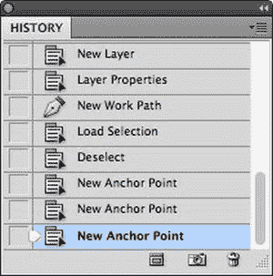

**图 2-36.** 通过“历史记录”面板回溯时间以撤销之前的操作。

继续绘制路径，使其看起来像图 2-37 所示。你可以通过点击你添加的第一个锚点来完成形状。当你这样做时，你会注意到`钢笔工具`旁边出现了一个小“O”图标。这表示你将**闭合路径**。当你闭合一条路径时，你就创建了一个形状。

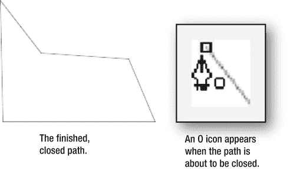

**图 2-37.** 闭合路径以创建山的粗略形状。

在单击添加锚点时按住 `Shift` 键，你可以绘制出点之间呈固定 90 度和 45 度角的完美直线。

锚点决定了你的形状将是什么样子。如果你对锚点放置的位置不满意，移动它们很容易。从“工具”面板中选择`直接选择工具`。大家都称之为**白色箭头**，它正是此意。使用白色箭头点击任意一个锚点并将其拖拽到新位置，如图 2-38 所示。你可以使用这个工具移动任意锚点并改变形状。

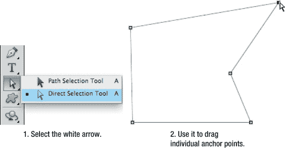

**图 2-38.** 使用直接选择工具（白色箭头）移动锚点。

`钢笔工具`和白色箭头总是这样配合使用。实际上，在`钢笔工具`和白色箭头之间切换非常频繁，因此值得学习其键盘快捷键。选中`钢笔工具`后，按住 `Ctrl` 键（Windows）或 `Command` 键（Mac OS X），钢笔会暂时变为白色箭头。这是个便捷的快捷键，因为如果你在 Photoshop 中使用`钢笔工具`制作大量游戏图形，你会在这两个工具之间来回切换成千上万次。

你可以使用**黑色箭头**（`路径选择工具`）拖拽整个形状路径，从而在画布上移动它。图 2-39 展示了这一点。

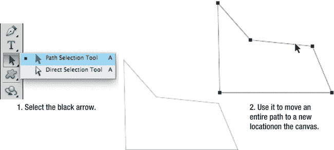

**图 2-39.** 使用路径选择工具（黑色箭头）在画布上移动整个路径。

添加和删除锚点很简单。要添加一个点，选择`钢笔工具`并将其移动到路径上的任意一条线上。你会看到钢笔旁边出现一个小加号图标。点击路径上的那个位置，就会添加一个新的锚点。（它会使用一个名为**方向线**的新特性来添加这个新锚点，你将在下一节中了解它们如何工作。）

你可以用类似的方式删除锚点。将`钢笔工具`移动到一个现有的锚点上，你会看到旁边出现一个减号图标。点击该锚点，它就会消失。图 2-40 展示了如何添加和删除锚点。

如果你使用的是旧版本的 Photoshop，可能无法如此轻松地添加和删除锚点。你很可能会需要从“工具”面板中选择`添加锚点`或`删除锚点`钢笔工具才能达到同样的效果。

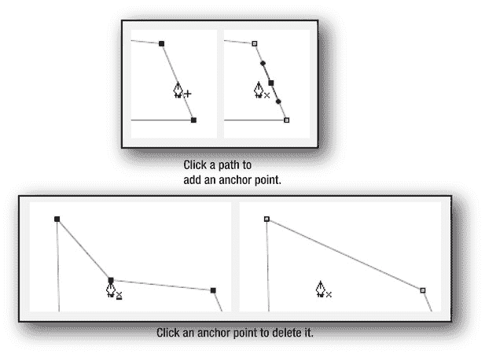

**图 2-40.** 使用钢笔工具添加和删除锚点。

如果你知道如何使用`钢笔工具`通过添加和删除锚点来创建路径，并且知道如何使用白色箭头移动它们，你就掌握了在 Photoshop 中创建复杂形状的基本技能。然而，到目前为止，你只处理了带有直线的形状。在下一节中，我将向你展示如何制作带有曲线的形状。

### 使用方向手柄创建曲线

要使形状弯曲，你需要在锚点上添加方向手柄。

从“工具”面板中选择“转换点工具”。单击其中一个锚点。然后，在按住鼠标左键的同时，将其拖过画布。此时会出现两个方向手柄；你可以使用它们在锚点处弯曲路径。通过拖拽和旋转来拉长方向手柄，曲线就会变得更大。图 2-41 展示了这一点。

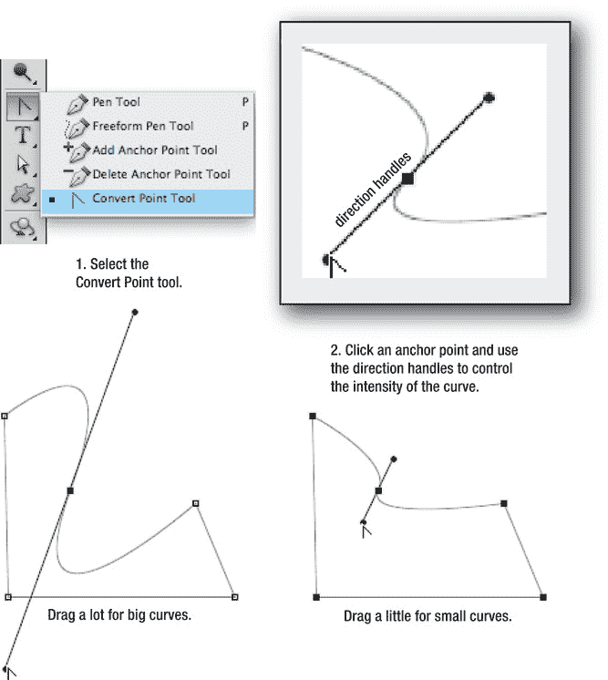

**图 2-41.** 拖拽并旋转方向手柄以添加曲线

第一次使用“转换点工具”时，你可以同时移动两个方向手柄。它们会保持连接并朝同一方向移动。但是，当你再次单击并拖拽一个方向手柄时，你会发现你只会移动其中一个手柄。使用“转换点工具”进行第二次点击会断开两个手柄之间的连接。这实际上没问题，因为能够独立移动方向手柄对于微调曲线非常有用，如图 2-42 所示。

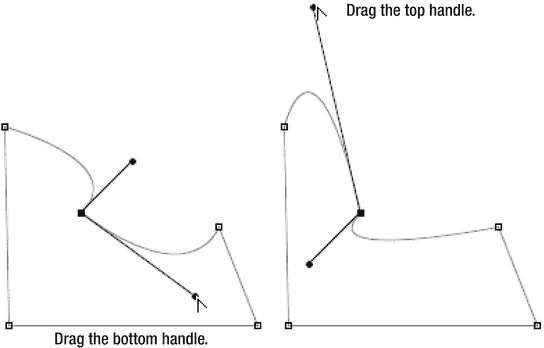

**图 2-42.** 使用“转换点工具”独立拖拽和旋转方向手柄。这可以让你微调曲线。

但是，如果你想再次同时移动两个方向手柄怎么办？你可以使用“直接选择工具”（那个白色箭头）来实现。

从“工具”面板中选择白色箭头。按住 `Alt` 键（Windows）或 `Option` 键（OS X）并拖拽其中一个方向手柄。你会看到它们又开始一起移动了。松开 `Alt`/`Option` 键后，你可以再次使用白色箭头独立移动方向手柄（参见图 2-43）。

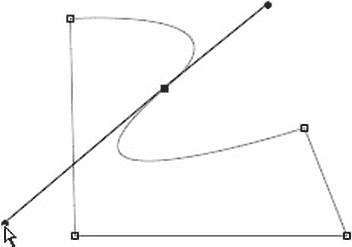

**图 2-43.** 使用白色箭头并按住 `Alt`（Windows）或 `Option`（OS X）键可同时移动两个方向手柄。

通过结合使用这些技巧，你可以非常精细地控制形状的曲线。让我们在下一步中运用它们。

运用这些技巧，让你的形状尽可能接近图 2-44 的样子。你需要让它看起来有点像从侧面看到的滑雪坡道。

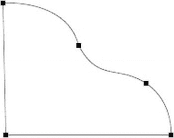

**图 2-44.** 完成的形状路径

如果你是初次使用`钢笔工具`和方向手柄，你可能第一次尝试就无法完美做到。事实上，你几乎肯定不行。这没什么好担心的！制作带有曲线的形状没有什么神奇的公式；你只需要不断尝试使用这些工具，直到对结果满意为止。使用`历史记录`面板撤销任何错误。但实际上你无法真正犯错——只需继续尝试。坚持按照这些指导进行练习，你很快就会掌握要领。正确使用`钢笔工具`需要大量的练习，但这是你可以学到的最有用、最强大的图形设计技能之一。

## 调整路径大小

如果你已经创建了一条路径，并想将其放大或缩小，请从`工具`面板中选择黑色箭头。在 Photoshop 工作区顶部的选项栏中选择“显示定界框”。用黑色箭头单击你已绘制的路径。你会看到它被一个带有角上手柄的定界框包围。拖拽这些手柄来调整路径大小，使你想要的形状变得尽可能大或小。图 2-45 展示了这一点。

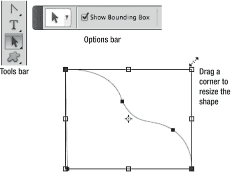

**图 2-45.** 使用黑色箭头调整路径大小。

为了这个项目的需要，请将你绘制的这个路径调整得相当大。

调整路径大小并将其定位，使其填满画布的左侧。请记住，在完成大小和位置的调整后，按 `Enter` 键以应用变换。你的画布现在应该看起来类似于图 2-46。

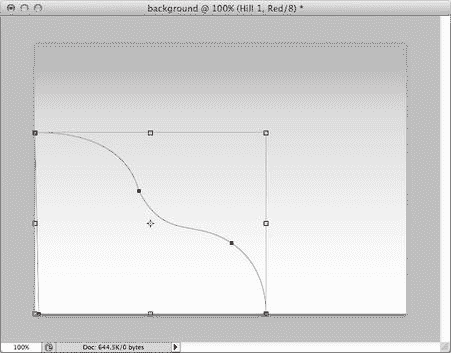

**图 2-46.** 调整路径大小并定位。

## 用颜色填充路径

你刚刚绘制的路径代表了想要制作形状的轮廓，但只有用颜色填充后，它才能成为游戏图形中可用的内容。Photoshop 工作区右侧的`路径`面板可以让你实现这一点。

要想让接下来的技巧生效，你需要先用黑色箭头工具选中上一节中绘制的路径。用黑色箭头点击路径一次将其选中。你可以通过形状路径周围带角点拖动手柄的黑色定界框来判断它是否被选中，如图 2-47 所示。

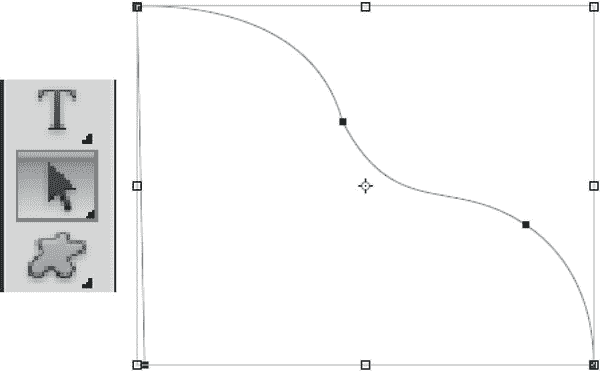

**图 2-47.** 确保形状路径仍被黑色箭头工具选中。

在成功为路径应用颜色之前，你还需要进行一项重要的设置。保持黑色箭头工具选中状态，点击 Photoshop 工作区顶部选项栏中的“添加到形状区域(+)”按钮。图 2-48 展示了该按钮的位置。如果未选中此按钮，后续步骤将无法正常进行。正是这个按钮能让你用颜色填充形状路径的内部区域。（如果按钮呈灰色无法点击，说明你未先用黑色箭头选中路径。用箭头点击路径使其选中，然后重试。）

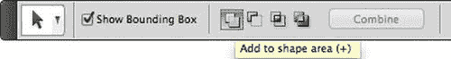

**图 2-48.** 在黑色箭头选项栏中点击“添加到形状区域(+)”按钮。

接下来，为你的形状选择一种颜色。使用本章前面学到的技巧，在工具面板的前景色色框中选择一种亮绿色（图 2-49）。

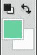

**图 2-49.** 选择一种绿色前景色。

打开`路径`面板，它作为标签选项位于包含`图层`面板的同一窗口中。如图 2-50 所示，你会看到刚绘制的路径的小缩略图，底部还有一些按钮。这些按钮可以让你用颜色填充路径、用画笔描边、将路径转换为选区或删除路径。如果你为路径指定一个独特的名称，Photoshop 会自动将路径随文档保存，以便日后在其他地方复用。我将我的路径命名为“Hill”。

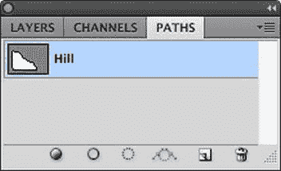

**图 2-50.** `路径`面板允许你用颜色填充路径。

点击`路径`面板底部的“用前景色填充路径”按钮。形状路径将被填充为绿色的前景色，如图 2-51 所示。

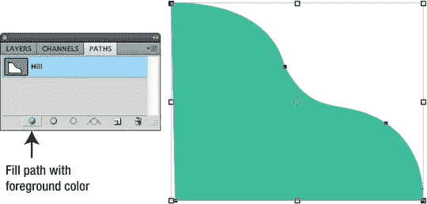

**图 2-51.** 用前景色填充路径。

如有必要，你可以点击黑色箭头选项栏中的“从形状区域减去(-)”按钮来撤销此效果。这将填充周围区域，而保持形状为空。

现在你的画布应类似于图 2-52。

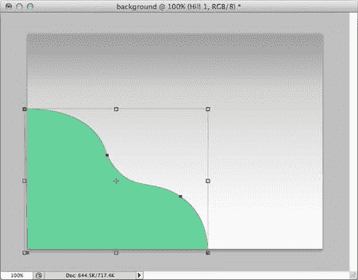

**图 2-52.** 山坡现在已被颜色填充。

这里到底发生了什么？你在前面章节中绘制的路径只是一个模板。你现在所做的事情就是将颜色倒入这个模板。颜色被倒在了图层的透明表面上。这就像使用模板在透明塑料片上给形状上色。

你唯一关心的是刚刚倒在图层上的颜色。你可以完全删除路径，因为它已经完成了使命，你不再需要它了。让我们删除它。

路径应该仍被黑色箭头工具选中。（你可以通过路径周围的定界框确认这一点。）如果未被选中，用黑色箭头点击路径一次。按下键盘上的`Delete`键，路径就会消失。

剩下的就是一个漂亮的绿色山坡。在下一节中，你将复制这个山坡，更改其颜色，并将其重新定位到画布右侧第一个山坡的后面。

当你熟练掌握了`钢笔工具`及其相关工具和技巧后，可以尝试使用自由钢笔工具。你会喜欢它的，它就像一支真正的笔！你可以徒手绘制形状，然后使用转换点工具和白色箭头来微调形状。

## 复制、修改与排列图层

你的场景中需要两座山丘。但与其费尽周折再建一座，不如直接复制已有的那座，然后稍作修改。

在`图层`面板中选中`山丘 1`图层后，从主菜单中选择`图层` > `复制图层`。（你也可以右键点击`山丘 1`图层，选择`复制图层`。）此时会弹出`复制图层`对话框，要求你为新图层命名。将其命名为`山丘 2`，如图 5-53 所示。点击`确定`按钮。


**图 2-53.** 复制图层。

完成此操作后，你会看到`山丘 1`图层上方出现了一个名为`山丘 2`的新图层（图 2-54）。这两个图层看起来一模一样。


**图 2-54.** 新图层被复制出来，悬浮在第一个图层之上。

现在画布上有了两座山丘，尽管看起来只有一座。这是因为你刚刚创建的新图层与第一个图层位置完全相同——新山丘直接叠放在第一座山丘之上。将其移开，你就能看到两座山丘了。

选择`移动工具`。在`选项`栏中，勾选`自动选择`，并从选项菜单中选择`图层`。`自动选择`功能允许`移动工具`在你点击对象时自动选中正确图层上的物体，这非常方便。如果不更改此设置，你需要先在`图层`面板中点击要操作的图层，然后才能移动该图层的内容。同时进行此操作时，请确保`显示变换控件`也已选中。图 2-55 展示了`移动工具`选项应有的状态。


**图 2-55.** 自动选择图层让移动工具在你点击对象时自动选中正确图层上的物体。

保持`移动工具`选中状态，移动画布上的山丘。这样，下方图层上的第一座山丘就会神奇地显露出来，如图 2-56 所示。


**图 2-56.** 移动新复制的山丘，露出下方图层上的原始山丘。

将其水平翻转，使其朝向与第一座山丘相反的方向。从 Photoshop 主菜单中选择`编辑` > `变换` > `水平翻转`。山丘将翻转过来，面向另一侧，如图 2-57 所示。


**图 2-57.** 水平翻转新山丘。

现在来更改新山丘的颜色。在`前景色`色块中选择一种深绿色。

选择`油漆桶工具`。点击新山丘内部，它将被填充上新的颜色（图 2-58）。


**图 2-58.** 选择油漆桶工具并点击新山丘内部以更改其颜色。

选择`移动工具`，将山丘移至画布左下角，如图 2-59 所示。


**图 2-59.** 将新山丘移到其位置上。

你创建的这座颜色更深的新山丘应位于第一座山丘之后，这样看起来就像在远处更远一点的地方。让我们移动它的图层，使其位于第一座山丘图层下方。

在`图层`面板中，将`山丘 2`图层拖拽到`山丘 1`图层下方。松开鼠标，现在你应该能看到深绿色山丘位于浅绿色山丘之后，如图 2-60 所示。


**图 2-60.** 将山丘 2 拖拽到山丘 1 下方，以重新排列画布上山丘的图层顺序。

能够像这样重新排列图层，是 Photoshop 最基本却最强大的技巧之一。

你的山丘看起来更好了，但让我们更进一步：使用一种称为*斜面与浮雕*的技巧，为它们增加一点 3D 效果。

## 斜面与浮雕

斜面与浮雕这两种互补效果能使对象呈现浅层立体感。浮雕效果使对象看起来像是压印在表面上，而斜面效果则让它显得略微凸起于表面。图 2-61 展示了斜面与浮雕效果。


**图 2-61.** 斜面与浮雕效果

在 Photoshop 中应用此类效果时，需要牢记一个重要概念：你并非将效果直接应用于你绘制的实际图像，而是应用于包含该对象的图层。这就是为什么它们被称为图层效果。该图层上的任何图形元素都会受到你应用于该图层的所有效果的影响。这与许多其他图形和绘图软件不同，那些软件中效果是直接应用于图形对象的。

那么，现在为你的山丘应用斜面效果。选择`Hill 1`图层，然后从`FX`菜单中选择`斜面与浮雕`，如图 2-62 所示。


**图 2-62.** 从`FX`菜单中选择`斜面与浮雕`。

此时会打开`图层样式`窗口。你在之前处理渐变时见过这个窗口。但现在选中了`斜面与浮雕`选项，这样你就可以应用其中任何一种效果了。

从`样式`菜单中选择`内斜面`。确保已勾选`预览`选项，这样你就能看到更改对画布上图形的影响。尝试调整各种设置，直到获得你喜欢的效果。如果取消勾选“使用全局光”选项，效果会更加显著。图 2-63 展示了我`图层样式`窗口的设置情况，图 2-64 则显示了山丘应用斜面效果后的结果。但无论你怎么做，现在都先别点`确定`按钮！


**图 2-63.** `图层样式`窗口允许你为选定图层设置并应用`斜面与浮雕`效果。


**图 2-64.** 完成后的斜面效果

创建斜面与浮雕效果很大程度上就是不断调整设置，直到找到你喜欢的效果为止。

保存这个图层样式，以便你能将其应用于第二个山丘。点击`图层样式`窗口中的`新建样式`按钮。会弹出一个`新建样式`窗口。输入名称`Hill`，然后点击`确定`按钮（图 2-65）。


**图 2-65.** 保存此样式以便日后使用。

在`图层样式`窗口中点击`确定`，将斜面效果应用于山丘。

接下来，你将把同样的效果应用于第二个山丘。

选择`Hill 2`图层。

打开`样式`面板，你可以在与`颜色`面板相同的窗口组中找到它。`样式`面板以缩略图列表形式显示了一些可以应用于图层的预设样式。列表中的最后一个就是你刚才创建并保存的`Hill`样式。点击它，你会看到样式立即应用于第二个山丘。图 2-66 展示了你将看到的效果。


**图 2-66.** 在`样式`面板中点击`Hill`样式，将已保存的样式应用于第二个山丘。

你已完成山丘的处理，因此锁定`Hill 1`和`Hill 2`图层，以防止在后续步骤中意外编辑它们。选择要锁定的图层，然后点击挂锁按钮。图层上会出现挂锁图标（图 2-67）。


**图 2-67.** 锁定图层以防止进一步编辑。

现在你有了一个包含天空和山丘的漂亮背景场景。下一节，你将为前景添加一些方块，并学习如何使用选区来制作形状。

### 使用矩形选框工具制作方块

到目前为止，我向你展示了两种用 Photoshop 制作形状的方法。第一种是使用`矩形`形状工具来制作天空。第二种是使用`钢笔工具`创建路径并用颜色填充路径。在本节中，你将学习第三种方法：如何创建选区并用颜色填充它。

你可以在`工具`面板顶部找到 Photoshop 的选区工具。它们通常用于选择照片的某个区域进行编辑，例如复制、粘贴或删除部分内容，但它们也是一种快速简便的制作形状的方法。你将使用`矩形选框工具`为游戏世界场景的前景制作一些方块。

点击`图层`面板中的新建图层按钮，在山丘图层上方创建一个新图层。将其命名为“Box”（图 2-68）。


**图 2-68.** 在之前的图层上方创建一个新图层。

从`工具`面板中选择`矩形选框工具`。你将用它来制作精确尺寸为 50 x 50 像素的方形块。`选项`栏允许你创建固定大小的选区。找到`样式`选项，并从菜单中选择`固定大小`。输入`宽度`为“50 px”和`高度`为“50 px”。添加“px”（代表像素）很重要；否则，如果你没有在 Photoshop 首选项中更改默认单位，Photoshop 可能会认为你使用的是以厘米为单位的尺寸。确认你的`选项`栏看起来像图 2-69。


**图 2-69.** 选择`矩形选框工具`并将其设置为 50 x 50 像素的固定大小。

Photoshop 称这些为“选框”选择工具，因为当你使用它们选择内容时，选区会被一圈移动的动画线条包围，看起来有点像电影或剧场霓虹灯广告牌的闪光。它们的另一个俏皮名称是“行军蚁”。

点击画布。一个由虚线移动边框界定的正方形会出现在画布上，如图 2-70 所示。它的尺寸正好是 50 x 50 像素。


**图 2-70.** 点击画布添加一个 50 x 50 像素的选择方块。

这就是一个选区。如果你以常规方式使用它，可以复制选区下方的内容，或者将图像粘贴到其中。相反，你将用它来制作一个方块游戏盒子。在接下来的几个步骤中，你将为其添加黑色外边框，用颜色填充，并赋予它斜面效果。

右键单击并选择选项菜单中的`描边`。在制作图形时，你可以将“描边”理解为 Photoshop 中表示“轮廓”的术语。（不过在其他上下文中，描边的用途远不止是勾勒形状。）会打开一个新窗口，允许你设置边框选项。将宽度设置为 5 px，并选择一个漂亮的黑色。完成后点击`确定`，你会看到选区现在有了黑色边框。图 2-71 展示了效果。


**图 2-71.** 为选区添加边框。

接下来，添加填充颜色。右键单击并从选项菜单中选择`填充`。会打开一个`填充`窗口。在`内容`部分从菜单中选择`颜色`。标准的`拾色器`窗口会打开，让你选择颜色。选择一种亮红色，完成后在`填充`窗口中点击`确定`。方形选区现在被你选择的颜色填充了。图 2-72 展示了你的方块现在应该看起来的样子。


**图 2-72.** 为选区添加填充颜色。

你也可以通过选择前景色，然后使用`油漆桶工具`在选区内部点击来填充选区。

如果你想用渐变填充选区，请使用渐变工具（它与油漆桶工具位于同一个按钮组中）。使用时，在选区中点击并拖动，选区将使用前景色和背景色填充渐变。你可以通过在选项栏中双击渐变预览来编辑渐变。

现在你已经有了一个带黑色边框的红色正方形。但请注意，选区仍然处于激活状态。你不再需要它了，所以请取消选区。从主菜单中选择`选择`→`取消选择`，或按`Ctrl+D`（Windows）或`Command+D`（Mac OS X）来取消选择。选框（即那些闪烁的黑线）将会消失。

接下来，为你的红色正方形添加一个斜面效果。点击图层调板底部的`FX`按钮，使用你在上一节学到的技术为正方形应用斜面效果。你的正方形看起来可能会像图 2-73 所示。


**图 2-73.** 添加斜面效果。

现在你有了一个很棒的通用游戏方块。再复制几个来装饰你场景的前景。

使用移动工具选择正方形。将鼠标悬停在正方形上，并按住`Alt`（Windows）或`Option`（Mac OS X）键。你会看到鼠标图标变为双箭头。按住鼠标左键并拖动。Photoshop 会在其自身的新图层上创建一个完全相同的正方形副本。（你也可以像上一步那样复制图层，但这没那么有趣！）图 2-74 展示了这一技巧。


**图 2-74.** 按住`Alt`（Windows）或`Option`（Mac OS X）并拖动以复制正方形。

使用同样的技巧再制作 10 或 15 个这样的正方形。使用移动工具将它们沿着画布底部排列，就像一堆积木块。（确保在选项栏中勾选了移动工具的`自动选择图层`选项。这样只需点击画布上的正方形即可轻松选择其图层。）完成后的最终场景看起来会像图 2-75 所示。


**图 2-75.** 最终的背景场景

当你在画布上复制和移动这些小方块时，注意不要点击方块正中央的小十字标记。这是决定方块旋转中心的位置。如果你想要让对象偏离中心轴旋转，实际上可以移动这个中心点，这通常非常有用。但是，如果你在尝试复制方块时意外地从中心十字标记拖拽，复制操作将被禁用，取而代之的是你发现自己在画布上随意拖动这个小小的中心十字标记。要重置以便重新开始复制，请双击该方块。最好从方块的内角开始拖拽，这样可以避免意外调整它们的大小或移动它们的中心位置。

现在，以适合 Flash 游戏使用的格式保存你的工作。

### 保存图像

要在 AS3.0 游戏或程序中使用你刚刚创建的图像（你将在下一章进行操作），你必须将其保存为 `PNG` 格式。`PNG` 是一种*压缩文件格式*。压缩文件具有非常小的文件体积，这意味着它们可以在互联网上快速加载，并且占用的硬盘空间很小。`PNG` 是一种高质量图像文件格式，体积小，但能保留图像中的透明区域。（其他压缩文件格式如 `JPEG` 或 `GIF` 不能保留透明度，尽管 `GIF` 具有有限的 1 位透明度，但它不能保留任何不透明度的渐变变化，例如阴影或半透明渐变效果中的变化。）

`PNG` 文件的唯一问题是无法编辑它们。这意味着如果你决定对图像进行更改，你在 `Photoshop` 中工作时保存的所有图层、样式或其他设置都将丢失。

出于这个原因，你需要保存图像文件的两个版本。第一个版本应为 `PSD`（`Photoshop` 文档）格式。`PSD` 文件体积较大，但你可以对它们进行修改。第二个文件应为压缩后的 `PNG` 文件。你将无法编辑此文件，但它是你将在游戏中使用的文件。如果你需要对图像进行任何更改，请先在 `PSD` 文件中进行修改，然后从该 `PSD` 文件创建 `PNG` 文件。

以下是保存你的工作并创建将在下一章使用的 `PNG` 文件的方法：

从 `Photoshop` 的主菜单中选择`文件`→`存储为`。如果这是你第一次保存工作，请将其命名为"background"，并确保在格式菜单中选择"Photoshop"。在你的电脑上选择一个位置保存文件，然后点击保存按钮。（如果此时弹出"最大化兼容性"窗口，直接点击`确定`忽略即可。）

接下来，将图像保存为 `PNG` 文件。从主菜单中选择`文件`→`存储为 Web 和设备所用格式`。将打开一个新窗口，其中显示许多用于优化图像质量和文件大小的不同设置。在此窗口右上角的预设菜单中，选择`PNG-24`。图 2-76 显示了此步骤的样式。点击保存按钮。将打开一个新窗口，允许你在需要时更改文件名并选择保存位置。为文件选择一个位置，然后点击保存按钮。


**图 2-76.** 存储为 Web 和设备所用格式窗口允许你将工作保存为压缩的 `PNG` 文件。

你现在保存了图像文件的两个版本：一个可供编辑的 `PSD` 版本，以及一个可在 AS3.0 游戏和程序中使用的 `PNG` 版本。

检查你保存这些图像的位置。你应该会看到这两个文件：

*   `background.psd`

*   `background.png`

你已经为你的游戏世界准备好了背景图像；现在你可以运用你所有新的 `Photoshop` 技能来制作一个游戏角色了。

## 制作游戏角色

如果你已经完成了本章中的所有练习和指导，那么你现在已经掌握了一套使用 `Photoshop` 制作游戏图形的综合技能。`Photoshop` 的功能远不止这些，但就绘图和制作图形而言，我几乎已经涵盖了所有内容。剩下的主要就是练习所学内容、磨练技能以及调整一些设置。

让我们运用这些技术来制作一个游戏角色。我会指导你创建新文件，并在这个过程中给你一些指点，但我会让你自己完成大部分工作。嘿，你拥有技能、想象力，以及至关重要的历史记录面板，所以别害怕。大胆去做吧！

### 创建新文件

在开始绘制之前，先打开一个新的 `Photoshop` 文档文件。

从 `Photoshop` 的主菜单中选择 `文件`  `新建`。

将此新文件命名为“角色”。将宽度和高度均设置为 100 像素。

非常重要的一点是，将`背景内容`设置为透明。这样，你绘图中任何透明或未填充的区域都将允许背景透出。你可以通过检查背景是否充满了棋盘格图案来判断自己是否在透明背景上绘图。

图 2-77 展示了新窗口应有的样子。


**图 2-77.** 创建一个尺寸为 100 x 100 的新文件。将背景内容设置为透明。

点击`确定`按钮，打开一个新的空白画布。

画布会有点小，因此从主菜单中选择`视图`  `放大`，直到找到你满意的大小。更便捷的方法是，按住 `Ctrl`（Windows）或 `Command`（Mac OS X）键，同时按键盘上的加号（`+`）和减号（`-`）键来放大和缩小。

`Photoshop` 中还有更多放大选项。你可以使用`工具`面板中的放大镜，在你想要放大的图像部分周围拖拽出一个选区。双击放大镜可使图像恢复到正常放大比例。在画布的左下角，你会看到一个带有百分比的数字——那就是你当前的缩放比例。你可以在此处输入任何你喜欢的缩放百分比。你也可以从`选项栏`正上方的`应用程序栏`更改缩放百分比。

现在，你可以开始绘制了！

### 绘制你的角色

你的新画布是 100 x 100 像素的正方形。在绘制游戏角色时，尽量填满画布边框内的所有空间。这一点在本节后面的章节中尤其重要，以便让你的游戏角色的边缘看起来能够接触到游戏世界的边缘。

仅使用本章中的技术，图 2-78 展示了我创建的游戏角色。


**图 2-78.** 一个游戏角色

请注意，背景充满了灰色和白色的棋盘格图案。这表明背景是透明的，这正是让游戏世界从角色边缘透出所需要的。如果你在创建新文件时选择了`背景内容：透明`，你的 `Photoshop` 画布就会看起来像这样。如果你忘了这样做，可以通过点击`背景`图层中的眼睛图标使其透明。

在处理这个角色的过程中，你将学到很多关于 `Photoshop` 的知识，并且完成后你很可能还会产生更多问题。让我们再看看一些可能对此项目有帮助的技巧。

#### 制作圆形

圆形？是的，当然！到目前为止，本章中你还没有制作过任何圆形形状，但它们非常容易制作。只需选择`圆形工具`（与`矩形工具`属于同一按钮组）或`椭圆选框工具`（与`矩形选框工具`属于同一按钮组）。然后按照制作矩形形状时使用的相同技巧操作即可。按住鼠标拖动的同时按下 `Shift` 键，可以将圆形强制变为正圆。按住鼠标拖动的同时按下 `Alt`（Windows）或 `Option`（OS X）键，可以从圆心开始绘制圆形。

#### 链接与编组图层

有时，你的图形会包含涉及跨多个图层形状的复杂特征。在这些情况下，将所有这些图层作为一个整体来操作会非常有用。`Photoshop` 有两个功能可以帮助你实现这一点：链接图层和编组图层。

通过链接图层，你可以只选择其中一个图层，就能选中所有链接图层上的图形。然后，你可以将这些图层作为一个整体进行移动、调整大小或旋转。当我在处理我的猫咪角色时，我将构成猫眼睛的白色和黑色形状链接了起来。这使得在画布上移动眼睛变得很容易，因为我不需要分别选择黑色和白色部分。

要链接图层，请按住 `Shift` 键并点击所有你想要链接的图层（按住 `Shift` 键可以让你选择多个项目）。然后点击`图层`面板底部的链条按钮。图 2-79 对此进行了说明。


**图 2-79.** 链接图层以将它们作为一个整体进行操作。

另一个选项是编组图层。通过编组图层，你可以在`图层`面板中创建一个文件夹，并将相关的图层组织到其中。然后你可以打开和关闭这个文件夹，以减少`图层`面板中的杂乱。

要编组两个或更多图层，请按住 `Shift` 键并用鼠标左键点击选择这些图层。从 `Photoshop` 的主菜单中选择`图层`  `图层编组`。然后你会看到你选择的图层被组织到`图层`面板中的一个文件夹里。点击文件夹名称旁边的小三角可以打开和关闭它。给这个文件夹起一个名字，以便提醒你里面有哪些图层。图 2-80 展示了我如何将猫咪角色的脚部图层组织到它们自己的文件夹中。


**图 2-80.** 将相关图层编组以减少图层面板中的杂乱。

创建组之后，你可以通过按住 `Alt`（Windows）或 `Option`（Mac OS X）键并将图层拖入组中，将图层移到组里。

要取消图层编组，请选择组的名称，然后从 `Photoshop` 的主菜单中选择`图层`  `取消图层编组`。

#### 保存你的游戏角色

当你完成角色的制作后，按照保存背景图像时使用的相同步骤进行保存。确保保存文件的两个版本：`PSD` 文件和 `PNG` 文件。确保这两个文件分别命名为 `character.psd` 和 `character.png`。

## 制作按钮

在第 3 章中，你将构建一个互动玩具，通过点击按钮来控制你的游戏角色。你需要一些可以点击的按钮，所以接下来你将制作这些按钮。在第 3 章中，你将向这些按钮附加一些 AS3.0 编程代码，以使它们能够工作。

你需要制作六个按钮，它们看起来就像图 2-81 中所示的那样。


**图 2-81.** 六个按钮

制作它们会很容易，因为你可以在一个 `Photoshop` 文件中完成所有按钮的制作。让我们看看如何操作。

### 创建新文件

到现在为止，你应该已经很擅长这个了，但让我们再次回顾一下创建新 Photoshop 文档的基本步骤，以确保你没有遗漏任何重要内容。

从 Photoshop 的主菜单中选择`文件`  `新建`。

将此新文件命名为“按钮”。

将宽度设置为 100 像素，高度设置为 50 像素。

将`背景内容`设置为透明。

点击`确定`按钮，打开一个新的空白画布。

## 绘制按钮

在 Photoshop 中，您可以通过两种方式制作正方形或圆形：使用形状工具或选择工具。您在本章中已经使用过这两种方法。

但它们之间有一个重要区别。当您使用选择工具创建形状时，Photoshop 会通过在画布上绘制像素（微小的方块）来制作形状。而使用形状工具时则不会这样。形状工具创建的形状是通过`矢量`制作的，矢量是基于线条的数学公式。无论将形状放大多少倍，您都看不到任何像素。使用矢量制作的形状编辑起来稍微容易一些，因为如果您调整形状大小，Photoshop 无需重新计算所有像素的位置，也无需可能轻微扭曲它们。

但矢量形状有一个缺点。默认情况下，您无法将它们与图层效果（如斜角、浮雕或投影）结合使用。这是因为这些图层效果只作用于像素，而非矢量形状。您需要对形状工具选项进行一点小调整，才能使这些图层效果生效。您需要强制形状工具使用像素而不是矢量。在接下来的步骤中，在制作按钮时，我将向您展示如何操作。

1.  从工具面板中选择`矩形形状`。

2.  在工具面板的前景色颜色框中选择一种漂亮的亮黄色。

3.  在选项栏中，点击`填充像素`按钮。这是一个神奇的按钮，它能让您使用形状工具绘制像素。

4.  在画布上绘制一个黄色矩形。在画布的右侧和底部留出大约 4 到 5 个像素的空间。这样您就有空间放置将在后续步骤中添加的投影效果。图 2-82 展示了此过程的外观。

    

    **图 2-82.** 使用`填充像素`选项让形状工具使用像素。

    形状现在填充了像素，这意味着您可以使用任何图层效果。在接下来的步骤中，您将添加斜角和浮雕效果。

5.  点击图层面板底部的`FX`按钮，然后选择`斜角和浮雕`。在`图层样式`窗口中进行任何您喜欢的更改，以获得漂亮的斜角效果。

6.  保持`图层样式`窗口打开，点击左侧选项菜单中的`投影`。投影选项将打开。`投影`能为图像添加轻微的阴影效果，增强其 3D 外观。

    设置以下投影选项：

    *   不透明度：75

    *   角度：120

    *   距离：4

    *   大小：4

    图 2-83 展示了投影选项的外观。

    

    **图 2-83.** 投影选项

    记住，您可以通过在图层面板中双击效果名称来随时编辑这些效果。

7.  当您对斜角和投影效果的外观满意后，在`图层样式`窗口中点击`确定`。完成后，您的画布和图层可能看起来像 图 2-84。

    

    **图 2-84.** 应用了斜角和投影效果的按钮

8.  最后，给图层命名，例如“按钮背景”，并锁定图层以防止进一步编辑。

您的按钮几乎完成了；接下来您需要做的就是添加一些文字。

## 使用文字工具

Photoshop 的文字工具非常易于使用。您将使用`横排文字工具`在按钮上添加单词“up”。

从工具面板中选择`横排文字工具`。选项栏让您选择字体、大小和颜色。选择一个漂亮的大号字体，并确保颜色为黑色。（默认颜色会是您刚使用的前景色，所以如果您希望文字在按钮背景上可见，需要更改颜色。）

*如果您需要添加沿着画布垂直排列的文字，请选择`直排文字工具`。*

点击画布并输入单词“up”。一旦您点击画布添加文字，Photoshop 会自动为您创建一个新图层。使用`移动工具`将文字定位到按钮的中心。图 2-85 展示了我的按钮外观以及我使用的文字选项。


**图 2-85.** 设置文字工具选项并向按钮添加一些文字。

当您向画布添加文字时，Photoshop 会自动为其创建一个新图层，图层名称与您输入的文本相同。但是，只有在您切换工具（例如选择`移动工具`）然后再添加更多文字时才会发生这种情况。如果您不切换工具，Photoshop 会将新文字添加到同一个图层。在这种情况下，请手动点击图层面板底部的`创建新图层`按钮来创建新图层。

一个按钮完成了。现在让我们制作剩下的按钮。

## 制作更多按钮

你需要总共制作六个按钮，按钮标签分别为`up`、`down`、`grow`、`shrink`、`vanish`和`spin`。所有按钮外观完全一致，唯一区别在于文本。你可以将每个按钮存为独立的`PSD`文件，这没有问题，但最终会得到六个需要管理的`Photoshop`文件以及配套的六个`PNG`文件。有一种方法可以简化这个过程。

我将向你展示一个经典技巧：将所有按钮保存在一个`PSD`文件中，然后利用这个文件生成所需的六个`PNG`文件——每个按钮对应一个。

其原理如下：按钮背景放在最底层，背景上方放置六个文本图层，每个图层对应不同的按钮标签文本。所有文本图层默认隐藏（使用眼睛图标），只显示其中一个。这意味着每次只显示一个按钮标签。接着，基于按钮背景和当前可见的文本标签生成该按钮的`PNG`文件。生成后，隐藏当前文本并显示下一个标签所在的图层，再用此状态生成下一个按钮的`PNG`文件。

实践操作时更容易理解，让我们开始吧！

首先，确保你的图层与图 2-86 类似：按钮背景上方应有一个文本图层，且按钮背景图层已锁定。


**图 2-86.** 当前按钮图层状态

点击`up`图层的眼睛图标将其隐藏，画布上的文本会消失。

选择横排文字工具，在画布上输入单词`down`。画布和图层现在应类似图 2-87。


**图 2-87.** 在隐藏图层上方添加新文本。

如果想确保新文本对齐，可临时显示`up`图层，将`down`文本直接置于其上方，完成后再隐藏`up`图层。

接下来，隐藏刚创建的`down`图层，使画布上的文本消失。

再次选择横排文字工具，在画布上输入单词`grow`。画布和图层现在应类似图 2-88。


**图 2-88.** 添加另一层按钮文本，该层应是唯一可见的。

是否已看出规律？所有按钮标签都按此方式添加，但每次只显示一个。重复此过程，直到添加完所有需要的按钮文本。

继续添加`shrink`、`vanish`和`spin`的文本图层。完成后，除`up`图层和`button background`图层外，其他所有图层均设为不可见。最终图层和画布应如图 2-89 所示。


**图 2-89.** 完成后的按钮

## 保存工作并生成`PNG`文件

现在你拥有一个包含所有按钮图形所需的`Photoshop`文档。首先将其保存为`PSD`格式，以免丢失辛苦成果。从主菜单中选择“文件”“存储为”，选择一个方便的位置保存文件。

现在可以用此文件生成六个`PNG`文件，每个按钮对应一个。从`up`按钮开始。

选择“文件”“存储为 Web 和设备所用格式”，将预设选项设为`PNG-24`。

如果“存储为 Web 和设备所用格式”选项变灰无法选择，可能是误用了 32 位颜色模式。请选择“图像”“模式”，然后选择`16 位/通道`或`8 位/通道`。`Photoshop`会询问是否合并图层——**不要合并**！合并图层会将所有图层压缩为一层，导致无法选择性隐藏和显示。点击“不合并”按钮。“存储为 Web 和设备所用格式”选项即可重新使用。

点击“存储”按钮，将`PNG`文件命名为`upButton`。确保小写字母`u`、大写字母`B`，且单词之间无空格。这是第 1 章讨论的小驼峰命名法（`lowerCamelCase`）示例。从现在起，本书中所有图像都将采用此命名规范。

`Photoshop`主工作区将重新可见。点击`up`图层的眼睛图标将其隐藏。

点击`down`图层的眼睛图标使其可见。此时应仅看到按钮背景上的文本`down`，如图 2-90 所示。


**图 2-90.** 仅保留`down`文本可见。

选择“文件”“存储为 Web 和设备所用格式”，`PNG-24`选项应已设置。点击“存储”按钮。

选择存储位置，并将新文件命名为`downButton`，遵循相同的小驼峰命名规范。点击“存储”按钮生成`PNG`文件。

是否已看出规律？应该如此！按照相同系统为剩余四个按钮标签创建`PNG`文件，分别保存为`grow.png`、`shrink.png`、`vanish.png`和`spin.png`。

完成后，你的电脑上应保存有`buttons.psd`文件以及六个`PNG`文件。

### 检查工作

本章你完成了很多工作！在继续之前，请双重确认计算机上是否已保存以下文件：

*   `background.psd`文件及其配套的`background.png`文件。
*   `character.psd`文件及其配套的`character.png`文件。
*   `buttons.psd`文件及其六个配套的`PNG`文件：`up.png`、`down.png`、`grow.png`、`shrink.png`、`vanish.png`和`spin.png`。

`PNG`文件最为重要，因为下一章你将使用它们，结合`AS3.0`编程代码创建交互游戏世界。图 2-91 展示了这些`PNG`文件应有的样式和文件名。


**图 2-91.** 本章结束时创建的`PNG`文件

如果文件与此一致，你就可以开始学习第 3 章的编程内容了！

### 更多关于`Photoshop`的内容

`Photoshop`还有很多值得学习的地方；本章内容仅触及表面。你已经掌握了开始制作专业级游戏图形所需的大部分重要技巧，这些技能也许已足够。但如果你充满好奇（应该如此！），还有更多内容值得探索。最好的起点可能是 Adobe 的权威文档《使用`Photoshop`》。你可以从以下链接下载`PDF`文件：

```
http://help.adobe.com/en_US/photoshop/cs/using/photoshop_cs5_help.pdf
```

（发布时的最新版本适用于`Photoshop CS5`。如需匹配您所用`Photoshop`版本的文档，请搜索 Adobe 网站。）

《使用`Photoshop`》详尽介绍了`Photoshop`的众多功能，包括本书篇幅无法涵盖的绘画和图像编辑。如果你对`Photoshop`工作原理或功能的任何细节有疑问，都能在该文档中找到答案。

你还可以在 Adobe `Photoshop`帮助网站找到更多资源，包括同一文档的`HTML`版本：

```
http://help.adobe.com/en_US/photoshop/cs/using/index.html
```

如果已完成本章学习，你将能够充分利用这些资源，并顺利踏上成为`Photoshop`专家的道路。

### 本章小结

如果你刚开始学习计算机图形学，希望你享受了本章关于绘制基本游戏对象和角色的内容。Photoshop 的绘图和设计工具让你拥有极大的控制权，只需稍加练习就能轻松上手。对于设计游戏角色和环境来说，它们非常理想。

我快速介绍了大量新知识，所以如果你是第一次使用 Photoshop，不妨稍作休息，进一步尝试探索。创建一个新的空白 `PSD` 文件，绘制一些对象和角色。你很快就能熟练操作，如果你和我一样，Photoshop 很快就会成为你最喜爱的绘图应用程序。第 7 章 将介绍另一种图形和插画应用——Adobe Illustrator，使用起来同样乐趣无穷。

本章中，你制作了一些基础的游戏图形。下一章，你将通过一些简单的编程魔法让这些图形生动起来。


