## 第 3 章

## 编程对象

在第 2 章中，你创建了一个游戏角色、一个游戏世界背景和一些按钮。本章将教你如何运用 `AS3.0` 编程代码来对这些图像进行编程，让它们发挥实际作用！

本章涵盖了一些非常重要的 `AS3.0` 编程概念和技巧：

- 如何将图像文件加载到 Flash Player 中
- 如何在舞台上定位对象
- 什么是变量以及如何使用它们
- 变量类型
- 如何创建可被编程代码定位的对象
- 点语法
- 方法调用与函数定义
- 方法参数与形参
- 事件侦听器
- 如何编程按钮以控制舞台上的对象

完成本章后，你将拥有一个完全可交互的游戏角色，通过点击按钮即可控制它。图 3-1 展示了你将能够实现的效果。

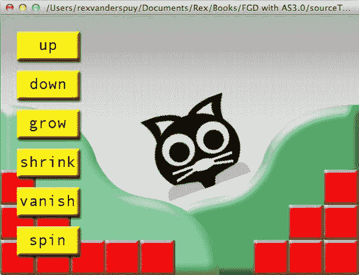

**图 3-1.** 用按钮控制游戏角色。

### 但我有点害怕编程！

尽管本章会介绍很多重要的编程理论，但你最需要掌握的核心内容是：你在 ActionScript 编辑窗口中输入的编程代码如何改变舞台上对象的行为。理论固然重要，但如果你一时不能完全理解，也不必担心。这些知识需要大量练习才能深入掌握。我们将通过许多实际示例来学习，你也会有很多机会来实践新技能。慢慢来，在感觉准备好之前不要急于求成。

正如任何司机都应该对汽车引擎的工作原理有个大致了解一样，如果你只是想开车，并不需要成为机械工程师。如果你以后对代码的某些细节有具体疑问，随时可以回头查阅这些理论。只要你大致理解输入的代码如何影响舞台上的对象，并能自信地在项目中使用这些代码，你就已经胜券在握。

请始终牢记，编程是一种帮助你表达自我的创造性工具，就像画笔之于艺术家。它可以帮助创作绘画，但如果没有艺术家的想象力——也就是你——它便毫无用处。

本章实际上分为两个部分。第一部分，我将教你如何从文件中加载图像并在 Flash Player 中显示它们。第二部分，我将教你如何对对象进行编程，让它们活起来。

那么，我们如何获取在第 2 章中创建的图像，并在 Flash Player 中显示它们呢？

### 加载和显示图像

在开始任何编程之前，我们先来看看需要解决的问题。

在你的电脑上的某个位置，有一些 `PNG` 文件，你想在 Flash Player 窗口中显示它们。我们如何将它们从所在的文件夹中提取到 Flash Player 中？图 3-2 展示了我们的难题。

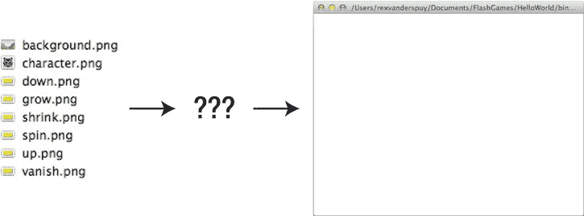

**图 3-2.** 如何将图像文件加载到 Flash Player 中？

这实际上是一个四步问题：

首先，我们需要知道图像在电脑上的存储位置，并获取其地址。

接着，你需要将图像的地址发送给一个称为`加载器`的东西。加载器是一个临时容器，它利用地址从电脑上的任何位置将文件加载到你的程序中。

图像进入加载器后，下一步是将其复制到一个 `Sprite` 中。还记得精灵吗？我们在第 1 章中简单讨论过它们。精灵能够创造游戏魔法，它们将成为你游戏的核心。你可以把精灵看作一个包含图像的盒子，它知道如何与游戏的其他部分通信。当图像被复制到 `Sprite` 中后，你可以为其附加 `AS3.0` 编程代码，从而完全控制它在 Flash Player 中的行为。

最后一步是将该 `Sprite` 添加到`舞台`上。舞台就是你看到的空白 Flash Player 窗口。舞台是所有动作发生的地方。只有将游戏精灵添加到舞台上，你才能看到它们。

所以，首先你需要获取图像的地址，用加载器检索图像，将其复制到 `Sprite` 中，最后添加到舞台。接下来，我们将用 `AS3.0` 代码完成所有这些步骤。图 3-3 说明了这个基本概念。

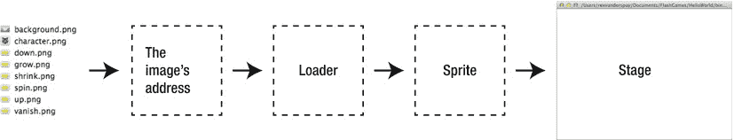

**图 3-3.** 在 Flash Player 中加载和显示图像的一般过程

> **注意：** 本书大部分项目将使用 `Sprite` 对象，但你也应该知道还有另外两种选择。图像加载后，你还可以将其复制到 `MovieClip` 或 `Bitmap` 中。本书不会涉及 `Bitmap` 对象，但你可以在下载章节“使用 Flash Professional 并发布你的游戏”中了解 `MovieClip` 对象的所有内容。`MovieClip` 对象与 `Sprite` 对象完全相同，唯一区别在于前者可以包含预先规划好的动画场景。

#### 设置新的 AS3.0 项目

在开始编程之前，我们将创建一个新的 `AS3.0` 项目，并将我们在第 2 章中创建的图像文件复制到其项目目录中。

在你的 IDE（Flash Builder 或 Flash Develop）中创建一个新的 ActionScript 项目，并将其命名为“GameWorld”。如果你对如何创建 `AS3.0` 项目还有些模糊，请回顾一下第 1 章。如果你使用的是 Flash Builder，你的项目目录将类似于图 3-4。

*注意：另外，如果你使用的是 Flash Builder，你可以从本章的源文件中导入 `GameWorldSetup` 文件夹。该文件夹包含了我们将用于启动此项目的基础设置文件，其中包括所有示例图像。要导入项目到 Flash Builder，请从 Flash Builder 的主菜单中选择 `File`  `Import Flash Builder Project`。在打开的新窗口中选择 `Project folder`。浏览到该文件夹，选中它，然后点击 `Open` 按钮。在导入窗口中点击 `Finish` 以加载项目。*

*但是，请抵制这种诱惑！在你当前的学习阶段，你需要通过系统地手动键入代码来练习。这是深入理解代码并与之建立联系的最佳方式。此外，在键入代码时你肯定会犯一些小错误，你需要了解这些错误是什么以及如何修复它们。*

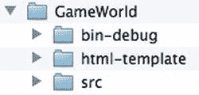

**图 3-4.** 使用 Flash Builder 创建新 ActionScript 项目时的默认项目目录

在 `GameWorld` 文件夹中，创建一个名为 `images` 的新子文件夹。将你在第 2 章中制作的所有 PNG 文件复制到这个新的 `images` 文件夹中。你的 `GameWorld` 项目文件夹现在应该看起来像图 3-5。请注意，你的 PNG 图像文件必须与此处显示的命名完全一致，否则后续步骤将无法进行。

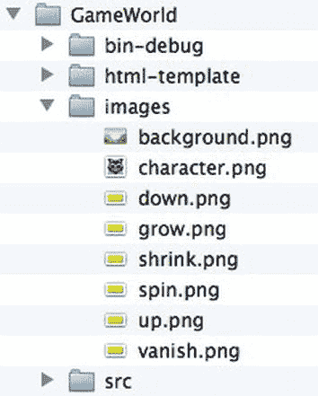

**图 3-5.** 创建一个 `images` 文件夹并将 PNG 文件复制到其中。

我们现在准备开始添加一些程序代码。这段初始代码的任务只是用一些基本设置来初始化程序，以便我们能够开始工作。你现在可能还无法理解其中的任何内容，但再过几页你就会明白了。先盲目地输入代码，我会在后面解释一切。

将以下代码复制到 ActionScript 编辑器窗口中。

```as3
package
{
  import flash.net.URLRequest;
  import flash.display.Loader;
  import flash.display.Sprite;
  import flash.events.MouseEvent;

  [SWF(width="550", height="400",
    backgroundColor="#FFFFFF", frameRate="60")]

  public class GameWorld extends Sprite
  {
    public function GameWorld()
    {
      trace("This is the game world!");
    }
  }
}
```

确认你的编辑器窗口看起来像图 3-6。

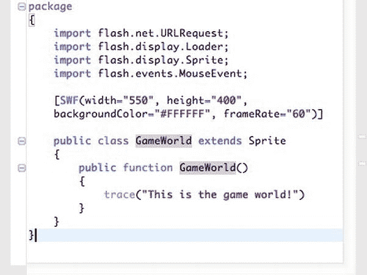

**图 3-6.** 程序的起始部分

编译程序。在 Flash Builder 中，这意味着点击调试按钮（如果你使用的是 Flash Develop，请选择 `Project`  `Test Movie`）。你应该会看到一个空白的 Flash Player 窗口以及跟踪消息“This is the game world!”。如果你没有看到此消息或收到了一些错误信息，请仔细检查你是否打错了任何内容，并将你的工作与本章源文件中 `GameWorldSetup` 项目文件夹内的文件进行比对。

我们现在准备为程序添加核心内容。但在此之前，让我们先了解这些新增代码的作用。

## 理解设置文件

你会注意到，我们编写的代码与第 1 章中的 `HelloWorld` 程序代码非常相似。你应该能识别出所有主要部分：`package`、加载 `Sprite` 的 `import` 语句、类定义以及构造方法。它们的结构完全相同。唯一的区别是，我在 `package` 代码块中插入了一些新代码。这些代码很重要，并且在本书的许多项目中你都会用到，所以我们来看看它的作用。

### import 语句

你从第 1 章中应该记得，`import` 语句用于从库中加载代码。这个库是一个巨大的、海量的预编写代码仓库，是 Flex SDK 的一部分。如果你的程序需要执行特定任务，你可以导入这些代码片段中的任何一个来使用。这些“代码片段”被称为`类`。你总能通过其名称以大写字母开头来识别一个类。我们在第 1 章中编写的 `HelloWorld` 程序就是一个类，而我们正在本章编写的 `GameWorld` 程序也是一个类。

我们的程序导入了四个类：

```as3
import flash.net.URLRequest;
import flash.display.Loader;
import flash.display.Sprite;
import flash.events.MouseEvent;
```

最后面的 `Sprite`、`Loader`、`URLRequest` 和 `MouseEvent` 就是这些类的名称。你永远不会看到这些类本身，也不需要看到。它们被无形地导入到你的程序中，并在后台运行。你只需要知道你想使用的类的名称。别担心，我会随时告知你它们具体是什么以及何时需要它们。你很快就会开始识别出这些“常客”。

在类名前面，是用点连接起来的词语，比如 `flash.display` 和 `flash.events`。这些是库中存放这些类的文件夹。

这些 `import` 语句的顺序可以任意。

我们可以看到，我们的程序将导入四个类。它们的作用如下：

*   `Sprite`：容器，帮助你在舞台上控制和显示图像。

*   `Loader`：一个临时容器，负责从你的项目目录将图像加载到 AS3.0 程序中。

*   `URLRequest`：理解你计算机上的目录位置，例如 `../images/background.png`。

*   `MouseEvent`：允许你使用鼠标与游戏对象交互的代码。

我们在本章中将要编写的所有代码都需要这些类的帮助。

### 使用元数据标签设置 Flash Player

你可能会注意到，编译程序时，会打开一个空白的 Flash Player 窗口。这个 Flash Player 窗口具有一些你可以控制的属性。例如，你想让它有多大？它的背景颜色应该是什么？它应该以多快的频率更新动画显示？所有这些属性（以及更多其他属性）都通过一个`元数据标签`来控制。在我们的程序中，它看起来像这样：

```actionscript
[SWF(width="550", height="400",
  backgroundColor="#FFFFFF", frameRate="60")]
```

这段代码创建了一个宽 550 像素、高 400 像素的 Flash Player 窗口。它用白色背景填充 Flash Player 窗口，并以每秒 60 帧的速度更新画面。

元数据标签用方括号括起来，像这样：

`[Anything inside these square brackets is metadata]`

在这个例子中，元数据标签描述了你程序编译后所创建的 SWF 文件的属性。所有 SWF 属性及其赋予的值都包含在内部圆括号中。

`[SWF(set all the swf file properties here)]`

请仔细查看这个元数据标签。你能看出它设置了哪四个属性吗？它们分别是：

-   `width`：Flash Player 窗口的宽度，单位为像素。

-   `height`：Flash Player 窗口的高度，单位为像素。

-   `backgroundColor`：Flash Player 窗口的背景颜色。你在这里看到的奇怪字符串 `#FFFFFF` 是一个`十六进制`颜色代码。十六进制代码是一种使用字母和数字组合来描述颜色的标准化方法。`#FFFFFF` 是白色的代码。它告诉 SWF 文件在 Flash Player 启动时显示白色背景。

在网上搜索“十六进制颜色表”可以得到一份包含各种颜色及其对应十六进制代码的详尽列表，你也可以在我们第 2 章提到的 Photoshop 调色板中找到它们。以下是一些常见颜色的代码：

-   黑色：`#000000`

-   白色：`#FFFFFF`

-   红色：`#FF0000`

-   蓝色：`#0000FF`

-   绿色：`#00FF00`

-   黄色：`#FFFF00`

-   橙色：`#FF9900`

-   紫色：`#CC33FF`

> **注意：** 你可以将黑色简写为 `#000`，白色简写为 `#FFF`。如果十六进制代码中的所有 6 个字符都相同，那么你只需要使用前 3 个字符。

# SWF 元数据与加载图片

## frameRate 属性

`frameRate`：SWF 显示更新的频率。“60”表示每秒更新 60 次，也就是**每秒帧数** (fps)。这决定了动画显示的流畅度。对于你的游戏来说，30 到 60 之间的任何数字都能带来流畅的动画效果。更高的帧率会让你的电脑处理器在显示游戏动画时更费力一些，但画面效果会更好。对于 Flash 游戏来说，60 帧/秒的效果很棒，并且对 CPU 的负担也不算太大。

尝试对元数据标签做一些修改，你会立刻在 Flash Player 中看到效果。尝试修改元数据标签中加粗显示的属性值：

```actionscript
[SWF(width="100", height="200",
backgroundColor="#000", frameRate="60")]
```

再次编译程序，你会看到 Flash Player 现在只有 100 像素宽、200 像素高，并且填充了黑色背景，如图 3-7 所示。完成后，记得将其改回原始值。

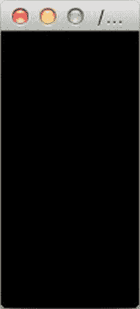

**图 3-7.** 使用元数据标签更改 Flash Player 中运行的 SWF 属性。

为什么我们把宽度和高度属性设置为 550 和 400？因为这与我们在第 2 章中创建的 `background.png` 图片文件的尺寸完全相同。当然，你可以为你的游戏使用任何你想要的宽度和高度。

元数据标签还可以用于将图片、声音和字体嵌入到游戏中，我们将在本书后面介绍其中一些用途。然而，我们刚刚介绍的这个 SWF 元数据标签将是我们编写所有程序的标准配置，你可能不需要更改它的任何属性。

> **请务必确保 SWF 元数据标签紧跟在 `import` 语句之后，并且正好在类定义之前。这是它在程序中唯一能正常工作的位置。**

## 加载并显示 `background.png` 图片

现在，我们准备将第一张图片 `background.png` 加载到程序中。让我们向程序添加新代码，看看它是否有效。我将在后续页面中解释代码的每个细节。

将以下加粗文本添加到 `GameWorld.as` 文件中（完成后，你的 ActionScript 编辑器窗口将如图 3-8 所示。请注意，原来的 `trace` 指令已被删除。）：

```actionscript
package
{
  import flash.net.URLRequest;
  import flash.display.Loader;
  import flash.display.Sprite;
  import flash.events.MouseEvent;

  [SWF(width="550", height="400",
    backgroundColor="#FFFFFF", frameRate="60")]

  public class GameWorld extends Sprite
  {
    //声明我们需要的变量
    public var backgroundURL:URLRequest;
    public var backgroundLoader:Loader;
    public var background:Sprite;

    public function GameWorld()
    {
      //将背景添加到舞台
      backgroundURL = new URLRequest();
      backgroundLoader = new Loader();
      background = new Sprite();

      backgroundURL.url = "../images/background.png";
      backgroundLoader.load(backgroundURL);
      background.addChild(backgroundLoader);
      stage.addChild(background);
    }
  }
}
```

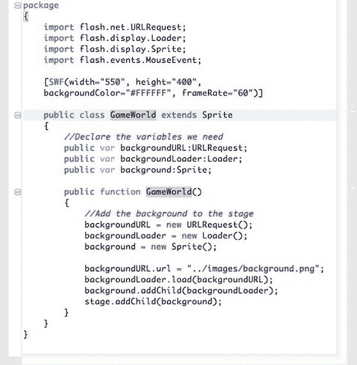

**图 3-8.** 向程序添加新代码。

> **请记住，任何以双斜杠 `//` 开头的代码行都是注释。它们不是程序的一部分，只是关于代码功能的说明。你不必在程序中包含注释——它们完全不影响程序的运行。**

编译程序。如果 `background.png` 文件位于项目目录中的正确文件夹内，并且你已完全按照此处显示的代码进行复制，你将看到 Flash Player 打开并显示背景图片，如图 3-9 所示。

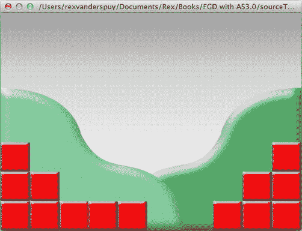

**图 3-9.** 程序加载并显示背景图片。

> **如果在编译此代码时收到任何错误消息，请参考第 1 章中关于调试代码的部分，以了解可能出错的原因。在此项目中，你可能会收到一条特别奇怪的错误消息：**
>
> `SecurityError: Error #2000: No active security context.`
>
> **这完全不是一条有用的错误消息！但我可以确切地告诉你它的含义：你拼错了文件名，或者错误地输入了指向 `background.png` 文件或其他某个图片文件的路径。**

## 这是如何工作的？

到目前为止我们使用的程序格式与第 1 章中 `HelloWorld` 程序使用的格式完全相同。如果你认为对这段代码的基本结构有任何不理解的地方，请参考该章节。这里有许多你以前从未见过的代码行，我将详细介绍它们的工作原理。

### 创建精灵和加载器对象

在本章开头，我解释了为了将计算机文件夹中的图像加载到程序中，我们需要三样东西：

- 我们需要知道图像文件的位置。
- 我们需要一个加载器将其加载到程序中。
- 我们需要一个精灵来通过编程代码控制图像。

这正是我们新代码的前几行为程序所做的准备。

第一行创建了一个叫做**变量**的东西。这就是这行代码的作用。变量的名称是：

`backgroundURL`

`public var backgroundURL:URLRequest;`

`backgroundURL`将承担一项特殊任务，即告诉程序在你的计算机上哪里可以找到`background.png`文件。

*URL 代表统一资源定位符。是的，我知道这完全是个毫无意义的短语，但你会在各处看到它，所以你需要学会它。它仅仅意味着“到哪里去找文件”。它可以是一个硬盘上的文件路径，也可以是一个网站地址。你经常会看到网站地址被称为 URL。*

代码接下来创建了另一个变量，叫做`backgroundLoader`。

`public var backgroundLoader:Loader;`

`backgroundLoader`将是我们的加载器对象。它会将图像从计算机文件夹中的位置加载到程序中。

然后代码创建了第三个变量，叫做`background`。

`public var background:Sprite;`

`background`将是我们的精灵对象。我们在程序中将要进行的所有有趣操作都将围绕这个对象展开。

我们还没有真正创建这些对象，只是告诉程序我们已经创建了将存储它们的变量。

仔细看这三行代码，你会发现它们的结构是相同的。还要注意这三行都以分号结尾。这意味着它们*执行某些操作*。执行某些操作的编程代码被称为指令（我们在第 1 章中讨论过指令）。你可以通过是否以分号结尾来判断它是否为指令。

用编程术语来说，这些指令被称为**变量声明**。我们已经创建了三个**变量**：

`backgroundLoader`

`background`

`backgroundURL`

图 3-10 详细说明了变量声明的结构。

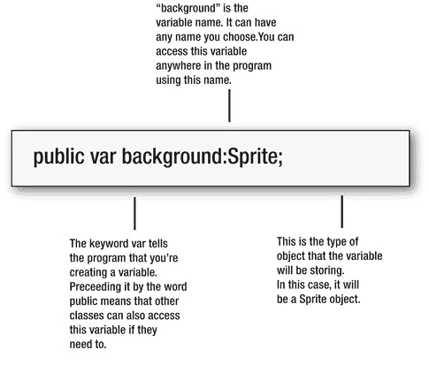

**图 3-10.** 变量声明

哇，一下子要吸收这么多内容！而且，变量到底是什么？

让我们稍作休息，了解一下变量是什么以及如何使用它们。

### 变量

你可以把**变量**想象成存储信息的小盒子。每个盒子都有自己的名字，并存储不同类型的信息。

图 3-11 展示了三个虚构的变量：`score`、`name`和`enemy`。每个变量名都与一个包含信息的盒子相关联。

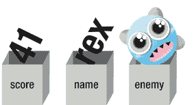

**图 3-11.** 变量就像存储信息的盒子。

如果你需要使用盒子里的信息，只需在程序中的任何地方引用盒子的名称即可。例如，如果你想了解当前分数，使用变量名`score`；程序会将其解释为 41。如果你想引用敌人精灵，使用单词`enemy`。

你还可以随时清空盒子并放入新信息。这就是“可变”的含义！

变量就是这样：带有名称的存储容器。

### 变量类型

如果你要整理许多装满不同类型物品的小盒子，有时了解每个盒子应该包含什么**类型**的信息会很有用。想象一下你有一个糖罐，却不小心把一袋盐倒进去了。当阿姨们来喝茶时，这可能会出问题！你需要确保你装填的是糖罐。

在 AS3.0 中，你可以告诉变量它应该存储什么类型的信息。为此，使用冒号后跟类型名称，如下所示：

`:Sugar`

如果你的厨房存在于 AS3.0 的宇宙中，你可以像这样标记橱柜里的容器：

`smallBluePlasticTub:Sugar; glassJar:Salt;`

这种标记可以防止你把错误的东西放进错误的容器，从而毁了茶话会。妈妈会为你感到骄傲的！

图 3-12 展示了你为变量分配类型后，它们可能的样子。这可以防止你将错误类型的物品放入错误的容器中。（在 AS3.0 中，任何由字母组成的信息被称为`字符串`，即“一串字母或单词”。）

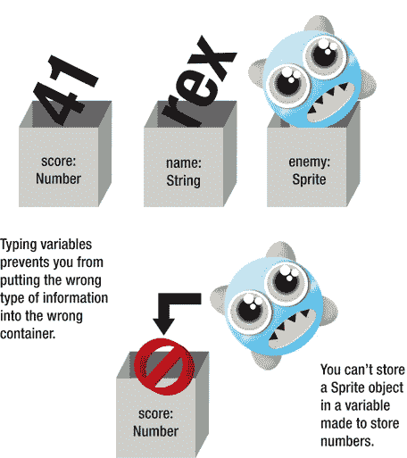

**图 3-12.** 为变量分配类型，这样就不会将错误类型的信息或对象放入错误的容器中。

### 创建空盒子

让我们快速回顾一下我们最初的三行新代码：

`public var backgroundLoader:Loader;`

`public var background:Sprite;`

`public var backgroundURL:URLRequest;`

现在它们对你来说是否更清晰了一些？

这些指令正在创建名为`backgroundLoader`、`background`和`backgroundURL`的空存储容器。

这些存储容器在哪里？它们正空置在程序中，等待我们向里面填充内容。如果你能看到它们，它们看起来会有点像图 3-13。

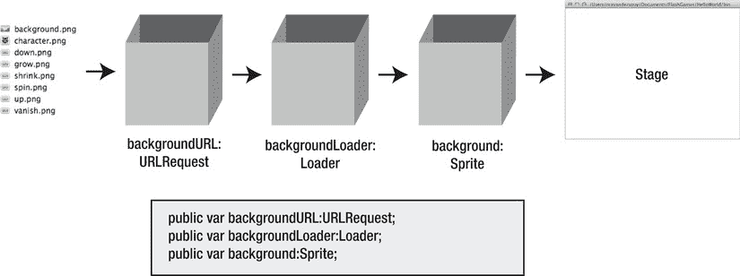

**图 3-13.** 三个等待填充内容的空盒子

让我们往这些盒子里放点东西吧！

### 创建实例与对象

到目前为止，我们的代码创建了三个空变量。下一步就是往这些"箱子"里填充有用的东西。我们要用对象来填充它们。这正是接下来的三个 `new` 指令所做的事：

```
backgroundURL = new URLRequest();
backgroundLoader = new Loader();
background = new Sprite();
```

现在，我们的空变量不再为空；它们被来自我们导入的三个类的程序代码填满了。它们变成了有用的对象。对象是编程元素，是类的副本，我们可以通过程序代码来控制它们。

等等，在弄糊涂之前，我们先退一步想想！

请记住，类是库中预先编写好的程序代码的名称。你看不到那段程序代码，也不想看到它，你只需要知道它的类名就能使用它。我们的程序导入了四个类：`URLRequest`、`Loader`、`Sprite` 和 `MouseEvent`。这四个类都包含我们程序中需要使用到的专用代码。

同样，请记住，你总能识别出一个类，因为它的首字母是大写的。你能在上面的代码行中看到我们导入的三个类的名称吗？你应该能看到！等号右边是类，左边是变量。图 3-14 说明了这一点。

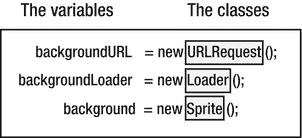

**图 3-14.** 通过类创建新对象

过程是这样的：类被从库中复制出来，其代码被放入变量中。变量中装满了类所包含的所有专用代码，从而赋予了它们源类所拥有的全部能力。“复制”的另一种说法是“创建实例”。AS3.0 的术语中，*实例* 指的是任何包含类副本的变量。

这三个变量现在变成了它们所源自类的*实例*。例如，`background` 变量现在是一个 `Sprite` 实例，而 `backgroundLoader` 变量现在是一个 `Loader` 实例。

这三行代码都包含了关键字 `new`。`new` 关键字的职责是“创建类的一个新实例”。

变量名后面紧跟的是等号。等号的职责是将类的新实例赋值给变量。

*在继续深入之前，让我们仔细看看这个等号的确切用途。在 AS3.0 中，等号被称为`赋值运算符`，因为它用于将等号右边的值赋给左边的变量。这与数学中等号的使用方式截然不同，这种差异常常让新手程序员犯糊涂。在数学中，等号表示“等于”。在编程中，等号表示“获取……的值”。*

*这里有一个非常简单的例子。假设你有一个变量，想在游戏中用来跟踪玩家的得分。我们就叫它 `playersScore`。假设游戏中某个玩家得了 12 分，你想要游戏记住这个数字，以便判断玩家表现如何。你可以用等号将数字 12 复制到 `playersScore` 变量中，就像你把重要数字记在笔记本上供日后参考一样。代码可能看起来像这样：*

```
playersScore = 12;
```

*AS3.0 会直接将其解释为：“`playersScore` 变量获取值 12。” 现在，每当程序看到 `playersScore` 变量时，就会亮起一盏小灯，并想：“啊哈！那意味着 12！”*

图 3-15 精确地说明了这个过程是如何工作的。

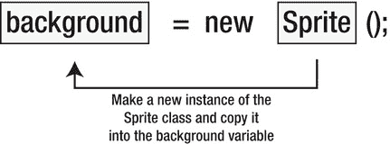

**图 3-15.** 使用 `new` 关键字创建类的实例

归根结底，我们的三个空变量不再为空。它们充满了我们可以在程序中访问的程序代码。

- `backgroundURL` 中装满了 `URLRequest` 类的一个副本。

- `backgroundLoader` 中装满了 `Loader` 类的一个副本。

- `background` 中装满了 `Sprite` 类的一个副本。

图 3-16 展示了这些变量现在被填充了什么内容。

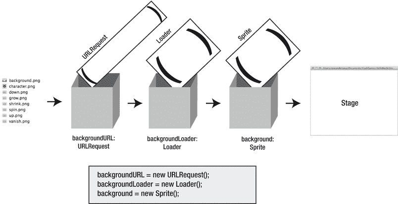

**图 3-16.** 变量现在是类的实例。它们变成了对象。

这个过程的结果是，我们的变量被转换成了对象。对象是类的实例（副本），你可以通过程序代码来定位它。对象是使用 AS3.0 编程的核心。

*对象还是变量？*

*请记住，变量只是一个空盒子。当类的实例被复制到其中时，它就变成了一个对象。这就像毛毛虫变成蝴蝶一样。*

*所有对象最初都是不起眼的变量，但并非所有变量都会变成对象。在本节中，我将使用`变量`这个名称来指代任何包含单一项普通数据的东西。以下是一些例子：*

```
playersScore = 14;
name = "Player's name";
```

*这些是用于存储单个信息片段的简单容器。*

*我将使用`对象`这个名称来指代任何使用 `new` 关键字创建的复杂事物。以下是一些例子：*

```
background = new Sprite();
button = new SimpleButton();
```

*当你看到 `new` 关键字时，你就知道我在创建一个对象。*

*（从纯粹的技术角度来看，AS3.0 程序中的一切都是对象。从概念上讲，当你进入更高级的编程时，了解这一点很重要，但在你学习阶段，先不要纠结于这个不一致之处，因为它只会让你更困惑。）*

你可能会好奇类名后面的空括号是做什么用的。它们的存在是为了在创建实例时，提供类完成其工作所需的任何额外细节。从图 3-16 中可以看到，它们完全是空的。我们接下来会看到如何用有用的信息来填充括号。

### 在舞台上显示图像

到目前为止，我们的代码创建了三个空变量并将它们转换为对象。现在我们可以利用这些对象在舞台上显示背景图像。接下来的三行代码将完成这项工作。

```
backgroundURL.url = "../images/background.png";
backgroundLoader.load(backgroundURL);
background.addChild(backgroundLoader);
```

第一行新代码告诉 `backgroundURL` 对象在项目目录中哪里可以找到 `background.png` 文件。你可以看到对象名称后面跟着“.url”（如下高亮所示）

```
backgroundURL.url = "../images/background.png";
```

点号表示 `url` 是 `backgroundURL` 的一个`属性`。`url` 的作用是存储文件的位置。在这个例子中，它存储了在你的计算机上查找 `background.png` 文件的位置。引号中的文本 `"../images/background.png"` 通过等号被复制到这个 `url` 属性中。我们将在后续页面中详细讨论*属性*究竟是什么意思。但现在，你可以把它想象成对象内部用于存储特定信息的一个容器。`url` 属性就像是 `backgroundURL` 对象内部的一个储物柜，它知道图像的位置地址。

图 3-17 精确地说明了这行代码是如何工作的，以及我们的程序是如何开始填充有用信息的。

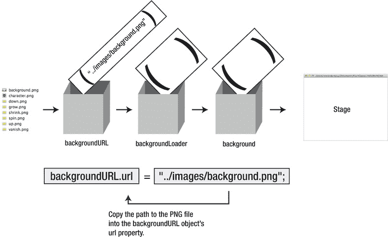

**图 3-17.** 告诉程序在哪里找到图像文件。

*如果你不熟悉文件路径名，这段文本可能会让你感到困惑：*

*`../images/background.png`*

*这是你文件的位置；也就是 URL。*

*如果你把它分解成几个部分，就更容易理解了。最后一部分是图像文件的名称——也就是我们要加载的图像：*

*`background.png`*

*很简单！*

*在此之前是存放它的文件夹名称：*

*`images/`*

*正斜杠表示这是一个文件夹。*

我们的程序还需要知道在哪里找到 `images` 文件夹。这就是以下字符的作用：

`../`

两个点和一条正斜杠告诉程序在当前目录的上一级目录中查找 `images` 文件夹。这是什么意思呢？

图像是由编译程序时创建的 SWF 文件加载的。在这个例子中，它是位于 `bin-debug` 文件夹中的 `GameWorld.swf` 文件。如果我们尝试使用以下路径名查找文件，是找不到的：

`images/background.png`

这是因为程序会在 SWF 文件运行的文件夹内部查找 `images` 文件夹，也就是在 `bin-debug` 文件夹内。而 `images` 文件夹并不在 `bin-debug` 文件夹内部，而是在它的上一级。因此，我们必须告诉程序在当前目录的上一级目录中查找 `images` 文件夹。这就是 `../` 的含义：“检查上一层目录”。

图 3-18 展示了这是如何工作的。

务必牢记，如果你改变了 SWF 文件的位置，也必须相应地移动 `images` 文件夹，否则你的图像将无法加载，并且会收到一条错误信息：“No active Security context”（没有活动的安全上下文）。这仅仅意味着 SWF 找不到这些图像。

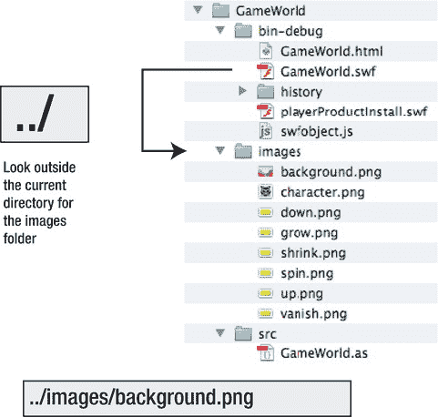

**图 3-18.** `"../"` 告诉程序在 SWF 文件运行文件夹的上一级目录中查找 `images` 文件夹

下一行代码使用了 `backgroundURL` 所包含的文件位置，并将其发送给加载器对象。

```
backgroundLoader.load(backgroundURL);
```

记住，`backgroundLoader` 是 `Loader` 的一种类型。它是一个 `Loader` 对象。`Loader` 对象的工作是加载东西。它通过紧随点号后的关键词 `load` 来完成这项任务（如下高亮所示）：

```
backgroundLoader.load(backgroundURL);
```

`load` 就是所谓的`方法`。方法是帮助对象执行动作的操作。在这个例子中，`load` 方法将我们在 `backgroundURL` 中指定的图像加载到 `backgroundLoader` 中。方法通常后面跟着括号，并且它们对括号内的任何信息进行操作。括号内的任何内容都被称为该方法的`参数`。我们很快就会详细探讨什么是方法以及它们是如何工作的。现在，你只需要知道 `load` 方法已将 `backgroundURL` 加载到了 `backgroundLoader` 中。图 3-19 说明了这行代码的作用。

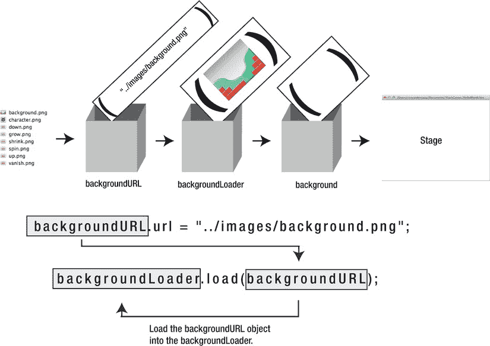

**图 3-19.** 将图像路径加载到 `backgroundLoader` 中。

我们在本书中之前见过一个方法。你还记得第 1 章中的这行代码吗？

`trace("Hello World! Can you read this?");`

`trace` 就是一个方法。它使用其后括号内的文字在控制台窗口中显示该文本。寻找后面跟着括号的小写单词，你就找到了一个方法！

`backgroundLoader` 是一个用于存放你想加载到程序中的文件的临时存储容器。这是加载文件的必要步骤，但它本身并没有太大用处。让我们通过将图像文件添加到我们的背景精灵中来使其更有用。

```
background.addChild(backgroundLoader);
```

`background` 是一个 `Sprite` 对象。`Sprite` 对象是你实际上可以在舞台上看到的东西。你在游戏中编写的大部分程序都将涉及控制 `Sprite` 对象。你可以把 `Sprite` 想象成一个包含图像并在舞台上移动的盒子。

`Sprite` 对象有一个叫做 `addChild` 的方法。如果你把 `Sprite` 想象成一个保护性的父级，那么每当你使用 `addChild` 时，你就是在给这个 `Sprite` 一个需要照看的东西。在这个例子中，`addChild` 将 `backgroundLoader` 的内容添加到了 `background` 这个 `Sprite` 中。`backgroundLoader` 的内容是什么？就是我们的图像。图 3-20 说明了这行代码是如何工作的。

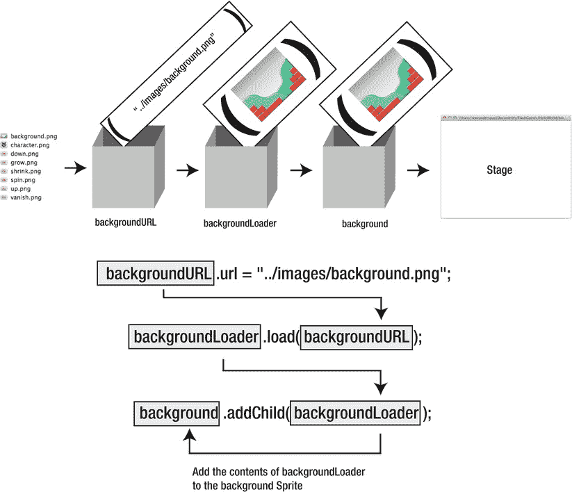

**图 3-20.** 使用 `addChild` 方法将加载器中的图像添加到 `background` 精灵中。

图像现在安全地处于 `background` 精灵对象的父级保护之下，但我们还不能在舞台上看到它。这就是我们编写的最后一行新代码的工作：

```
stage.addChild(background);
```

AS3.0 有一个名为 `stage` 的内置对象。每当你使用 `stage.addChild()` 方法时，括号内的任何内容都会显示在舞台上（只要它是一个 `Sprite`、`MovieClip` 或 `Bitmap` 对象）。

在这行代码中，`addChild` 所做的是获取 `background` 精灵对象，并将其添加到所谓的`显示列表`中。任何在显示列表上的实例在舞台上都是可见的。现在我们可以看到我们的背景图像了……耶！图 3-21 展示了在我们这个小跳蛙游戏中，这最后一道障碍如何最终呈现出一个可见的图像。

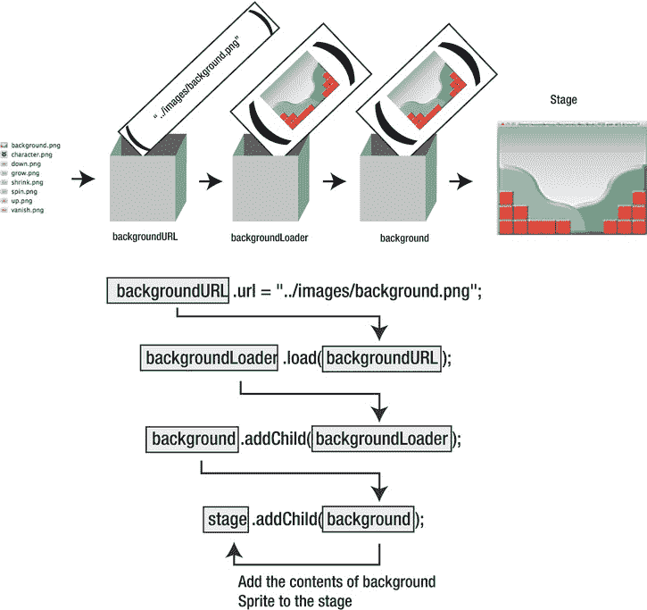

**图 3-21.** 在最后一步，使用 `addChild` 将 `background` 精灵中的图像添加到舞台。

从图 3-21 中你可以看到，这实际上只是将图像从一个对象传递到下一个对象，直到它最终出现在舞台上。在本章稍后的部分，我将向你展示一些快捷方式，可以将其中一些步骤合并起来，从而让你少打很多字。但现在，请先掌握这个体系，因为它清楚地揭示了变量如何变成对象，以及对象又如何被用来实现各种功能的基本机制。

## 理解代码结构

我们编写这段代码所使用的结构与第一章 `HelloWorld` 项目中使用的结构完全相同。所有的代码块都在这里：`package`（包）、`class`（类）定义以及 `constructor`（构造器）方法。我们一直在向这个结构中编写代码。请仔细审视你目前已编写的代码，看看是否能识别出这个结构。

我们已经将特定的代码片段写入了特定的代码块中。如果你理解了其中的原因，程序对你来说就会变得更有意义。以下是每个代码块应该包含的内容：

- **`package` 代码块**：`import`（导入）语句和 SWF 元标签。这是程序运行所需的基本配置。

- **`class` 定义代码块**：在这里声明你的变量和对象。这些都是你将要创建并希望在程序中使用的所有事物。

- **`constructor` 方法代码块**：在这里创建并执行一些操作来设置你的游戏。所有有趣的事情都从这里开始！

我们将在程序中添加更多代码块，但它们都将建立在**这个基本结构**之上。事实上，你编写的每一个 AS3.0 游戏和程序都将使用这个基本结构。如图 3-22 所示。

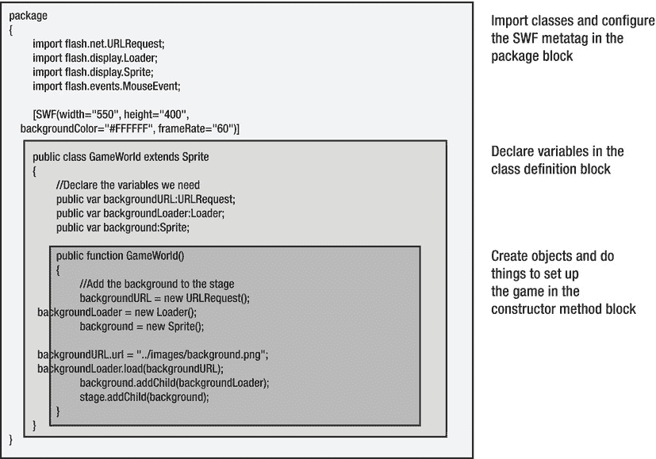

**图 3-22**。一个 AS3.0 程序的基本结构

## 在舞台上定位精灵

我们总共有七张图片需要添加到舞台上。我们将使用完全相同的模式来添加剩余的图片。接下来，让我们添加游戏角色。

请仔细在类定义中，紧接在我们之前编写的代码之后，添加以下加粗的代码行：

```
public class GameWorld extends Sprite
{
  //声明我们需要的变量
  public var backgroundURL:URLRequest;
  public var backgroundLoader:Loader;
  public var background:Sprite;

  //角色
  public var characterURL:URLRequest;
  public var characterLoader:Loader;
  public var character:Sprite;
  public function GameWorld()
  {...
```

现在，在构造器方法中，紧接在上一节添加的代码之后，添加这些新的加粗代码行。

# 理解对象的 `x` 和 `y` 位置

你应该能看到这段代码与我们用于显示背景的代码完全相同。其功能是相同的。唯一的区别是变量名和图像的文件路径。我只是将所有名称中的 "background" 替换成了 "character"。

编译程序，你应该会看到你的游戏角色现在出现在 Flash Player 窗口的左上角，如图 3-23 所示。

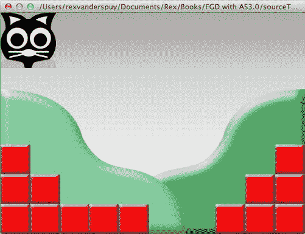

图 3-23。将游戏角色添加到舞台。

当你向舞台添加对象时，最后添加的对象总是显示在最先添加的对象之上。这称为`堆叠顺序`，你将在第 9 章中学到更多关于如何控制它的知识。

我的猫咪角色坐在那里看起来相当可爱，但让我们使用一些 AS3.0 代码将它移动到舞台中央。

舞台高 550 像素，宽 400 像素。我们知道这一点，因为这些是我们输入到 SWF 元标签中的值。

```
[SWF(width="550", height="400",
backgroundColor="#FFFFFF", frameRate="60")]
```

这意味着舞台实际上只是一个 550x400 的像素网格。左上角是位置 0。当你向舞台添加一个 `Sprite`（精灵）时，它总是将其添加到位置 0，如图 3-24 所示。

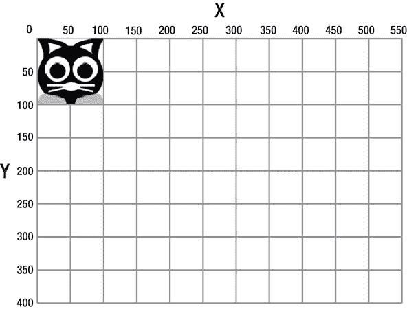

图 3-24。舞台是一个像素网格。

网格上的水平位置称为 `X`，垂直位置称为 `Y`。你可以通过引用其 `x` 和 `y` 坐标来引用网格上的任何位置。例如，如果你想引用网格的正中心，可以这样描述：

```
x = 275
y = 200
```

图 3-25 对此进行了说明。

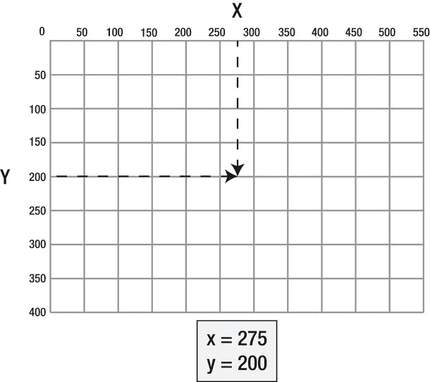

图 3-25。使用 `x` 和 `y` 坐标描述网格上的任意点。

我们可以通过编写如下代码将角色移动到舞台中央：

```
character.x = 275;
character.y = 200;
```

`Sprite` 对象具有名为 `x` 和 `y` 的属性。你分配给这些属性的任何数字都会将 `Sprite` 移动到舞台上该坐标处。图 3-26 展示了如果我们使用上述代码，角色在舞台上的位置。

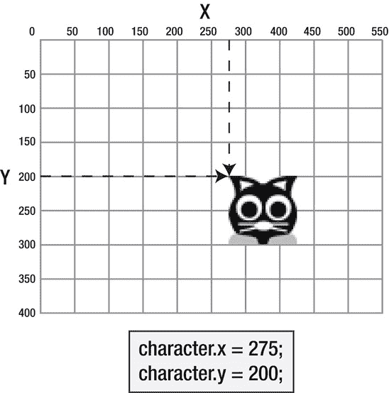

图 3-26。使用 `x` 和 `y` 属性定位 `Sprite` 对象。

但角色居中了吗？完全没有！这是因为 `Sprite` 对象是从其左上角开始移动的。这被称为`注册点`。

如果你想让精灵居中，必须从 `x` 和 `y` 坐标中减去其宽度的一半和高度的一半。

我们知道角色 `Sprite` 高 100 像素，宽 100 像素（这正是我们在第 2 章中制作的图像大小。）这意味着如果我们希望角色完全居中于舞台中央，必须从 `x` 位置减去 50，并从 `y` 位置减去 50。我们使用的代码看起来像这样：

```
character.x = 225;
character.y = 150;
```

图 3-27 显示了这些 `x` 和 `y` 位置将使角色精确居中于舞台。

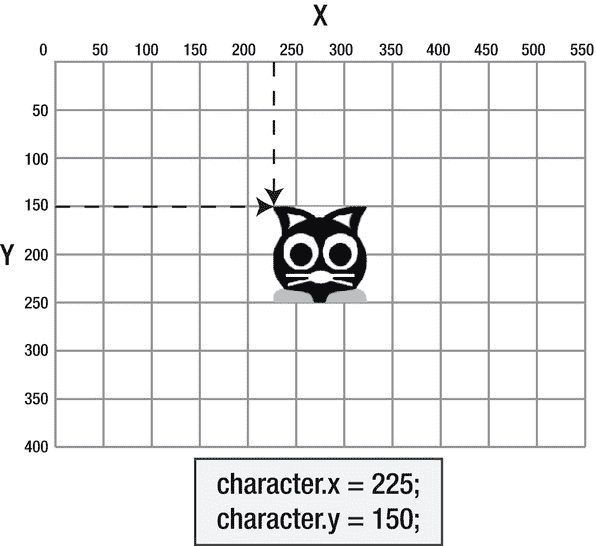

图 3-27。使用 `x` 和 `y` 属性定位 `Sprite` 对象。

现在让我们使用这段代码，在我们的 `GameWorld` 程序中实际地将角色居中于舞台。

直接在您刚编写的新代码之后，输入以下加粗的代码。

```
characterURL.url = "../images/character.png";
characterLoader.load(characterURL);
character.addChild(characterLoader);
stage.addChild(character);

character.x = 225;
character.y = 150;
```

编译代码，你将看到角色精确地居中于舞台，如图 3-28 所示。

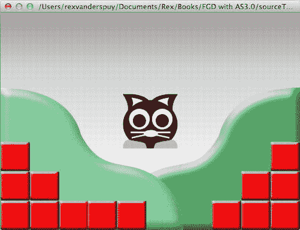

图 3-28。角色在舞台上居中。

现在让我们使用这些新技术，沿着舞台左侧加载、显示并定位这些按钮。

# 显示和定位按钮

接下来，我们需要加载六个按钮并定位它们。只需重复相同的代码模式，但将“background”和“character”替换为以下按钮名称：“`upButton`”、“`downButton`”、“`growButton`”、“`shrinkButton`”、“`vanishButton`”和“`spinButton`”。

我们先一起添加上移按钮，然后由你自行添加其余按钮。

在类定义中现有代码之后，添加以下加粗的新代码。

```
public class GameWorld extends Sprite
{
  //声明所需变量
  public var backgroundURL:URLRequest;
  public var backgroundLoader:Loader;
  public var background:Sprite;

  //角色
  public var characterURL:URLRequest;
  public var characterLoader:Loader;
  public var character:Sprite;

  //upButton
  public var upButtonURL:URLRequest;
  public var upButtonLoader:Loader;
  public var upButton:Sprite;

  public function GameWorld()
  {...}
```

接下来，在构造函数方法中添加以下加粗的新代码。将其直接添加到你编写的用于设置角色 `x` 和 `y` 属性的代码之后。我列出了整个构造函数方法块，以便你能在正确的上下文中看到所有代码。

```
public function GameWorld()
{
  //将背景添加到舞台
  backgroundURL = new URLRequest();
  backgroundLoader = new Loader();
  background = new Sprite();

  backgroundURL.url = "../images/background.png";
  backgroundLoader.load(backgroundURL);
  background.addChild(backgroundLoader);
  stage.addChild(background);

  //将角色添加到舞台
  characterURL = new URLRequest();
  characterLoader = new Loader();
  character = new Sprite();

  characterURL.url = "../images/character.png";
  characterLoader.load(characterURL);
  character.addChild(characterLoader);
  stage.addChild(character);

  character.x = 225;
  character.y = 150;
}
```

# 按钮编程

本项目的下一步是对按钮进行编程，以便通过点击按钮来控制游戏角色。但在深入具体操作方法之前，让我们先退一步，审视一下你将编写的代码背后的一些基本原理。这些内容并不难，但你会接触到许多新概念，需要快速吸收。你需要将它们分解成可管理的部分，逐一学习。

所以，倒上一杯印度香料奶茶，舒舒服服地坐在沙发上。暂时放下编程，详细了解一下以下主题：

- 点语法

- 方法

- 事件侦听器

这三个元素将协同作用于你将编写的新代码中。

*下一节包含大量理论内容，但均为可选阅读。你可能会发现，只需卷起袖子，看看这些概念在实际编程中是如何运作的，反而能理解得更好。可以考虑直接跳到“让按钮生效”一节，那里将把这些理论付诸实践。如果之后觉得需要更深入地了解代码的运行机制，随时可以再回到本节。*

*学习编程就是编写一点代码并观察效果。不要让理论或技术术语拖累或困扰你！如果感到困惑，不妨直接开始处理本书下一个实践项目，并仔细留意你的代码产生的效果。这是最好的学习方法。*

## 理解点语法

你可能一直好奇，在编写过的代码片段之间出现的那些点究竟有什么具体作用。这些点有三个主要功能。

首先，它们可以告诉你任何给定对象的层级关系。例如，看看下面这个你见过多次的 `import` 语句：

`import flash.display.Sprite;`

这些点表明 `Sprite` 是 `display` 的一部分，而 `display` 又是 `flash` 的一部分。这就是描述如何在库中找到 `Sprite` 类的层级关系。

这些点还能帮助你访问对象的**属性**。属性是关于对象的特定信息，例如其大小、颜色或位置。我们刚刚看到，可以通过更改 `character` 对象的 `x` 和 `y` 属性将其定位在舞台上。你可以通过以下方式引用 `x` 和 `y` 属性：

`character.x`

`character.y`

点用于表明 `x` 和 `y` *属于* `character` 对象。本章稍后我们将详细介绍属性。

最后，点可以表明对象正在使用方法执行特定任务。下面是我们刚编写过的代码中的一个示例：

`stage.addChild(character);`

这个点表明 `stage` 对象正在使用 `addChild` 方法使角色显示出来。

这种使用点来访问对象及其属性和方法的系统称为**点语法**。它是 ActionScript 3.0 及其相关编程语言（如 C++ 和 Java）的关键特性。

## 方法

到目前为止，我在本书中已经多次提及方法，但在深入之前，我们应详细了解一下它们究竟是什么以及如何运作的。

方法在程序中执行某种有用的操作。它们由两部分组成：

- **函数定义**：这一部分是一段代码块，包含执行所需任务的指令。

- **方法调用**：这一部分是一个单词，用于激活函数定义中的指令。

让我们仔细看看这两个要素。

### 使用方法调用

到目前为止，你已经在这本书中看到过三种方法调用：`trace`、`addChild` 和 `load`。以下是它们的使用方式：

`trace("Hello World!");`

`stage.addChild(background);`

`backgroundLoader.load(backgroundURL);`

我们程序中发生的一切有趣的事情，到目前为止都归功于方法调用。

方法调用的一个优点在于，你无需知道它们实际如何工作就能使用它们。你知道 `trace` 究竟如何显示文本，或者 `addChild` 如何将 `Sprite` 放到舞台上吗？你当然不知道——你只需要知道如何使用它来获得你想要的结果。方法实际完成这项工作的方式是其**函数定义**的一部分，我们稍后将讨论函数定义。

你总能识别出方法调用，因为它的名称后面总是跟着括号。括号内的内容是方法完成其工作所需的额外信息。在编程术语中，这些额外信息被称为**参数**。参数就是括号中的内容。

以下是一个 `trace` 方法调用的示例：

`trace("Wow! This is an argument!");`

括号内引号中的文本就是该方法调用的参数。另一个示例如下：

`stage.addChild(character);`

这并不意外。你之前见过这个！`addChild()` 是方法调用，而 `character` 是方法的参数。任何作为 `addChild` 方法参数提供的 `Sprite` 对象名称都会显示在舞台上。

关键字 `stage` 和方法名之前的点告诉我们，这是一个属于 `stage` 的方法。舞台正在使用该方法来完成其工作。

有些方法不需要参数就能完成工作。没有参数的方法调用只需使用空括号。示例如下：

`simpleMethod();`

即使这个方法调用没有参数，你仍然需要提供空括号。

### 使用函数定义

```actionscript
public function GameWorld()
{
  //向舞台添加背景
  backgroundURL = new URLRequest();
  backgroundLoader = new Loader();
  background = new Sprite();

  backgroundURL.url = "../images/background.png";
  backgroundLoader.load(backgroundURL);
  background.addChild(backgroundLoader);
  stage.addChild(background);

  //向舞台添加角色
  characterURL = new URLRequest();
  characterLoader = new Loader();
  character = new Sprite();
  characterURL.url = "../images/character.png";
  characterLoader.load(characterURL);
  character.addChild(characterLoader);
  stage.addChild(character);
  character.x = 225;
  character.y = 150;

  //添加上移按钮
  upButtonURL = new URLRequest();
  upButtonLoader = new Loader();
  upButton = new Sprite();
  upButtonURL.url = "../images/up.png";
  upButtonLoader.load(upButtonURL);
  upButton.addChild(upButtonLoader);
  stage.addChild(upButton);
  upButton.x = 25;
  upButton.y = 25;
}
```

编译程序，你会看到上移按钮位于舞台左上角附近，如图 3-29 所示。

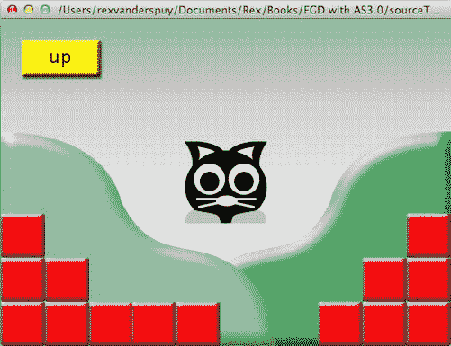

**图 3-29**。将上移按钮添加到舞台。

按照完全相同的方式，将剩余的 5 个按钮添加到舞台。最终效果应如图 3-30 所示。

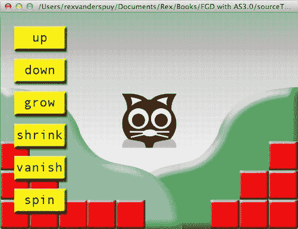

**图 3-30**。将所有按钮添加到舞台。

以下是正确对齐按钮所需的 `x` 和 `y` 位置：

```
downButton.x = 25;
downButton.y = 85;

growButton.x = 25;
growButton.y = 145;

shrinkButton.x = 25;
shrinkButton.y = 205;

vanishButton.x = 25;
vanishButton.y = 265;

spinButton.x = 25;
spinButton.y = 325;
```

你将会进行大量的输入，但这是学习过程中重要的一环。你需要直观地感受逐字逐句键入 ActionScript 3.0 代码的过程，从而培养与它的内在熟悉感。你还需了解自己在编写代码时会犯哪些类型的错误。每次为新按钮添加代码后，都要编译程序以确保一切运行正常。尽早发现错误至关重要。

在接下来的两章中，你将学习一些新的快捷方法和技巧，它们将大幅减少加载图片所需的代码量——仅为我们这里所用代码的一小部分。但通过本章中这种较为繁琐的方式，我们揭示了变量使用、类运用和对象创建的基本原理。制作游戏需要掌握这些知识。

如果你对编写的代码有任何疑问，本章末尾提供了完整的代码清单。你也可以从本章的源文件中下载名为 `GameWorldLoadedImages` 的项目文件夹。截至当前节点的所有代码都在该文件夹中。

除了一个例外，到目前为止本书中使用的所有方法都已内置于 AS3.0 语言中。（唯一的例外是在 `HelloWorld` 和 `GameWorld` 项目中创建的构造函数方法。构造函数方法是一种用于初始化类的特殊函数定义。）你很幸运，因为这些内置方法非常有用，为你节省了一些工作。然而，作为一名程序员，你可以创建自己的方法。如果你的程序需要执行任何特定的任务，你可以创建一个专门完成该任务的方法。

要创建自己的方法，你需要定义它。以下是定义方法的基本格式：

```
public function methodName():void
{
  //在此处添加指令
}
```

这被称为`函数定义`。函数定义是块语句，你可以通过它们由一对花括号构成这一特点来识别。正如我们在第 1 章中所学，花括号形成了一段代码“块”。花括号内的任何代码都是该块的一部分。程序是通过组合使用许多这样的块来构建的。

函数定义以关键字 `function` 开头，后跟方法名，然后是括号。如果方法调用不使用任何参数（额外信息），则括号为空。如果方法调用使用参数，则括号内必须包含一个`参数`（稍后你将了解如何使用方法参数）。

括号之后是`类型声明`，它是一个冒号，后跟一个描述该方法可能返回给程序其余部分的信息类型的词。你之前见过类型。还记得这些吗？

`:Sugar`

`:Salt`

`:Sprite`

方法也需要包含类型。然而，许多方法不需要向程序的其余部分返回任何信息，因此它们的类型是无关紧要的。要指定一个方法不返回任何信息，你可以指定返回类型为 `void`。如下所示：

`:void`

在你被所有这些新信息搞得不知所措之前，花点时间看一下图 3-31 和图 3-32，熟悉方法调用的样子以及函数定义的结构。

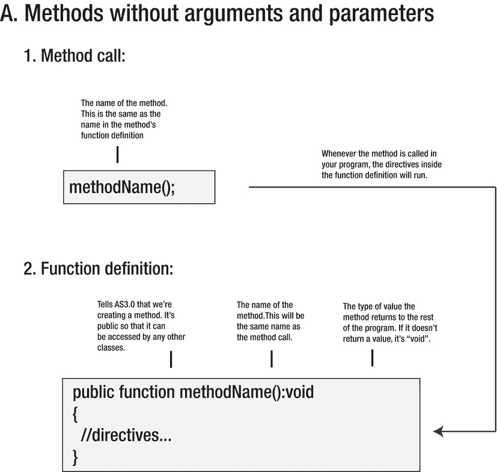

**图 3-31**. 基本方法的格式

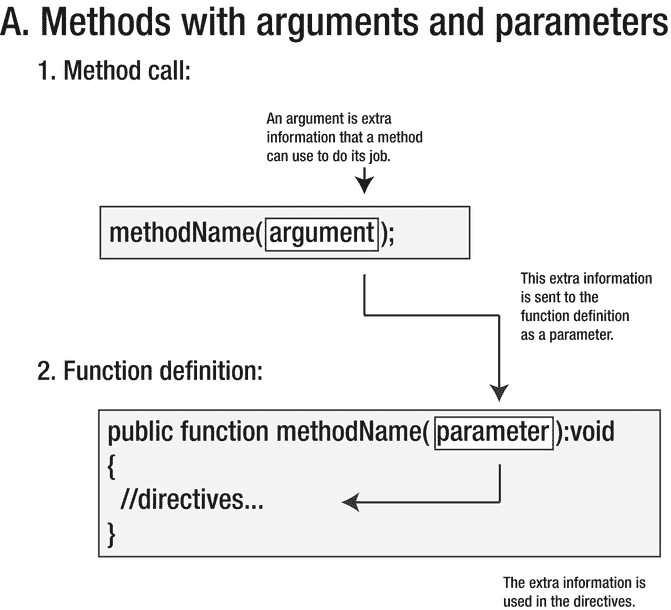

**图 3-32**. 使用参数提供的额外信息的方法的格式

### 使用一个基本方法

让我们看看如何在程序中使用一个非常简单的例子。

创建一个新的 AS3.0 项目，并在编辑器窗口中输入以下代码：

```
package
{
  import flash.display.Sprite;

  public class MethodWithoutParameters extends Sprite
  {
    public function MethodWithoutParameters()
    {
      displayText();
    }

    public function displayText():void
    {
      trace("This is text from the function definition");
    }
  }
}
```

编译该程序，你将看到显示以下跟踪信息：

`This is text from the function definition`

该程序的结构非常重要。方法调用 `displayText()` 位于程序的构造函数块内。原因在于，构造函数方法内的任何内容都在程序首次启动时立即运行。`displayText` 函数定义紧跟构造函数块之后。通过图解更容易看清这一点，请查看图 3-33，它展示了程序块是如何组织的。

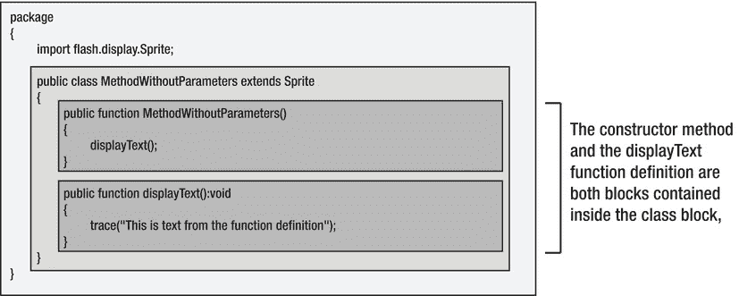

**图 3-33**. `displayText` 函数定义是类块的一部分。

图 3-34 说明了方法调用和函数定义如何协同工作来显示文本。

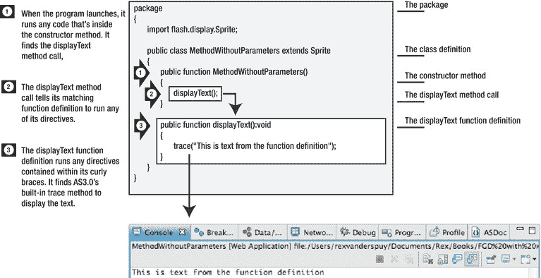

**图 3-34**. `displayText` 方法如何工作

始终牢记，方法是两部分系统：你必须创建一个函数定义来定义方法，然后需要一个方法调用来使用它。你可以在本章源文件中的 `MethodWithoutParameters` 项目文件夹中找到该程序的工作示例。

### 创建方法的参数与形参

简单的 `displayText` 方法运行得相当不错，但它有一个局限性——它显示的文字始终是固定的。如果你能让这个方法每次被调用时都能传入新的文字来显示，那岂不是更好？

当然可以！新的方法调用可能像这样：

`displayText("你可以在这里写下任何你喜欢的文字！");`

现在的调用中包含了`实参（argument）`。这个实参就是你想要显示的文本。

为了显示这段文本，你需要使用`形参（parameter）` 重写函数定义。形参就是一个用于存储新信息的变量。这个变量可以在函数定义中的任何位置使用，以访问方法调用发送过来的信息。

这其实非常简单，来看一下：

```
public function displayText(textYouWantToDisplay:String):void
{
  trace(textYouWantToDisplay);
}
```

如果你在程序中使用这个方法并运行它，就会看到这条消息：“你可以在这里写下任何你喜欢的文字！”

让我们用一个简单程序来测试一下。

创建一个名为 `MethodWithParameters` 的 AS3.0 项目。

在编辑器窗口中输入以下代码：

```
package
{
  import flash.display.Sprite;

  public class MethodWithParameters extends Sprite
  {
    public function MethodWithParameters()
    {
      displayText("你可以在这里写下任何你喜欢的文字！");
    }

    public function displayText(textYouWantToDisplay:String):void
    {
      trace(textYouWantToDisplay);
    }
  }
}
```

编译程序，你会看到以下跟踪消息：

`你可以在这里写下任何你喜欢的文字！`

现在看看我们的方法变得多么灵活。将 `displayText` 方法调用改为以下内容：

`displayText("这是一段新的文本");`

再次编译程序，你会看到：

`这是一段新的文本`

这个系统的美妙之处在于，你只需要编写一次函数定义。只需改变方法调用实参中的文字，就能改变方法显示的文字。例如，你可以使用以下任何方法调用，跟踪输出都会随之改变：

`displayText("所有这些文字");`

`displayText("可以随时按你想要的方式更改");`

`displayText("而无需修改函数定义");`

这让方法变得非常通用。理解的关键在于：

- 方法调用实参中的文字被发送到函数定义。

- 函数定义将该文字存储在一个变量中。该变量名称由形参提供。在本例中，变量名是 `textYouWantToDisplay`。

每当你在函数定义中使用 `textYouWantToDisplay` 时，它都会被替换为方法调用实参中提供的文字。图 3-35 展示了这一切是如何工作的。

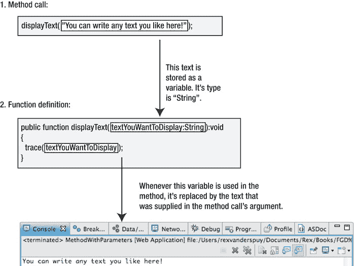

**图 3-35**。基本方法的格式

*注：你会发现变量 `textYouWantToDisplay` 被指定为 `String` 类型。`String` 变量是包含文本的变量。我们将在第 4 章中详细讨论它们。*

你可以在本章源文件的 `MethodWithParameters` 文件夹中找到这个可运行的示例程序。

### 使用多个实参与形参

方法可以使用多个实参或形参。使用多个形参的函数定义如下所示：

```
public function methodName (valueOne:Type,  valueTwo:Type):void
{
  //指令...
}
```

形参只需要在括号内用逗号分隔即可。

如果函数定义使用了多个形参，方法调用也需要发送相同数量的实参。以下是包含两个实参的方法调用示例：

`methodName(argumentOne,  argumentTwo);`

你只需用逗号分隔实参即可。你可以用同样的方式创建任意数量形参的方法。

*在编程生涯的某个时刻，你可能需要调用一个方法，但事先不知道需要多少个参数。假设你有一个方法需要记录去杂货店购买的物品，而你永远不知道会买多少件。今天你可能有 3 件物品，像这样：*

*`methodName (itemOne,  itemTwo,  itemThree);`*

*明天你可能有 5 件物品，像这样：*

*`methodName (itemOne,  itemTwo,  itemThree,  itemFour,  itemFive);`*

*为了避免编写两个不同的函数定义，你可以创建一个方法，将接收到的实参存储在一个数组中。我将在第 9 章中介绍数组，所以你或许只需将这些信息存档以备将来参考。函数定义将如下所示：*

```
# 理解方法与事件

```actionscript
function methodName (...itemArray):void
{
  //指令…
}
```

所有实参都作为元素存储在一个名为 `itemArray` 的数组中。参数名前的三个点表示该参数是一个数组，而不是一个变量。（目前，你可以把数组想象成可以存储大量变量的大文件柜。）

如果你是编程新手，在真正掌握这些内容之前，你需要多练习使用方法并查看不同的示例。别担心！在接下来的章节和篇幅中，我会给你提供大量的练习机会。没有人能一开始就完全理解方法。只要把这章放在手边，并尝试本章源文件中的一些示例程序即可。你会在本书中看到许多方法的实际应用示例，并逐渐习惯使用它们。

## 理解事件与事件侦听器

事件是程序中发生的各种情况。你通常会乐于让程序中的大多数事件自动处理，无需费心关注细节。但有些事件（比如按钮点击）你需要了解，以便指定在它们发生时执行特定操作。

AS3.0 允许你为对象附加事件侦听器。事件侦听器会“侦听”程序中发生的事件。当事件发生时，侦听器会触发相应的操作指令。你可以把事件侦听器想象成一只极其聪明且爱吠叫的小狗。你训练它不仅在遇到入侵者时狂吠，还能在吠叫的同时拨打警察局的电话，并向电话那头的警官报出你家地址。多么聪明的小狗！而你在 AS3.0 中通过事件侦听器就能拥有这样一只小狗。

创建事件侦听器分为三个步骤。你需要按以下步骤设置并在程序中使用它们：

1.  从 Flash 的 `events` 包中导入一个事件类。

2.  通过调用 AS3.0 内置的 `addEventListener` 方法，为对象添加一个事件侦听器。该方法的调用包含多个参数，例如要侦听的事件类型以及事件发生时要执行的操作。

3.  创建一个事件处理函数，这是一个专门的函数定义，用于告诉程序事件发生时该做什么。它“处理”该事件。事件处理函数包含一个特殊参数，允许它接收一个事件对象，该对象提供了关于所发生事件的相当多的信息。你可以在程序中使用这些信息。

理解事件侦听器工作原理的最佳方式是观察一个实际运行的例子。让我们编写一个简单的程序，展示一个你能创建的最基本的事件侦听器。

创建一个名为 `EventListener` 的新 AS3.0 项目。

在代码编辑器中输入以下程序：

```actionscript
package
{
  import flash.display.Sprite;
  import flash.events.MouseEvent;

  public class EventListener extends Sprite
  {
    public function EventListener()
    {
      stage.addEventListener(MouseEvent.CLICK, clickHandler);
    }
    public function clickHandler(event:MouseEvent):void
    {
      trace("You clicked on the stage");
    }
  }
}
```

编译程序。用鼠标点击空白的 Flash Player 窗口。每次点击时，你都会看到屏幕上显示“You clicked on the stage”这条跟踪信息。

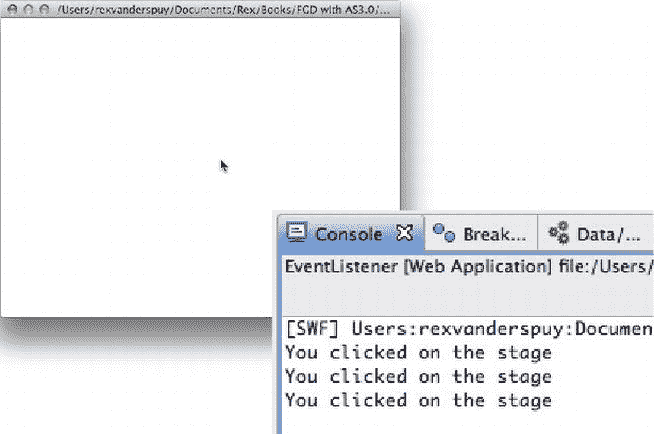

**图 3-36**。每次点击舞台时，你都会看到显示跟踪信息。

让我们来看看这个程序是如何工作的。

### 导入事件类

要使用事件侦听器，首先要导入 AS3.0 的一个事件类。在本书中，你将最常使用 `MouseEvent` 和 `KeyboardEvent` 类，尽管还有很多其他类。`MouseEvent` 类的 `import` 语句如下所示：

```actionscript
import flash.events.MouseEvent;
```

一旦导入，你就可以用它来了解鼠标正在做什么，比如点击事物或在舞台上移动。

### 添加事件侦听器

下一步是添加一个事件侦听器，用于检测鼠标何时被点击。

```actionscript
stage.addEventListener(MouseEvent.CLICK, clickHandler);
```

事件侦听器通常被添加到对象上。“stage”和“addEventListener”之间的点表示该侦听器已连接到舞台。

让我们把这个指令分解成更小的部分。最重要的是这个方法调用：

```actionscript
addEventListener
```

这是对 AS3.0 内置方法之一的调用。它用于注册事件，以便侦听器可以开始其工作。

在最基本的情况下，`addEventListener` 方法调用接受两个参数：

```actionscript
(MouseEvent.CLICK, clickHandler)
```

第一个参数是你要侦听的事件类型。在本例中，你正在侦听鼠标点击。描述要侦听的事件类型的格式是使用导入的事件类名，后跟一个点，然后是你感兴趣的事件：

```actionscript
MouseEvent.CLICK
```

你要侦听的事件类型是 `CLICK` 事件。我相信你能猜到，它侦听的是鼠标点击。（事件名称总是用大写字母书写。）

事件名称用大写书写的*原因*是它们实际上是一种称为**常量**的编程元素。常量总是用大写字母书写，这是它们遵循的命名约定。（你将在第 9 章中了解如何使用常量。）`CLICK` 常量内置于 AS3.0 的 `MouseEvent` 类中。

第二个参数是事件发生时你要调用的函数定义。我们的示例程序使用了这个：

```actionscript
clickHandler
```

这是事件处理函数的名称。它的名称必须与包含你希望在鼠标按钮被点击时运行的指令的函数定义的名称完全匹配。

### 使用事件处理器

以下是在示例程序中事件处理器的模样：

```actionscript
public function clickHandler(event:MouseEvent):void
{
  trace("You clicked on the stage");
}
```

它与你之前在方法章节中看到的函数定义完全一样。然而，事件处理器有两个独特之处，使其有别于普通的函数定义。

第一个区别在于命名。按照惯例，事件处理器的名称总是以单词 *handler* 结尾。程序员选择给事件处理器起类似 `clickHandler`、`moveHandler` 或 `someOtherKindOfEvnetHandler` 这样的名称，以便在其他函数定义中易于识别。你也可以随意为事件处理器起任何你喜欢的名字，但如果遵循这个惯例，你的工作会稍微轻松一些。本书的剩余部分都将遵循这一惯例。

第二个区别在于函数定义的参数：

`(event:MouseEvent)`

事件处理器必须声明一个特殊的事件变量，并且该变量的类型必须与发生的事件类型相同，例如 `MouseEvent`。

这个事件变量是什么？它实际上是当事件发生时，由 AS3.0 自动创建的一个对象。其工作原理如下：

想象一下用鼠标点击舞台。一旦发生点击，就会触发一个 `CLICK` 事件。AS3.0 将这个 `CLICK` 事件发送给所谓的**事件调度器**。（你不需要了解事件调度器的太多细节，只需知道它有点像在你程序中徘徊，监听事件的微型软件机器人。但你永远不会直接看到它或与它交互。）一旦它听到你告诉它要监听的事件，它就会拿出一个笔记本，记录下关于该事件的大量信息。例如，如果你点击了一个按钮，它可以告诉你点击的按钮名称以及点击发生在舞台上的哪个位置。所有这些信息被封装成一个**事件对象**，并发送给事件处理器（即为响应事件发生而编程运行的函数定义）。然而，事件处理器必须创建一个变量作为其参数来接收这个事件对象。即使你可能实际上不需要在函数定义中使用这个事件对象，AS3.0 也要求你创建一个变量作为参数来容纳它。

那么这个事件对象包含哪些信息呢？你可以使用 `trace` 来显示其内容来一探究竟。你可以修改示例函数定义，使其看起来像这样：

```actionscript
public function clickHandler(event:MouseEvent):void
{
  trace(event);
}
```

现在，如果你再次编译程序，然后点击舞台，你会看到类似这样的跟踪消息：

```
[MouseEvent type="click" bubbles=true cancelable=false eventPhase=2 localX=360 localY=139
stageX=360 stageY=139 relatedObject=null ctrlKey=false altKey=false shiftKey=false
buttonDown=false delta=0]
```

信息量真大！其中一些信息可能非常有用，尽管对于我们现在要做的事情来说并非必需。在本书后面，你将学习如何访问这些信息并在你的游戏中使用它们。

你可以使用点语法访问所有这些信息。你只需要使用事件对象的名称，后跟一个点，再跟上你需要访问的事件对象的属性。基于前面的例子，你可以使用以下代码来找出鼠标点击舞台处的 `x` 位置：

```actionscript
function onClick(event:MouseEvent):void
{
  trace(event.stageX);
}
```

如果舞台上有其他对象，你可以使用 `target` 属性找出被点击对象的名称。使用 `event.target` 将返回你所点击对象的名称：

```
function onClick(event:MouseEvent):void
{
  trace(event.target);
}
```

如果在示例代码中使用它，它将输出以下内容：

```
[object Stage]
```

这就是舞台。

很快你就会看到，我们将如何使用事件监听器来编程控制游戏角色的按钮。

图 3-37 给出了这个示例程序如何工作的总体概述。

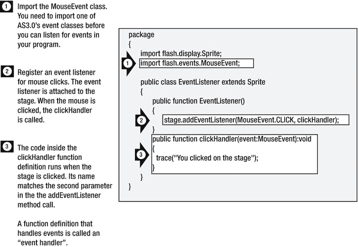

**图 3-37.** 一个演示事件监听器的简单程序

## 了解其他事件

这个示例向你展示了如何使用 `MouseEvent` 类中的 `CLICK` 事件。`MouseEvent` 类包含许多其他你肯定会用到的事件。表 3-1 显示了事件名称及其功能。

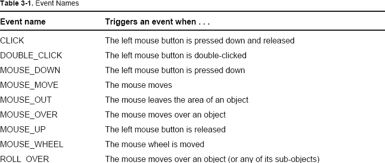


这些事件中的许多不适用于你在示例中使用的舞台对象，但它们都适用于 `Sprite` 对象。以下是一些如何使用 `addEventListener` 注册这些事件的示例：

```
addEventListener(MouseEvent.ROLL_OVER, onRollOver);
addEventListener(MouseEvent.ROLL_OUT, onRollOut);
addEventListener(MouseEvent.MOUSE_MOVE, onMouseMove);
```

图 3-38 展示了创建事件监听器的基本模型以及事件发生时发生的情况。

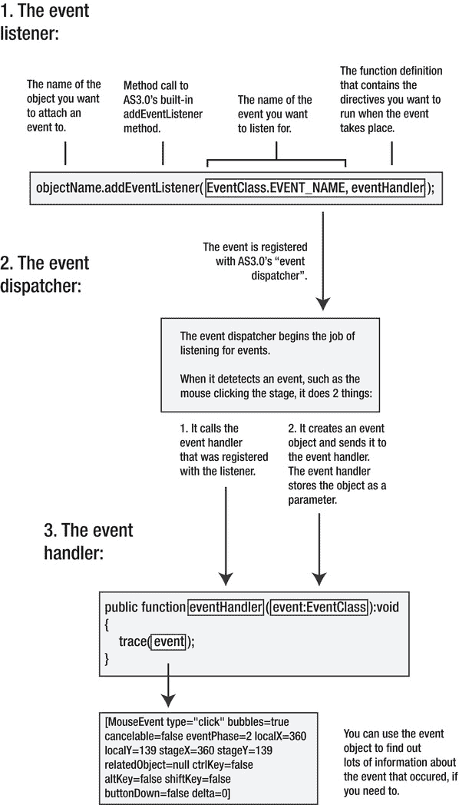

**图 3-38.** 事件监听器的工作原理

像学习方法一样，在你完全掌握事件监听器的工作原理之前，需要一些实践和更多实用示例。在本书的后续内容中，你将会看到许多事件监听器实际应用的例子，因此你将有很多机会进行实验，并在不同上下文中观察它们的效果。事件监听器的优点在于它们都使用完全相同的格式。你暂时不必完全理解它们工作的每一个细节；你只需要知道如何使用它们来为你的游戏获得想要的结果。

## 让你的按钮工作起来

既然我们已经了解了点表示法、方法和事件监听器，就可以运用这些技巧来为我们的 `GameWorld` 项目中的按钮编写程序了。我们来编写一个向上按钮，当点击它时显示一条消息。

1.  确保 `GameWorld` 项目已打开。

2.  在你之前编写的代码后面，直接添加以下加粗显示的代码。

    *为了节省本书篇幅，我省略了你在类定义中编写的所有变量声明，以及在构造方法中用于创建、显示和定位对象的所有代码。我所有这些代码都用注释代替了，所以你需要小心地将这段新代码插入到你自己项目中的正确位置。如果你对在何处添加这段新代码有任何疑问，请查看本章源文件中的 `GameWorldButtonTest` 文件。它包含了下一步完整的可运行代码。你也会在本章末尾找到该项目完整完成的代码清单。*

    ```
    package
    {
      import flash.display.Loader;
      import flash.display.Sprite;
      import flash.events.MouseEvent;
      import flash.net.URLRequest;

      [SWF(width="550", height="400",
        backgroundColor="#FFFFFF", frameRate="60")]

      public class GameWorld extends Sprite
      {
        //所有变量声明…

        public function GameWorld()
        {
          //所有用于创建、显示和定位对象的代码…

          //添加按钮监听器
          upButton.addEventListener(MouseEvent.CLICK, upButtonHandler);
        }
        public function upButtonHandler(event:MouseEvent):void
        {
          trace("你点击了向上按钮");
        }
      }
    }
    ```

3.  编译程序。程序运行时，点击舞台上的向上按钮。你会看到追踪消息 “你点击了向上按钮。” 图 3-39 显示了你会看到的效果。

    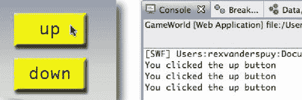

    **图 3-39.** 点击向上按钮来测试你的按钮事件。

到目前为止，这个非常简单的小程序很好地展示了对象、点表示法、方法和事件监听器是如何协同工作的。但它还没有任何真正有趣的功能。要使其真正具有交互性，并将其作为制作游戏的基础，我们需要了解更多关于 `Sprite` 对象以及如何控制它们的内容。

## 使用属性控制 Sprite 对象

使用 AS3.0 进行游戏设计，很大一部分内容就是学习如何控制 `Sprite` 对象。这通常是通过改变 `Sprite` 的属性来实现的。在本章中，我们已经遇到了两个 `Sprite` 属性：`x` 和 `y` 属性。我们学会了如何改变这些属性来定位舞台上的对象。让我们更仔细地看看 `Sprite` 属性是什么，以及你能用它们做什么。

属性是你可以通过代码控制的对象特征。这些特征是什么？它们可以是附加到你所创建对象上的变量。或者，它们可以是属于 `Sprite` 类的一些内置属性。这些内置属性对游戏设计师尤其有用。

`Sprite` 类拥有大量你可以访问、使用，有时甚至修改的属性。但是，对于本书中大多数游戏所需的交互类型，你只需频繁使用少数几个属性。更为难得的是，它们也是用起来非常有趣的属性！表 3-1 列出了这些属性。

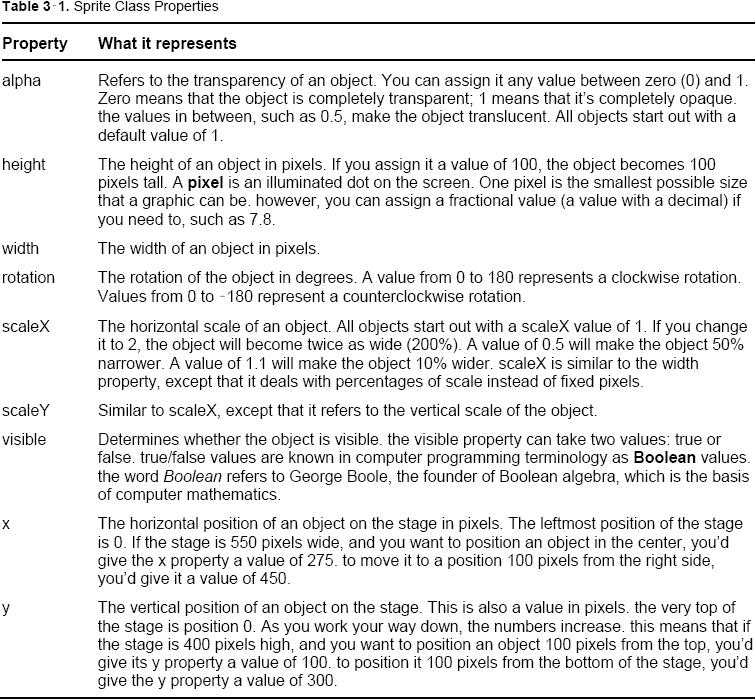

还有一些额外的属性用于在 3D 空间中变换对象。本书中你不会用到它们，但你应该知道它们的存在，并在有机会时尝试使用。虽然它们的主要目的是作为创建 3D 对象和空间的构建块，但你可能会在你的一些游戏中将它们用于特殊效果。表 3-2 展示了你可能想了解的 3D 属性。

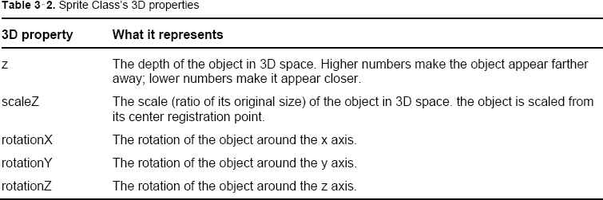

使用所有这些属性可以非常有趣，而且它们很容易使用。在接下来的几节中，我们将在我们的 `GameWorld` 项目中使用它们，将角色对象变成一个交互式玩具。

### 上下移动

我们要做的第一件事是编写向上和向下按钮的程序，使角色在舞台上上下移动。有几种方法可以编写这些按钮的程序。为了确切演示 `x` 和 `y` 属性是如何工作的，以及如何改变它们，我们将从最简单的方法开始，然后稍微修改一下程序，使其效果更逼真一些。

在 `GameWorld.as` 文件中添加或更改以下加粗显示的代码（我们将在下一节中详细了解它的工作原理）：

```
package
{
  import flash.display.Loader;
  import flash.display.Sprite;
  import flash.events.MouseEvent;
  import flash.net.URLRequest;

  [SWF(width="550", height="400",
    backgroundColor="#FFFFFF", frameRate="60")]

  public class GameWorld extends Sprite
  {
    //所有变量声明…

    public function GameWorld()
    {
      //所有用于创建、显示和定位对象的代码…

      //添加按钮监听器
      upButton.addEventListener(MouseEvent.CLICK, upButtonHandler);
      downButton.addEventListener
        (MouseEvent.CLICK, downButtonHandler);
    }
    public function upButtonHandler(event:MouseEvent):void
    {
      character.y = 100;
    }
    public function downButtonHandler(event:MouseEvent):void
    {
      character.y = 200;
    }
  }
}
```

本书中代码示例的最大行宽是 70 个字符。然而，你要编写的许多 AS3.0 代码行会远比这个长得多。为了使这些代码示例易于阅读，而又不必使用令人困惑的换行符，我对长代码行采用了一种简单的格式化系统。

我将在`运算符`处断开长代码行。运算符可以指以下任何字符：`( ) = + - * / || !`

然后我会缩进两个空格，并从该点继续编写代码行。

这是你刚刚编写的程序中的一个示例。下面的代码段太长，无法放入一行：

`downButton.addEventListener(MouseEvent.CLICK, downButtonHandler);`

所以我在左括号处断行，另起一行，缩进两个空格，然后从该点继续代码：

`downButton.addEventListener`

`  (MouseEvent.CLICK, downButtonHandler);`

你如何为代码添加空格或缩进不会影响程序的运行方式。只需记住，分号会始终告诉你指令在哪里结束。

我们将在本书中编写一些非常长的单行代码。我将向你展示一些格式化它们的策略，以便在遇到它们时更容易阅读。

编译程序。点击向上和向下按钮，观察角色在舞台上上下移动。图 3-40 展示了你会看到的效果。

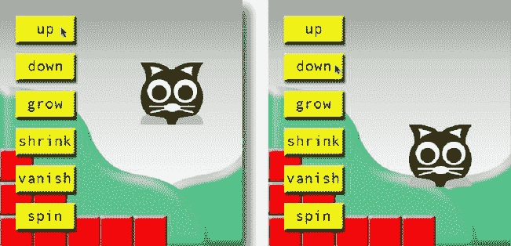

**图 3-40.** 点击按钮使角色在舞台上上下移动。

这太神奇了，不是吗？有趣的是，如此简单的效果看起来却如此令人满足，尤其是在你为这个程序付出了这么多努力之后。

你应该能认出大部分新代码。你为向下按钮创建了一个事件监听器和一个处理函数。你还在按钮事件处理函数中添加了两条指令，以便在点击按钮时改变角色的 `y` 位置属性。

## 逐步移动

按钮已经生效：它们能让我的猫咪角色在舞台上上下移动。但跳跃幅度太大了，而且只能让它在两个位置之间来回移动。如果能以细微、渐进的增量移动角色，并且不受限于两个点，那该多好啊？这样效果会更逼真，玩起猫咪玩具来也更有趣。幸运的是，这很容易实现：

1.  用以下加粗的新文本更新 `upButtonHandler` 和 `downButtonHandler` 中的指令：

    ```
    public function upButtonHandler(event:MouseEvent):void
    {
      character.y = character.y - 15;
    }
    public function downButtonHandler(event:MouseEvent):void
    {
      character.y = character.y + 15;
    }
    ```

2.  编译程序。再次点击向上和向下按钮，现在猫咪会朝任一方向移动 15 像素。好多了！

但这是如何实现的呢？一旦理解了，背后的逻辑其实非常简单。让我们看看 `downButtonHandler` 的指令：

`character.y = character.y + 15;`

这条指令获取猫咪当前的 `y` 位置，加上 15 像素，然后将新的总数重新赋值给猫咪当前的 `y` 位置。可以这样理解：猫咪的新位置是点击按钮前的位置加上 15 像素的组合。你想让猫咪在舞台上向下移动，所以需要*增加*它的 `y` 位置。

我知道，这有点让人脑筋转不过弯！让我们再分解一下。在我的程序中，角色的起始位置是 150 像素。每当程序看到 `character.y` 时，都会将其解释为“150 像素”。你设置了程序，使得每次点击向下按钮时，都会在角色的 y 位置上加 15 像素。这就是指令中加粗部分所做的事情：

`character.y = character.y + 15;`

它只是给猫咪的 y 位置加上了 15，所以猫咪的新 y 位置是 165。因此你实际上可以这样写这条指令：

`character.y = 165;`

真的很简单，不是吗？

下次点击按钮时，发生的情况完全相同，只是此时 `character.y` 的起始值是 165 像素。再次加上 15 像素，新值就变成了 180。每次点击按钮，都会在该位置上再增加 15 像素，结果就是猫咪看起来像是在舞台上逐渐向下移动。

### 追踪输出

为了帮助你理解其工作原理，可以在程序的事件处理函数中添加一条 `trace` 指令：

1.  将以下加粗代码添加到 `upButtonHandler` 和 `downButtonHandler` 中：

    ```
    public function upButtonHandler(event:MouseEvent):void
    {
      character.y = character.y - 15;
      trace(character.y);
    }
    public function downButtonHandler(event:MouseEvent):void
    {
      character.y = character.y + 15;
      trace(character.y);
    }
    ```

2.  再次编译程序。

多次点击向下按钮。每次点击，你都会看到 `character.y` 属性的新值以 `trace` 消息的形式显示出来。虽然你的数字会有所不同，但效果与你在图 3-41 中看到的情况类似。每次点击，数值都会增加 15。

点击向上按钮，随着角色在舞台上向上移动，会产生相反方向的数值。

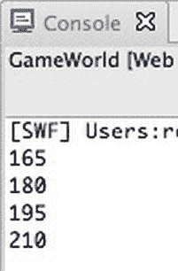

**图 4-41.** 每点击一次向下按钮，角色的 y 位置增加 15 像素。

使用 `trace` 指令是帮助你弄清楚代码正在做什么的好方法，并且在测试和调试本书中的项目时，你会经常使用它。

### 使用递增和递减运算符

有一种稍微更高效的方式来编写这段代码。像你刚才所做的那样增量更新值，是一种非常常见且有用的操作，因此 AS3.0 提供了专门的运算符来为你完成这项工作。

`运算符` 是像 `=`、`-`、`+` 和 `*` 这样的符号，它们对值执行专门的操作，例如赋值、加法或减法。

你将使用的两个新运算符被称为**递增**和**递减**运算符。让我们更新 `upButtonHandler` 和 `downButtonHandler`，以便它们使用这些运算符：

1.  更改 `upButtonHandler` 和 `downButtonHandler`，使其与下面的代码匹配。（我没有包含 `trace` 指令，如果你愿意可以将其删除。保留它们也没问题，不会影响程序的运行。）

    ```
    public function upButtonHandler(event:MouseEvent):void
    {
      character.y -= 15;
    }
    public function downButtonHandler(event:MouseEvent):void
    {
      character.y += 15;
    }
    ```

2.  编译程序，再次点击向上和向下按钮。

程序的功能完全相同，但我通过使用递减运算符简化了代码：

`-=`

以及递增运算符：

`+=`

这些运算符通过将新值重新赋值回原始属性来工作。`-=` 运算符减去该值，`+=` 运算符则加上该值。

递增和递减是游戏设计师的基本工具，所以要习惯使用它们，因为从现在开始你会经常用到它们。

### 限制移动范围

你可能已经注意到，小猫在舞台上可以无限向上或向下移动。实际上，你可以让角色一直移动到舞台顶部，并继续无限延伸超出边界。能够以如此具体的方式对“无限”这样的抽象概念进行建模，确实有一种存在主义式的魅力，但这对于你的游戏来说毫无帮助！

你必须使用条件语句来限制角色的移动范围。你可以通过 `if` 关键字来创建条件语句。条件语句会检查角色的 `y` 坐标是否在允许范围内；如果不在，它就会阻止事件处理程序中的指令执行。

`if` 语句非常容易实现。它是一个块语句，你可以将其放置在程序中的任何位置，用于检查某个特定条件是否为真。如果条件为真，则块内的指令会执行；如果条件为假，则这些指令不会执行。

下面是一个用通俗的英语解释 `if` 语句如何工作的例子：

```
if (括号内的条件为真)
{
  ... 则运行大括号内的指令。
}
```

现在，让我们在你刚写好的方法中实际使用一个 `if` 语句来测试一下。我们将阻止我们的游戏角色移出舞台的顶部或底部边界。

1.  将以下加粗显示的代码添加到程序中：

# 控制角色移动与缩放

```actionscript
public function upButtonHandler(event:MouseEvent):void
{
  if(character.y> 0)
  {
    character.y -= 15;
  }
}
public function downButtonHandler(event:MouseEvent):void
{
  if(character.y< 300)
  {
    character.y += 15;
  }
}
```

2. 编译程序，再次尝试点击向上和向下按钮。现在角色被阻止移出舞台顶部和底部了。这正是我们想要达到的效果！

让我们看看 `if` 语句在 `upButtonHandler` 方法中是如何工作的：

```actionscript
if(character.y> 0)
{
  character.y -= 15;
}
```

使其工作的关键在于括号内的条件语句：

`if(character.y> 0)`

条件语句用于检查某个特定条件是真还是假。上面的条件语句正在检查小猫的 `y` 坐标是否大于 0。如果条件结果为真，则执行花括号内包含的指令。请记住，0 是舞台最顶部的 `y` 值，而角色的 `y` 坐标是从其左上角开始测量的。

条件语句使用条件运算符来进行检查。这个 `if` 语句中使用的条件运算符是“大于运算符”。它看起来像这样：

`>`

这个运算符检查其左侧的值（角色的 `y` 坐标）是否大于右侧的值。AS3.0 中提供了许多条件运算符，表 4-3 列出了最常用的一些。

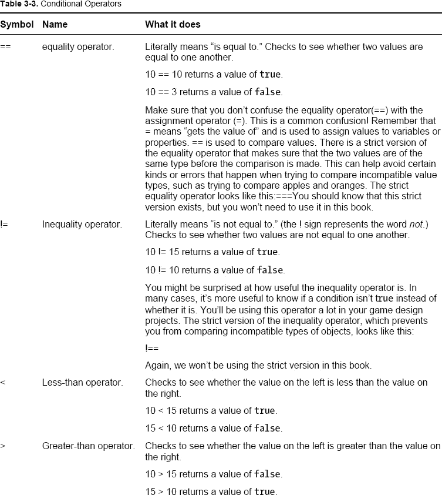

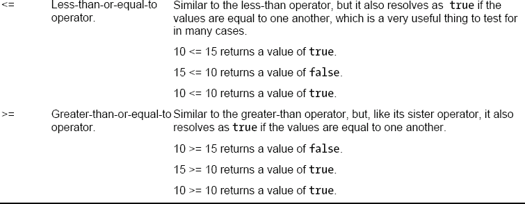

请将这张表放在手边，因为在接下来的项目中，你会非常频繁地用到其中的许多运算符。

检查角色是否向下移动过多的代码可能稍微难以理解一些：

```actionscript
if(character.y< 300)
{
  character.y += 15;
}
```

这基本上是在说：“当角色的 `y` 坐标小于 300 时，允许角色在舞台上向下移动 15 像素”。这意味着如果角色的 `y` 坐标等于或大于 300，角色就不会移动。

但数字 300 是从哪来的呢？我们知道舞台顶部的 `y` 坐标是 0，舞台底部的 `y` 坐标是 400。如果我们想阻止角色移出舞台底部，难道不应该用 400 吗？

在这个例子中却不是这样，我们必须使用 300，原因如下：

关于我们的游戏角色，有两个重要的事实需要记住：

*   它的 `y` 坐标是从其左上角测量的。

*   它有 100 像素高。

这意味着当它的脚（底部）接触到舞台底部时，它的左上角仍位于舞台底部上方 100 像素的位置。为了精确地阻止它的脚越过舞台底部，我们必须在其左上角位于 `y` 坐标为 300 时停止移动它。这等于舞台高度减去角色的高度。如果我们在 400 时停止它，角色的整个身体早已消失了。在你的程序中测试一下，看看效果吧！

当我们在第 5 章中讨论设置舞台边界时，会更详细地研究这个问题。

## 放大与缩小

玩弄 `Sprite` 的属性可以带来很多乐趣。接下来，我们要借鉴《爱丽丝梦游仙境》中的做法，使用 `scaleX` 和 `scaleY` 属性让角色变大或变小：

1. 仔细将以下新代码添加到 `GameWorld.as` 文件中：

   ```actionscript
   package
   {
     import flash.net.URLRequest;
     import flash.display.Loader;
     import flash.display.Sprite;
     import flash.events.MouseEvent;

     [SWF(width="550", height="400",
       backgroundColor="#FFFFFF", frameRate="60")]

     public class GameWorld extends Sprite
     {
       //所有变量声明...

       public function GameWorld()
       {
         //所有用于创建、显示和定位对象的代码...

         //添加按钮监听器
         upButton.addEventListener(MouseEvent.CLICK, upButtonHandler);
         downButton.addEventListener
           (MouseEvent.CLICK, downButtonHandler);
         growButton.addEventListener
           (MouseEvent.CLICK, growButtonHandler);
         shrinkButton.addEventListener
           (MouseEvent.CLICK, shrinkButtonHandler);
       }
       public function upButtonHandler(event:MouseEvent):void
       {
         if(character.y> 0)
         {
           character.y -= 15;
         }
       }
       public function downButtonHandler(event:MouseEvent):void
       {
         if(character.y< 300)
         {
           character.y += 15;
         }
       }
       public function growButtonHandler(event:MouseEvent):void
       {
         character.scaleX += 0.1;
         character.scaleY += 0.1;
       }
       public function shrinkButtonHandler(event:MouseEvent):void
       {
         character.scaleX -= 0.1;
         character.scaleY -= 0.1;
       }
     }
   }
   ```

2. 编译程序，然后点击放大和缩小按钮。现在您可以改变角色的大小，如图 Figure 3-42 所示。

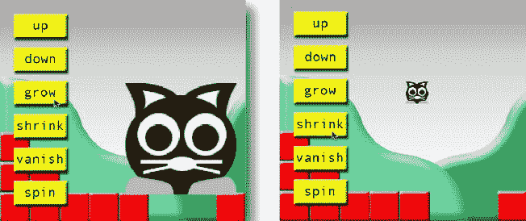

**Figure 3-42.** 点击放大和缩小按钮来改变猫的大小。

您会注意到角色是从其左上角开始改变大小的。这是因为左上角是其注册点所在位置。如果角色能从其中心均匀地放大或缩小，效果会更自然。在本章末尾，我将向您展示如何居中 `Sprite` 的注册点来实现这种效果。

`growButtonHandler` 和 `shrinkButtonHandler` 的基本功能与向上和向下按钮的处理程序相同。但这里使用的是 `scaleX` 和 `scaleY` 属性来水平和垂直缩放角色，而不是使用 `y` 属性。您需要同时使用这两个属性才能均匀缩放。如果只使用其中一个，比如 `scaleX`，角色腹部会变得非常胖，但高度却完全不会增加。（试试看！）

实际上，既然您知道可以同时改变两个属性，您也可以用 `x` 和 `y` 属性来尝试。要让角色在舞台上沿对角线移动，您可以修改向上和向下按钮的事件处理程序，使其如下所示：

```actionscript
public function upButtonHandler(event:MouseEvent):void
{
  if(character.y> 0)
  {
    character.y -= 15;
    character.x += 10;
  }
}
public function downButtonHandler(event:MouseEvent):void
{
  if(character.y< 300)
  {
    character.y += 15;
    character.x -= 10;
  }
}
```

试试看！

`scaleX` 和 `scaleY` 属性使用的值代表对象缩放的比例。这意味着所有对象在其原始大小下，该值均为 1。如果您想将对象的尺寸加倍，就需要将 `scaleX` 和 `scaleY` 的值设为 2。在您添加的新代码中，每次点击按钮，猫的缩放比例就会增加或减少 0.1，这相当于其原始大小的 10% 变化。

将`scaleX`和`scaleY`属性与`height`和`width`属性进行对比是很有趣的。它们都能修改对象的大小，但`height`和`width`属性使用的是像素值。让我们对`growButtonHandler`和`shrinkButtonHandler`做一些小改动来测试一下。为了让效果更有趣，我们对高度和宽度使用不同的数值，这样角色就不会在各方向上均匀改变大小了。

1. 对`growButtonHandler`和`shrinkButtonHandler`进行以下修改，用粗体显示的代码替换原始代码：

```
public function growButtonHandler(event:MouseEvent):void
{
  character.height += 25;
  character.width += 15;
}
public function shrinkButtonHandler(event:MouseEvent):void
{
  character.height -= 25;
  character.width -= 15;
}
```

2. 编译程序。

多次点击放大和缩小按钮，您会注意到角色逐渐被拉伸或压扁，如图 Figure 3-43 所示。这是因为，虽然角色精确地有 100 像素高和 100 像素宽，但这些指令分别为高度和宽度增加了不同的像素数。如果您为高度和宽度提供完全相同的值，它就会在两个维度上均匀地放大和缩小。

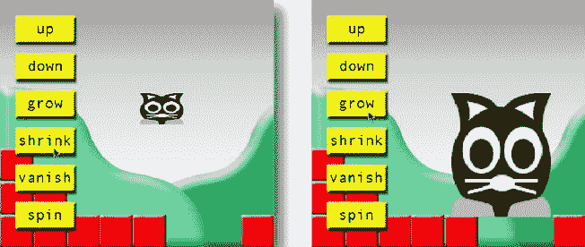

**Figure 3-43.** 以不同的增量改变高度和宽度来压扁或拉伸一个方形对象。

## 消失！

接下来这个小技巧将使用`visible`属性让角色消失。`visible`属性与你之前看到的其他属性略有不同，因为它使用布尔值。布尔值是只能为`true`或`false`的值。这可以让你利用一点编程手法来制作一个切换按钮。你只需一个按钮就能切换（或开关）猫的可见性。

1. 将以下新代码以粗体形式添加到`GameWorld.as`文件中：

```
package
{
  import flash.net.URLRequest;
  import flash.display.Loader;
  import flash.display.Sprite;
  import flash.events.MouseEvent;

  [SWF(width="550", height="400",
    backgroundColor="#FFFFFF", frameRate="60")]

  public class GameWorld extends Sprite
  {
    //所有变量声明...

    public function GameWorld()
    {
      //所有创建、显示和定位对象的代码...

      //添加按钮监听器
      upButton.addEventListener(MouseEvent.CLICK, upButtonHandler);
      downButton.addEventListener
        (MouseEvent.CLICK, downButtonHandler);
      growButton.addEventListener
        (MouseEvent.CLICK, growButtonHandler);
      shrinkButton.addEventListener
        (MouseEvent.CLICK, shrinkButtonHandler);
      vanishButton.addEventListener
        (MouseEvent.CLICK, vanishButtonHandler);
    }
    public function upButtonHandler(event:MouseEvent):void
    {
      if(character.y> 0)
      {
        character.y -= 15;
      }
    }
    public function downButtonHandler(event:MouseEvent):void
    {
      if(character.y< 300)
      {
        character.y += 15;
      }
    }
    public function growButtonHandler(event:MouseEvent):void
    {
      character.height += 15;
      character.width += 15;
    }
    public function shrinkButtonHandler(event:MouseEvent):void
    {
      character.height -= 15;
      character.width -= 15;
    }
    public function vanishButtonHandler(event:MouseEvent):void
    {
      character.visible = false;
    }
  }
}
```

2. 编译程序并点击消失按钮。猫会消失。图 3-44 展示了你将……看不到的画面！

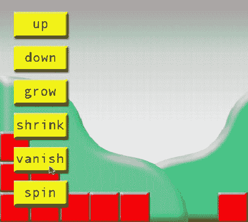

**图 3-44.** 通过将`visible`属性设置为`false`来让对象消失。

实现消失效果的关键指令是`vanishButtonHandler`中的这一行：

`character.visible = false;`

与你见过的其他属性一样，`visible`属性只是通过点符号附加到对象上。但不同的是，这是你遇到的第一个使用布尔值`false`的属性。该指令的意思是："不，角色不可见。"

点击消失按钮后，小猫不仅消失了，而且是永久消失。再怎么点按钮也无法让它回来。实际上，猫仍然作为可编程的对象存在于舞台上，只是你看不见它。怎样才能让猫再次可见呢？

有两种方法。一种方法是创建另一个按钮，并用与可见性按钮完全相同的代码进行编程，只不过将`visible`属性的值设为`true`，像这样：

`character.visible = true;`

第二种方法更有趣一些：使用单个按钮让猫既能消失又能重新出现。

如果要切换的两个状态可以用`true`和`false`值来定义，AS3.0 提供了一种非常简单的方法来制作切换按钮，即使用非运算符。非运算符就是一个感叹号，像这样：

`!`

它的字面意思是"非"。当与布尔值一起使用时，它表示"相反的值"。你可以将非运算符放在任何布尔值前面，将其解读为相反的值。下面我们在`vanishButtonHandler`中使用非运算符，将消失按钮变成切换按钮：

1. 修改`vanishButtonHandler`中的指令，使其如下所示：

```
public function vanishButtonHandler(event:MouseEvent):void
{
  character.visible = !character.visible;
}
```

2. 编译程序并点击消失按钮几次。你应该每次点击都能看到猫出现和消失。

这就是你赋给`visible`属性的新值：

`!character.visible;`

它的字面意思是"当前角色可见状态的相反值"。如果猫当前的可见状态是`true`，则相反状态将是`false`。如果当前状态是`false`，则状态将被解读为`true`。

程序首次运行时，角色显然可见。它的`visible`属性为`true`。当点击消失按钮时，程序将`!character.visible`解读为`false`。角色消失了！第二次点击按钮时，角色的`visible`属性现在为`false`，因此程序将`!character.visible`解读为`true`。角色重新出现！

以这种方式使用非运算符的妙处在于，你永远不需要知道`visible`属性是`true`还是`false`。程序会为你跟踪这一点。而且你只需要一个按钮就可以在这两种状态之间切换。

你可以将非运算符的这一特性用于任何接受布尔值（`true`或`false`）的变量或属性，从而在两个状态之间切换。布尔值在游戏设计中极为有用，用于跟踪诸如敌人是死是活、物品是否已拾取、门是锁着还是没锁等情况。无论你在何处使用布尔值，你很可能都会找到非运算符的巧妙用途，就像你在这里用到的一样。

## 旋转

接下来我们要编写旋转按钮的代码，让角色围绕其注册点旋转。这将演示如何使用`rotation`属性。

1. 在已有代码中添加以下粗体标注的新代码：

## 居中精灵

正如你刚刚所见，旋转按钮工作正常，但如果你能让角色围绕其中心点旋转，岂不是更好？放大和缩小按钮也能工作，但你的角色是从其左上角开始放大和缩小的。对于大多数游戏来说，你希望这些效果从对象的实际中心点发生。

正如我们本章前面讨论过的，这与角色的注册点位于其左上角有关。当你将一个 PNG 图像文件加载到 `Sprite` 中时，AS3.0 会自动以这种方式对齐它。

但这是为什么呢？让我们退后几步，回想一下当你在程序中加载图像并将其显示在舞台上时会发生什么。

你会记得，图像是被加载到一个 `Loader` 对象中的。然后这个 `Loader` 被添加到一个 `Sprite` 对象中。最后，这个 `Sprite` 被添加到舞台上。图 3-46 展示了这一点。

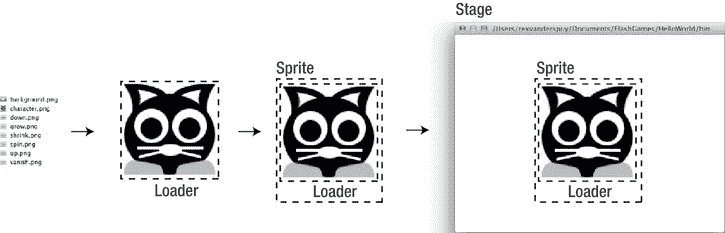

**图 3-46.** 图像由三个对象包含：`Loader`、`Sprite` 和舞台。

所以，尽管你在舞台上只能看到角色的图像，但实际上它被一个不可见的 `Sprite` 包围着，而这个 `Sprite` 里又包含一个不可见的 `Loader`。这就像我们那套套娃一样！请记住这一点。

你知道舞台是一个网格，并且你可以使用 `x` 和 `y` 属性将 `Sprite` 对象放置在网格上的任意位置。但你还不知道的是，包含图像的 `Sprite` *本身也是一个网格*。当你向 `Sprite` 添加图像时，图像加载器的左上角会被定位在 `x` 和 `y` 为 0,0 的位置——*位于 Sprite 自身的网格内部*。0,0 就是 `Sprite` 的注册点。图 3-47 展示了它的样子。


**图 3-47.** `Sprite` 将图像加载器放置在其局部网格的 0,0 位置。

这突显了一个非常重要的概念。一个图像实际上有两个坐标：它的**舞台坐标**和它在包含它的 `Sprite` 内部的**局部坐标**。请记住这一点，因为你通常需要同时了解这两个坐标，才能精确调整游戏中对象的位置。

`Sprite` 局部网格中的 0,0 位置就是它的注册点。你可以在图 3-47 中清晰地看到这一点。猫的左耳位于 0,0 点。如果我们想让注册点位于猫图像的中心，我们必须移动 `Sprite` 网格内部的图像加载器，使其居中于 0,0 位置上方。图 3-48 展示了我们需要实现的目标。


**图 3-48.** 将图像加载器居中于 `Sprite` 的 0,0 点上方，以实现注册点居中。

如果我们能做到这一点，角色将从其中心进行放大、缩小和旋转。所有这些都可以通过两行简单的代码完成。让我们看看如何操作。

1.  在 `GameWorld.as` 文件中找到你将角色添加到舞台的代码段。请仔细添加下面以粗体显示的新代码。

    ```
    //Add the character to the stage
    characterURL = new URLRequest();
    characterLoader = new Loader();
    character = new Sprite();
    characterURL.url = "../images/character.png";
    characterLoader.load(characterURL);
    characterLoader.x = -50;
    characterLoader.y = -50;
    character.addChild(characterLoader);
    stage.addChild(character);
    character.x = 225;
    character.y = 150;
    ```

2.  编译程序。

2.  点击旋转按钮。现在角色会围绕其左上角轴线旋转，如图 3-45 所示。


**图 3-45.** 点击按钮使角色旋转。

`rotation` 属性的使用方法与之前学习的其他属性非常相似：

`character.rotation += 20;`

`rotation` 属性接受圆的角度值，因此你可以使用的范围是 0 到 360。正值使对象顺时针旋转，负值使其逆时针旋转。旋转的中心是对象自身的中心注册点。在这个例子中，它是我的猫的左耳。下一节我将展示如何创建注册点位于正中心的 `Sprite` 对象。

### 更多属性？

本章开头表格中还有两个重要属性尚未在这个小交互玩具中使用：

*   `alpha`：控制对象的透明度，接受 0（完全透明）到 1（完全不透明或实体）之间的值。

*   `x`：控制对象的水平位置，与其“同伙” `y` 属性一样，接受以像素为单位的值。

这些属性的功能与你已使用的属性非常相似。因此，这里有一个小任务给你：何不创建一对能让猫左右移动的按钮，以及另一对能让猫逐渐消失和重新出现的按钮？我相信你能搞定！同时也可以尝试操作 3D 属性：`z`、`rotationX`、`rotationY`、`rotationZ` 和 `scaleZ`。

玩得开心，完成测试后我们下一节见。

```
package
{
  import flash.net.URLRequest;
  import flash.display.Loader;
  import flash.display.Sprite;
  import flash.events.MouseEvent;

  [SWF(width="550", height="400",
    backgroundColor="#FFFFFF", frameRate="60")]

  public class GameWorld extends Sprite
  {
    //所有变量声明...

    public function GameWorld()
    {
      //所有用于创建、显示
      //和定位对象的代码...

      //添加按钮监听器
      upButton.addEventListener(MouseEvent.CLICK, upButtonHandler);
      downButton.addEventListener
        (MouseEvent.CLICK, downButtonHandler);
      growButton.addEventListener
        (MouseEvent.CLICK, growButtonHandler);
      shrinkButton.addEventListener
        (MouseEvent.CLICK, shrinkButtonHandler);
      vanishButton.addEventListener
        (MouseEvent.CLICK, vanishButtonHandler);
      spinButton.addEventListener
        (MouseEvent.CLICK, spinButtonHandler);
    }
    public function upButtonHandler(event:MouseEvent):void
    {
      if(character.y> 0)
      {
        character.y -= 15;
      }
    }
    public function downButtonHandler(event:MouseEvent):void
    {
      if(character.y< 300)
      {
        character.y += 15;
      }
    }
    public function growButtonHandler(event:MouseEvent):void
    {
      character.height += 15;
      character.width += 15;
    }
    public function shrinkButtonHandler(event:MouseEvent):void
    {
      character.height -= 15;
      character.width -= 15;
    }
    public function vanishButtonHandler(event:MouseEvent):void
    {
      character.visible = false;
    }
    public function spinButtonHandler(event:MouseEvent):void
    {
      character.rotation += 20;
    }
  }
}
```

你首先会注意到角色不再位于舞台中央。它向左上方偏移了 50 像素，如图 3-49 所示。


**图 3-49.** 角色现在偏移了 50 像素。

如果你在本章中一直保持专注，现在应该清楚为什么会发生这种情况。你刚刚添加的新代码将图像加载器对象向左移动了 50 像素，向上移动了 50 像素。

```
characterLoader.x = -50;
characterLoader.y = -50;
```

你已将其定位在 `Sprite` 内部。因为角色正好是 100 像素见方，所以图像加载器现在直接居中于 `Sprite` 的注册点上方。

这很好，但这也意味着你需要通过将所有角色的 `x` 和 `y` 属性值调整 50 像素来补偿这一点。如果你想让角色在舞台上居中，要像这样在你之前用于居中的值上加 50 像素：

```
character.x = 275;
character.y = 200;
```

如果你修改这些属性并再次编译程序，角色的正中心现在将位于舞台的正中心。

嘿，现在去试试放大、缩小和旋转按钮吧！我们现在得到了我们想要的效果——它们都从角色的中心发生，如图 3-50 所示。我们已成功地将图像居中于 `Sprite` 的注册点上方。


**图 3-50.** 从中心进行放大、缩小和旋转。

为了保持简单，本书中的大部分代码都将 `Sprite` 的注册点保持在左上角。但正如你所见，在很多情况下，居中注册点对于实现某些效果至关重要。

### 代码总结

我们在本章中编写了大量的 AS3.0 代码！为了让你对已编写的内容没有任何疑问，以下是 `GameWorld` 项目的完整最终代码。我使用**粗体**高亮注释作为主要代码段的标题，以便你轻松查看各部分的组织方式。在本章的源文件中，你还可以在 `GameWorldFinished` 文件夹中找到该项目的可运行示例。

```
package
{
  import flash.display.Loader;
  import flash.display.Sprite;
  import flash.events.MouseEvent;
  import flash.net.URLRequest;
  [SWF(width="550", height="400",
    backgroundColor="#FFFFFF", frameRate="60")]

  public class GameWorld extends Sprite
  {
    //声明所需的变量
    public var backgroundURL:URLRequest;
    public var backgroundLoader:Loader;
    public var background:Sprite;

    //角色
    public var characterURL:URLRequest;
    public var characterLoader:Loader;
    public var character:Sprite;

    //向上按钮
    public var upButtonURL:URLRequest;
    public var upButtonLoader:Loader;
    public var upButton:Sprite;

    //向下按钮
    public var downButtonURL:URLRequest;
    public var downButtonLoader:Loader;
    public var downButton:Sprite;

     //放大按钮
    public var growButtonURL:URLRequest;
    public var growButtonLoader:Loader;
    public var growButton:Sprite;

    //缩小按钮
    public var shrinkButtonURL:URLRequest;
    public var shrinkButtonLoader:Loader;
    public var shrinkButton:Sprite;

    //消失按钮
    public var vanishButtonURL:URLRequest;
    public var vanishButtonLoader:Loader;
    public var vanishButton:Sprite;

    //旋转按钮
    public var spinButtonURL:URLRequest;
    public var spinButtonLoader:Loader;
    public var spinButton:Sprite;

    public function GameWorld()
    {

      //将背景添加到舞台
      backgroundURL = new URLRequest();
      backgroundLoader = new Loader();
      background = new Sprite();

      backgroundURL.url = "../images/background.png";
      backgroundLoader.load(backgroundURL);
      background.addChild(backgroundLoader);
      stage.addChild(background);

      //将角色添加到舞台
      characterURL = new URLRequest();
      characterLoader = new Loader();
      character = new Sprite();
      characterURL.url = "../images/character.png";
      characterLoader.load(characterURL);
      character.addChild(characterLoader);
      stage.addChild(character);
      character.x = 225;
      character.y = 150;

      //添加上按钮
      upButtonURL = new URLRequest();
      upButtonLoader = new Loader();
      upButton = new Sprite();
      upButtonURL.url = "../images/up.png";
      upButtonLoader.load(upButtonURL);
      upButton.addChild(upButtonLoader);
      stage.addChild(upButton);
      upButton.x = 25;
      upButton.y = 25;

      //添加下按钮
      downButtonURL = new URLRequest();
      downButtonLoader = new Loader();
      downButton = new Sprite();
      downButtonURL.url = "../images/down.png";
      downButtonLoader.load(downButtonURL);
      downButton.addChild(downButtonLoader);
      stage.addChild(downButton);
      downButton.x = 25;
      downButton.y = 85;

      //添加放大按钮
      growButtonURL = new URLRequest();
      growButtonLoader = new Loader();
      growButton = new Sprite();
      growButtonURL.url = "../images/grow.png";
      growButtonLoader.load(growButtonURL);
      growButton.addChild(growButtonLoader);
      stage.addChild(growButton);
      growButton.x = 25;
      growButton.y = 145;

      //添加缩小按钮
      shrinkButtonURL = new URLRequest();
      shrinkButtonLoader = new Loader();
      shrinkButton = new Sprite();
      shrinkButtonURL.url = "../images/shrink.png";
      shrinkButtonLoader.load(shrinkButtonURL);
      shrinkButton.addChild(shrinkButtonLoader);
      stage.addChild(shrinkButton);
      shrinkButton.x = 25;
      shrinkButton.y = 205;

      //添加消失按钮
      vanishButtonURL = new URLRequest();
      vanishButtonLoader = new Loader();
      vanishButton = new Sprite();
      vanishButtonURL.url = "../images/vanish.png";
      vanishButtonLoader.load(vanishButtonURL);
      vanishButton.addChild(vanishButtonLoader);
      stage.addChild(vanishButton);
      vanishButton.x = 25;
      vanishButton.y = 265;

      //添加旋转按钮
      spinButtonURL = new URLRequest();
      spinButtonLoader = new Loader();
      spinButton = new Sprite();
      spinButtonURL.url = "../images/spin.png";
      spinButtonLoader.load(spinButtonURL);
      spinButton.addChild(spinButtonLoader);
      stage.addChild(spinButton);
      spinButton.x = 25;
      spinButton.y = 325;

      //添加按钮监听器
      upButton.addEventListener
        (MouseEvent.CLICK, upButtonHandler);
      downButton.addEventListener
        (MouseEvent.CLICK, downButtonHandler);
      growButton.addEventListener
        (MouseEvent.CLICK, growButtonHandler);
      shrinkButton.addEventListener
        (MouseEvent.CLICK,shrinkButtonHandler);
      vanishButton.addEventListener
        (MouseEvent.CLICK, vanishButtonHandler);
      spinButton.addEventListener
        (MouseEvent.CLICK, spinButtonHandler);
    }

    //事件处理函数
    public function upButtonHandler(event:MouseEvent):void
    {
      if(character.y> 0)
      {
        character.y -= 15;
        //可选：
        //character.x += 10;
      }
    }
    public function downButtonHandler(event:MouseEvent):void
    {
      if(character.y< 300)
      {
        character.y += 15;

        //可选：
        //character.x -= 10;
      }
    }
    public function growButtonHandler(event:MouseEvent):void
    {
      character.scaleX += 0.1;
      character.scaleY += 0.1;

      //可选：
      //character.height += 25;
      //character.width += 15;
    }
    public function shrinkButtonHandler(event:MouseEvent):void
    {
      character.scaleX -= 0.1;
      character.scaleY -= 0.1;

      //可选：
      //character.height -= 25;
      //character.width -= 15;
    }
    public function vanishButtonHandler(event:MouseEvent):void
    {
      character.visible = !character.visible;
    }
    public function spinButtonHandler(event:MouseEvent):void
    {
      character.rotation += 20;
    }
  }
}
```

### 总结

无论你是否意识到这一点，你现在已经掌握了相当丰富的技能，可以用来构建非常丰富的交互式游戏世界。在本章中，我们探讨了构建这些游戏世界所需的基本技术——实际上你并不需要更多技巧。如果你理解了如何创建、显示和控制 `Sprite` 对象，以及如何使用事件监听器在游戏中触发动作，你就掌握了本书其余项目所需的基础知识。

在第 4 章中，我们将构建第一个完整的游戏。这是一个猜数字游戏，它将极大地拓展你的编程技能。你将学习如何分析玩家的输入以创建基本的人工智能系统，如何使用方法来模块化程序，如何添加交互式文本，以及如何通过随机数让玩家（毫不夸张地说）持续猜测！


