## 第 4 章

### 决策制定

本章将是你首次真正接触如何设计一款完整的游戏。虽然它只是一个短小精悍的简单游戏，却包含了游戏设计的所有基本结构元素，这些元素你将来会反复用到。输入与输出、决策制定、得分记录、判断玩家胜负、随机数生成以及提供再来一局的机会——这些功能全部囊括其中。你还会更深入地研究变量和 `if` 语句。此外，你将学习如何通过将冗长的代码段分解成细粒度的方法来实现程序模块化。学完本章后，你将拥有基于此简单模型构建复杂逻辑游戏所需的一切技能。

你要构建的游戏是一个简单的猜数字游戏。游戏会要求你猜一个介于 0 到 99 之间的数字。如果猜得过高或过低，游戏会提示你，直到你通过排除法找出神秘数字。完成后的游戏效果如图 4-1 所示。

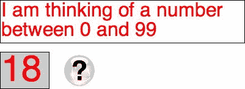

**图 4-1.** 猜数字游戏

实际上，你将分阶段构建这个游戏。先从最基础的版本开始，然后逐步添加更多功能，比如限制猜测次数、向玩家提供更详细的游戏状态信息、随机化神秘数字以及增加重新游戏的选项。你还会学习如何制作随交互方式改变外观的游戏按钮。

听起来很复杂？游戏的每个阶段都是独立的，因此你可以在进入下一阶段之前稍作休息，吸收并尝试新技巧。当所有部分组合在一起时，你会惊讶于它的简洁与易用。

### 使用文本

上一章你学习了如何加载、显示和定位图像。但在大多数游戏中，你需要将图像与文本结合使用，而且文本通常会根据游戏状态的变化而改变。本章你将首先学习如何使用 `TextField` 和 `TextFormat` 对象创建并应用交互式文本。

#### 设置项目

我先为你准备一个基础程序，它会在舞台上创建两个文本字段，并输出一条"游戏已启动"的跟踪消息。你可能对这段新代码不太理解，但我将在后续章节中逐一解释。如果你不想手动输入所有代码，可以在本章的源文件中找到这个设置文件，项目文件夹名为 `NumberGuessingGameSetup`。

1.  新建一个 AS3.0 项目，并在编辑器窗口中输入以下程序：

    ```
    package
    {
      import flash.net.URLRequest;
      import flash.display.Loader;
      import flash.display.Sprite;
      import flash.events.MouseEvent;
      import flash.events.KeyboardEvent;
      import flash.ui.Keyboard;
      import flash.text.*;

      [SWF(width="550", height="400",
      backgroundColor="#FFFFFF", frameRate="60")]

      public class NumberGuessingGame extends Sprite
      {
        //创建文本对象
        public var format:TextFormat = new TextFormat();
        public var output:TextField = new TextField();
        public var input:TextField = new TextField();

        public function NumberGuessingGame()
        {
          setupTextfields();
          startGame();
        }
        public function setupTextfields():void
        {
          //设置文本格式对象
          format.font = "Helvetica";
          format.size = 32;
          format.color = 0xFF0000;
          format.align = TextFormatAlign.LEFT;

          //配置输出文本字段
          output.defaultTextFormat = format;
          output.width = 400;
          output.height = 70;
          output.border = true;
          output.wordWrap = true;
          output.text = "这是输出文本字段";

          //显示并定位输出文本字段
          stage.addChild(output);
          output.x = 70;
          output.y = 65;

          //配置输入文本字段
          format.size = 60;
          input.defaultTextFormat = format;
          input.width = 80;
          input.height = 60;
          input.border = true;
          input.type = "input";
          input.maxChars = 2;
          input.restrict = "0-9";
          input.background = true;
          input.backgroundColor = 0xCCCCCC;
          input.text = "";

          //显示并定位输入文本字段
          stage.addChild(input);
          input.x = 70;
          input.y = 150;
          stage.focus = input;
        }
        public function startGame():void
        {
          trace("游戏已启动")
        }
      }
    }
    ```

2.  编译该程序。你会在输出面板看到"游戏已启动"的跟踪消息。Flash Player 窗口将打开，显示两个文本字段。较大的字段用红色文字显示"这是输出文本字段"。较小的字段带有灰色背景和闪烁的光标，你可以在其中输入猜测的数字。图 4-2 展示了运行效果。

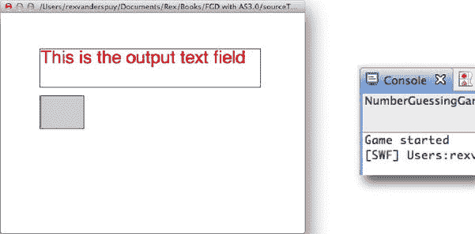

**图 4-2.** 编译设置程序后的效果

别被代码吓到。它没有包含任何超出前一章范围的概念——只是呈现方式略有不同。下面我们来了解它的工作原理。

#### 需要导入的类

你会注意到，本程序导入了前一章中所有的类，但也新增了一些。以下是新增的导入代码：

```
import flash.events.KeyboardEvent;
import flash.ui.Keyboard;
import flash.text.*;
```

前两行导入了 `KeyboardEvent` 和 `Keyboard` 类。如果你想制作玩家通过键盘交互的游戏，就需要这两个特殊的类。在本项目中你将使用键盘交互功能，并且会随着程序开发看到这两个类的具体应用。

第三行很有意思，因为它没有指定具体的类，而是用了一个星号：

```
import flash.text.*;
```

星号表示"导入所有文本类"。AS3.0 库中有一个名为 `flash.text` 的部分，包含所有用于显示和操作文本的类。这些类数量众多，在游戏中需要显示文本时，大部分都会用到。与其逐个导入每个类，不如直接用星号代替类名，程序会自动从 `flash.text` 加载所有类。如果逐个导入，你需要编写四条像这样的导入语句：

```
import flash.text.TextFormat;
import flash.text.TextField;
import flash.text.TextFormatAlign;
import flash.text.TextFieldAutoSize;
```

# 使用星号导入与逐个导入

使用星号导入所有类与逐个导入在技术层面没有优劣之分，前提是你清楚自己会用到程序中的所有类。如果你确定某个类不会被使用，最好逐个导入，以便排除不需要的类。导入未使用的类会延长代码编译时间，因为 AS3.0 编译器在生成 SWF 文件时仍需浏览这些未使用的类。不过，导入不必要的类不会影响游戏的运行性能。

你可以使用星号从任何 AS3.0 代码包中导入所有类。例如，要导入显示包中的所有类，可以这样写：

```
import flash.display.*;
```

在本项目中你将用到所有这些类。

## 创建 TextFormat 和 TextField 对象

你可能还记得第 3 章中提到，创建一个对象（例如 `Sprite`）需要两个步骤。

首先，你必须声明一个变量来存放 `Sprite` 对象，如下所示：

`public var gameCharacter:Sprite;`

接着，你需要使用 `new` 关键字将该变量转换为 `Sprite` 对象。

`gameCharacter = new Sprite();`

你在上一章中写了很多类似这样的代码。但你可能不知道的是，你可以将这两行代码合并为一行，如下所示：

`public var gameCharacter:Sprite = new Sprite();`

这行代码一步到位地声明了变量并创建了对象。结果是一样的：你最终得到了一个 `Sprite` 对象，但省下了一行代码。

有时在编写程序时，在程序启动时你并不确切知道变量将包含哪种类型的对象。这是因为在某些复杂程序中，你要创建的对象直到程序开始运行时才存在。在这种情况下，你需要先声明变量，然后在程序后面再创建对象。你将在本书后面的章节中看到这为何重要的示例。

然而，在程序初次初始化时，你通常能确切知道要创建哪种类型的对象。在这种情况下，可以一步完成变量声明和对象创建。类定义中的前三行新代码就是这样做的：

```
public class NumberGuessingGame extends Sprite
{
  public var format:TextFormat = new TextFormat();
  public var output:TextField = new TextField();
  public var input:TextField = new TextField();
}
```

它们创建了一个 `TextFormat` 对象和两个 `TextField` 对象。

`TextFormat` 对象名为 `format`。它的工作是确定文本在舞台上的外观：例如其字体、颜色、大小以及文本对齐方式。

`TextField` 对象名为 `input` 和 `output`。这些对象是你在舞台上实际看到的文本。编译此程序时，你在舞台上看到了这两个对象：`output` 字段位于顶部，`input` 字段是它下方那个带有灰色背景的小字段。

我们来了解一下这些 `TextFormat` 和 `TextField` 属性是如何工作的。

## 设置文本格式

查看 `setupTextfields` 函数定义，你会看到以下四行代码：

```
format.font = "Helvetica";
format.size = 32;
format.color = 0xFF0000;
format.align = TextFormatAlign.LEFT;
```

这段代码设置了 `format` 对象的四个属性。你可能还记得第 3 章中提到，所有对象都有属性，你可以更改这些属性来实现不同的效果。你应记得 `Sprite` 对象具有诸如 `x`、`y`、`visible`、`scaleX` 和 `scaleY` 等属性。

`format` 是一个 `TextFormat` 对象，其属性决定了文本在舞台上的外观。以下是它正在设置的四个属性：

-   `font` 是你希望文本显示所用的字体。此示例使用了 Helvetica。你可以使用计算机上安装的任何字体的名称。用引号将字体的确切名称括起来。

    在测试游戏时，`font` 属性工作正常，但如果游戏在另一台计算机上运行，而该计算机没有安装与你指定的完全相同的字体，则字体显然无法加载。它将被 Flash Player 认为可能接近的另一种字体所替代。如果你希望游戏中的字体在所有计算机上看起来完全一致，无论该字体是否已安装，都必须使用一种称为字体嵌入的技术。嵌入字体有时会产生奇怪的结果，但本章末尾的“字体嵌入快速指南”部分将介绍如何做到这一点。

-   `color` 是字体的十六进制颜色代码。你可以使用任何喜欢的十六进制代码；只需在其前面加上 `0x`。此示例使用了 `0xFF0000`，这是红色的十六进制代码。

-   `size` 是字体大小。

-   `align` 是文本的对齐方式：左对齐、右对齐或居中对齐。以下是如果你想更改对齐方式可以使用的属性值：

    -   `TextFormatAlign.LEFT`

    -   `TextFormatAlign.RIGHT`

    -   `TextFormatAlign.CENTER`

你可能想知道为什么设置 `align` 属性的值看起来如此奇怪。

`TextFormatAlign.LEFT`

`TextFormatAlign` 是一个特殊的内置类，仅包含用于对齐文本的属性。（你可以通过它以大写字母开头来判断它是一个类。）类名后面是一个点。你知道，点后面跟随的要么是属性，要么是方法。在此例中，点后面跟随的是属性，例如 `LEFT` 和 `RIGHT`。

这些属性全部用大写字母书写，因为它们是称为常量的编程元素。你将在第 9 章中了解常量是什么以及如何使用它们。但常量的一个特点是它们始终用大写字母书写。

在图 4-3 中，你可以看到所有这些文本属性的效果。

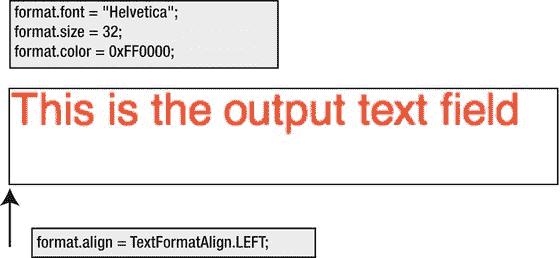

**图 4-3.** 格式属性如何影响文本

这些是四个最常用的 `TextFormat` 属性，但还有许多其他属性。表 4-1 展示了其他可用属性。

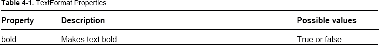

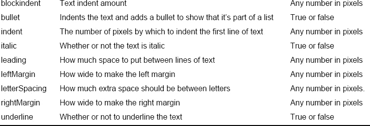

此外，还有几个极少使用的文本属性：`kerning`、`tabStops`、`target` 和 `url`。你可以在 Adobe AS3.0 文档的 `TextFormat` 章节中了解有关这些属性的更多信息，网址为 [`http://help.adobe.com/en_US/ActionScript/3.0_ProgrammingAS3/`](http://help.adobe.com/en_US/ActionScript/3.0_ProgrammingAS3/)。

`TextFormat` 对象决定了文本的外观，但并不决定文本的实际内容。显示实际文本是 `TextField` 对象的工作。

### 配置并显示输出文本

`TextField` 对象的工作非常简单，就是显示文本。你的程序有两个 `TextField` 对象：`output` 和 `input`。在这个程序中，`output` `TextField` 的工作是告诉你游戏中正在发生什么。以下是配置它并将其显示在舞台上的所有代码：

```java
// 配置输出文本字段
output.defaultTextFormat = format;
output.width = 400;
output.height = 70;
output.border = true;
output.wordWrap = true;
output.text = "这是输出文本字段";

// 显示并定位输出文本字段
stage.addChild(output);
output.x = 70;
output.y = 65;
```

来看看这段代码是如何工作的。

`output` `TextField` 需要知道它应该如何被格式化。

`output.defaultTextFormat = format;`

`defaultTextFormat` 是一个 `TextField` 属性，它决定了文本应如何被格式化。你在等号右侧给它赋的值是什么？就是你的 `format` 对象！你告诉 `output` `TextField`，它应该使用你刚刚配置好的 `format` 对象。这样一来，任何由 `output` `TextField` 显示的文本都将继承 `format` 对象的所有特性。

接下来的五行代码设置了一些非常重要的属性。

```java
output.width = 400;
output.height = 70;
output.border = true;
output.wordWrap = true;
output.text = "这是输出文本字段";
```

`width` 和 `height` 属性决定了文本字段的大小。你可以使用任意像素值。图 4-4 展示了宽度为 400、高度为 70 时，与文本周围边框的尺寸相匹配。

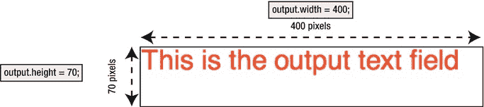

**图 4-4。** `width` 和 `height` 属性决定了文本字段的大小。

通常你会发现，让文本字段的高度和宽度根据其所含文本的大小自动设置会很方便。在这种情况下，就不要设置 `height` 和 `width` 属性。而是使用下面这行代码：

```
output.autoSize = TextFieldAutoSize.LEFT;
```

`autoSize` 属性使用特殊的 `TextFieldAutoSize` 类来自动调整文本字段的大小，无论文本是大是小。`LEFT` 表示文本在字段中左对齐。此处可以使用的其他值还有 `RIGHT` 和 `CENTER`。

`border` 属性决定了文本是否有边框。如果设置为 `true`，边框可见，正如你在图 4-4 中看到的。如果你完全不设置 `border` 属性，或将其值设为 `false`，边框将不可见。

## 自动换行

自动换行是指当文本触及右边距时自动换到新行。`wordWrap` 属性很重要，因为它用来告诉文本字段：当第一行文本太长时，是否强制将其从第一行换到第二行。

图 4-5 展示了将 `wordWrap` 属性设置为 `true` 或 `false` 对长行文本产生的不同效果。

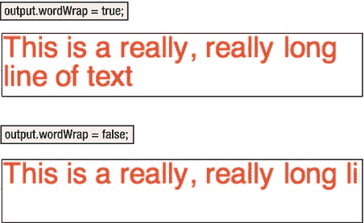

**图 4-5。** 文本字段的换行样式

当 `wordWrap` 设置为 `true` 时，文本在触及文本字段的右边距时会创建新行。当设置为 `false` 时，则不会换行，因此如果文本字段长度不够，文本可能会被截断。

在 `output` `TextField` 上设置的最后一个属性是最重要的。它就是 `text` 属性。它决定了文本字段中实际会显示哪些文字。

```
output.text = "这是输出文本字段";
```

你可以将这些文字改为任何你喜欢的文字，无论你输入什么，都会显示在文本字段中，正如你在图 4-6 中看到的。

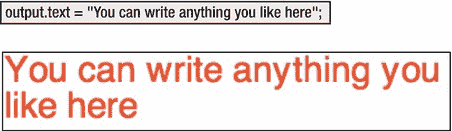

**图 4-6。** `text` 属性决定了文本字段中显示哪些文字。

在编写游戏时，你会经常更改 `output` `TextField` 的 `text` 属性，并且你会看到这会产生多么重要的效果。

设置好所有属性后，最后要做的事情就是将 `output` `TextField` 添加到舞台上并定位。

```java
stage.addChild(output);
output.x = 70;
output.y = 65;
```

这与你在前一章中添加和定位 `Sprite` 对象的方式完全相同。

## 配置和显示输入字段

以下是配置并显示 `input` 文本字段的代码：

```
//配置输入文本字段
format.size = 60;
input.defaultTextFormat = format;
input.width = 80;
input.height = 60;
input.border = true;
input.type = "input";
input.maxChars = 2;
input.restrict = "0-9";
input.background = true;
input.backgroundColor = 0xCCCCCC；
input.text = ""；
```

```
//显示并定位输入文本字段
stage.addChild(input);
input.x = 70;
input.y = 150;
stage.focus = input;
```

`input` `TextField` 的作用是接收用户输入。你可以实际在其中输入内容，并且当你的游戏编程完成后，所有这些信息都会传入游戏。在编写猜数字游戏时，你将使用 `input` `TextField` 来输入猜测的数字。

`input` `TextField` 使用了与 `output` 字段相同的所有属性，例如 `height`、`width` 和 `border`，但它还使用了一些专门的新属性。

它们的相似之处在于，两个文本字段都使用相同的格式对象来决定字体样式、大小、颜色和对齐方式。但请看应用格式设置的上方那一行代码：

```
format.size = 60;
input.defaultTextFormat = format;
```

在将格式应用于 `input` 字段之前，`format` 对象的 `size` 属性被设置为 60。这是因为我希望 `input` `TextField` 与 `output` `TextField` 的格式完全相同，但字号要更大一些。因此，在将 `format` 对象分配给 `input` 字段之前，我首先将 `format` 对象的 `size` 属性更改为 60。这样既放大了字号，又保持了样式、颜色和对齐方式不变。你可以在图 4-7 中看到这一点。

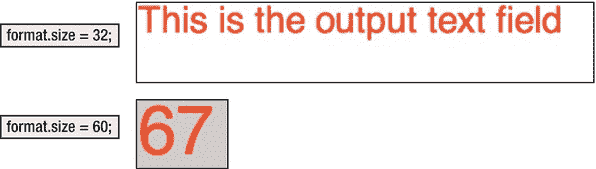

**图 4-7.** 两个文本字段的文字格式相同，只是输入字段的字号更大。

这省去了我创建全新 `TextFormat` 对象的麻烦，不过如果除了字号之外还需要更改更多内容，我可能还是会这样做。

在设置了 `height`、`width` 和 `border` 之后，接下来的几行代码尤为重要。

```
input.type = "input";
```

将 `type` 属性设置为 "input" 允许你在字段中输入文本。这意味着你可以直接在其中输入。（另一个可设置的值是 "dynamic"，它阻止用户输入。所有新创建的 `TextField` 对象默认都会自动设置为 "dynamic"。）

`maxChars` 限制了你只能输入最多两个字符。

```
input.maxChars = 2;
```

在这个猜数字游戏中这一点很重要，因为你希望玩家猜测 0 到 99 之间的一个数字。你不希望玩家输入超过两位数的数字，例如 134 或 746。

下一个属性 `restrict` 用于阻止玩家输入数字以外的任何字符。

```
input.restrict = "0-9";
```

试着在 `input` 字段中输入字母。你会发现无法输入。你只能输入数字 0 到 9。这对于你的游戏也很重要。这是一个猜数字游戏，如果玩家输入了像 "bicycle" 这样的词作为猜测，你那可怜的游戏会发生什么呢？像这样限制玩家输入意味着你的游戏不必处理这类意外信息。

如果你只想将文本字段限制为大写字母 A、B 和 C，可以像这样设置 `restrict` 属性：

```
input.restrict = "ABC";
```

你可以通过用连字符分隔范围中的首尾字符来限制数字或字母的范围。以下是一些示例：

-   要只允许大写字母 M 到 O，请使用 "M-O"。

-   要允许所有大写字母，请使用 "A-Z"。

-   要将输入限制为仅小写字母，请使用 "a-z"。

-   要允许大小写字母，请使用 "A-Za-z"。

作为程序员，你的工作往往可以通过限制某些类型的输入来得到改善，因为如果用户输入了程序不知道如何处理的内容，整个程序可能会停止运行。

你会注意到 `input` 字段有一个浅灰色背景。这要归功于接下来的两行代码：

```
input.background = true;
input.backgroundColor = 0xCCCCCC;
```

在分配背景颜色之前，你需要先将 `background` 属性设置为 `true`。然后你可以将任何喜欢的十六进制颜色代码分配给 `backgroundColor` 属性。

`input` 字段显示并定位在舞台上的方式与输出字段完全相同，但最后一行代码很重要：

```
stage.focus = input;
```

这会在 `input` 文本字段中创建一个闪烁的光标。

当舞台上的某个对象（例如按钮或文本字段）被用户选中时，我们称之为拥有**焦点**。当输入文本字段获得焦点时，会出现一个闪烁的光标，用户输入的任何内容都会自动输入到该字段中。请注意，焦点是内置 `Stage` 类的一个属性，它位于所有显示对象（你在舞台上能看到的所有对象）层级结构的根部。当 SWF 文件运行程序时，会自动创建 `Stage` 类的一个实例（为了方便起见，就叫做 `Stage`）。要将焦点分配给一个文本字段，你只需要像此处这样将文本字段对象的名称赋值给 `stage.focus` 属性。

如果需要移除文本字段的焦点，可以将其设置为 `null` 值，例如：

```
stage.focus = null；
```

`TextField` 对象还有许多其他属性可以设置，表 4-2 列出了其中最有用的属性。

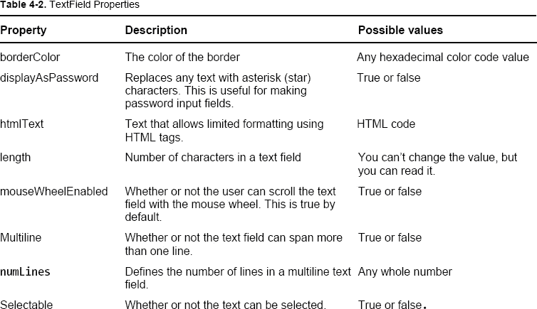

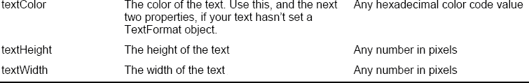

还有很多更专业的 `TextField` 属性；你可以在 Adobe 的参考文档中找到关于它们的更多信息，网址为 `http://help.adobe.com/en_US/FlashPlatform/reference/actionscript/3/flash/text/TextField.html`。

你会很高兴地了解到，这差不多就是你在 Flash 游戏中处理文本所需了解的全部内容。现在让我们以这个设置文件为基础，开始编写你的第一款游戏。

## 构建一个简单的猜数字游戏

我们将分三个阶段来构建猜数字游戏，这样你可以在增加复杂性之前扎实掌握这些技术。第一阶段是最基础的版本，但却是最重要的，因为它包含了游戏的核心。

游戏开始时，要求玩家猜测一个 0 到 99 之间的数字。它会告诉玩家猜测的数字是太高还是太低，直到最终猜中正确的数字。在这个版本中，玩家可以无限次猜测，但在第二阶段，你会对此进行限制并增加一些更有趣的功能。

### 理解程序结构

到目前为止，你的程序中存在一些需要仔细审视的微妙之处，在开始编写游戏前必须先弄清楚这些。你可能还记得第 1 章中提到，任何放在构造方法中的代码都会在程序启动时立即执行。让我们来看看当前游戏构造方法的内容：

```
public function NumberGuessingGame()
{
  setupTextfields();
  startGame();
}
```

这与前几章中密密麻麻写满代码的构造方法截然不同。现在你只有两条简洁的指令：

```
setupTextfields();
startGame();
```

这些是什么？它们是**方法调用**。方法调用会触发方法的函数定义，执行其包含的指令。这里被“调用”的方法分别是`setupTextfields`和`startGame`。这意味着构造方法一旦运行，就会立即让这两个方法执行各自分配的任务。

首先运行的是`setupTextfields`方法。你刚才已经详细研究过它了：它负责设置并显示两个文本字段。以下是省略了实际代码的简化版本，用注释代替了原始代码：

```
public function setupTextfields():void
{
  //设置并显示输入和输出字段...
}
```

随后，构造方法会运行`startGame`方法：

```
public function startGame():void
{
  trace("Game started")
}
```

目前这个方法没做太多事情，只是显示一条简单的跟踪消息让你知道一切正常，但很快你就会开始往里面编写代码了。

通过将构造方法的工作拆分成两个独立的方法，你开始对程序进行**模块化**。程序模块化是一种将相关代码整合成单一单元的做法，便于管理和维护。模块化代码被分解成小型、相关的单元，而无需在杂乱无章的大段代码中翻找。这有助于你专注于程序的特定区域，而不会被无关代码干扰。

在你的程序中，用于设置文本字段的代码与游戏机制毫无关系。事实上，你之后可能再也不需要触碰这段设置代码。因此，将其与程序的其他部分分离是合理的，这样你就不用被它打扰。我已经通过把所有显示文本字段的代码放在`setupTextFields`方法中实现了这一点。

同样，所有初始化游戏的代码都放在`startGame`方法中。这意味着当你编写这部分代码时，可以忽略程序的其他部分，只关注`startGame`方法。这将极大地帮助你集中精力并组织工作。

此外，这意味着在玩过游戏后，如果想再玩一次，你只需再次运行`startGame`方法即可。除非你已经像这样把所有游戏初始化代码移到了独立的方法中，否则这是不可能实现的。在本章末尾创建“再玩一次”按钮时，你就会体会到这有多方便。

图 4-8 展示了构造方法如何启动`setupTextFields`和`startGame`方法。

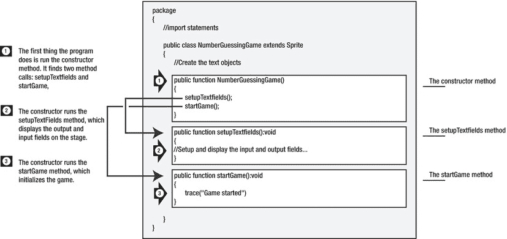

**图 4-8.** 构造方法将程序设置工作分担给两个不同的方法。

在后续章节中，你还会看到更多关于如何编写模块化代码的示例。

### 深入学习变量

你的首要任务是初始化游戏中需要的一些基本变量。其中最重要的是玩家需要猜出的神秘数字。你还需要初始化输出文本字段中玩家看到的第一条消息。这两个值都通过变量来赋值。要查看具体操作，请按照以下步骤进行：

1. 在类定义中添加以下加粗文本：

```
public class NumberGuessingGame extends Sprite
{
  //创建文本对象
  public var format:TextFormat = new TextFormat();
  public var output:TextField = new TextField();
  public var input:TextField = new TextField();

  //游戏变量
  public var startMessage:String;
  public var mysteryNumber:uint;
}
```

2. 将以下文本添加到`startGame`方法中（删除现有的`trace`指令）：

```
public function startGame():void
{
  //初始化变量
  startMessage = "我正在想一个 0 到 99 之间的数字";
  mysteryNumber = 50;

  //初始化文本字段
  output.text = startMessage
  input.text = "";
}
```

3. 编译程序。你应该会看到输出文本字段中显示“我正在想一个 0 到 99 之间的数字”，而`input`文本字段应为空白，如图 4-9 所示。

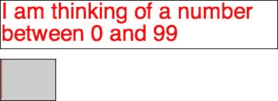

**图 4-9.** 游戏现已初始化。

你做的第一件事是在类定义中声明了两个新变量。你在前几章已经使用过变量，但这里有个新东西——变量类型（冒号后面的部分）。

```
public var startMessage:String;
public var mysteryNumber:uint;
```

这些变量类型`String`和`uint`是什么意思？

你可能还记得上一章中，当你创建用于保存`Sprite`对象的变量时，你声明它们的类型为创建该对象的类。下面这行代码是什么意思？

```
public var character:Sprite;
```

它的意思是`character`变量是`Sprite`类型。你刚刚写的新代码与此非常相似。这一行表示`startMessage`是`String`类型：

```
public var startMessage:String;
```

而这一行表示`mysteryNumber`是`uint`类型（代表**无符号整数**）：

```
public var mysteryNumber:uint;
```

好吧，这听起来有点抽象，对吧？别担心，很快就会变得清晰！

让我们退一步思考。当你声明一个变量时，需要告诉程序这个变量将存放什么类型的信息。你将用这个变量来存储数字还是文字？如果是数字，那具体是哪种数字？这听起来可能有些繁琐，但 AS3.0 需要这些信息来确保你不会试图混合使用包含文字的变量和包含数字的变量，或任何其他可能不兼容的数据类型。

那么，变量类型有哪些呢？以下是 AS3.0 中变量可以使用的所有数据类型：

*   `Boolean` 可取两个值之一：`true` 或 `false`；其默认值为 `false`。

*   `Number` 是任意数字，例如整数（也称为**整数**）和包含小数位的数字（也称为**浮点数**）。

*   `int` 代表**整数**，即没有小数位的整数，可为正数或负数。由于 CPU 无需计算小数位，使用它可以提升程序性能。如果你确定不需要使用小数，通常优先使用 `int` 类型而非 `Number` 类型。`int` 类型的默认值为 `0`。

*   `uint` 代表**无符号整数**。`uint` 是仅限正数的整数，是比 `int` 类型更精简的版本，因此是其中运算速度最快的。尽可能使用它以获得最佳性能。`uint` 的默认值为 `0`。

*   `String` 可以是字母、单词或短语——任何文本。你甚至可以用 `String` 类型存储数字，但这样做时，数字会被解释为文本，无法对其进行数学运算。`String` 类型的默认值为 `null`，意为“无任何类型的数据”。

*   `Object` 是一个通用类型。AS3.0 中的 `Object` 类是所有其他对象的基类。`Object` 类也默认值为 `null`。

*   `void` 是一种非常特殊的类型，仅用于不返回值的**方法**。它不用于变量。它只能包含一个值：`undefined`。`undefined` 值与 `null` 值非常相似，区别在于它用于变量尚未分配数据类型，或变量包含数字或 `Boolean` 值的情况。到目前为止，所有方法都已声明为 `void` 类型。

*   `*`（星号）用于创建没有特定类型的变量，或者需要变量足够灵活以在不同时间包含不同类型时，用星号替换类型名称。例如，你可能会使用如下代码行：`variableName:*;`

### 变量类型与注意事项

此变量现在可以保存任何类型的数据。关于星号的使用有一条建议：不要用它！除非你有极其充分的理由要求变量能包含多种类型的数据，否则你就是在给程序埋下潜在麻烦。强制变量为特定类型是 AS3.0 的一大优势，因为它能防止因错误类型数据存入错误类型变量而导致的 bug 和错误。这类错误通常极难调试。

> **注意：** `int`、`uint` 和 `void` 数据类型以小写字母开头；其他类型均以大写字母开头。

你可以将这些数据类型先记下来，但在本书的后续内容中，你将用到它们全部。在今天的内容中，你已接触到其中的两种：`startMessage` 是 `String` 类型，而 `mysteryNumber` 是 `uint` 类型。

`startGame` 方法做的第一件事就是为这些变量赋值。

```actionscript
startMessage = "I am thinking of a number between 0 and 99";
mysteryNumber = 50;
```

接下来发生的事是将 `startMessage` 变量中的文本复制到输出文本字段的 `text` 属性中。

```actionscript
output.text = startMessage;
```

当然，`output` 就是舞台上的文本字段。你也可以轻松地将这行代码写成如下形式，结果完全相同：

```actionscript
output.text = "I am thinking of a number between 0 and 99";
```

为什么你要多此一举创建额外的 `startMessage` 变量，而不是直接分配文本呢？

首先，你练习了创建 `String` 变量——这个理由不算坏，对吧？其次，有时将程序中所有需要用到的文本存储在变量中，并集中在一处访问是很有用的。如果你知道程序中所有文本都分配给了 `startGame` 方法中的变量，那么需要修改时就不必在代码中四处寻找。对于像这个猜数字游戏这样的小程序来说，这并非要紧事，但在更大的程序中，这可能会成为真正的麻烦。最后，你要确保 `input` 文本字段完全空白，以便玩家可以自由输入任何内容。要清除文本字段中的所有字符，为其分配一对空引号，如下所示：

```actionscript
input.text = "";
```

空引号对于字符串变量而言，就如同 `0` 对于数字变量：它仅表示那里还没有文本。

### 监听按键

在第 3 章中，你通过点击按钮让游戏世界发生了一些事情。在这个游戏中，你将通过按下键盘上的 Enter 键来触发事件。你需要编写的代码遵循与按钮代码相同的格式。

*   你需要创建一个监听按键的事件监听器。
*   你需要创建一个事件处理函数，告诉程序按下按键时应该发生什么。

现在，让我们在你的程序中添加一个事件监听器和处理函数来捕获按键操作。

1.  将以下新代码（加粗部分）直接添加到之前编写的代码下方：

```actionscript
public function startGame():void
{
  //初始化变量
  startMessage = "I am thinking of a number between 0 and 99";
  mysteryNumber = 50;

  //初始化文本字段
  output.text = startMessage
  input.text = "";

//添加一个按键事件监听器
  stage.addEventListener(KeyboardEvent.KEY_DOWN, keyPressHandler);
}
public function keyPressHandler(event:KeyboardEvent):void
{
  if (event.keyCode == Keyboard.ENTER)
  {
    trace(input.text);
  }
}
```

请仔细输入这段代码——在该新代码之后，你的程序末尾应该再增加两个右大括号。图 4-10 显示了添加这段新代码后，你的代码编辑器应该看起来的样子。

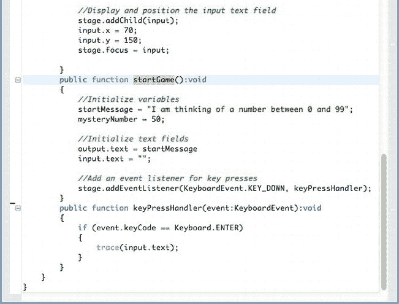

**图 4-10.** 将新代码添加到程序的末尾。

2.  编译程序。在 `input` 字段中输入一些数字，然后按下 Enter 键。你会看到你输入的数字以跟踪消息的形式显示出来。图 4-11 展示了这一过程。

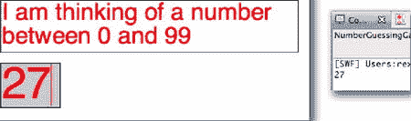

**图 4-11.** 你在输入字段中输入的任何数字都会以跟踪消息的形式显示出来。

你的代码首先向舞台添加了一个监听器。它的工作方式与你在第 3 章中使用的按钮监听器完全相同，区别在于它监听的是按键。

```actionscript
stage.addEventListener(KeyboardEvent.KEY_DOWN, keyPressHandler);
```

`KeyboardEvent` 类（你已在本项目中将该类与其他类一起导入）有一个特殊的 `KEY_DOWN` 属性，你可以用它来检测键盘上按下的任何键。当检测到按键时，监听器会调用 `keyPressHandler` 来确定应该执行什么操作。

```actionscript
public function keyPressHandler(event:KeyboardEvent):void
{
  if (event.keyCode == Keyboard.ENTER)
  {
    trace(input.text);
  }
}
```

正如你在第 3 章中学到的，事件监听器会在一个特殊的事件对象中向事件处理函数发送大量信息。你可以在处理函数的参数中看到这个事件对象：它的名称是 `event`。图 4-12 高亮显示了这一点。

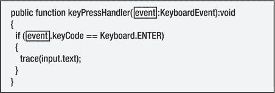

**图 4-12.** 事件对象存储了大量关于所发生事件的信息，包括按下的键。

所有事件处理函数都必须包含一个事件对象来存储这些信息——这是基本要求。包含键盘信息的事件对象被类型化为 `KeyboardEvent` 对象，如下所示：

`event:KeyboardEvent`

它们直接声明在事件处理函数中，如下面加粗的代码所示：

```actionscript
private function onKeyDown(event:KeyboardEvent):void
{...
```

你可以随时访问这个 `event` 对象来使用它包含的信息。其中一条信息就是被按下键的键码数字。这个数字存储在事件变量的一个名为 `keyCode` 的属性中。你可以像下面这样访问它：

`event.keyCode`

它包含被按下键的键码数字。这很重要，因为这意味着你可以利用这个信息来判断键盘上哪个键被按下了。键码是一个数字（例如 40 或 37），对应键盘上的一个特定键。幸运的是，你不需要知道或记住这些键码到底是什么。`Keyboard` 类包含了方便的常量属性，如 `LEFT`、`RIGHT`、`UP`、`DOWN` 和 `ENTER`，你可以用它们来代替实际的键码数字。

一个 `if` 语句检查按下的键是否是 Enter 键。

```actionscript
if (event.keyCode == Keyboard.ENTER)
{
  trace(input.text);
}
```

代码检查 `event` 对象的键码是否与 `Keyboard.ENTER` 的值匹配。如果匹配，则执行 `trace` 指令。`trace` 指令显示 `input` 字段的 `text` 属性的值——也就是你在舞台上输入的任何内容。真巧妙！

Enter 键的键码数字是 13。实际上，你也可以将条件语句写成下面这样，它同样可以正常工作：

```actionscript
if (event.keyCode == 13)
{
  trace(input.text);
}
```

说实话，如果你打算这样写，我也不会阻止你！但是，AS3.0 的 `Keyboard` 类包含了大量预定义的常量，这些常量已经代表了这些数字，例如 `Keyboard.ENTER`，所以你不需要记住键盘上每个键对应的数字。相反，你只需要使用 `Keyboard` 类中那些易读易记的 `Keyboard` 属性。你将在第 5 章中了解到更多这些 `Keyboard` 属性。

> 实际上，`Keyboard` 类包含了键盘上每个键的常量。如果你想查看完整的列表，请将你的网络浏览器指向 [`http://help.adobe.com/en_US/FlashPlatform/reference/actionscript/3/flash/ui/Keyboard.html#?filter_flash=cs5&filter_flashplayer=10.2&filter_air=2.6`](http://help.adobe.com/en_US/FlashPlatform/reference/actionscript/3/flash/ui/Keyboard.html#?filter_flash=cs5&filter_flashplayer=10.2&filter_air=2.6)。

现在，你已经有办法直接从玩家那里获取信息并传入程序。将其应用到你的游戏中，看看它是如何工作的。

### 做出判断

# 构建游戏核心逻辑：使用 if/else 语句判断玩家输入

你的程序已经做了大量工作，但目前为止它还没有实现任何实际功能。现在你需要构建游戏的核心逻辑，让程序能够判断玩家输入的数字是过大、过小还是正确。

你可以使用 `if/else` 语句来实现这一点。请注意，`if/else` 语句与你之前在第 3 章学过的简单 `if` 语句非常相似，区别在于当被检查的条件为假时，它会提供额外的执行路径。

## 基础 if 语句

以下是上一章你见过的基础 `if` 语句示例：

```
if (这个条件或变量为真)
{
执行此指令。
}
```

但如果条件不成立呢？显然，`if` 语句内部的指令不会执行。但如果你希望执行其他操作呢？这时就需要引入关键字 `else`。

## if/else 语句

下面是一个简单 `if/else` 语句的示例：

```
if (这个条件或变量为真)
{
  执行此指令...
}
else
{
  如果条件或变量不为真，则执行此指令...
}
```

如果条件不成立，程序会直接跳转到 `else` 代码块花括号内的第二条指令。这使程序可以在两个备选方案中做出选择，并且至少会执行其中之一。

## if/else if/else 语句

你可以更进一步，通过增加 `else if` 语句来引入第三种或更多可能的选择。来看看它是如何工作的：

```
if (这个条件或变量为真)
{
  执行此指令。
}
else if (其他某个条件或变量为真)
{
  执行此指令。
}
else
{
  如果两者都不为真，则执行此指令。
}
```

这个 `if/else` 语句会依次检查每个条件。如果第一个条件为假，就跳至第二个条件。如果第二个条件也为假，则执行 `else` 代码块中的最后一条指令作为默认值。

这种格式非常适合数字猜谜游戏，因为你需要程序检查三种可能的情况：

- 如果玩家的猜测小于神秘数字。
- 如果玩家的猜测大于神秘数字。
- 如果玩家的猜测恰好等于神秘数字。

## 实现判断逻辑

要在程序中实现这种判断逻辑，你首先需要找到一种方法，将舞台上 `input` 文本字段中的数字传入程序以便处理。这很容易实现。

- 你需要创建一个名为 `currentGuess` 的新变量，用于存储玩家在 `input` 文本字段中输入的数字。你将使用这个新变量将 `input` 文本字段中的文本从字符串转换为数字，以便 `if/else` 语句能够处理它。
- 你需要实现当玩家按下键盘上的 Enter 键时触发某些操作。
- 你需要创建一个名为 `playGame` 的新方法。它的职责是分析玩家的输入，并判断猜测的数字是过小、过大还是正确。

让我们开始吧！

### 步骤 1：添加新变量

在类定义中，紧接在你之前添加的两个新变量之后，添加以下新变量 `currentGuess`：

```
public class NumberGuessingGame extends Sprite
{
  //创建文本对象
  public var format:TextFormat = new TextFormat();
  public var output:TextField = new TextField();
  public var input:TextField = new TextField();

  //游戏变量
  public var startMessage:String;
  public var mysteryNumber:uint;

  public var currentGuess:uint;
```

### 步骤 2：编写 playGame 方法

编写 `playGame` 方法。将其添加在你的代码中 `startGame` 方法之后、`keyPressHandler` 方法之前。如果你不确定添加位置，请参考图 4-13。

```
public function playGame():void
{
  currentGuess = uint(input.text);
```

```actionscript
if (currentGuess > mysteryNumber)
{
    output.text = "That's too high.";
}
else if (currentGuess < mysteryNumber)
{
    output.text = "That's too low.";
}
else
{
    output.text = "You got it!";
}
```

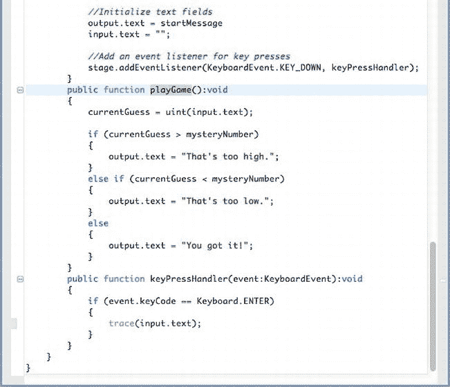

**图 4-13.** 在 `startGame` 和 `keyPressHandler` 之间添加 `playGame` 方法。

实际上，只要该方法位于类定义中自己的代码块内，添加在哪个位置其实并不重要。不过，我倾向于将事件处理程序放在程序末尾，以保持代码整洁。

### 步骤 3：连接 keyPressHandler 和 playGame

现在需要将 `keyPressHandler` 连接到 `playGame` 方法。这样，当按下回车键时，`playGame` 方法就会运行。修改 `keyPressHandler`，将 `trace` 方法替换为 `playGame()` 方法调用，如下所示：

```actionscript
public function keyPressHandler(event:KeyboardEvent):void
{
    if (event.keyCode == Keyboard.ENTER)
    {
        playGame();
    }
}
```

### 步骤 4：编译并测试

编译程序。在 `input` 字段中输入一个数字，然后按回车键。游戏现在会告诉你猜的数字是太高、太低还是正确（参见 图 4-14）。

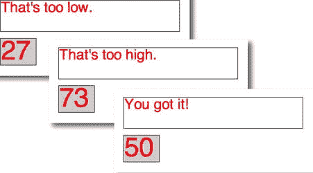

**图 4-14.** 通过 `if`/`else` 语句，游戏可以判断玩家的猜测是否正确。

当你按下回车键时，键盘事件监听器会调用 `keyPressHandler`。如果按下的是回车键，则会调用 `playGame` 方法。`playGame` 方法会分析玩家的输入并显示结果。图 4-15 展示了按下回车键时代码的执行路径。

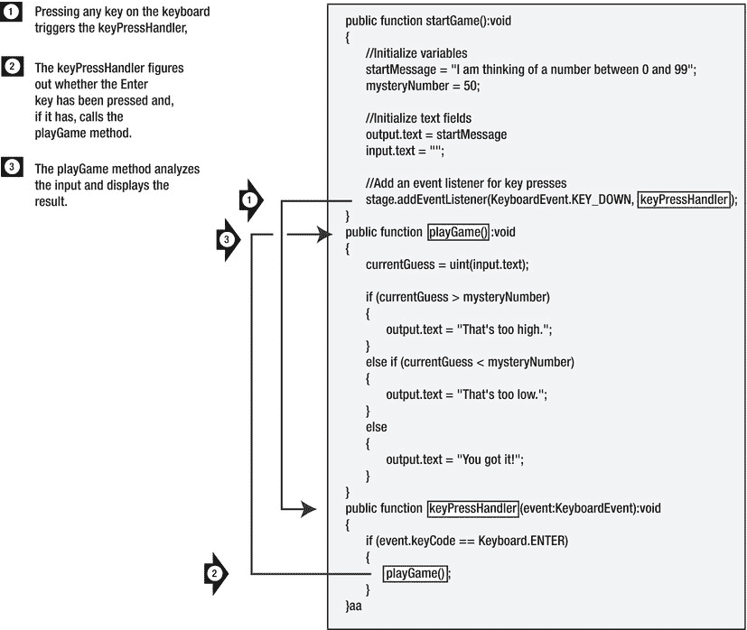

**图 4-15.** 按下回车键时发生的事件

## 解析 playGame 方法

让我们来看看 `playGame` 方法是如何工作的。

```actionscript
public function playGame():void
{
    currentGuess = uint(input.text);

    if (currentGuess > mysteryNumber)
    {
        output.text = "That's too high.";
    }
    else if (currentGuess < mysteryNumber)
    {
        output.text = "That's too low.";
    }
    else
    {
        output.text = "You got it!";
    }
}
```

第一条指令可能有点令人费解。

```actionscript
currentGuess = uint(input.text);
```

这到底是怎么回事？它将 `input` 字段中的文本复制到 `currentGuess` 变量中。但不仅如此，它还将输入数据从纯文本转换为数字。

当你在 `input` 文本字段中输入文本时，该文本会作为 `String` 对象存储在字段的内置 `text` 属性中。`String` 对象是单词或字母，通常可以通过它们被引号包围而识别出来。即使你输入的是数字，这些数字也会被解释为文本行中的字符，而不是可以数学处理的数据。对于字符串来说，`"789"` 只是另一个像 `"bike"` 或 `"elephant"` 一样的单词。这就产生了一个问题，因为游戏依赖于玩家输入能够被识别为数字的数字。

因此，你需要做的是将 `input` 字段的 `text` 属性中的数据从字符串转换为数字。由于 0 到 99 的数字都是正数且不含小数，因此将它们解释为 `uint` 类型的数据是合理的。

在 AS3.0 中转换数据类型非常容易。你所需要做的就是用括号将要转换的数据括起来，然后加上你想要转换成的类型名称。这就是下面这段代码的作用：

```actionscript
currentGuess = uint(input.text);
```

它将 `input` 字段的 `text` 变量中的字符串转换为 `uint` 类型的数字。这种将一种数据类型转换为另一种数据类型的过程称为**类型转换**。在本书中，你会经常遇到类型转换。为了确保 AS3.0 的编译器能正确运行代码，通常需要将数据或对象转换为特定类型。

另一种转换变量的方法是使用 `as` 关键字。你可以这样编写上面那行代码：

```actionscript
currentGuess = input.text as uint;
```

这行代码非常易读，效果完全相同。完全取决于你更喜欢哪种转换风格。

现在，`currentGuess` 变量中有了一个数字，你可以使用 `if`/`else` 语句来分析它。

```markdown
# 显示游戏状态

逻辑运行得很好，但你实际上无法赢得或输掉游戏。游戏会给你无限次数的猜测机会，甚至在你猜对神秘数字后，你还能一直玩下去！这又一次让我们得以一窥永恒的奥秘以及地球上生命转瞬即逝的本质，但玩起来可一点都不有趣！

为了限制猜测次数，程序需要更清楚地了解游戏的状态，以及在达成胜利或失败条件时该如何处理。你将分两步解决这个问题，首先从显示游戏状态开始。

要判断玩家是赢是输，游戏首先需要知道更多信息。

-   游戏结束前，玩家还剩多少次猜测机会。
-   玩家已经进行了多少次猜测。这实际上是可选信息，但实现起来很有趣，所以我们来试试看。

当一个程序需要关于某事物的更多信息时，通常意味着你需要创建更多的变量来捕获和存储这些信息。这正是你接下来要做的：创建两个新变量，分别命名为 `guessesRemaining` 和 `guessesMade`。你还会创建第三个变量 `gameStatus`，用于在 `output` 文本字段中显示这些新信息。

1.  将以下三个新变量添加到类定义中，紧接在前几步添加的其他变量下方：
    ```actionscript
    public class NumberGuessingGame extends Sprite
    {
      //创建文本对象
      public var format:TextFormat = new TextFormat();
      public var output:TextField = new TextField();
      public var input:TextField = new TextField();
      //游戏变量
      public var startMessage:String;
      public var mysteryNumber:uint;
      public var currentGuess:uint;
      public var guessesRemaining:uint;
      public var guessesMade:uint;
      public var gameStatus:String;
    }
    ```

2.  在 `startGame` 方法中初始化这三个新变量，如下所示：
    ```actionscript
    public function startGame():void
    {
      //初始化变量
      startMessage = "I am thinking of a number between 0 and 99";
      mysteryNumber = 50;
      //初始化文本字段
      output.text = startMessage
      input.text = "";
      guessesRemaining = 10;
      guessesMade = 0;
      gameStatus = "";
      //为按键添加事件监听器
      stage.addEventListener(KeyboardEvent.KEY_DOWN, keyPressHandler);
    }
    ```

3.  将以下加粗的代码添加到 `playGame` 方法中：
    ```actionscript
    public function playGame():void
    {
      guessesRemaining--;
      guessesMade++;
      gameStatus
        = "Guess: " + guessesMade + ", Remaining: " + guessesRemaining;
      currentGuess = uint(input.text);
      if (currentGuess > mysteryNumber)
      {
        output.text = "That's too high." + "\n" + gameStatus;
      }
      else if (currentGuess < mysteryNumber)
      {
        output.text = "That's too low." + "\n" + gameStatus;
      }
      else
      {
        output.text = "You got it!";
      }
    }
    ```

4.  编译程序并玩游戏。`output` 文本字段现在会显示你还剩多少次猜测机会以及你已经猜了多少次。图 4-16 展示了游戏可能的样子。

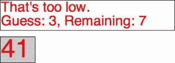

**图 4-16.** 游戏会跟踪剩余猜测次数和已猜测次数。

接下来我们看看这段新代码做了什么。

## 使用后缀运算符按一递增或递减变量值

新代码为这三个新变量分配了初始值。

```actionscript
guessesRemaining = 10;
guessesMade = 0;
gameStatus =  "";
```

游戏结束前玩家的总猜测次数存储在 `guessesRemaining` 变量中。你将它初始化为 10，但当然可以更改这个值来让游戏变得更难或更容易。你还想统计玩家进行了多少次猜测，所以创建了 `guessesMade` 变量来存储这一信息。游戏开始时，玩家显然还没有进行任何猜测，因此 `guessesMade` 变量被设为 0。`gameStatus` 变量是一个 `String`，用于输出这些新信息，你马上就会看到它是如何做到的。它最初不包含任何文本（被赋值为一对空引号）。

现在看看 `playGame` 方法中的前两个新指令。

```actionscript
guessesRemaining--;
guessesMade++;
```

当你玩游戏时，你会注意到输出文本字段中的“剩余猜测次数”减少 1，而“已猜测次数”增加 1。这都归功于两行代码，它们使用了极其方便的**后缀运算符**。

还记得上一章讨论过的递增和递减运算符吗？如果你想将某个值增加 1，可以编写如下代码：

```actionscript
numberVariable += l;
```

事实证明，递增 1 是程序员希望程序经常执行的操作。实际上，这种情况太常见了，以至于 AS3.0 为此提供了特殊的简写形式：双加号，这是一种特殊类型的运算符，称为后缀运算符。你可以用它重写之前的代码行，就像这样：

```actionscript
numberVariable++;
```

它会完成完全相同的事情：给变量的值加 1。你可以使用另一个后缀运算符——双减号，以完全相同的方式从变量值中减去 1，就像这样：

```actionscript
numberVariable--;
```

后缀运算符每次指令执行时都将变量的值改变 1。`playGame` 事件处理程序中的指令在每次按下 Enter 键时执行，这当然也就对应了每次玩家进行猜测。因此，让 `guessesRemaining` 和 `guessesMade` 变量在每次按键时更新，是跟踪玩家已猜测次数的绝佳方式。

游戏开始时，`guessesRemaining` 变量被初始化为 10。第一次点击猜测按钮时，会执行以下指令：

```actionscript
guessesRemaining--;
```
```

### 字符串拼接

让我们在程序中再创建一个名为 `gameStatus` 的新变量。你已将这个变量声明为 `String` 类型，这意味着它将用于存储文本。它首次出现在以下指令中：

```
gameStatus = "Guess: " + guessesMade + ", Remaining: " + guessesRemaining;
```

（这是一行非常长的代码，为了便于在本书中打印，我通过在等号处换行将其分成了两行。在你的程序中，你可以将所有内容保持在一行不间断的代码中，如图 4-17 所示。）

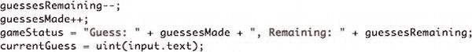

**图 4-17.** 将较长的代码段保留在同一行。

对于初学者来说，这可能是一段令人望而生畏的代码。它到底是做什么的？你在游戏中第一次进行猜测时，会在输出文本字段的第二行看到以下文本：`Guess: 1, Remaining: 9`。这段文本必须有来源，而正是前面的那条指令负责将其拼接在一起。

仔细想想：当你第一次点击“Guess”按钮时，`guessesRemaining` 和 `guessesMade` 变量的值是多少？（它们是 9 和 1。）好的，那么让我们假设你用它们所代表的实际数字 9 和 1 替换了指令中使用的变量名。结果大致如下：

```
gameStatus = "Guess: " + 1 + ", Remaining: " + 9;
```

讲得通，对吧？很好，现在让我们假装加号消失了，所有内容都放在一对引号内：

```
gameStatus = "Guess: 1, Remaining:  9";
```

啊哈！你现在能看出它们是如何拼接在一起的吗？这正是输出文本字段中显示的那段文本。图 4-18 展示了从原始指令到最终在输出文本字段中显示的整行文本是如何被解释的。

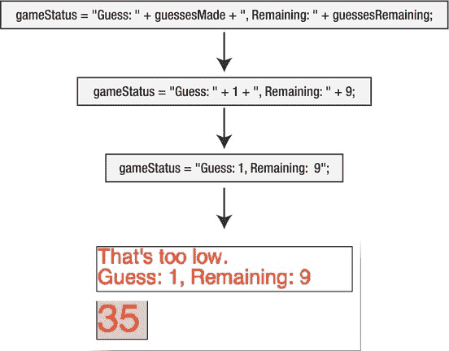

**图 4-18.** 从厨房到餐盘：字符串拼接实战！

这条指令使用加号将各个独立元素连接在一起，形成一段连贯的文本字符串。这在计算机编程中被称为字符串拼接。它的含义仅仅是“用加号将文本连接起来”。当你需要将不变的文本与会变化的变量混合使用时，这是一个非常有用的技术。由于变量的值会改变，整个文本字符串也会相应地自动更新。这实际上非常简单，但在程序运行时却是一种神奇的现象。

当你使用加号拼接字符串时，它们没有任何数学意义——它们就像针脚一样，用于将所有的文本片段缝合成长长的一段。在程序中，所有这些拼接的最终结果会被复制到 `gameStatus` 变量中，因此无论何时需要显示这段文本，你只需使用 `gameStatus` 变量即可。而这正是接下来这段代码所做的。

你应该注意一个小的技术细节：下面的指令实际上混合了 `String` 和 `uint` 变量：

```
gameStatus = "Guess: " + guessesMade + ", Remaining: " + guessesRemaining;
```

在程序中，你将 `gameStatus` 变量声明为 `String` 类型。这意味着它不能包含数字，除非以数字字符的形式（这些字符会被像字母或单词一样解释）。然而，你将 `guessesRemaining` 和 `guessesMade` 变量都声明为 `uint` 变量（它们会被解释为数字）。它们与普通文本连接在一起，并被复制到 `gameStatus` 字符串变量中。分配变量类型的目的不就是为了防止字符串和数字之间这种混搭吗？这怎么可能？

事实上，你可以通过加号将数字变量与字符串连接在一起使用，但当你这样做时，AS3.0 会将数字变量的值转换为字符串。`guessesRemaining` 和 `guessesMade` 变量中的数据类型保持为 `uint` 不变，但它们包含的值在赋值给 `gameStatus` 字符串变量时会被转换为字符串。这对于你目前的使用目的非常有用：显示包含由程序更新的数字的文本。这在程序中是一个如此常见的需求，以至于 AS3.0 会自动进行这种类型转换。

现在你已经将 `gameStatus` 变量打包好并准备就绪，你可以在 if/else 语句中充分利用它了。新的代码部分以粗体突出显示：

```
if (currentGuess > mysteryNumber)
{
  output.text = "That's too high." + "\n" + gameStatus;
}
else if (currentGuess < mysteryNumber)
{
  output.text = "That's too low." + "\n" + gameStatus;
}
else
{
  output.text = "You got it!";
}
```

你正在使用字符串拼接将 `gameStatus` 变量的内容添加到输出文本字段中。但这里有一些你之前没见过的东西：`"\n"`。反斜杠后跟字母 n 被称为换行符。换行符会强制其后的任何文本另起一行。这就是为什么游戏会在第一段文本下方显示游戏状态信息的原因。

你可以在任何字符串的中间使用换行符，将文本分成两行或更多行。这里有一个例子：

```
"This text\nis broken in the middle."
```

它会显示为：

```
This text
is broken in the middle.
```

在程序中，你通过字符串拼接将换行符与其余文本连接在一起。使用示例文本时，看起来如下：

```
"This text" + "\n" + "is broken in the middle."
```

结果完全相同，但代码更容易阅读，因为换行位置在视觉上非常清晰。

### 为什么使用 `gameStatus` 变量？

还有最后一点你需要快速了解，你可能会对 if/else 语句中代码的编写方式有疑问。你本可以在 if/else 语句的前两条指令中不使用 `gameStatus` 变量，像这样编写：

```
if (currentGuess > mysteryNumber)
{
  output.text = "That's too high." + "\n" + "Guess: " + guessesMade + ", Remaining: " + guessesRemaining;
}
else if (currentGuess < mysteryNumber)
{
  output.text = "That's too low." + "\n" + "Guess: " + guessesMade + ", Remaining: " + guessesRemaining;
}
else
{
  output.text = "You got it!";
}
```

那么，既然不用它也能轻松实现，为什么你还要费心去创建一个专门的 `gameStatus` 变量呢？很明显，那会是一大段代码，使得 `if/else` 语句更难阅读，而且你还得把它完整地写两遍。

另一个原因可能不那么明显：如果你把那串文本整洁地存储在 `gameStatus` 变量中，并且需要对其进行任何修改，你只需要修改一次。程序中任何使用了 `gameStatus` 变量的地方都会自动更新为新文本。在一个像这个猜数字游戏一样的小程序里，这可能不是什么大问题，但如果在一个更大的程序中，同一个文本需要在不同地方使用 10 次或 20 次，更新起来就会非常繁琐。

无论何时，当你在任何程序中发现自己反复使用大量相同的文本时，试着把它存储在一个变量中。从长远来看，这会为你节省大量的输入工作和麻烦。

## 使用 `uint` 与 `int` 变量

你是否尝试过超出游戏提示的十次机会继续猜数？如果试过，你会发现输出文本字段显示的内容类似这样：

`Remaining: 4294967295`

（如果数字显示不全，你可能需要向下滚动输出文本字段才能看到。）

此刻，你还没有编写玩家用尽猜测次数时游戏结束的逻辑，因此即使十次机会用完后，`guessesRemaining` 变量仍会持续减 1。当它越过 0 时，会突然跳变为这个疯狂的长数字：`4294967295`。不，这并非你的程序要加入一个密谋推翻人类的秘密电脑僵尸网络；背后其实有非常有趣的逻辑。

你将 `guessesRemaining` 变量声明为 `uint` 类型，这种类型仅能存储正整数。它永远不能为负数。当声明为 `uint` 类型的变量试图变为负数时，恰恰会发生相反的情况：它会翻转至最大可能值，恰好是 `4294967295`。

了解这一点非常重要，因为有时你需要或想要知道某个数字是否已进入负数区间。在这种情况下，请确保将变量声明为 `int` 类型。（如前所述，`int` 代表 *integer*（整数），即可为正数或负数的整数。）

要查看将 `guessesRemaining` 变量改为 `int` 类型对程序的影响，请尝试以下操作并观察结果！

1.  在类定义中修改声明 `guessesRemaining` 变量的代码行，将其类型设为 `int`：`public var guessesRemaining:int;`
2.  编译程序。
3.  按 `Enter` 键超过十次。你应该会看到 `Remaining` 值变为负数，如下所示：

`Remaining: -3`

每当你决定声明变量类型时，请牢记这一点。

## 胜负判定

现在游戏已掌握足够信息来判断玩家是否获胜或失败。你只需找到一种方式说：“嘿，游戏结束了！”并告知玩家他们的表现如何。

为此，请在程序中添加以下内容：

*   一个名为 `gameWon` 的布尔型（`true`/`false`）变量，当游戏获胜时设置为 `true`，未获胜时设置为 `false`。
*   一个名为 `checkGameOver` 的方法，用于检查玩家是否还有足够的剩余猜测次数继续游戏。
*   一个名为 `endGame` 的方法，用于告知玩家他们是获胜还是失败。

下一段代码的一个关键方面在于，它向你展示了如何利用方法将代码模块化。正如本章开头讨论的，*模块化编程*是将复杂代码分解为更小、更易管理的部分（即*模块*）的一种方式。模块可以是任何执行特定有用功能的代码片段，例如类或方法。请查看以下代码中添加的两个新方法，看看你是否能理解它们如何用于实现程序的模块化。

1.  在类定义中添加新的 `gameWon` 变量。

```actionscript
public class NumberGuessingGame extends Sprite
{
  // 创建文本对象
  public var format:TextFormat = new TextFormat();
  public var output:TextField = new TextField();
  public var input:TextField = new TextField();
  // 游戏变量
  public var startMessage:String;
  public var mysteryNumber:uint;
  public var currentGuess:uint;
  public var guessesRemaining:int;
  public var guessesMade:uint;
  public var gameStatus:String;
  public var gameWon:Boolean;
}
```

2.  在 `startGame` 方法中将其初始值设为 `false`。

```actionscript
public function startGame():void
{
  // 初始化变量
  startMessage = "我正在想一个介于 0 到 99 之间的数字";
  mysteryNumber = 50;
  // 初始化文本字段
  output.text = startMessage
  input.text = "";
  guessesRemaining = 10;
  guessesMade = 0;
  gameStatus = "";
  gameWon = false;
  // 添加键盘按下的事件侦听器
  stage.addEventListener(KeyboardEvent.KEY_DOWN, keyPressHandler);
}
```

3.  将以下粗体代码添加到 `startGame` 方法中。在其正下方添加两个新方法 `checkGameOver` 和 `endGame`。

```actionscript
public function playGame():void
{
  guessesRemaining--;
  guessesMade++;
  gameStatus = "已猜: " + guessesMade + ", 剩余: " + guessesRemaining;
  currentGuess = uint(input.text);

  if (currentGuess > mysteryNumber)
  {
      output.text = "That's too high." + "\n" + gameStatus;
      checkGameOver();
  }
  else if (currentGuess < mysteryNumber)
  {
      output.text = "That's too low." + "\n" + gameStatus;
      checkGameOver();
  }
  else
  {
      output.text = "You got it!";
      gameWon = true;
      endGame();
  }
}

public function checkGameOver():void
{
    if (guessesRemaining < 1)
    {
        endGame();
    }
}

public function endGame():void
{
    if (gameWon)
    {
        output.text
            = "Yes, it's " + mysteryNumber + "!" + "\n"
            + "It only took you " + guessesMade + " guesses.";
    }
    else
    {
        output.text
            = "No more guesses left!" + "\n"
            + "The number was: " + mysteryNumber + ".";
    }
}
```

# 4. 修改游戏逻辑

## 4.1 删除冗余指令

将以下指令从`startGame`方法中的`if`语句中删除。这段文本将被`endGame`方法的新文本替换。将其保留实际上无伤大雅，但显得冗余：`output.text = "You got it!";`

## 4.2 编译与测试

编译程序并玩游戏。现在它会阻止你猜测超过十次，并告诉你是否赢了或输了。图 4-19 展示了如果你猜对时游戏可能的样子。

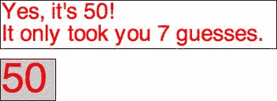

**Figure 4-19.** 游戏现在可以分出胜负。

游戏需要判断玩家是否用完了所有猜测次数。在你添加新代码之前，你可以统计猜测次数，但程序不知道如何处理这些信息。新代码解决了这个问题。

新方法通过将步骤分解为可管理的部分，帮助实现了程序的模块化。让我们简要浏览一下所有这些新代码是如何组合在一起的。

## 4.3 添加游戏结束检查

首先，你需要帮助游戏判断玩家是否还能继续游戏。你在`startGame`方法中`if/else`语句的前两个代码块中添加了相同的`checkGameOver`方法调用，如下所示（以粗体突出显示）：

```actionscript
public function playGame():void
{
    guessesRemaining--;
    guessesMade++;
    gameStatus = "Guess: " + guessesMade + ", Remaining: " + guessesRemaining;
    currentGuess = uint(input.text);
    if (currentGuess > mysteryNumber)
    {
        output.text = "That's too high." + "\n" + gameStatus;
        `checkGameOver();`
    }
    else if (currentGuess < mysteryNumber)
    {
        output.text = "That's too low." + "\n" + gameStatus;
        `checkGameOver();`
    }
    else
    {
        output.text = "You got it!";
        gameWon = true;
        endGame();
    }
}
```

这两个新指令是对`checkGameOver`方法的调用。因此，一旦程序读取到其中一个指令，它会立即跳转到`checkGameOver`方法的函数定义处，并执行其中包含的任何指令。

`checkGameOver`函数的定义如下所示：

```actionscript
public function checkGameOver():void
{
    if (guessesRemaining < 1)
    {
        endGame();
    }
}
```

该方法会检查玩家剩余的猜测次数。如果次数足够，则无事发生，游戏继续。但如果`guessesRemaining`小于 1，则通过调用`endGame`方法来结束游戏。

## 4.4 实现游戏结束逻辑

```actionscript
public function endGame():void
{
    if (gameWon)
    {
        output.text
            = "Yes, it's " + mysteryNumber + "!" + "\n"
            + "It only took you " + guessesMade + " guesses.";
    }
    else
    {
        output.text
            = "No more guesses left!" + "\n"
            + "The number was: " + mysteryNumber + ".";
    }
}
```

`endGame`方法通过检查`gameWon`变量是`true`还是`false`来判断游戏是赢了还是输了。然后它会显示相应的消息。（你能弄清楚字符串拼接是如何用来显示这些消息的吗？将代码与你在游戏输出文本字段中看到的内容进行比较。我相信你一定能做到！）

*`if`语句的工作原理是：如果括号内的条件为真，则执行其指令。对于布尔型变量，有两种方法可以检查它们是`true`还是`false`。你可以使用相等运算符（双等号）并将其与`true`或`false`值进行比较，如下所示：*

*`if(gameWon == true)`*

*如果`gameWon`为`false`，则此语句被视为假，指令不会执行。如果`gameWon`为`true`，则此语句被视为真，指令会执行。*

*从上一章你应该已经熟悉了这种检查真假条件的方式。然而，如果你要检查的条件恰好是一个布尔变量的值，那么使用以下简写形式会更方便，并且通常能使代码更易读：*

*`if(gameWon)`*

*因为`gameWon`的值只能是`true`或`false`，所以它提供的信息与第一个示例完全相同。*

*在本书中，你将使用此方式作为在`if`语句中检查布尔变量值的首选方法。`if(gameWon)`非常接近英语短语“If the game is won.”（如果游戏赢了）。精心选择变量的名称有助于让你的程序更易读。*

## 4.5 理解游戏状态变量

程序如何知道`gameWon`变量是`true`还是`false`？

你在`startGame`方法中将`gameWon`初始化为`false`。这意味着除非你在游戏的某处将其更改为`true`，否则它将始终为`false`。只有当玩家实际满足获胜条件时，你才会将其更改为`true`。在这个游戏中，玩家只有一种获胜方式：猜中正确的数字。

这使得事情变得非常简单，因为你知道如果玩家仍有足够的猜测次数，并且他们猜中了正确的数字，那么他们一定赢了。所以你只需要在检查玩家猜测是否正确的同一个`if/else`块中将`gameWon`变量设为`true`并调用`endGame`方法即可。很简单！

不信？看看`playGame`方法中`if/else`语句执行此操作的部分（以粗体文本显示）：

```actionscript
public function playGame():void
{
    guessesRemaining--;
    guessesMade++;
    gameStatus = "Guess: " + guessesMade + ", Remaining: " + guessesRemaining;
    currentGuess = uint(input.text);
    if (currentGuess > mysteryNumber)
    {
        output.text = "That's too high." + "\n" + gameStatus;
        `checkGameOver();`
    }
    else if (currentGuess < mysteryNumber)
    {
        output.text = "That's too low." + "\n" + gameStatus;
        `checkGameOver();`
    }
    else
    {
        output.text = "You got it!";
        `gameWon = true;`
        `endGame();`
    }
}
```

思考一下`if/else`语句背后的逻辑。如果玩家仍有足够的猜测次数，游戏将继续。如果游戏还在继续，并且玩家猜对了数字，那么他们一定赢了。然后将`gameWon`变量设为`true`，并执行`endGame`方法中的指令。当`endGame`方法运行时，其条件语句注意到`gameWon`为`true`，并显示消息告知玩家她已获胜。

## 使用方法进行模块化编程

你是否注意到，代码中通过`checkGameOver`和`endGame`方法实现了模块化？实际上，你也可以不借助这些方法，将所有判断条件塞进一个极长的`if/else`语句中来完成程序。但若真这么做，部分代码就不得不重复编写两次，整个程序也会变得难以阅读和调试。

将特定任务模块化封装到独立的方法中，你可以单独修改或调试这些代码片段，而无需改动（甚至可能破坏）其他正常运行的程序部分。这也意味着，每当需要执行某个任务时，无需重复编写已写过的代码，只需调用对应的方法即可。

使用方法实现代码模块化可能需要一些练习，在看过更多示例并在自己的项目中尝试使用之前，你可能会觉得有些烧脑。不妨先观察当前游戏的运行机制，尝试理解方法与方法调用之间的关联关系。图 4-20 展示了各模块如何协同工作。你可以将每个代码块视为程序中的一个模块。

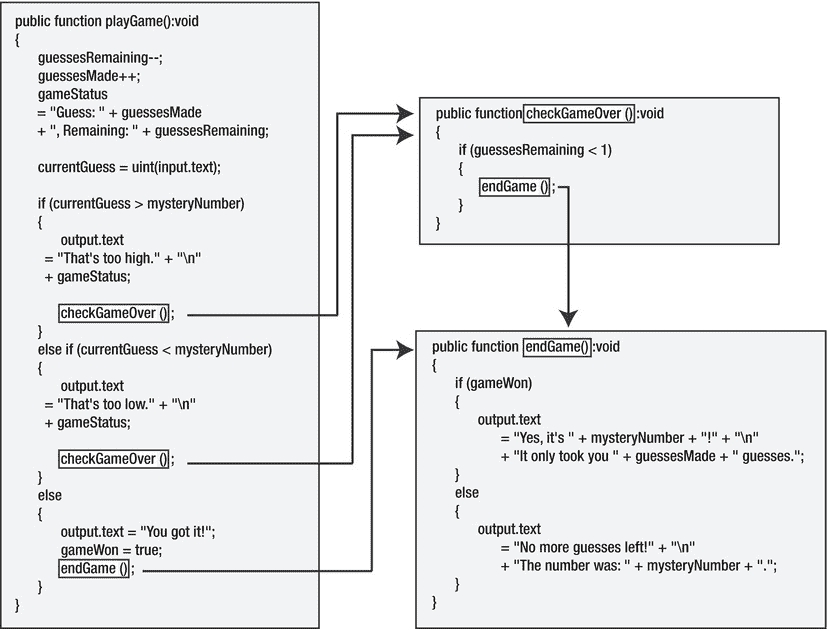

**图 4-20.** 使用方法将特定任务模块化。

## 完善优化

俗话说，开发软件时 30% 的时间用来让它跑起来，剩下 70% 的时间则用来让它跑得更好。猜数字游戏就是这条原则的最佳例证。它虽然可玩，但缺少许多玩家会吐槽的功能。

以下是一些可改进的方向：

- 玩家获胜后，游戏仍在继续计数猜的次数。
- 神秘数字呢？如果每次玩都是 50，那游戏的可重复性就太差了。可以通过随机生成神秘数字来解决。
- 最好添加一些按钮来操作游戏，比如加入“再玩一次”按钮。

是时候撸起袖子，看看能否解决这些问题了！

### 处理随机数

我们先解决随机数问题，因为几乎可以肯定，你在多数游戏项目中都会用到随机数。AS3.0 内置了一个名为`Math`的类，其中包含许多实用的数字处理方法。其中之一是`random`方法，它能生成 0 到 1 之间的随机数。其用法如下：

```
Math.random()
```

你可以像给其他变量赋值一样，将这个随机数赋给一个变量，例如：

```
randomVariable = Math.random();
```

虚构变量`randomVariable`现在被赋值为 0 到 1 之间的随机数，最多包含 16 位小数。所以它可能是任何值，例如`0.3669164208535294`或`0.5185672459021346`。

一个带有 16 位小数的 0 到 1 之间的随机数有什么用呢？实际上，几乎毫无用处。不过，我们可以稍作调整，让它变得更有用。

首先，游戏中的随机数通常需要是整数。必须去掉那些小数位！你能想象猜数字游戏的神秘数字如果是`33.6093155708325684`会有多可怕吗？去掉所有小数后，你会得到类似`33`这样更人性化的数字。

幸运的是，`Math`类内置了几个方法，可以帮助你对小数进行向上或向下取整：

- `Math.round`用于四舍五入。例如，`Math.round(3.4)`返回`3`。`Math.round(3.8)`返回`4`。`Math.round(3.5)`也返回`4`。
- `Math.floor`始终向下取整。`Math.floor(3.2)`返回`3`。`Math.floor(3.9)`也返回`3`。
- `Math.ceil`始终向上取整。`Math.ceil(3.2)`返回`4`，`Math.ceil(3.9)`也返回`4`。（`ceil`是什么？它是*ceiling*（天花板）的缩写。天花板向上，地板向下。明白了吗？）

要将这些方法与`Math.random`结合使用，需要采用如下格式：

```
Math.round(Math.random())
```

想想这段代码在做什么。`Math.random()`生成一个 0 到 1 之间且带有大量小数的随机数。假设它生成了一个毫无用处的数字，比如`0.6781340985784098`。你可以把上面的代码想象成这样：

```
Math.round(0.6781340985784098)
```

如何对这个数字取整？向上取整，结果如下：

```
1
```

但如果随机数较小呢？

```
Math.round(0.2459678308703125)
```

它会被向下取整为：

```
0
```

这意味着，你可以使用`Math.round(Math.random())`这一行代码，生成一个有 50% 概率为 0 或 1 的随机数。虽然还不是游戏所需，但也并非毫无用处。在你的游戏中，有很多场景需要计算某件事发生的 50% 概率，而这段小代码正好能派上用场。

*实际上，你可以用这段代码生成随机的布尔值。假设你有一个名为`rainToday`的布尔变量。可以初始化为`false`。*

```
rainToday = false;
```

*唉，要是真的不下雨就好了！为了更真实一点，可以给它一个 50% 的概率为 true 或 false。只需在`if/else`语句中使用`Math.round(Math.random())`代码片段，并判断它是否等于 1 即可。代码可能如下：*

```
if(Math.round(Math.random()) == 1)
{
  rainToday = true;
}
else
{
  rainToday = false;
}
```

# 使用随机数

`Math.round(Math.random())` 生成数字 1 或 0 的概率正好各为 50%。如果恰好是 1，则执行第一条指令，`rainToday` 变为 true。如果是 0，今天就不下雨！

所以 0 到 1 之间的随机数稍微有点用了，但还不是游戏真正需要的。如何得到一个 0 到 99 之间的数字呢？方法如下：

`Math.floor(Math.random() * 100)`

星号是 AS3.0 中的乘法运算符。`* 100` 表示乘以 100。这行代码将随机数乘以 100，然后用 `Math.floor` 向下取整，使其最小可能为 0，最大为 99。这样就能生成一个完美的、范围在 0 到 99 之间的随机整数。

以下是另一种理解方式。假设随机数为 0.3378208608542148，那么代码将如下所示：

`Math.floor(0.3378208608542148 * 100)`

乘以 100 后，随机数将变成：

`Math.floor(33.78208608542148)`

小数点向右移动了两位，得到了一个便于处理的大数值。但令人头疼的小数问题依然存在！别担心，`Math.floor` 通过向下取整解决了这个问题。最终结果令人满意：

`33`

非常适合猜数字游戏！图 4-21 展示了这一过程的实际示例。

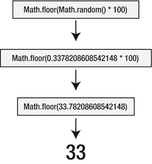

**图 4-21.** 从无用变有用：使用 `Math.random` 和 `Math.floor` 生成指定范围内的随机整数。

如果你需要一个 1 到 100 之间的随机数，可以使用如下代码：

`Math.ceil(Math.random() * 100);`

`Math.ceil` 向上取整，因此最小值为 1，最大值为 100。

只需更改乘以的数值，即可将此格式应用于任何数字范围。以下是一些示例：

- `Math.ceil(Math.random() * 10)` 生成 1 到 10 之间的随机数。
- `Math.ceil(Math.random() * 27)` 生成 1 到 27 之间的随机数。
- `Math.ceil(Math.random() * 5)` 生成 1 到 5 之间的随机数。

使用 `Math.ceil` 能确保随机数范围从 1 开始，因为任何小于 1 的数（如 0.23）都会被向上取整为 1。这样你就不必处理 0 值，而在游戏所需的数字范围中，0 通常没什么用。但如果你确实希望 0 也包含在范围内，可以使用 `Math.round`。`Math.round(Math.random() * 100)` 将生成一个 0 到 100 之间的随机数。

如果要在非 1 或 0 为起始的范围内生成随机数，该怎么办？

假设你需要一个 10 到 25 之间的数字。这意味着有 15 个可能的数字：10、11、12……一直到 25。你只需生成一个 0 到 15 之间的随机数，然后加上 10，将其推至所需范围。代码如下：

`Math.round(Math.random() * 15) + 10`

这样理解：随机数在 0 到 15 之间。假设是 8，然后加上 10，得到 18。这样你就得到了 10 到 25 之间的随机数范围。

现在，运用你学到的随机数知识来修改游戏。

1. 用加粗的新代码修改 `startGame` 方法。除了随机化 `mysteryNumber` 变量外，你还要添加一个用于测试的 `trace` 指令，以便检查数字是否真的是随机的。（注意，`trace` 指令中使用了字符串拼接，使显示的消息更易读。）

```actionscript
public function startGame():void
{
  //初始化变量
  startMessage = "我正在想一个 0 到 99 之间的数字";
  mysteryNumber = Math.floor(Math.random() * 100);
  //初始化文本字段
  output.text = startMessage
  input.text = "";
  guessesRemaining = 10;
  guessesMade = 0;
  gameStatus = "";
  gameWon = false;
  //追踪神秘数字
  trace("神秘数字：" + mysteryNumber);
  //添加键盘按键事件监听器
  stage.addEventListener(KeyboardEvent.KEY_DOWN, keyPressHandler);
}
```

2. 编译程序并开始游戏。神秘数字现在是一个 0 到 99 之间的随机数。你还会看到一条追踪信息显示"神秘数字：？？"，以便确认一切按预期运行。图 4-22 展示了游戏可能呈现的示例。

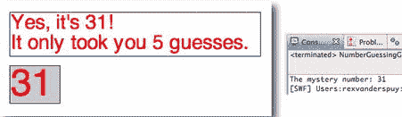

**图 4-22.** 随机化神秘数字

### 禁用回车键

游戏中目前有一个古怪的错误：如果玩家赢了游戏但继续按回车键，游戏仍然会继续计数猜测次数。你可以在输出文本字段中看到这一点，如图 4-23 所示。

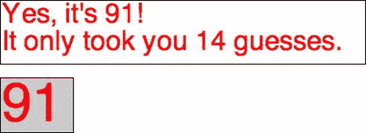

**图 4-23.** 随机化神秘数字

如果你思考一下程序的工作方式，这完全合理，因为回车键本身无法知道游戏是否结束；它只是尽职尽责地继续执行你分配给它的任务。

要修复这个问题，你需要在游戏结束时做三件事：

1. 从舞台对象中移除 `keyPressHandler` 事件监听器。
2. 禁用 `input` 文本字段，使其无法输入任何文本。
3. 调暗 `input` 文本字段，以便明显看出它已被禁用。这是可选的，但这是一个很好的视觉提示，告诉玩家游戏已结束。

只需要两行非常直接的代码。

1. 在 `endGame` 方法中添加以下加粗显示的代码：

```actionscript
public function endGame():void
{
  if (gameWon)
  {
    output.text
      = "Yes, it's " + mysteryNumber + "!" + "\n"
      + "It only took you " + guessesMade + " guesses.";
  }
  else
  {
    output.text
      = "No more guesses left!" + "\n"
      + "The number was: " + mysteryNumber + ".";
  }
  stage.removeEventListener
  (KeyboardEvent.KEY_DOWN, keyPressHandler);
  input.type = "dynamic";
  input.alpha = 0.5;
}
```

## 2. 编译程序并试玩游戏

游戏结束后，你将无法在`input`字段中输入更多文本，并且`input`字段会变暗，如图 4-24 所示。

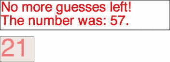

**图 4-24.** 游戏结束时禁用并调暗输入文本字段

所有新代码都添加在`endGame`方法的函数定义内部，因为其指令仅在游戏结束时运行。

第一条新指令从`Stage`对象中移除事件监听器：

`stage.removeEventListener(KeyboardEvent.KEY_DOWN, keyPressHandler);`

添加这行代码后，按下回车键时不会发生任何事情，但你仍然可以在`input`字段中输入文本。要防止这种情况，你需要使用以下代码行专门禁用`input`文本字段：

`input.type = "dynamic";`

`TextField`对象可以是两种类型："input"或"dynamic"。（这些值是字符串，因此你需要用引号将它们括起来。）显示游戏状态的`output`文本字段是"dynamic"类型，这意味着它可以显示文本，但不允许用户在其中输入。当你首次创建`TextField`对象时，所有对象默认都是"dynamic"类型。你可能还记得，当你创建`input`字段时，你将其类型设置为"input"。这行新代码所做的是将其切换回"dynamic"，从而阻止你向其中输入文本。

最后一条新指令调暗了舞台上的按钮。使用`input`文本字段的`alpha`属性并将其设置为 0.5，使其变为半透明：

`input.alpha = 0.5;`

为了帮助你保持代码更加模块化，你实际上可以将所有这些与禁用手游相关的指令移动到它们自己的方法中，也许命名为`disableGame`。然而，在数字猜谜游戏这样的小程序中，这可能得不偿失。在你力所能及的地方模块化代码，但同时也要根据时机是否合适或实用来判断。

你可以在本章源文件的`NumberGuessingGameFinished`文件夹中找到截至目前编写的所有游戏代码。

### 制作真正漂亮的按钮

在第 3 章中，你创建了按钮来控制交互式游戏角色。这些按钮虽然有效，但有些局限。当你点击它们时，它们没有反应或提供任何反馈。当你与大多数游戏或软件中的按钮交互时，你会注意到它们有三种重要的行为方式：

- 当鼠标悬停在它们上方时，会有高亮效果。
- 当你点击或按住鼠标按钮时，按钮通常会变暗或略微改变位置，看起来就像被按下一样。
- 当鼠标离开时，按钮恢复正常。

这三种基本的按钮状态被称为**弹起**、**悬停**和**按下**。图 4-25 展示了 Adobe Illustrator 工具栏中一个典型的按钮示例。

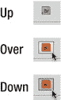

**图 4-25.** 弹起、悬停和按下按钮状态的典型示例

一旦你开始留意，你会到处看到这三种按钮状态。这三种不同按钮状态的具体外观总是会因插画师的个人风格或当下的设计时尚而有所不同，因此对于它们应该是什么样子并没有规则。这三种状态有数百种变体。

像这样的交互式按钮很容易制作，但需要一些规划。首先，你需要每个按钮状态的三张 PNG 图片。这三张图片的大小必须完全相同。它们之间的唯一区别应该是每个按钮状态效果的细微变化。

在第 2 章中，你学习了如何制作许多相同大小的按钮，只改变其文本。现在，你不仅可以改变文本，还可以改变按钮上的高亮效果来指示每个状态。对于每一个按钮，你都需要三张独立的图片。

为了让你上手，在回到数字猜谜游戏之前，我为你准备了一个小项目。

1. 创建三张 PNG 图片，每张代表三种按钮状态之一。将这些图片命名为`buttonUp.png`、`buttonOver.png`和`buttonDown.png`。图 4-26 展示了示例按钮的样子。（我使用 Adobe Illustrator 的内置符号库快速制作了这些按钮。我将在第 7 章中介绍 Adobe Illustrator。）你的按钮状态不必看起来像这样。我的按钮图片尺寸是 50×57 像素，但你可以制作任意大小的按钮。主要的是，三张图片的大小必须完全相同；否则，在编程时按钮状态将无法正确对齐。

    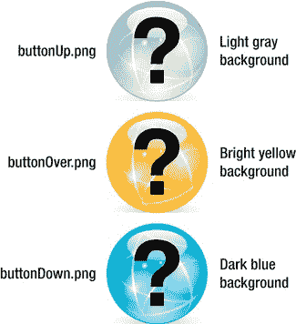

    **图 4-26.** 弹起、悬停和按下按钮状态

2. 在本章的源文件中，你会找到一个名为`Buttons`的项目文件夹。它有一个名为`images`的子文件夹。你可以在那里找到我的三个示例 PNG 文件。将你的三个按钮 PNG 文件复制到`images`文件夹中，用你的文件替换我的文件，如图 4-27 所示。

    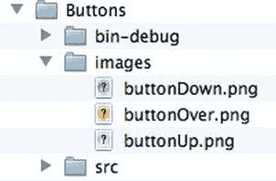

    **图 4-27.** 将你的 PNG 按钮状态复制到 Buttons 项目的 images 文件夹

3. 导入`Buttons`项目并编译`Buttons.as`文件。你的按钮将出现在舞台上，大致居中。点击它并观察会发生什么。鼠标指针会变成手形图标悬停在按钮上，所有按钮状态都按预期工作。跟踪消息会告诉你鼠标触发了哪个状态。图 4-28 显示了你将看到的内容。

    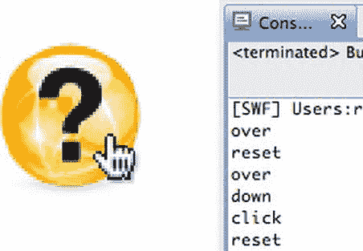

    **图 4-28.** 测试你的按钮

#### 理解概念

我们先回顾一下如何将图像载入程序中。一张`PNG`文件会从`images`文件夹载入到一个加载器对象中，接着该加载器对象被添加到一个`Sprite`对象里，然后包含已载入图像的`sprite`对象会被放置在舞台上。图 4-29 说明了单个按钮图像的工作原理，不过这并非新知识——这正是你在上一章加载所有图像时所做的操作，很简单吧！

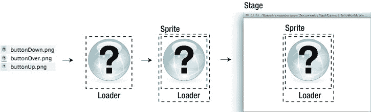

**图 4-29.** 将一张图像载入程序的过程

要制作一个具有三种状态的按钮，需要将三张图像都载入到一个`sprite`对象中。没错，你没听错：在一个`sprite`对象里放入三张图像！不过，在任何时刻只有其中一张图像是可见的。按钮状态的图像会根据鼠标操作显示或隐藏。图 4-30 阐释了这一概念。

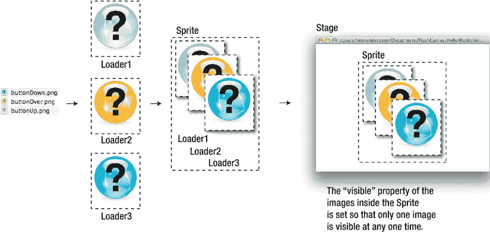

**图 4-30.** 将一张图像载入程序的过程

如果你理解了这个概念，那么代码就很容易理解了。让我们来看看`Buttons.as`文件中实现这一功能的代码。

#### 载入图像并显示按钮

`Buttons.as`文件出乎意料地长，因此你首先需要查看载入按钮图像并将按钮`sprite`添加到舞台的特定代码。在接下来的内容中，你将了解所有这些代码如何与程序的其他部分协同工作。高亮注释说明了每段代码的作用。

以下是类定义中创建三个图像加载器和单个按钮`sprite`的代码：

```
//创建 URLRequest 对象以获取图像路径
public var buttonUpURL:URLRequest
  = new URLRequest("../images/buttonUp.png");
public var buttonOverURL:URLRequest
  = new URLRequest("../images/buttonOver.png");
public var buttonDownURL:URLRequest
  = new URLRequest("../images/buttonDown.png");

//为图像创建加载器
public var buttonUpImage:Loader = new Loader();
public var buttonOverImage:Loader = new Loader();
public var buttonDownImage:Loader = new Loader();

//创建一个包含图像的单 Spritesprite
public var button:Sprite = new Sprite();
```

这里没有任何新内容；你在上一章已经见过所有这些代码。唯一的小区别是我在创建`URLRequest`对象时使用了一种简写方式。`AS3.0`允许你在创建`URLRequest`对象的同时指定文件路径，就像这样：

```
public var buttonUpURL:URLRequest
  = new URLRequest("../images/buttonUp.png");
```

你可以看到图像文件的路径包含在括号内。这样就省去了在程序后面编写这行代码的麻烦：

```
buttonUpURL.url = "../images/buttonUp.png";
```

下一步是加载图像，这在程序运行时发生。

```
buttonUpImage.load(buttonUpURL);
buttonDownImage.load(buttonDownURL);
buttonOverImage.load(buttonOverURL);
```

但接下来要注意的是，除了`buttonUpImage`之外，所有图像的`visible`属性都被设置为 false。

```
buttonUpImage.visible = true;
buttonDownImage.visible = false;
buttonOverImage.visible = false;
```

然后将所有三张图像添加到`button`这个`sprite`中。

```
button.addChild(buttonUpImage);
button.addChild(buttonDownImage);
button.addChild(buttonOverImage);
```

它们都以完全相同的方式对齐在`button`这个`sprite`上——注册点位于左上角。你可以将它们想象成三张完美叠放在一起的扑克牌，但只有`buttonUpImage`是可见的。

接着，`button`这个`sprite`设置了一些特定属性，使其行为像一个真正的按钮。

```
button.buttonMode = true;
button.mouseEnabled = true;
button.useHandCursor = true;
button.mouseChildren = false;
```

让我们来看看这些属性各自的作用。

*   `buttonMode` 将`sprite`对象转换为按钮。当鼠标悬停时，它会显示手形图标。如果按钮处于活动状态，它还允许通过 Enter 键或空格键接受点击事件。`buttonMode`值可以为 true 或 false。
*   `mouseEnabled` 决定`sprite`对象是否可以接受鼠标事件。其默认值为 true，因此你实际上不需要特意编写代码将其设置为 true。但重要的是要知道，如果你希望阻止按钮被点击，可以将其设置为 false。
*   `useHandCursor` 决定当鼠标移动到按钮上时，鼠标箭头图标是否会变为指向手形。你可以将其设置为 true 或 false。一旦将`buttonMode`属性设置为 true，`useHandCursor`就会默认变为 true，因此你无需特意进行设置。但同样，重要的是要知道，如果需要，你可以关闭此功能。
*   `mouseChildren` 决定鼠标是否可以与`sprite`内部的任何其他对象进行交互。在这个示例中，按钮`sprite`内部有三个对象：你载入其中的三张图像。`AS3.0`将这些内部对象称为子对象。当你创建按钮时，不希望鼠标直接与这些子对象交互，而只希望鼠标与父级按钮`sprite`交互。这意味着你应该始终将`mouseChildren`属性设置为 false。否则，程序将难以判断鼠标是打算点击按钮还是点击其包含的图像。

最后，将`button`这个`sprite`添加到舞台并大致居中。

```
stage.addChild(button);
button.x = 225;
button.y = 175;
```

现在图像已载入按钮，按钮也已放置在舞台上，你可以使用鼠标事件来决定显示哪张图像了。

## 理解鼠标事件

代码为 `Sprite` 按钮添加了四个监听器，并配有相应的事件处理函数。

```
button.addEventListener(MouseEvent.ROLL_OVER, overHandler);
button.addEventListener(MouseEvent.MOUSE_DOWN, downHandler);
button.addEventListener(MouseEvent.ROLL_OUT, resetHandler);
button.addEventListener(MouseEvent.CLICK, clickHandler);
```

每个监听器控制着不同状态的显示。在上一章中，你仅使用了 `CLICK` 事件。其他监听器的工作方式完全相同，区别在于它们由不同的鼠标动作触发。接下来看看它们在程序运行时的具体表现。

当鼠标滑过按钮时，会触发 `ROLL_OVER` 事件。此事件通过显示 `buttonOverImage` 并隐藏其他状态，营造出高亮效果。

```
public function overHandler(event:MouseEvent):void
{
  buttonUpImage.visible = false;
  buttonDownImage.visible = false;
  buttonOverImage.visible = true;
}
```

图 4-31 展示了这一效果。

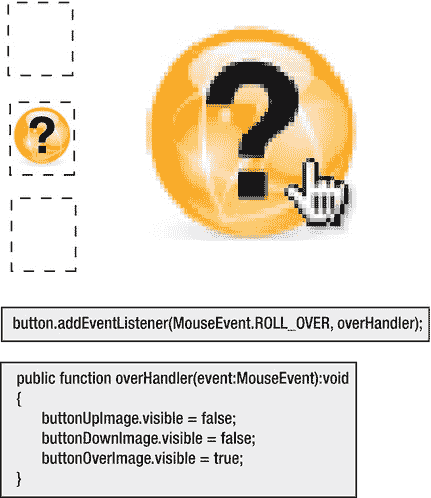

图 4-31. ROLL_OVER 事件

当鼠标左键在按钮上按下时，会触发 `MOUSE_DOWN` 事件。这模拟了按下按钮的效果（参见图 4-32）。

```
public function downHandler(event:MouseEvent):void
{
  buttonUpImage.visible = false;
  buttonDownImage.visible = true;
  buttonOverImage.visible = false;
}
```

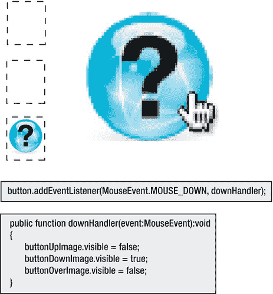

图 4-32. MOUSE_DOWN 事件

当鼠标左键离开按钮时，会触发 `ROLL_OUT` 事件。此时，按钮会重置为弹起状态（参见图 4-33）。

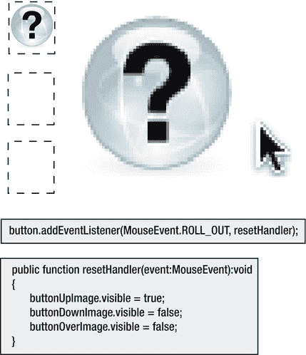

图 4-33. ROLL_OUT 事件

当鼠标左键被单击时，会触发 `CLICK` 事件。在此示例中，它使按钮再次回到弹起状态。其效果与 `ROLL_OUT` 事件相同。

```
public function clickHandler(event:MouseEvent):void
{
  buttonUpImage.visible = true;
  buttonDownImage.visible = false;
  buttonOverImage.visible = false;
}
```

至此，你已经了解了控制按钮显示的全部四个按钮事件。以下是 `Buttons.as` 文件的完整代码，以便你在完整的上下文中查看：

```
package
{
  import flash.net.URLRequest;
  import flash.display.Loader;
  import flash.display.Sprite;
  import flash.events.MouseEvent;

  [SWF(width="550", height="400",
  backgroundColor="#FFFFFF", frameRate="60")]
  public class Buttons extends Sprite
  {
    //创建 URLRequest 对象，获取图片路径
    public var buttonUpURL:URLRequest
      = new URLRequest("../images/buttonUp.png");
    public var buttonOverURL:URLRequest
      = new URLRequest("../images/buttonOver.png");
    public var buttonDownURL:URLRequest
      = new URLRequest("../images/buttonDown.png");

    //为图片创建加载器
    public var buttonUpImage:Loader = new Loader();
    public var buttonOverImage:Loader = new Loader();
    public var buttonDownImage:Loader = new Loader();

    //创建一个 Sprite 来容纳这些图片
    public var button:Sprite = new Sprite();

    public function Buttons()
    {
      makeButton();
    }

    public function makeButton():void
    {
      //加载图片
      buttonUpImage.load(buttonUpURL);
      buttonDownImage.load(buttonDownURL);
      buttonOverImage.load(buttonOverURL);

      //隐藏除弹起状态外的所有图片
      buttonUpImage.visible = true;
```

# 为数字猜谜游戏添加按钮

```actionscript
buttonDownImage.visible = false;
buttonOverImage.visible = false;

//将图片添加到按钮 Sprite 中
button.addChild(buttonUpImage);
button.addChild(buttonDownImage);
button.addChild(buttonOverImage);

//设置 Sprite 的按钮属性
button.buttonMode = true;
button.mouseEnabled = true;
button.useHandCursor = true;
button.mouseChildren = false;

//将按钮 Sprite 添加到舞台
stage.addChild(button);
button.x = 225;
button.y = 175;

//为按钮添加事件监听器
button.addEventListener(MouseEvent.ROLL_OVER, overHandler);
button.addEventListener(MouseEvent.MOUSE_DOWN, downHandler);
button.addEventListener(MouseEvent.ROLL_OUT, resetHandler);
button.addEventListener(MouseEvent.CLICK, clickHandler);
}

public function overHandler(event:MouseEvent):void
{
  buttonUpImage.visible = false;
  buttonDownImage.visible = false;
  buttonOverImage.visible = true;
  trace("over");
}

public function downHandler(event:MouseEvent):void
{
  buttonUpImage.visible = false;
  buttonDownImage.visible = true;
  buttonOverImage.visible = false;
  trace("down");
}

public function clickHandler(event:MouseEvent):void
{
  buttonUpImage.visible = true;
  buttonDownImage.visible = false;
  buttonOverImage.visible = false;
  trace("click");
}

public function resetHandler(event:MouseEvent):void
{
  buttonUpImage.visible = true;
  buttonDownImage.visible = false;
  buttonOverImage.visible = false;
  trace("reset");
}
}
}
```

该程序的结构与本书前面介绍的其他程序完全相同。唯一需要指出的是，构造函数将其创建按钮的工作委托给了 `makeButton` 方法。

```actionscript
public function Buttons()
{
  makeButton();
}
```

这与你在数字猜谜游戏的构造函数中用于模块化代码的技术相同。

这是一种非常常见的创建交互式按钮的方法，但 AS3.0 还提供了一个专门的类 `SimpleButton`，它是创建交互式按钮的一种非常高效的方式。使用 `SimpleButton` 类需要对 AS3.0 编程有深入的理解，但学完本书后，你应该具备足够的技能来轻松驾驭它。关于 `SimpleButton` 类的使用细节，在《Flash 高级游戏设计》中有详细介绍，你也可以在 Adobe 的 AS3.0 文档中了解更多信息：[`help.adobe.com/en_US/FlashPlatform/reference/actionscript/3/flash/display/SimpleButton.html#?filter_flash=cs5&filter_flashplayer=10.2&filter_air=2.6`](http://help.adobe.com/en_US/FlashPlatform/reference/actionscript/3/flash/display/SimpleButton.html#?filter_flash=cs5&filter_flashplayer=10.2&filter_air=2.6)

现在，我要交给你一项精细的工作：将 `Buttons.as` 文件中的代码与 `NumberGuessingGame.as` 文件合并。完成后的数字猜谜游戏将拥有一个可点击的按钮，其点击效果与按下回车键相同。

别慌，你不需要学习任何新代码或新技术。只要理解如何向程序添加代码——放在何处及其作用——你就能完成这项任务。这将是一次很好的练习，能确保你充分掌握前四章讲解的所有概念。完成后，游戏界面将类似于图 4-34。

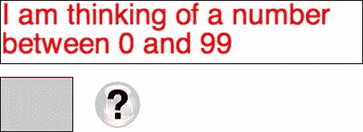

图 4-34. 带有交互式按钮的数字猜谜游戏

以下是需要完成的事项：

1.  将 `Buttons` 项目文件夹中的 `images` 文件夹复制到 `NumberGuessingGame` 文件夹中。
2.  将所有用于创建和设置按钮的代码保留在独立的 `makeButton` 方法中。然后，在数字猜谜游戏的构造函数中调用该方法，如下所示：
    ```actionscript
    public function NumberGuessingGame()
    {
      setupTextfields();
      makeButton();
      startGame();
    }
    ```
3.  将按钮事件监听器添加到 `startGame` 方法中。这样，如果你将来想添加“再玩一次”按钮，就能轻松地重新初始化游戏。按钮事件监听器应添加在以下位置：
    ```actionscript
    public function startGame():void
    {
      //初始化变量
      startMessage = "我正在想一个介于 0 到 99 之间的数字";
      mysteryNumber = Math.floor(Math.random() * 100);

      //初始化文本字段
      output.text = startMessage
      input.text = "";
      guessesRemaining = 10;
      guessesMade = 0;
      gameStatus = "";
      gameWon = false;

      //追踪神秘数字
      trace("神秘数字: " + mysteryNumber);

      //添加键盘按键事件监听器
      stage.addEventListener(KeyboardEvent.KEY_DOWN, keyPressHandler);

      //添加按钮事件监听器
      button.addEventListener(MouseEvent.ROLL_OVER, overHandler);
      button.addEventListener(MouseEvent.MOUSE_DOWN, downHandler);
      button.addEventListener(MouseEvent.ROLL_OUT, resetHandler);
      button.addEventListener(MouseEvent.CLICK, clickHandler);
    }
    ```
4.  当玩家点击按钮时，游戏应读取输入字段中的数字。你已有名为 `playGame` 的方法来分析输入。只需将其连接到按钮的 `CLICK` 事件即可，具体如下：
    ```actionscript
    public function clickHandler(event:MouseEvent):void
    {
      buttonUpImage.visible = true;
    ```

# 在游戏结束时禁用按钮

当按钮在游戏中正常运作后，你可能希望在游戏结束时禁用它，就像禁用回车键一样。为此，请在 `endGame` 方法的末尾添加以下粗体文本中的代码：

```actionscript
public function endGame():void
{
  if (gameWon)
  {
    output.text
      = "是的，就是 " + mysteryNumber + "!" + "\n"
      + "你只猜了 " + guessesMade + " 次。";
  }
  else
  {
    output.text
      = "没有剩余猜测次数了！" + "\n"
      + "这个数字是: " + mysteryNumber + "。";
  }
  stage.removeEventListener
    (KeyboardEvent.KEY_DOWN, keyPressHandler);
  input.type = "dynamic";
  input.alpha = 0.5;
  button.removeEventListener(MouseEvent.ROLL_OVER, overHandler);
  button.removeEventListener(MouseEvent.MOUSE_DOWN, downHandler);
  button.removeEventListener(MouseEvent.ROLL_OUT, resetHandler);
  button.removeEventListener(MouseEvent.CLICK, clickHandler);
  button.alpha = 0.5;
  button.mouseEnabled = false
}
```

这段新代码移除了所有监听器，使按钮不再具备任何功能。同时，它让按钮变得透明，作为按钮已失效的视觉提示。最后，将按钮的 `mouseEnabled` 属性设为 `false`，使其不再响应鼠标操作。图 4-35 展示了最终效果。

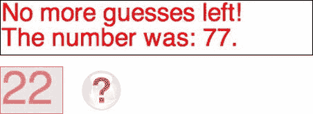

**图 4-35.** 在游戏结束时使按钮变暗并禁用

这需要你编写大量新代码！如果你不确定最终效果，可以在本章源文件的 `NumberGuessingGameWithButton` 文件夹中找到截止到这一步的完整项目。以下是游戏到目前为止所有代码的完整清单：

```actionscript
package
{
  import flash.net.URLRequest;
  import flash.display.Loader;
  import flash.display.Sprite;
  import flash.events.MouseEvent;
  import flash.events.KeyboardEvent;
  import flash.ui.Keyboard;
  import flash.text.*;

  [SWF(width="550", height="400",
  backgroundColor="#FFFFFF", frameRate="60")]
  public class NumberGuessingGame extends Sprite
  {
    //创建文本对象
    public var format:TextFormat = new TextFormat();
    public var output:TextField = new TextField();
    public var input:TextField = new TextField();

    //创建按钮对象
    public var buttonUpURL:URLRequest
      = new URLRequest("../images/buttonUp.png");
    public var buttonOverURL:URLRequest
      = new URLRequest("../images/buttonOver.png");
    public var buttonDownURL:URLRequest
      = new URLRequest("../images/buttonDown.png");
    public var buttonUpImage:Loader = new Loader();
    public var buttonOverImage:Loader = new Loader();
    public var buttonDownImage:Loader = new Loader();
    public var button:Sprite = new Sprite();

    //游戏变量
    public var startMessage:String;
    public var mysteryNumber:uint;
    public var currentGuess:uint;
    public var guessesRemaining:int;
    public var guessesMade:uint;
    public var gameStatus:String;
    public var gameWon:Boolean;

    public function NumberGuessingGame()
    {
      setupTextfields();
      makeButton();
      startGame();
    }

    public function setupTextfields():void
    {
      //设置文本格式对象
      format.font = "Helvetica";
      format.size = 32;
      format.color = 0xFF0000;
      format.align = TextFormatAlign.LEFT;

      //配置输出文本字段
      output.defaultTextFormat = format;
      output.width = 400;
      output.height = 70;
      output.border = true;
      output.wordWrap = true;
      output.text = "这是输出文本字段";

      //显示并定位输出文本字段
      stage.addChild(output);
      output.x = 70;
      output.y = 65;

      //配置输入文本字段
      format.size = 60;
      input.defaultTextFormat = format;
      input.width = 80;
      input.height = 60;
      input.border = true;
      input.type = "input";
      input.maxChars = 2;
      input.restrict = "0-9";
      input.background = true;
      input.backgroundColor = 0xCCCCCC;
      input.text = "";

      //显示并定位输入文本字段
      stage.addChild(input);
      input.x = 70;
      input.y = 150;
      stage.focus = input;
    }

    public function makeButton():void
    {
      //加载图片
      buttonUpImage.load(buttonUpURL);
      buttonDownImage.load(buttonDownURL);
      buttonOverImage.load(buttonOverURL);

      //除向上状态的图片外，
      //其他图片设置为不可见
      buttonUpImage.visible = true;
      buttonDownImage.visible = false;
      buttonOverImage.visible = false;

      //将图片添加到按钮精灵中
      button.addChild(buttonUpImage);
    }
  }
}
```

```markdown
button.addChild(buttonDownImage);
button.addChild(buttonOverImage);

//设置精灵的按钮属性
button.buttonMode = true;
button.mouseEnabled = true;
button.useHandCursor = true;
button.mouseChildren = false;

//将按钮精灵添加到舞台
stage.addChild(button);
button.x = 175;
button.y = 155;
}

public function `startGame`():void
{
    //初始化变量
    startMessage = "我正在想一个 0 到 99 之间的数字";
    mysteryNumber = Math.floor(Math.random() * 100);

    //初始化文本字段
    output.text = startMessage
    input.text = "";
    guessesRemaining = 10;
    guessesMade = 0;
    gameStatus = "";
    gameWon = false;

    //跟踪神秘数字
    trace("神秘数字：" + mysteryNumber);

    //添加键盘按下事件监听器
    stage.addEventListener
    (KeyboardEvent.KEY_DOWN, keyPressHandler);

    //添加按钮事件监听器
    button.addEventListener(MouseEvent.ROLL_OVER, overHandler);
    button.addEventListener(MouseEvent.MOUSE_DOWN, downHandler);
    button.addEventListener(MouseEvent.ROLL_OUT, resetHandler);
    button.addEventListener(MouseEvent.CLICK, clickHandler);
}

public function `playGame`():void
{
    guessesRemaining--;
    guessesMade++;
    gameStatus
    = "已猜：" + guessesMade
    + "，剩余：" + guessesRemaining;

    currentGuess = uint(input.text);

    if (currentGuess > mysteryNumber)
    {
        output.text = "猜得太大了。" + "\n" + gameStatus;
        checkGameOver();
    }
    else if (currentGuess < mysteryNumber)
    {
        output.text = "猜得太小了。" + "\n" + gameStatus;
        checkGameOver();
    }
    else
    {
        output.text = "你猜对了！";
        gameWon = true;
        endGame();
    }
}

public function `checkGameOver`():void
{
    if (guessesRemaining < 1)
    {
        endGame();
    }
}

public function `endGame`():void
{
    if (gameWon)
    {
        output.text
        = "没错，就是 " + mysteryNumber + "！" + "\n"
        + "你只用了 " + guessesMade + " 次就猜对了。";
    }
    else
    {
        output.text
        = "没有剩余猜测次数了！" + "\n"
        + "数字是：" + mysteryNumber + "。";
    }

    //禁用回车键
    stage.removeEventListener
    (KeyboardEvent.KEY_DOWN, keyPressHandler);
    input.type = "dynamic";
    input.alpha = 0.5;

    //禁用按钮
    button.removeEventListener
    (MouseEvent.ROLL_OVER, overHandler);
    button.removeEventListener
    (MouseEvent.MOUSE_DOWN, downHandler);
    button.removeEventListener
    (MouseEvent.ROLL_OUT, resetHandler);
    button.removeEventListener
    (MouseEvent.CLICK, clickHandler);
    button.alpha = 0.5;
    button.mouseEnabled = false;
}

public function `keyPressHandler`(event:KeyboardEvent):void
{
    if (event.keyCode == Keyboard.ENTER)
    {
        playGame();
    }
}

public function `overHandler`(event:MouseEvent):void
{
    buttonUpImage.visible = false;
    buttonDownImage.visible = false;
    buttonOverImage.visible = true;
}

public function `downHandler`(event:MouseEvent):void
{
    buttonUpImage.visible = false;
    buttonDownImage.visible = true;
    buttonOverImage.visible = false;
}

public function `clickHandler`(event:MouseEvent):void
{
    buttonUpImage.visible = true;
    buttonDownImage.visible = false;
    buttonOverImage.visible = false;
    playGame();
}

public function `resetHandler`(event:MouseEvent):void
{
    buttonUpImage.visible = true;
    buttonDownImage.visible = false;
    buttonOverImage.visible = false;
}
```

## 管理复杂代码

这是一个很长的程序，但请注意，代码的主体部分与游戏机制无关。大约 70% 的代码用于设置、显示和管理文本字段与按钮。在大型游戏项目中，你会发现大部分代码都像这个游戏一样，用于显示图形和管理用户界面。

使用小而精的方法将代码模块化的重要性之一，就在于它能让你将可视化元素的编程与游戏逻辑的编程分离开来。这样做能让游戏编写变得容易得多，因为当你完成一个方法的编程后，就无需再查看它了。你可以将精力集中在另一个方法的代码上。

尽管如此，在一个包含数百个不同图形元素的复杂游戏中，这种方法也只能帮你到一定程度。你需要学习如何进一步模块化代码，以便能够完全封装那些无需再处理的代码。在第 7 章中，你将学习如何利用多个类来制作游戏，这能在一定程度上解决问题。最终的解决方案是采用一种更高级的方法，即使用一种名为“模型-视图-控制器”（`MVC`）的编程`设计模式`。本书不涵盖 `MVC` 的详细内容，但你可以在本书的续作《Flash 高级游戏设计》中找到所有相关信息。

不过，在你仍在学习的过程中，使用方法进行代码模块化已经能帮助你走得很远，并且你会在这一过程中学到很多。以下是一些让你的游戏和程序更易于管理的思路：

*   创建非常具体的方法，只执行一两个任务——绝不多做。
*   将所有可视化元素（如按钮、文本、游戏角色、游戏对象和背景）的设置和显示工作都放在各自独立的方法中。这一点很重要，这样它们就不会干扰使游戏运行的关键逻辑编程。
*   将所有事件处理程序放在程序的末尾。在编写并测试完事件处理程序后，你几乎不需要再去查看它们。如果它们都整齐地排列在程序末尾，就能被巧妙地隐藏起来。

在接下来的章节中，你将在代码中看到所有这些技巧的实际应用。

## 项目扩展

这是本书中第一个完整的游戏。但它真的完成了吗？

游戏设计是一件有趣的事情。游戏，即使是复杂的游戏，也永远不会真正完成。设计师们只是在游戏运行得足够好、没有人抱怨时，才停止对它们的工作。通常，如果设计师有足够的时间、耐心和想象力，游戏还可以添加许多深层次的复杂性或额外的功能。耐心和想象力似乎是游戏设计师取之不尽的资源。通常是`时间`这个因素会从中作梗。

你还能为这个游戏添加不少内容。以下是一些想法。

### 制作一个“再玩一次”按钮

在游戏结束时显示一个按钮，让玩家可以再玩一次。我不打算解释如何实现，因为你已经知道怎么做了！你知道如何制作按钮、设置对象属性以及创建和调用方法。通过自己创建一个“再玩一次”按钮，你将练习过去四章学到的所有技能：从设计图形到编写代码。你还会遇到一些从未想象过的问题，最终解决它们，当一切正常运行时，你会感觉如履云端。

完成后，你的猜数字游戏可能看起来像图 4-36 这样。

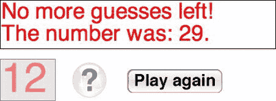

**图 4-36.** 创建一个“再玩一次”按钮来重新开始游戏。

以下是一些提示，帮助你进行：

*   当你首次创建“再玩一次”按钮并将其添加到游戏时，它需要被禁用且不可见。
*   `endGame`方法应该启用“再玩一次”按钮。
*   在按钮被点击后，你需要禁用它。你可以直接在它的 CLICK 事件处理程序中完成。
*   当你点击“再玩一次”按钮时，它需要重新开始游戏。你可以通过在“再玩一次”按钮的 CLICK 事件处理程序中调用`startGame`方法来实现。
*   你需要在游戏重新开始时重新启用 Enter 键和猜测按钮。你会在哪里添加代码来实现这一点？

如果你彻底卡住了，你可以在本章源文件的`PlayAgain`文件夹中找到带有“再玩一次”按钮的完成版游戏。

祝你好运！

### 追踪猜测记录

你将游戏设置为允许十次猜测，但有些玩家可能没有耐心记住他们之前猜过什么。你可以添加另一个文本字段，显示他们所有的历史猜测，并在他们做出新猜测时添加进去。

为此，你需要一个新的文本字段，或许叫做`guessHistory`。你可以创建一个名为`previousGuesses`的新字符串变量，将所有猜测存储为一段文本字符串，每个数字之间用空格分隔。每当玩家做出新猜测时，你可以将其添加到`previousGuesses`变量中，然后更新`guessHistory`文本字段。以下是这段代码核心部分的示例：

```
previousGuesses += currentGuess + "  ";
guessHistory.text = previousGuesses;
```

这行代码在`playGame`方法中会工作得很好。你能看出第一行指令中的代码是如何用空格分隔每个数字的吗？

### 添加视觉显示

一个类似“吊死鬼”游戏的视觉显示，用来展示玩家表现如何（或者多糟糕！），是一种有趣的增强。你可以创建十张图片，显示十种不同的“吊死鬼”状态。使用`visible`属性，根据游戏进程有选择地显示或隐藏每种状态。每种状态可以逐步向玩家展示他们离失败有多近，就像在“吊死鬼”游戏中，粉笔人形象添加肢体一样。

### 扭转局面

一个更高级且有趣的项目是改变游戏规则，让程序来猜一个*你*心中所想的数字。这将是一个全新的程序，但你现在已经具备让它运作起来的所有技能。

想试试看吗？这里有个提示：要让这个游戏工作，你需要使用除法运算符。你已经见过乘法运算符了。

```
*
```

你曾使用乘法运算符将随机数乘以 100。除法运算符看起来像这样：

```
/
```

它是一个简单的正斜杠。你可以在任何指令中使用它来对两个数进行除法运算。

```
100 / 2
```

这个示例的结果是 50。然后你可以将这个计算结果赋值给一个指令中的变量。示例如下：

```
computersGuess = (100 / 2);
```

你能看出我的思路吗？我不打算剧透，让你自己琢磨剩下的部分！这对你来说会是一个有难度的项目，但你能做到。并且，在此过程中学到的东西，将让你对自己作为游戏程序员的技能成长和风格获得宝贵的洞察。

## 嵌入字体快速指南

如果你想确保游戏中的字体在你之外的电脑上也能正确显示，就需要将字体嵌入。嵌入字体后，字体文件会被存储在 SWF 文件中，这样玩家无需在电脑上安装该字体也能正常显示。以下是嵌入字体的操作步骤：

1.  在项目目录中创建一个名为`fonts`的文件夹，并将字体文件复制到该文件夹中。（字体文件通常具有`.ttf`、`.otf`或`.ttc`文件扩展名。）
2.  字体嵌入需通过元标签实现。在类定义的开头添加以下代码：
    ```
    public class EmbeddedFonts extends Sprite
    {
      [Embed
        (
          source="../fonts/Optima.ttc",
          embedAsCFF="false",
          fontName="embeddedFont",
          fontWeight="normal",
          advancedAntiAliasing="true",
          mimeType="application/x-font"
        )
      ]
      private var EmbeddedFontClass:Class;
    ```
    这段代码最重要的是：`source`参数必须提供项目目录中字体文件的**准确路径**。
3.  将`format`对象的`font`属性设置为`"embeddedFont"`，该值应与代码中`fontName`参数指定的名称一致。
    ```
    format.size = 32;
    format.color = 0x000000;
    format.font = "embeddedFont"
    ```
4.  将文本字段的`embedFonts`属性设置为`true`。
    ```
    output.embedFonts = true;
    ```

发布后，SWF 文件就能在任何电脑上正确显示该字体。

本章的源文件中有一个名为`EmbeddedFonts`的文件夹，其中包含该系统的可运行示例。它使用嵌入式字体显示一行文本。以下是完整的`EmbeddedFont`类：

```
package
{
  import flash.display.Sprite;
  import flash.text.*;
  public class EmbeddedFonts extends Sprite
  {
    [Embed
      (
        source = "../fonts/Optima.ttc",
        embedAsCFF = "false",
        fontName = "embeddedFont",
        fontWeight = "normal",
        advancedAntiAliasing = "true",
        mimeType = "application/x-font"
      )
    ]
```
