# 第五章 控制玩家角色

游戏首先要实现的功能之一，就是让玩家能在舞台上移动某个对象。游戏对象可以通过鼠标或键盘来移动。本章将介绍如何用键盘控制游戏对象。

本章涵盖以下主题：

*   使用`KEY_DOWN`、`KEY_UP`和`ENTER_FRAME`事件。
*   将玩家角色限定在舞台边缘以及屏幕环绕处理。
*   滚动：垂直滚动、水平滚动和视差滚动。
*   如何将图像嵌入游戏。

## 使用键盘控制玩家角色

游戏最基本的功能之一，就是让玩家能用键盘控制游戏角色。这并不难实现，其技术核心是使用 AS3.0 的两个内置类：`KeyboardEvent`类和`Keyboard`类。只需在程序顶部将其与其他导入的类一起导入即可。

```actionscript
import flash.events.KeyboardEvent;
import flash.ui.Keyboard;
```

你在第四章中已经使用过这两个类，实现了玩家按键盘回车键在输入文本字段中输入文字的功能。`KeyboardEvent`和`Keyboard`类包含的方法和属性，能帮助你让玩家通过键盘与游戏互动。就像`MouseEvent`类的属性一样，很快你就能闭着眼睛熟练使用所有这些新方法和新属性了。

### 用键盘控制对象——错误的方式！

用键盘控制对象有两种方法：正确的方式和错误的方式。我们先来看看错误的方式。

为什么要学习错误的方式呢？因为用错误的方式实现玩家键盘控制非常直接易懂。哦，而且它其实也能用。但即使你永远不会在某个游戏里用它来控制玩家角色，作为一种判断玩家按了哪些键的通用技术，你也会发现它有无穷的其他用途。它也是理解正确键盘控制方式的基础，而正确方式会在同一底层系统上增加额外的灵活性和优化层。如果你先理解了错误方式如何工作，就能更好地理解和欣赏正确的做法。不过别担心，我会一步步讲解。当你把所有部分拼凑起来时，会惊讶于这个过程如此简单。

让我们编写一个简单的程序来演示这一点。

1.  创建一个名为`SimpleKeyboardControl`的新 ActionScript 项目。
2.  在项目文件夹中，创建一个名为`images`的子文件夹。
3.  将你在第 2 章中创建的`character.png`文件复制到`images`文件夹中。完成后，你的项目文件夹应如图 Figure 5-1 所示。

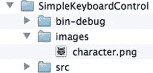

**图 5-1.** 将`character.png`文件复制到`images`文件夹中。

4.  在代码编辑器窗口中编写以下程序。（如果你不想全部手动输入，可以在本章源文件的`SimpleKeyboardControl`文件夹中找到完成后的程序。）

```actionscript
package
{
  import flash.net.URLRequest;
  import flash.display.Loader;
  import flash.display.Sprite;
  import flash.events.KeyboardEvent;
  import flash.ui.Keyboard;

  [SWF(width="550", height="400",
    backgroundColor="#FFFFFF", frameRate="60")]
  public class SimpleKeyboardControl extends Sprite
  {
    //创建游戏角色对象
    public var characterURL:URLRequest
      = new URLRequest("../images/character.png");
    public var characterImage:Loader = new Loader();
    public var character:Sprite = new Sprite();

    public function SimpleKeyboardControl()
    {
      //加载图片并将角色添加到舞台
      characterImage.load(characterURL);
      character.addChild(characterImage);
      stage.addChild(character);
      character.x = 225;
      character.y = 150;

      //添加 KeyboardEvent 监听器
      stage.addEventListener
        (KeyboardEvent.KEY_DOWN,  keyDownHandler);
    }

    public function keyDownHandler(event:KeyboardEvent):void
    {
      if (event.keyCode == Keyboard.LEFT)
      {
        character.x -= 10;
      }
        else if (event.keyCode == Keyboard.RIGHT)
      {
        character.x += 10;
      }
      else if (event.keyCode == Keyboard.DOWN)
      {
        character.y += 10;
      }
      else if (event.keyCode == Keyboard.UP)
      {
        character.y -= 10;
      }
    }
  }
}
```

嵌入式字体的行为有时会有些怪异，具体表现往往取决于你试图嵌入的字体文件。如果遇到问题，可首先尝试从`Embed`元标签中删除以下这行代码：

`embedAsCFF = "false",`

通常这行代码就能解决问题。

## 总结

本章中介绍的猜数字游戏非常重要，原因如下：

*   这是本书中第一个完整的、真正的游戏。虽然它体量小巧，但包含了完整可运行游戏应具备的所有要素。尽管你后续能构建更复杂的大型游戏，但猜数字游戏是解决游戏设计问题的典范。如果你能理解其中的游戏设计问题及解决方案，那么在尝试更具挑战性的项目时，你将处于非常有利的位置。
*   你现在已经掌握了输入输出、变量、方法、`if/else`语句、按钮与键盘事件，以及通过方法实现程序模块化。这些主题代表了计算机编程的核心概念。你现在拥有了强大的编程能力，可以构建多种基于逻辑的游戏。
*   为尽量简化内容，本章重点聚焦于游戏的内部逻辑和结构。但这并不意味着你不能将这些技术与前章中控制舞台上视觉对象的技术相结合。事实上，你绝对应该将这些技术结合起来！稍加创意，你就能构建出完全视觉化、基于逻辑和谜题的复杂冒险游戏。

在继续阅读本书之前，不妨稍作休息，根据目前已学的技术自己创作一个游戏。没有什么方式比亲自尝试更能促进学习了，这也会让你对后续章节中更高级的技术有更深的理解。

在第五章中，你将详细了解如何通过键盘控制舞台上的对象。这将是你从设计**游戏**迈向设计**视频游戏**的重要基石。


## 5. 编译程序

你的游戏角色将出现在舞台上。你可以使用方向键在舞台中移动它，如图 Figure 5-2 所示。

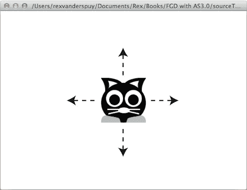

**图 5-2.** 使用键盘方向键在舞台上移动游戏角色。

我肯定你已注意到这种玩家角色控制方案存在一些明显问题，但在展示解决方案之前，我们先快速了解一下它的工作原理。首先要做的是将 `KeyboardEvent` 和 `Keyboard` 类导入程序。

```actionscript
import flash.events.KeyboardEvent;
import flash.ui.Keyboard;
```

`Keyboard` 类的主要任务是让判断玩家按了哪些键更简单。`KeyboardEvent` 类允许你为舞台添加事件监听器来监听按键。这正是构造函数中这段代码所做的：

`stage.addEventListener(KeyboardEvent.KEY_DOWN, keyDownHandler);`

这与你在第 4 章中使用的事件监听器相同，工作方式也一样。它的任务是检测键盘上是否有按键被按下。它会调用 `keyDownHandler`，后者的任务是处理这个事件。

```actionscript
public function keyDownHandler(event:KeyboardEvent):void
{
  if (event.keyCode == Keyboard.LEFT)
  {
    character.x -= 10;
  }
  else if (event.keyCode == Keyboard.RIGHT)
  {
    character.x += 10;
  }
  else if (event.keyCode == Keyboard.DOWN)
  {
    character.y += 10;
  }
  else if (event.keyCode == Keyboard.UP)
  {
    character.y -= 10;
  }
}
```

*正如你在第 4 章中学到的，`Keyboard.LEFT`、`Keyboard.RIGHT`、`Keyboard.DOWN` 和 `Keyboard.UP` 代表 AS3.0 关联到键盘按键的数字。这些数字被称为键码。*

*AS3.0 使用的键码基于 ASCII，这是一种将数字解释为字符的固定标准。例如，ASCII 数字 65 代表大写字母 A。然而，不同操作系统映射这些码到键盘按键的方式并不完全相同。如果你在 Windows 电脑上使用键码设计并测试游戏，然后在另一个操作系统（如 OS X）上运行 SWF，你使用的键码可能不匹配 OS X 的键盘映射。因此，最好使用 `Keyboard` 类的内置键属性（如 `LEFT` 和 `RIGHT`）而不是实际的键码数字。*

*如果你需要使用这些属性未表示的键，则必须使用键码数字。请务必在每个游戏运行的操作系统上仔细测试这些键码，确保它们正确映射到所有系统上的对应按键。*

*如果你使用 Flash Professional 软件构建游戏，在构建和测试过程中某些键可能不起作用。Flash Professional 为快捷键保留了一些键（例如 Ctrl 和 S 用于保存文件）。因此，如果你在游戏中使用了这些键或组合键，需要在测试时按住 Shift 键来覆盖 Flash Professional 自身对这些键的使用。在发布的 SWF 中这些键将正常工作。*

非常简单，`keyPressHandler` 包含一个 if/else 语句，判断哪个键被按下，然后通过向角色的 `x` 或 `y` 位置增加或减少 10 像素来向左、右、下或上移动角色。

这很容易理解，但为什么它运行得这么差呢？当你测试程序时，可能注意到了几个大问题：

- 角色移动时抖动。
- 当你按下方向键之一时，角色开始移动前会有轻微延迟。
- 你一次只能在一个轴（`x` 或 `y`）上移动角色。你可以左右或上下移动角色，但不能沿对角线移动。尝试同时按上箭头和左箭头；它只会按照你最后按下的键的方向移动角色。如何才能让角色沿对角线移动呢？

这些问题是由于计算机键盘的`按键缓冲区`导致的。当你按下键盘上的一个键时，键盘只向计算机报告该键被按下了一次；它不知道这个键是否被*按住不放*。计算机操作系统内置了按键重复功能，它会以固定的时间间隔重新发送`KEY_DOWN`事件。按键重复功能对于文字处理器等程序是必要的，例如，你可以按住一个键来重复输入屏幕上的字符。你无法控制按键重复的运行方式，其结果在 Flash 游戏中就是你在舞台上看到的抖动移动。

为了解决这个问题，你需要绕开按键缓冲区，让按键不直接移动对象。你可以用按键来确定对象的方向和速度，但你需要找到另一种方法来实际移动对象。

### 正确控制键盘！

既然你已经知道 AS3.0 如何检测你按下了哪些键，你就可以使用同样的基本系统来优化键盘控制程序。

这里有很多新东西，但别慌！一旦你让程序运行起来，我会一步一步地分解所有内容，向你精确解释其工作原理。但现在，先快速总结一下你需要做什么：

- 你必须导入 AS3.0 的`Event`类，以便使用其`ENTER_FRAME`属性。
- 你必须创建两个新变量：`vx`和`vy`。这些变量将存储对象的垂直和水平速度。
- 你必须修改`keyDownHandler`，使其不再改变角色的位置。取而代之的是，它用对象应移动的速度和方向来更新`vx`和`vy`变量。
- 你必须添加一个名为`keyUpHandler`的事件处理函数。它的工作是检测方向键何时被释放。当它们被释放时，它将角色的速度设置为 0。
- 你必须创建一个名为`enterFrameHandler`的新事件处理函数，它使用`vx`和`vy`变量来实际移动角色。

让我们编写一个新程序来演示所有这些特性。

1.  创建一个名为`KeyboardControl`的新 ActionScript 项目。
2.  在项目目录中创建一个`images`文件夹，并将`character.png`文件复制到其中。
3.  在代码编辑器中编写以下程序：

```actionscript
package
{
  import flash.net.URLRequest;
  import flash.display.Loader;
  import flash.display.Sprite;
  import flash.events.KeyboardEvent;
  import flash.ui.Keyboard;
  import flash.events.Event;

  [SWF(width="550", height="400",
    backgroundColor="#FFFFFF", frameRate="60")]
  public class KeyboardControl extends Sprite
  {
    //创建游戏角色对象
    public var characterURL:URLRequest
      = new URLRequest("../images/character.png");
    public var characterImage:Loader = new Loader();
    public var character:Sprite = new Sprite();

    //创建并初始化 vx 和 vy 变量
    public var vx:int = 0;
    public var vy:int = 0;

    public function KeyboardControl()
    {
      //加载图像并将角色添加到舞台
      characterImage.load(characterURL);
      character.addChild(characterImage);
      stage.addChild(character);
      character.x = 225;
      character.y = 150;

      //添加事件监听器
      stage.addEventListener
        (KeyboardEvent.KEY_DOWN, keyDownHandler);
      stage.addEventListener
        (KeyboardEvent.KEY_UP, keyUpHandler);
      stage.addEventListener
        (Event.ENTER_FRAME, enterFrameHandler);
    }

    public function keyDownHandler(event:KeyboardEvent):void
    {
      if (event.keyCode == Keyboard.LEFT)
      {
        vx = -5;
      }
      else if (event.keyCode == Keyboard.RIGHT)
```

# 使用速度移动

首先要留意的是两个新的整数变量`vx`和`vy`，它们存储了角色的速度——即移动的快慢。实际上，这里需要更精确一点。你存储的其实不是对象的*速率*，而是**速度**。

速度包含了速率和方向。这对初学者来说有时是个令人困惑的概念，因此值得更详细地讨论一下。请看这个指令：

```
vx = -5;
```

`vx`指的是 x 轴（水平方向）的速度。这实际上告诉了你两件事。首先，5 是每帧你想要角色移动的像素数。你将 SWF 文件的帧率设置为 60 fps，这意味着对象每帧将移动 5 个像素，即每秒 300 像素。所以这是第一件事：它的速率。

注意负号。

```
vx = -5;
```

这又告诉了你什么？记住，舞台最左边的 x 值为 0。向右移动时，x 值增加。向左移动时，x 值减小。这意味着那些负的 x 值实际上指向了*左侧*，正的值指向了*右侧*。因此，这个指令告诉了你速度和方向，也就是速度。

`向左移动 5 像素。`

再举一个例子：

```
vy = +5;
```

`vy`指的是对象在 y 轴（垂直方向）上的速度。舞台最顶端的 y 值为 0。向下移动舞台时，y 值增加。这个指令表示：

`向下移动 5 像素。`

这就是它的速度！其实并不难，对吧？图 5-3 是一个示意图，展示了正负值如何表明方向。

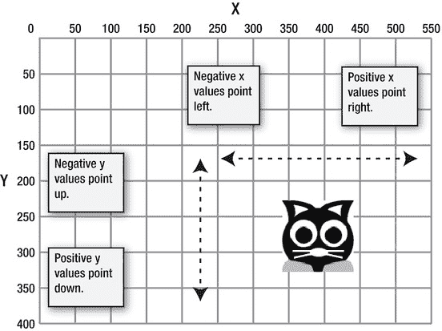

**图 5-3.** 你可以通过判断 x 或 y 值是正还是负来确定移动方向。

如果这一切看起来平淡无奇且显而易见，那太好了！就应该如此！现在让我们看看所有这些关于速度的讨论是如何融入程序中的。

*选择变量名`vx`和`vy`已经成为指代水平和垂直速度变量的编程惯例，因此本书中也沿用此约定。大多数看到`vx`和`vy`的编程者都会立即明白它们的含义。这只是一个大家似乎都遵循的不成文编程规则，且没人知道原因。当然，你可以给这些变量起任何你喜欢的名字，比如`velocityX`和`velocityY`（这两个名字更具描述性，可能使你的程序更易读）。但是，惯例有时很难打破，因此本书坚持使用`vx`和`vy`。*

## 使用新的 `keyDownHandler`

`keyDownHandler` 与你在本章中看到的第一个程序相比略有变化。

```
public function keyDownHandler(event:KeyboardEvent):void
{
  if (event.keyCode == Keyboard.LEFT)
  {
    vx = -5;
  }
  else if (event.keyCode == Keyboard.RIGHT)
  {
    vx = 5;
  }
  else if (event.keyCode == Keyboard.UP)
  {
    vy = -5;
  }
  else if (event.keyCode == Keyboard.DOWN)
  {
    vy = 5;
  }
}
```

`if/else` 语句不再直接改变角色的 `x` 或 `y` 属性，而是仅使用适当的速率来更新 `vx` 和 `vy` 变量。实际移动对象的工作交给了 `enterFrameHandler` 处理。稍后会详细说明，但首先让我们快速看看另一个新的事件处理器：`keyUpHandler`。

## 使用 `keyUpHandler`

在第一个简单的键盘控制程序中，向舞台添加了一个名为 `keyDownHandler` 的事件处理器，其任务是监听按键按下。`keyDownHandler` 的有趣之处在于，它只知道按键何时被按下，而不知道何时被释放。事实证明，对于游戏而言，知道按键被抬起与知道按键被按下同样重要。因此，AS3.0 中 `KeyboardEvent` 类有一个名为 `KEY_UP` 的便捷小属性，可以告诉你这些信息。你已在附加到舞台对象的指令中使用了 `KEY_UP` 属性作为事件监听：

`stage.addEventListener(KeyboardEvent.KEY_UP, keyUpHandler);`

它监听那些被*释放*的按键，并将这些信息发送到 `keyUpHandler`，以便你进行相应操作。但你为什么想知道某个按键是否不再被按下呢？

试想一下：你修改了 `keyDownHandler`，使得当游戏玩家按下某个方向键时，角色的速率改变 5 像素。这很好，因为当你按下某个方向键时，你显然希望角色移动。但当你停止按下某个方向键时呢？合理的情况是角色也应停止。然而，除非你明确告诉程序这一点，否则它不知道你的意图，角色就会无休止地一直移动下去。在简单的键盘控制程序中，`keyDownHandler` 直接改变角色的 `x` 和 `y` 属性时这不成问题，但现在你使用了速率，并将实际移动任务交给了 `enterFrameHandler`，这就成了一个重大问题。

`keyUpHandler` 的任务是检查是否有方向键被释放，然后将角色的速率设置为 0。这正是以下代码的作用：

```
public function keyUpHandler(event:KeyboardEvent):void
{
  if (event.keyCode == Keyboard.LEFT
    || event.keyCode == Keyboard.RIGHT)
  {
    vx = 0;
  }
  else if (event.keyCode == Keyboard.DOWN
    || event.keyCode == Keyboard.UP)
  {
    vy = 0;
  }
}
```

这段代码应该非常浅显易懂，但有一项内容对你来说是全新的：**或运算符**。它看起来像这样：

`||`

它由两个**管道符**组成。管道符是一条竖线，你可以在键盘上靠近花括号或斜杠键的位置找到它。仔细看看，它就在那里！

`||` 运算符用于条件语句中，帮助你判断某件事*或*另一件事是否为真。

看一下这行代码：

```
if (event.keyCode == Keyboard.LEFT
  || event.keyCode == Keyboard.RIGHT)
{...
```

它的字面意思是：

```
如果左箭头键被按下，
或者右箭头键被按下，
则执行以下操作。
```

释放左箭头键或右箭头键会将水平速率设置为 0；角色将停止向左或向右移动。由于这两种条件的结果完全相同，因此将它们合并到一个带有 `||` 运算符的语句中是很合理的。这非常高效地节省了额外几行冗余代码。

## 使用 `enterFrameHandler`

`enterFrameHandler` 才是真正让角色移动的关键。它由一个使用 `Event` 类中 `ENTER_FRAME` 属性的事件监听器触发。要使用它，你首先必须在类定义中通过以下导入指令引入 `Event` 类：

```
import flash.events.Event;
```

然后，在构造方法中设置事件监听器，指令如下：

```
addEventListener(Event.ENTER_FRAME, onEnterFrame);
```

它的格式与另外两个监听器相同，但有一个重要的区别：该监听器并未附加到 `stage` 对象上。那么它附加到了哪里？不附加到对象而直接添加事件监听器意味着该监听器会*直接附加到它所在的类本身*；在本例中，即是你正在编写的实际程序 `KeyboardControl` 类。这点目前意义不大，但当你在第 8 章开始研究使用不同类构建游戏时，它会变得非常重要。

当事件监听器被触发时，它会调用 `enterFrameHandler`。

```actionscript
public function enterFrameHandler(event:Event):void
{
  // 移动角色
  character.x += vx;
  character.y += vy;
}
```

这个事件处理程序的功能非常简单：它获取 `vx` 和 `vy` 变量中的水平与垂直速度，并将其赋值给角色的 `x` 和 `y` 属性。这就让物体动了起来。耶！

但是等等，调用这个处理程序的事件是什么？你知道程序中其他事件是由按键按下或松开触发的。`KeyboardEvent.KEY_DOWN` 和 `KeyboardEvent.KEY_UP` 在这方面不言自明，但 `Event.ENTER_FRAME` 究竟是什么事件？

先泡杯茶，再往火里添根柴。这里有个小故事，或许能帮你理解其中原理。Flash 技术最初是为制作动画而设计的，而动画是一门从静态物体中创造运动幻觉的艺术。Flash 借用的许多概念都来自动画产业，该产业使用赛璐珞胶片来创造这种幻觉。以下简要介绍胶片动画的工作原理：

**胶片**是一长条赛璐珞（塑料），由一系列称为**帧**的小方块组成。每一帧包含一幅图像，而每一帧中的图像与其前一帧的图像只有细微差别。如果有足够多这样略有不同的图像以足够快的速度在观众眼前闪过，这些单独的静态图像就会看起来像是一个连续运动的图像。这种运动幻觉被称为**视觉暂留**，是所有电影、视频、动画乃至游戏动画的基础。

要创造令人信服的运动幻觉，这些略有不同的图像需要以至少每秒 12 次（也称为帧率，fps）的速度在观众眼前闪过。大多数卡通动画都是以 12fps 的速度进行动画的。要获得真正流畅自然的运动，你需要将帧率提高到大约 24fps。24fps 是电影院放映的电影和高质量动画电影所使用的帧率。视频则使用大约 30fps 的帧率。

在这个项目中，帧率设置为 60，这是游戏常见的帧率。这意味着舞台上所有对象每秒更新 60 次。每次舞台进行这样的更新，就相当于“进入一帧”。因此程序每秒*进入一帧*60 次。

简而言之，这就是 `Event.ENTER_FRAME` 的含义。每次程序进入新的一帧时，`ENTER_FRAME` 事件就会被触发。因此，你放在由 `ENTER_FRAME` 事件调用的处理程序中的任何指令，每秒都会运行 60 次。它会在程序运行的整个过程中持续执行，直到你移除该事件监听器为止。

在当前程序中，以下两行指令每秒运行 60 次：

```actionscript
player.x += vx;
player.y += vy;
```

这使得物体看起来像是在移动。原理如下：

假设角色位于 x 坐标为 100 的位置。如果游戏玩家按下左箭头键，`vx` 变量被赋值为-5。当 SWF 文件下一次进入新帧时，-5 被加到角色当前的 x 位置上。物体新位置变为 95。在下一帧中，-5 再次被加到角色的 x 位置上，因此新位置变为 90。如果松开左箭头键，`vx` 变量被赋值为 0。然后零被加到角色的 x 位置上（使用 `+=` 运算符），因此它的位置保持在 90，并且停止移动。

很巧妙，对吧？

为了让角色在屏幕上移动，似乎需要费不少周折。请稍安勿躁；这种方法的好处将在本书稍后部分，当你研究使用物理模拟实现自然运动时，会变得非常明显。如果你能先计算出速度，那么在使用它更新游戏角色位置之前，你可以用它做各种有趣的事情。耐心点，我的孩子；一切都会揭晓！

`ENTER_FRAME` 事件是 AS3.0 中面向游戏设计师最重要的事件之一。它是使用 AS3.0 编程代码移动物体的基础。你将要学习的大部分新技术都将由 `ENTER_FRAME` 事件触发，因此你会发现从现在起，`enterFrameHandler` 将成为一个相当忙碌的小地方——很快它就会充满新朋友和愉快的闲聊。

## 设置舞台边界

既然你已经能让小玩家角色在舞台上移动，请注意你可以让它完全移出舞台边缘，并且如果你愿意，可以一直走下去，永无止境。游戏设计师主要使用三种策略来防止这种情况发生。

*   在舞台边缘阻挡移动。
*   屏幕环绕，即玩家从舞台左侧离开，然后从右侧出现。
*   滚动，即角色处在一个非常大的环境中，背景移动以显示未探索的区域。

你将逐一研究这些技术。

### 在舞台边缘阻止移动

与大多数编程问题一样，如果你理解了所要实现的目标背后的逻辑，那么你需要做的就是找到一种用编程代码表达该逻辑的方法。以下是这段代码实现功能背后的逻辑：

*如果角色到达屏幕边缘，就将其推回。*

嗯，说起来容易做起来难？我们来看看。

AS3.0 没有任何方法可以将“屏幕边缘”作为一个整体来表示，但你可以访问内置的 `stage` 对象。它包含 `stageWidth` 和 `stageHeight` 属性，可以告诉你舞台的大小。也许你可以利用这些属性来确定舞台的上、下、左、右边界，然后当你发现角色的 `x` 或 `y` 位置超出了这些边界时，就阻止它移动。

听起来可行？试试看！请按以下步骤操作：

1.  将以下代码添加到 `enterFrameHandler` 中：

```actionscript
public function enterFrameHandler(event:Event):void
{
  //移动角色
  character.x += vx;
  character.y += vy;

  //在舞台边缘阻止角色
  if (character.x < 0)
  {
    character.x = 0;
  }
  if (character.y < 0)
  {
    character.y = 0;
  }
  if (character.x + character.width > stage.stageWidth)
  {
    character.x = stage.stageWidth - character.width;
  }
  if (character.y + character.height > stage.stageHeight)
  {
    character.y = stage.stageHeight - character.height;
  }
}
```

2.  编译程序，并使用方向键将角色移动到舞台边缘。当角色的任何一侧接触到边缘时，它就会停止移动，如图 5-4 所示。

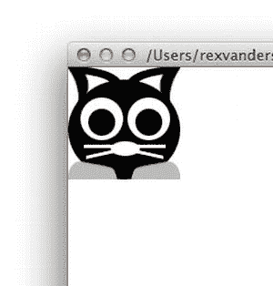

**图 5-4.** 角色在到达舞台边缘时停止移动。

让我们详细看看这段代码是如何阻止角色越过舞台的左侧、顶部、右侧和底部边缘的。

你知道舞台最左侧的 `x` 位置值为 0。请记住，你的角色的注册点（即测量其 `x` 和 `y` 位置的点）是其左上角。这意味着你可以使用以下逻辑来阻止角色越过舞台左侧：

*如果角色的 x 位置小于零，则将其精确设置为零。*

在代码中，同样的逻辑如下所示：

```actionscript
if (character.x < 0)
{
  character.x = 0;
}
```

如果角色从右向左移动，其 `x` 位置值会逐渐减小。如果它移动得足够远，其 `x` 值最终会达到零，甚至变为负数。当这种情况发生时，代码会将角色推回，使其正好处于位置零——即舞台的左边缘。图 5-5 说明了这一工作原理。

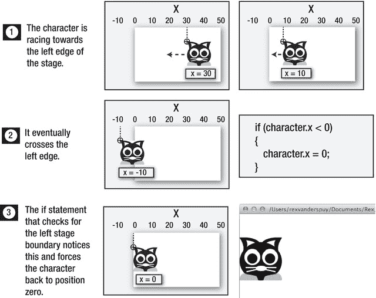

**图 5-5.** 角色在到达舞台边缘时停止移动。

即使角色实际上确实略微移动到了你设定的舞台边界之外，你也从未看到它这样做；你只能看到它被强制推回的那个位置。

这个逻辑同样适用于检查舞台顶部边界的代码。

*如果角色的 y 位置小于零，则将其精确设置为零。*

```actionscript
if (character.y < 0)
{
  character.y = 0;
}
```

## 舞台边界与屏幕环绕

如果角色越过舞台顶部，它会被强制推回到`y`位置为零。

检查舞台右侧和底部边界会稍微复杂一些。原因在于角色的`x`和`y`位置是从其左上角测量的。这意味着你需要在角色的左上角到达右侧和底部边界之前就阻止它。如果你在角色的左上角到达舞台右侧或底部时才阻止它，那么角色的身体可能已经消失在边缘之外了。图 5-6 说明了这个问题。

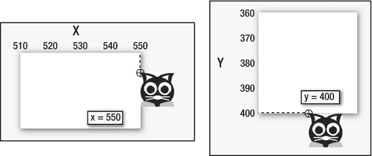

**图 5-6.** 你不能直接使用角色的`x`和`y`位置将其停在舞台的右侧和底部边缘。

你需要提前多少停止呢？刚好是其宽度或高度的量。图 5-7 显示了为什么这样有效。

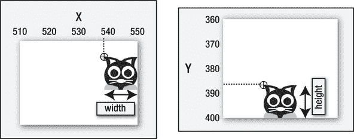

**图 5-7.** 通过加上角色的宽度和高度，可以精确地将其停在右侧和底部边缘。

你可以通过使用内置的`height`和`width`属性来获取角色的高度和宽度。

```
character.height
character.width
```

你在第 2 章中创建的角色对象的高度和宽度为 100 像素。因此，在这个项目中，`character.height`和`character.width`将等于 100。

要找到舞台右侧边缘和底部的像素值，请使用舞台对象内置的`stageWidth`和`stageHeight`属性。

```
stage.stageWidth
stage.stageHeight
```

舞台的尺寸是 550 x 400 像素。这意味着`stage.stageWidth`属性的值是 550，`stage.stageHeight`属性的值是 400。

以下是精确地将角色停在右侧和底部边缘所需执行的操作：

1.  首先，将角色的宽度或高度加到其`x`或`y`位置。这将为你提供角色前缘的位置。
2.  如果该前缘的值大于舞台的右侧或底部边缘，则将角色移回到一个`x`或`y`位置，该位置等于舞台尺寸减去角色的高度或宽度。

因此，以下是`if`语句中检查角色的`x`和`y`位置是否已越过舞台右侧和底部边界的代码：

```
if (character.x + character.width > stage.stageWidth)
{
  character.x = stage.stageWidth - character.width;
}
if (character.y + character.height > stage.stageHeight)
{
  character.y = stage.stageHeight - character.height;
}
```

它弥补了角色的高度和宽度，并使其精确地停在舞台边界处。图 5-8 展示了这一概念的实际应用。

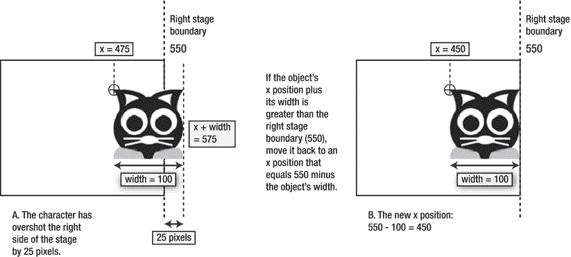

**图 5-8.** 使用对象的宽度实现精确的屏幕边界

使用角色和舞台的内置`height`和`width`属性的好处在于，你无需知道两者中的任何一个有多大。无论游戏角色或舞台的尺寸如何，这段代码都可以保持不变地工作。

你可以在本章源文件中的`StageBoundaries`文件中找到此代码的完整版本。

### 屏幕环绕

**屏幕环绕**是指对象从舞台一侧消失，然后从对侧重新出现。这是一种非常有趣的效果，实现起来也非常简单。实际上，实现此效果所用的逻辑，几乎与你用于在舞台边缘阻止移动的逻辑完全相反。让我们试试看！

1.  将 `enterFrameHandler` 中的条件语句修改为与加粗文本一致：

```
public function enterFrameHandler(event:Event):void
{
  //移动角色
  character.x += vx;
  character.y += vy;
  //屏幕环绕
  if (character.x + character.width < 0)
  {
    character.x = 550;
  }
  if (character.y + character.height < 0)
  {
    character.y = 400;
  }
  if (character.x > stage.stageWidth)
  {
    character.x = 0 - character.width;
  }
  if (character.y > stage.stageHeight)
  {
    character.y = 0 - character.height;
  }
}
```

2.  编译程序。
3.  使用方向键将角色移动到舞台边缘。躲猫猫！它从对侧出现了（参见图 5-9）。

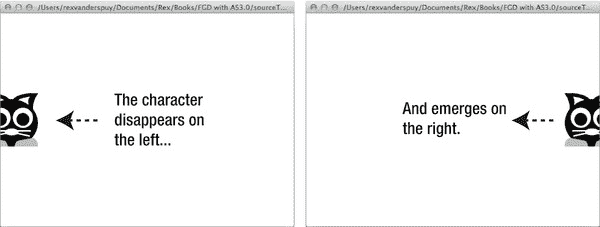

**图 5-9.** 屏幕环绕

在详细了解了如何在舞台边缘停止对象之后，我相信你已经能理解这段代码的作用了。除了逻辑恰好相反这一点令人愉悦外，它几乎完全一样！它利用对象的宽度和高度来判断对象是否已完全消失在舞台边缘之外。一旦检测到这种情况，它就会将对象定位在舞台对侧，刚好在可见边界之外。这创造了一种错觉，仿佛对象被困在某种圆柱形的无尽平面上。我通常在本书中会抱怨这类事情，但这次，这太棒了！好好享受吧！当然，屏幕环绕是《吃豆人》和《小行星》等许多经典老游戏的特色，现在你已经知道如何在需要时实现它了。

你可以在本章源文件的 `ScreenWrapping` 文件夹中找到这个屏幕环绕示例的完整代码。

### 嵌入图像

在继续深入学习之前，让我们看看另一种将图像加载到游戏中的系统。我将向你展示如何将图像嵌入到程序中。

到目前为止，你是这样将图像加载到程序中的：

首先，你创建了一个 `URLRequest` 和一个 `Loader` 对象。

```actionscript
public var characterURL:URLRequest
  = new URLRequest("../images/character.png");
public var characterImage:Loader = new Loader();
```

然后，你将图像加载到 `Loader` 对象中。

```actionscript
characterImage.load(characterURL);
```

这种加载图像的系统称为**运行时**加载。图像不是在程序编译时加载，而是在 SWF 文件运行时加载。实际上，是编译好的 SWF 文件在加载这些图像，而不是你的程序。SWF 文件会读取你图像文件夹中 PNG 文件的路径，并加载图像。

运行时加载很有用，因为它意味着你可以在不重新编译程序的情况下更改游戏中的任何图像。只需将不同的图像放入图像文件夹，编译好的 SWF 文件就会自动读取新图像。

然而，运行时加载有一个致命缺陷：图像加载速度比代码运行速度慢。这意味着你的程序可能在所有图像加载完成之前就开始运行。如果你在运行每秒更新代码 60 次的 `ENTER_FRAME` 事件，情况尤其如此，它可能导致各种问题。

AS3.0 的 `Loader` 类有许多内置的方法和属性，允许你监控已加载图像的状态，并仅在图像加载完成后才初始化程序。这需要相当多的额外编码来设置和管理，但是，如果你的项目出于某种原因需要运行时加载，这可能是唯一的解决方案。你可以在 AS3.0 的文档中找到关于 `Loader` 类允许你执行此操作的属性和方法的更多信息，文档地址是 `http://help.adobe.com/en_US/FlashPlatform/reference/actionscript/3/flash/display/Loader.html?filter_flash=cs5&filter_flashplayer=10.2&filter_air=2.6`。

然而，对于你将处理的大多数游戏来说，有一种更可靠、更简单且更好的方法。你可以将图像直接嵌入到程序中。这意味着在代码运行之前，程序就可以立即使用这些图像。这也意味着编译好的 SWF 文件不依赖于外部的图像文件夹。

以下是向程序嵌入图像的步骤：

1.  导入 `DisplayObject` 类。

```actionscript
import flash.display.DisplayObject;
```

将此导入语句添加到程序中的其他导入语句中。

2.  在类定义中添加这两行代码：

```actionscript
[Embed(source="../images/character.png")]
public var CharacterImage:Class;
```

第一行是 `Embed` 元标签。它告诉程序在哪里查找图像文件。（当你嵌入图像时，文件路径是相对于 AS 文件，而不是 SWF 文件。）

第二行创建了一个 `Class` 变量。图像直接存储在此变量中。（请注意，它的名称以大写字母开头，这表明它是一个类。）

非常重要的一点是，这两行代码必须像这样一起出现，并且按此顺序。你不能将它们分开或在它们之间添加任何其他代码。这只是 AS3.0 语法中的一个奇怪特性。

3.  从上一步创建的 `Class` 变量创建图像对象。

```actionscript
public var characterImage:DisplayObject = new CharacterImage();
```

此新图像对象必须被类型化为 `DisplayObject`。

4.  最后，你需要将图像对象添加到容器 `Sprite` 中，方式与之前示例中添加加载器对象完全相同。

```actionscript
character.addChild(characterImage);
```

图 5-10 说明了嵌入图像的工作原理。

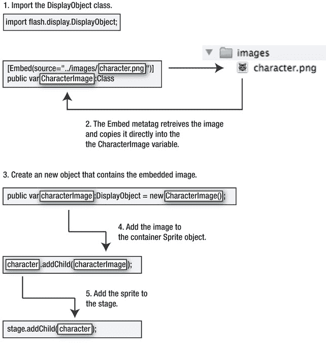

**图 5-10.** 将图像嵌入到程序中

由于它能解决所有问题，像这样嵌入图像将成为本书后续项目中加载图像到游戏的首选系统。你将在下一节看到一个如何嵌入图像的实用示例。

*你可以嵌入任何类型的文件，而不仅仅是图像文件。在第 9 章中，你将学习如何嵌入声音；在第 11 章中，你将学习如何嵌入 SWF 文件。*

## 滚动效果

**滚动**是一种让玩家能够在远超舞台尺寸的广阔环境中移动的视觉效果。如同中国古代的长卷在木桌上缓缓展开，背景会随之移动，使角色能够探索舞台边界之外的空间。

虽然很难说哪个游戏系列更胜一筹，但要说游戏设计中几乎所有的核心理念，都能在两大经典游戏系列《**超级马力欧兄弟**》和《**塞尔达传说**》中以不同形式体现，这一点恐怕争议不大。游戏设计师需要考虑的关于优秀游戏设计的方方面面，几乎都能在这两款游戏中找到，滚动效果也不例外。

《超级马力欧兄弟》主要采用了**横向卷轴**的方式。也就是说，当玩家移动到屏幕左边缘或右边缘时，背景会向左或向右移动。这类游戏的视角通常设计成从侧面观察场景。《塞尔达传说》则使用了**俯瞰式多轴滚动**。在俯瞰式滚动中，你可以从正上方俯视环境，就像一只飞在天空的鸟，俯瞰着下方的大地。多轴滚动允许玩家角色自由地向任何方向移动（上、下、左、右），而环境背景会随之滚动以保持角色位于视野中。

实际上，大多数使用滚动效果的游戏都是这两种系统的结合。本章将先介绍其中更复杂的多轴滚动，最后再快速讲解横向卷轴。当你熟练掌握这里讲解的滚动技术后，就能实现这两种系统的任意组合。

实现滚动系统首先需要一张比舞台大得多的背景场景。在本例中，你将使用一张非常大的图片。

1.  找一张你认为适合滚动系统的大图。任何宽度和高度大于 1000 像素的图片都适用于本示例。我决定让我那只勤劳的小猫角色去太空度个假：前往火星的卫星之一——火卫一。幸运的是，美国国家航空航天局（NASA）提供了大量免版税照片，包括我能够下载到的火卫一超高分辨率图像。（要自行下载高分辨率太空场景，请访问 `http://photojournal.jpl.nasa.gov/`。任何标记为“全分辨率”的图片尺寸都足够大。）
2.  将下载的照片重命名为 `background`。注意：这很可能是一张扩展名为 `.jpg` 的 JPEG 图片。如果是这样，你需要在后续的示例代码中使用文件名 `“background.jpg”`。
3.  创建一个名为 `BasicScrolling` 的新 ActionScript 项目。
4.  在 `BackgroundScrolling` 项目目录中创建一个 `images` 文件夹，然后将你的背景图片和角色图片复制进去。
5.  在代码编辑器中编写以下程序。（你可以在本章源文件的 `BasicScrolling` 文件夹中找到这段完整的代码。）

```actionscript
package
{
  import flash.display.Sprite;
  import flash.display.DisplayObject;
  import flash.events.KeyboardEvent;
  import flash.ui.Keyboard;
  import flash.events.Event;

  [SWF(width="550", height="400",
    backgroundColor="#FFFFFF", frameRate="60")]
  public class BasicScrolling extends Sprite
  {
    //嵌入背景图像
    [Embed(source="../images/background.png")]
    public var BackgroundImage:Class;
    public var backgroundImage:DisplayObject
      = new BackgroundImage();
    public var background:Sprite = new Sprite();

    //嵌入角色图像
    [Embed(source="../images/character.png")]
    public var CharacterImage:Class;
    public var characterImage:DisplayObject = new CharacterImage();
    public var character:Sprite = new Sprite();

    //创建并初始化 vx 和 vy 变量
    public var vx:int = 0;
    public var vy:int = 0;

    public function BasicScrolling()
    {
      //添加背景
      background.addChild(backgroundImage);
      stage.addChild(background);
      background.x = -1325;
      background.y = -961;

      //添加角色
      character.addChild(characterImage);
      stage.addChild(character);
      character.x = 225;
      character.y = 150;

      //添加事件侦听器
      stage.addEventListener
        (KeyboardEvent.KEY_DOWN, keyDownHandler);
      stage.addEventListener
        (KeyboardEvent.KEY_UP, keyUpHandler);
      stage.addEventListener
        (Event.ENTER_FRAME, enterFrameHandler);
    }

    public function keyDownHandler(event:KeyboardEvent):void
    {
      if (event.keyCode == Keyboard.LEFT)
      {
        vx = -5;
      }
      else if (event.keyCode == Keyboard.RIGHT)
      {
        vx = 5;
      }
      else if (event.keyCode == Keyboard.UP)
      {
        vy = -5;
      }
      else if (event.keyCode == Keyboard.DOWN)
      {
        vy = 5;
      }
    }

    public function keyUpHandler(event:KeyboardEvent):void
    {
      if (event.keyCode == Keyboard.LEFT
        || event.keyCode == Keyboard.RIGHT)
      {
        vx = 0;
      }
      else if (event.keyCode == Keyboard.DOWN
        || event.keyCode == Keyboard.UP)
      {
        vy = 0;
      }
    }

    public function enterFrameHandler(event:Event):void
    {
```

//移动背景

`background.x -= vx;`

`background.y -= vy;`

//检查舞台边界

```
if (background.x > 0)
{
  background.x = 0;
}

if (background.y > 0)
{
  background.y = 0;
}

if (background.x < stage.stageWidth - background.width)
{
  background.x = stage.stageWidth - background.width;
}

if (background.y < stage.stageHeight - background.height)
{
  background.y = stage.stageHeight - background.height;
}
```

6. 请记住，如果你使用的是 JPEG 文件，则可能需要将`"background.png"`改为`"background.jpg"`。`[Embed(source="../images/background.jpg")]`
7. 编译程序。使用方向键在舞台上移动角色，你会看到自己可以在火卫一的表面上飞翔！（参见图 5-11。）

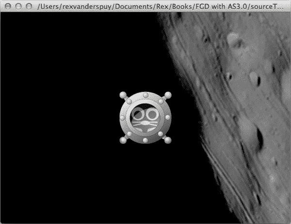

**图 5-11.** 太空度假！

## 查看代码

让我们来看看这个程序中引入的一些新代码和概念。

### 嵌入角色与背景图像

为了嵌入图像，程序首先导入了`DisplayObject`类。

```
import flash.display.Sprite;
import flash.display.DisplayObject;
import flash.events.KeyboardEvent;
import flash.ui.Keyboard;
import flash.events.Event;
```

图像被嵌入在类定义中。实现这一功能的代码与你刚才看到的示例完全相同。请记住，即使嵌入了图像，如果要将其显示在舞台上，最终还是需要将其复制到`Sprite`对象中。这就是为什么代码要为角色和背景分别创建对应的`Sprite`对象。

```
public class BasicScrolling extends Sprite
{
  //嵌入背景图像
  [Embed(source="../images/background.png")]
  public var BackgroundImage:Class;
  public var backgroundImage:DisplayObject = new BackgroundImage();
  public var background:Sprite = new Sprite();

  //嵌入角色图像
  [Embed(source="../images/character.png")]
  public var CharacterImage:Class;
  public var characterImage:DisplayObject = new CharacterImage();
  public var character:Sprite = new Sprite();

  //创建并初始化 vx 和 vy 变量
  public var vx:int = 0;
  public var vy:int = 0;

  public function BasicScrolling()
  {...}
```

包含图像的`Sprite`随后会以与之前程序相同的方式，在构造方法中被添加到舞台上。

```
public function BasicScrolling()
{
  //添加背景
  background.addChild(backgroundImage);
  stage.addChild(background);
  background.x = -1005;
  background.y = -761;

  //添加角色
  character.addChild(characterImage);
  stage.addChild(character);
  character.x = 225;
  character.y = 150;

  //添加事件监听器
  stage.addEventListener
    (KeyboardEvent.KEY_DOWN, keyDownHandler);
  stage.addEventListener
    (KeyboardEvent.KEY_UP, keyUpHandler);
  stage.addEventListener
    (Event.ENTER_FRAME, enterFrameHandler);
}
```

但请注意定位背景的这行代码：

```
background.x = -1325;
background.y = -961;
```

这值得进一步解释。

### 定位背景

我使用的火卫一图像非常大：尺寸为 2561 x 1922 像素。而舞台只有 550 x 400 像素。我想将背景添加到舞台上并使其居中——这样在游戏开始时，火卫一的中心点就能显示在舞台上。这意味着我需要在背景的`x`和`y`位置分别取其宽度和高度的一半的负值。然后，还需要在`x`位置加上舞台宽度的一半，在`y`位置加上舞台高度的一半。请记住，对象的定位是从其左上角开始的。并且舞台左上角的`x`和`y`值均为 0。这意味着，如果我将背景的初始`x`位置设为 -1005，`y`位置设为 -761，那么游戏开始时背景将相对于舞台居中。图 5-12 说明了其原理。

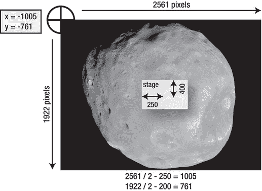

**图 5-12.** 使背景相对于舞台居中。

当然，大部分背景隐藏在舞台之外。但它将正好位于舞台中心的正上方。

要使你自己的背景图像居中，请将图像的高度和宽度除以一半，然后减去舞台宽度和高度的一半。通过在前面加上负号使这些数字变为负数，并将这些负数用作背景的`x`和`y`位置。如果你不想手动计算（又何必自己算呢？），只需让 AS3.0 像下面这样自动为你完成即可：

```
background.x = -(background.width - stage.stageWidth) / 2;
background.y = -(background.height - stage.stageHeight) / 2;
```

这段代码将使任何尺寸的大型背景图像居中。

角色在舞台上居中。实际上，在整个过程中，角色从未离开它在舞台中央的位置。看起来它像是在移动，但实际上并没有。这就是滚动幻象的全部内容，接下来我将解释其工作原理。

### 滚动背景

那么，如果角色不移动，移动的是什么呢？是背景。在`enterFrameHandler`的代码中，`background`对象成为了新的关注中心。

你所做的仅仅是逆转了之前用于移动角色的一部分逻辑。当你按下方向键时，它们会沿着你希望角色移动的*相反*方向移动`background`对象。这就是为什么你需要在这两行代码中给`vx`和`vy`变量加上负号：

```
background.x += -vx;
background.y += -vy;
```

这便制造出了角色在移动的幻象，而实际上是背景对象在向相反方向移动。啊，电子游戏程序员那狡黠的手段！

条件判断语句用于阻止背景对象在其边缘触及舞台边缘时继续移动。

```
if (background.x > 0)
{
  background.x = 0;
}

if (background.y > 0)
{
  background.y = 0;
}

if (background.x < stage.stageWidth - background.width)
{
  background.x = stage.stageWidth - background.width;
}

if (background.y < stage.stageHeight - background.height)
{
  background.y = stage.stageHeight - background.height;
}
```

至于它为何如此运作，其中的逻辑推导就留给你自己去琢磨了，但这不过是用于阻止角色移出舞台边缘的那套逻辑的又一种变体应用而已。

### 更好的滚动

这个简单的滚动系统实际上可以让你走得很远，但有几个问题可以通过微调来解决：

- 当可滚动区域达到其极限时，角色将无法一直移动到舞台边缘。试着按住右箭头键，看看你能走多远。到某个时候，背景会停止移动，但玩家无法一直走到舞台的右侧。这似乎是一种人为的限制，在许多动作或冒险游戏中，这对玩家来说会是一个令人沮丧的限制。图 5-13 说明了这个问题。

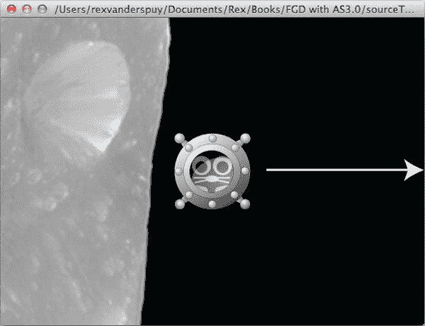

**图 5-13.** 当背景达到其可滚动区域的极限时，角色无法一直移动到舞台边缘。

- 另一个潜在问题是滚动背景`总是`在滚动。对于许多游戏来说，如果背景只在角色`接近`舞台边缘时才滚动，可能更有意义。否则，角色应该自由探索，而背景不应移动。

以下是解决这些问题的方法。你可以建立一个系统，根据角色和背景对象各自的位置，来确定是应该移动角色还是背景对象。如果背景对象已经达到了其移动极限，那么角色应该可以自由移动到舞台边缘。此外，如果玩家没有靠近任何舞台边缘，那么他应该可以在不移动背景对象的情况下自由移动。

实现这一点的诀窍是设置一个假想的`内部边界`，它是舞台内部一个正好为舞台高度和宽度一半的矩形区域。角色可以在内部边界内自由移动；当它到达边界边缘时，它将停止移动，而背景开始滚动。当背景达到其滚动极限时，一直阻挡玩家前进的内部边界将扩展到舞台的极限，以允许玩家移动到舞台边缘。

你将要创建的内部边界，并不像玩家和背景对象那样是一个真实的对象。相反，它只是定义了这些边界的上、下、左、右的四个数字。实际上，找出这些数字的逻辑与设置真实舞台边界的逻辑完全相同；你只是将它们缩小了一半。

你将分两个阶段构建此代码，以便了解其工作原理。（有关此代码的完整最终工作版本，请参阅本章源代码文件中的 `BetterScrolling.as` 文件。）

1. 你可以创建一个新的 ActionScript 项目，或者修改上一个示例中的代码。以下是整个程序的代码清单；所有新代码都已用粗体文本突出显示。

```actionscript
package
{
  import flash.display.Sprite;
  import flash.display.DisplayObject;
  import flash.events.KeyboardEvent;
  import flash.ui.Keyboard;
  import flash.events.Event;

  [SWF(width="550", height="400",
    backgroundColor="#FFFFFF", frameRate="60")]
  public class BetterScrolling extends Sprite
  {
    //嵌入背景图像
    [Embed(source="../images/background.png")]
    public var BackgroundImage:Class;
    public var backgroundImage:DisplayObject
      = new BackgroundImage();
    public var background:Sprite = new Sprite();

    //嵌入角色图像
    [Embed(source="../images/character.png")]
    public var CharacterImage:Class;
    public var characterImage:DisplayObject = new CharacterImage();
    public var character:Sprite = new Sprite();

    //创建并初始化 vx 和 vy 变量
    public var vx:int = 0;
    public var vy:int = 0;

    //内部边界的变量
    public var rightInnerBoundary:uint;
    public var leftInnerBoundary:uint;
    public var topInnerBoundary:uint;
    public var bottomInnerBoundary:uint;

    public function BetterScrolling()
    {
      //添加背景
      background.addChild(backgroundImage);
      stage.addChild(background);
      background.x = -(background.width - stage.stageWidth) / 2;
      background.y = -(background.height - stage.stageHeight) / 2;

      //添加角色
      character.addChild(characterImage);
      stage.addChild(character);
      character.x = 225;
      character.y = 150;

      //定义内部边界变量
      rightInnerBoundary
        = (stage.stageWidth / 2) + (stage.stageWidth / 4);
      leftInnerBoundary
        = (stage.stageWidth / 2) - (stage.stageWidth / 4);
      topInnerBoundary
        = (stage.stageHeight / 2) - (stage.stageHeight / 4);
      bottomInnerBoundary
        = (stage.stageHeight / 2) + (stage.stageHeight / 4);

      //添加事件监听器
      stage.addEventListener
        (KeyboardEvent.KEY_DOWN, keyDownHandler);
      stage.addEventListener
        (KeyboardEvent.KEY_UP, keyUpHandler);
      stage.addEventListener
        (Event.ENTER_FRAME, enterFrameHandler);
    }

    public function keyDownHandler(event:KeyboardEvent):void
    {
      if (event.keyCode == Keyboard.LEFT)
      {
        vx = -5;
      }
      else if (event.keyCode == Keyboard.RIGHT)
      {
        vx = 5;
      }
      else if (event.keyCode == Keyboard.UP)
      {
        vy = -5;
      }
      else if (event.keyCode == Keyboard.DOWN)
      {
        vy = 5;
      }
    }

    public function keyUpHandler(event:KeyboardEvent):void
    {
      if (event.keyCode == Keyboard.LEFT
        || event.keyCode == Keyboard.RIGHT)
      {
        vx = 0;
      }
      else if (event.keyCode == Keyboard.DOWN
        || event.keyCode == Keyboard.UP)
      {
        vy = 0;
      }
    }

    public function enterFrameHandler(event:Event):void
    {
      //禁用移动背景的代码
      //background.x -= vx;
      //background.y -= vy;

      //移动玩家
      character.x += vx
      character.y += vy;

      //在内部边界边缘停止角色
```

## 内部边界移动逻辑

```actionscript
if(character.x < leftInnerBoundary)
{
  character.x = leftInnerBoundary;
  background.x -= vx;
}
if(character.x + character.width > rightInnerBoundary)
{
  character.x = rightInnerBoundary - character.width
  background.x -= vx;
}
if(character.y < topInnerBoundary)
{
  character.y = topInnerBoundary;
  background.y -= vy;
}
if(character.y + character.height  > bottomInnerBoundary)
{
  character.y = bottomInnerBoundary - character.height;
  background.y -= vy;
}
```

```actionscript
//检查舞台边界
if (background.x > 0)
{
  background.x = 0;
}
if (background.y > 0)
{
  background.y = 0;
}
if (background.x < stage.stageWidth - background.width)
{
  background.x = stage.stageWidth - background.width;
}
if(background.y < stage.stageHeight - background.height)
{
  background.y = stage.stageHeight - background.height;
}
```

2. 编译程序，使用方向键移动角色。现在你可以在舞台内部边界内自由移动角色。当角色到达内部边界的边缘时，背景开始滚动，如图 5-14 所示。

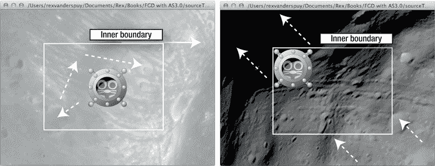

**图 5-14.** 角色可在内部边界内自由移动。当角色到达其中一条边缘时，角色停止移动，背景开始滚动。

代码首先通过这四个新变量定义了内部边界。你之前在类定义中声明了这些新变量。

```actionscript
public var rightInnerBoundary:uint;
public var leftInnerBoundary:uint;
public var topInnerBoundary:uint;
public var bottomInnerBoundary:uint;
```

然后在构造方法中设置它们的值。

```actionscript
rightInnerBoundary
  = (stage.stageWidth / 2) + (stage.stageWidth / 4);
leftInnerBoundary
  = (stage.stageWidth / 2) - (stage.stageWidth / 4);
topInnerBoundary
  = (stage.stageHeight / 2) - (stage.stageHeight / 4);
bottomInnerBoundary
  = (stage.stageHeight / 2) + (stage.stageHeight / 4);
```

这是你第一次编写使用除法运算符的代码。它由正斜杠（`/`）字符表示，意为“除以”。

你能理解这些边界是如何计算出来的吗？（试试看，其实并不难！）最终你会得到一个面积为舞台一半大小的内部区域。

以下是 `enterFrameHandler` 中真正实现整个系统运转的新增代码：

```actionscript
//移动玩家
character.x += vx
character.y += vy;
//在内部边界边缘停止角色
if (character.x < leftInnerBoundary)
{
  character.x = leftInnerBoundary;
  background.x -= vx;
}
else if (character.x + character.width > rightInnerBoundary)
{
  character.x = rightInnerBoundary - character.width
  background.x -= vx;
}
if (character.y < topInnerBoundary)
{
  character.y = topInnerBoundary;
  background.y -= vy;
}
else if (character.y + character.height > bottomInnerBoundary)
{
  character.y = bottomInnerBoundary - character.height;
  background.y -= vy;
}
```

可以看到，我们再次移动了角色。但它只能在内部边界范围内移动。让我们看看第一个 `if` 语句是如何工作的。

```actionscript
if (character.x < leftInnerBoundary)
{
  character.x = leftInnerBoundary;
  background.x -= vx;
}
```

条件语句检查玩家的左边缘是否小于左侧内部边界。如果是，则将玩家强制拉回到该边缘。这与之前用于在舞台边缘停止角色的逻辑完全相同。

但下一行代码很有意思。

```actionscript
background.x -= vx;
```

背景开始移动了！这其实就是全部逻辑。代码非常简洁，但在程序运行时产生的效果却显得相当复杂。

## 改进滚动效果

你还有一个问题需要解决。当滚动背景到达极限时，角色仍然无法移动到舞台边缘。为此，你需要临时扩展边界，并在玩家返回舞台中心时将其移回原位。只需在恰当位置添加几行非常简单的代码即可实现。

1. 在 `enterFrameHandler` 中添加以下加粗的行：

```actionscript
public function enterFrameHandler(event:Event):void
{
  //移动玩家
  character.x += vx
  character.y += vy;
  //检查内部边界  
  if (character.x < leftInnerBoundary)
  {
    character.x = leftInnerBoundary;
    rightInnerBoundary
      = (stage.stageWidth / 2) + (stage.stageWidth / 4);
    background.x -= vx;
  }
  else if (character.x + character.width > rightInnerBoundary)
  {
    character.x = rightInnerBoundary - character.width
    leftInnerBoundary
      = (stage.stageWidth / 2) - (stage.stageWidth / 4);
    background.x -= vx;
  }
  if (character.y < topInnerBoundary)
  {
    character.y = topInnerBoundary;
    bottomInnerBoundary
      = (stage.stageHeight / 2) + (stage.stageHeight / 4);
    background.y -= vy;
  }
  else if
  (character.y + character.height > bottomInnerBoundary)
  {
    character.y = bottomInnerBoundary - character.height;
    topInnerBoundary
      = (stage.stageHeight / 2) - (stage.stageHeight / 4);
    background.y -= vy;
  }
  //检查舞台边界
  if (background.x > 0)
  {
    background.x = 0;
```

### 进一步探索

通过这些滚动示例，你可以为自己的游戏获得相当多的实用经验。你能想象出的任何类型的滚动系统，都会以某种组合方式使用这些相同的技术。实际上你已经攻克了最难处理的滚动类型——垂直和水平组合滚动，因此如果你需要制作一个仅需水平滚动的游戏，那将是小菜一碟。技术完全相同，只是代码量减半，因为只需要检查 x 轴上的边界即可。

但这并非关于滚动的最终定论，实际上这只是个开始。审视一些你最喜欢的游戏，仔细观察它们是如何实现滚动的。你会发现其中许多游戏以非常巧妙的方式修改了滚动的时机和方式。然而，所有这些的核心都基于你在本章中看到的示例。

当需要同时滚动背景和前景游戏对象时，情况会变得稍微复杂一些。你将在第 7 章中了解如何实现这一点。

#### 视差滚动

还有一种滚动技术值得一提，因为它应用广泛且效果极其显著：**视差滚动**。

**视差**是一种视觉效果，即物体的位置似乎会随观察视角的改变而发生变化。游戏中的视差滚动效果用于营造浅景深的错觉。这是一种简单的 3D 效果，远处的背景物体移动速度比近处的前景物体慢，从而产生慢速移动物体更远的错觉。视差滚动甚至能给简单的 2D 游戏带来非常强烈的视觉冲击。

实现起来非常容易。首先，你需要将背景场景拆分为两张独立的图像。第一张用于远处的物体，比如山脉或云朵。你可以将其命名为 `distantBackground`。将其高度设为与舞台相同（400 像素），但宽度要很长，比如超过 2000 像素。图 5-17 展示了可能的效果。

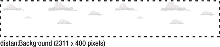

**图 5-17.** 用于远处物体的远景背景对象

接下来，你需要一张用于近处物体的图像。你可以将其命名为 `foreground`。使其尺寸与远景背景完全相同。图 5-18 展示了可能的效果。

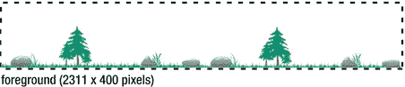

**图 5-18.** 用于近处物体的前景对象

将它们都添加到舞台上，居中放置，然后添加你的游戏角色，形成一个场景（图 5-19）。


**图 5-19.** 将两个背景组件与游戏角色一起添加到游戏中。

现在你需要做的只是让 `distantBackground` 对象以比 `foreground` 对象更慢的速度移动。你使用的指令可能如下所示：

```
foreground.x += -vx;
foreground.y += -vy;
distantBackground.x += -vx / 2;
distantBackground.y += -vy / 2;
```

当游戏角色移动时，远景背景以前景一半的速度移动，使其看起来仿佛在远处。试试看！效果非常迷人。而且，你也可以毫不费力地添加第三个元素作为极远景背景对象，以更慢的速度移动。

为了帮助你开启自己的视差滚动实验，可以查看本章源文件中的 `ParallaxScrolling` 程序。以下是实现该效果的代码：

```
package
{
  import flash.display.Sprite;
  import flash.display.DisplayObject;
  import flash.events.KeyboardEvent;
  import flash.ui.Keyboard;
  import flash.events.Event;

  [SWF(width="550", height="400",
    backgroundColor="#FFFFFF", frameRate="60")]
  public class ParallaxScrolling extends Sprite
  {
    //嵌入远景背景图像
    [Embed(source="../images/distantBackground.png")]
    public var DistantBackgroundImage:Class;
    public var distantBackgroundImage:DisplayObject
      = new DistantBackgroundImage();
    public var distantBackground:Sprite = new Sprite();

    //嵌入前景图像
    [Embed(source="../images/foreground.png")]
    public var ForegroundImage:Class;
    public var foregroundImage:DisplayObject
      = new ForegroundImage();
    public var foreground:Sprite = new Sprite();

    //嵌入角色图像
    [Embed(source="../images/character.png")]
    public var CharacterImage:Class;
    public var characterImage:DisplayObject = new CharacterImage();
    public var character:Sprite = new Sprite();

    //创建并初始化 vx 变量
    public var vx:int = 0;

    //内边界的变量
    leftInnerBoundary = 0;
  }
  else if (background.y > 0)
  {
    background.y = 0;
    topInnerBoundary = 0;
  }
  else if (background.x < stage.stageWidth - background.width)
  {
    background.x = stage.stageWidth - background.width;
    rightInnerBoundary = stage.stageWidth;
  }
  else if (background.y < stage.stageHeight - background.height)
  {
    background.y = stage.stageHeight - background.height;
    bottomInnerBoundary = stage.stageHeight;
  }
}
```

2.  编译程序并尝试运行。现在角色可以探索整个区域，直达舞台边缘。

这段代码的工作原理是：当背景达到其移动极限时，将内部边界扩展到舞台边缘。让我们看看代码中第一个 `if` 语句是如何工作的（新增代码以粗体突出显示）。

```
if (background.x > 0)
{
  background.x = 0;
  leftInnerBoundary = 0;
}
```

如果你按下左方向键，`background` 对象将持续移动，直到条件语句检测到其达到极限。此时，它会停止 `background` 对象的移动，并为 `leftInnerBoundary` 变量赋予一个新值，该值等于舞台左侧的 `x` 值。你知道舞台最左侧的 `x` 位置值为零。这使得角色能够一直移动到舞台边缘。图 5-15 展示了其工作原理。

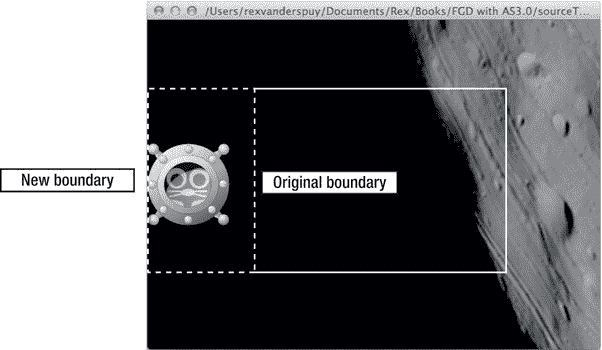

**图 5-15.** 当背景对象停止移动时，边界被扩展，从而允许角色移动到舞台边缘。

问题解决了！但你又制造了另一个问题：如果玩家移回舞台中心，如何才能将边界移回其原始位置？

不妨这样思考：假设角色已经移动到了舞台的最左侧边缘，如图 图 5-15 所示。当它回到舞台中央时，不需要立即移动背景对象，直到角色抵达右侧内边界才需要移动。如果出现这种情况，你就知道可以安全地将左侧内边界重置回初始位置。这就是新增粗体代码行的作用：

```
else if (character.x + character.width > rightInnerBoundary)
{
  character.x = rightInnerBoundary - character.width
  leftInnerBoundary
    = (stage.stageWidth / 2) - (stage.stageWidth / 4);
  background.x -= vx;
}
```

图 5-16 展示了这一过程。

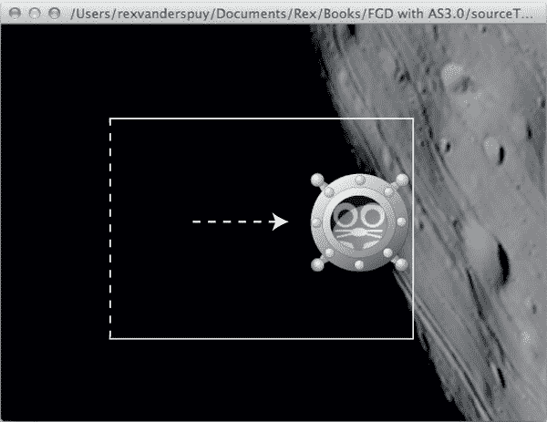

**图 5-16.** 当角色到达右侧边界时，左侧边界重置到初始位置。

本节添加的其他新代码行，对于其余三个边界都遵循完全相同的逻辑。

你可以在本章源文件的 `EvenBetterScrolling` 文件夹中找到该代码的完整工作示例。

## ActionScript 视差滚动代码解析

```actionscript
public var rightInnerBoundary:uint;

public var leftInnerBoundary:uint;
```

```actionscript
public function ParallaxScrolling()
{
    //添加远景
    distantBackground.addChild(distantBackgroundImage);
    stage.addChild(distantBackground);
    distantBackground.x
        = -(distantBackground.width - stage.stageWidth) / 2;
    distantBackground.y = 0;

    //添加前景
    foreground.addChild(foregroundImage);
    stage.addChild(foreground);
    foreground.x = -(foreground.width - stage.stageWidth) / 2;
    foreground.y = 0;

    //添加角色
    character.addChild(characterImage);
    stage.addChild(character);
    character.x = 225;
    character.y = 290;

    //定义内部边界变量
    rightInnerBoundary
        = (stage.stageWidth / 2) + (stage.stageWidth / 4);
    leftInnerBoundary
        = (stage.stageWidth / 2) - (stage.stageWidth / 4);

    //添加事件监听器
    stage.addEventListener
        (KeyboardEvent.KEY_DOWN, keyDownHandler);
    stage.addEventListener
        (KeyboardEvent.KEY_UP, keyUpHandler);
    stage.addEventListener
        (Event.ENTER_FRAME, enterFrameHandler);
}

public function keyDownHandler(event:KeyboardEvent):void
{
    if (event.keyCode == Keyboard.LEFT)
    {
        vx = -5;
    }
    else if (event.keyCode == Keyboard.RIGHT)
    {
        vx = 5;
    }
}

public function keyUpHandler(event:KeyboardEvent):void
{
    if (event.keyCode == Keyboard.LEFT
        || event.keyCode == Keyboard.RIGHT)
    {
        vx = 0;
    }
}

public function enterFrameHandler(event:Event):void
{
    //移动玩家
    character.x += vx

    //检查内部边界
    if (character.x < leftInnerBoundary)
    {
        character.x = leftInnerBoundary;
        rightInnerBoundary
            = (stage.stageWidth / 2) + (stage.stageWidth / 4);
        distantBackground.x -= vx / 2;
        foreground.x -= vx;
    }

    if (character.x + character.width > rightInnerBoundary)
    {
        character.x = rightInnerBoundary - character.width
        leftInnerBoundary
            = (stage.stageWidth / 2) - (stage.stageWidth / 4);
        distantBackground.x -= vx / 2;
        foreground.x -= vx;
    }

    //检查舞台边界
    if (foreground.x > 0)
    {
        foreground.x = 0;
        distantBackground.x
            = -(distantBackground.width - stage.stageWidth) / 4;
        leftInnerBoundary = 0;
    }

    if (foreground.x < stage.stageWidth - foreground.width)
    {
        foreground.x = stage.stageWidth - foreground.width;
        distantBackground.x
            = ((distantBackground.width - stage.stageWidth) / 4) * -3;
        rightInnerBoundary = stage.stageWidth;
    }
}
```

这段代码使用了本章介绍的所有技术。不过，相比之前的例子，它的代码量更少，因为滚动只发生在 `x` 轴上。

其中有段代码需要说明一下。当滚动到达前景左边界的极限时，前景会停止移动。这与你在前一个例子中看到的效果相同。但此时，你还需要让远景也停止移动。由于远景的移动速度是前景的一半，你不能简单地将它的 `x` 位置设为零。你需要将其 `x` 位置设为：负（宽度减去舞台宽度后的四分之一）。

```actionscript
if (foreground.x > 0)
{
  foreground.x = 0;
  distantBackground.x
    = -(distantBackground.width - stage.stageWidth) / 4;
  leftInnerBoundary = 0;
}
```

又一个烧脑的问题！不过，或许图 5-20 能帮你理清思路。

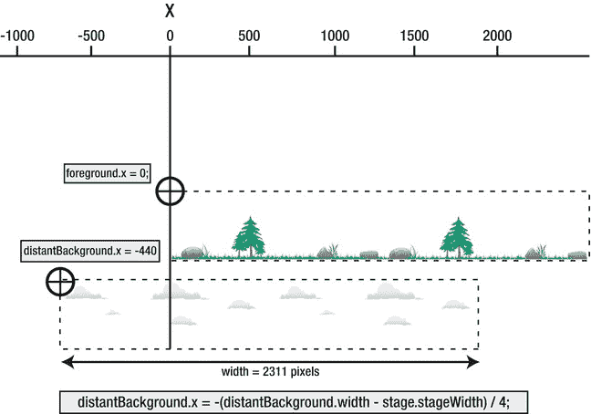

**图 5-20.** 由于远景以一半的速度移动，你必须将其 `x` 位置设为：负（宽度减去舞台宽度后的四分之一）。

左边界也需要同样的处理技巧。

```actionscript
else if (foreground.x < stage.stageWidth - foreground.width)
{
  foreground.x = stage.stageWidth - foreground.width;
  distantBackground.x
    = ((distantBackground.width - stage.stageWidth) / 4) * -3;
  rightInnerBoundary = stage.stageWidth;
}
```

别被这些数学计算吓倒。直接使用即可，它确实有效！

### 本章总结

那么，就这些了吗？当然不是！本章让你初步体验了如何设置玩家控制方案，但还有更多可以优化的空间。在本书后续章节中，你将学习如何修改这些模型，将加速度、摩擦力和重力融入角色的移动中。你还将看到一种玩家控制方案，使游戏可以通过鼠标而非键盘来操作。

在本章中，你解决了一些游戏设计中极其重要的问题，这些问题将在后续章节的不同情境中反复出现。你可以自己尝试一下这些技术。准备好了之后，我们第 6 章见。届时，我将向你展示如何利用碰撞检测创建一个对象可以与之交互的环境。


