# 第 6 章

## 碰撞检测

欢迎来到一个有趣的章节！在这些篇幅中，你将构建一个充满巧妙游戏设计技巧的互动游乐场，并可以在此基础上扩展，创建完全交互的二维环境，也就是我们常说的动作冒险游戏！从碰撞检测、建造墙壁到拾取和丢弃物体，这里应有尽有。发挥一点想象力，你就能用这些非常简单的技术创作出不同类型的游戏。嘿，恭喜自己：从第一页开始，你已经走了很远！你所有的努力即将得到回报。

在本章末尾，我将介绍 `Collision` 类，这是一个专为本书设计的自定义类。它包含一个专门处理对象间复杂碰撞的方法，你可以将其用于任何游戏项目中。

### 使用 `hitTestObject` 进行基础碰撞检测

大多数电脑游戏之所以好玩，本质上是它们对现实世界的一种简化模拟。与现实世界一样，游戏中包含一些你可以通过某种方式与之互动的物体。这些物体可能是阻挡你前进的墙壁、帮助你的朋友，或是伤害你的敌人。

要创建这类可互动的物体，首先需要一种方法来检测一个物体是否与另一个物体接触。在电脑游戏编程中，这被称为碰撞检测。碰撞检测只是游戏编程术语，指的是物体相互碰撞时发生的情况。AS3.0 提供了一种非常简单的方法来检测物体间的碰撞：`hitTestObject` 方法。

`hitTestObject` 方法能给你带来多么强大的功能，这着实令人惊叹。在接下来的页面示例中，你将了解如何使用它来实现以下功能：

- 更改动态文本框中的文字。
- 触发状态变化。
- 减少生命值计量条。
- 更新分数。
- 拾取和放下物体。

只要发挥一点想象力，你就能运用这些技巧制作出丰富多样的游戏。

在本章的源文件中，你会找到一个名为 `BasicCollisionDetection` 的项目文件夹，它展示了 `hitTestObject` 的工作方式。编译该项目，你会看到一个类似图 6-1 的场景。使用方向键在舞台上移动猫咪角色，观察猫咪撞到怪物时会发生什么。输出文本字段中会显示“Hey!!!”字样。如果你将玩家角色移离敌人，文本字段会再次显示“No collision...”。

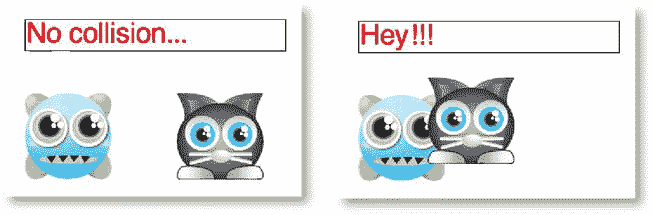

**图 6-1.** 使用 `hitTestObject` 更改文本字段中的文字。

查看实现这一切的代码，对你来说是一次很好的复习机会，可以回顾至今所学的所有概念和技巧。它嵌入并显示了图像，使用了动态文本字段，实现了键盘控制，并将构造器方法中的任务模块化到了三个独立的方法中。你现在应该能理解所有这些代码了，但如果有些地方你还不太明白，那么在接触更复杂的内容之前，现在可能是重新查阅书中相关章节的好时机。

所有这些代码中，只有一种你之前没见过的新技巧：使用 `hitTestObject` 方法。它用于在游戏角色碰撞时更改输出文本字段中的文字。我在下面 `BasicCollisionDetection` 程序的代码清单中将其高亮标出。你能弄清楚它是如何工作的吗？

```
package
{
  import flash.display.Sprite;
  import flash.display.DisplayObject;
  import flash.events.KeyboardEvent;
  import flash.ui.Keyboard;
  import flash.events.Event;
  import flash.text.*;

  [SWF(width="550", height="400",
    backgroundColor="#FFFFFF", frameRate="60")]
  public class BasicCollisionDetection extends Sprite
  {
//创建文本对象
    public var format:TextFormat = new TextFormat();
    public var output:TextField = new TextField();
    public var input:TextField = new TextField();

//嵌入角色图像
    [Embed(source="../images/character.png")]
    public var CharacterImage:Class;
    public var characterImage:DisplayObject = new CharacterImage();
    public var character:Sprite = new Sprite();

//嵌入怪物图像
    [Embed(source="../images/monsterNormal.png")]
    public var MonsterNormalImage:Class;
    public var monsterNormalImage:DisplayObject
      = new MonsterNormalImage();
    public var monster:Sprite = new Sprite();

//创建并初始化 vx 和 vy 变量
    public var vx:int = 0;
    public var vy:int = 0;

public function BasicCollisionDetection()
    {
      setupTextfields();
      createGameObjects();
      setupEventListeners();
    }

    public function setupTextfields():void
    {
//设置文本格式对象
      format.font = "Helvetica";
      format.size = 32;
      format.color = 0xFF0000;
      format.align = TextFormatAlign.LEFT;

//配置输出文本字段
      output.defaultTextFormat = format;
      output.width = 300;
      output.height = 36;
      output.border = true;
      output.text = "";

//显示并定位输出文本字段
      stage.addChild(output);
      output.x = 125;
      output.y = 65;
    }

    public function createGameObjects():void
    {
//将怪物添加到舞台
      monster.addChild(monsterNormalImage);
      stage.addChild(monster);
      monster.x = 125;
      monster.y = 150;

//将角色添加到舞台
      character.addChild(characterImage);
      stage.addChild(character);
      character.x = 300;
      character.y = 150;
    }

    public function setupEventListeners():void
    {
      stage.addEventListener
        (KeyboardEvent.KEY_DOWN, keyDownHandler);
      stage.addEventListener
        (KeyboardEvent.KEY_UP, keyUpHandler);
      stage.addEventListener
        (Event.ENTER_FRAME, enterFrameHandler);
    }

    public function keyDownHandler(event:KeyboardEvent):void
    {
      if (event.keyCode == Keyboard.LEFT)
      {
        vx = -5;
      }
```

# 碰撞检测与状态变更

让我们来了解一下 `hitTestObject` 是如何工作的。

## 使用 `hitTestObject`

`hitTestObject` 方法可用于检测任意两个对象是否发生碰撞。假设你有一个名为 `car` 的 `Sprite` 对象，玩家可以控制它；另有一个名为 `wall` 的 `Sprite` 对象。在你的游戏中，如果玩家的汽车撞到墙壁，它应该发生碰撞。

用通俗的语言来说，你会想编写类似下面这样的计算机代码：

```
if (the car hits the wall)
{
  the car must crash;
}
```

在 AS3.0 代码中，它的实现可能如下所示：

```
if(car.hitTestObject(wall))
{
  car.crash();
}
```

`hitTestObject` 方法通过点语法附加到 `car` 对象上。它有一个参数 `(wall)`，其中包含了你想要检测碰撞的对象名称。图 6-2 展示了这一切是如何协同工作的。

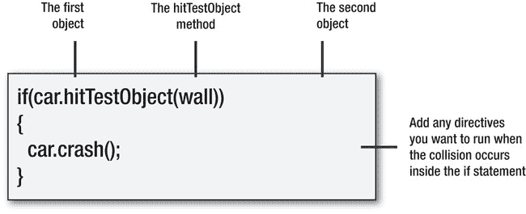

**图 6-2.** 在条件语句中使用 `hitTestObject` 方法来检测两个对象之间的碰撞。

通常，你会在 `if` 语句的条件表达式中使用 `hitTestObject` 方法。如果对象相互接触，该方法会返回布尔值 `true`，并执行 `if` 语句内部的指令。如果返回值为 `false`（即对象未接触），则不会执行 `if` 语句内部的指令。

以下是在 `BasicCollisionDetection` 程序中更改输出字段文本显示的代码片段：

```
public function enterFrameHandler(event:Event):void
{
  //移动玩家
  character.x += vx;
  character.y += vy;
  //碰撞检测
  if (character.hitTestObject(monster))
  {
    output.text = "嘿!!!";
  }
  else
  {
    output.text = "无碰撞...";
  }
}
```

它非常简单，只是检查两个对象是否接触。如果接触，则在 `output` 文本字段中显示“嘿!!!”。如果没有接触，则显示“无碰撞…”字样。

非常重要的是，请注意这个 `hitTestObject` `if` 语句位于 `enterFrameHandler` 内部。这意味着程序会以每秒 60 次的频率检查碰撞。这就是为啥当猫和怪物接触时，显示内容会立刻变化；而当它们不接触时，又会立刻恢复的原因。`hitTestObject` 几乎总是在 `enterFrameHandler` 内部使用。

仅仅几行代码就能产生如此强大的效果，是不是很神奇？而且还有更棒的！

## 触发状态变更

你可以在检测碰撞的 `if` 语句内部放置任意所需的指令。在接下来的示例中，当碰撞发生时，怪物的外观会发生改变。我们先来看看效果，然后再为你解释其工作原理。

打开本章源文件中的 `StateChange` 项目。编译并运行项目，观察当对象碰撞时会发生什么：怪物会张开它的嘴。图 6-3 展示了你将看到的效果。

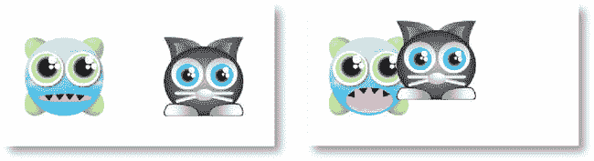

**图 6-3.** 当猫撞到怪物时，怪物会张开嘴。

以下是实现这一功能的程序清单。请注意，这里有两张不同的怪物图像被添加到了同一个 `Sprite` 对象中。这听起来是否耳熟？没错！（提示：回想一下第 3 章中的按钮！）

```
package
{
  import flash.display.Sprite;
  import flash.display.DisplayObject;
  import flash.events.KeyboardEvent;
  import flash.ui.Keyboard;
  import flash.events.Event;

  [SWF(width="550", height="400",
    backgroundColor="#FFFFFF", frameRate="60")]
  public class StateChange extends Sprite
  {
    //嵌入角色图像
    [Embed(source="../images/character.png")]
    public var CharacterImage:Class;
    public var characterImage:DisplayObject = new CharacterImage();
    public var character:Sprite = new Sprite();

    //嵌入怪物图像
    [Embed(source="../images/monsterNormal.png")]
    public var MonsterNormalImage:Class;
    public var monsterNormalImage:DisplayObject
      = new MonsterNormalImage();
    [Embed(source="../images/monsterScared.png")]
    public var MonsterScaredImage:Class;
    public var monsterScaredImage:DisplayObject
      = new MonsterScaredImage();
    public var monster:Sprite = new Sprite();

    //创建并初始化 vx 和 vy 变量
    public var vx:int = 0;
    public var vy:int = 0;

    public function StateChange()
    {
      createGameObjects();
      setupEventListeners();
    }

    public function createGameObjects():void
    {
      //组合怪物并将其添加到舞台
      monster.addChild(monsterNormalImage);
      monster.addChild(monsterScaredImage);
      monsterScaredImage.visible = false;
      stage.addChild(monster);
      monster.x = 125;
      monster.y = 150;

      //将角色添加到舞台
      character.addChild(characterImage);
      stage.addChild(character);
      character.x = 300;
    }
  }
}
```

# 游戏对象状态与生命值条

首先你会注意到，程序里嵌入了两种不同的怪物图片：`monsterNormal.png` 和 `monsterScared.png`。图 6-4 展示了它们的样子。这两张图片尺寸完全相同——唯一的区别在于怪物的嘴巴。

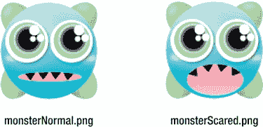

图 6-4. 怪物的两种不同状态

以下是嵌入这些图片并创建怪物精灵（`Sprite`）的代码。

```actionscript
[Embed(source="../images/monsterNormal.png")]
public var MonsterNormalImage:Class;
public var monsterNormalImage:DisplayObject
  = new MonsterNormalImage();

[Embed(source="../images/monsterScared.png")]
public var MonsterScaredImage:Class;
public var monsterScaredImage:DisplayObject
  = new MonsterScaredImage();

public var monster:Sprite = new Sprite();
```

同样要注意的是，即使创建了两张图片，也只有一个怪物精灵（`monster` `Sprite`）。这套机制的关键在于**两张图片都被添加到了同一个精灵中**。不过，程序启动时只有 `monsterNormal` 图片是可见的。以下是将两张图片组合成怪物精灵（`monster` `Sprite`）的代码：

```actionscript
monster.addChild(monsterNormalImage);
monster.addChild(monsterScaredImage);
monsterScaredImage.visible = false;
stage.addChild(monster);
```

`monsterScared` 图片的 `visible` 属性被设为 `false`，因此它是隐藏的。这与你在第 3 章中创建不同按钮状态时使用的技术完全相同。怪物精灵（`monster` `Sprite`）包含两张完美对齐、上下重叠的图片，就像叠放的扑克牌。但在任何时刻，只有其中一张图片是可见的。通过选择性地显示其中一张图片，你就能让怪物改变外貌。

游戏中你选择的任何条件都可以触发怪物外貌的变化。在这个例子中，当两个角色碰撞时就会发生。下面是使用 `hitTestObject` 实现此功能的 `if` 语句：

```actionscript
if (character.hitTestObject(monster))
{
  monsterScaredImage.visible = true;
  monsterNormalImage.visible = false;
}
else
{
  monsterScaredImage.visible = false;
  monsterNormalImage.visible = true;
}
```

这个 `if` 语句根据猫和怪物是否接触，来隐藏其中一张图片。这是一个极其简单但极其有用的效果。

你可以用同样的技术来创建具有非常复杂状态的游戏对象。想象你有一个包含 10 或 20 张不同图片的对象。你可以根据游戏中事件的变化来选择性地显示这些图片。这是创建复杂游戏的基础，而这一切都源于这个简单的技巧。

## 减少生命值条

许多游戏使用**生命值条**来决定游戏何时结束。当游戏角色撞到像怪物这样的坏东西时，生命值条会逐渐缩小。当生命值条消失时，游戏结束。

实现生命值条非常简单。它巧妙地利用了 `width` 属性。你可以在本章源文件的 `HealthMeter` 项目文件夹中找到生命值条运行的示例。编译程序，你会看到图 6-5 所示的效果。当游戏角色碰撞时，生命值条会减少。当它完全减到零时，会通过跟踪输出显示“游戏结束”。

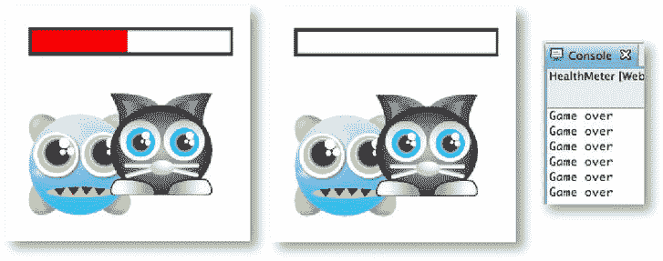

图 6-5. 物体碰撞时减少生命值条。

生命值条由两张独立的图片组成：`meterInside.png` 和 `meterOutside.png`。它们尺寸和宽度相同（200 x 28 像素）。图 6-6 展示了它们的样子。

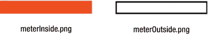

图 6-6. 构成生命值条的两张图片

非常重要的一点是，`meterOutside` 的 PNG 图片内部是透明的。它只是一个黑色的边框。这意味着它后面的任何东西都会透出来。

这两张图片被组合到一个精灵（`Sprite`）中。这与你在上一个例子中用两个状态创建怪物对象（`monster`）的概念相同。这次唯一不同的是，内部和外部这两张图片是同时可见的。

这个程序的大部分代码与前面两个例子的代码几乎相同，所以我们来看看不同之处。首先，两张图片都被嵌入到程序中。

```actionscript
[Embed(source="../images/meterInside.png")]
public var MeterInsideImage:Class;
public var meterInsideImage:DisplayObject
  = new MeterInsideImage();

[Embed(source="../images/meterOutside.png")]
public var MeterOutsideImage:Class;
public var meterOutsideImage:DisplayObject
  = new MeterOutsideImage();
```

# ActionScript 游戏开发：生命值条与分数系统

## 创建生命值条

```actionscript
public var meter:Sprite = new Sprite();
```

一个名为 `meter` 的单个精灵对象将被用来组合它们。这发生在 `createGameObjects` 方法初始化程序时。

```actionscript
meter.addChild(meterInsideImage);
meter.addChild(meterOutsideImage);
stage.addChild(meter);
meter.x = 125;
meter.y = 65;
```

外部图片在内部图片之后添加，这样它就会覆盖在内部图片之上，完美地将它框起来。

## 碰撞检测与游戏结束

`enterFrameHandler` 包含碰撞代码并显示“游戏结束”消息。

```actionscript
public function enterFrameHandler(event:Event):void
{
  //移动玩家
  character.x += vx;
  character.y += vy;

  //碰撞检测
  if (character.hitTestObject(monster))
  {
    if(meterInsideImage.width > 0)
    {
      meterInsideImage.width--;
    }
  }

  if(meterInsideImage.width < 1)
  {
    trace("Game over");
  }
}
```

第一个 `if` 语句检查碰撞。如果发现碰撞，它会每帧将生命值条的宽度减少 1 像素。但它还进行了一个额外的检查。只有当宽度大于零时，它才会减少宽度。这可以防止宽度变为负数——如果没有这个额外检查，就会发生这种情况。

```actionscript
if (character.hitTestObject(monster))
{
  if(meterInsideImage.width > 0)
  {
    meterInsideImage.width--;
  }
}
```

在这个简单的例子中，防止生命值条宽度变为负数其实并非必要。但在一个复杂的游戏程序中，你可能会有其他依赖于生命值条宽度值的代码，如果代码未预期到负数值，游戏可能会产生错误。

这是你第一次看到在一个 `if` 语句内部使用另一个 `if` 语句。这被称为**嵌套 if 语句**，是一种非常常见的编程结构。嵌套的 `if` 语句允许你在第一个条件通过（为真）后，对逻辑进行微调以检查其他条件。（之所以叫嵌套 `if` 语句，是因为它舒适地嵌在第一个语句里面，就像巢里的蛋。如果你把这一页侧过来看，我确信你能想象出一只乌鸦或喜鹊在第二个 `if` 语句形成的缩进里筑一个非常舒适的巢。）

`enterFrameHandler` 在发现生命值条宽度小于 1 像素时，也会显示一条跟踪消息“游戏结束”。

```actionscript
if(meterInsideImage.width < 1)
{
  trace("Game over");
}
```

在一个像样的游戏中，你可以改为在文本字段中显示“游戏结束”。或者，你也可以在舞台上方显示整个游戏结束的图片，并提供一个让玩家重新开始的按钮。

## 使用 `scaleX` 按百分比缩放计量器

你也可以使用 `scaleX` 属性来改变计量器的大小。`scaleX` 根据对象的比例改变其尺寸。它允许你基于百分比而非固定像素值来调整计量器的宽度。这种方式通常更可取，因为无论计量器长短如何，它都会以相同的比例缩减。

`scaleX` 值为 `1` 时表示对象为原始大小。你可以通过每帧将 `scaleX` 属性减去 `0.01` 来将计量器缩小 1%。

如果你想用 `scaleX` 复制健康计量器的示例，可以使用以下代码：

```actionscript
if (character.hitTestObject(monster))
{
  if(meterInsideImage.scaleX > 0)
  {
    meterInsideImage.scaleX -= 0.02;
  }
}
if(meterInsideImage.scaleX <= 0)
{
  trace("Game over");
}
```

值为 `0.02` 时，每帧将计量器缩小 2%，因此计量器将在 50 帧后缩小至 `0`。

按百分比缩放非常有用，因为你可以用计量器来图表化游戏中可能使用百分比的其他数据。

## 更新分数

大多数游戏通过根据玩家表现更新分数来追踪胜负。以下示例展示了如何更新分数，并在达到特定分数时结束游戏。打开本章源文件中的 `UpdateScore` 项目文件夹并尝试运行。每次猫撞到怪物时，分数增加 1。当分数达到 `5` 时，会显示一条“Game over”跟踪信息。图 6-7 展示了你将看到的内容。

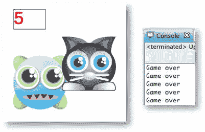

**图 6-7.** 使用碰撞检测来增加分数。

这段代码需要解决一个问题。请记住，碰撞检测代码运行在 `enterFrameHandler` 内部。`enterFrameHandler` 每秒更新 60 次。如果发生碰撞，所有碰撞代码也会被每秒触发 60 次。如果该代码的任务是在碰撞发生时更新分数，那么分数将每秒更新 60 次，直到对象不再接触。

这意味着什么？如果碰撞代码每帧将分数更新 `1`，那么超过 3 秒后分数将激增至 `180`。你可以从之前的示例中看到这种效果：当对象接触时，健康计量器每帧持续减少。

这不是更新分数的正确方式。分数应该只在对象首次接触时更新一次，即使它们保持接触，也不应再次更新。你必须找到一种方法，检测首次碰撞，然后阻止第二次碰撞被记录——直到对象分离。

你可以使用一个布尔变量来实现这一点，该变量根据我刚刚描述的条件打开或关闭碰撞检测。以下是实现这一功能的关键代码。首先，你需要在类定义中创建两个新变量。

```actionscript
public var score:uint = 0;
public var collisionHasOccurred:Boolean = false;
```

`score` 是一个数字，用于追踪两个对象碰撞的次数。游戏开始时它被设为 0。`collisionHasOccurred` 负责追踪是否已经发生过碰撞。程序启动时它被设为 `false`。如果发生碰撞，它会被设为 `true`，以防止检测到第二次碰撞。这个变量对于评分系统的正常工作至关重要，接下来你将看到原因。

`enterFrameHandler` 负责移动角色、检测碰撞、更新分数以及检查游戏是否结束。以下是 `enterFrameHandler` 中的全部代码：

```actionscript
public function enterFrameHandler(event:Event):void
{
  //移动玩家
  character.x += vx;
  character.y += vy;

  //碰撞检测
  if (character.hitTestObject(monster))
  {
    if(! collisionHasOccurred)
    {
      score++;
      output.text = String(score);
      collisionHasOccurred = true;
    }
  }
  else
  {
    collisionHasOccurred = false;
  }

  //检查游戏是否结束
  if(score == 5)
  {
    trace("Game over");
  }
}
```

让我们分解这段代码，看看发生了什么以及为什么。首先，代码检查角色与怪物之间是否有碰撞。

```actionscript
if (character.hitTestObject(monster))
{...
```

如果有碰撞，下一个 `if` 语句检查对象之间的碰撞*是否尚未发生*。没错，你没有误读上一句；我们想要检查碰撞是否*尚未*发生。这就是这行代码的作用：

```actionscript
if(!collisionHasOccurred)
{...
```

它会检查 `collisionHasOccurred` 变量是否为 `false`。通常，条件语句会检查某些条件或变量是否为真，但这次不同。相反，你使用了非运算符来检查 `false` 条件。非运算符是一个感叹号（`!`）。当它用于布尔变量前的条件语句中时，它会使得 `if` 语句内部的指令能够执行，如同该布尔值为 `false` 一样。

那么，它真的是 `false` 吗？在程序启动时，你将 `collisionHasOccurred` 初始化为 `false`，因此当第一次碰撞发生时，它的值为 `false`，`if` 语句内部的所有指令都会执行。

```actionscript
score++;
output.text = String(score);
collisionHasOccurred = true;
```

这行代码会更新分数和动态文本框，但它还做了一件非常重要的事：它将 `collisionHasOccurred` 变量设为 `true`。

为什么这很重要？请记住，所有这些代码都运行在 `enterFrameHandler` 内部。这意味着如果物体仍然接触，在恰好 1/60 秒后，同一个 `if` 语句将*第二次*被调用。

```
if(!collisionHasOccurred)
{
  score++;
  output.text = String(score);
  collisionHasOccurred = true;
}
```

你希望这段代码只运行一次，因为你只希望对象首次接触时更新分数。幸运的是，当这段代码第一次运行时，`collisionHasOccurred` 变量已被设为 `true`，因此它会阻止代码第二次运行。这意味着没有任何指令被执行，分数和文本框只更新一次。

完美——这正是你想要的！

但还有另一个问题。你希望在物体分离并在游戏后续时刻再次碰撞时，分数*再次*更新。如果 `collisionHasOccurred` 仍然设为 `true`，这种情况就不会发生。你必须设法将其重置为 `false`，以便在未来的碰撞中更新分数。

这非常简单；你只需在物体*未碰撞*时将 `collisionHasOccurred` 设为 `false`。`if/else` 语句的第二部分负责处理这个问题，如下面加粗的代码所示：

```
if (character.hitTestObject(monster))
{
  if(! collisionHasOccurred)
  {
    score++;
    output.text = String(score);
    collisionHasOccurred = true;
  }
}
else
{
collisionHasOccurred = false;
}
```

是的，我知道你在想什么。如果你是编程新手，这种逻辑可能会让你觉得有点烧脑！这是到目前为止你见过的关于逻辑运算符和 `if` 语句最复杂的用法。如果你不能立刻理解，或者觉得自己短时间内写不出同样复杂的代码，也不要太灰心。多看几遍，晚上躺在床上时琢磨一下，过几天再回来看，并在自己的游戏中尝试使用。它会慢慢变得清晰——相信我！观察他人如何解决问题，然后在自己的游戏中尝试这些解决方案，是学习编程极为重要的一环。为了帮助你理解，图 6-8 展示了实际流程。

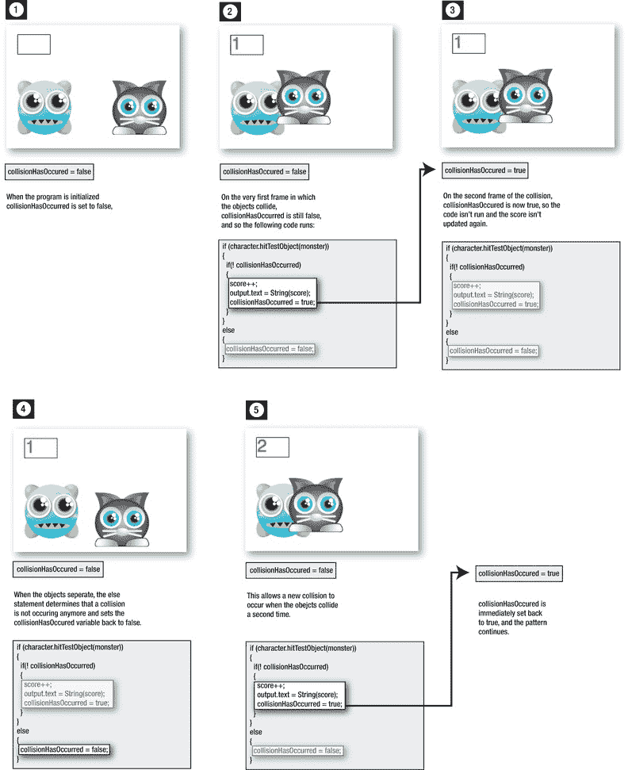

**图 6-8.** 防止分数在一次碰撞中重复更新。

*这段代码也展示了类型转换的另一个例子。你回想一下，类型转换是一种将一种变量类型转换为另一种的系统。*

*`score` 变量被声明为 `uint` 数字类型。*

*`public var score:uint = 0;`*

*你需要 `score` 变量是数字类型，以便每次碰撞时通过加 1 来更新它，如下所示：*

*`score++;`*

*因此分数可能是 1、5、14 或任何数字，取决于物体碰撞的次数。当需要将这个数字显示在文本框中时，问题就出现了。`TextField` 对象只能以字符串（字母或单词）形式显示信息。这意味着你需要将 `score` 变量的值转换为文本字段可以显示的字符串字符。这就是类型转换发挥作用的地方。你的代码可以强制将 `score` 变量作为字符串读取，如下所示：*

*`String(score)`*

*现在，`score` 的值就可以直接在 `output` 文本框中显示了，如下所示：*

*`output.text = String(score);`*

### 检查游戏是否结束

`score` 变量也用于判断游戏何时结束。`enterFrameHandler` 内部一个非常简单的 `if` 语句会在分数达到 5 时显示一条追踪消息。

```
if(score == 5)
{
  trace("Game over");
}
```

但你会很快发现这个系统有一个问题。在分数达到 5 之后，程序仍在继续给分数加 1 并显示“Game over”消息，如图 6-9 所示。为了正确工作，当分数达到 5 时，程序应该停止计算碰撞次数，而且“Game over”消息应该只显示一次。

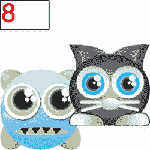

**图 6-9.** 程序应该在分数达到 5 时停止计算碰撞，但它没有。

你可以通过应用一些简单的逻辑轻松解决这个问题。

*只有当分数小于 5 时才检查碰撞。*

你知道该怎么做！只需用另一个 `if` 语句包围碰撞检测代码，如下所示：

```
if(score < 5)
{
  if (character.hitTestObject(monster))
  {
    if(! collisionHasOccurred)
    {
      score++;
      output.text = String(score);
      collisionHasOccurred = true;
    }
  }
  else
  {
    collisionHasOccurred = false;
  }

  //检查游戏是否结束
  if(score == 5)
  {
    trace("Game over");
  }
}
```

用这段新代码重新编译程序，你会注意到分数现在在达到 5 时停止累加，并且“Game over”消息只显示一次。图 6-10 说明了这一点。

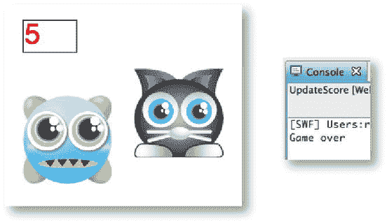

**图 6-10.** 再添加一个简单的 `if` 语句，当分数达到 5 时游戏结束。

你会发现，在游戏中需要解决的许多“可能令人困惑的编程问题”（Potentially Puzzling Programming Problems），都可以通过应用像这样非常简单的逻辑来解决。

### 拾取和放下物体

现在是时候让猫和怪物放下分歧、和平相处了！在接下来的例子中，你将看到如何让猫拾取一个物体并将其带给怪物。使用本章迄今讨论的技术，这非常容易实现。

你可以在本章源文件的 `PickingUpObjects` 文件夹中找到这个效果的工作示例。将猫角色移动到星星上方，按下空格键，猫会拾取星星。将星星带到怪物处，再次按下空格键，猫会放下星星，并且会在跟踪消息中显示“Thanks!!”。图 6-11 展示了这一过程。

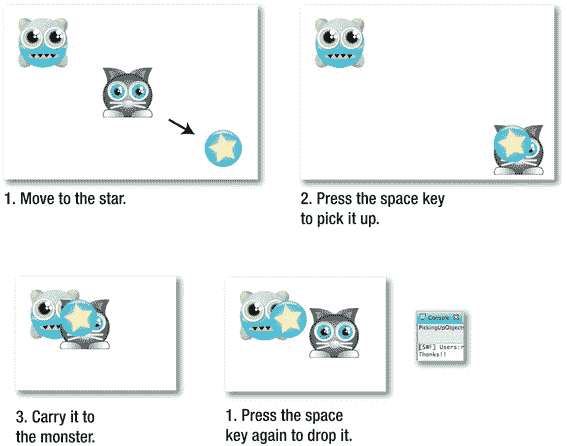

**图 6-11.** 拾取星星并将其带给怪物

该程序使用一个名为 `characterHasStar` 的布尔变量来确定猫是否正在携带星星。它在类定义中创建时被初始化为 `false`。

`public var characterHasStar:Boolean = false;`

你可能会认为 `enterFrameHandler` 现在是让游戏中发生有趣事情的主角。毕竟，过去 40 多页中展示的大多数新技术都涉及在其中放置指令。但别忘了，你还有几个同样有用但有些被忽视的方法，如果你能为它们找到用武之地，它们随时准备听候差遣。这一次，`keyDownHandler` 将闪耀登场。下面加粗的文本突出显示了 `keyDownHandler` 中使该程序运行的代码。

```
public function keyDownHandler(event:KeyboardEvent):void
{
  if (event.keyCode == Keyboard.LEFT)
  {
    vx = -5;
  }
  else if (event.keyCode == Keyboard.RIGHT)
  {
    vx = 5;
  }
  else if (event.keyCode == Keyboard.UP)
  {
    vy = -5;
  }
  else if (event.keyCode == Keyboard.DOWN)
  {
    vy = 5;
  }

  if (event.keyCode == Keyboard.SPACE
  && character.hitTestObject(star))
  {
    if (!characterHasStar)
    {
      character.addChild(star);
      star.x = 0;
      star.y = 0;
      characterHasStar = true;
    }
    else
    {
      stage.addChild(star);
      star.x = character.x;
      star.y = character.y;
      characterHasStar = false;
      if (monster.hitTestObject(star))
      {
        trace("Thanks!!");
      }
    }
  }
}
```

要理解这是如何工作的，请思考在玩家角色能够拾取或放下星星之前，需要满足哪些条件。

- 游戏玩家需要按下空格键。你可以通过如下条件语句检查这个条件：

```
if(event.keyCode == Keyboard.SPACE)
```

## 拾取和放下星星的逻辑

角色对象需要接触到星星。你可以通过如下条件语句检查这个条件：

```
if(character.hitTestObject(star))
```

如果这两件事同时发生，你就知道玩家要么试图拾取星星，要么试图放下星星。但重要的是，这两个条件必须同时成立。为什么？嗯，很明显，如果猫没有碰到星星，它就不能拾取星星。游戏还需要知道玩家想要拾取物体，而按下空格键正是告诉它这一点。

要检查两个条件是否同时成立，你可以使用与运算符将它们组合成一个条件语句。你在第 3 章中简要了解过与运算符，但直到现在你才真正看到它的实际应用。与运算符是一个双与符号（`&&`）。

它在这行代码的第一个新`if`语句中被使用：

```
if (event.keyCode == Keyboard.SPACE
&& character.hitTestObject(star))
{…}
```

太好了！在一行代码中，你就可以检查拾取或放下物体的条件是否都已满足。但是究竟是哪一个呢？拾取还是放下？

这很容易判断。如果这两个条件都为真，并且猫还没有拿到星星，你就知道需要拾取星星。如果猫已经拿到了星星，你就知道应该放下星星。这只需要一个额外的嵌套`if/else`语句来检查`characterHasStar`变量是否为`false`。以下是这个逻辑的简化版本：

```
if (the character doesn't have the star)
{
   Pick the star up…
}
else
{
   Drop the star…
}
```

请记住这一点，因为实际代码如下所示：

```
if (!characterHasStar)
{
  character.addChild(star);
  star.x = 0;
  star.y = 0;
  characterHasStar = true;
}
else
{
  stage.addChild(star);
  star.x = character.x;
  star.y = character.y;
  characterHasStar = false;
  if (monster.hitTestObject(star))
  {
    trace("Thanks!!");
  }
}
```

现在是不是稍微明白一些了？图 6-12 展示了所有这些逻辑是如何转化为代码的。

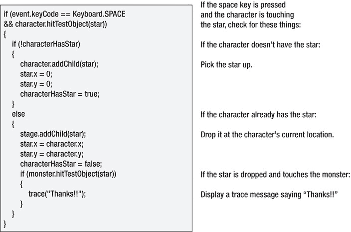

**图 6-12.** 拾取和放下星星的代码

但代码实际上是如何拾取和放下物体的呢？首先，让我们看看拾取星星的指令。

```
character.addChild(star);
star.x = 0;
star.y = 0;
characterHasStar = true;
```

代码使用`addChild`方法将星星设为角色的子对象。

```
character.addChild(star);
```

这与您用来将多个图像添加到单个`Sprite`的技术相同。这里，您将星星`Sprite`添加到角色`Sprite`。这基本上将星星粘在了角色身上。所以，就像一只小鸭子，无论猫去哪里，星星都紧随其后。

然后代码将星星的`x`和`y`位置设为`0`。

```
star.x = 0;
star.y = 0;
```

因为星星刚刚成为角色的子对象，它现在使用角色`Sprite`的内部坐标系，而不是舞台的坐标系。`x`和`y`位置为`0`意味着它被定位在角色的左上角，在角色`Sprite`内部。图 6-13 说明了这一点。

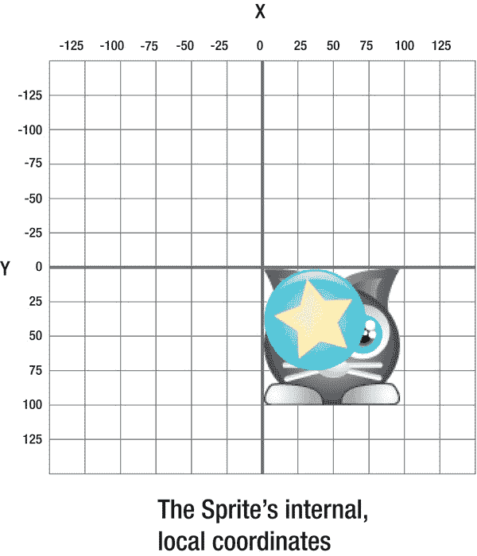

**图 6-13.** 当星星成为角色的子对象时，它成为角色局部坐标系的一部分。

你现在给星星的任何`x`和`y`位置都将引用角色`Sprite`*内部*的这些坐标。

最后一件事是将`characterHasStar`变量设为`true`，这可以防止程序在角色已经拥有星星的情况下再次尝试拾取它。

```
characterHasStar = true;
```

放下星星的指令同样简单明了。

```
stage.addChild(star);
star.x = character.x;
star.y = character.y;
characterHasStar = false;
if (monster.hitTestObject(star))
{
  trace("Thanks!!");
}
```

代码首先使用`addChild`方法再次将星星设为舞台的子对象。这使它从猫的束缚中解放出来。

```
stage.addChild(star);
```

星星现在再次成为舞台坐标系的一部分，而不是角色`Sprite`的坐标系。

`stage`对象是舞台上*所有*对象的父对象，包括`character`和`monster`。作为舞台子对象的对象处于食物链的顶端，自由自在。星星现在不再需要盲目地跟随角色，可以随心所欲地惹上它自己的麻烦了。

接下来，代码为星星赋予与角色相同的`x`和`y`位置。

```
star.x = character.x;
star.y = character.y;
```

这将星星固定在舞台上的当前位置，使其看起来像是被放下了。

`characterHasStar`变量被设为`false`，允许角色稍后再次拾取星星。

```
characterHasStar = false;
```

最后，代码实际上还做了一点额外的工作。它添加了以下`if`语句：

```
if (monster.hitTestObject(star))
{
  trace("Thanks!!");
}
```

它检查怪物是否碰到了星星。如果是，会显示跟踪消息“Thanks!!”。啊……终于有朋友了！（你可以在本章源文件的`PickingUpObjects`文件夹中找到这个示例的完整代码。）

## 关于`hitTestObject`的坏消息

首先，请允许我说：我非常喜欢`hitTestObject`方法！从这些示例中你可以看到，仅用几行代码、一点想象力和一点简单的逻辑，它就能给你带来巨大的能力。我相信你的脑海里肯定已经充满了各种游戏创意。如果你还有任何疑虑，我现在就向你确认：是的，你已经拥有了开始制作它们所需的所有技能！我不会阻止你。去吧，如果你感到灵感迸发，可以先暂停阅读本章，开始动手构建游戏。无限可能的世界在等着你！

但在你继续深入阅读本书之前，让我们更仔细地看看`hitTestObject`的工作原理。亲爱的读者，这一点必须说明：`hitTestObject`隐藏着一个深暗的秘密，如果你不理解它，它将会拖垮你的游戏。

### 检测边界框碰撞

AS3.0 是如何知道两个物体正在接触的呢？所有显示对象（你可以在舞台上看到的对象）都被一个假想的矩形框包围，这个框被称为**边界框**。边界框定义了`hitTestObject`检查碰撞的对象区域。边界框是看不见的，但它确实存在。图 6-14 展示了上一个示例中对象的边界框。

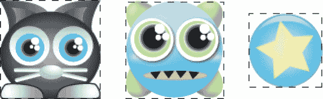

**图 6-14.** 边界框定义了对象对碰撞敏感的区域。

每当一个边界框的任何部分与另一个对象的边界框的任何部分相交时，就会检测到碰撞。图 6-15 展示了一些示例。

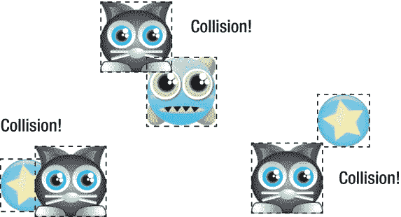

**图 6-15.** 当边界框接触或相交时，就会检测到碰撞。

如果物体是方形的或矩形的，这完全没问题，但如果它们不是呢？仔细看看图 6-15：其中一个碰撞与其他不同！第三个碰撞的边界框重叠了，即使实际的物体本身并没有接触。你可以在图 6-16 中清晰地看到这一点。

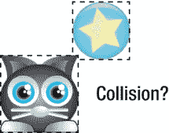

**图 6-16.** 即使表示物体形状的图像没有接触，边界框也会判定为碰撞。

公平地说，这不是`hitTestObject`本身的问题；它的工作就是检查两个对象边界框之间的碰撞。它就是这样工作的。如果这对你不适用，你需要决定是修改游戏和对象的结构使其工作，还是寻找其他进行碰撞检测的方法。

有很多不使用`hitTestObject`进行碰撞检测的方法，但让我们看看它相对于更复杂方法的一些优势，以及如何让你的游戏利用好它。

`hitTestObject`有两个很大的优点，使其成为进行碰撞检测的首选：它易于理解、易于实现，并且对 CPU 或 Flash Player 压力很小。在游戏设计中，性能考虑会主导许多设计决策，仅凭最后这个原因就足以激励你去探索如何从不起眼的`hitTestObject`中榨取出最多的价值。

那么，你能在使用`hitTestObject`的同时，让它对不规则形状的物体也能合理工作吗？

让我们看看一些解决方案。

### 学会与之共存

第一个解决方案，实际上算不上一个真正的解决方案，是根据`hitTestObject`施加给你的限制来设计游戏。限制可以是一种巨大的优势，就像按照十四行诗的规则写诗可以是一种优势一样。它们可以帮助你集中精力并简化设计——只管去问问莎士比亚吧！

# 碰撞检测与子对象

如果你知道`hitTestObject`最适合方形或矩形物体，那么就把你的物体相应地设计成方形。

看看本章示例中使用的猫和怪物游戏角色。它们都是方形的，但除非你实际看到围绕它们绘制的方形轮廓，否则你不会知道这一点。它们被设计成大部分边缘和角落都与设计它们时所处的网格方格的边缘对齐。这意味着角色形状不填充边界框的地方非常少，因此当碰撞发生时，物体的形状几乎总是重叠的。

然而，在图 6-16 所示的情况下，当一个方形物体的角落与一个圆形物体的角落相交时，你该怎么办？这两个物体上都有一些点，即使可见形状没有重叠，也会检测到碰撞。

这不是整个系统的致命弱点吗？如果物体移动得足够快，那就不是，而在大多数游戏中，它们都会移动得很快。圆形星星边缘的空隙最大处不超过 5 个像素。请记住，这些示例中的角色对象以每`1/60`秒 5 像素的速度移动。那真的很快。速度如此之快，空隙又如此之小，以至于玩游戏的人永远不会注意到碰撞是不准确的。

当然，如果物体移动得较慢，你就会遇到问题。但这部分要说明的是：设计你的游戏，使其*不*成为问题。让你的物体矮胖一些，并且移动得合理快速。如果你能做到这一点，`hitTestObject`将是你唯一需要的工具。

看看你最喜欢的一些 2D 游戏。所有角色和物体似乎都有点圆胖和方形，这不是很有趣吗？他们正在应对与你完全相同的限制。欢迎加入视频游戏设计师俱乐部！

## 创建子对象

使用`hitTestObject`改进碰撞检测的最简单方法，是在主对象内部创建子对象，并用它们来检查碰撞。

让我们继续处理方形猫与圆形星星的碰撞问题。如果你在猫的精灵（`Sprite`）内部创建一个更小的矩形对象来定义碰撞区域，就能极大地改进它们之间的碰撞检测。你可以将这个子对象命名为`collisionArea`。

如果在`if`语句中将其与`hitTestObject`一起使用，代码可能如下所示：

```
if(collisionArea.hitTestObject(star))
{
  //碰撞处理指令…
}
```

当然，你需要将`collisionArea`子对象的`visible`属性设置为`false`，使其完全透明。你不需要看到它，只需用它作为主对象内部的形状来定义碰撞区域。

你可以在本章源文件的`SubObjects`项目文件夹中找到此类系统的运行示例。图 6-17 显示了运行 SWF 文件时的效果。猫的中央有一个白色小方块，它跟随猫在舞台上移动。当猫的图像触碰到星星时，不会发生碰撞；但如果白色方块触碰到星星，则会检测到碰撞。这个白色方块是猫的子对象，也是用于判断是否发生碰撞的碰撞区域。

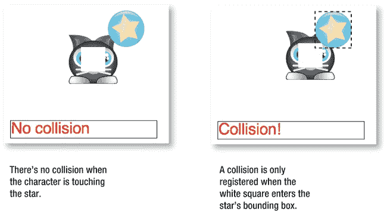

**图 6-17.** 使用子对象在主对象内部创建碰撞区域。

你可以制作一个正方形的 PNG 图像文件，将其嵌入程序，并使用`addChild`将其作为角色的子对象。这种方法可行，与之前在角色中创建星星子对象的原理相同。不过，对于创建简单形状，AS3.0 有更好的方法。AS3.0 内置了一个名为`Shape`的类，允许你在舞台上绘制基本形状。本例使用`Shape`类通过 AS3.0 代码绘制一个正方形，然后将该正方形作为子对象添加到角色中。碰撞检测代码随后检查正方形与星星之间是否发生碰撞，而不是检查角色与星星。

以下是`SubObjects`示例程序中的代码工作原理。首先，导入`Shape`类。

```
import flash.display.Shape;
```

然后，在类定义中创建一个名为`square`的`Shape`对象。

```
public var square:Shape = new Shape();
```

`createGameObjects`方法负责绘制一个 50x50 像素的白色正方形，并将其添加到角色精灵中。

```
square.graphics.beginFill(0xFFFFFF);
square.graphics.drawRect(0, 0, 50, 50);
square.graphics.endFill();
character.addChild(square);
square.x = 25;
square.y = 25;
```

它还通过将`square`的`x`和`y`坐标设置为 25，使其在角色精灵中居中。

绘制正方形的任务由 AS3.0 的`graphics`包完成，任何`Shape`或`Sprite`对象都可以使用该包。代码首先使用`beginFill`方法为正方形选择颜色：`square.graphics.beginFill(0xFFFFFF);`

你可以在其括号中使用任何十六进制颜色代码。`0xFFFFFF`是白色的十六进制代码。

接下来，代码使用`drawRect`方法绘制正方形：

`square.graphics.drawRect(0, 0, 50, 50);`

前两个参数`0`和`0`决定形状距离左上角的偏移量。你不需要偏移，因此设置为 0。后两个参数`50`和`50`是正方形的宽度和高度，单位为像素。这正好是角色对象（100x100 像素）的一半大小。你可以使用`drawRect`方法绘制任意尺寸的矩形。

绘制代码的最后一部分使用了`endFill`方法：

`square.graphics.endFill();`

这基本上意味着“绘制完成，停止填充颜色”。

这三行代码绘制了一个 50x50 像素的白色正方形。接下来的代码将正方形添加到角色精灵中，并将其相对于角色左上角的位置偏移 25 像素，从而使其完美居中。

```
character.addChild(square);
square.x = 25;
square.y = 25;
```

你可以在图 6-18 中看到这段代码的效果。很迷人！


**图 6-18.** 绘制一个正方形并将其居中于角色对象内部。

`以上是对 AS3.0 绘图包的快速介绍，它允许你通过 AS3.0 代码绘制各种简单形状。本书后续不会再使用它，但《高级 Flash 游戏设计》中有详细讲解。你也可以在 Adobe 的 AS3.0 文档中找到关于如何使用它的非常详细的信息：[`http://help.adobe.com/en_US/FlashPlatform/reference/actionscript/3/flash/display/Graphics.html`](http://help.adobe.com/en_US/FlashPlatform/reference/actionscript/3/flash/display/Graphics.html)`。

为了使白色方块不可见，以免遮挡角色的脸，只需在最后一段代码中添加这一行：

`square.visible = false;`

现在，角色携带着这个正方形子对象，你可以在`enterFrameHandler`中使用它来检查与星星的碰撞。代码非常直接：

```
if (square.hitTestObject(star))
{
  output.text = "Collision!"
}
else
{
  output.text = "No collision"
}
```

当然，这种碰撞检测仍然不完美。它避免了猫的耳朵碰到星星边界框的空角时被检测到碰撞的问题，但仍然不是角色图像与星星之间的精确碰撞检测。这重要吗？很可能并不重要。

仔细看看你喜欢的一些 2D 游戏中的碰撞检测，你会发现你常常可以只是轻微碰到敌人而不会触发碰撞。在《大金刚》中跳过木桶或在《超级马里奥兄弟》中躲避龟壳时，这种模糊的碰撞检测无数次救了我一命，而且从未让人觉得游戏有问题。

这归结为仔细思考游戏中的碰撞检测，并决定哪些碰撞重要，哪些不重要。让我们再看一下猫和星星的问题。如果猫的耳朵碰到其边界框的空角就捡起星星，这真的合理吗？绝对不合理，如果真的发生了，看起来肯定不对劲。星星与猫的身体稍微重叠而不触发碰撞是可以接受的吗？很可能，因为一旦猫用包含爪子在内的身体部位触碰到星星，碰撞就会发生。这对玩家来说是有意义的。轻微重叠可以被解释为深度浅（或许是猫的毛发），玩家不会注意到有什么不对劲。

然而，如果你测试后发现这看起来确实很别扭，你可以在猫的区域添加更多矩形子对象来改进或微调碰撞精度。你可以根据需要添加任意多个此类子对象。唯一的缺点是，你需要编写更多代码来检查这些碰撞。如果子对象数量巨大，它们可能会开始拖慢游戏速度。尽管如此，这仍然是一个很好的解决方案，通过明智地使用这种方法，几乎没有什么碰撞检测问题是解决不了的。

这完全是一门艺术，而非科学。如果你能妥当平衡，你将拥有一个极其舒适和自然的碰撞检测系统。为`hitTestObject`喝彩！

## 高级碰撞检测策略

`HitTestObject` 将在本书大部分内容中频繁出现，但最终你的游戏需要更精确的碰撞检测方式。以下是可供研究的几种技术：

* `hitTestPoint`。这是与 `hitTestObject` 相关的方法。它检测单个点是否与物体的形状相交。但它仅适用于矢量图形，你可以通过 AS3.0 的 `Shape` 类用代码制作，或使用 Flash Professional 软件绘制。以下是使用 `hitTestPoint` 方法的格式：

```
if(vectorShape.hitTestPoint(pointX, pointY, true))
{
  //碰撞处理指令…
}
```

如果 `pointX` 和 `PointY` 碰到矢量图形，碰撞将注册为 `true`，碰撞处理指令将运行。`hitTestPoint` 实际上能告知点是否碰到物体的实际形状，而不仅仅是其边界框。

这看起来似乎有用，但几乎从未用于游戏。不是因为其功能不佳，而是事实上有更好、更有用、更精确的方法来检测形状之间的碰撞。因此大多数游戏设计师会跳过它，去追求更高级的技术。但请不要完全忽视它；你可能会在某些游戏中找到其创新用途。更多关于 `hitTestPoint` 的信息，可查阅 [`http://help.adobe.com/en_US/FlashPlatform/reference/actionscript/3/flash/display/DisplayObject.html?filter_flash=cs5&filter_flashplayer=10.2&filter_air=2.6#hitTestPoint()`](http://help.adobe.com/en_US/FlashPlatform/reference/actionscript/3/flash/display/DisplayObject.html?filter_flash=cs5&filter_flashplayer=10.2&filter_air=2.6#hitTestPoint())。

* `BitmapData.hitTest`。正确使用这个 AS3.0 方法，将引导你找到碰撞检测的终极目标：形状间的像素级完美碰撞。这需要高级的 AS3.0 和编程知识才能使用，但当你完成本书学习时，将掌握所有必要技能。你将在《Flash 高级游戏设计》中了解使用 `BitmapData.hitTest` 进行复杂碰撞检测所需的一切知识。

* 运用数学。或许令人惊讶的是，判断两个物体是否碰撞的最佳方式是完全放弃 AS3.0 内置的 `hitTestObject` 等方法，自己计算。这不仅提供高精度，而且如果用数学方法处理碰撞，你的游戏运行速度会快得多。在高级层面，你可以使用**向量数学**对各种形状和大小的物体进行极其精确的碰撞检测（你将在《Flash 高级游戏设计》中了解具体做法）。不过，你也可以用更简单的数学方法对矩形形状进行非常精确的碰撞检测，这对于你可能编写的 95% 的游戏来说已经足够。

那么，让我们来看看另一种会在你的游戏中发挥巨大作用的碰撞检测方法。

## 使用基于向量的碰撞检测

到目前为止，你看到的碰撞检测代码能告知两个物体何时接触，你也能利用这些信息来改变变量和物体属性的值。然而，大多数游戏需要更进一步。你需要物体在碰撞时能作出某种物理反应。例如，如果游戏角色撞到箱子，箱子应该阻挡其移动。或者，如果游戏角色发现一块岩石，或许应该能够推动它绕舞台移动。

AS3.0 没有内置功能来实现这些。你当然可以做到这些，但必须从头编写所有代码来实现。这意味着要学习一些简单的数学知识，并花时间理解代码的工作原理。不要因此退缩——在此过程中学到的技能对你作为游戏设计师的职业生涯将是无价之宝，而且你能够将这些相同的技术直接应用于任何其他游戏设计技术或编程语言。

**基于向量的碰撞检测**是视频游戏设计的深奥技巧之一。学会它，你将能在游戏中精确控制所有碰撞检测与反应。你将使用它来防止两个物体重叠，使一个物体阻挡另一个物体的移动。

### 防止对象重叠

如果你希望一个游戏对象（比如一个盒子）能够阻挡游戏角色的移动，你就必须找到一种方法来防止角色和盒子重叠。但是，你只有知道它们在碰撞时重叠了多少，才能做到这一点。`hitTestObject` 对此毫无帮助，因为它完全不提供碰撞中对象之间重叠量的任何信息。图 6-19 说明了这个问题。

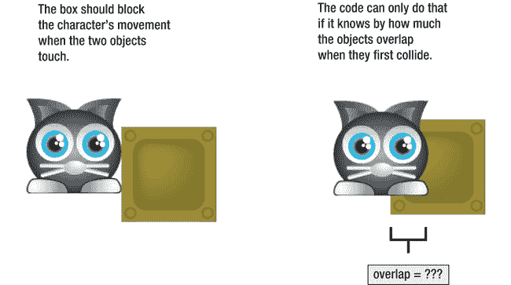

**图 6-19.** 如果你知道对象在碰撞中的重叠量，就可以将它们分开。但你该如何计算出来呢？

如果你知道对象之间的重叠量，你就可以精确地按照这个量将它们分开。该如何计算呢？解决方案是使用**向量**。

你可以将向量想象成连接对象的假想线。所谓"假想"，是指它们仅以数字形式存在；你在舞台上无法看到它们。但是，如果你在游戏对象的中心之间画出这些假想线，你就能判断对象是否接触，以及它们重叠的具体量。如果你知道重叠量，就能以刀刃般的精度将它们分开。这一切都是通过一些简单的数学计算完成的。具体原理如下：

首先，你需要计算第一个对象中心到第二个对象中心之间的向量。你可以用两个变量来描述这个向量。

*   `vx`：告知你向量的宽度。"vx" 代表 "沿 x 轴的向量"。

*   `vy`：告知你向量的高度。"vy" 代表 "沿 y 轴的向量"。

如果你有存储这些信息的 `vx` 和 `vy` 变量，那么你就创建了一个可以在游戏中使用的向量。图 6-20 展示了如何使用 `vx` 和 `vy` 变量来描述两个游戏对象之间的距离。

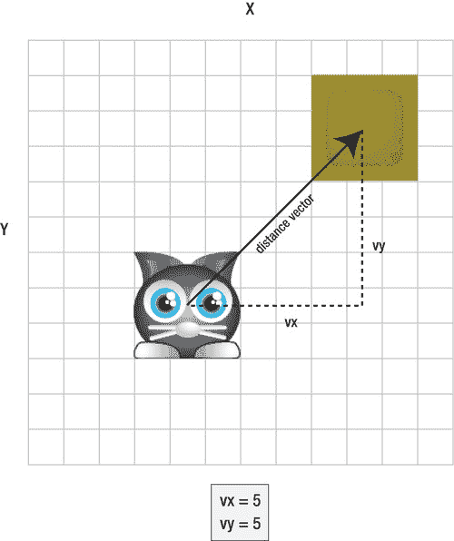

**图 6-20.** `vx` 和 `vy` 变量描述了向量的宽度和高度。

你在图 6-20 中看到的距离向量就是我之前提到的假想线。你在舞台上看不到它。它之所以存在，仅仅是因为 `vx` 和 `vy` 变量描述了它的高度和宽度。

在图 6-20 中，你可以轻易看出两个对象在 x 轴上相距 5 个单位，在 y 轴上相距 5 个单位。这就是 `vx` 和 `vy` 变量要告诉你的全部信息。很简单吧！

*如果你需要知道距离向量的确切长度，可以使用勾股定理。勾股定理是一个非常常用、久经考验的公式。以下是使用 `vx` 和 `vy` 变量计算对象间精确距离的方法：*

```
distance = Math.sqrt(vx * vx + vy * vy);
```

*`Math.sqrt` 是 AS3.0 的一个内置方法，它返回参数中任何值的平方根。*

*在图 6-20 中，`vx` 和 `vy` 变量的值分别为 5 和 5。如果你将它们代入上面的公式，结果如下：*

```
distance = Math.sqrt(5 * 5 + 5 * 5);
```

*如果你在 AS3.0 中运行这段代码，将会得到以下结果：*

```
distance = 5.9
```

*这正是你在图 6-20 中看到的两个对象间距离向量的长度。*

*能够像这样计算出对象间的精确距离，对于游戏开发来说极其有用。如果你知道哪些对象更接近，你的游戏角色就可以根据它们与其他对象的距离远近，来决定去哪里或应该避开什么。本章中不需要使用勾股定理，但你将在第 10 章中再次遇到它。*

现在你有了一个能告诉你两个对象间距离的向量，如何用它来判定它们是否接触呢？首先，你必须计算两个对象的组合半宽和组合半高。这是什么意思呢？取第一个对象的宽度，除以一半。然后取第二个对象的宽度，同样除以一半。将这两个数相加，得到的就是对象的组合半宽。示例如下：

```
combinedHalfWidths
  = (objectOne.width / 2) + (objectTwo.width / 2);
```

然后对对象的高度做同样的事情。

```
combinedHalfHeights
  = (objectOne.height / 2) + (objectTwo.height / 2);
```

图 6-21 展示了这些数字的含义。

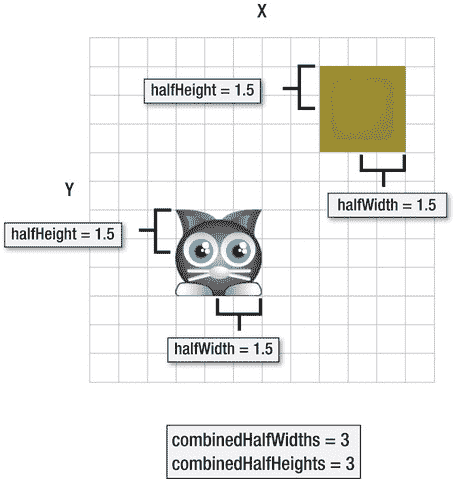

**图 6-21.** 找出对象的组合半高和组合半宽。

你可以看到这确实是简单的数学计算。但看起来也可能像一堆无用的信息！其实不然。以下是其重要性所在：

> *如果组合半宽和组合半高小于 `vx` 和 `vy` 变量，那么对象就是接触的。*

让我们来实际了解一下其原理：

1.  想象一下猫咪角色正在舞台上移动。你想知道它是否碰到了盒子。将 `vx` 和 `vy` 变量与对象的组合半高和组合半宽进行比较。如果 `vx` 和 `vy` 变量的值大于组合半宽和组合半高，那么就没有发生碰撞。图 6-22 说明了这一点。

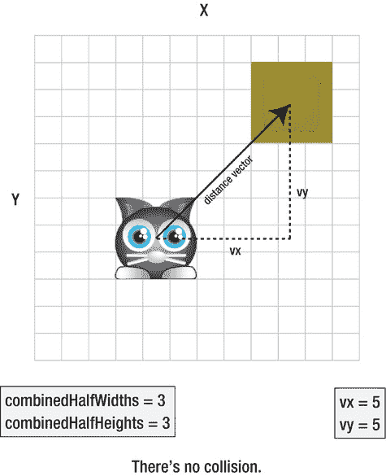

**图 6-22.** 如果 `vx` 和 `vy` 变量大于对象的组合半宽和组合半高，则未发生碰撞。

2.  但是如果猫咪悄悄靠近舞台的右边缘会发生什么？一旦它的 `vx` 值变得小于组合半宽，就可能即将发生碰撞。但目前还没有发生，因为 `vy` 值仍然大于组合半高。你可以在图 6-23 中看到这一点。

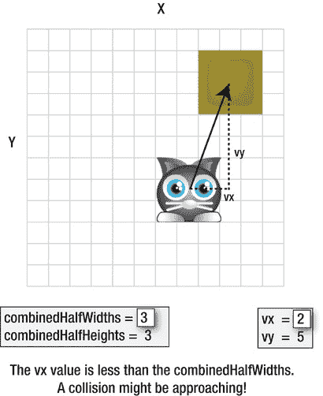

**图 6-23.** 如果 `vx` 值变得小于组合半宽，则可能发生碰撞。

3.  如果 `vx` 和 `vy` 值都小于组合半宽和组合半高，那么可以肯定对象正在碰撞。图 6-24 展示了这一点。

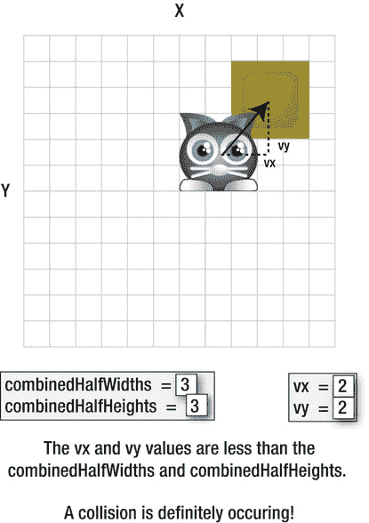

**图 6-24.** 如果 `vx` 和 `vy` 值都小于组合半宽和组合半高，则肯定发生了碰撞。

4.  既然你知道发生了碰撞，就必须将对象分开。只有你知道它们重叠了多少，才能做到这一点。如何计算出来呢？通过从组合半宽和组合半高中减去 `vx` 和 `vy` 的值，如图 6-25 所示。

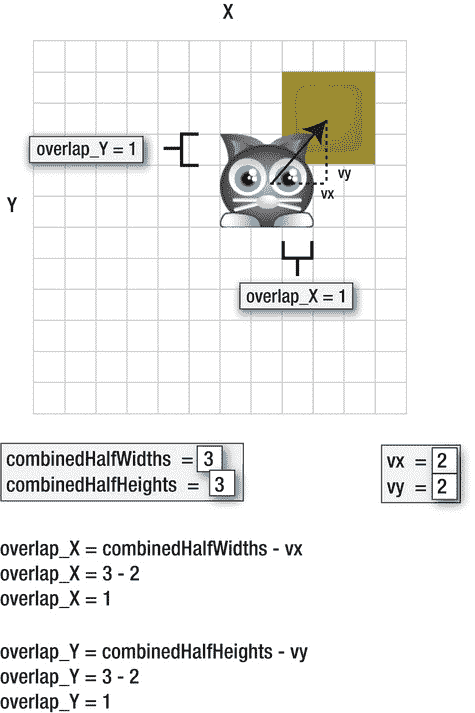

**图 6-25.** 计算出重叠量。

5.  最后一步是分开对象，使它们不再接触。既然你知道对象重叠了多少，这就很容易做到了。只需从对象的 x 和 y 位置中减去重叠量即可，如下所示：

```
character.x = character.x - overlap_X;
character.y = character.y - overlap_Y;
```

这等同于说：

> 角色的新位置将与其旧位置相同，减去重叠量。

这会将对象移出碰撞。图 6-26 说明了这一点。

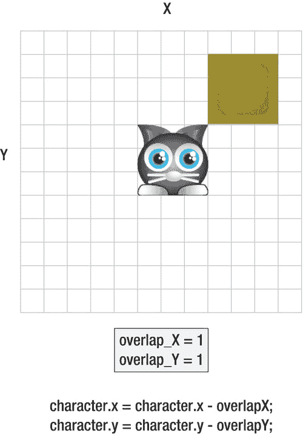

**图 6-26.** 从角色的当前位置减去重叠量，将其移出碰撞。

通常，在 x 轴或 y 轴上的重叠会稍微多一些。在这种情况下，你应该沿着重叠量最小的轴向移动对象，使其脱离碰撞。

好的，作为高级文档工程师，我将遵循您提供的格式指南和示例，对给定的文本进行排版。

你是否对理论感到了困惑？但我之前不是承诺过这本书里不会有太多数学内容吗？幸运的是，你不需要了解这些数学知识就能在游戏中使用它。接下来我将向你展示如何操作。

## 使用 `Collision` 类进行编程

如果你理解了这些基本概念，接下来要做的就是弄清楚如何在游戏中运用它们。你很快就会进行实践，但其方式与你在这本书中之前编写的任何代码都截然不同。你将把这段代码作为一个完全独立的类的一部分来使用。这个类叫做 `Collision`，你可以在本章的源文件中找到它。

但类到底是什么？你可以把类看作是程序的一个独立组件。你可以将不同的类链接在一起，使它们能够共享代码并协同工作，从而构建复杂的游戏和程序。如何做到这一点将是本书后续大部分内容的重点，所以如果现在觉得这听起来有些吓人，不必慌张！我将提供一些易于掌握的小步骤。

从技术上讲，你之前编写的每个程序都是一个类。我一直称它们为计算机程序，但实际上你一直在编写类。你之所以能看出来，是因为你所有的程序都包含了一个叫做类定义的代码块。

```
public class PickingUpObjects extends Sprite
{…
```

到目前为止，你所有的程序都包含在一个类中。这对于学习和构建短小的程序来说非常棒，但随着你的游戏复杂度的提升，你会发现将游戏的各个组件拆分到不同的类中会高效得多。

让我们来看看这些新概念和理论的一个实际应用。在本章的源文件中，你会找到一个名为 `BlockingMovement` 的项目文件夹。打开 `src` 文件夹。你会看到它包含两个 AS 文件，如图 6-27 所示。

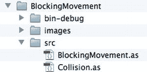

**图 6-27.** `BlockingMovement` 程序使用两个类来完成其工作。

这些 AS 文件，`BlockingMovement.as` 和 `Collision.as`，都是类。`BlockingMovement.as` 是主类。它是启动程序并让一切运转起来的类。程序的主类被称为 `应用程序类`。你在本书中迄今为止编写的所有类都是应用程序类。

另一个类是 `Collision.as`。这个类包含专门化的代码，用于帮助应用程序类完成其工作。事实上，它包含了代表你刚刚看到的碰撞逻辑的所有代码。如果你希望一个游戏对象阻挡另一个游戏对象的移动，就可以使用这个类。

将所有碰撞代码放在它自己的类中，有几个很好的理由。

-   `Collision` 类包含的代码非常有用，你会在许多游戏项目中用到它。与其为每个你想使用它的游戏从头编写所有代码，不如直接复制该类并将其放到任何项目的 `src` 文件夹中。然后你就可以使用 `Collision` 类的所有代码，而无需重写其中任何部分。

-   如果你不想了解 `Collision` 类中的代码，也完全不需要查看或理解它如何工作。它是一个自包含的“黑盒”。你可以在主程序中非常轻松地使用它，而无需完全弄懂它。

让我们看看这两个类是做什么的。打开 `BlockingMovement` 项目并编译程序。将猫角色移到箱子旁边。角色无法穿过箱子——这是一个固体环境边界。一个输出文本字段会告诉你角色的哪一侧正在接触箱子。图 6-28 显示了你会看到的内容。

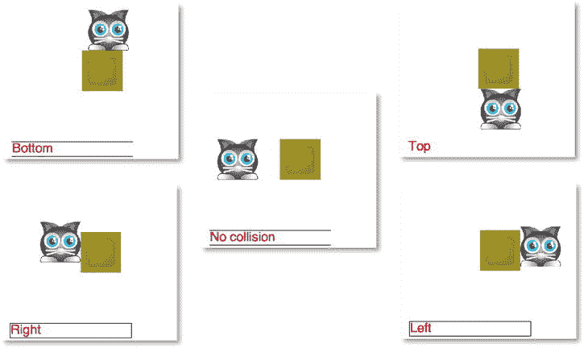

**图 6-28.** 猫被箱子从各个方向阻挡。

实现这一切的代码非常简单。大部分代码与本章中的其他示例相同。所有的魔法都发生在 `enterFrameHandler` 中。以下加粗的代码完成了所有工作：

```
public function enterFrameHandler(event:Event):void
{
  //Move the player
  character.x += vx;
  character.y += vy;

  //Collision code
  Collision.block(character, box);
}
```

```
// 在输出文本字段中显示碰撞方向
output.text = Collision.collisionSide;
```

没错，真的只有一行代码！

```
Collision.block(character, box);
```

它将 `character` 和 `box` 对象发送给 `Collision` 类的 `block` 方法。`Collision.block` 方法负责所有阻止对象重叠的工作。你无需关心它如何实现，只需在希望阻止任意两个游戏对象之间的移动时使用这一行代码即可。这段代码能工作，是因为 `Collision` 类与 `BlockingMovement` 类位于同一个 `src` 文件夹中。图 6-29 展示了这两个类如何协同工作。

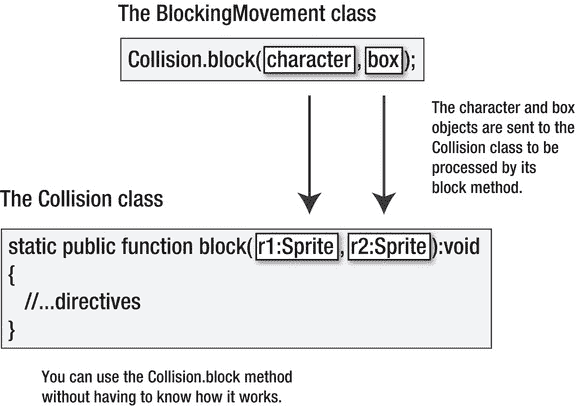

**图 6-29.** 角色和箱子对象被发送到 Collision 类的 block 方法中。

`Collision.block` 是一种特殊的方法，称为 `静态方法`。静态方法是属于外部类的方法，你可以在主程序中使用它们。

要在你的程序中使用静态方法，只需使用该方法所属的类名，后跟一个点，再跟方法名和括号即可。示例如下：

```
ClassName.methodName();
```

你之前已经见过静态方法，只是当时没有意识到。在第 4 章中，你用过 AS3.0 的一个特殊内置方法：

```
Math.random()
```

是不是很眼熟？没错，它就是一个静态方法！`random` 是 AS3.0 的 `Math` 类中的一个方法。它的专有功能是生成一个介于 0 和 1 之间的随机数，并且你可以在程序中任何其他类里使用它。像这样使用的静态方法通常被称为 `工具方法`。它们在你的程序中完成一些实用的小功能，只要提供你需要的结果，你无需关心它们如何工作。

你可以通过在方法定义中添加关键字 `static` 来将任何类的方法变为静态方法，如下所示：

```
static public function block(r1:Sprite, r2:Sprite):void
{ …
```

这段代码的另一个额外特性是，它能告诉你碰撞发生在角色的哪一侧。

```
output.text = Collision.collisionSide;
```

这行代码读取了 `Collision` 类内部的一个 `String` 变量，并将其显示在输出文本字段中。

这段代码还有一个额外的好处。只需做一个小小的改动，你就可以让角色推着箱子在舞台上移动。你只需要交换方法参数中对象的顺序即可。将 `box` 放在前面，然后是 `character`，像这样：

```
Collision.block(box, character);
```

重新编译程序并观察效果。现在猫可以推着箱子在舞台上移动，如图 6-30 所示。

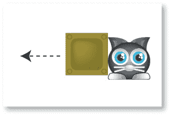

**图 6-30.** 交换 Collision.block 方法中参数的顺序，让猫推着箱子在舞台上移动。

这怎么可能？通过改变参数的顺序，代码的效果作用在了箱子上，而不是角色上。唯一的区别在于，因为角色在移动，箱子必须不断调整自身位置到角色移动方向的前方，以防止两个对象重叠。

这就是使用 `Collision` 类的方法！

如果你对新代码可以工作感到满意，并且不太纠结于细节，可以直接跳到下一章。最重要的是，你拥有了一个可以在任何游戏中使用的绝佳小工具。如果你现在对基于向量的碰撞检测原理、为什么需要使用它，以及如何在自定义类中使用静态方法有了大致了解，这已经足够了。就像 `Math.random` 一样，`Collision.block` 是一个随时可供你使用的工具方法，你不需要知道它如何工作。

但如果你是个代码发烧友，请继续往下读！

## 再探方法、实参和形参

`Collision.block` 方法使用了两个实参。它们可以是游戏中的任意 `Sprite` 对象。在前面的例子中，它们是 `character` 和 `box` 对象。

```
Collision.block(character, box);
```

这些实参被发送到函数定义中的形参里（你可以在 `Collision` 类中找到它，稍后就会看到）。形参已用高亮标出。

```
static public function block(r1:Sprite, r2:Sprite):void
{ …
```

我在第 3 章中讨论过如何使用方法形参，但在继续之前，让我们再回顾一下。

假设你想编写一个方法，其任务是显示水果的名称。我们称这个方法为 `fruitDisplay`。你希望能够给它任何水果的名称，然后这个方法应该接收这些名称并以跟踪消息的形式显示出来。

这个方法不知道水果的名称会是什么；你可以发送给它任何能想到的水果。它只知道你会给它两个名称。你可以编写类似下面的代码：

```
fruitDisplay("apple", "orange");
```

水果的名称在方法名后面的括号中提供，这被称为实参。你提供了水果的名称作为字符串（用引号括起来的单词），并用逗号分隔。现在，方法的函数定义的任务就是利用这些信息做点有用的事情。

下面是 `fruitDisplay` 方法的函数定义：

```
public function fruitDisplay
  (parameterOne:String, parameterTwo:String):void
{
  trace(parameterOne,  parameterTwo);
}
```

如果你在程序中运行这段代码，你会看到以下跟踪消息：

```
apple orange
```

你可以在程序中随时更改方法调用中的实参来显示不同的水果。例如，你可能会厌倦苹果和橙子，然后在程序稍后的位置写下这行代码：

```
fruitDisplay("mango", "banana");
```

然后你会看到以下跟踪消息：

```
mango banana
```

你完全没有修改方法本身；你所做的只是更改了方法调用中的实参。当实参被发送到方法的函数定义时，它们被复制到形参中，这里用高亮标出：

```
function fruitDisplay
  (parameterOne:String,  parameterTwo:String):void
{
  trace(parameterOne,  parameterTwo);
}
```

形参只是可以在函数定义中任何地方使用的变量。因为你期望它们接收字符串值，所以你将它们的变量类型设置为 `String`，就像对待其他任何变量一样。

这两个形参的值包含了方法调用传递给它们的任何值。这意味着，每当方法使用变量名 `parameterOne` 和 `parameterTwo` 时，它都会用 `apple` 和 `orange` 或 `mango` 和 `banana` 或你选择发送的其他任何值来替换它们。这种系统的美妙之处在于，你可以将这种方法用于许多不同的相关任务，而无需知道变量的具体值。

下面是另一个例子。我们创建一个方法来对三个数字求和并显示结果。它可能看起来像这样：

```
public function add(one:int,  two:int, three:int):void
{
  trace(one + two + three);
}
```

然后你可以使用方法调用来使用这个方法，可能像这样：

```
add(4,10,6);
```

它会显示以下跟踪消息：

```
20
```

你提供的任意三个数字都会得到不同的结果。我相信你已经开始看到这有多实用了。

### 返回值的方法

你也可以创建向主程序返回结果的方法。假设你有一个名为 `add` 的方法，用于将两个数字相加，代码可能如下所示：

```
public function add(numberOne:Number, numberTwo:Number):Number
{
  var result:Number = numberOne + numberTwo;
  return result;
}
```

该方法将两个参数相加，并将结果存储到名为 `result` 的变量中。随后，关键字 `return` 将 `result` 的值发送回主程序。你可以在主程序中像这样使用此方法：

```
anyVariable = add(23, 13);
```

`add` 方法的 `result` 值将被复制到 `anyVariable` 中。在此例中，`anyVariable` 的值将变为 36。

要在方法中使用返回值，方法的函数定义必须指定该方法将返回的值类型。在本例中，它返回一个 `Number` 类型，你可以看到函数定义中的最后一项，如下高亮所示：

```
public function add(numberOne:Number, numberTwo:Number):Number
```

方法可以向主程序返回任何类型的值，例如 `String` 或 `Sprite` 对象。只需确保在函数定义中指定正确的返回类型，就像前面的代码一样。（你可以在本章源文件的 `ReturningAValue` 项目文件夹中找到该系统的实际示例。）

### 将 Block 方法的参数与碰撞类结合使用

如你所见，若想阻止 `character` 对象穿过 `box`，你可以编写如下所示的方法调用：

```
Collision.block(character, box);
```

这在本程序中可能有效，但如果你有另一个游戏，需要阻止一只 `mouse` 穿过一条溪流呢？无需更改方法函数定义的任何内容，只需使用这行代码：

```
Collision.block(mouse, stream);
```

该方法以通用方式编写，因此无需预先知道具体要阻止哪些对象，只需知道它们将是两个 `Sprite` 对象即可。你可以在任何上下文中重复使用完全相同的代码。

### 查看 Collision.block 方法

那么，现在你没有任何借口说你不理解方法参数和形参了！准备好迎接更大的挑战了吗？让我们看看 `Collision` 类，并准确理解代码是如何工作的。

**警告！** 代码有点复杂，你几乎肯定无法立即理解。实际上，更有利的做法是，等你的编程技能再精进一些，过几章后再回头阅读本章的这一部分。

在开始之前，请翻回几页，找到名为“防止对象重叠”的部分，并尝试熟悉你需要解决的问题。如果你理解了问题以及用于解决问题的逻辑，那么所有新代码所做的就是将那个逻辑转换成 AS3.0 代码。让我们逐步解析 `Collision` 类，看看有哪些新内容以及它是如何工作的。

以下是整个 `Collision` 类。你会看到很多你不理解的代码，但暂时不必担心。我将在接下来的几页中带你一一解读。请注意，`r1` 和 `r2` 分别代表“矩形一”和“矩形二”。在你刚刚看到的示例中，`r1` 是 `character`，`r2` 是 `box`。

```
package
{
  import flash.display.Sprite;

  public class Collision
  {
    static public var collisionSide:String = "";

    public function Collision()
    {
    }
    static public function block(r1:Sprite, r2:Sprite):void
    {
      //计算距离向量
      var vx:Number
        = (r1.x + (r1.width / 2))
        - (r2.x + (r2.width / 2));

      var vy:Number
        = (r1.y + (r1.height / 2))
        - (r2.y + (r2.height / 2));

      //检查 vx
      //是否小于组合半宽
      if(Math.abs(vx) < r1.width / 2 + r2.width / 2)
      {
        //可能正在发生碰撞！检查
        //vy 是否小于组合半高
        if(Math.abs(vy) < r1.height / 2 + r2.height / 2)
        {
          //碰撞已发生！很好！
          //找出 X 轴和 Y 轴上的重叠大小
          var overlap_X:Number
            = r1.width / 2
            + r2.width / 2
            - Math.abs(vx);

          var overlap_Y:Number
            = r1.height / 2
            + r2.height / 2
            - Math.abs(vy);

          //碰撞发生在重叠量 *最* 小的轴上。让我们确定
          //是哪条轴

          if(overlap_X >=  overlap_Y)
          {
            //碰撞发生在 X 轴上
            //但在哪一侧？vy 可以告诉我们
            if(vy > 0)
            {
              collisionSide = "Top";

              //将矩形移出碰撞
              r1.y = r1.y + overlap_Y;
            }
            else
            {
              collisionSide = "Bottom";

              //将矩形移出碰撞
              r1.y = r1.y - overlap_Y;
            }
          }
          else
          {
            //碰撞发生在 Y 轴上
            //但在哪一侧？vx 可以告诉我们
            if(vx > 0)
            {
              collisionSide = "Left";

              //将矩形移出碰撞
              r1.x = r1.x + overlap_X;
            }
            else
            {
              collisionSide = "Right";

              //将矩形移出碰撞
              r1.x = r1.x - overlap_X;
            }
          }
        }
        else
        {
          //未发生碰撞
          collisionSide = "No collision";
        }
      }
      else
      {
        //未发生碰撞
        collisionSide = "No collision";
      }
    }
  }
}
```

这是本书到目前为止你遇到的最复杂的代码，但我将把它拆分开来，一次只分析一小部分。第一个奇怪的地方是 `Collision` 类的构造方法。

```as3
public function Collision()
{
}
```

记住，类*必须*有一个构造函数，且构造函数的名称必须与类名完全相同。构造函数内的任何指令都会在类实例化时立即执行。

这个构造函数完全是空的，这看起来可能有些奇怪。原因是你没有任何需要执行的初始化指令。像这样写一个空的构造函数是完全可行的。事实上，如果你愿意，甚至可以完全省略整个构造函数，尽管通常认为省略它是一种不良的编程习惯。（如果你省略了它，AS3.0 在编译程序时会自动添加。）

接下来是 `block` 方法的函数定义。

```as3
static public function block(r1:Sprite, r2:Sprite):void
{…
```

`static` 关键字意味着你可以使用以下格式，在任何其他类中直接调用此方法：

`Collision.block`

这很方便，因为如果这个方法没有被声明为 `static`，你就需要先使用 `new` 关键字创建该类的一个实例，像这样：

`public var collision:Collision = new Collision();`

然后你才能像这样使用 `block` 方法：

`collision.block(character, box);`

通过将方法声明为 `static`，你就不必费心先创建类的实例了。

关于这个函数定义，另一个重要的部分是它的参数。

`(r1:Sprite, r2:Sprite)`

这些是类型为 `Sprite` 的局部变量。在 `BlockingMovement` 应用类中，你使用了这行代码来调用该方法：

`Collision.block(character, box);`

`character` 和 `box` 都是 `Sprite` 对象，因此 `r1` 和 `r2` 也应该是 `Sprite` 对象类型。当方法被调用时，对 `character` 对象的引用会被复制到 `r1` 变量中，对 `box` 对象的引用则被复制到 `r2` 变量中。每当你在方法体中看到 `r1` 和 `r2` 时，如果这有助于你更好地理解代码的工作原理，你可以在脑海中将它们替换为 `character` 和 `box`。（这里的 "r" 只是 "矩形 rectangle" 的缩写。在这段代码中保持变量名简短，可以使代码更紧凑，也更易读。）

`block` 方法开头的几行代码创建了 `vx` 和 `vy` 变量，用于定义对象之间的距离向量。

```as3
var vx:Number
  = (r1.x + (r1.width / 2))
  - (r2.x + (r2.width / 2));

var vy:Number
  = (r1.y + (r1.height / 2))
  - (r2.y + (r2.height / 2));
```

这是位于角色和盒子之间的假想线。该向量是从对象的*中心*绘制的。要找到中心点，需要将它们的宽度和高度的一半值加到其左上角的 x 和 y 坐标上。最终得到的是一个从角色中心指向盒子中心的向量。记住，一对 `vx` 和 `vy` 变量总是描述一个单一的向量。（如果你对此还有点模糊，请回顾图 6-20 复习一下原因。）

既然已经定义了向量，代码就会按步骤检查 `vx` 和 `vy` 是否小于组合后的半宽。记住，如果小于，则发生碰撞。这一切都是通过一系列嵌套的 `if` 语句完成的。这是第一个：

```as3
if(Math.abs(vx) < r1.width / 2 + r2.width / 2)
{…
```

这段代码并没有看起来那么吓人！它的意思就是：

*`如果(vx 值小于 r1 的半宽加上 r2 的半宽)`*

*`{…`*

再看一眼那个 `if` 语句。现在明白了吗？就像我保证的那样，这不过是点简单的数学运算。

但其中有一处新内容：

`Math.abs(vx)`

`Math.abs` 是 AS3.0 的内置方法之一。（是的，它是一个静态方法！）它的作用是求出一个数字的`绝对值`。绝对值只能是正数；被强制求绝对值的负数会去掉其符号。假设你在这样一行代码中使用了 `Math.abs`：

`Math.abs(-27);`

它会返回：

`27`

为什么这对你有用？如果第一个对象的 x 坐标值小于第二个对象，那么 `vx` 的值将为负数。负数值会使代码变得过于复杂，因为你需要额外的 `if` 语句来处理它。只处理正值对你来说更简单。

那么，如果代码发现 `vx` 小于组合半宽会怎样？它会检查 `vy` 是否小于组合半高。

```as3
if(Math.abs(vy) < r1.height / 2 + r2.height / 2)
{…
```

如果结果为真，那么你就知道绝对发生碰撞了。这就是图 6-24 所示的情况。下一步是计算 x 轴和 y 轴上的重叠量，然后使用这些量来确定碰撞发生在对象的哪一侧：顶部、左侧、底部还是右侧。

重叠量被存储在两个名为 `overlap_X` 和 `overlap_Y` 的变量中。计算方式如下：

```as3
var overlap_X:Number
  = r1.width / 2 + r2.width / 2 - Math.abs(vx);
var overlap_Y:Number
  = r1.height / 2 + r2.height / 2 - Math.abs(vy);
```

你会注意到这些变量没有使用 `public` 关键字声明。这是因为它们仅是方法内部使用的变量，不属于该类。它们不能在 `block` 方法之外使用。这些被称为**局部变量**。在本书的剩余部分，你会看到更多关于局部变量工作的示例。

既然知道了重叠量，你只需将重叠值与 `vx` 和 `vy` 值进行比较，就能找出碰撞发生在第一个对象的哪一侧。当代码知道这一点后，它就能使用正确的重叠值来重新定位对象，使其不再与第二个对象接触。

```as3
if(overlap_X >=  overlap_Y)
{
//碰撞发生在 X 轴上
//但发生在哪一侧？vy 能告诉我们
  if(vy > 0)
  {
    collisionSide = "Top";

//将矩形移出碰撞
    r1.y = r1.y + overlap_Y;
  }
  else
  {
    collisionSide = "Bottom";

//将矩形移出碰撞
    r1.y = r1.y - overlap_Y;
  }
}
else
{
//碰撞发生在 Y 轴上
//但发生在哪一侧？vx 能告诉我们
  if(vx > 0)
  {
    collisionSide = "Left";

//将矩形移出碰撞
    r1.x = r1.x + overlap_X;
  }
  else
  {
    collisionSide = "Right";

//将矩形移出碰撞
    r1.x = r1.x - overlap_X;
  }
}
```

这就是全部内容了。你可以看到逻辑有些复杂，但如果你花几分钟时间在脑海中仔细地跟随代码一步步执行，你也会发现它其实相当简单。

作为额外功能，`Collision` 类有一个名为 `collisionSide` 的 `String` 变量。

```as3
static public var collisionSide:String = "";
```

它的作用是记录碰撞发生的侧面。对于你的一些游戏来说，了解这些信息可能很有用。事实上，了解这些信息对于编写平台游戏至关重要，正如你将在第 9 章中看到的那样。

`collisionSide` 被声明为一个 `static` 变量。这意味着你可以在主应用类中像这样访问这个变量：

`Collision.collisionside`

这将返回 `collisionSide` 变量的当前文本。你可以在游戏场景中像这样使用它：

```as3
if(Collision.collisionSide == "Bottom")
{
  //角色正站在盒子上方，
  //所以释放蜂群吧！
}
```

我将把实际编写这个游戏的任务留给你，靠你的技巧和想象力去实现。（我已经迫不及待想玩到它了！）

### 摘要

碰撞检测是游戏设计中一个相当宏大的主题。希望本章的初步介绍能激发你对后续内容的兴趣。

不过在跳入下一章之前，你可能想稍作休息，动手制作一个游戏。嘿，别害怕，你能做到！毕竟，这正是本书的核心——制作你自己的游戏。如果你将本章的碰撞检测技术与上一章的角色控制技巧（以及你在猜数字游戏中学习到的逻辑分析方法）结合起来，你就拥有了制作一些相当精良游戏所需的所有工具。

而这正是你在下一章要做的事情。你将运用截至目前学到的所有技能，将它们整合起来，制作出你的第一款真正的视频游戏！


