## 第 7 章

## 制作游戏

现在你已具备开始制作真正游戏所需的所有技能。但具体该怎么做呢？如何从零散的小示例跨越到完整的大游戏，这可能并不显而易见，但别担心。在本章中，我将向你精确演示如何实现这一跨越。我将带你一步步地了解如何仅使用你已经学过的技术来制作一款视频游戏。（好吧，我承认，我还会偷偷加入一两个小技巧！）

你将亲历制作游戏的全过程——从图形到编程。你要制作的游戏是一个非常简单的物品收集游戏。玩家需要在 10 秒倒计时结束前收集五颗炸弹并将其拆除。图 7-1 展示了游戏的样子。

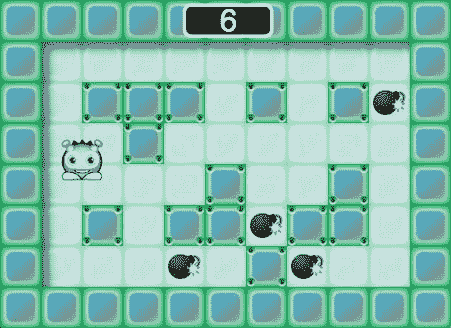

**图 7-1.** 在时间耗尽前拆除炸弹！

我将利用本章的机会向你介绍另一个有用的游戏图形创作工具：Adobe Illustrator。如果你对 Illustrator 的工作原理感到好奇，却又因其表面的复杂性而却步，本章将教你开始使用它所需的一切知识。但你不必非得使用 Illustrator 来制作这些图形；你也可以使用 Photoshop 或任何其他能生成 PNG 文件的图形设计或插画软件来制作。

你还会学到一项有趣的编程新技巧：如何制作计时器。我将向你展示如何将每个游戏对象封装成独立的类，从而大幅减少主应用程序类中所需的代码量。

是时候制作你的第一款真正游戏了！

### 制作游戏图形

你的游戏需要五张 PNG 图片。以下是它们的名称和尺寸：

*   `character.png`（宽：50 像素，高：50 像素）
*   `box.png`（宽：50 像素，高：50 像素）
*   `bomb.png`（宽：40 像素，高：30 像素）
*   `background.png`（宽：550 像素，高：400 像素）
*   `gameOver.png`（宽：300 像素，高：150 像素）

图 7-2 展示了我为这个项目设计的样子。你可以按照自己的喜好设计这些 PNG 文件。只要它们的名称和尺寸与上述一致，就能在游戏程序中使用。

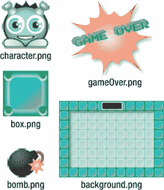

**图 7-2.** 你将制作的游戏图形

我已经使用 Adobe Illustrator CS5.0 制作了所有这些图形，并将在后续的逐步指南中向你展示具体方法。我会从最简单的图形开始，以最复杂的图形结束。完成后，你将拥有使用 Illustrator 创作自己游戏图形所需的所有技能。

本章假定你已经学习过第 2 章的内容，或者已经知道如何使用 Photoshop。

#### 制作纹理盒子

你要制作的第一个图形是图 7-3 所示的纹理游戏盒子。这种多用途盒子是视频游戏的基本元素，我将借此机会向你展示一些最实用的基础 Illustrator 绘图技巧。

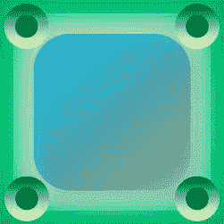

**图 7-3.** 纹理游戏盒子

##### 熟悉 Adobe Illustrator

当你首次启动 Adobe Illustrator 时，你会发现工具和工作区与 Photoshop 惊人地相似，这让人感到安心。但当你开始使用它时，很快就会发现，尽管外观相似，却存在一些根本性的差异。面板的位置不同，使用的许多概念不同，一些键盘快捷键也不同。Photoshop 和 Illustrator 之间有相当多的重叠之处，这恰恰是起初让人困惑的原因。正当你以为知道如何操作时，Illustrator 却改变了游戏规则，让你碰壁。但解决方法很简单！不要把它看作是 Photoshop 的类似物——将其视为一个完全不同的程序。抛开任何先入为主的期望，下定决心从头开始学习。这绝对值得付出努力，因为事实上，一旦你掌握了要领，用 Illustrator 制作游戏图形反而*比*Photoshop *更容易*。Illustrator 更加宽松，不那么挑剔，而且灵活得多。和 Photoshop 一样，学习使用 Illustrator 是一项不错的长期投资。它是目前使用最广泛、功能最强大的图形设计软件包之一，现在花时间认真学习它，将为你未来多年的发展打下坚实基础。

但与 Photoshop 一样，Illustrator 也是一款极其复杂的软件。它可以在无数种配置下进行定制，并且达到任何特定效果通常都有十种或更多种方法。在本章中，我将带你进行一次范围相当窄的 Illustrator 之旅；我将只涉及它实际功能的大约 5%。不过，和 Photoshop 之旅一样，你会很高兴地知道，你学到的这 5%正是你在游戏图形工作中 95%的时间里会使用的技巧。在完成本章学习后，你将能够熟练使用 Illustrator 来创建大量用于游戏的图形，这些技能也将是学习更高级技巧的重要垫脚石——如果你感到灵感迸发的话……你也应该感到振奋！

Illustrator 和 Photoshop 之间最重要的区别之一是，Illustrator 主要是一个制作**矢量图形**的工具。矢量图形是由线条而非像素构成的图片。而 Photoshop 完全是关于像素的。使用矢量绘图实际上是 Illustrator 的一大特色，因为这意味着你可以将图像缩放到任意尺寸，而不会损失分辨率质量。此外，绘制完成后，你可以选择是将其作为 PNG 文件（使用像素）还是 SWF 文件（使用矢量）用于你的游戏中。这两种类型在你的 Flash 游戏中都可以使用。

*本书中的所有 Flash 游戏都使用 PNG 文件，但你可以同样轻松地使用 SWF 文件。你可以通过选择“文件”“导出”，然后选择“Flash (swf)”格式，来保存你在 Illustrator 中制作的任何图形。*

*选择使用 SWF 还是 PNG 文件实际上取决于风格和个人偏好。PNG 图形通常对 Flash Player 处理器的压力稍小。这对于通常处理器负荷很重的游戏来说是有利的。另一方面，使用 SWF 图形的游戏可以缩放到任意尺寸，而不会损失分辨率质量。你更喜欢哪种？两种都试试再决定吧！*

在这个项目中你将使用像素，所以第一件事就是告诉 Illustrator 将像素作为它的通用度量单位。通过选择“编辑”“首选项”~“单位”（Windows）或“Illustrator”“首选项”（OS X）打开“首选项”菜单。选择“单位”，并将“常规”选项更改为“像素”。

现在，你将创建你的第一个 Illustrator 文件并开始绘图！

### 设置工作区

启动 Illustrator 并创建一个名为 `box` 的新文档。

在 Illustrator 主菜单中选择 `文件` > `新建`。`新建文档`对话框将打开。更改此窗口中的参数，使其与以下内容匹配（图 7-4 展示了你的`新建文档`窗口应呈现的样子）：

-   **名称**：`box`
-   **宽度**：`50 px`
-   **高度**：`50 px`
-   **单位**：`Pixels`
-   **颜色模式**：`RGB`（如果看不到此选项，请点击 **高级** 按钮使其可见。）

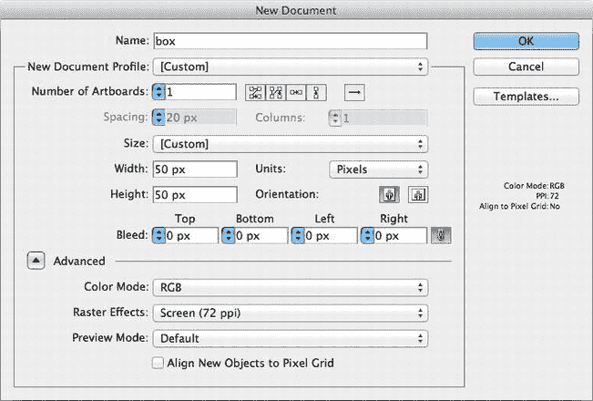

**图 7-4.** 新文档的参数

宽度和高度以像素为单位指定，但这些实际上只是应用到最终 PNG 文件上的数字。你的所有绘图都将使用矢量完成，这意味着如果你日后改变主意想调整最终图像的大小，你的插图也可以缩放到任意尺寸。Illustrator 有一个**像素预览**视图，可以显示矢量图形在像素化后的样子，你很快会了解如何使用它。

另外，非常重要的一点是**颜色模式**必须设置为 `RGB`。`RGB` 代表**红**、**绿**、**蓝**，指的是可见光谱。这是一种在任何投射光的媒介（如电脑显示器或电视屏幕）上使用的颜色解释方式，也是你在制作游戏时应该始终使用的模式。另一种广泛使用的颜色系统是 `CMYK`，代表**青**、**品红**、**黄**和**黑**（“黑”指黑色）。它用于书籍和杂志等印刷图像，描述了油墨涂覆到纸张上的底层过程。

你会注意到最后一个选项叫做**将新建对象对齐到像素网格**。这实际上是一个非常实用的功能，因为它会将你的图形微调到与底层像素网格精确对应的位置。对于你正在制作这类非常小的图像，有时这样操作可能会有点麻烦，因为像素相对较大，你的线条和形状会被大幅度地调整。但对于实现真正的像素级精确度而言，它是必不可少的，所以可以考虑在某个时刻选择此选项。

点击 **确定** 按钮，你会看到一个空白绘图表面，称为**画板**。画板与 Photoshop 中的画布相同——这是你进行所有绘图的地方。你可以在画板周围的灰色区域绘图，但你在那里绘制的任何内容都不会出现在最终图像中。画板周围的灰色区域是尝试技巧或绘图元素的好地方。如果发现能用得上，你可以将它们复制或拖入最终作品。

如果你需要对画板进行任何更改，例如更改其大小，请单击**工具**栏中的**画板工具**（图 7-5）。然后，你可以在贯穿 Illustrator 工作区顶部的**控制面板**中调整画板大小或更改其任何属性。（实际上，你可以在一个 Illustrator 文档中拥有多个画板，如果你正在创建许多共享某些元素的不同游戏图形，这可能会很有用。你可以在不同画板之间复制和粘贴，而不是在不同文档之间操作。）

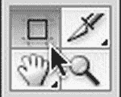

**图 7-5.** 使用画板工具更改绘图区域的大小和属性。

*与 Photoshop 一样，Illustrator 允许你选择不同的工作区，这些工作区是工具和面板的自定义布局。默认工作区称为**基本功能**，我建议你目前坚持使用这个。你可以通过从 Illustrator 主菜单中选择**窗口** > **工作区**，或单击**控制面板**右上角的**基本功能**按钮来更改工作区。如果你因为四处拖动画板、将它们停靠在不寻常的地方或打开/关闭它们而弄得一团糟，只需从这两个菜单中重新选择**基本功能**工作区，所有内容都会重置回原始位置。*

### 选择颜色

我总是苦于为我的游戏选择合适的颜色。幸运的是，你可以让 Illustrator 从预设的色板选项中为你选择，从而简化颜色选择。你可以在工作区右侧的**面板**栏中找到**色板**面板。

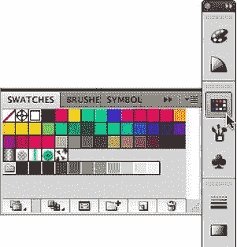

**图 7-6.** 打开色板面板。

打开面板时，你会看到一组基本的色板，如图 7-6 所示，但 Illustrator 实际上还有许多其他颜色色板集合，它们隐藏在**色板**面板的菜单中。

1.  单击面板右上角的**色板**面板菜单按钮。选择**打开色板库**。将出现一整个不同色板颜色组合的列表。选择你喜欢的任何一个。我为这个项目选择了**儿童用品**，因为它是一组明亮、欢快的颜色，非常适合视频游戏。图 7-7 显示了色板库的查找位置。新的色板将在它们自己的面板中打开。

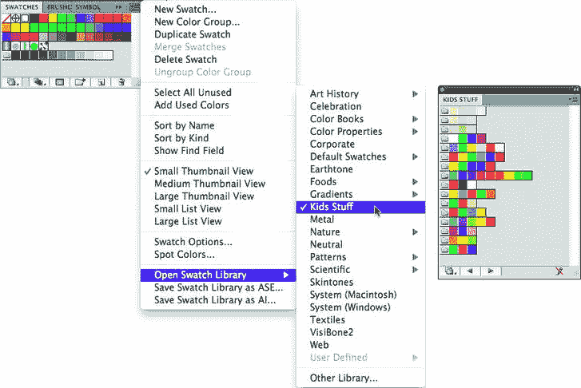

**图 7-7.** 从色板库中选择一组新的色板。

现在你有一组不错的明亮、饱和及柔和的颜色可供选择。

### 绘制外部形状

首先，你要绘制盒子的外部形状。这是一个应用了内发光效果的绿色矩形。

1.  从**工具**栏中选择**矩形工具**（图 7-8）。

    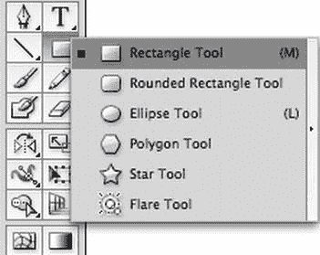

    **图 7-8.** 选择矩形工具。

2.  单击**工具**栏中的前景色选择器，然后单击一个绿色色板。将描边（轮廓）颜色设为无。（通过选择**工具**面板中的描边颜色选择器，然后单击带有红色斜线的小按钮来完成此操作。如果操作成功，描边颜色上应该有一条匹配的红色斜线。）图 7-9 显示了**工具**栏中的前景色和描边颜色应呈现的样子。

    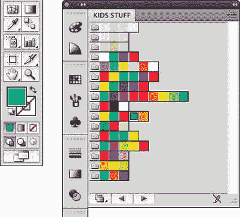

    **图 7-9.** 选择绿色前景色并将描边颜色设置为无。

3.  同时按住鼠标左键和 **Shift** 键，从画板的最左上角拖动到最右下角。一个实心绿色正方形将填满整个画板，如图 7-10 所示。使用**矩形工具**拖动时按住 **Shift** 键，可以让你绘制出完美的正方形。

    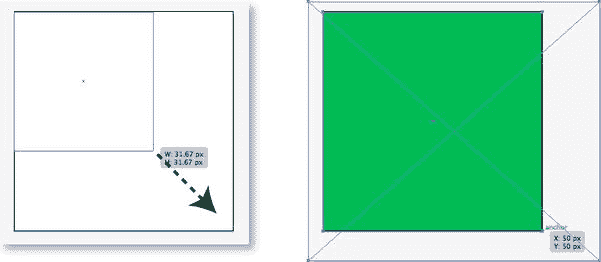

    **图 7-10.** 单击并拖动以绘制一个绿色矩形。

4.  确保矩形仍处于选中状态。（如果没有，请使用黑色箭头工具重新选中它。）选择 `效果` > `风格化` > `内发光`。`内发光`窗口将打开，让你配置该效果。确保选中**预览**选项，并使用以下设置配置效果：

    - **模式**：`Normal`
    - **不透明度**：`80`
    - **模糊**：`9px`
    - **中心**

最终效果将如图 7-11 所示。关于如何选择这些设置没有固定规则——只需随意调整，直到你对效果的样子感到满意为止。

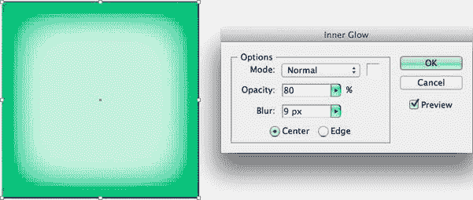

**图 7-11.** 为矩形添加内发光。

如果你需要修改此效果，或你可能添加到绘图对象上的任何其他效果，请确保选中该对象，然后打开**外观**面板（图 7-12）。单击效果名称进行修改。你也可以从**外观**面板修改对象的所有其他视觉属性。

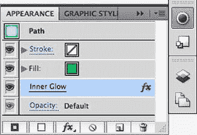

**图 7-12.** 外观面板允许你修改对象的所有视觉属性，例如效果、颜色和不透明度。

### 绘制内部形状

接下来，你将绘制一个带圆角的内层正方形。你需要使用半透明渐变填充它，并添加一个投影效果，使其看起来像是浮在外层正方形之上。

1.  从工具栏中选择`圆角矩形工具`（图 7-13）。`圆角矩形工具`可让你绘制带圆角的方形和矩形。

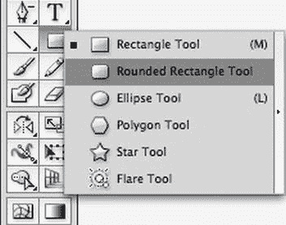

**图 7-13.** 选择`圆角矩形工具`。

2.  点击工作区顶部`控制面板`中的`首选项`按钮。将`圆角半径`设置为`8px`，然后点击`确定`按钮，如图 7-14 所示。圆角半径决定了矩形边角的圆化程度。（你也可以在绘制矩形时，通过按键盘上的上箭头或下箭头来交互式地更改圆角半径。）

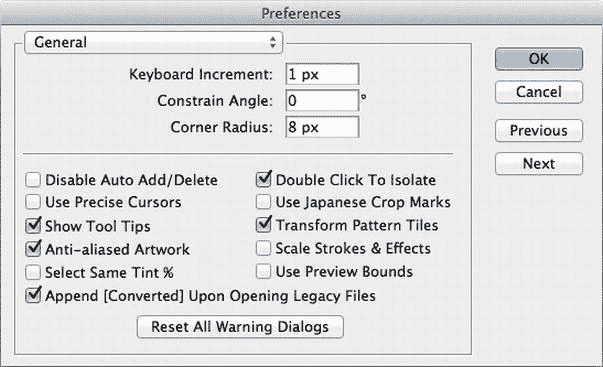

**图 7-14.** 在`首选项`窗口中设置圆角矩形的圆角半径。

3.  在你绘制的第一个矩形上方绘制一个任意尺寸的圆角矩形，如图 7-15 所示。其填充颜色无关紧要，但不应有描边颜色。

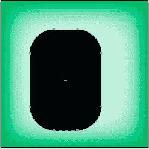

**图 7-15.** 确保新的圆角矩形没有描边颜色。

4.  确保这个新矩形仍处于选中状态，并在`控制面板`的`X`、`Y`、`W`（宽度）和`H`（高度）字段中输入以下数值：

*   `X: 25`
*   `Y: 25`
*   `W: 35`
*   `H: 35`

这将为正方形设定精确的高度和宽度，并将其居中，如图 7-16 所示。

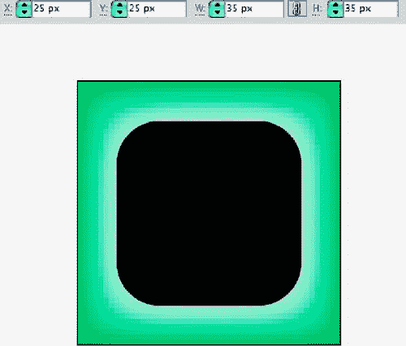

**图 7-16.** 在`控制面板`中输入精确的尺寸和位置。

*现在画板上有两个绘图对象。如果你使用黑色箭头双击其中任何一个，Illustrator 将切换至`隔离模式`。此模式会调暗并禁用画板上除选中对象之外的所有其他对象，以便于你处理选中项。要退出隔离模式，请在选中对象之外的位置双击鼠标。*

接下来，你将使用半透明渐变填充这个新正方形。

1.  打开`渐变`面板。从`色板`面板中将一个浅蓝色色板拖放到渐变预览最左侧的渐变滑块上。再从`色板`面板中将一个黑色色板拖放到渐变预览最右侧的渐变滑块上。将渐变中点滑块向右移动约 75%。图 7-17 对此进行了说明。

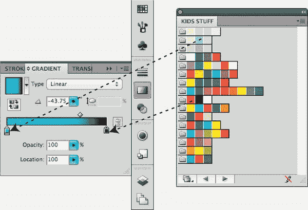

**图 7-17.** 通过将色板拖入渐变滑块来创建渐变。

2.  选择最右侧的渐变滑块（此时应为黑色），并将`不透明度`值更改为`0`。此时你应该能看到此渐变填充应用到你所绘制的新正方形上。
3.  在工具栏中选择`渐变工具`。你会看到正方形上出现一个长条。这被称为`渐变批注器`。它是一个非常有用的工具，让你可以通过在画板上移动它来交互式地更改渐变的旋转角度、尺寸和位置。图 7-18 显示了你将看到的内容。你可以使用此工具拖拽、旋转、调整大小和变形渐变；你还可以更改渐变的颜色和颜色分布。

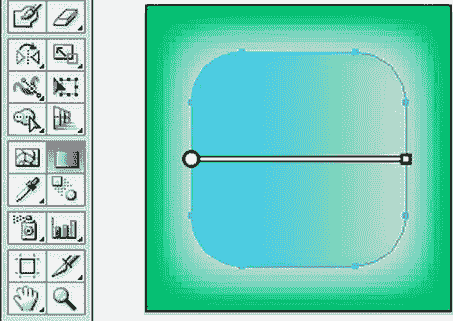

**图 7-18.** 选择`渐变工具`以显示`渐变批注器`。

4.  旋转并定位`渐变批注器`，使渐变沿正方形的对角线方向，从左上角延伸到右下角，如图 7-19 所示。

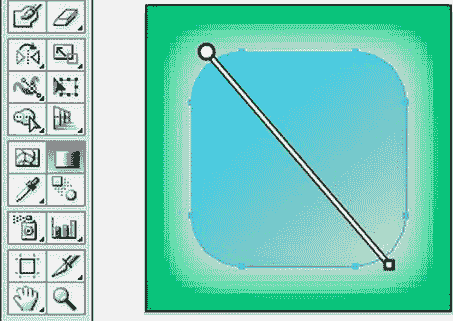

**图 7-19.** 旋转并重新定位渐变。

现在添加一个浅投影效果，为内层正方形增加一些深度感。

1.  确保内层正方形仍处于选中状态，然后从 Illustrator 的主菜单中选择`效果`  `风格化`  `投影`。`投影`窗口将打开（参见图 7-20）。输入以下数值：

*   `模式: 正常`
*   `不透明度: 30`
*   `X 偏移: 1px`
*   `Y 偏移: 1px`
*   `模糊: 2px`

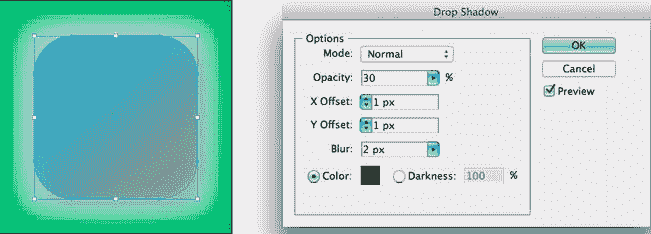

**图 7-20.** 为内层正方形添加投影。

确保选中`预览`选项，以便在设置这些数值时能够看到正方形上的变化。同样，这只是一个选择看起来效果不错的设置的问题。

现在在方框的边角添加一些铆钉。

1.  从工具栏中选择`椭圆工具`。它与`矩形工具`属于同一按钮组。为其设置深绿色填充颜色。
2.  按住`Shift`键，在外层正方形左上角点击并拖动绘制一个小圆。图 2-21 对此进行了说明。使用`椭圆工具`绘制时按住`Shift`键可让你绘制出完美的正圆。

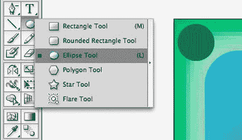

**图 7-21.** 在左上角绘制一个圆形。

3.  使用你刚学到的渐变技巧，用线性渐变填充深绿色圆形。它应该顶部颜色深，底部颜色浅。你的最终结果应该类似图 7-22 所示。

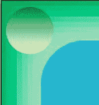

**图 7-22.** 在左上角绘制一个圆形。

4.  在第一个圆内部绘制一个较小的深绿色圆形，如图 7-23 所示。

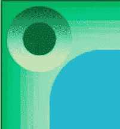

**图 7-23.** 添加一个较小的圆。

*如果你需要完美对齐两个或多个对象，可以使用 Illustrator 的对齐按钮。使用时，按住`Shift`键并用黑色箭头点击所有你想要对齐的对象。对齐按钮将出现在工作区顶部的`控制面板`中。点击任意按钮，你会看到对象神奇地对齐到正确位置。*

*如果你需要将较小的对象居中于较大的对象内部（就像制作这些铆钉时一样），请确保两个圆都被选中，然后点击`水平居中对齐`按钮，接着点击`垂直居中对齐`按钮。*

再复制几个这个铆钉，用于其他三个边角。

1.  使用黑色箭头点击时按住`Shift`键，可以让你选择多个对象。同时选中内圆和外圆。如果你看到两个圆周围都出现了蓝色定界框，就说明操作正确，如图 7-24 所示。

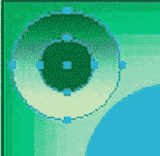

**图 7-24.** 按住`Shift`键点击以选择多个对象。

2.  从主菜单中选择`对象`  `编组`。编组对象允许你将多个对象作为一个对象来处理。这意味着你可以在画板上移动、复制和粘贴一组对象，它们会作为一个整体保持在一起。你可以通过双击来编辑组中的单个单元。你可以通过选择`对象`  `取消编组`来取消对象的编组。
3.  现在两个圆已编组为一个整体，选择`编辑`  `复制`（或使用键盘快捷键：Windows 系统为`Ctrl+C`，OSX 系统为`Command+C`）。选择`编辑`  `贴在前面`（或快捷键：Windows 系统为`Ctrl+F`，OSX 系统为`Command+F`）。这会复制该编组并将其直接粘贴到原编组的正上方。
4.  将复制的编组移动到正方形的右上角，如图 7-25 所示。

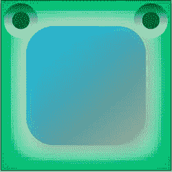

**图 7-25.** 使用`复制`/`贴在前面`命令复制编组的圆形，并将新副本移动到正方形的右上角。

5.  再次使用`粘贴到前面`两次，将复制出的铆钉移至正方形底部两个角，如图图 7-26 所示。


**图 7-26.** 再复制两个铆钉并放置到相应位置。

至此，您的多功能游戏盒就完成了！

不过，到目前为止您一直在使用矢量图形进行绘制。最终在游戏中使用的`PNG`图像将由像素组成。它会是什么样呢？要查看效果，请从 Illustrator 主菜单中选择`视图`  `像素预览`。您将看到 50×50 像素游戏盒中像素的具体效果，如图图 7-27 所示。

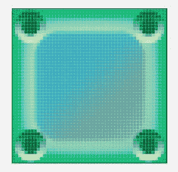

**图 7-27.** 像素预览让您看到绘图在像素层面呈现的效果。

这完美展示了矢量图与位图的区别：线条与点阵。实际上，如果您愿意，完全可以全程开启`像素预览`进行绘制。有时这种模式对确保精细作品的像素对齐十分必要，尤其针对小尺寸图形。在下一节设计炸弹图案时，您会体会到它的实用性。（取消勾选`视图`菜单中的`像素预览`即可关闭该模式。）

最后一步是保存作品。

1.  从主菜单中选择`文件`  `另存为`。在电脑上选择保存 Illustrator 文档的位置，点击`保存`按钮。（Illustrator 文档的扩展名为`.ai`。）
2.  现在需要制作`PNG`版本。从主菜单中选择`文件`  `存储为 Web 和设备所用格式`。从`预设`菜单中选择`PNG-24`。点击`保存`按钮，为完成的`PNG`图像选择保存位置。

以上内容涵盖了 Illustrator 的多种不同技巧。让我们加快节奏，设计炸弹图案吧。

#### 制作炸弹

绘制炸弹图形可以让您有机会使用 Illustrator 的钢笔工具和星形工具，并展示如何将两个或多个形状合并为一个。

1.  新建一个 Illustrator 文档，命名为`bomb`。保持所有新文档设置与绘制盒子时相同，但将宽度改为`40`，高度改为`30`。
2.  选择`椭圆`工具。按住`Shift`键并拖动，绘制一个与画板高度相等的正圆。（如果要以圆心为起点绘制圆形，请按住`Alt`（Windows）或`Option`（OSX）键。）
3.  为圆形填充一个颜色极深、近乎黑色的径向渐变，如图 7-28 所示。将圆形放置在画板的左侧。

    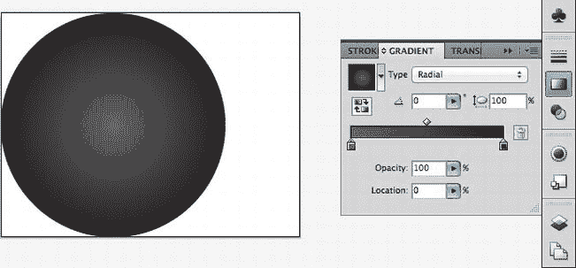

    **图 7-28.** 绘制一个带有深色径向渐变的圆形。

4.  选择`渐变`工具。使用渐变注释器重新定位渐变中心，使其最亮区域靠近圆形的左上方（图 7-29）。这将产生高光效果，赋予圆形一种立体感，仿佛它是一个球体。

    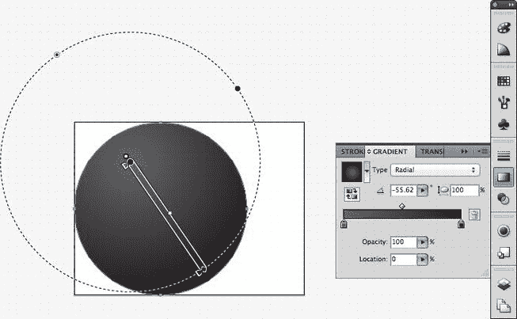

    **图 7-29.** 旋转并移动渐变以创建球体高光效果。

5.  绘制一个大小约为圆形五分之一的黑色矩形。使用白色箭头工具收窄左右两个角。Illustrator 中的箭头工具与 Photoshop 中的完全相同。最终你会得到一个类似图 7-30 的形状。

    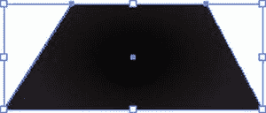

    **图 7-30.** 绘制一个收窄的黑色矩形。

6.  旋转这个新形状并将其移动到圆形的左上边缘。让它与圆形略微重叠，如图 7-31 所示。

    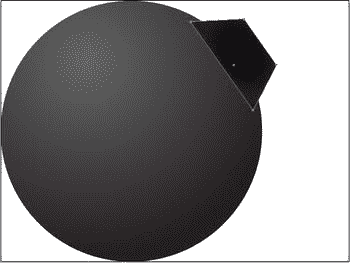

    **图 7-31.** 将新形状移动到圆形上方。

    接下来的技巧是将新形状移动到圆形的后方。在 Photoshop 中，你可以通过将新形状的图层移到圆形图层下方来实现。Illustrator 与 Photoshop 一样有图层，但你通常不需要使用它们。形状通常通过调整它们在单个图层上的堆叠顺序来进行分层。让我们看看如何操作。

7.  确保新形状仍处于选中状态。在主菜单中选择`对象`  `排列`  `后移一层`。新形状将定位到圆形下方，如图图 7-32 所示。

    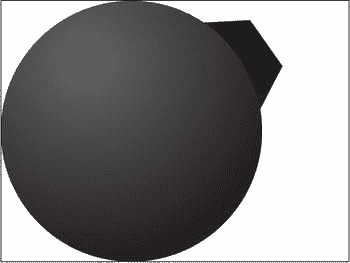

    **图 7-32.** 将新形状移动到圆形后方。

    将形状移动到其他形状的前方或后方，在 Illustrator 中是如此常见的操作，以至于你可能很想学习实现此操作的键盘快捷键。首先，按住`CTRL`（Windows）或`Command`键（OSX）。然后按下方括号键`[`和`]`，即可在堆叠顺序中将对象前移或后移。如果同时按住`Shift`键，所选形状将跳转到堆叠顺序的最顶层或最底层。这个方法非常有效，你会发现通常只有在处理非常复杂的形状时才需要使用图层。

    现在将这两个形状合并在一起。

8.  在主菜单中选择`窗口`  `路径查找器`，打开`路径查找器`面板。`路径查找器`面板有多个按钮，可以让你合并或减去形状。
9.  按住`Shift`键，使用黑色箭头分别点击两个形状以同时选中它们。你也可以通过选择主菜单中的`选择`  `全部`来选择所有形状。或者使用方便的键盘快捷键：`Ctrl+A`（Windows）或`Command+A`（OSX）。当两个形状都被选中时，你会看到它们都被蓝色的定界框包围。图 7-33 显示了应呈现的样子。

    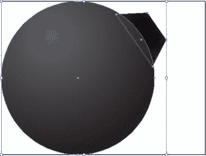

    **图 7-33.** 同时选中两个形状。

10.  点击`路径查找器`面板中的`联集`按钮，如图 7-34 所示。此时两个形状已合并成一个。

    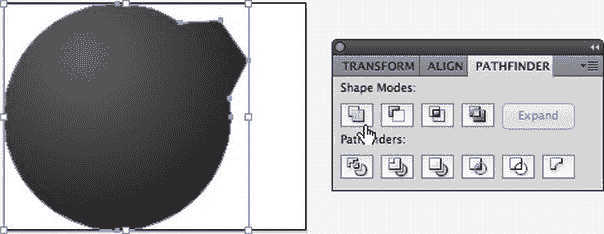

    **图 7-34.** 使用路径查找器面板合并形状。

当你这样合并形状时，下方形状会继承上方形状的着色品质。你会注意到，收窄的矩形现在与覆盖着它的圆形黑色径向渐变无缝融合。你也可以使用`路径查找器`菜单从一个形状中减去另一个形状。有时间的话可以尝试一下，你会发现它在制作复杂的复合形状时非常有用。

接下来是制作炸弹的导火索。你将使用`钢笔`工具绘制一条路径来完成此操作。Illustrator 的`钢笔`工具与 Photoshop 中的完全相同，如果你不确定如何使用，请回顾第 2 章中的相关部分。在绘制和调整路径时，你需要在黑色箭头、白色箭头和`转换锚点`工具之间频繁切换，因此掌握以下键盘快捷键非常有用：

*   黑色箭头（选择工具）：`V`
*   白色箭头（直接选择工具）：`A`
*   转换锚点：`Shift+C`
*   另外，不妨也记一下`钢笔`工具本身的快捷键：`P`

（黑白箭头的快捷键很容易记，因为字母`A`和`V`看起来有点像箭头。）

使用这些工具绘制炸弹的导火索。

1.  绘制一条类似图 7-35 的曲线路径。（操作时确保未选择填充或描边颜色，这样更容易集中精力精确绘制路径。）

    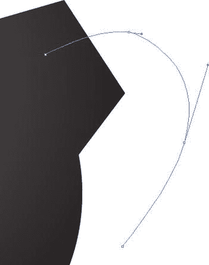

    **图 7-35.** 使用钢笔和箭头工具为导火索绘制路径。

2.  选择一种深棕色作为描边颜色。
3.  打开`描边`面板。将粗细设置为`0.25`。对于线条来说，这通常是窄得不可思议的宽度，但由于你的炸弹图形非常小，你会发现这个宽度非常合适。（通常情况下，你会将线条粗细设置在`1`到`5`像素之间。）`描边`面板允许你设置线条和轮廓的所有属性，还允许你进行一些有用的操作，比如添加箭头或更改线条样式。图 7-36 展示了在哪里找到`描边`面板以及它的外观。

    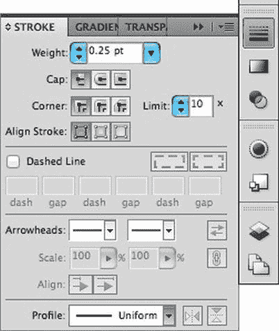

    **图 7-36.** 描边面板允许你更改线条的所有属性。

    现在，你要为你绘制的路径添加一种艺术画笔描边。

4.  打开`画笔`面板，如图 7-37 所示。

    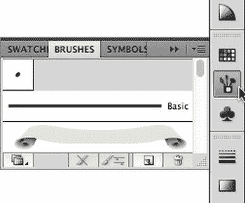

    **图 7-37.** 画笔面板允许你为线条选择画笔样式。

5.  你将加载`艺术画笔-油墨`画笔库，它隐藏在`画笔`菜单中。点击`画笔`面板右上角的菜单按钮。选择`打开画笔库`  `艺术`  `艺术画笔-油墨`。这将把`艺术画笔-油墨`画笔库作为一个新面板打开。
6.  从`艺术画笔-油墨`画笔库中选择`锥形圆角`画笔，如图 7-38 所示。你会看到画笔样式被应用到你绘制的路径上，最终效果应该类似图 7-39。

    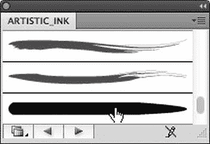

    **图 7-38.** 为炸弹的导火索选择一种艺术画笔样式。

    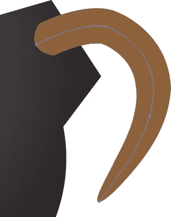

    **图 7-39.** 画笔样式被应用到路径上。

7.  你需要将导火索移动到炸弹形状的后方。确保导火索仍被选中，然后从主菜单中选择`对象`  `排列`  `置于底层`。（你也可以右键点击它，从选项菜单中选择`排列`  `置于底层`，或者在 Windows 中按住`Shift+Ctrl+[`，或在 OSX 中按住`Shift+Command+[`。）现在导火索将位于炸弹后方，如[图 7-40 所示。

    

    **图 7-40.** 使用“置于底层”命令将导火索定位在炸弹形状后方。

    最后一步是在导火索的末端添加一个火花。你将使用`星形`工具来完成此操作。

8.  从工具栏中选择`星形`工具（图 7-41）。你可以在与矩形和椭圆工具相同的按钮组中找到它。

    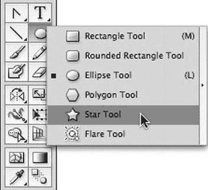

    **图 7-41.** 星形工具允许你绘制星星。

9.  `星形`工具名副其实：你可以用它绘制星星！点击并拖动以绘制星形，但在释放左键之前，按下键盘上的上、下箭头键。这将增加或减少星形的角点数。当对角点数量满意后，释放鼠标左键。
10.  为星形添加径向渐变填充。将渐变的中心设为黄色，外部设为红色。将星形定位在导火索末端，并调整其大小至合适尺寸。图 7-42 展示了可能得到的效果。

    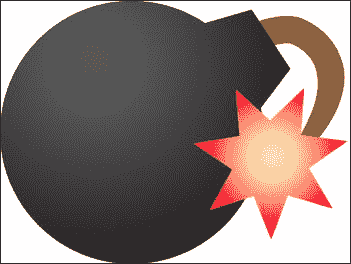

    **图 7-42.** 使用星形工具为导火索添加火花。

你可以通过`效果`  `模糊`菜单添加高斯模糊来改善此效果，但在本例中，由于图形尺寸很小，这不会对它在最终游戏舞台上的显示效果产生任何影响。

因为这是一个非常小的图像，你需要确保所有像素都保持在画板边界内，并且所有内容都对齐良好。选择`视图`  `像素预览`来查看图像的实际像素效果。Illustrator 在将矢量转换为像素方面做得不错，但永远比不上你自己的眼睛。你可能会发现图像的某些部分超出了画板边缘，比如图 4-43 中的火花。如果是这样，请将它们移回内部。（你可以使用键盘上的箭头键非常精确地移动。如果在按箭头键的同时按住`Shift`键，可以以更大的增量移动对象。）利用`像素预览`的机会，重新定位或调整任何看起来不合适的部分。当你处理小型图形（大多数游戏图形都是如此）时，最好在设计过程中间歇性地打开`像素预览`，以便快速捕获此类小问题。

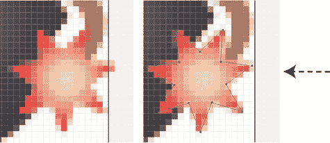

**图 7-43.** 使用像素预览重新定位、对齐或重新调整任何外观异常的图形。

最后，保存文件并创建 PNG 图像。

1.  选择`文件`  `另存为`，并在你的计算机上找到合适的位置保存文件。
2.  选择`文件`  `存储为 Web 和设备所用格式`。将文件保存为 PNG 格式。

接下来，通过创建一个简单的游戏角色来学习更多有用的 Illustrator 技巧。

#### 制作游戏角色

游戏角色由几个基本形状构成，你可以将其作为起点，发挥自己的创意来设计游戏角色。

#### 设置文档并绘制身体

1.  创建一个新的 Illustrator 文档，宽度和高度设置为 50 x 50 像素。将文档命名为 `character`。
2.  使用椭圆工具绘制一个略微扁平的椭圆。为其添加一个从浅蓝到深灰的径向渐变。移动渐变的中点，使其大约位于 85% 的左侧位置。这个椭圆将作为角色的身体。将椭圆定位，使其底边与画板底部对齐。为其设置 1pt 的黑色描边颜色。图 7-44 展示了预期效果。

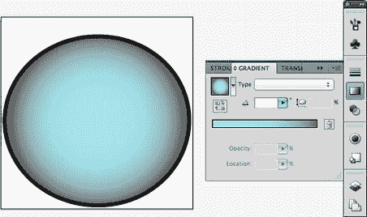

**图 7-44.** 使用椭圆工具绘制角色的身体。

#### 绘制天线

游戏角色需要一对闪亮的金属天线。在接下来的几个步骤中，你将用两个部分制作第一根天线，将它们组合在一起，然后连接到身体上。

1.  首先，绘制一个小而细长的椭圆形。你可以在画板边缘之外的灰色绘图区域绘制它，以便有足够的操作空间。

在“色板”面板中，点击面板右上角的菜单按钮。选择 `打开色板库` > `渐变` > `金属`。这将打开一个渐变面板，其中模拟了光线在不同类型金属上的反射效果。选择 `钢色径向` 渐变作为椭圆的填充颜色。将其描边颜色设置为无。图 7-45 展示了椭圆此时的外观。

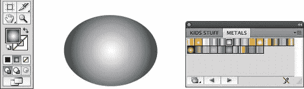

**图 7-45.** 绘制一个椭圆并用金属渐变填充。

色板库中有多种像这样的渐变预设，你在为游戏对象上色时肯定会经常用到。有空不妨花些时间探索一下。

2.  选择渐变工具。使用渐变批注器移动渐变，使白色高光位于椭圆的左上角。压扁渐变，使其形状与椭圆相同，但稍微小一点。拖动定义渐变区域的虚线线上的小黑圆圈即可实现此操作。你可以在图 7-46 中看到这一点。

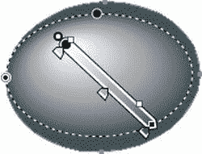

**图 7-46.** 扭曲渐变，使其形状与椭圆大致相同。

绘制一个略微倾斜的锥形矩形。使用转换路径工具将其底部弯曲。它看起来应该有点像图 7-47。这将成为天线的底座。

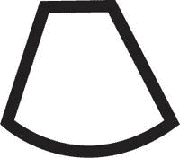

**图 7-47.** 绘制天线的底座。

将新锥形矩形的描边颜色设置为无。选择吸管工具，点击你在步骤 5 中绘制的椭圆的中心。锥形矩形现在将填充与椭圆相同的渐变，如图 7-48 所示。

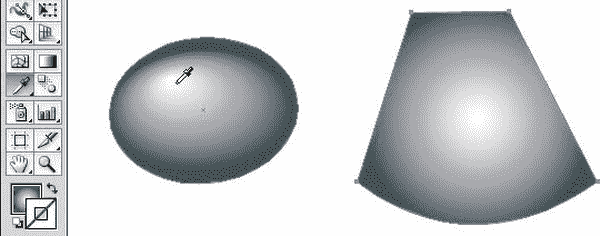

**图 7-48.** 使用吸管工具为天线底座填充与椭圆相同的渐变。

3.  选择渐变工具，重新定位锥形矩形上的渐变，使其中心刚好在底座上方。同时使其稍微更宽更长。你可以在图 7-49 中看到结果。

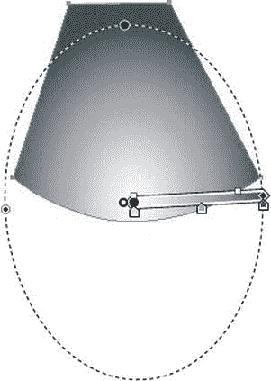

**图 7-49.** 重新定位天线底座上的渐变。

将椭圆移动到矩形锥形端的上方，并使用 `对象` > `排列` > `置于顶层` 命令将其置于最前面。同时选中两个形状并组合它们（从主菜单中选择 `对象` > `编组`）。图 7-50 显示了结果。

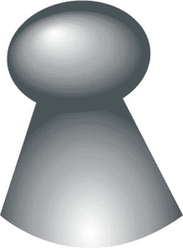

**图 7-50.** 将天线的两个部件编组，以便将它们作为一个整体移动。

现在你拥有了一根漂亮的金属天线，可以粘到角色的身体上。

4.  定位并旋转编组后的天线，使其在画板的左上角向外倾斜。在定位时，你可能希望打开“像素预览”，以确保没有杂散像素越过画板边界。调整天线的尺寸和比例，直到你对其附着在身体上的外观满意为止。请记住，如果需要，你可以双击编组内的任何形状进入隔离模式进行单独编辑。图 7-51 展示了最终结果。

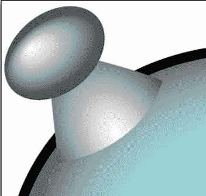

**图 7-51.** 将天线连接到身体上。

#### 制作第二根天线

你将通过复制第一根天线，然后使用“镜像”命令将其翻转来制作第二根天线。

1.  确保编组后的天线仍处于选中状态。选择 `编辑` > `复制`，然后选择 `编辑` > `贴在前面`。这将制作天线的精确副本，并将其粘贴到原件的正上方。
2.  从主菜单中选择 `对象` > `变换` > `镜像`。将打开“镜像”窗口。选择类型为“垂直”，并将角度设置为 90 度。点击“确定”按钮，你将看到新复制的天线被翻转了过来（图 7-52）。

    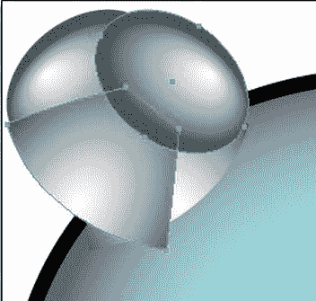

    **图 7-52.** 镜像复制的天线。

3.  将新天线移动到身体的左侧，如图 7-53 所示。

    

    **图 7-53.** 身体和两根天线

最后需要做的事情是重新定位第二根天线上的渐变，使其看起来光线以与第一根天线相同的角度照射到它。

4.  双击新天线中的椭圆进入隔离模式。选择渐变工具，用它旋转渐变并将其中心移动到左上角。最终效果应类似于图 7-54。

    

    **图 7-54.** 校正第二天线上高光的位置。

身体和天线已经完成；接下来你将处理角色的眼睛。

#### 制作角色的眼睛

角色的眼睛非常简单，由三个圆形组成。

1.  在左侧触角下方绘制一个白色圆形（图 7-55）。
    
    **图 7-55**. 眼睛的第一个圆形

    在第一个圆形内部绘制一个更小的圆形。用蓝色到白色的径向渐变填充它（图 7-56）。
    
    **图 7-56**. 用径向渐变填充第二个圆形。

2.  在第二个圆形内部添加一个更小的黑色圆形。用黑色到深灰色的径向渐变填充它（图 7-57）。这是眼睛的瞳孔。
    
    **图 7-57**. 用深色径向渐变填充第三个圆形。

3.  绘制三个大小不同的白色圆形，并将其按图 7-58 所示放置。这些被称为高光。它们模拟环境光反射，为角色的眼睛增添生气与活力。
    
    **图 7-58**. 添加三个高光。

4.  将所有圆形编组。复制它们以制作第二只眼睛。将第二只眼睛放置在身体右侧。

图 7-59 展示了角色拥有新眼睛后的样子。

**图 7-59**. 角色的眼睛

#### 添加微笑

目前角色看起来有点过于严肃了。你应该让它有点值得微笑的事情。

1.  在眼睛正下方绘制一个拉长的椭圆。给它一个 1pt 的黑色描边轮廓和粉色填充颜色，如图 7-60 所示。
    
    **图 7-60**. 绘制一个带有黑色轮廓的粉色椭圆。

2.  确保它被选中，然后从主菜单中选择`效果`  `变形`  `弧形`。将打开“变形选项”窗口。设置以下选项：
    - 样式：弧形
    - 水平
    - 弯曲：-17%

    完成后点击`确定`按钮，椭圆将变形为微笑的形状，如图 7-61 所示。
    
    **图 7-61**. 使用弧形变形效果让角色微笑。

Illustrator 有大量的变形效果，您可以利用它们快速轻松地将简单形状转换为非常复杂的形状。

#### 召唤造型师！

通过在两根触角之间简单地添加三个三角形，为角色添加头发。

1.  从工具栏中选择`多边形工具`。多边形工具与矩形和椭圆工具位于同一按钮组中。您可以使用它通过按上箭头或下箭头键来创建任意边数的多边形。单击并拖动以创建一个多边形，但在释放鼠标按钮之前，按下下箭头键。当多边形变成三角形时释放鼠标按钮。
2.  为三角形填充黑色，并将其放置在两根触角之间、身体后方，如图 7-62 所示。调整其大小使其恰到好处。
    
    **图 7-62**. 使用多边形工具绘制一个黑色三角形。

3.  复制此三角形，并使用`编辑`  `贴在后面`命令将副本粘贴到原件后面。将其移动到第一个三角形的左侧，并旋转使其与身体的曲线对齐。再制作一个三角形副本，并将其放置在第一个三角形的右侧。最终，您的角色将拥有一个尖刺发型，如图 7-63 所示。打开`像素预览`以确保任何三角形的尖点没有超出画板。
    
    **图 7-63**. 角色的新发型

您快完成了！您只需给角色添上脚。

#### 绘制鞋子

您将使用钢笔工具绘制鞋子，并为其添加一个简单的从深色到浅色的线性渐变。

1.  使用`钢笔工具`粗略绘制出左鞋的形状（图 7-64）。
    
    **图 7-64**. 绘制基本路径。

2.  使用`转换锚点工具`将边缘变圆（图 7-65）。
    
    **图 7-65**. 将边缘变圆。

3.  为鞋子添加白色到灰色的线性渐变填充。
4.  使用黑色箭头调整、缩放或重新定位鞋子，使其恰好适合画板的左半部分。使用`像素预览`确认这一点（图 7-66）。
    
    **图 7-66**. 在像素预览模式下使用黑色箭头微调鞋子的大小和位置。

5.  如果一切看起来不错，再复制一只鞋子。然后从主菜单中选择`对象`  `变换`  `对称`，将新的鞋子副本翻转过来。将其移动到角色的右侧。

角色基本完成了！图 7-67 展示了它现在的样子。

**图 7-67**. 即将完成的游戏角色

您可以让角色保持这个样子，这在游戏中已经足够好了。但让我们再更进一步。

#### 增添额外的可爱感

最后的润色是给角色添加红润的脸颊。

1.  在角色眼睛下方添加两个圆形。用透明到浅粉色的径向渐变填充它们。效果很微妙，但为角色的深度和生动性增添了一些东西。您最终的目标图像应该看起来像图 7-68。
    
    **图 7-68**. 添加一些红润的脸颊。

2.  最后，保存您的工作并创建 `character.png` 文件。

下一步是设计游戏背景屏幕。

### 设计游戏场地

我不会一步步教你如何制作游戏背景，而是会解释它是如何制作的。这里没有用到任何新技巧，而且你现在的 Illustrator 技能应该已经足够让你轻松创作出类似的效果。

我首先创建了一个 550 x 400 像素的文档。为了简化工作，我让 Illustrator 的网格可见，并将网格单元格大小设置为 50 x 50 像素。游戏中没有对象大于 50 像素见方，因此以此为基本尺寸来规划游戏场地的布局是合理的。

要设置网格大小，请选择 `编辑`  `首选项`  `参考线和网格` (Windows) 或 `Illustrator`  `首选项`  `参考线和网格` (OSX)。将 `网格线间隔：` 选项设置为 `50px`。

定义好网格单元格大小后，通过选择 `视图`  `显示网格` 使其可见。然后选择 `视图`  `对齐到网格` 选项，这样对象就会整齐地对齐到网格方块上。

完成这些后，我复制了我的盒子图形。我移除了角上的铆钉，并将它复制到每个网格方块中。然后我将所有方块编组，并在“透明度”面板中将其不透明度设置为 40%。图 7-69 展示了其效果。


**图 7-69.** 创建游戏背景的过程

为了制作边框，我首先创建了一个新图层。我沿着周边复制了盒子图形。我将它们编组，并添加了阴影效果，使其看起来像是边框略微漂浮在主游戏场地上方。然后，我绘制了一个带白色描边颜色的黑色圆角矩形，放置在顶部边框上。这里将显示游戏计时器。最终结果可以在 图 7-70 中看到。


**图 7-70.** 完成的背景图形

“游戏结束”图形同样很容易制作。

### 制作游戏结束图形

为了制作“游戏结束”图形的爆炸效果，我首先绘制了一个简单的星形，并填充了红黄径向渐变。然后，我从“效果”菜单中添加了“鱼眼弯曲”效果，只是为了让它稍微膨胀一点。接着，我从“效果”菜单中添加了“内凹和外凸”效果。简单的投影完成了最终效果，你可以在 图 7-71 中看到最终效果。制作它花了不到 30 秒。


**图 7-71.** 应用于星形以创建卡通爆炸效果的各种效果。

实际上，这只是在那些效果菜单中调整参数的问题，直到我在画板上看到满意的结果为止。

3D 文字同样很容易制作。我使用 Emulogic 字体键入了“GAME OVER”字样。我给了文字亮绿色填充和白色轮廓颜色。然后，我应用了“效果”  “3D”菜单中的“凸出和斜角”效果。同样，这只需要调整效果参数，直到结果看起来不错为止。最后，我稍微旋转了文字。图 7-72 显示了最终结果。又花了 30 秒，时间花得值！


**图 7-72.** 使用“凸出和斜角”效果创建 3D 文字。

图 7-73 显示了最终的“游戏结束”图形。当此图形在游戏中显示时，“You Won!”或“You Lost!”字样将显示在“GAME OVER”文字下方。


**图 7-73.** 完成的游戏结束图形

所有图形都完成了，所以将 PNG 文件复制到游戏项目的 images 文件夹中。现在让我们看看如何编程实现这个游戏。

*关于 Adobe Illustrator，你现在已经掌握足够多的知识，可以开始制作复杂的游戏图形了。但是，你肯定还想了解更多关于 Illustrator 的知识，首先要查阅的是 Illustrator 自带的帮助菜单。选择 `帮助`  `Illustrator 帮助`，Adobe 帮助应用程序将打开，按章节逐一介绍 Illustrator 的功能及其使用方法。*

*Adobe 还维护着一个优秀的教程网站，其中包含许多关于如何使用基本功能和实现特殊效果的视频。你可以在 Adobe 的支持网站 [`www.adobe.com/support/illustrator/`](http://www.adobe.com/support/illustrator/) 上找到更多信息。*

### 编程实现游戏

`Time Bomb Panic` 结合了你在本书中学到的所有编程技巧。当你查看代码时，你会发现其中 90% 或多或少与你在前几章中使用的代码相同。这很好，因为它表明你可以在真实游戏的上下文中使用你一直在学习的所有代码。没有太多新的东西需要学习。

那么你之前没见过的那 10% 呢？以下是你要学习的新内容：

*   如何创建和使用 `Timer` 对象。像随机数一样，定时器对于大多数类型的视频游戏都是必不可少的。
*   如何为所有游戏对象创建单独的类。
*   如何使用自定义方法来简化和减少重复代码。

你将全面了解所有这些新特性，以及游戏处理你之前见过的几种技术的特定方式，例如：

*   盒子和炸弹之间的碰撞检测。
*   舞台边界。
*   检查游戏是否结束。
*   显示游戏结束图像。

当你完成时，你应该拥有制作类似复杂度游戏所需的所有信心。

### 处理多个对象

在你查看主应用类的代码之前，必须克服一个大问题：这个游戏中有很多对象。如果你在开始编程游戏之前找不到管理它们的方法，你将陷入数百行重复代码的泥潭。

有多少个对象？你已经创建了五个游戏图形，所以至少有五个。但其中许多图像，如盒子和炸弹，在游戏中会被多次使用。仔细看看 图 7-74。根据你现在对游戏编程的了解，你认为你需要处理多少个对象？


**图 7-74.** 如果一个游戏有很多对象，你如何让代码易于管理？

你有 14 个盒子、5 个炸弹、1 个角色、1 个背景、1 个可见文本字段，以及在游戏结束时出现的“游戏结束”图形。这个“游戏结束”图形还包含另一个文本字段。总共有 24 个对象。在前几章的示例程序中，最多只有五个。

为什么这是个问题？想想看，你仅仅是为了创建并向游戏添加一个对象就需要编写多少代码。首先，你必须嵌入图像，创建 `DisplayObject` 容器，并创建包含的 `Sprite`，如下所示：

```

# 什么是类（class）？

我已经讨论了很多关于类的内容，但如果你对我试图解释的内容理解不多，也不必担心。除非你面前有一个真实、鲜活的类，否则这可能是一个非常抽象的概念。所以，让我们来看一些真实、鲜活的类吧！

在这本书中，你已经见过很多类了。

- `AS3.0` 的内置类，比如 `Sprite`、`TextField` 和 `Event`，你可以将它们导入到程序中。
- 你编写主程序时使用的应用类，比如 `PickingUpObjects`、`KeyboardControl` 或 `NumberGuessingGame`。到目前为止，我一直称它们为“程序”，但它们实际上是“应用类”。
- 第 6 章中的 `Collision` 类，它是一个专门的类，帮助你创建游戏对象之间的碰撞边界。

很好，但类到底是什么？简而言之，它只是你游戏中的一个“东西”。你可以为你想要在游戏中使用的任何对象创建一个类。这些对象可以是抽象的代码片段，比如 `Collision` 类，也可以是你在舞台上看到的真实游戏对象。

那么，如果“类”只是一个“东西”，这是否意味着你应该能够为游戏中的每一个东西都创建一个类？当然可以！为了证明这一点，打开 `TimeBombPanic` 项目文件夹，查看 `src` 文件夹。你会看到这些文件（也如图 7-75 所示）：

- `TimeBombPanic.as`
- `Collision.as`
- `Character.as`
- `Box.as`
- `Bomb.as`
- `Background.as`
- `GameOver.as`


**图 7-75**。Time Bomb Panic 中使用的类。每个游戏对象都有一个类。

现在你知道了，`TimeBombPanic.as` 是应用类——主程序。而且你知道 `Collision.as` 是你在第 6 章中编写的专门类。但你可以清楚地看到，现在还有五个类，分别对应你在本章第一部分用 Illustrator 绘制的五个游戏对象。

这些类是做什么的？非常简单。它们所做的只是将嵌入的图像加载到自身中。为了证明这一点，让我们看看 `Character` 类。

```actionscript
package
{
  import flash.display.DisplayObject;
  import flash.display.Sprite;

  public class Character extends Sprite
  {
    //Embed the image
    [Embed(source="../images/character.png")]
    public var GameObjectImage:Class;

    public var gameObjectImage:DisplayObject
      = new GameObjectImage();

    public function Character()
    {
      this.addChild(gameObjectImage);
    }
  }
}
```

`Character` 类的工作就是显示 `character.png` 图像。仅此而已！而且你已经见过所有这些代码——它就是那六行你总是用来嵌入和显示图像的相当冗长的代码。

这为什么有用？这意味着，因为你已经在这个类中编写了这段代码，你永远不必再写一遍，并且可以在你编写的任何其他游戏中重复使用它。你很快就会看到它的作用。

我需要指出两个细节。首先，`Character` 类继承了 `Sprite` 类。

```actionscript
public class Character extends Sprite
```

这意味着你使用 `Character` 类创建的任何游戏对象，本质上都是 `Sprite` 对象。`extends` 关键字意味着 `Character` 类已经*继承*了 `Sprite` 类的所有属性和方法。这意味着你可以使用所有你通常与 `Sprite` 对象一起使用的属性和方法。像 `x`、`y`、`visible`、`alpha` 这样的属性，或者像 `addChild` 这样的方法，都对你用这个新的 `Character` 类创建的任何对象起作用。

*这是一个重要的编程概念，称为继承。当你使用 `extends` 关键字时，你正在创建的新类会“继承”被扩展类的所有属性和方法。继承是面向对象编程（OOP）风格的一个关键特性。`AS3.0` 是一种 OOP 语言，`Java`、`C++`、`C#` 和 `Objective C` 也是如此。*

这也意味着你不必创建一个单独的 `Sprite` 对象并将图像添加到其中。图像已经封装在一个 `Sprite` 中，因为 `Character` 扩展了 `Sprite` 类。

所有这一切意味着 `Character` 对象能够做 `Sprite` 对象能做的一切事情，而且还额外显示了游戏角色的图像。

但是 `character.png` 实际上是在哪里显示的呢？它不是显示在舞台上。它是在*这个*类内部显示的。这就是这行代码的作用：

```actionscript
this.addChild(gameObjectImage);
```

关键字 `this` 表示“这个类”。这行代码的意思是你正在将 `gameObjectImage` 添加到*这个* `Character` 类中。结果是，无论何时你在游戏中使用 `Character` 类对象，`character.png` 图像都会自动显示出来。它是这个类的一部分。

为什么你之前没有像在其他程序中那样使用 `stage.addChild()`？那是因为只有应用类才能直接将东西添加到舞台上。在这种情况下，应用类是 `TimeBombPanic.as`。你很快就会看到它如何将 `Character` 类对象添加到舞台上。

所以现在你知道了，`Character` 类只是负责显示 `character.png` 图像。但是 `Bomb`、`Box`、`Background` 和 `GameOver` 类又是做什么的呢？完全相同的事情：它们显示你在本章第一部分设计的图像。事实上，每个类中的代码几乎相同。看看 `Box` 类：

```actionscript
package
{
  import flash.display.DisplayObject;
  import flash.display.Sprite;

  public class Box extends Sprite
  {
    //Embed the image
    [Embed(source="../images/box.png")]
    public var GameObjectImage:Class;

    public var gameObjectImage:DisplayObject
      = new GameObjectImage();

    public function Box()
    {
      this.addChild(gameObjectImage);
    }
  }
}
```

`Box` 类和 `Character` 类之间的唯一区别是名称和它嵌入的 PNG 文件。浏览其他类，你会发现它们都遵循这个完全相同的格式。

那么，既然你已经有了这些类，并把你的游戏图形塞进了里面，你该如何使用它们呢？你首先必须从它们创建对象，这可以在应用类中完成。

当然，你已经知道如何创建对象：使用 `new` 关键字。你可以像这样从 `Character` 类创建一个对象：

```actionscript
public var character:Character = new Character();
```

然后你可以像这样将它添加到舞台上：

```actionscript
stage.addChild(character);
```

## 使用类创建游戏对象

现在你可以在游戏中的任何地方使用 `character` 对象，它就像你创建过的任何其他 `Sprite` 对象一样工作。但一个额外的好处是，它已经包含了 `character.png` 图像。

这在需要创建多个对象副本时会节省大量工作。Time Bomb Panic 中有 14 个箱子。你不需要为每个箱子创建 14 个单独的类。你只需要一个父级 `Box` 类，就可以创建它的 14 个实例（副本）。每个实例都会自动包含嵌入的 `box.png` 图像。这让你省去了输入几十行重复代码的麻烦。

### 通过类实例化对象

以下是如何仅用一个 `Box` 类创建多个箱子实例的方法。首先，在应用类中创建几个 `box` 对象。

```actionscript
public var box1:Box = new Box();
public var box2:Box = new Box();
public var box3:Box = new Box();
```

你可以像这样将它们添加到舞台上：

```actionscript
stage.addChild(box1);
stage.addChild(box2);
stage.addChild(box3);
```

看不到任何 Embed 元标签！`box1`、`box2` 和 `box3` 都包含了嵌入到其父类 `Box` 中的 `box.png` 图像。

现在你明白类是如何作为游戏中的“事物”了吗？

这五个简单的类目前只包含了图像，但你可以将任何你喜欢的东西放入一个类中。在下一章中，你将看到如何将逻辑代码放入其中，从而创建具有极其复杂和自主行为的对象。

图 7-76 演示了这些对象类如何与应用程序类协同工作，以生成你在舞台上看到的图像。


`图 7-76`。应用程序类从游戏对象类生成游戏对象。

既然你已经知道你的五个游戏对象是自包含的类，那么让我们来看看整个 `TimeBombPanic` 应用程序类，我将向你展示它们是如何在游戏中被使用的。

### 查看 `TimeBombPanic` 应用程序类

我将在下面列出整个 `TimeBombPanic` 应用程序，以便你在本章后续内容中参考它。你会认出一些非常熟悉的代码，但也会看到一些新内容。我将逐步为你详细解释所有这些代码是如何工作的。

```actionscript
package
{
  import flash.display.DisplayObject;
  import flash.display.Sprite;
  import flash.events.Event;
  import flash.events.KeyboardEvent;
  import flash.text.*;
  import flash.ui.Keyboard;
  import flash.events.TimerEvent;
  import flash.utils.Timer;

  [SWF(width="550", height="400",
    backgroundColor="#FFFFFF", frameRate="60")]

  public class TimeBombPanic extends Sprite
  {
    //创建文本对象
    public var format:TextFormat = new TextFormat();
    public var output:TextField = new TextField();
    public var input:TextField = new TextField();
    public var gameResult:TextField = new TextField();

    //创建游戏对象
    public var character:Character = new Character();
    public var background:Background = new Background();
    public var gameOver:GameOver = new GameOver();

    //炸弹
    public var bomb1:Bomb = new Bomb();
    public var bomb2:Bomb = new Bomb();
    public var bomb3:Bomb = new Bomb();
    public var bomb4:Bomb = new Bomb();
    public var bomb5:Bomb = new Bomb();

    //箱子
    public var box1:Box = new Box();
    public var box2:Box = new Box();
    public var box3:Box = new Box();
    public var box4:Box = new Box();
    public var box5:Box = new Box();
    public var box6:Box = new Box();
    public var box7:Box = new Box();
    public var box8:Box = new Box();
    public var box9:Box = new Box();
    public var box10:Box = new Box();
    public var box11:Box = new Box();
    public var box12:Box = new Box();
    public var box13:Box = new Box();
    public var box14:Box = new Box();

    //创建计时器
    public var timer:Timer;

    //创建并初始化 vx 和 vy 变量
    public var vx:int = 0;
    public var vy:int = 0;

    //用于统计已拆除炸弹数量的 bombsDefused 变量
    public var bombsDefused:uint = 0;

    public function TimeBombPanic()
    {
      createGameObjects();
      setupTextfields()
      setupEventListeners();
    }

    public function createGameObjects():void
    {
      //添加背景
      addGameObjectToStage(background, 0, 0);

      //添加角色
      addGameObjectToStage(character, 50, 50);

      //添加箱子
      addGameObjectToStage(box1, 100, 100);
      addGameObjectToStage(box2, 150, 100);
      addGameObjectToStage(box3, 200, 100);
      addGameObjectToStage(box4, 150, 150);
      addGameObjectToStage(box5, 100, 250);
      addGameObjectToStage(box6, 200, 250);
      addGameObjectToStage(box7, 250, 250);
      addGameObjectToStage(box8, 250, 200);
      addGameObjectToStage(box9, 300, 100);
      addGameObjectToStage(box10, 300, 300);
      addGameObjectToStage(box11, 350, 250);
      addGameObjectToStage(box12, 400, 100);
      addGameObjectToStage(box13, 400, 200);
      addGameObjectToStage(box14, 400, 250);

      //炸弹
      addGameObjectToStage(bomb1, 105, 160);
      addGameObjectToStage(bomb2, 205, 310);
      addGameObjectToStage(bomb3, 305, 260);
      addGameObjectToStage(bomb4, 355, 310);
      addGameObjectToStage(bomb5, 455, 110);
```

//添加 `gameOver` 图像，并在游戏开始时使其不可见

`addGameObjectToStage(gameOver, 125, 50);`

`gameOver.visible = false;`

//初始化计时器

`timer = new Timer(1000);`

`timer.addEventListener(TimerEvent.TIMER, updateTimeHandler);`

`timer.start();`

}

public function `setupTextfields()`:`void`

{

//设置文本格式对象

`format.font = "Helvetica";`

`format.size = 38;`

`format.color = 0xFFFFFF;`

`format.align = TextFormatAlign.CENTER;`

//配置输出文本字段

`output.defaultTextFormat = format;`

`output.autoSize = TextFieldAutoSize.CENTER;`

`output.border = false;`

`output.text = "0";`

//显示并定位输出文本字段

`stage.addChild(output);`

`output.x = 265;`

`output.y = 7;`

//配置并显示 `gameResult` 文本字段

`format.color = 0x000000;`

`format.size = 32;`

`gameResult.defaultTextFormat = format;`

`gameResult.autoSize = TextFieldAutoSize.CENTER;`

`gameResult.text = "你赢了！";`

`gameOver.addChild(gameResult);`

`gameResult.x = 145;`

`gameResult.y = 160;`

}

public function `setupEventListeners()`:`void`

{

`stage.addEventListener(KeyboardEvent.KEY_DOWN, keyDownHandler);`

`stage.addEventListener(KeyboardEvent.KEY_UP, keyUpHandler);`

`stage.addEventListener(Event.ENTER_FRAME, enterFrameHandler);`

}

public function `updateTimeHandler(event:TimerEvent)`:`void`

{

`output.text = String(timer.currentCount);`

//当计时器达到 10 时停止

if(`timer.currentCount == 10`)

{

`checkGameOver();`

}

}

public function `enterFrameHandler(event:Event)`:`void`

{

//移动玩家

`character.x += vx;`

`character.y += vy;`

//舞台边界

if (`character.x < 50`)

{

`character.x = 50;`

}

if (`character.y < 50`)

{

`character.y = 50;`

}

if (`character.x + character.width > stage.stageWidth - 50`)

{

`character.x = stage.stageWidth - character.width - 50;`

}

if (`character.y + character.height > stage.stageHeight -50`)

{

`character.y = stage.stageHeight - character.height - 50;`

}

//箱子碰撞代码

`Collision.block(character, box1);`

`Collision.block(character, box2);`

`Collision.block(character, box3);`

`Collision.block(character, box4);`

`Collision.block(character, box5);`

`Collision.block(character, box6);`

`Collision.block(character, box7);`

`Collision.block(character, box8);`

`Collision.block(character, box9);`

`Collision.block(character, box10);`

`Collision.block(character, box11);`

`Collision.block(character, box12);`

`Collision.block(character, box13);`

`Collision.block(character, box14);`

```
// 炸弹碰撞检测代码
if(character.hitTestObject(bomb1) && bomb1.visible == true)
{
  bomb1.visible = false;
  bombsDefused++;
  checkGameOver();
}
if(character.hitTestObject(bomb2) && bomb2.visible == true)
{
  bomb2.visible = false;
  bombsDefused++;
  checkGameOver();
}
if(character.hitTestObject(bomb3) && bomb3.visible == true)
{
  bomb3.visible = false;
  bombsDefused++;
  checkGameOver();
}
if(character.hitTestObject(bomb4) && bomb4.visible == true)
{
  bomb4.visible = false;
  bombsDefused++;
  checkGameOver();
}
if(character.hitTestObject(bomb5) && bomb5.visible == true)
{
  bomb5.visible = false;
  bombsDefused++;
  checkGameOver();
}
```

}

public function `checkGameOver()`:`void`

{

if(`bombsDefused == 5`)

{

`gameOver.visible = true;`

`gameResult.text = "你赢了！";`

`character.alpha = 0.5;`

`background.alpha = 0.5;`

`timer.removeEventListener(TimerEvent.TIMER, updateTimeHandler);`

`stage.removeEventListener(Event.ENTER_FRAME, enterFrameHandler);`

}

else if(`timer.currentCount == 10`)

{

`gameOver.visible = true;`

`gameResult.text = "你输了！";`

`character.alpha = 0.5;`

`background.alpha = 0.5;`

## 向游戏中添加对象

你知道所有游戏对象都是类。要在游戏中调用它们，你需要从类中创建对象并将其添加到舞台上。`character`、`background` 和 `gameOver` 对象是这样创建的：

```actionscript
public var character:Character = new Character();
public var background:Background = new Background();
public var gameOver:GameOver = new GameOver();
```

从 `Bomb` 类创建了 5 个对象，从 `Box` 类创建了 14 个对象。以下是简化后的代码：

```actionscript
public var bomb1:Bomb = new Bomb();
...
public var bomb5:Bomb = new Bomb();
public var box1:Box = new Box();
...
public var box14:Box = new Box();
```

是的，这是一长串代码，但相比于不使用类的情况，代码量减少了近四分之三。在后续章节中，你将看到如何让这段代码变得更加紧凑。

现在你需要使用 `addChild()` 将对象添加到舞台上，然后设置它们的 `x` 和 `y` 坐标。通常你会这样写：

```actionscript
stage.addChild(character);
character.x = 225;
character.y = 150;
```

在这个游戏中这样写完全没问题，只不过这次你需要处理 22 个对象，而不是仅仅三四个。你肯定不想为此写 66 行代码——那该是多无聊的苦差事！如果能将每个对象的代码缩减到一行，那就太好了。当然可以！

我为这个游戏创建了一个自定义方法，叫做 `addGameObjectToStage`。以下是如何使用它将一个游戏对象添加到舞台上：

```actionscript
addGameObjectToStage(character, 50, 50);
```

该方法接受三个参数：对象名称、`x` 坐标和 `y` 坐标。

你可以在 `TimeBombPanic` 应用类中程序清单大约四分之三的位置找到这个方法的函数定义。

```actionscript
public function addGameObjectToStage
  (gameObject:Sprite, xPos:int, yPos:int):void
{
  stage.addChild(gameObject);
  gameObject.x = xPos;
  gameObject.y = yPos;
}
```

它将对象添加到舞台上，并分配你在方法参数中给定的 `x` 和 `y` 坐标。

有一个需要注意的小技术细节：该方法的函数定义将传入的参数 `gameObject` 的类型声明为 `Sprite`。

`gameObject:Sprite`

不过，本游戏中所有游戏对象的类型都是 `Character`、`Background`、`Box`、`GameOver` 和 `Bomb`，它们都不是 `Sprite` 类型。但请记住，当你创建游戏对象类时，它们都扩展了 `Sprite` 类，就像这样：

`public class Character extends Sprite`

这意味着 `Sprite` 是父类。通过在方法参数中将对象声明为其父类类型，你可以使该方法非常通用，从而适用于所有继承自同一父类的对象。

仔细思考游戏程序中可能存在的任何重复代码片段，你经常会发现可以编写像这样的自定义方法来为你完成这些繁重的工作。

## 舞台边界

在这个游戏中，你会注意到角色无法越过游戏场地外围的方格边界，如图 Figure 7-77 所示。


**图 7-77**。角色无法越过游戏场地边界。

因为你自己设计了背景图形，所以你知道实际上没有任何物理障碍物阻止角色越过这条边界——它只是一个图像。但它看起来确实像一道坚固的边界。实现这种错觉非常容易。代码所做的只是在每个坐标轴上将舞台边界缩小 50 像素，实际上相当于舞台每边都变小了 50 像素。以下是来自 `enterFrameHandler` 实现此功能的 `if` 语句，其中修改后的舞台边界已高亮显示：

```actionscript
if (character.x < 50)
{
  character.x = 50;
}
if (character.y < 50)
{
  character.y = 50;
}
if (character.x + character.width > stage.stageWidth - 50)
{
  character.x = stage.stageWidth - character.width - 50;
}
if (character.y + character.height > stage.stageHeight -50)
{
  character.y = stage.stageHeight - character.height - 50;
}
```

游戏场地的边界宽度为 50 像素，因此代码只需要在 `x` 和 `y` 两个坐标轴上对此进行补偿即可。

## 角色与方块的碰撞

《定时炸弹恐慌》使用了我在 第 6 章 中介绍过的同一个 `Collision` 类。本游戏的唯一区别在于，`enterFrameHandler` 中调用了 14 次 `Collision.block` 方法——每个方块调用一次。以下是实现此功能的简化代码：

```actionscript
Collision.block(character, box1);
...
Collision.block(character, box14);
```

没有比这更简单的了。它工作得很好，不过在 第 10 章 中，你将学习如何使用 `for 循环` 更高效地处理多个对象之间的碰撞，这样就不必把同一行代码重复输入 14 次了。

## 拆除炸弹

`bombsDefused` 变量负责统计角色已收集的炸弹数量。它在游戏开始时于类定义中创建并初始化为 0。

`public var bombsDefused:uint = 0;`

`enterFrameHandler` 函数会检查角色与炸弹之间的碰撞。五个炸弹对象各自对应一个 `if` 语句。当角色与炸弹碰撞时，炸弹的 `visible` 属性会被设为 `false`，这实质上就是将炸弹从游戏中移除。随后 `bombsDefused` 变量增加 1，另一行代码会检查游戏是否结束。以下是检测与第一个炸弹碰撞的 `if` 语句：

```actionscript
if (character.x < bomb1.x + bomb1.width &&
    character.x + character.width > bomb1.x &&
    character.y < bomb1.y + bomb1.height &&
    character.y + character.height > bomb1.y)
{
  bomb1.visible = false;
  bombsDefused++;
  checkGameOver();
}
```

## 使用计时器

本游戏的一个全新功能是使用计时器统计从开始到现在的秒数。如果十秒过去了玩家还未拆除所有炸弹，玩家就会输掉游戏。

我们先通过一个非常聚焦的示例程序来看看计时器如何工作，然后我会展示在《炸弹恐慌计时》中如何使用计时器。

### 理解计时器

在本章的源文件中，你会找到一个名为 `UsingATimer` 的项目文件夹。打开并编译它。它会从 0 计数到 10 秒。到达 10 秒后，计数会重新开始。图 7-78 展示了你会看到的效果。


**图 7-78.** 从 0 到 10 计数秒数

`UsingATimer` 应用程序类使用计时器更新一个文本字段。以下是整个程序。我已将所有与创建和使用 `Timer` 对象相关的代码高亮显示。

```actionscript
package
{
  import flash.display.Sprite;
  import flash.text.*;
  import flash.events.TimerEvent;
  import flash.utils.Timer;

  public class UsingATimer extends Sprite
  {
    //Timer 对象
    public var timer:Timer;
    //Text 对象
    public var output:TextField = new TextField();
    public var format:TextFormat = new TextFormat();

    public function UsingATimer()
    {
      //初始化计时器
      timer = new Timer(1000);
      timer.addEventListener(TimerEvent.TIMER, updateTimeHandler);
      timer.start();

      //设置文本格式对象
      format.font = "Helvetica";
      format.size = 200;
      format.color = 0x000000;
      format.align = TextFormatAlign.CENTER;

      //配置输出文本字段
      output.defaultTextFormat = format;
      output.autoSize = TextFieldAutoSize.CENTER;
      output.border = true;
      output.text = "0";

      //显示并定位输出文本字段
      stage.addChild(output);
      output.x = 200;
      output.y = 100;
    }

    public function updateTimeHandler(event:TimerEvent):void
    {
      output.text = String(timer.currentCount);
      //当计数达到 10 时重置并重新启动计时器
      if(timer.currentCount == 10)
      {
        timer.reset();
        timer.start();
      }
    }
  }
}
```

要在程序中使用计时器，首先需要导入 `Timer` 和 `TimerEvent` 类。

```actionscript
import flash.events.TimerEvent;
import flash.utils.Timer;
```

计时器是对象，因此需要用与其他对象相同的方式来创建它们。首先，在类定义中声明计时器变量。

`public var timer:Timer;`

然后在构造函数方法中使用 `new` 关键字将其转化为 `Timer` 对象。

`timer = new Timer(1000);`

`Timer` 类需要一个参数，即代表毫秒的数字。（一毫秒等于千分之一秒。本例中的一千毫秒等于一秒。）

AS3.0 中的计时器通过以固定间隔触发事件来工作。在本例中，你希望每秒触发一次事件。该事件的作用是将舞台上的输出文本字段数值加 1。但要实现这一点，需要为刚创建的 `timer` 对象添加一个 `TimerEvent` 事件监听器。

`timer.addEventListener(TimerEvent.TIMER, updateTimeHandler);`

接下来，需要使用 `Timer` 类的 `start` 方法来实际启动计时器。

`timer.start();`

现在，`timer` 对象每秒都会触发 `updateTimeHandler` 事件处理函数。

```actionscript
public function updateTimeHandler(event:TimerEvent):void
{
  output.text = String(timer.currentCount);
  //当计数达到 10 时重置并重新启动计时器
  if(timer.currentCount == 10)
  {
    timer.reset();
    timer.start();
  }
}
```

`Timer` 对象有一个名为 `currentCount` 的属性，它会告诉你自从计时器启动以来，计时器事件触发了多少次。`updateTimeHandler` 将该值复制到舞台上的输出文本字段中。

`output.text = String(timer.currentCount);`

你可以像这里一样使用 `currentCount`：显示事件被触发的次数。`if` 语句使用 `currentCount` 来检查是否已过去十秒；如果是，则调用 `Timer` 类的 `reset` 和 `start` 方法：

```actionscript
timer.reset();
timer.start();
```

从游戏中移除对象的方法有很多，但将其设为不可见是最简单的方式。不过需要注意，虽然舞台上看不到某个对象了，但它依然存在。这意味着如果角色与炸弹碰撞后，炸弹的 `visible` 属性被设为 `false`，这并不能阻止角色再次与其碰撞，只是角色碰撞的会是一个隐形炸弹而非可见炸弹。

这种情况是不能允许的，因此需要在 `if` 语句中添加额外检查，确保角色只与可见炸弹碰撞。

```actionscript
if(character.hitTestObject(bomb1) && bomb1.visible == true)
{...
```

如果任何炸弹不可见，说明它已被拆除，这个 `if` 语句就会被忽略。

在更新 `bombsDefused` 变量之后，这些 `if` 语句最后会调用 `checkGameOver` 方法：

`checkGameOver();`

这个方法的作用是判断游戏是否结束，你很快就会了解它的工作原理。

```actionscript
if(character.hitTestObject(bomb1) && bomb1.visible == true)
{
  bomb1.visible = false;
  bombsDefused++;  
  checkGameOver();
}
```

`reset` 会停止计时器，并将 `currentCount` 重置为零。要重新启动计时器，需再次使用 `start` 方法。（如果你需要在任何游戏中完全停止计时器，可以使用 `stop` 方法，它会停止计时但不重置 `currentCount`。）

创建 `Timer` 对象时，你可以传入第二个参数，即 `repeatCount`。这个数字告诉计时器应重复多少次。通过修改创建 `timer` 对象的指令，可以观察到使用 `repeatCount` 的效果，如下所示：

`timer = new Timer(l000, 5);`

重新编译程序后，你会看到数字计数到 5。之后，事件处理程序便不再被调用。

还有一些 `Timer` 类的属性你应该了解。如果需要更改事件之间的时间间隔，可以使用 `delay` 属性。例如，如果你希望计时器事件每半秒触发一次，可以将 `delay` 设置为 500 毫秒，如下所示：

`timer.delay = 500;`

如果需要知道计时器当前是否正在运行，可以使用 `running` 属性，计时器运行时返回 `true`，否则返回 `false`。

最后，你可以使用 `TimerEvent` 类的 `TIMER_COMPLETE` 属性，在计时器完成时触发事件。

`timer.addEventListener(TimerEvent.TIMER_COMPLETE, timerCompleteHandler);`

这是关于计时器工作原理的基础介绍。你可以使用 `Timer` 对象创建倒计时器、让对象间歇性地移动，或者根据玩家完成任务所需的时间计算其得分。

这个示例程序以及《定时炸弹危机》的另一个特点是，文本字段会自动设置其高度和宽度。这是通过 `TextFieldAutoSize` 类实现的，如下所示：

`output.autoSize = TextFieldAutoSize.CENTER;`

## 在《定时炸弹危机》中使用计时器

《定时炸弹危机》中的计时器创建和使用方式与示例程序完全相同。它每秒触发一次 `updateTimeHandler`，代码如下：

```
public function updateTimeHandler(event:TimerEvent):void
{
  output.text = String(timer.currentCount);
  //计时器达到 10 时停止
  if(timer.currentCount == 10)
  {
    checkGameOver();
  }
}
```

它只做两件事。首先，用当前时间更新输出文本字段。

`output.text = String(timer.currentCount);`

如图 7-79 所示，这会在舞台上显示当前时间。


**图 7-79**。输出文本字段显示计时器的 `currentCount` 属性。

`updateTimeHandler` 做的第二件事是检查游戏是否结束。

```
if(timer.currentCount == 10)
{
  checkGameOver();
}
```

它仅在计时器达到 10 时检查游戏是否结束。那么这个神秘的 `checkGameOver` 方法到底做了什么呢？

### 结束游戏

游戏有两种结束方式：玩家拆除五颗炸弹，或计时器达到 10。每次玩家与炸弹碰撞时，都会调用 `checkGameOver` 方法。而且，正如你刚才所见，当 `timer.currentCount` 值等于 10 时也会调用它。以下是 `checkGameOver` 方法的代码：

```
public function checkGameOver():void
{
  if(bombsDefused == 5)
  {
    gameOver.visible = true;
    gameResult.text = "You Won!";
    character.alpha = 0.5;
    background.alpha = 0.5;
    timer.removeEventListener(TimerEvent.TIMER, updateTimeHandler);
    stage.removeEventListener(Event.ENTER_FRAME, enterFrameHandler);
  }
  else if(timer.currentCount == 10)
  {
    gameOver.visible = true;
    gameResult.text = "You Lost!";
    character.alpha = 0.5;
    background.alpha = 0.5;
    timer.removeEventListener(TimerEvent.TIMER, updateTimeHandler);
    stage.removeEventListener(Event.ENTER_FRAME, enterFrameHandler);
  }
}
```

可以看到，它只是简单地检查这两个条件。如果玩家拆除了五颗炸弹，游戏获胜；反之，如果计时器达到 10，游戏失败。

如果玩家获胜，将执行这些指令：

```
gameOver.visible = true;
gameResult.text = "You Won!";
character.alpha = 0.5;
background.alpha = 0.5;
timer.removeEventListener(TimerEvent.TIMER, updateTimeHandler);
stage.removeEventListener(Event.ENTER_FRAME, enterFrameHandler);
```

你可以在 图 7-80 中看到效果。


**图 7-80**。当玩家获胜时，显示 `gameOver` 对象。

首先，`gameOver` 对象被显示出来。

`gameOver.visible = true;`

在通过构造函数初始化游戏时，`gameOver` 对象的 `visible` 属性被设为 `false`。游戏结束时，它被设为 `true`，从而在舞台上可见。

接着，代码在 `gameResult` 文本字段中显示 "You Won!"。

`gameResult.text = "You Won!";`

`gameResult` 文本字段实际上是 `gameOver` 对象的一个子级。它在构造函数中创建时，并未被设为舞台的子级，而是直接添加到了 `gameOver` 中，如下所示：

```
gameOver.addChild(gameResult);
gameResult.x = 145;
gameResult.y = 160;
```

这意味着它是 `gameOver` 对象的一部分。为其设置的 `x` 和 `y` 坐标是 `gameOver` 对象内部的局部坐标。这与你在第 6 章中将子对象嵌入单个 Sprite 的技巧相同。在此处这样做很有用，因为这意味着 `gameResult` 文本字段的可见性和位置将由它的父级 `gameOver` 对象决定。它们是一个整体。

`checkGameOver` 方法中的指令还会在游戏结束时，通过以下两行代码使背景和角色变暗：

```
character.alpha = 0.5;
background.alpha = 0.5;
```

这是给玩家的一个视觉提示，表明游戏已不再活跃。

最后，代码禁用了 `enterFrameHandler`，并将 `updateTimeHandler` 从计时器中移除。

```
timer.removeEventListener(TimerEvent.TIMER, updateTimeHandler);
stage.removeEventListener(Event.ENTER_FRAME, enterFrameHandler);
```

# 创建滚动游戏环境

第一款真正的游戏完成后，你还可以进行许多微调来让它更完善。可以添加一个“再玩一次”按钮，也可以调整计时器让游戏变得更简单或更难。作为更大的挑战，你甚至可以设计并编程实现游戏的新关卡来增加难度。（下一章将介绍如何制作多关卡游戏。）

一个明显的改进是，你可以创建一个更大、会滚动的游戏环境。事实上，你几乎肯定会想要这样做——能够构建一个潜在的巨大游戏世界的诱惑实在太大了。你在第 5 章中已经学会了如何制作滚动游戏世界。但在那个例子中，只有背景会滚动。当游戏世界中存在其他物体（如盒子和炸弹）时，情况会变得稍微复杂些。这是因为每次背景滚动时，前景中的游戏对象都必须调整自身位置来适应滚动。这并不难实现，你只需要正确计算对象的位置坐标即可。接下来我将演示具体做法。

在本章的源文件中，你会找到 `TimeBombScroll` 项目文件夹。打开并编译应用程序类（`TimeBombScroll.as`），你会看到游戏现在占据的场地是原来的四倍。任何时候都只能看到场地的四分之一。当角色在游戏世界中移动时，背景会随之滚动。如图 7-82 所示。


图 7-82. 大型滚动游戏世界

让我们看看这是如何实现的。

## 准备滚动所需的素材

首先需要制作一张大型背景图片。本例中的背景图片是原图的四倍大小：1100 像素×800 像素。我将其命名为`bigBackground.png`，如图 7-83 所示。


图 7-83. 制作一张大背景图片。

我为这张新背景图片创建了一个名为`BigBackground`的类。

此外，我还需要将包围时间显示文字的黑色圆角矩形从边框分离出来。因为该黑色矩形应固定在舞台的某个位置，不随背景滚动。我将这张黑色矩形图片命名为`timeDisplay.png`，并为其创建了一个名为`TimeDisplay`的类。`TimeDisplay`和`BigBackground`类与你本章中看到的其他游戏对象类完全相同。

## 向游戏添加对象

我使用`BigBackground`和`TimeDisplay`类创建了背景和时间显示对象，代码如下：

```actionscript
public var background:BigBackground = new BigBackground();
public var timeDisplay:TimeDisplay = new TimeDisplay();
```

然后将它们添加到舞台并定位：

```actionscript
addGameObjectToStage
  (
    background,
    -(background.width - stage.stageWidth) / 2,
    -(background.height - stage.stageHeight) / 2
  );
addGameObjectToStage(timeDisplay, 200, 5);
```

背景居中所用的公式与你在第 6 章中使用的一致。

请确保在将所有其他对象添加到舞台**之后**再添加`timeDisplay`对象。这样能保证在游戏滚动时，它会浮在其他对象之上。

背景位置确定后，就可以开始添加游戏对象了。但现在面对的是广阔空间，你不能再用简单的舞台坐标来定位它们。你需要提供相对于背景放置位置的坐标。这些对象大多数在游戏开始时都处于舞台之外。

幸运的是，这很容易实现。只需将游戏对象的 x 和 y 坐标与背景的 x 和 y 坐标相加即可。以下是第一个盒子的定位方式：

```actionscript
addGameObjectToStage(box1, background.x + 100, background.y + 100);
```

这会将盒子放置在背景左上角右方 100 像素、下方 100 像素的位置。如图 7-84 所示。


图 7-84. 游戏对象相对于背景对象的 x 和 y 位置进行定位。

这非常方便，因为如果你将来更改背景的初始起始位置，盒子的位置会自动调整进行补偿。

所有游戏对象都像这样相对于背景位置进行定位：

```actionscript
//盒子
addGameObjectToStage(box1, background.x + 100, background.y + 100);
addGameObjectToStage(box2, background.x + 200, background.y + 300);
addGameObjectToStage(box3, background.x + 400, background.y + 450);
addGameObjectToStage(box4, background.x + 100, background.y + 600);
addGameObjectToStage(box5, background.x + 300, background.y + 700);
addGameObjectToStage(box6, background.x + 500, background.y + 200);
addGameObjectToStage(box7, background.x + 600, background.y + 600);
addGameObjectToStage(box8, background.x + 500, background.y + 500);
addGameObjectToStage(box9, background.x + 700, background.y + 200);
addGameObjectToStage(box10, background.x + 700, background.y + 400);
addGameObjectToStage(box11, background.x + 800, background.y + 500);
addGameObjectToStage(box12, background.x + 100, background.y + 700);
addGameObjectToStage(box13, background.x + 900, background.y + 300);
addGameObjectToStage(box14, background.x + 800, background.y + 200);
//炸弹
addGameObjectToStage(bomb1, background.x + 55, background.y + 710);
addGameObjectToStage(bomb2, background.x + 255, background.y + 310);
addGameObjectToStage(bomb3, background.x + 355, background.y + 160);
addGameObjectToStage(bomb4, background.x + 855, background.y + 510);
addGameObjectToStage(bomb5, background.x + 755, background.y + 610);
```

要使其正常工作，你必须确保在设置游戏对象的 x 和 y 坐标**之前**，先设置好背景的 x 和 y 坐标。

## 滚动与舞台边界

以下是 `enterFrameHandler` 中用于滚动背景和游戏对象的全部代码。它使用一个名为 `scroll` 的自定义方法来执行滚动游戏对象的实际工作。我将在后续页面中解释这一切的工作原理。

```
//计算滚动速度
var temporaryX:int = background.x;
var temporaryY:int = background.y;
//检查舞台边界
//1. 检查内部边界
if (character.x < leftInnerBoundary)
{
  character.x = leftInnerBoundary;
  rightInnerBoundary
```

```markdown
```actionscript
    = (stage.stageWidth / 2) + (stage.stageWidth / 4);

  background.x -= vx;

}

else if (character.x + character.width > rightInnerBoundary)

{

  character.x = rightInnerBoundary - character.width

  leftInnerBoundary

    = (stage.stageWidth / 2) - (stage.stageWidth / 4);

  background.x -= vx;

}

if (character.y < topInnerBoundary)

{

  character.y = topInnerBoundary;

  bottomInnerBoundary

    = (stage.stageHeight / 2) + (stage.stageHeight / 4);

  background.y -= vy;

}

else if (character.y + character.height > bottomInnerBoundary)

{

  character.y = bottomInnerBoundary - character.height;

  topInnerBoundary

    = (stage.stageHeight / 2) - (stage.stageHeight / 4);

  background.y -= vy;

}

//2. 背景舞台边界

if (background.x > 0)

{

  background.x = 0;

  leftInnerBoundary = 0;

}

if (background.y > 0)

{

  background.y = 0;

  topInnerBoundary = 0;

}

if (background.x < stage.stageWidth - background.width)

{

  background.x = stage.stageWidth - background.width;

  rightInnerBoundary = stage.stageWidth;

}

if (background.y < stage.stageHeight - background.height)

{

  background.y = stage.stageHeight - background.height;

  bottomInnerBoundary = stage.stageHeight;

}

//3. 角色舞台边界

if (character.x < 50)

{

  character.x = 50;

}

if (character.y < 50)

{

  character.y = 50;

}

if (character.x + character.width > stage.stageWidth - 50)

{

  character.x = stage.stageWidth - character.width - 50;

}

if (character.y + character.height > stage.stageHeight -50)

{

  character.y = stage.stageHeight - character.height - 50;

}

//计算滚动速度

var scroll_Vx:int = background.x - temporaryX;

var scroll_Vy:int = background.y - temporaryY;

//使用滚动速度移动游戏对象

scroll(box1, scroll_Vx, scroll_Vy);

scroll(box2, scroll_Vx, scroll_Vy);

scroll(box3, scroll_Vx, scroll_Vy);

scroll(box4, scroll_Vx, scroll_Vy);

scroll(box5, scroll_Vx, scroll_Vy);

scroll(box6, scroll_Vx, scroll_Vy);

scroll(box7, scroll_Vx, scroll_Vy);

scroll(box8, scroll_Vx, scroll_Vy);

scroll(box9, scroll_Vx, scroll_Vy);

scroll(box10, scroll_Vx, scroll_Vy);

scroll(box11, scroll_Vx, scroll_Vy);

scroll(box12, scroll_Vx, scroll_Vy);

scroll(box13, scroll_Vx, scroll_Vy);

scroll(box14, scroll_Vx, scroll_Vy);

scroll(bomb1, scroll_Vx, scroll_Vy);

scroll(bomb2, scroll_Vx, scroll_Vy);

scroll(bomb3, scroll_Vx, scroll_Vy);

scroll(bomb4, scroll_Vx, scroll_Vy);

scroll(bomb5, scroll_Vx, scroll_Vy);
```

上述代码使用的 `scroll` 方法如下：

```actionscript
public function scroll
  (gameObject:Sprite, scroll_Vx:int, scroll_Vy:int):void
{
  gameObject.x += scroll_Vx;
  gameObject.y += scroll_Vy;
}
```

这段代码的大部分内容用于滚动背景，并为角色和背景设置舞台边界。你之前已经看过所有这些内容——它是第 5 章滚动代码的整合，加上你在本章中为防止角色穿过游戏场地 50 像素宽的边界所做的额外修改。如果你对任何代码的工作原理不确定，请回顾第 5 章以及本章前面的部分。

这里的新颖之处在于，代码让所有游戏对象相对于背景移动。这使它们看起来像是固定在背景上的位置。当然，这只是一种假象，但效果非常出色。让我们来看看它是如何工作的。

首先，你需要创建两个变量来临时捕获背景当前的 x 和 y 坐标。你必须在滚动背景*之前*执行此操作。这两个变量名为 `temporaryX` 和 `temporaryY`。

```actionscript
var temporaryX:int = background.x;
var temporaryY:int = background.y;
```

它们所做的仅仅是在背景移动前记录其位置。

在背景通过滚动代码移动后，你使用这些变量来计算所谓的**滚动速度**。这告诉你背景先前位置与其当前位置之间的差异。`scroll_Vx` 和 `scroll_Vy` 变量用于计算这个差值。

```actionscript
var scroll_Vx:int = background.x - temporaryX;
var scroll_Vy:int = background.y - temporaryY;
```

既然知道了差值，你就可以用它来正确地重新定位游戏对象。你所要做的就是将 `scroll_Vx` 和 `scroll_Vy` 值应用到对象的 x 和 y 坐标上，如下所示：

```actionscript
box1.x += scroll_Vx;
box1.y += scroll_Vy;
```

这样就足够了。无论背景如何滚动，这些对象现在都会相对于背景保持固定位置。

然而，`TimeBombScroll` 中的代码更进一步。它没有繁琐地手动设置 14 个盒子和 5 个炸弹的 x 和 y 坐标，而是将这个工作委托给一个名为 `scroll` 的方法。

```actionscript
scroll(box1, scroll_Vx, scroll_Vy);
```

然后，`scroll` 方法的函数定义负责处理设置对象 x 和 y 属性的重复性工作，如下所示：

```actionscript
public function scroll
  (gameObject:Sprite, scroll_Vx:int, scroll_Vy:int):void
{
  gameObject.x += scroll_Vx;
  gameObject.y += scroll_Vy;
}
```

这为你节省了一些繁琐的输入工作。而这就是全部内容。以下是确保其正常工作必须遵循的步骤：

1.  将背景的 x 和 y 坐标复制到 `temporaryX` 和 `temporaryY` 变量中。
2.  滚动背景。
3.  计算 `scroll_Vx` 和 `scroll_Vy` 值，以确定背景移动了多少。
4.  将 `scroll_Vx` 和 `scroll_Vy` 值应用于你想要随背景一起滚动的游戏对象。

你必须`严格`按照此顺序添加代码，才能使其正常工作。当然，所有这些代码都在 `enterFrameHandler` 内部运行。

这实际上是对一种非常精确的游戏动画技术——韦尔莱积分法的简单介绍。本书不涉及韦尔莱积分法，但你可以在《高级 Flash 游戏设计》中读到关于它的全部内容。将对象的位置捕获到临时变量中，移动对象，然后计算差值，这一基本过程正是韦尔莱积分法的核心所在。

`TimeBombScroll.as` 中的其余代码与 `TimeBombPanic.as` 相同，只有两处小改动：游戏开始时角色居中，以及时间限制增加到了 20 秒。（但是，拜托，你应该仍然能在 10 秒内通关！）请查看源文件中的完整代码，以便从上下文理解全部内容。

### 总结

现在你已经知道如何从头到尾制作一个完整的游戏了。本章向你展示了如何制作游戏图形、通过代码控制它们，并将它们转化为一个真正可玩的游戏。

但是，你可能希望你的游戏能做到的很多事情，你还没有学会。如何制作能够自行移动的敌方游戏对象？如何切换游戏关卡？以及如何发射子弹？接下来的第 8 章将解释所有这些以及更多内容。


