## 第 8 章

# 制作更大型的游戏

`Time Bomb Panic` 是一款优秀的小型单关卡游戏模型。它的概念简单，只需十秒就能玩完，你还有足够的时间去撸猫或冲浪。但这可能不是你真正想制作的那种游戏。那些让你彻夜难眠、反复构思的游戏创意，无疑包含数百个关卡；需要 50 小时甚至更久才能通关；并且包含数十种不同的游戏对象、谜题和有趣的场景。它们是大型游戏。在本章中，你将学习如何制作这类游戏。

本章要介绍的游戏名为 `Monster Mayhem`。这是一款只有两个关卡、包含少量游戏对象的游戏，但你可以使用相同的架构来制作包含任意数量关卡和对象的游戏，同时仍能保持代码的可控性。它是一款大型游戏的优秀模型——同时也适用于你将要制作的大部分小型游戏。

你可以在本章源文件的 `MonsterMayhem` 项目文件夹中找到这款游戏。多玩几次，感受一下它的玩法。在第一关中，你需要击杀舞台上徘徊的两只怪物。按下空格键向上发射一枚星星投射物；如果星星击中怪物三次，它们就会爆炸。如果任何一只怪物碰到你的角色，游戏就会结束。如果你击杀了这两只怪物，就会加载第二关。第二关中有四只移动速度更快的怪物，但这次你可以朝四个方向发射星星。你能击杀全部四只怪物通关吗？这比看上去要难得多！图 8-1 展示了游戏的运行画面。

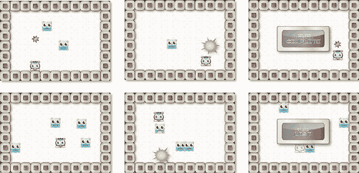

**图 8-1.** Monster Mayhem

### 理解游戏结构

`Monster Mayhem` 游戏的代码结构与本书之前介绍的任何游戏都截然不同。游戏的每个关卡都完全包含在单个 `Sprite` 中。当一个关卡完成时，主应用程序类会从舞台上移除当前关卡的 `Sprite`，并添加一个新的 `Sprite`。这意味着所有游戏对象（如角色或怪物）都不会被直接添加到主舞台，而是先被添加到一个容器 `Sprite` 中，再由应用程序类将该容器 `Sprite` 添加到舞台上。

为了更清晰地理解其工作原理，让我们比较一下 `Monster Mayhem` 和 `Time Bomb Panic` 的结构。在 `Time Bomb Panic` 中，所有游戏对象都作为独立类创建，然后由主应用程序类直接添加到舞台上。图 8-2 展示了这种结构。

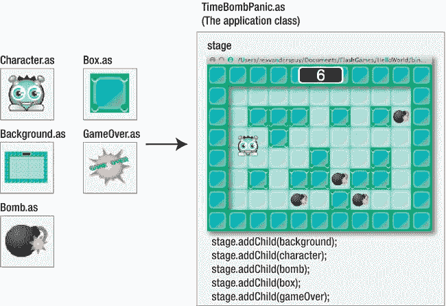

**图 8-2.** 在 Time Bomb Panic 中，所有对象都由主应用程序类添加到舞台上。

在 `Monster Mayhem` 中，所有游戏对象首先被添加到一个名为 `LevelOne` 的类中，然后由 `MonsterMayhem` 应用程序类将一个名为 `_levelOne` 的对象添加到舞台上。图 8-3 展示了这一点。

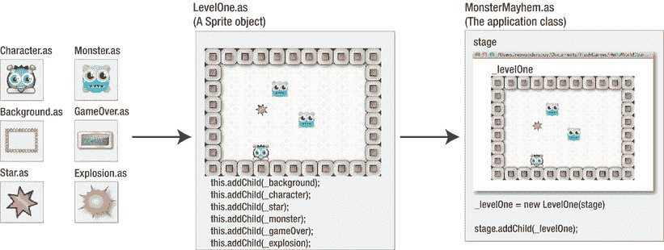

**图 8-3.** 在 Monster Mayhem 中，所有对象首先被添加到 LevelOne 类中，然后主应用程序类创建一个 `_levelOne` 对象并将其添加到舞台上。

`LevelOne` 是一个 `Sprite`。这意味着游戏中的所有动作和所有游戏逻辑都发生在 `LevelOne` 这个 `Sprite` 内部，而不是在应用程序类中。应用程序类所做的只是将关卡添加到舞台上，以便你能看到它。将整个游戏关卡包含在一个 `Sprite` 中的原因是，应用程序类可以通过在舞台上添加或移除关卡来轻松切换关卡。

这里有一个非常重要的知识点要知道：只有应用程序类能访问舞台。这意味着它是唯一可以通过将对象显示在舞台上来使其可见的类。请牢记这一点，因为理解它对于掌握你即将需要了解的代码的某些技术细节至关重要。应用程序类是唯一能使用如下代码行的类：

`stage.addChild(gameObject);`

其他类可以在自身内部显示对象，但不能直接显示在舞台上。它们只能通过引用 `this`（意为“此类”）来将对象添加到自身：

`this.addChild(gameObject);`

从图 8-3 中可以看出，`LevelOne` 类使用如下代码将对象添加到自身：

```
this.addChild(_character);
this.addChild(_monster);
this.addChild(_star);
```

这意味着这些对象被添加到了 `LevelOne` 类中。这没问题，但只有包含这些对象的 `LevelOne` 类本身在舞台上可见时，你才能实际看到这些对象。这就是为什么应用程序类需要负责从 `LevelOne` 类创建一个 `_levelOne` 对象并将其添加到舞台上：

`stage.addChild(_levelOne);`

让我们来看看应用程序类 `MonsterMayhem.as`，看看它是如何将 `_levelOne` 添加到舞台上的。这是完整的类代码：

```
package
{
  import flash.display.Sprite;
  import flash.events.Event;

  [SWF(width="550", height="400",
  backgroundColor="#FFFFFF", frameRate="60")]

  public class MonsterMayhem extends Sprite
  {
    private var _levelOne:LevelOne;
    private var _levelTwo:LevelTwo;

    public function MonsterMayhem()
    {
      _levelOne = new LevelOne(stage);
      _levelTwo = new LevelTwo(stage);
      stage.addChild(_levelOne);
      stage.addEventListener("levelOneComplete", switchLevelHandler);
    }

    private function switchLevelHandler(event:Event):void
    {
      trace("Hello from the application class! Switch levels!");
      stage.removeChild(_levelOne);
      _levelOne = null;
      stage.addChild(_levelTwo);
    }
  }
}
```

# 应用程序类与游戏编程

应用程序类负责以下任务：

- 使用 SWF 元标签设置 Flash Player 的参数。
- 创建两个对象：`_levelOne` 和 `_levelTwo`。这些就是游戏关卡。创建这两个对象时，它们都会接收到舞台的引用作为参数，如下所示：

`_levelOne = new LevelOne(stage);`

我稍后会解释这是如何工作的以及为什么这很重要。

- 将 `_levelOne` 对象添加到舞台上。
- 当玩家完成第一关后，从舞台上移除 `_levelOne` 对象并添加 `_levelTwo`。现在不用担心 `switchLevelHandler` 中的这段代码——我们将在本章后面详细讲解。

另外请注意，应用程序类只导入了两个类：`Sprite` 和 `Event`——没有其他类。这是因为对于它执行的这些简单任务，它不需要任何其他类。

## 使用私有变量和方法

在 `MonsterMayhem.as` 中，有一些你之前没见过的新内容。两个关卡对象 `_levelOne` 和 `_levelTwo` 被声明为私有。

```actionscript
private var _levelOne:LevelOne;
private var _levelTwo:LevelTwo;
```

`switchLevelHandler` 也被声明为私有。

```actionscript
private function switchLevelHandler(event:Event):void
{...}
```

请注意，`private` 意味着这些变量和方法只能在定义它们的类内部使用。它们只能在 `MonsterMayhem` 类中使用，不能在其他任何地方使用。

如果在声明属性或方法时没有使用 `private` 关键字，AS3.0 会默认它们是 `public`（公开的）。公开的属性可以被其他任何类自由访问。如果需要，你可以在代码中使用 `public` 关键字来明确表示这一点。

为什么要把变量或方法声明为 `private` 呢？想象一下，你的房子就是一个类，而你的烤箱是类中的一个变量。你的烤箱出了故障，无法打开，于是你叫了一个修理工来检查。但你真的太忙了，修理工来的时候你无法在家，所以你让门开着，相信一切都会顺利。最好的情况是：你回到家，发现烤箱修好了，但一个花瓶碎在地上，沙发上有一个空披萨盒，月底还收到一份账单，上面列出了你确定从未看过的各种付费点播电影。最坏的情况是：你回到家，发现房子烧成了一片废墟，街坊邻居的房子也都着火了。要是你当时能告诉那个修理工（他正拿着他那 1 万伏特的充电跨接器准备就绪）：“这是个燃气灶，不是电炉！”就好了。因为你的烤箱是 `public` 的，任何其他不知道它在做什么的类（比如那个修理工）都可以随意对它进行任何修改，从而给你的游戏造成混乱。如果烤箱被声明为 `private`，那么这个不明所以的修理工就会被拒之门外。

在一个只有几个类的非常小的游戏中，你当然可以将所有变量和方法保持为 `public`，这样一切都会运行良好。然而，在一个较大的游戏中，你会让自己陷入潜在的调试噩梦。因此，为了帮助你养成良好的长期编程习惯，本书中的所有代码都会将类的变量和方法设为 `private`，除非其他类需要访问它们。

通过使用 `private` 属性以这种方式锁定一个类，是面向对象编程的一个方面，称为**封装**。封装意味着你的类完全封闭，防止被其他类篡改，并且尽可能自包含。如果其他类想要访问或修改封装类中的任何属性，它们必须遵循非常严格的规则。

AS3.0 还有两个特殊的访问器方法，称为 `get` 和 `set`，它们允许类以受控的方式使用另一个类的 `private` 属性。本书中未使用它们，但你可以在 Adobe 的在线文档 *Programming ActionScript 3.0 for Flash* 的“Methods”章节中阅读更多相关内容，文档地址为 [`http://help.adobe.com/en_US/ActionScript/3.0_ProgrammingAS3/`](http://help.adobe.com/en_US/ActionScript/3.0_ProgrammingAS3/)。

你还会注意到，`private` 变量 `_levelOne` 和 `_levelTwo` 的名称以下划线字符 (`_`) 开头。这是一种完全可选的命名约定，但本书将采用此方式。在 `private` 变量名称前加下划线，有助于你一眼看出哪些属性是 `private` 的。这可以帮助你轻松区分哪些变量在整个类中可访问，哪些变量只能在方法内部访问。你将在后面的一些代码示例中看到这样做的好处。

现在你知道了 `MonsterMayhem` 应用程序类几乎不做任何事情，除了创建并显示一个 `_levelOne` 对象，那么游戏的所有代码在哪里呢？大部分代码都在 `LevelOne` 和 `LevelTwo` 类中。

## 编程实现游戏

以下是 `MonsterMayhem` 使用的类：

- `MonsterMayhem.as`
- `LevelOne.as`
- `LevelTwo.as`
- `Background.as`
- `Character.as`
- `Explosion.as`
- `GameOver.as`
- `Monster.as`
- `Star.as`

正如你刚才所见，`MonsterMayhem` 是应用程序类，负责将关卡添加到游戏中。`LevelOne` 和 `LevelTwo` 包含所有游戏编程代码。所有其他类都是游戏对象类。你将首先了解如何将 `LevelOne` 添加到舞台，然后了解如何编程实现游戏的所有具体功能。

### 让 LevelOne 访问舞台

你刚刚看到，当应用程序类创建 `_levelOne` 对象时，它会将对 `stage` 的引用作为参数传递给它，如下所示：

```actionscript
_levelOne = new LevelOne(stage);
```

请记住，应用程序类 `MonsterMayhem` 是唯一能够直接访问 `stage` 对象的类。如果其他任何对象因某种原因需要访问 `stage`，应用程序类必须在创建该对象时将 `stage` 的引用传递给它。对 `stage` 的引用通过其构造函数方法传递给对象。`LevelOne` 需要知道 `stage` 的存在，因为它要做的事情之一就是将键盘事件侦听器附加到 `stage` 上，以便玩家可以使用方向键移动角色。为了在自身内部保存对 `stage` 的引用，`LevelOne` 还需要一个变量来存储它。以下是 `LevelOne` 构造函数及其用于存储舞台引用的 `_stage` 变量的代码（高亮代码是重点内容）：

```actionscript
private var _stage:Object;

public function LevelOne(stage:Object)
{
  _stage = stage;
  this.addEventListener(Event.ADDED_TO_STAGE, addedToStageHandler);
}
```

当应用程序类创建 `_levelOne` 对象时，它会向其发送一个对 `stage` 的引用。然后，`_levelOne` 对象将该引用存储在其自己的变量 `_stage` 中。这意味着，每当 `LevelOne` 类中的代码使用变量 `_stage` 时，它就可以访问 `MonsterMayhem` 应用程序类中的主舞台。图 8-4 说明了 `stage` 的引用是如何从 `MonsterMayhem` 应用程序类传递到 `_levelOne` 对象的。

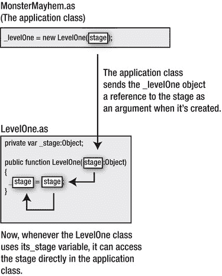

**图 8-4.** 应用程序类将舞台引用发送给 LevelOne。

`LevelOne` 需要这个对 `stage` 的引用，因为它必须将 `keyDownHandler` 和 `keyUpHandler` 附加到它上面。以下是它如何使用新的 `_stage` 变量来实现这一点：

```actionscript
_stage.addEventListener(KeyboardEvent.KEY_DOWN, keyDownHandler);
_stage.addEventListener(KeyboardEvent.KEY_UP, keyUpHandler);
```

你很快就会在完整类的上下文中看到这一点。

### 确保 `LevelOne` 确实位于舞台上

当你像刚才那样允许类访问舞台时，会遇到一个额外的技术问题：你必须确保这些对象在尝试访问舞台对象之前，确实已经位于舞台上。如果你使用 `new` 关键字创建了一个对象，并且该对象在应用类通过 `stage.addChild()` 方法将它添加到舞台之前就尝试访问舞台，就会看到如下错误信息：

```
Error #1009: 无法访问空对象引用的属性或方法
```

# AS3.0 游戏开发：舞台访问与事件监听

如果你正在向游戏中添加对象，这些对象很可能在创建后就需要立即访问舞台。它们可能需要以此来设置舞台边界，或访问舞台上其他对象的属性。如果它们因为尚未被添加到舞台而无法找到 `stage` 对象，AS3.0 的编译器就会“摊手放弃”，你就会看到上述错误信息。

要解决这个问题，你需要在对象被添加到舞台之后再进行初始化，而不是在此之前。有一个名为 `ADDED_TO_STAGE` 的特殊事件监听器正是为此而生。它会等待对象被添加到舞台，然后执行你需要的任何代码。

`LevelOne` 类需要访问舞台来附加移动游戏角色的键盘事件监听器，因此它需要等到被添加到舞台后再尝试这样做。以下是它使用 `ADDED_TO_STAGE` 事件监听器的方式（重要代码已高亮显示）：

```actionscript
public function LevelOne(stage:Object)
{
  _stage = stage;
  this.addEventListener(Event.ADDED_TO_STAGE, addedToStageHandler);
}

private function addedToStageHandler(event:Event):void
{
  startGame();
  this.removeEventListener
    (Event.ADDED_TO_STAGE, addedToStageHandler);
}

private function startGame():void
{
  //所有设置和初始化游戏的指令
}
```

一旦应用类创建了 `LevelOne` 对象，构造函数方法就会设置好 `ADDED_TO_STAGE` 监听器。

```actionscript
this.addEventListener(Event.ADDED_TO_STAGE, addedToStageHandler);
```

它会等待直到对象出现在舞台上。一旦出现，就会运行 `addedToStageHandler`。该处理器负责调用 `startGame` 方法，并且移除监听器，如下所示：

```actionscript
private function addedToStageHandler(event:Event):void
{
  startGame();
  this.removeEventListener
    (Event.ADDED_TO_STAGE, addedToStageHandler);
}
```

然后，`startGame` 方法会运行所有创建游戏对象和初始化游戏变量的指令。

这是一个需要克服的技术障碍。没错，这确实很烦人！但不幸的是，对于任何非应用类的类，如果需要引用或使用 `stage` 对象，这却是必不可少的。图 8-5 展示了 `ADDED_TO_STAGE` 监听器如何启动类的代码。幸运的是，这些都是非常常规的代码，你不需要耗费太多脑力去过度思考。只需盲从地按此示例在你自己游戏中照做即可，不必过于担忧。

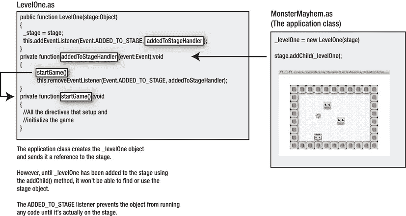

**图 8-5.** 等待对象位于舞台上之后再对其进行初始化。

`ADDED_TO_STAGE` 监听器有一个配套的监听器叫 `REMOVED_FROM_STAGE`。`REMOVED_FROM_STAGE` 事件监听器会在对象从舞台被移除时触发。非常重要的是，`REMOVED_FROM_STAGE` 允许你移除可能正在对象上运行的其他任何事件监听器。这对于 `ENTER_FRAME` 或定时器事件尤其重要。AS3.0 的一个小怪癖是，即使使用 `removeChild` 将对象从舞台上移除，它们的 `ENTER_FRAME` 事件仍会在后台静默运行。如果某个 `ENTER_FRAME` 事件正在运行并试图引用已不存在的对象，就会产生大量错误信息。为了防止这种情况，你可以使用 `REMOVED_FROM_STAGE` 事件，在对象本身被移除时移除它的 `enterFrameHandler` 事件监听器——如果你的代码没有以其他方式移除它的话。

以下是使用 `REMOVED_FROM_STAGE` 事件监听器的格式。首先，在类的构造方法中添加它：

```actionscript
public function ClassConstructorMethod()
{
  //... 任何类初始化代码
  //或其他监听器...
  this.addEventListener
    (Event.REMOVED_FROM_STAGE, removedFromStageHandler);
}
```

接着，使用 `removedFromStageHandler` 来运行当对象从舞台移除时应执行的任何代码。非常重要的是，你还需要移除 `removedFromStageHandler` 本身。

```actionscript
private function removedFromStageHandler(event:Event):void
{
  //... 你想在对象从舞台移除时
  //运行的任何指令
  this.removeEventListener
    (Event.ENTER_FRAME, enterFrameHandler);
  this.removeEventListener
    (Event.REMOVED_FROM_STAGE, removedFromStageHandler);
}
```

虽然手动移除 `ENTER_FRAME` 事件是必需的，但手动移除其他事件监听器是可选的。在大多数情况下，即使对象上仍有监听器，Flash 仍然会删除对象。不过，为了确保万无一失，最佳实践是手动移除它们，这样你就能绝对确定，在对象消失后不会有任何残留代码在后台运行。

### `LevelOne` 类

第一关的所有游戏逻辑都包含在 `LevelOne` 类中。它执行了之前章节中应用类所承担的工作。因此，除了刚才介绍的一些新技术细节外，大部分代码都会非常熟悉。但这段代码也做了许多新的事情：

*   让角色发射星星弹丸。
*   让怪物在被击中时张嘴。
*   在怪物被消灭时，在舞台上添加爆炸效果。
*   在关卡结束时显示“关卡完成”或“游戏结束，你输了”的信息。
*   在关卡完成时生成一个 `levelComplete` 事件，以便应用类知道它需要加载第二关。

你将逐个详细查看这些新特性。但为了让你有一个完整的代码参考，以下是 `LevelOne` 的完整代码清单：

```actionscript
package
{
  import flash.display.Sprite;
  import flash.events.Event;
  import flash.events.KeyboardEvent;
  import flash.events.TimerEvent;
  import flash.ui.Keyboard;
  import flash.utils.Timer;

  public class LevelOne extends Sprite
  {
    //Declare the variables to hold
    //the game objects
    private var _character:Character;
    private var _background:Background;
    private var _gameOver:GameOver;
    private var _monster1:Monster;
    private var _monster2:Monster;
    private var _star:Star;
    private var _levelWinner:String;

    //The timers
    private var _monsterTimer:Timer;
    private var _gameOverTimer:Timer;

    //A variable to store the reference
    //to the stage from the application class
    private var _stage:Object;

    public function LevelOne(stage:Object)
    {
      _stage = stage;
      this.addEventListener
        (Event.ADDED_TO_STAGE, addedToStageHandler);
    }

    private function addedToStageHandler(event:Event):void
    {
      startGame();
      this.removeEventListener
        (Event.ADDED_TO_STAGE, addedToStageHandler);
    }

    private function startGame():void
    {
```

# 游戏初始化与核心逻辑

## 创建与添加游戏对象

```actionscript
//Create the game objects
_character = new Character();
_star = new Star();
_background = new Background();
_monster1 = new Monster();
_monster2 = new Monster();
_gameOver = new GameOver();

//Add the game objects to the stage
addGameObjectToLevel(_background, 0, 0);
addGameObjectToLevel(_monster1, 400, 150);
addGameObjectToLevel(_monster2, 150, 150);
addGameObjectToLevel(_character, 250, 300);
addGameObjectToLevel(_star, 250, 300);
_star.visible = false;
addGameObjectToLevel(_gameOver, 140, 130);
```

## 初始化计时器与事件监听

```actionscript
//Initialize the monster timer
_monsterTimer = new Timer(1000);
_monsterTimer.addEventListener(TimerEvent.TIMER, monsterTimerHandler);
_monsterTimer.start();

//Event listeners
_stage.addEventListener(KeyboardEvent.KEY_DOWN, keyDownHandler);
_stage.addEventListener(KeyboardEvent.KEY_UP, keyUpHandler);
this.addEventListener(Event.ENTER_FRAME, enterFrameHandler);
```

## enterFrameHandler 函数

```actionscript
private function enterFrameHandler(event:Event):void
{
  //Move the game character and
  //check its stage boundaries
  _character.x += _character.vx;
  _character.y += _character.vy;
  checkStageBoundaries(_character);

  //Move the monsters and
  //check their stage boundaries
  if(_monster1.visible)
  {
    _monster1.x += _monster1.vx;
    _monster1.y += _monster1.vy;
    checkStageBoundaries(_monster1);
  }
  if(_monster2.visible)
  {
    _monster2.x += _monster2.vx;
    _monster2.y += _monster2.vy;
    checkStageBoundaries(_monster2);
  }

  //If the star has been launched,
  //move it, check its stage
  //boundaries and collisions
  //with the monsters
  if(_star.launched)
  {
    //If it has been launched,
    //make it visible
    _star.visible = true;
    //Move it
    _star.y -= 3;
    _star.rotation += 5;
    //Check its stage boundaries
    checkStarStageBoundaries(_star);
    //Check for collisions with the monsters
    starVsMonsterCollision(_star, _monster1);
    starVsMonsterCollision(_star, _monster2);
  }
  else
  {
    _star.visible = false;
  }

  //Collision detection between the
  //character and  monsters
  characterVsMonsterCollision(_character, _monster1);
  characterVsMonsterCollision(_character, _monster2);
}
```

## characterVsMonsterCollision 函数

```actionscript
private function characterVsMonsterCollision(character:Character, monster:Monster):void
{
  if(monster.visible
  && character.hitTestObject(monster))
  {
    character.timesHit++;
    checkGameOver();
  }
}
```

## starVsMonsterCollision 函数

```actionscript
private function starVsMonsterCollision(star:Star, monster:Monster):void
{
  if(monster.visible
  && star.hitTestObject(monster))
  {
    //Call the monster's openMouth
    //method to make it open its mouth
    monster.openMouth();
    //Deactivate the star
    star.launched = false;
    //Add 1 to the monster's timesHit variable
    monster.timesHit++;
    //Has the monster been hit 3 times?
    if(monster.timesHit == 3)
    {
      //call the killMonster
      //method
      killMonster(monster);
      //Check to see if the
      //game is over
      checkGameOver();
    }
  }
}
```

## killMonster 函数

```actionscript
private function killMonster(monster:Monster):void
{
  //Make the monster invisible
  monster.visible = false;
  //Create a new explosion object
  //and add it to the stage
  var explosion:Explosion = new Explosion();
  this.addChild(explosion);
  //Center the explosion over
  //the monster
  explosion.x = monster.x -21;
  explosion.y = monster.y -18;
  //Call the explosion's
```

```actionscript
//explode method
explosion.explode();
}

private function checkGameOver():void
{
  if(_monster1.timesHit == 3 && _monster2.timesHit == 3)
  {
    _levelWinner = "character";
    _gameOverTimer = new Timer(2000);
    _gameOverTimer.addEventListener(TimerEvent.TIMER, gameOverTimerHandler);
    _gameOverTimer.start();
    _monsterTimer.removeEventListener(TimerEvent.TIMER, monsterTimerHandler);
    this.removeEventListener(Event.ENTER_FRAME, enterFrameHandler);
  }
  if(_character.timesHit == 1)
  {
    _levelWinner = "monsters";
    _character.alpha = 0.5;
    _gameOverTimer = new Timer(2000);
    _gameOverTimer.addEventListener(TimerEvent.TIMER, gameOverTimerHandler);
    _gameOverTimer.start();
    _monsterTimer.removeEventListener(TimerEvent.TIMER, monsterTimerHandler);
    this.removeEventListener(Event.ENTER_FRAME, enterFrameHandler);
  }
}

private function checkStageBoundaries(gameObject:Sprite):void
{
  if (gameObject.x < 50)
  {
    gameObject.x = 50;
  }
  if (gameObject.y < 50)
  {
    gameObject.y = 50;
  }
  if (gameObject.x + gameObject.width > _stage.stageWidth - 50)
  {
    gameObject.x = _stage.stageWidth - gameObject.width - 50;
  }
  if (gameObject.y + gameObject.height > _stage.stageHeight - 50)
  {
    gameObject.y = _stage.stageHeight - gameObject.height - 50;
  }
}

private function checkStarStageBoundaries(star:Star):void
{
  if (star.y < 50)
  {
    star.launched = false;
  }
}

private function monsterTimerHandler(event:TimerEvent):void
{
  changeMonsterDirection(_monster1);
  changeMonsterDirection(_monster2);
}

private function changeMonsterDirection(monster:Monster):void
{
  var randomNumber:int = Math.ceil(Math.random() * 4);
  if(randomNumber == 1)
  {
    //右
    monster.vx = 1;
    monster.vy = 0;
  }
  else if (randomNumber == 2)
  {
    //左
    monster.vx = -1;
    monster.vy = 0;
  }
  else if(randomNumber == 3)
  {
    //上
    monster.vx = 0;
    monster.vy = -1;
  }
  else
  {
    //下
    monster.vx = 0;
    monster.vy = 1;
  }
}

private function gameOverTimerHandler(event:TimerEvent):void
{
  if(_levelWinner == "character")
  {
    if(_gameOverTimer.currentCount == 1)
    {
      _gameOver.levelComplete.visible = true;
    }
    if(_gameOverTimer.currentCount == 2)
    {
      _gameOverTimer.reset();
      _gameOverTimer.removeEventListener(TimerEvent.TIMER, gameOverTimerHandler);
      dispatchEvent(new Event("levelOneComplete", true));
    }
  }
  if(_levelWinner == "monsters")
  {
    _gameOver.youLost.visible = true;
    _gameOverTimer.removeEventListener(TimerEvent.TIMER, gameOverTimerHandler);
  }
}

private function keyDownHandler(event:KeyboardEvent):void
{
  if (event.keyCode == Keyboard.LEFT)
  {
    _character.vx = -5;
  }
  else if (event.keyCode == Keyboard.RIGHT)
  {
    _character.vx = 5;
  }
  else if (event.keyCode == Keyboard.UP)
  {
    _character.vy = -5;
  }
  else if (event.keyCode == Keyboard.DOWN)
  {
    _character.vy = 5;
  }
  if(event.keyCode == Keyboard.SPACE)
  {
    if(!_star.launched)
    {
      _star.x = _character.x + _character.width / 2;
      _star.y = _character.y + _character.width / 2;
      _star.launched = true;
    }
  }
}

private function keyUpHandler(event:KeyboardEvent):void
{
  if (event.keyCode == Keyboard.LEFT || event.keyCode == Keyboard.RIGHT)
  {
    _character.vx = 0;
  }
  else if (event.keyCode == Keyboard.DOWN || event.keyCode == Keyboard.UP)
  {
    _character.vy = 0;
  }
}

private function addGameObjectToLevel(gameObject:Sprite, xPos:int, yPos:int):void
{
  this.addChild(gameObject);
  gameObject.x = xPos;
  gameObject.y = yPos;
}
```

# 编程生成游戏角色

在上一章中，你看到了游戏里的每个对象是如何成为独立类的。那些游戏对象类非常简单，它们所做的只是加载并显示 PNG 文件。在《怪物大乱斗》中，游戏对象类要复杂得多。它们不仅显示对象的图像，还执行以下两个附加功能。

*   它们将对象的数据存储在变量中，这些变量被称为`属性`。
*   它们让对象通过方法执行操作。这些操作会改变对象的外观。

让我们进一步了解类属性和方法，然后看看它们在游戏中是如何使用的。

## 理解属性和方法

类本质上是对一个对象的描述。一个类通过以下两种方式来描述对象：

*   `属性`：对象“是什么”。
*   `方法`：对象“做什么”。

为了理解属性和方法的概念，让我们来看一个虚构的类——长颈鹿：

```actionscript
package
{
  import flash.display.Sprite;

  public class Giraffe extends Sprite
  {
    //属性
    private var _isHungry:Boolean;
    private var _favoriteActivity:String;

    public function Giraffe()
    {
      _isHungry = true;
      _favoriteActivity =  "eating";
    }

    //方法
    private function eatLeaves():void
    {
      //...  指令
    }

    private function wanderAimlessly():void
    {
      //...  指令
    }
  }
}
```

我相信通过查看前面的类，你可以对这只可怜长颈鹿的生活有个相当清晰的认识！

`属性`其实就是`变量`的另一种说法，例如：

`_hungry`
`_favoriteActivity`

是的，它们就是普通的变量——就这么简单！像在长颈鹿示例中那样描述对象特征的变量，被称为属性。这只是你需要学习的一个术语。属性也指你一直使用的所有内置 Sprite 属性（如 `x`、`y`、`rotation` 和 `visible`）。

方法呢？当然，你现在已经知道方法是什么了！以下是长颈鹿的方法：

`eatLeaves`
`wanderAimlessly`

通过将属性和方法结合使用，你可以创建对象的`模型`。你游戏中的所有游戏对象类实际上就是由它们的属性和方法描述的模型。

`Character.as` 类是游戏中最简单的类之一。它没有任何方法，只有属性。以下是整个类：

```actionscript
package
{
  import flash.display.DisplayObject;
  import flash.display.Sprite;

  public class Character extends Sprite
  {
    //嵌入图像
    [Embed(source="../images/character.png")]
    private var CharacterImage:Class;

    //私有属性
    private var _character:DisplayObject = new CharacterImage();

    //公有属性
    public var vx:int = 0;
    public var vy:int = 0;
    public var timesHit:int = 0;

    public function Character()
    {
      //在此类中显示图像
      this.addChild(_character);
    }
  }
}
```

`Character` 类有三个公有属性。

*   `vx`：角色的水平速度。
*   `vy`：角色的垂直速度。
*   `timesHit`：角色被怪物击中的次数。

这些都是游戏所需的关于角色的重要信息。图 8-6 对此进行了说明。

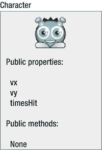

**图 8-6.** `Character` 类的公有属性

注意，所有这些属性都被声明为公有。这是因为其他类必须能够访问它们。你将在下一节了解具体方式。另一个私有变量 `_character` 也是一个属性，但它仅供类内部使用，用于显示 PNG 图像。

## 移动角色

在前面的示例中，应用程序类包含了`vx`和`vy`变量，这些变量用于在舞台上移动角色。而在这个游戏中，这些变量实际上是角色类自身的一部分。你可以通过点表示法，在`LevelOne`类中从`_character`对象内部访问它们，像这样：

`_character.vx`
`_character.vy`

由于这些属性已被声明为公共属性（public），应用程序类可以轻松地访问和修改它们。当玩家按下键盘上的方向键时，`keyDownHandler`中的代码会直接修改`_character`对象内部的`vx`和`vy`属性。（下方加粗代码突出显示了这一点）：

```
if (event.keyCode == Keyboard.LEFT)
{
  _character.vx = -5;
}
else if (event.keyCode == Keyboard.RIGHT)
{
  _character.vx = 5;
}
else if (event.keyCode == Keyboard.UP)
{
  _character.vy = -5;
}
else if (event.keyCode == Keyboard.DOWN)
{
  _character.vy = 5;
}
```

图 8-7 展示了这段代码直接修改了`_character`对象内部的`vx`和`vy`属性。

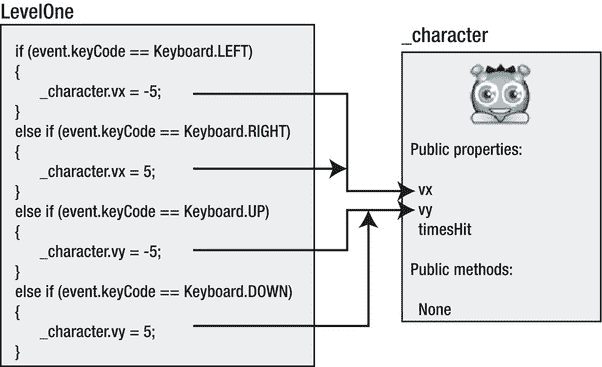

**图 8-7.** `LevelOne`类可以直接修改对象的公共属性

然后，`enterFrameHandler`中的代码可以利用角色被修改后的`vx`和`vy`属性，让角色在舞台上移动，示例如下：

`_character.x += _character.vx;`
`_character.y += _character.vy;`

## 检查舞台边界

角色移动后，`checkStageBoundaries`方法会阻止角色移出舞台区域。

`checkStageBoundaries(_character);`

以下是完成所有核心工作的方法函数定义：

```
private function checkStageBoundaries(gameObject:Sprite):void
{
  if (gameObject.x < 50)
  {
    gameObject.x = 50;
  }
  if (gameObject.y < 50)
  {
    gameObject.y = 50;
  }
  if (gameObject.x + gameObject.width > _stage.stageWidth - 50)
  {
    gameObject.x = _stage.stageWidth - gameObject.width - 50;
  }
  if (gameObject.y + gameObject.height > _stage.stageHeight - 50)
  {
    gameObject.y = _stage.stageHeight - gameObject.height - 50;
  }
}
```

此方法也用于检查`_monster1`和`_monster2`对象的舞台边界。请注意，它使用了`LevelOne`类的私有变量`_stage`来获取舞台的高度和宽度。

## 检查角色与怪物之间的碰撞

`enterFrameHandler`使用`characterVsMonsterCollision`方法来检查角色与怪物之间的碰撞。需要检查两个怪物碰撞，因此该方法被调用了两次——每个怪物一次。

`characterVsMonsterCollision(_character, _monster1);`
`characterVsMonsterCollision(_character, _monster2);`

以下是该方法的函数定义：

```
private function characterVsMonsterCollision
  (character:Character, monster:Monster):void
{
  if(monster.visible
  && character.hitTestObject(monster))
  {
    character.timesHit++;
```

### enterFrameHandler 中代码的顺序

再次查看完整`LevelOne`代码清单中的整个`enterFrameHandler`。请注意，`characterVsMonsterCollision`方法是其运行的最后一小段代码。这是因为游戏只应在游戏对象移动*之后*才检查碰撞。这样做的原因是为了确保我们基于对象当前的*新位置*（而不是前一帧的位置）来检查碰撞和边界。

以下是你在`enterFrameHandler`中运行代码时应遵循的顺序：

1.  首先，移动游戏对象。
2.  移动之后，检查舞台边界和与其他对象的碰撞。
3.  确保在你移动了对象对中的两个对象之后，再检查它们之间的碰撞。例如，先移动角色，再移动怪物，然后才检查它们之间的碰撞。

如果你在移动对象之前就检查碰撞和边界，那么碰撞将不会基于它们的当前位置，而是基于对象*在上一帧*的位置。你所有的碰撞都会看起来有些偏差。

你可以通过像这样在改变角色舞台位置之前运行其`checkStageBoundaries`方法来测试这一点：

```
checkStageBoundaries(_character);

_character.x += _character.vx;

_character.y += _character.vy;
```

重新编译代码，并将角色移动到舞台的某个边界。你会看到角色会与边界重叠 5 像素，如图 8-8 所示。这是因为角色尚未更新到其新的当前位置。

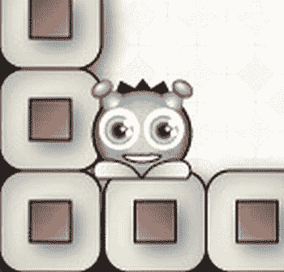

图 8-8. 如果在检查碰撞或边界之前不移动游戏对象，碰撞将会延迟一帧。

这是游戏设计中一个非常常见的问题，但正如你所见，修复起来很容易。如果你发现自己的游戏碰撞检测略微不精确时，请记住这一点。

### 为怪物编程

`LevelOne` 使用同一个 `Monster` 类来创建怪物对象，就像这样：

```
_monster1 = new Monster();

_monster2 = new Monster();
```

两个怪物的行为完全一致，因此它们可以使用完全相同的类。花一份钱得两个！这是使用类的一大好处：你只需编写一次类。只要它足够通用，你就可以为所需数量的同类对象反复重用它。

这些怪物有一个迷人的特点。当它们被星星击中时，会张开嘴巴，正如你在图 8-9 中所见。

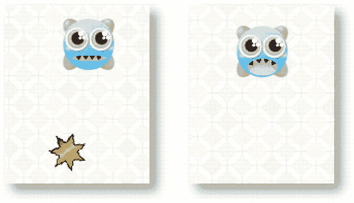

图 8-9. 被星星击中时，怪物张开了嘴巴。可怜的小家伙！

怪物的嘴巴会保持张开两秒钟，然后再次闭上。

你在第 6 章中已经看到过这种情况，当时我们展示了如何在与某物碰撞时改变对象的图像状态。所以你已经知道，这个把戏是通过让一张图像可见、另一张不可见来实现的。这里的新颖之处在于，图像的切换全部发生在 `Monster` 类*内部*。该类使用一个计时器让怪物的嘴巴张开两秒钟，然后再闭上。

以下是实现此功能的 `Monster` 类：

```
package
{
  import flash.display.DisplayObject;
  import flash.display.Sprite;
  import flash.events.TimerEvent;
  import flash.utils.Timer;

  public class Monster extends Sprite
  {
     //嵌入怪物图片
    [Embed(source="../images/monsterMouthClosed.png")]
    private var MonsterMouthClosedImage:Class;
    [Embed(source="../images/monsterMouthOpen.png")]
    private var MonsterMouthOpenImage:Class;

    //私有属性
    private var _monsterMouthClosed:DisplayObject = new MonsterMouthClosedImage();
    private var _monsterMouthOpen:DisplayObject = new MonsterMouthOpenImage();
    private var _timer:Timer;

    //公有属性
    public var vx:int = 0;
    public var vy:int = 0;
    public var timesHit:int = 0;

    public function Monster()
    {
      this.addChild(_monsterMouthClosed);
      this.addChild(_monsterMouthOpen);
      _monsterMouthOpen.visible = false;

      //嘴巴计时器
      _timer = new Timer(2000);
    }

    //公有方法
    public function openMouth():void
    {
      _monsterMouthOpen.visible = true;
      _monsterMouthClosed.visible = false;
      _timer.addEventListener(TimerEvent.TIMER, mouthTimeHandler);
      _timer.start();
    }

    //私有方法
    private function mouthTimeHandler(event:TimerEvent):void
    {
      _monsterMouthOpen.visible = false;
      _monsterMouthClosed.visible = true;
      _timer.reset();
      _timer.removeEventListener(TimerEvent.TIMER, mouthTimeHandler);
    }
  }
}
```

怪物与角色拥有相同的公有属性：`vx`、`vy` 和 `timesHit`。但它们还有一个公有方法：`openMouth()`。图 8-10 对此进行了说明。

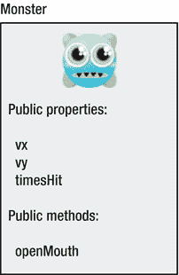

图 8-10. Monster 类的公有属性和方法

`LevelOne` 类可以通过调用怪物的 `openMouth` 方法来随时让怪物张开嘴巴，就像这样：

```
_monster1.openMouth();
_monster2.openMouth();
```

`Monster` 类有一个计时器，设置为每两秒（2000 毫秒）触发一次。

```
_timer = new Timer(2000);
```

当怪物的 `openMouth` 方法被调用时，张开嘴巴的图像变为可见，闭上嘴巴的图像变为不可见。然后计时器启动。

```
public function openMouth():void
{
  _monsterMouthOpen.visible = true;
  _monsterMouthClosed.visible = false;
  _timer.addEventListener(TimerEvent.TIMER, mouthTimeHandler);
  _timer.start();
}
```

当计时器计时满两秒时，它会调用 `mouthTimeHandler`。该方法使怪物闭上嘴巴的图像再次可见，张开嘴巴的图像不可见。然后它会重置计时器，以便下次使用时从零开始计数。最后，计时器的事件监听器被移除。

```
private function mouthTimeHandler(event:TimerEvent):void
{
  _monsterMouthOpen.visible = false;
  _monsterMouthClosed.visible = true;
  _timer.reset();
  _timer.removeEventListener(TimerEvent.TIMER, mouthTimeHandler);
}
```

# 移动怪物

Monster Mayhem 是你看到的第一个除游戏角色外的对象也在舞台上移动的游戏。怪物们每隔一秒就随机改变方向——向上、向下、向左或向右，如图 8-11 所示。

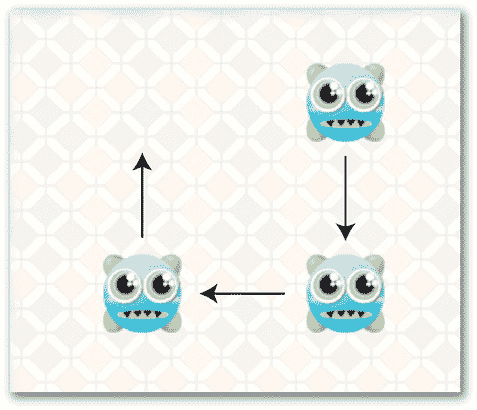

图 8-11. 怪物每秒选择一个随机方向。

`LevelOne` 类使用一个计时器来每秒触发 `monsterTimerHandler`。

```
_monsterTimer = new Timer(1000);
_monsterTimer.addEventListener(TimerEvent.TIMER, monsterTimerHandler);
_monsterTimer.start();
```

`monsterTimerHandler` 将 `_monster1` 和 `_monster2` 对象发送给 `changeMonsterDirection` 方法。

```
private function monsterTimerHandler(event:TimerEvent):void
{
  changeMonsterDirection(_monster1);
  changeMonsterDirection(_monster2);
}
```

`changeMonsterDirection` 方法生成 1 到 4 之间的随机数。它利用这个随机数为怪物分配不同的 `vx` 和 `vy` 值，这将使怪物向右、向左、向上或向下移动。

```
private function changeMonsterDirection(monster:Monster):void
{
  var randomNumber:int = Math.ceil(Math.random() * 4);
  if(randomNumber == 1)
  {
    //向右
    monster.vx = 1;
    monster.vy = 0;
  }
  else if (randomNumber == 2)
  {
    //向左
    monster.vx = -1;
    monster.vy = 0;
  }
  else if(randomNumber == 3)
  {
    //向上
    monster.vx = 0;
    monster.vy = -1;
  }
  else
  {
    //向下
    monster.vx = 0;
    monster.vy = 1;
  }
}
```

图 8-12 展示了这个系统如何工作。

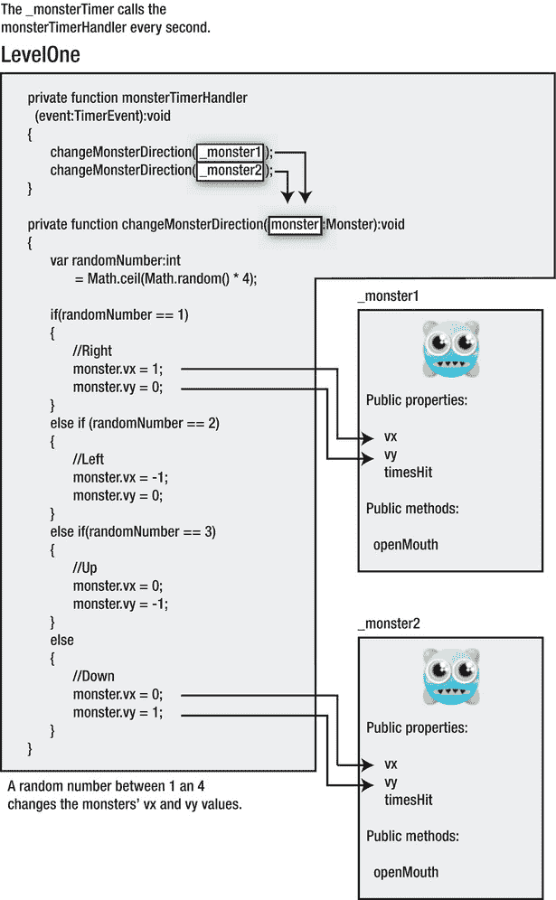

图 8-12. 怪物被分配了一个随机方向。

然后，`enterFrameHandler` 使用这些新的 `vx` 和 `vy` 值让怪物移动。它还使用了角色使用的相同 `checkStageBoundaries` 方法来让怪物保持在游戏区域内。然而，所有这些代码仅在怪物可见时才会运行。

```
if(_monster1.visible)
{
  _monster1.x += _monster1.vx;
  _monster1.y += _monster1.vy;
  checkStageBoundaries(_monster1);
}
if(_monster2.visible)
{
  _monster2.x += _monster2.vx;
  _monster2.y += _monster2.vy;
  checkStageBoundaries(_monster2);
}
```

在这个游戏中，当怪物被星星击中三次时，它们的 `visible` 属性会被设置为 `false`。让它们不可见是一种简单的将其从游戏中移除的方法。但是，即使怪物不可见，它们仍然会留在舞台上，并且仍然可以被 `enterFrameHandler` 移动。`if` 语句确保如果怪物不可见，则不会移动它们。

需要注意的重要一点是，`Monster` 类不会执行任何影响游戏逻辑的操作。它所做的一切就是处理怪物的状态变化：张开和闭上嘴巴。由 `LevelOne` 类根据游戏中发生的事情来决定何时应该发生这种变化。像这样设计你的游戏对象类非常重要，这样你就可以在其他游戏或关卡中重用它们，而无需重写该类。

例如，也许你后来决定怪物在撞到墙壁时也应该张开嘴巴。为此，你无需对 `Monster` 类做任何修改。你只需要在怪物撞到墙壁时，在 `LevelOne` 类中编写 `_monster1.openMouth()` 即可。

# 编程实现星星武器

当玩家按下空格键时，星星武器会变为可见状态，并从角色中心发射出去。它会旋转着向上移动。如果它碰到游戏场地边界或怪物，就会再次变为不可见状态。前两次击中怪物时，怪物会张开嘴，但第三次击中时会显示爆炸图形，怪物随即消失。图 8-13 展示了星星武器的工作原理。

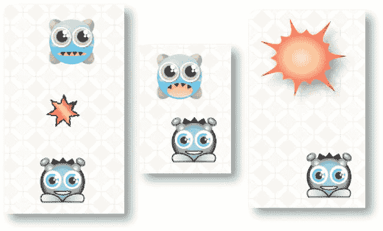

图 8-13. 发射星星武器来消灭怪物

`Star` 类与其他游戏对象共享相同的 `vx` 和 `vy` 属性，但新增了一个名为 `launched` 的属性。这是一个布尔变量，用于告知游戏玩家是否已通过按空格键发射了星星。你将看到这个属性在控制星星行为方面至关重要。以下是完整的 `Star` 类：

```
package
{
  import flash.display.DisplayObject;
  import flash.display.Sprite;

  public class Star extends Sprite
  {
    //嵌入图像
    [Embed(source="../images/star.png")]
    private var StarImage:Class;

    //私有属性
    private var _star:DisplayObject = new StarImage();

    //公有属性
    public var vx:int = 0;
    public var vy:int = 3;
    public var launched:Boolean = false;

    public function Star()
    {
      this.addChild(_star);
      //居中星星图像
      _star.x = -(_star.width / 2);
      _star.y = -(_star.height / 2);
    }
  }
}
```

图 8-14 说明了 `Star` 类的公有属性和方法。

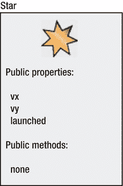

图 8-14. 星星的公有属性

但由于星星需要围绕其中心旋转，因此需要将 `_starImage` 居中。通过两行代码即可轻松完成，即分别从 x 和 y 位置减去星星图像高度和宽度的一半。这样就完美地将图像居中。

```
_star.x = -(_star.width / 2);
_star.y = -(_star.height / 2);
```

现在星星图像已经居中，其旋转轴将位于中心点。如果没有这样居中，旋转轴将是其左上角，旋转效果会不平衡。

## 发射星星

当玩家按下键盘上的空格键时，`onKeyDownHandler` 会将星星的 `launched` 属性设置为 `true`。仅当 `launched` 尚未为 `true` 时才会执行此操作，以确保星星在舞台上时不会被多次发射。

```
if(event.keyCode == Keyboard.SPACE)
{
  if(!_star.launched)
  {
    _star.x = _character.x + _character.width / 2;
    _star.y = _character.y + _character.width / 2;
    _star.launched = true;
  }
}
```

这段代码还将星星居中放置在角色上。

如果星星已被发射，`enterFrameHandler` 随后会运行以下代码：

```
if(_star.launched)
{
  //如果已发射，使其可见
  _star.visible = true;
  //移动星星
  _star.y -= 3;
  _star.rotation += 5;
  //检查舞台边界
```

```markdown
这段代码使星星变为可见，移动它，旋转它，检查其舞台边界，并检查与怪物的碰撞。如果 `launched` 属性为 `false`，这段代码还会使星星不可见。你将很快看到，当星星碰到舞台边界或任何一个怪物时，`launched` 属性会被设置为 `false`。

## 检查星星的碰撞

由于星星只向上移动，检查其舞台边界的代码只需检测是否与舞台顶部发生碰撞。`checkStarStageBoundaries` 方法实现了这一点：

```actionscript
private function checkStarStageBoundaries(star:Star):void
{
  if (star.y < 50)
  {
    star.launched = false;
  }
}
```

如果星星碰到顶部游戏场地边界，它会将星星的 `launched` 属性设置为 `false`。

`starVsMonsterCollision` 方法用于检查星星与怪物之间的碰撞。它接受两个参数：要检测碰撞的星星和怪物。

```actionscript
starVsMonsterCollision(_star, _monster1);
starVsMonsterCollision(_star, _monster2);
```

该方法的函数定义仅在所检测的怪物可见时才进行碰撞检测。（如果怪物不可见，说明它已经被击中三次并从游戏中被移除。）如果怪物可见，代码会执行以下操作：

- 让怪物张开嘴。
- 将怪物的 `timesHit` 属性加 1。
- 将星星的 `launched` 属性设置为 `false`。
- 检查怪物是否已被击中三次；如果是，则调用 `killMonster` 方法。
- 如果怪物已被击中三次，还会调用 `checkGameOver` 方法来判断游戏是否可能结束。

以下是完成所有这些工作的 `starVsMonsterCollision` 方法：

```actionscript
private function starVsMonsterCollision
  (star:Star, monster:Monster):void
{
  if(monster.visible
  &&star.hitTestObject(monster))
  {
    //调用怪物的 openMouth 方法使其张开嘴
    monster.openMouth();
    //停用星星
    star.launched = false;
    //将怪物的 timesHit 变量加 1
    monster.timesHit++;
    //怪物是否已被击中 3 次？
    if(monster.timesHit == 3)
    {
      //调用 killMonster 方法
      killMonster(monster);
      //检查游戏是否结束
      checkGameOver();
    }
  }
}
```

这是一段有趣的代码，因为它改变了星星的一个属性、怪物的两个属性，并调用了 `LevelOne` 类中的两个方法。图 8-15 展示了所有这些连接如何配合在一起。

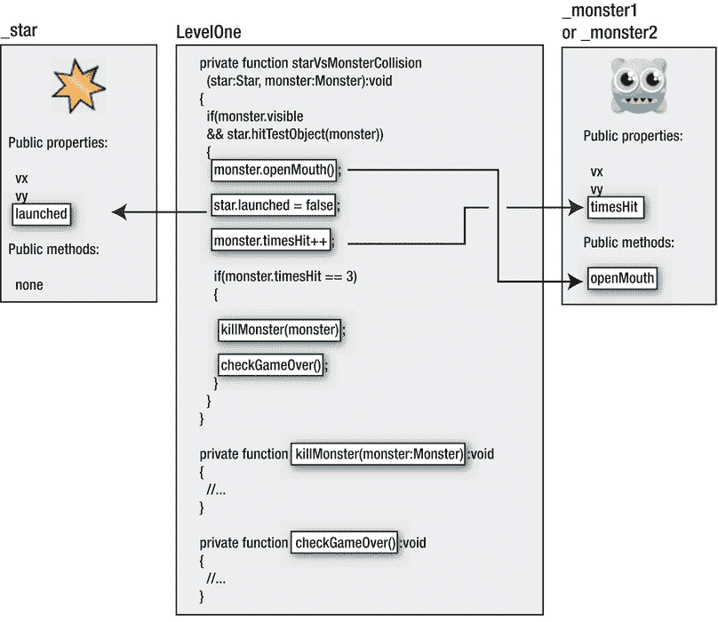

**图 8-15.** 星星击中怪物时发生的情况

你很快就会详细了解 `checkGameOver` 方法，但首先来看看当其中一个怪物被击中三次时会发生什么。

### 消灭怪物与潽炸效果

如果星星击中怪物三次，将调用 `killMonster` 方法，该方法执行以下任务：

- 使怪物不可见。
- 创建 `Explosion` 类的爆炸对象并添加到舞台。
- 将爆炸效果居中放置在怪物当前位置上方。
- 调用爆炸对象的 `explode` 方法。这会使爆炸图像显示，并在两秒后再次消失。

以下是实现上述功能的 `killMonster` 方法：

```actionscript
private function killMonster(monster:Monster):void
{
  //Make the monster invisible
  monster.visible = false;
  //Create a new explosion object
  //and add it to the stage
  var explosion:Explosion = new Explosion();
  this.addChild(explosion);
  //Center the explosion over
  //the monster
  explosion.x = monster.x -21;
  explosion.y = monster.y -18;
  //Call the exlposion's
  //explode method
  explosion.explode();
}
```

这是你第一次看到如何在游戏进行中创建对象。其他所有游戏对象，如 `_star`、`_character`、`_monster1` 和 `_monster2`，都是在游戏初始化时创建的。而爆炸对象则由 `killMonster` 方法在需要时创建，如下所示：

```actionscript
var explosion:Explosion = new Explosion();
this.addChild(explosion);
```

这个新爆炸对象是 `killMonster` 方法的*局部*对象。这意味着你只能在该方法内部访问它。在类的其他任何地方都无法引用这个新的 `explosion` 对象。这完全没问题，因为它只是一个简单的视觉效果，你无需在其他地方使用。另外，你事先不知道游戏开始前需要多少个爆炸对象，因此该方法会在你需要时创建一个新的，无论是 1 个还是 100 个。你无需在游戏初始化时预先创建所有爆炸对象来提前规划。

`局部变量`和对象只能在创建它们的方法内部使用。你可以在方法内部这样创建一个局部变量：

```actionscript
var localVariable:VariableType = new ClassName();
```

请注意，`var` 前面没有 `public` 或 `private`。

`实例变量`和对象可以在类的所有代码中任何位置使用。实例变量在类定义中创建，如下所示：

```actionscript
private var _instanceVariable:VariableType = new ClassName();
public var instanceVariable:VariableType = new ClassName();
```

这些变量可以在类中的任何位置、任何时候被任何方法使用。如果它们被声明为 `public`，其他类也可以访问它们。你之前使用的大多数变量和游戏对象都是实例变量。

由于局部变量的作用域更有限，它们在 Flash Player 内存中占用的空间略小。

创建这个新的 `explosion` 对象后，它会居中放置在怪物当前位置上方。

```actionscript
explosion.x = monster.x -21;
explosion.y = monster.y -18;
```

最后，调用 `explosion` 对象的 `explode` 方法。

```actionscript
explosion.explode();
```

这会使爆炸图像显示两秒，然后再次消失。这一切都是通过 `Explosion` 类中的计时器完成的，它使用的技术与让怪物张嘴和闭嘴的技巧完全相同。

以下是完整的 `Explosion` 类及其公共方法 `explode`，该方法启动计时器使图像可见：

```actionscript
package
{
  import flash.display.DisplayObject;
  import flash.display.Sprite;
  import flash.events.TimerEvent;
  import flash.utils.Timer;

  public class Explosion extends Sprite
  {
    //Embed the image
    [Embed(source="../images/explosion.png")]
    private var ExplosionImage:Class;

    //Private properties
    private var _explosion:DisplayObject = new ExplosionImage();
    private var _timer:Timer;

    public function Explosion()
    {
```

this.addChild(_explosion);

      _explosion.visible = false;

      _timer = new Timer(2000);

    }

    //Public methods

    public function explode():void

    {

      _explosion.visible = true;

      _timer.addEventListener

        (TimerEvent.TIMER, explosionTimeHandler);

      _timer.start();

    }

    //Private methods

    private function explosionTimeHandler(event:TimerEvent):void

    {

      _explosion.visible = false;

      _timer.reset();

      _timer.removeEventListener

        (TimerEvent.TIMER, explosionTimeHandler);

    }

  }

}

```

图 8-16 展示了 `Explosion` 类的属性和方法。

现在你已经了解了游戏中所有对象的运作方式，让我们看看代码如何判断关卡是否完成。

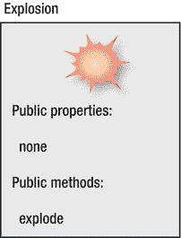

**图 8-16.** `Explosion` 类

### 检查关卡是否结束

当角色被怪物击中一次，或者每个怪物都被玩家的星星击中三次时，关卡即告完成。如之前的示例所示，当这种情况发生时，代码会调用 `checkGameOver` 方法。

```
private function checkGameOver():void

{

  if(_monster1.timesHit == 3

  && _monster2.timesHit == 3)

  {

    _levelWinner = "character"

    _gameOverTimer = new Timer(2000);

    _gameOverTimer.addEventListener

      (TimerEvent.TIMER, gameOverTimerHandler);

    _gameOverTimer.start();

    _monsterTimer.removeEventListener

      (TimerEvent.TIMER, monsterTimerHandler);

    this.removeEventListener

      (Event.ENTER_FRAME, enterFrameHandler);

  }

  if(_character.timesHit == 1)

  {

    _levelWinner = "monsters"

    _character.alpha = 0.5;

    _gameOverTimer = new Timer(2000);

    gameOverTimer.addEventListener

      (TimerEvent.TIMER, gameOverTimerHandler);

    _gameOverTimer.start();

    monsterTimer.removeEventListener

      (TimerEvent.TIMER, _monsterTimerHandler);

    this.removeEventListener(Event.ENTER_FRAME, enterFrameHandler);

  }

}
```

以下是 `checkGameOver` 的工作方式：

- 判定谁是赢家：怪物还是角色。并将结果赋给名为 `_levelWinner` 的变量。

```
if(_monster1.timesHit == 3

&& _monster2.timesHit == 3)

{

  _levelWinner = "character"

  //...

}

if(_character.timesHit == 1)

{

  _levelWinner = "monsters"

  //...

}
```

- 移除 `enterFrameHandler`，这会冻结舞台上的所有动作。如果角色失败，代码会将角色的 `alpha` 值设为 0.5，使其变为半透明。

```
this.removeEventListener(Event.ENTER_FRAME, enterFrameHandler);

_character.alpha = 0.5;
```

- 移除怪物计时器的 `TIMER` 事件处理程序，以停止为怪物分配随机方向。这样做很重要，因为怪物计时器在关卡结束后不会自动停止。如果不需要，你不想浪费宝贵的 CPU 资源来运行计时器。

```
_monsterTimer.removeEventListener(TimerEvent.TIMER, monsterTimerHandler);
```

- 启动 `_gameOverTimer`，它会调用 `gameOverTimerHandler`。

```
_gameOverTimer = new Timer(2000);

_gameOverTimer.addEventListener

  (TimerEvent.TIMER, gameOverTimerHandler);

_gameOverTimer.start();
```

负责显示“关卡完成”或“游戏结束”消息，并通知应用程序类关卡已结束的正是 `gameOverTimerHandler`。接下来让我们看看它是如何工作的。

#### 结束关卡

`gameOverTimerHandler` 引入了一些新的技巧。

- 它利用计时器的 `currentCount` 属性，每两秒执行一次新操作。
- 它会宣布关卡已完成，以便应用程序类能够加载第二关。

以下是执行此操作的 `gameOverTimerHandler`，我接下来将详细解释它的工作原理。

```
private function gameOverTimerHandler(event:TimerEvent):void

{

  if(_levelWinner == "character")

  {

    if(_gameOverTimer.currentCount == 1)

    {

      _gameOver.levelComplete.visible = true;

    }

    if(_gameOverTimer.currentCount == 2)

    {

      _gameOverTimer.reset();

      _gameOverTimer.removeEventListener

        (TimerEvent.TIMER, gameOverTimerHandler);

      dispatchEvent(new Event("levelOneComplete", true));

    }

  }

  if(_levelWinner == "monsters")

  {

    _gameOver.youLost.visible = true;

    _gameOverTimer.removeEventListener

      (TimerEvent.TIMER, gameOverTimerHandler);

  }

}
```

##### 如果怪物获胜……

我们首先来看看当怪物在游戏中获胜时会发生什么，因为这段代码非常简单。`_gameOverTimer` 移除了 `gameOverTimerHandler`，这样所有这段代码就不会被第二次调用。

```
_gameOverTimer.removeEventListener(TimerEvent.TIMER, gameOverTimerHandler);
```

该代码还将 `_gameOver` 对象的 `youLost` 子对象设为可见。

```
_gameOver.youLost.visible = true;
```

`_gameOver` 对象是在 `LevelOne` 类初始化时由该类添加到游戏中的。

```
private var _gameOver:GameOver;

//...

addGameObjectToLevel(_gameOver, 140, 130);
```

它一直位于舞台上，但你无法看到它，因为它包含的子对象是不可见的。`GameOver` 类包含两个子对象：`youLost` 和 `levelComplete`。当它们被添加到父类时，它们的 `visible` 属性都被设置为 `false`。以下是执行此操作的完整 `GameOver` 类：

```
package

{
```

# 游戏结束逻辑

```actionscript
import flash.display.DisplayObject;
import flash.display.Sprite;

public class GameOver extends Sprite
{
    //嵌入图像
    [Embed(source="../images/levelComplete.png")]
    private var LevelCompleteImage:Class;

    [Embed(source="../images/youLost.png")]
    private var YouLostImage:Class;

    //私有属性
    public var levelComplete:DisplayObject = new LevelCompleteImage();
    public var youLost:DisplayObject = new YouLostImage();

    public function GameOver()
    {
        //将图像添加到此类中
        //并使它们不可见
        this.addChild(levelComplete);
        levelComplete.visible = false;
        this.addChild(youLost);
        youLost.visible = false;
    }
}
```

图 8-17 展示了当怪物获胜时，将 `_gameOver` 对象的 `youLost` 子对象设为可见所产生的效果。

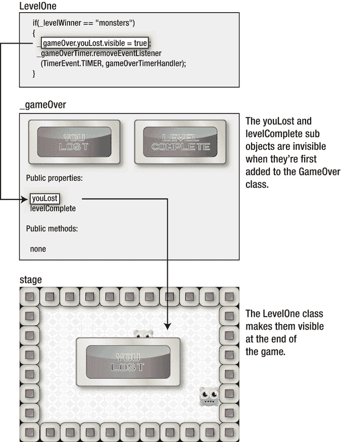

图 8-17. 使“你输了”消息可见

因此，如果怪物获胜，游戏就此结束，不会发生其他任何事情。如果角色获胜，情况就会有趣得多。

### 如果角色获胜……

当 `_gameOverTimer` 被创建时，它被初始化，以便每两秒调用一次 `gameOverTimerHandler`。

```actionscript
_gameOverTimer = new Timer(2000);
_gameOverTimer.addEventListener(TimerEvent.TIMER, gameOverTimerHandler);
_gameOverTimer.start();
```

如第 7 章所述，计时器有一个名为 `currentCount` 的属性，用于计算计时器运行的次数。在此示例中，`_gameOverTimer` 将每两秒将其 `currentCount` 属性增加 1。游戏利用此功能来管理显示“关卡完成”消息并加载第二关。

然后，`currentCount` 从 0 开始计数，计时器每 2,000 毫秒触发一次。这意味着当它变为 1 时，已经过去了两秒。当 `currentCount` 变为 2 时，已经过去了四秒。以下是它如何用于管理从第一关到第二关的过渡：

- `currentCount = 0`：游戏结束时，当 `checkGameOver` 方法移除 `enterFrameHandler` 时，会出现两秒的暂停。`checkGameOver` 方法也会启动 `_gameOverTimer`。
- `currentCount = 1`：显示“关卡完成”消息。
- `currentCount = 2`：两秒后，代码宣布关卡完成。应用程序类监听到此消息并加载游戏的第二关。（`_gameOverTimer` 也会被重置。）

图 8-18 说明了 `_gameOverTimer.currentCount` 属性如何管理游戏最后四秒。

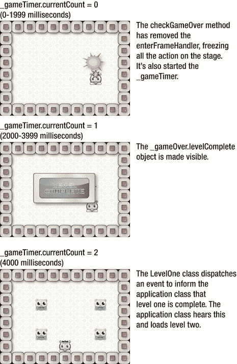

图 8-18. 计时器用于结束第一关并过渡到第二关。

以下是实际执行此操作的 `gameOverTimerHandler` 方法中的代码：

```actionscript
if(_levelWinner == "character")
{
    if(_gameOverTimer.currentCount == 1)
    {
        _gameOver.levelComplete.visible = true;
    }
    if(_gameOverTimer.currentCount == 2)
    {
        _gameOverTimer.reset();
        _gameOverTimer.removeEventListener(TimerEvent.TIMER, gameOverTimerHandler);
        dispatchEvent(new Event("levelOneComplete", true));
    }
}
```

你现在应该理解这段代码的作用了，除了这一行非常重要的代码：

```actionscript
dispatchEvent(new Event("levelOneComplete", true));
```

这段代码正在*派发一个事件*，名为 `levelOneComplete`。它向游戏的其他部分广播一条消息，即第一关已完成。任何对此消息感兴趣的对象都可以监听它，并在听到此事件被广播时执行某种操作。

`MonsterMayhem` 应用程序类对此事件非常感兴趣，因为它需要知道第一关何时结束。让我们再看一下 `MonsterMayhem` 类。我已高亮显示了所有添加 `levelOneComplete` 事件监听的代码，以及监听到事件后执行操作的 `switchLevelHandler`。

```actionscript
package
{
    import flash.display.Sprite;
    import flash.events.Event;

    [SWF(width="550", height="400", backgroundColor="#FFFFFF", frameRate="60")]
    public class MonsterMayhem extends Sprite
    {
        private var _levelOne:LevelOne;
        private var _levelTwo:LevelTwo;

        public function MonsterMayhem()
        {
            _levelOne = new LevelOne(stage);
            _levelTwo = new LevelTwo(stage);
            stage.addChild(_levelOne);
            stage.addEventListener("levelOneComplete", switchLevelHandler);
        }

        private function switchLevelHandler(event:Event):void
        {
            trace("Hello from the application class! Switch levels!");
            stage.removeChild(_levelOne);
            _levelOne = null;
            stage.addChild(_levelTwo);
        }
    }
}
```

`MonsterMayhem` 应用程序类通过向舞台附加一个事件监听器来监听 `levelOneComplete` 事件。

```actionscript
stage.addEventListener("levelOneComplete", switchLevelHandler);
```

监听器会等待，直到舞台上的任何对象运行以下代码行：

```actionscript
dispatchEvent(new Event("levelOneComplete", true));
```

一旦监听到此事件，应用程序类就会运行其 `switchLevelHandler`。

```actionscript
private function switchLevelHandler(event:Event):void
{
    trace("来自应用程序类的问候！切换关卡！");
    stage.removeChild(_levelOne);
    _levelOne = null;
    stage.addChild(_levelTwo);
}
```

### `switchLevelHandler` 执行以下操作：

- 生成一条跟踪消息，让你知道此事件正在工作。这是可选的，仅用于测试。

`trace("来自应用程序类的问候！切换关卡！");`

- 使用 `removeChild` 方法将 `_levelOne` 对象从舞台上移除。它还将 `_levelOne` 对象的值设为 null，从而将其从 Flash Player 的内存中清除。

`stage.removeChild(_levelOne);`
`_levelOne = null;`

- 将 `_levelTwo` 对象添加到舞台。

`stage.addChild(_levelTwo);`

图 8-19 展示了当 `_levelOne` 调度事件时，`MonsterMayhem` 应用程序类如何“监听到”该事件。

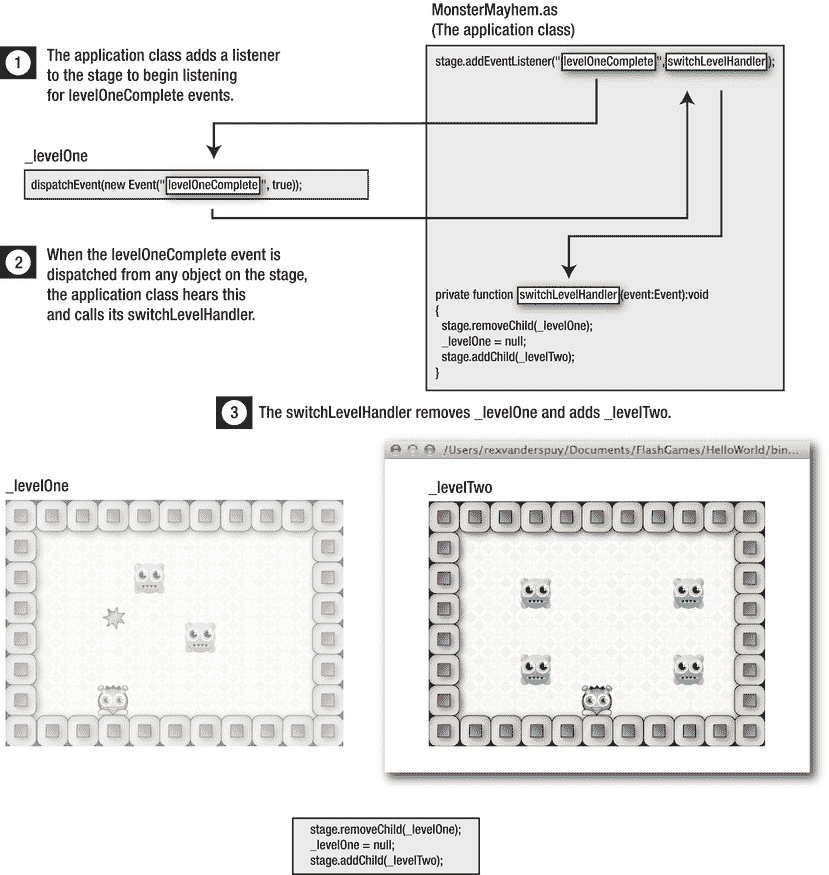

**图 8-19.** 使用事件切换关卡

这是你第一次看到如何使用 `removeChild`，也是你第一次看到一个类如何监听另一个类广播的事件。让我们稍微深入地看看这两个新特性。

### 使用 `removeChild` 完全移除对象

到目前为止，在所有的游戏示例中，你都是通过将对象的可见属性设置为 false 来从游戏中移除对象，就像这样：

`_monster1.visible = false;`

然后你可以通过简单的 if/else 语句来检查对象是否仍在游戏中，就像这样：

```
if(_monster1.visible)
{
  //怪物处于活动状态，因此保持
  //它的移动并检测碰撞
}
else
{
  //怪物已不在游戏中
}
```

这是一种移除游戏对象的简单方法，通常也是最好的方法。这种技术的优点在于，对象实际上在整个过程中一直存在于舞台上。如果你的游戏需要反复隐藏和显示相同的对象，这就是最佳做法。只需将对象重新设为可见，就能轻松重置游戏或游戏关卡。

这样做唯一的问题在于，游戏对象实际上仍然存在，并占用着 Flash Player 的内存空间。如果舞台上有数百个不可见对象，而这些对象可能仍在运行内部事件（如计时器或 `enterFrameHandler`），这就会成为一个问题。在这种情况下，最好使用 `removeChild` 将它们完全移除。具体做法如下：

`removeChild(objectName);`

如果你要移除的对象在舞台上，可以这样移除：

`stage.removeChild(objectName);`

如果它在另一个类（如 `LevelOne`）内部，可以这样移除：

`this.removeChild(objectName);`

为了将对象从内存中完全清除，请将任何引用该对象的变量赋值为 null，就像这样：

`objectName = null;`

当对象被移除时，实际上会发生什么？AS3.0 有一个**垃圾回收器**来完成这项工作。你可以把垃圾回收器想象成一个软件小机器人，它在你的游戏中四处奔波，寻找未被使用或没有任何值的对象和属性，并将它们彻底删除。这节省了内存和处理能力，AS3.0 会自动为你完成。垃圾回收器的工作之一就是寻找那些已通过 `removeChild` 移除的对象，并将它们从 Flash Player 的内存中擦除。然而，垃圾回收器有点挑剔，它在选择完全删除哪些内容时非常讲究。

- 垃圾回收器不会删除正在运行 `ENTER_FRAME` 事件的对象。这些对象会让垃圾回收器有些犯难，因此你必须像在 `removedFromStage` 事件处理函数中所做的那样，使用 `removeListener` 手动移除 `ENTER_FRAME` 事件。虽然对象会移除自己的事件监听器（如 `ADDED_TO_STAGE` 和 `REMOVED_FROM_STAGE`），但手动移除它们也被认为是良好的编程习惯。
- 垃圾回收器不喜欢使用时间轴进行动画的 `MovieClip` 对象。除非通过使用 `stop` 方法停止动画，否则它不会动这些对象。
- 如果有任何对象使用 `Timer` 类运行计时器，垃圾回收器不会删除它们。
- 如果游戏中有多个变量引用了某个对象，垃圾回收器不会删除该对象。

不过，通常情况下，AS3.0 的垃圾回收器在处理这类事情上是相当高效的。只要你牢记这些指导原则，你的游戏就不会因为那些你以为已完全删除但实际上并未删除、仍在后台运行的对象而意外变慢。

如果你已使用 `removeChild` 从游戏中移除了一个对象，你可以通过使用如下所示的 if 语句来测试它是否还存在：

```
if(gameObject == null)
{
  //该对象已不在游戏中
}
```

还要记住，当你从舞台上移除一个对象时，该对象的 `REMOVED_FROM_STAGE` 事件处理函数（如果你为此对象创建了的话）将会运行。这是一个移除计时器或对象的 `enterFrameHandler` 的好地方，以防止对象被移除后它们仍在后台秘密运行。

### 通过派发事件实现类间通信

你用过的最酷的新编程魔法就是 `dispatchEvent` 方法。

`dispatchEvent(new Event("levelOneComplete", true));`

这会向其他可能对此感兴趣的类广播一个名为 `"levelOneComplete"` 的事件。你可以随意命名该事件，并且可以根据游戏需要派发任意数量的事件。

派发事件是游戏程序员能学到的最有用的技能之一。在本书几乎每一章中，你都会看到事件被广泛使用。按钮点击、计时器、帧——AS3.0 程序中几乎所有重要的事情似乎都由事件触发。但到目前为止，你用到的事件都是 AS3.0 内置的。通过使用 `dispatchEvent` 方法，你可以创建自己的事件，并在游戏中任何重要事件发生时触发它们。

例如，假设你正在制作一款冒险游戏，其中主角需要从一个熟睡的女巫那里偷走一块魔法姜饼。一旦饼干被偷，游戏中的其他对象如果能知道这件事会非常有用。你可以通知应用类更新分数，通知角色更新背包，甚至还可以通知沉睡的女巫——如果玩家脚步不够轻，她可能会醒来。然而，魔法姜饼无需逐个通知每个对象，它只需要向整个游戏广播一个事件：“我被拿走了！”这被称为*派发事件*。其他对象可以选择是否监听此事件，并在事件与自己相关时采取行动。

这种系统的优雅之处在于，事件并非派发给特定对象，而监听事件的对象也无需了解广播事件的对象。

以下是派发事件的快速入门指南：

1. 导入 `Event` 类。
   ```actionscript
   import flash.events.Event;
   ```
2. 当游戏中任何对象可能感兴趣的事情发生时，使用 `dispatchEvent` 方法为其创建事件。创建事件的基本格式如下：
   ```
   dispatchEvent(new Event("eventName", true));
   ```
   这条指令向程序的其余部分广播某个事件已发生。你可以任意命名事件，例如示例中的 `"eventName"`。
3. 现在，任何其他类都可以通过添加事件监听器来监听此事件，如下所示：
   ```
   stage.addEventListener("eventName", eventNameHandler);
   ```
   在你的游戏中，你可能更倾向于将事件监听器添加到舞台（原因稍后解释）。但你可以将事件监听器附加到任何对象上。
4. 接着，你需要创建事件处理函数，以便在事件发生时执行某些操作。
   ```actionscript
   private function eventNameHandler(event:Event)
   {
       trace(event.target);
   }
   ```

在事件处理函数中，你可以使用事件对象的 `target` 属性来访问调用事件的对象及其所有属性。（如果你想访问注册了事件的对象，比如本例中的舞台，请使用 `currentTarget` 属性。）

5. 等待事件发生。

你可以为游戏中任何你认为其他对象应该知道的事情创建事件，例如一扇门打开、一个敌人被消灭，或者一个变量改变其值。任何对象都可以根据需要选择监听这些事件，并据此采取行动。

通过使用事件，对象之间可以相互通信，而无需依赖其他类来正常运行。它们可以监听自己感兴趣的事件，并在内部修改自身的私有属性。

### 事件冒泡

事件被派发后，会经历三种不同的状态：捕获、目标和冒泡。你只需要关心*冒泡*状态，它对于本书中涉及的各种游戏设计场景最为实用。

当一个对象派发事件时，该对象就像广播电台播报新闻一样广播事件。其他对象随后可以“收听”这个事件，如果想要监听它的话。

然而，事件并非同时广播给程序中的每个对象。它们会沿着对象的层级结构向上或向下传播。你可以在传播过程中的任何点监听事件。

如果事件被设置为冒泡，意味着它会沿着层级结构向上传播。它从子对象开始，然后通知父对象。该父对象随后可以执行任何需要的操作。图 8-20 展示了这一过程。

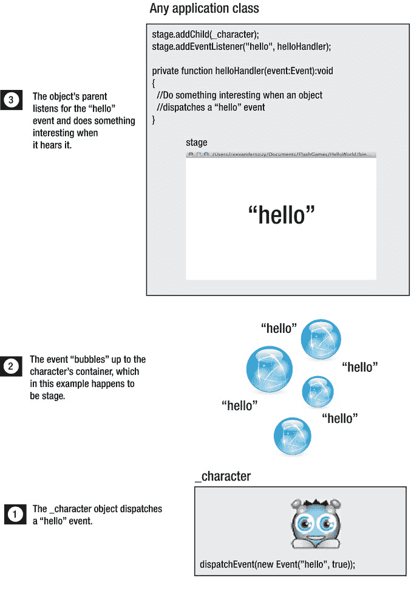

**图 8-20.** 事件从子对象向父对象冒泡。

`dispatchEvent` 方法有一个参数，称为事件构造函数。这里用粗体标出：

`dispatchEvent(new Event("eventName", true));`

事件构造函数用于创建事件。通过将事件构造函数中的第二个参数设置为 `true`，可以使事件冒泡：

`new Event("eventName", true)`

如果将其改为 `false` 或完全省略，事件则不会冒泡。

*如果其他类或对象想要监听某个事件，它们必须将事件监听器附加到父对象上。通常，这个父对象就是舞台，它是所有显示对象的共同父级。不过，如果你只用一个类来监听来自所有对象的事件，游戏会更容易管理。这个类可以是应用类，也可以是中介类，比如本章示例中的 `LevelOne`。这样游戏的控制权就集中了，当事件被触发时，你就能知道在代码中何处查找并修改游戏对象应执行的操作。*

以上就是你在游戏中派发和监听事件所需了解的全部内容。

## 完成第一关

《怪兽大乱斗》的第一关即将完成。你唯一还没看过的类是 `Background` 类。它所做的只是显示背景图片——没什么特别的！为了完整性，下面是完整的 `Background` 类：

```actionscript
package
{
    import flash.display.DisplayObject;
    import flash.display.Sprite;

    public class Background extends Sprite
    {
        //嵌入图片
        [Embed(source="../images/background.png")]
        private var BackgroundImage:Class;
        private var _background:DisplayObject = new BackgroundImage();

        public function Background()
        {
            this.addChild(_background);
        }
    }
}
```

## 第二关：四方向发射星星

第二关为游戏引入了几个新变化。舞台上现在有四只怪物，而且它们的移动速度更快了。通过将速度从每帧 1 像素提高到 2 像素，很容易就实现了这一点。`LevelTwo`类中其余大部分代码与`LevelOne`相同，但请务必阅读本章源文件中`LevelTwo.as`文件里的全部代码，以了解其在完整上下文中的运作。

第二关最大的变化是游戏角色能向所有四个方向发射星星，如图 8-21 所示。

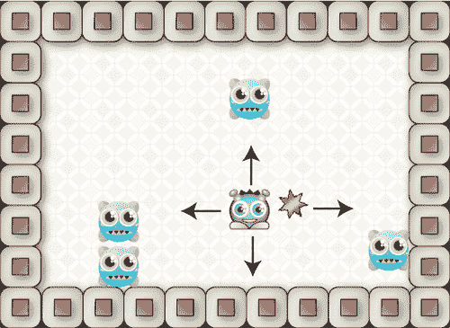

**图 8-21.** 在第二关中，角色可以向四个方向发射星星。

实现这一功能非常简单：只需追踪玩家按下的是四个方向键中的哪一个，然后根据该方向改变星星的`vx`和`vy`属性即可。

首先，`LevelTwo`使用一个名为`_starDirection`的新字符串变量来追踪星星应该移动的方向。请注意，`_starDirection`会根据按下的按键变为"left"、"right"、"up"或"down"，并且只有在星星尚未发射时才会更改。这可以防止星星在飞行途中因为玩家按下方向键而改变方向。

```actionscript
private function keyDownHandler(event:KeyboardEvent):void
{
  if (event.keyCode == Keyboard.LEFT)
  {
    _character.vx = -5;
    if(!_star.launched)
    {
      _starDirection = "left";
    }
  }
  else if (event.keyCode == Keyboard.RIGHT)
  {
    _character.vx = 5;
    if(!_star.launched)
    {
      _starDirection = "right";
    }
  }
  else if (event.keyCode == Keyboard.UP)
  {
    _character.vy = -5;
    if(!_star.launched)
    {
      _starDirection = "up";
    }
  }
  else if (event.keyCode == Keyboard.DOWN)
  {
    _character.vy = 5;
    if(!_star.launched)
    {
      _starDirection = "down";
    }
  }
  if(event.keyCode == Keyboard.SPACE)
  {
    if(!_star.launched)
    {
      _star.x = _character.x + _character.width / 2;
      _star.y = _character.y + _character.width / 2;
      _star.launched = true;
    }
  }
}
```

然后，`enterFrameHandler`会根据`_starDirection`的设定值，设置星星的速度，使其向四个方向中的任意一个移动。

```actionscript
if(_star.launched)
{
  _star.visible = true;
  //根据 keyDownHandler 中设置的
  //_starDirection 变量来设置星星的速度
  if(_starDirection == "up")
  {
    _star.vy = -3;
    _star.vx = 0;
  }
  else if(_starDirection == "down")
  {
    _star.vy = 3;
    _star.vx = 0;
  }
  else if(_starDirection == "left")
  {
    _star.vy = 0;
    _star.vx = -3;
  }
  else if(_starDirection == "right")
  {
    _star.vy = 0;
    _star.vx = 3;
  }
  //移动并旋转星星
  _star.x += _star.vx;
  _star.y += _star.vy;
  _star.rotation += 5;
  //检查舞台边界
  checkStarStageBoundaries(_star);
  //检测与怪物的碰撞
  starVsMonsterCollision(_star, _monster1);
  starVsMonsterCollision(_star, _monster2);
  starVsMonsterCollision(_star, _monster3);
  starVsMonsterCollision(_star, _monster4);
}
else
{
  _star.visible = false;
}
```

以上就是需要做出的全部修改。

你也可以选择在`Star`类内部创建一个名为`direction`的属性。然后，你可以像这样修改这个方向属性：

```actionscript
star.direction = "left";
```

_star.direction = "up"

然后，你可以像这样用它来检查星星应该移动的方向：

```
if(_star.Direction == "up")
{
    ...
}
```

你采用何种方式来追踪星星的方向完全取决于你自己。

在《怪物大作战》中，当第一颗星星还在舞台上时，角色无法发射另一颗星星。然而，在许多游戏中，无论舞台上有多少颗子弹，角色都可以发射无限数量的抛射物。要实现这一点，你需要了解**数组**和**循环**。你将在第 9 章中学习数组和循环，并在第 10 章中学习如何使用它们发射多个抛射物。

第二关的结束方式与第一关相同。代码会检测怪物或角色哪一方获胜，并显示相应的信息。

### 更多《怪物大作战》的玩法！

《怪物大作战》是游戏项目的一个绝佳模型，但如果你正在制作类似类型的游戏，你可能还希望它具备一些更高级的功能。

- **滚动背景**：你可能想要创建一个比舞台边框更大的游戏环境，并让角色和怪物在其中移动。
- **智能怪物**：《怪物大作战》中的怪物在舞台上随机移动。如果它们能定位角色的位置并向其移动，岂不是很有趣？

你可以实现这两个功能。让我们来看看具体方法。

#### 在滚动游戏世界中移动对象

在第 7 章中，我展示了如何制作一个拥有大型滚动背景的游戏。实现这一点的技巧是计算**滚动速度**并将其应用于游戏对象。这可以使它们的位置与滚动背景保持同步。你将使用完全相同的技术让《怪物大作战》中的对象滚动，因此在学习下一节内容之前，请确保你已完全理解第 7 章中的代码。

在《怪物大作战》中，怪物和星星武器是在舞台上移动的。这意味着它们需要调整自身速度以适应移动的背景。幸运的是，这非常容易实现，但需要一些思考和规划，因此我将带你详细了解这段代码，以便你能更轻松地在自己的游戏中实现滚动效果。

你可以在`ScrollingMonsters`项目文件夹中找到《怪物大作战》的滚动版本。它只有一个关卡，包含四只怪物，并且碰撞检测已被禁用，以便更容易测试滚动效果。运行 SWF 文件，你会看到怪物现在可以在整个游戏世界中自由漫步（图 8-22）。

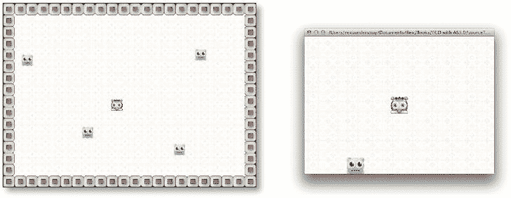

**图 8-22.** 在大型滚动游戏世界中移动对象

### 滚动游戏代码

我按照与原始《怪物大乱斗》完全相同的方式构建了这个示例，以便你能看到另一个简化版的游戏结构系统在运行。应用程序类`ScrollingMonsters`创建了一个名为`_scrollingLevel`的对象，并将其添加到舞台上。所有游戏逻辑都在`ScrollingLevel`类中。以下是加载游戏关卡的`ScrollingMonsters`应用程序类：

```
package
{
  import flash.display.Sprite;
  import flash.events.Event;

  [SWF(width="550", height="400",
  backgroundColor="#FFFFFF", frameRate="60")]
  public class ScrollingMonsters extends Sprite
  {
    private var _scrollingLevel:ScrollingLevel;

    public function ScrollingMonsters()
    {
      _scrollingLevel = new ScrollingLevel(stage);
      stage.addChild(_scrollingLevel);
    }
  }
}
```

为了让您能看到所有代码的上下文，以下是包含所有游戏逻辑的整个`ScrollingLevel`类。其中大部分代码与你在本章前面看到的`LevelOne`和`LevelTwo`类中的代码相同。我已将所有与滚动相关的新代码突出显示，并将稍后详细解释。

```
package
{
  import flash.display.Sprite;
  import flash.events.Event;
  import flash.events.KeyboardEvent;
  import flash.events.TimerEvent;
  import flash.ui.Keyboard;
  import flash.utils.Timer;

  public class ScrollingLevel extends Sprite
  {
    //声明变量以保存游戏对象
    private var _character:Character;
    private var _background:BigBackground;
    private var _gameOver:GameOver;
    private var _monster1:Monster;
    private var _monster2:Monster;
    private var _monster3:Monster;
    private var _monster4:Monster;
    private var _star:Star;
    private var _levelWinner:String;
    private var _stage:Object;
    private var _starDirection:String;

    //计时器
    private var _monsterTimer:Timer;
    private var _gameOverTimer:Timer;

    //滚动所需的变量
    private var _temporaryX:int;
    private var _temporaryY:int;
    private var _scroll_Vx:int;
    private var _scroll_Vy:int;
    private var _rightInnerBoundary:uint;
    private var _leftInnerBoundary:uint;
    private var _topInnerBoundary:uint;
    private var _bottomInnerBoundary:uint;
    private var _currentExplosion:Sprite = null;

    public function ScrollingLevel(stage:Object)
    {
      _stage = stage;
      this.addEventListener
        (Event.ADDED_TO_STAGE, addedToStageHandler);
    }

    private function addedToStageHandler(event:Event):void
    {
      startGame();
      this.removeEventListener
        (Event.ADDED_TO_STAGE, addedToStageHandler);
    }

    private function startGame():void
    {
      //创建游戏对象
      _character = new Character();
      _star = new Star();
      _background = new BigBackground();
      _monster1 = new Monster();
      _monster2 = new Monster();
      _monster3 = new Monster();
      _monster4 = new Monster();
      _gameOver = new GameOver();

      //将游戏对象添加到舞台
      addGameObjectToLevel
        (
           _background,
           -(_background.width - stage.stageWidth) / 2,
           -(_background.height - stage.stageHeight) / 2
         );
      addGameObjectToLevel(_monster1, 400, 125);
      addGameObjectToLevel(_monster2, 150, 125);
      addGameObjectToLevel(_monster3, 400, 250);
      addGameObjectToLevel(_monster4, 150, 250);
```

```actionscript
addGameObjectToLevel(_character, 250, 175);
addGameObjectToLevel(_star, 250, 300);
_star.visible = false;
addGameObjectToLevel(_gameOver, 140, 130);

//初始化怪物计时器
_monsterTimer = new Timer(1000);
_monsterTimer.addEventListener(TimerEvent.TIMER, monsterTimerHandler);
_monsterTimer.start();

//事件监听器
_stage.addEventListener(KeyboardEvent.KEY_DOWN, keyDownHandler);
_stage.addEventListener(KeyboardEvent.KEY_UP, keyUpHandler);
this.addEventListener(Event.ENTER_FRAME, enterFrameHandler);

//定义内部边界变量
_rightInnerBoundary = (_stage.stageWidth / 2) + (_stage.stageWidth / 4);
_leftInnerBoundary = (_stage.stageWidth / 2) - (_stage.stageWidth / 4);
_topInnerBoundary = (_stage.stageHeight / 2) - (_stage.stageHeight / 4);
_bottomInnerBoundary = (_stage.stageHeight / 2) + (_stage.stageHeight / 4);
}

private function enterFrameHandler(event:Event):void
{
  //移动游戏角色
  _character.x += _character.vx;
  _character.y += _character.vy;

  //移动怪物并检查其舞台边界
  if(_monster1.visible)
  {
    _monster1.x += _monster1.vx;
    _monster1.y += _monster1.vy;
    checkStageBoundaries(_monster1);
  }
  if(_monster2.visible)
  {
    _monster2.x += _monster2.vx;
    _monster2.y += _monster2.vy;
    checkStageBoundaries(_monster2);
  }
  if(_monster3.visible)
  {
    _monster3.x += _monster3.vx;
    _monster3.y += _monster3.vy;
    checkStageBoundaries(_monster3);
  }
  if(_monster4.visible)
  {
    _monster4.x += _monster4.vx;
    _monster4.y += _monster4.vy;
    checkStageBoundaries(_monster4);
  }

  //星星是否已发射？
  if(_star.launched)
  {
    //如果已发射，使其可见
    _star.visible = true;
    //根据在 keyDownHandler 中设置的 _starDirection 变量
    //设置星星的速度
    if(_starDirection == "up")
    {
      _star.vy = -3;
      _star.vx = 0;
    }
    else if(_starDirection == "down")
    {
      _star.vy = 3;
      _star.vx = 0;
    }
    else if(_starDirection == "left")
    {
      _star.vy = 0;
      _star.vx = -3;
    }
    else if(_starDirection == "right")
    {
      _star.vy = 0;
      _star.vx = 3;
    }

    //移动并旋转星星
    _star.x += _star.vx;
    _star.y += _star.vy;
    _star.rotation += 5;

    //检查其舞台边界
    checkStarStageBoundaries(_star);

    //检查与怪物的碰撞
    starVsMonsterCollision(_star, _monster1);
    starVsMonsterCollision(_star, _monster2);
    starVsMonsterCollision(_star, _monster3);
    starVsMonsterCollision(_star, _monster4);
  }
  else
  {
    _star.visible = false;
  }

  //角色与怪物之间的碰撞检测
  //取消注释以下代码以重新启用碰撞
  /*
  characterVsMonsterCollision(_character, _monster1);
  characterVsMonsterCollision(_character, _monster2);
  characterVsMonsterCollision(_character, _monster3);
  characterVsMonsterCollision(_character, _monster4);
  */

  //滚动背景
  //计算滚动速度
  _temporaryX = _background.x;
  _temporaryY = _background.y;

  //检查内部边界
  if (_character.x < _leftInnerBoundary)
  {
    _character.x = _leftInnerBoundary;
    _rightInnerBoundary = (_stage.stageWidth / 2) + (_stage.stageWidth / 4);
    _background.x -= _character.vx;
  }
  else if (_character.x + _character.width > _rightInnerBoundary)
  {
    character.x = _rightInnerBoundary - _character.width;
    _leftInnerBoundary = (_stage.stageWidth / 2) - (_stage.stageWidth / 4);
    _background.x -= _character.vx;
  }

  if (_character.y < _topInnerBoundary)
  {
    _character.y = _topInnerBoundary;
    _bottomInnerBoundary = (_stage.stageHeight / 2) + (_stage.stageHeight / 4);
    _background.y -= _character.vy;
  }
  else if
```

```actionscript
(_character.y + _character.height > _bottomInnerBoundary)
{
  _character.y = _bottomInnerBoundary - _character.height;
  _topInnerBoundary = (_stage.stageHeight / 2) - (_stage.stageHeight / 4);
  _background.y -= _character.vy;
}

// 背景舞台边界
if (_background.x > 0)
{
  _background.x = 0;
  _leftInnerBoundary = 0;
}
else if (_background.y > 0)
{
  _background.y = 0;
  _topInnerBoundary = 0;
}
else if (_background.x < _stage.stageWidth - _background.width)
{
  _background.x = _stage.stageWidth - _background.width;
  _rightInnerBoundary = _stage.stageWidth;
}
else if (_background.y < _stage.stageHeight - _background.height)
{
  _background.y = _stage.stageHeight - _background.height;
  _bottomInnerBoundary = _stage.stageHeight;
}

// 角色舞台边界
if (_character.x < 50)
{
  _character.x = 50;
}
if (_character.y < 50)
{
  _character.y = 50;
}
if (_character.x + _character.width > _stage.stageWidth - 50)
{
  _character.x = _stage.stageWidth - _character.width - 50;
}
if (_character.y + _character.height > _stage.stageHeight - 50)
{
  _character.y = _stage.stageHeight - _character.height - 50;
}

// 计算滚动速度
_scroll_Vx = _background.x - _temporaryX;
_scroll_Vy = _background.y - _temporaryY;

// 1. 滚动移动对象
// 滚动怪物
`scroll(_monster1)`;
`scroll(_monster2)`;
`scroll(_monster3)`;
`scroll(_monster4)`;

// 2. 滚动星星
if (_star.launched)
{
  `scroll(_star)`;
}

// 3. 滚动当前爆炸特效
if (_currentExplosion != null)
{
  `scroll(_currentExplosion)`;
}

public function `scroll`(`gameObject:Sprite`):void
{
  `gameObject.x` += _scroll_Vx;
  `gameObject.y` += _scroll_Vy;
}

private function `characterVsMonsterCollision`(`character:Character`, `monster:Monster`):void
{
  if (`monster.visible` && `character.hitTestObject(monster)`)
  {
    `character.timesHit`++;
    `checkGameOver()`;
  }
}

private function `starVsMonsterCollision`(`star:Star`, `monster:Monster`):void
{
  if (`monster.visible` && `star.hitTestObject(monster)`)
  {
    // 调用怪物的"openMouth"方法使其张开嘴巴
    `monster.openMouth()`;
    // 停用星星
    `star.launched` = false;
    // 将怪物的 `timesHit` 变量加 1
    `monster.timesHit`++;
    // 怪物是否被击中 3 次？
    if (`monster.timesHit` == 3)
    {
      // 调用"killMonster"方法
      `killMonster(monster)`;
      // 检查游戏是否结束
      `checkGameOver()`;
    }
  }
}

private function `killMonster`(`monster:Monster`):void
{
  // 使怪物不可见
  `monster.visible` = false;
  // 创建新的爆炸对象并将其添加到舞台
  var `explosion:Explosion` = new `Explosion()`;
  this.addChild(`explosion`);
  _currentExplosion = `explosion`;
  // 将爆炸特效居中在怪物上方
  `explosion.x` = `monster.x` - 21;
  `explosion.y` = `monster.y` - 18;
  // 调用爆炸对象的"explode"方法
  `explosion.explode()`;
}

private function `checkGameOver`():void
{
  if (`_monster1.timesHit` == 3 && `_monster2.timesHit` == 3 && `_monster3.timesHit` == 3 && `_monster4.timesHit` == 3)
  {
    _levelWinner = "character";
    _gameOverTimer = new `Timer(2000)`;
    _gameOverTimer.addEventListener(`TimerEvent.TIMER`, `gameOverTimerHandler`);
    _gameOverTimer.start();
    _monsterTimer.removeEventListener(`TimerEvent.TIMER`, `monsterTimerHandler`);
    this.removeEventListener(`Event.ENTER_FRAME`, `enterFrameHandler`);
  }
  if (`_character.timesHit` == 1)
  {
    _levelWinner = "monsters";
    `_character.alpha` = 0.5;
    _gameOverTimer = new `Timer(2000)`;
    _gameOverTimer.addEventListener(`TimerEvent.TIMER`, `gameOverTimerHandler`);
    _gameOverTimer.start();
    _monsterTimer.removeEventListener(`TimerEvent.TIMER`, `monsterTimerHandler`);
    this.removeEventListener(`Event.ENTER_FRAME`, `enterFrameHandler`);
  }
}

private function `checkStageBoundaries`(`gameObject:Sprite`):void
{
  if (`gameObject.x` < `_background.x` + 50)
  {
    `gameObject.x` = `_background.x` + 50;
  }
  if (`gameObject.y` < `_background.y` + 50)
  {
    `gameObject.y` = `_background.y` + 50;
  }
  if (`gameObject.x` + `gameObject.width` > `_background.x` + `_stage.stageWidth` - 50)
  {
    `gameObject.x` = `_background.x` + `_stage.stageWidth` - `gameObject.width` - 50;
  }
  if (`gameObject.y` + `gameObject.height` > `_background.y` + `_stage.stageHeight` - 50)
  {
    `gameObject.y` = `_background.y` + `_stage.stageHeight` - `gameObject.height` - 50;
  }
}
```

```markdown
> `_background.x + _background.width - 50)`

    {

        `gameObject.x`

            = `_background.x + _background.width`

            - `gameObject.width - 50`;

    }

    if (`gameObject.y + gameObject.height`

    > `_background.y + _background.height - 50`)

    {

        `gameObject.y`

            = `_background.y + _background.height`

            - `gameObject.height - 50`;

    }

}

private function `checkStarStageBoundaries`(`star`:`Star`):`void`

{

    if (`star.y < 0`

    || `star.x < 0`

    || `star.x > _stage.stageWidth`

    || `star.y > _stage.stageHeight`)

    {

        `_star.launched = false`;

    }

}

private function `monsterTimerHandler`(`event`:`TimerEvent`):`void`

{

    `changeMonsterDirection`(`_monster1`);

    `changeMonsterDirection`(`_monster2`);

    `changeMonsterDirection`(`_monster3`);

    `changeMonsterDirection`(`_monster4`);

}

private function `changeMonsterDirection`(`monster`:`Monster`):`void`

{

    var `randomNumber`:`int` = `Math.ceil(Math.random() * 4)`;

    if(`randomNumber == 1`)

    {

        //右

        `monster.vx = 2`;

        `monster.vy = 0`;

    }

    else if (`randomNumber == 2`)

    {

        //左

        `monster.vx = -2`;

        `monster.vy = 0`;

    }

    else if(`randomNumber == 3`)

    {

        //上

        `monster.vx = 0`;

        `monster.vy = -2`;

    }

    else

    {

        //下

        `monster.vx = 0`;

        `monster.vy = 2`;

    }

}

private function `gameOverTimerHandler`(`event`:`TimerEvent`):`void`

{

    if(`_levelWinner == "character"`)

    {

        if(`_gameOverTimer.currentCount == 1`)

        {

            `_gameOver.levelComplete.visible = true`;

        }

        if(`_gameOverTimer.currentCount == 2`)

        {

            `_gameOverTimer.reset()`;

            `gameOverTimer.removeEventListener`

                (`TimerEvent.TIMER, gameOverTimerHandler`);

            //dispatchEvent(new Event("levelOneComplete", true));

        }

    }

    if(`_levelWinner == "monsters"`)

    {

        `_gameOver.youLost.visible = true`;

        `gameOverTimer.removeEventListener`

            (`TimerEvent.TIMER, gameOverTimerHandler`);

    }

}

private function `keyDownHandler`(`event`:`KeyboardEvent`):`void`

{

    if (`event.keyCode == Keyboard.LEFT`)

    {

        `_character.vx = -5`;

        if(!`_star.launched`)

        {

            `_starDirection = "left"`;

        }

    }

    else if (`event.keyCode == Keyboard.RIGHT`)

    {

        `_character.vx = 5`;

        if(!`_star.launched`)

        {

            `_starDirection = "right"`;

        }

    }

    else if (`event.keyCode == Keyboard.UP`)

    {

        `_character.vy = -5`;

        if(!`_star.launched`)

        {

            `_starDirection = "up"`;

        }

    }

    else if (`event.keyCode == Keyboard.DOWN`)

    {

        `_character.vy = 5`;

        if(!`_star.launched`)

        {

            `_starDirection = "down"`;

        }

    }

    if(`event.keyCode == Keyboard.SPACE`)

    {

        if(!`_star.launched`)

        {

            `_star.x = _character.x + _character.width / 2`;

            `_star.y = _character.y + _character.width / 2`;

            `_star.launched = true`;

        }

    }

}

private function `keyUpHandler`(`event`:`KeyboardEvent`):`void`

{

    if (`event.keyCode == Keyboard.LEFT`

    || `event.keyCode == Keyboard.RIGHT`)

    {

        `_character.vx = 0`;

    }

    else if (`event.keyCode == Keyboard.DOWN`

    || `event.keyCode == Keyboard.UP`)

    {

        `_character.vy = 0`;

    }

}

private function `addGameObjectToLevel`

    (`gameObject`:`Sprite`, `xPos`:`int`, `yPos`:`int`):`void`

{

    this.addChild(`gameObject`);

    `gameObject.x = xPos`;

    `gameObject.y = yPos`;

}

```

### 滚动代码的工作原理

为了简化代码，我将滚动所需的所有变量和对象都声明为类定义中的实例变量。这意味着在类的任何位置，只要需要，任何方法或对象都可以访问它们。

```
private var `_temporaryX`:`int`;

private var `_temporaryY`:`int`;

private var `_scroll_Vx`:`int`;

private var `_scroll_Vy`:`int`;

private var `_rightInnerBoundary`:`uint`;

private var `_leftInnerBoundary`:`uint`;

private var `_topInnerBoundary`:`uint`;

private var `_bottomInnerBoundary`:`uint`;
```

# 游戏滚动与智能怪物实现

## 滚动爆炸效果

所有爆炸对象都是在 `killMonster` 方法中本地创建的，如下所示：

```actionscript
var explosion:Explosion = new Explosion();
this.addChild(explosion);
```

这意味着它们无法在 `killMonster` 方法外部被访问。这是个问题，因为 `enterFrameHandler` 需要某种方式来访问它们，以便在它们被添加到舞台后能够滚动它们。

一个简单的解决方案是创建一个实例变量，用于存储对当前爆炸对象的引用。你可能还记得，实例变量是在类定义中声明的任何变量。它们可供类中任何位置的所有对象和所有方法使用。我在类定义中创建了一个名为 `_currentExplosion` 的实例变量，并将其初始值设为 `null`。

```actionscript
private var _currentExplosion:Sprite = null;
```

它是一个 `Sprite`（精灵），因此可以包含任何扩展自 `Sprite` 类的对象，就像爆炸对象那样。

当 `killMonster` 方法创建一个临时爆炸对象时，你只需要将其复制到 `_currentExplosion` 变量中，如下所示：

```actionscript
var explosion:Explosion = new Explosion();
this.addChild(explosion);
_currentExplosion = explosion;
```

这让你能够持有一个对临时爆炸对象的引用，该引用可用于类中的其他方法。`enterFrameHandler` 可以使用这个 `_currentExplosion` 对象来滚动爆炸效果，如下所示：

```actionscript
if(_currentExplosion != null)
{
  scroll(_currentExplosion);
}
```

这种技术是引用临时对象并在创建它们的方法之外使用它们的快速简便方法。但这可能并非最佳方式。跟踪和控制临时对象会变得复杂，特别是当你需要同时访问多个临时对象时。在第 10 章中，你将学习如何使用循环和数组来精确地添加、移除和控制游戏中的临时对象。

## 智能怪物

让怪物主动追捕角色非常简单。代码需要做的只是判断怪物相对于角色的位置：是在上方、下方、左侧还是右侧。一旦明确方向，只需修改怪物的速度，使其向玩家移动即可。你需要编写的代码遵循以下逻辑。

```actionscript
if (角色在怪物左侧)
{
  让怪物向左移动
}
```

以下是《怪物大作战》中实际代码可能的样子：

```actionscript
if (_character.x < monster.x)
{
  monster.vx = -2;
  monster.vy = 0;
}
```

如你所见，只需比较角色的 `x` 坐标和怪物的 `x` 坐标，然后将怪物向左移动即可。

你可以在项目源文件的 `IntelligentMonsters` 示例中查看所有这些代码的实际运行效果。运行 SWF 文件，你会注意到怪物在舞台上追逐角色。它们每秒都会决定应该向左或向右，还是向上或向下移动以接近角色。如果你停止移动角色，你会注意到怪物会蜂拥而至。图 8-23 展示了怪物的行为。

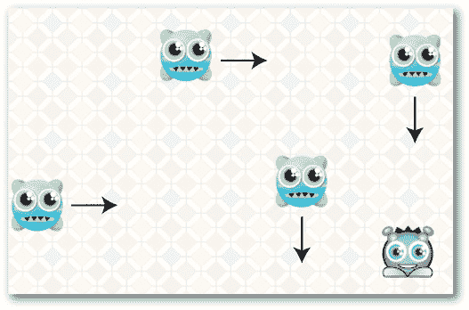

**图 8-23.** 追逐玩家的怪物

实现此功能的代码极其简单。只需对 `changeMonsterDirection` 方法进行小幅修改。以下是更新后的方法：

```actionscript
private function changeMonsterDirection(monster:Monster):void
{
  //在 1 和 2 之间选择一个随机数
  var randomNumber:int = Math.ceil(Math.random() * 2);
  //如果数字是 1，则沿水平轴靠近角色
  if (randomNumber == 1)
  {
    if (_character.x > monster.x)
    {
      //向右
      monster.vx = 2;
      monster.vy = 0;
    }
    if (_character.x < monster.x)
    {
      //向左
      monster.vx = -2;
```

`monster.vy = 0;`

}

}

//如果数字是 2，则沿垂直轴靠近角色

if (`randomNumber` == 2)

{

if (`_character.y` < `monster.y`)

{

//向上

`monster.vx` = 0;

`monster.vy` = -2;

}

if (`_character.y` > `monster.y`)

{

//向下

`monster.vx` = 0;

`monster.vy` = 2;

}

}

}

```

代码首先在 1 和 2 之间选择一个随机数。

```

var `randomNumber`:int = `Math.ceil`(`Math.random`() * 2);

```

如果数字是 1，怪物决定沿`x`轴靠近角色。

```

if (`randomNumber` == 1)

{

//向左或向右移动...

}

```

如果随机数是 2，怪物则沿`y`轴靠近角色。

```

if (`randomNumber` == 2)

{

//向上或向下移动...

}

```

我加入这点随机性是为了让游戏稍微容易一些。你可以轻松地让怪物在方向选择上非常精确，只选择最接近角色的方向移动。具体做法是比较`x`和`y`位置的距离，让怪物选择距离最长的方向。使用`Math.abs`方法可以计算出距离，而无需担心物体`x`和`y`坐标的正负值。

```

//判断怪物是在 x 轴还是 y 轴上更接近角色

var `vx`:Number = `Math.abs`(`_character.x` - `monster.x`);

var `vy`:Number = `Math.abs`(`_character.y` - `monster.y`);

//如果在 y 轴上已经更接近，则向右或向左移动角色

if (`vx` > `vy`)

{

if (`_character.x` > `monster.x`)

{

//向右

`monster.vx` = 2;

`monster.vy` = 0;

}

else

{

//向左

`monster.vx` = -2;

`monster.vy` = 0;

}

}

//如果在 x 轴上已经更接近，则向上或向下移动角色

else

{

if (`_character.y` < `monster.y`)

{

//向上

`monster.vx` = 0;

`monster.vy` = -2;

}

else

{

//向下

`monster.vx` = 0;

`monster.vy` = 2;

}

}
```

这种修改能让怪物像外科手术般精准地锁定角色。虽然这会使游戏变得非常困难，但通过尝试加入一些额外的随机性，你就能找到合适的平衡点，创造出既有趣又富有挑战性的游戏。你可以在 `IntelligentMonsters` 类的 `changeMonsterDirection` 方法的注释中找到所有这些可行代码。

## 障碍物与寻路

这是你首次接触游戏设计中称为人工智能（通常简称为 AI）的领域。这是一个庞大的话题，如果你对游戏设计是认真的（你确实是！），你会想要更深入地探索它。

你希望对《怪物大作战》进行的另一个修改是添加障碍物，比如一个迷宫让怪物在其中穿行。你可以使用前两章用过的 `Collision.block` 方法来实现，当怪物碰到墙壁的某一段时，让它们改变方向。但由于每个怪物都需要与每一段墙壁进行碰撞检测，你将不得不管理大量重复的代码。在第 10 章中，你将学习如何处理多个物体间的碰撞，届时我将用一段非常高效且紧凑的代码重新审视这个问题。

你可能还希望让你的怪物能智能地在迷宫中寻路，最好是走最短路径。为此，你需要研究`基于瓦片`的方法来构建游戏，并实现一段著名的代码——`A-Star（A*）寻路算法`。你可以在《Advanced Game Design with Flash》一书中找到完成所有这些操作的方法。

### 关于游戏结构的更多细节

本章中用于构建游戏的结构，很可能成为你今后制作所有游戏的模板。下面是其工作原理的快速概览：

- 应用程序类负责加载关卡类，并在某个关卡调度事件告知游戏该关卡已完成时，进行关卡切换。
- 关卡类包含所有游戏逻辑并控制游戏对象。
- 游戏中的每个对象都由其自身的类构成。游戏对象拥有包含该对象重要数据的属性，并管理其自身状态的变化。它们不包含任何特定于游戏逻辑的代码。这使得在其他游戏中重复使用相同的游戏对象类变得非常容易。

这种结构是著名软件`设计模式`——模型-视图-控制器 (MVC) 的一个极其简化的版本。设计模式是一种将计算机代码组织到多个类中以便于管理的结构。我对这个模式进行了一些简化，使其比真正的 MVC 模式更易于理解和使用。我们称之为 LMVC 模式（懒人模型-视图-控制器）。这种模式非常适合理解类如何协同工作，并且将在未来许多游戏项目中为你提供很大帮助，尤其是在你学习编程的初级阶段。事实上，它可能就是你唯一需要使用的模式。

理解这种结构的关键在于，一个类完全负责游戏逻辑和控制舞台上的对象。这被称为`视图/控制器`类。在《怪物大乱斗》中，`LevelOne` 和 `LevelTwo` 类就是视图/控制器类。游戏对象类是`模型`类。模型类仅包含关于对象的数据，并管理其自身的内部状态变化。它们包含的数据存储在其属性中。视图/控制器类像木偶大师操控所有提线一样控制着这些模型类。如果你理解了这个结构，并在自己的游戏中严格遵守它，你会发现你的游戏易于构建、管理和调试。图 8-24 展示了这个结构。

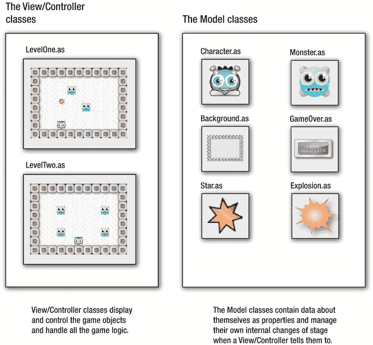

**图 8-24.** 视图/控制器类控制游戏逻辑和模型类。

你将在本书后续的示例中沿用这一结构，因此在继续学习之前，请确保你完全理解它。然而，为了简化代码示例，并且因为后续示例不会包含多个游戏关卡，所有逻辑将像前面章节那样放在应用程序类中。（这意味着应用程序类将充当游戏的视图/控制器。）但如果你设计的游戏有多个关卡，或者有很多不同的游戏画面需要在之间切换，请回到本章，并使用《怪物大乱斗》的结构来规划你的游戏。

随着编程经验的增长，你的游戏开始变得复杂，你将需要学习真正的“模型-视图-控制器”模式。这是管理复杂游戏的一种非常高效的方法，可以避免编写大量重复代码。你可以在《高级游戏设计与 Flash》中找到关于如何构建模型-视图-控制器系统的全部内容。

### 总结

这真是个大章节！包含了大量代码和许多需要吸收的新概念。然而，这里涵盖的所有内容对于打下坚实的 AS3.0 游戏设计基础都是绝对必要的。在你的游戏设计生涯中，迟早都要处理这些问题。如果第一次没有全部理解，就把这章拆分成更小的部分，仔细学习每个部分，直到弄明白为止。将你在玩游戏时看到的现象与实现它的代码进行对比。理解本章的最佳方法是从头开始创建你自己的《怪物大乱斗》版本。你绝对有这个能力，而且你经历的过程会巩固这里涵盖的所有概念。

希望本章能启发你思考如何开始使用类来帮助构建游戏。如果你谨慎使用，这里介绍的结构可以带你走得很远。

那么，尽情享受本章介绍的一些新技术吧。想不想制作一个将这些技术与前几章学到的其他技术结合起来的游戏？例如，一个带有巨大滚动地牢或太空关卡的游戏怎么样？那会非常棒！或者，结合一些使用文本输入的解谜环节，比如第 4 章中的猜数字游戏？也许可以将《怪物大乱斗》和《炸弹恐慌》结合成一个混合游戏，让每个新关卡的难度递增？即使是在本书的这个阶段，你也已经拥有了强大的游戏编码能力。最好的学习方法就是一头扎进去，开始制作一个游戏。

在下一章中，你将学习一个完全不同的游戏类型：平台游戏。你将学习如何使用物理模拟让物体移动，如何使用数组来存储和分析数据，以及如何为你的游戏添加音效和音乐。

祝你设计下一个精彩游戏的过程充满乐趣！完成这些之后，我们第 9 章见！


