## 第 9 章 物理、循环、数组和声音

最受欢迎的视频游戏类型之一是`平台游戏`，它同时也带来了一些非常有趣的编程和设计挑战。从编程的角度来看，如果你能编写一个平台游戏，就意味着你在游戏设计师的成长道路上达到了一个里程碑。

在本章中，我将向你展示制作自己的平台游戏所需的全部技能。你将详细了解核心视频游戏设计技术，例如：

- 使用物理和热力学模拟实现自然运动。
- 复杂的玩家角色行为。
- 具有精确反弹和摩擦的碰撞。
- 嵌入声音和音乐。
- 使用数组。

你将在实际、真实的语境中学习这些技术，这样你就能清楚地知道如何将它们应用到自己的游戏中。但首先，让我们详细了解一下在你的游戏中使用物理所需的技术。

### 使用物理引擎实现自然运动

撞到墙上会发生什么？如果你是上一章《怪物大乱斗》中的角色，那就什么也不会发生——你只是停下脚步，故事就此结束。在现实生活中，情况要复杂得多。一个高速弹跳的橡胶球会以一个角度反弹回来。而像石头这样更重的物体则会砰然落地。再举一个例子：当你踩下汽车油门时，车速逐渐增加；而在踩下刹车后，也需要一段时间才能减速。这些物理反应正是现实世界中的网球、赛车等游戏如此有趣的部分原因。

在接下来的几页中，你将学习如何使用以下技术，创建一个模拟真实物理和热力学的移动游戏角色：

- **加速度**：逐渐加速。
- **摩擦力**：逐渐减速。
- **反弹**：当物体碰到舞台边缘时改变运动方向。
- **重力**：添加一个将物体拉向舞台底部的力。
- **跳跃**：视频游戏角色最需要的能力之一。

为游戏应用物理原理其实很简单。大多数技术归结为对 `vx` 和 `vy` 属性进行简单计算。虽然计算很简单，但有时很难直观地看出如何实际运用它们。而你将重点探讨的正是这种实际应用。

在本书中，你将用到的大多数物理计算都基于一个名为`欧拉积分`（俗称“简单的视频游戏物理”）的系统。视频游戏物理在游戏环境中看似绝对精确，但实际上只是对真实物理的近似模拟。游戏使用近似物理，是因为处理它们所需的 CPU 性能远低于使用物理教科书上的计算公式。如果你需要进行真实世界教科书级别的物理模拟，可以参考 Keith Peters 的《ActionScript 3.0 动画：让物体动起来》和《高级 ActionScript 3.0 动画》，这两本书对此有详细论述。

要开始尝试物理效果，首先需要创建一个包含可用于应用物理公式的属性的游戏对象类。

#### 用于物理实验的游戏对象类

在本章的源文件中，你会找到一个名为 `Acceleration` 的文件夹。打开 `src` 子文件夹，找到 `Character` 类。它使用你现在应该非常熟悉的代码嵌入了猫游戏角色的图像。此外，它还包含一些你将在本章示例中需要的特殊公共属性。以下是 `Character` 类，其中突出的部分是特殊的物理属性：

```actionscript
package
{
  import flash.display.DisplayObject;
  import flash.display.Sprite;

  public class Character extends Sprite
  {
    //嵌入图像
    [Embed(source="../images/character.png")]
    private var CharacterImage:Class;

    //私有属性
    private var _character:DisplayObject = new CharacterImage();

    //公共属性
    public var vx:Number = 0;
    public var vy:Number = 0;
    public var accelerationX:Number = 0;
    public var accelerationY:Number = 0;
```

```markdown
public var speedLimit:Number = 5;

public var friction:Number = 0.96;

public var bounce:Number = -0.7;

public var gravity:Number = 0.3;

public var isOnGround:Boolean = undefined;

public var jumpForce:Number = -10;

public function Character()
{
  //在此类中显示图像
  this.addChild(_character);
}
}
}
```

你会认出 `vx` 和 `vy` 属性，但其他属性将是新的。在接下来的示例中，你将看到每个新属性的作用。下图展示了 `Character` 类的公共属性及其初始值。

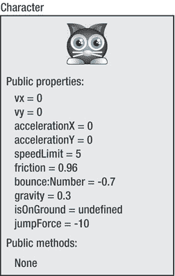

**图 9-1.** `Character` 类包含物理所需的属性。

请注意，大多数属性的类型都是 `Number`。这是因为它们需要存储小数值。如果需要存储物理值，则不能将属性类型设为 `int` 或 `uint`，因为物理值始终是分数。

`isOnGround` 属性是一个 `Boolean` 变量。它已被初始化为 `undefined`。如果你不确定一个 `Boolean` 变量应该为 `true` 还是 `false`，将其赋值为 `undefined` 意味着“我还不知道”。这相当于将 `Number` 变量赋值为 `0`，或将 `String` 变量赋值为一对空引号。

最简单的物理运动类型是加速度，那么让我们看看如何让它与新的角色对象一起工作。

#### 加速度

**加速度**是指逐渐增加速度。这就像你开始更快地踩自行车踏板时发生的情况。要让游戏对象逐渐加速，你需要在 `enterFrameHandler` 中向对象的 `vx` 或 `vy` 属性添加一个值。你可能还记得前一章中，`vx` 指的是 `x` 轴上的速度，`vy` 指的是 `y` 轴上的速度。简而言之，这些属性代表对象在水平或垂直方向上的移动速度。

在 AS3.0 中，如果你想逐渐增加对象在 `x` 轴上的速度，你需要使用加法赋值运算符（`+=`）将加速度值加到 `vx` 属性上。你的代码可能类似于这样：

```
vx += 0.2;
```

在 `y` 轴上，你的代码可能如下：

```
vy += 0.2;
```

`0.2` 从哪里来？这就是加速度的值。具体的数值完全取决于你，以及你希望对象加速的快慢。较大的数字（如 `0.6`）会使对象加速更快，而较小的数字（如 `0.1`）则会使加速慢得多。选择合适的数字只需反复尝试，并观察其对对象产生的影响。

让我们在舞台上看看这个效果对猫角色的影响。运行 `Acceleration` 应用程序类，使用方向键在舞台上移动猫对象。它会逐渐加速，直到达到每秒 5 像素的最大速度，如下图所示。

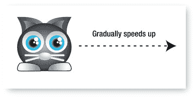

**图 9-2.** 使用加速度逐渐增加对象的速度。

### Acceleration 类

以下是 `Acceleration` 应用程序类。我已高亮显示所有涉及应用加速度和移动角色的代码。

```
package
{
  import flash.display.Sprite;
  import flash.events.Event;
  import flash.events.KeyboardEvent;
  import flash.ui.Keyboard;

  [SWF(width="550", height="400",
    backgroundColor="#FFFFFF", frameRate="60")]
  public class Acceleration extends Sprite
  {
    private var _character:Character = new Character();;

    public function Acceleration()
    {
      //将角色添加到舞台
      stage.addChild(_character);
      _character.x = 250;
      _character.y = 175;

      //添加事件监听器
      stage.addEventListener
        (KeyboardEvent.KEY_DOWN, keyDownHandler);
      stage.addEventListener
        (KeyboardEvent.KEY_UP, keyUpHandler);
      stage.addEventListener
        (Event.ENTER_FRAME, enterFrameHandler);
    }

    public function keyDownHandler(event:KeyboardEvent):void
    {
      if (event.keyCode == Keyboard.LEFT)
      {
        _character.accelerationX = -0.2;
      }
      else if (event.keyCode == Keyboard.RIGHT)
      {
        _character.accelerationX = 0.2;
      }
      else if (event.keyCode == Keyboard.UP)
      {
        _character.accelerationY = -0.2;
      }
      else if (event.keyCode == Keyboard.DOWN)
      {
        _character.accelerationY = 0.2;
      }
    }

    public function keyUpHandler(event:KeyboardEvent):void
    {
      if (event.keyCode == Keyboard.LEFT
      || event.keyCode == Keyboard.RIGHT)
      {
        _character.accelerationX = 0;
        _character.vx = 0;
      }
      else if (event.keyCode == Keyboard.DOWN
      || event.keyCode == Keyboard.UP)
      {
        _character.accelerationY = 0;
        _character.vy = 0;
      }
    }

    public function enterFrameHandler(event:Event):void
    {
      //应用加速度
      _character.vx += _character.accelerationX;
      _character.vy += _character.accelerationY;

      //限制速度
      if (_character.vx > _character.speedLimit)
      {
        _character.vx = _character.speedLimit;
      }
      if (_character.vx < -_character.speedLimit)
      {
        _character.vx = -_character.speedLimit;
      }
      if (_character.vy > _character.speedLimit)
      {
        _character.vy = _character.speedLimit;
      }
      if (_character.vy < -_character.speedLimit)
      {
        _character.vy = -_character.speedLimit;
      }

      //移动角色
      _character.x += _character.vx;
      _character.y += _character.vy;

      //检查舞台边界
      if (_character.x < 0)
      {
        _character.x = 0;
      }
      if (_character.y < 0)
      {
        _character.y = 0;
      }
```

尽管代码很长，但它不过是自第 5 章以来一直使用的常规代码的微小修改。我相信你认识其中的大部分内容。让我们看看有哪些新内容，以及加速度是如何工作的。

`_character` 对象有三个属性来存储新的加速度数据。它们的初始值在 `Character` 类定义中赋值。

```actionscript
public var accelerationX:Number = 0;
public var accelerationY:Number = 0;
public var speedLimit:Number = 5;
```

`accelerationX` 和 `accelerationY` 属性存储的值决定了物体加速的程度。由于你不希望物体在首次出现在舞台上时移动，因此 `accelerationX` 和 `accelerationY` 被初始化为零。最后，`speedLimit` 是希望物体移动的最大速度。值为 5 意味着物体每帧最多移动不超过 5 像素。

为角色的 `accelerationX` 和 `accelerationY` 属性赋值的工作由 `keyDownHandler` 完成。

```actionscript
public function keyDownHandler(event:KeyboardEvent):void
{
  if (event.keyCode == Keyboard.LEFT)
  {
    _character.accelerationX = -0.2;
  }
  else if (event.keyCode == Keyboard.RIGHT)
  {
    _character.accelerationX = 0.2;
  }
  else if (event.keyCode == Keyboard.UP)
  {
    _character.accelerationY = -0.2;
  }
  else if (event.keyCode == Keyboard.DOWN)
  {
    _character.accelerationY = 0.2;
  }
}
```

如果 `accelerationX` 为正值，物体向右移动。负值使其向左移动。正的 `accelerationY` 值使物体向下移动，负值使其向上移动。当按下任意箭头键时，这些新值会被赋值。使角色移动所需做的就是将这些值赋给它的 `vx` 和 `vy` 属性。用两行代码就能轻松完成。

```actionscript
_character.vx += _character.accelerationX;
_character.vy += _character.accelerationY;
```

然而，如果保持现状，加速度值会在每一帧都添加到物体的速度上——而物体能有多快没有限制。这意味着物体最终会移动得如此之快，以至于在舞台上只剩下一个模糊的影子。这在大多数游戏中没什么用，因此通常建议设置一个速度限制，这正是以下代码段的作用：

```actionscript
if (_character.vx > _character.speedLimit)
{
  _character.vx = _character.speedLimit;
}
if (_character.vx < -_character.speedLimit)
{
  _character.vx = -_character.speedLimit;
}
if (_character.vy > _character.speedLimit)
{
  _character.vy = _character.speedLimit;
}
if (_character.vy < -_character.speedLimit)
{
  _character.vy = -_character.speedLimit;
}
```

只有当 `vx` 和 `vy` 属性在速度限制（本例中为 5）范围内时，加速度值才会添加到角色的速度上。这意味着角色会加速到每帧 5 像素，然后以恒定速度移动。其背后的逻辑与设置舞台边界的逻辑完全相同。

下一步是将这些新的速度值添加到物体的 `x` 和 `y` 位置。这通过一些老伙伴来完成——基本上与自第 5 章以来使用的指令相同。

```actionscript
_character.x += _character.vx;
_character.y += _character.vy;
```

事实上，这两个指令就是你移动角色`所有`需要的内容，即使使它们移动所涉及的物理原理变得相当复杂。所有物理计算都应用于 `vx` 和 `vy` 属性；然后它们被简单地赋给角色的 `x` 和 `y` 属性，使其移动。

那么，这实际上是如何让物体加速的呢？`enterFrameHandler` 末尾的跟踪输出给了你一个线索。

```actionscript
trace("_character.vx: " + _character.vx);
trace("_character.x: " + _character.x);
trace("----------");
```

编译项目，按下右箭头键，观察跟踪输出。当角色开始移动时，你会看到类似于这样的输出：

```
_character.vx:  0
_character.x:  250
```

```
_character.vx:  0.2
_character.x:  250.2
```

```
_character.vx:  0.4
_character.x:  250.6
```

```
_character.vx:  0.6000000000000001
_character.x:  251.2
```

```
_character.vx:  0.8
_character.x:  252
```

```
_character.vx:  1
_character.x:  253
```

```
_character.vx:  1.2
_character.x:  254.2
```

这是前七个运动帧，但此模式会一直持续，直到 `vx` 达到最大值 5，即 `speedLimit` 属性所设置的值。那些带有大量小数的数字是 CPU 的二进制数系统存储分数的方式所产生的副产品。`0.6000000000000001`

在实际应用中，你可以忽略那些一串串的零，并四舍五入保留两位小数。

`AS3.0 能够将一个像素分割的最小单位是 0.05。这个单位有一个古怪的名字叫缇（20 缇等于 1 像素）。这就是为什么你在跟踪输出中看到的所有 x 和 y 值都是 0.05 的倍数。`

在第二帧中，`accelerationX` 的初始值为 0.2，该值被添加到角色的当前 `x` 位置。结果 `x` 值变为 250.2。因为右箭头键仍被按住，所以会运行以下代码：

```actionscript
else if (event.keyCode == Keyboard.RIGHT)
{
  _character.accelerationX = 0.2;
}
```

它在 `vx` 值上*额外*增加了 0.2，使其新值为 0.4。你可以在第三次跟踪中看到这个新值。

`_character.vx:  0.4`
`_character.x:  250.6`

然后，0.4 被添加到物体的 `x` 位置，得到新位置 250.6。从跟踪输出中可以看到，`accelerationX` 值持续累积，每帧在自身基础上增加 0.2，直到最终达到 5，此时物体以相当快的速度移动。这一切共同营造出一种非常逼真的物体在加速的错觉。

代码最后要做的是停止物体，这由 `keyUpHandler` 处理。

```actionscript
public function keyUpHandler(event:KeyboardEvent):void
{
  if (event.keyCode == Keyboard.LEFT
    || event.keyCode == Keyboard.RIGHT)
  {
    _character.accelerationX = 0;
    _character.vx = 0;
  }
```

# 物理模拟

```actionscript
else if (event.keyCode == Keyboard.DOWN
    || event.keyCode == Keyboard.UP)
  {
    _character.accelerationY = 0;
    _character.vy = 0;
  }
}
```

当相应的按键被释放时，这会将物体的加速度和速度都设为零。

## 摩擦力

摩擦力与加速度正好相反：它会导致物体逐渐减速。图 9-3 对此进行了说明。

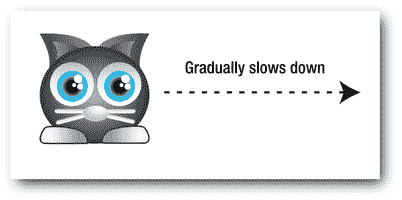

**图 9-3.** 摩擦力使物体逐渐减速。

让我们看看摩擦力是如何在猫咪角色上起作用的。你可以在本章的源文件中找到 `Friction` 项目文件夹。运行 SWF 文件，并使用方向键在舞台上移动角色。你会注意到，猫会逐渐加速，当你释放按键时又会逐渐减速。它看起来像是在舞台上漂浮。

`Friction` 应用程序类中的代码几乎和你刚才在 `Acceleration` 类中看到的代码相同，只是做了一些小的补充。在你的代码编辑器中打开它，然后看一看。最大的变化在 `enterFrameHandler` 中。两行新代码将角色的 `vx` 和 `vy` 属性与其 `friction` 值相乘。这发生在添加加速度的那几行代码之后，我已在此将它们突出显示：

```actionscript
//应用加速度
_character.vx += _character.accelerationX;
_character.vy += _character.accelerationY;

//应用摩擦力
_character.vx *= _character.friction;
_character.vy *= _character.friction;
```

记住，角色的 `friction` 值为 0.96。摩擦系数为 1 相当于没有摩擦力，因此任何小于 1 的值都会使物体逐渐减速。0.94 到 0.98 之间的值会非常缓慢地施加摩擦力，以实现非常流畅的运动。而 0.7 或 0.6 这样的值会使物体快速减速。

应用摩擦力的这两行代码将角色的速度乘以一个小于 1 的数，从而逐渐减小速度。这非常简单且非常有效。

然而，有一个技术细节你需要处理。场景是这样的：假设物体的速度是 5。它的摩擦系数是 0.6。物体需要速度为零才能完全停止。你每帧都施加一些摩擦力，将速度乘以 0.6，希望能最终达到零。前五帧可能如下所示：

5 * 0.6 = 3
3 * 0.6 = 1.8
1.8 * 0.6 = 1.08
1.08 * 0.6 = 0.648
0.648 * 0.6 = 0.3888

但你还没到零。你认为需要多久才能达到零？嗯，你可以一直算下去——永远也到不了！

这是一种被称为`芝诺悖论`的效应。大致是这样的：假设你有一块蛋糕，你把它切成两半。你把其中一半再切成两半。然后你对第三块再做同样的操作。蛋糕块变得越来越小。你切多少次才能切到没有东西可切？芝诺悖论是：你永远无法达到终点——蛋糕块仅仅变得无限薄，而你可以永远切下去。尽管听起来很疯狂，但数学上确实如此，更疯狂的是，你在 AS3.0 中必须处理这个问题！

这意味着当你应用摩擦力时，`vx` 和 `vy` 永远不会达到零。物体永远不会完全停止。所以你需要做的是，当 `vx` 和 `vy` 低于某个阈值时，*强制其值为零*。这正是 `enterFrameHandler` 中下面这段新代码的作用：

```actionscript
if (Math.abs(_character.vx) < 0.1)
{
  _character.vx = 0;
}
if (Math.abs(_character.vy) < 0.1)
{
  _character.vy = 0;
}
```

如果 `vx` 和 `vy` 的绝对值低于 0.1，则强制其值为 0，从而阻止芝诺悖论的发生。0.1 足够低，不会对物体的运动产生任何可观察的影响，并且即使在低摩擦系数（如 0.99）下，物体也能看起来非常自然地停下来。没有这段代码，你的物体就会在舞台上缓慢地向上和向左滑动——并且永远不会真正停止。

这段代码位于 `enterFrameHandler` 中，就在检查角色速度限制的代码块下方。

*快速回顾一下，`Math.abs` 会强制其参数的值变为正数（“绝对值”）。这简化了代码，因为你无需检查负值。*

代码的最后一个微小改动是，`keyUpHandler` 现在不再将角色的 `vx` 和 `vy` 属性设为零。这个任务交给了摩擦力计算来完成。`keyUpHandler` 只需要停止物体的加速度。

```actionscript
public function keyUpHandler(event:KeyboardEvent):void
{
  if (event.keyCode == Keyboard.LEFT
    || event.keyCode == Keyboard.RIGHT)
  {
    _character.accelerationX = 0;
  }
  else if (event.keyCode == Keyboard.DOWN
    || event.keyCode == Keyboard.UP)
  {
    _character.accelerationY = 0;
  }
}
```

关于摩擦力，就是这些了！

## 弹跳

在加速度和摩擦力之后，弹跳就是小菜一碟（非无限的那种！）。打开章节源文件中的 `Bounce` 项目文件夹并运行 SWF。使用方向键在舞台上移动猫咪，你会注意到可以将它从舞台边缘弹开，如图 9-4 所示。

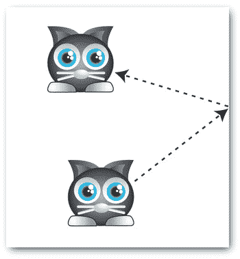

**图 9-4.** 将猫咪从舞台边缘弹开。

`Character` 类有一个名为 `bounce` 的属性，它被初始化为 `-0.7`。

`public var bounce:Number = -0.7;`

`bounce` 值必须是负数，因为弹跳的工作原理是*反转*物体的速度。你很快就能看到这具体是如何发生的。`-0.7` 这个值会产生中等程度弹跳的效果。值为 `-1` 会使物体具有极强的弹性。值为 `1` 会使物体完全没有弹力。任何小于 `-1` 的值都会让物体看起来像是撞到了弹性极强的表面，例如蹦床。如果你想在游戏中制作一个弹跳平台，这一点非常重要。

`bounce` 属性直到处理舞台边界的代码部分才再次出现。我在此处高亮了相关代码：

```actionscript
//Check stage boundaries
if (_character.x < 0)
{
  _character.vx *= _character.bounce;
  _character.x = 0;
}
if (_character.y < 0)
{
  _character.vy *= _character.bounce;
  _character.y = 0;
}
if (_character.x + _character.width > stage.stageWidth)
{
  _character.vx *= _character.bounce;
  _character.x = stage.stageWidth - _character.width;
}
if (_character.y + _character.height > stage.stageHeight)
{
  _character.vy *= _character.bounce;
  _character.y = stage.stageHeight - _character.height;
}
```

这里发生的一切就是将物体的速度乘以 `bounce` 值，而这个值是负数。如果你反转物体的速度，看起来就像它在弹跳。不，我在这里可没有向你隐瞒什么——这种显著的效果仅通过四行极其简单的代码就实现了。谁说物理很难？

## 重力

重力的实现与其他物理力一样简单。你只需要创建另一个值，并将其添加到物体的 `vy` 属性中即可。

要查看重力的效果，请打开 `Gravity` 项目并运行 SWF。猫咪会掉落到舞台底部。如果你按下上方向键，猫咪会向上移动。当释放上方向键时，猫咪会下落，直到你再次按下上方向键。如果它撞到地面，则会弹起。图 9-5 展示了你会看到的情景。

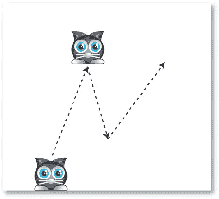

**图 9-5.** 使用方向键让猫咪飞起来。

尽管代码非常简单，但结果却是对真实世界非常令人信服的模拟。实际上，它真实得几乎有点吓人！让我们来看看它是如何工作的。

`Character` 类有一个名为 `gravity` 的属性，它被初始化为 `0.3`。

`public var gravity:Number = 0.3;`

与其他数值一样，`0.3` 也是通过反复试验得出的一个值，并且在此上下文中看起来很自然。数值越大，重力越大；数值越小，重力越小。

将重力应用于角色只需在 `enterFrameHandler` 中将其加到角色的 `vy` 属性上。

`_character.vy += _character.gravity;`

# 游戏物理实现

就这样！这就是实现重力所需的所有工作。以下展示了这行代码如何融入 `enterFrameHandler` 中的其他代码：

```
//Apply acceleration
_character.vx += _character.accelerationX;
_character.vy += _character.accelerationY;

//Apply friction
_character.vx *= _character.friction;

//Apply gravity
_character.vy += _character.gravity;
```

（此代码与之前示例相比的另一个小改动是，没有将摩擦力添加到 `vy` 属性。这没有必要，因为重力已经处理了向下的运动。）

然而，`Gravity` 类做得更深入一些。你希望允许玩家在按下上方向键时让猫咪向上移动。实际上有多种方法可以实现这一点，而这个类实现的是稍微复杂一些的方式。

其工作方式是，当玩家按下上方向键时，在 `keyDownHandler` 中将 `gravity` 设置为 `0`（在此处高亮）：

```
public function keyDownHandler(event:KeyboardEvent):void
{
  if (event.keyCode == Keyboard.LEFT)
  {
    _character.accelerationX = -0.2;
  }
  else if (event.keyCode == Keyboard.RIGHT)
  {
    _character.accelerationX = 0.2;
  }
  else if (event.keyCode == Keyboard.UP)
  {
    _character.accelerationY = -0.2;
    _character.gravity = 0;
  }
}
```

这使得猫咪可以在舞台上自由向上移动。注意，也没有为下方向键编写代码。你并不需要它——重力会处理向下移动物体的事情。

当按键释放时，`gravity` 属性会被重置回其初始值 `0.3`。

```
public function keyUpHandler(event:KeyboardEvent):void
{
  _character.accelerationX = 0;
  _character.accelerationY = 0;
  _character.gravity = 0.3;
}
```

你也可以通过另一种方式创建相同的重力效果：在需要应用重力时，直接给 `accelerationY` 一个正值。（正的 `y` 值会将物体拉向舞台底部。）这意味着你可以在角色中完全省去创建 `gravity` 属性。然而，使用单独的 `gravity` 值的一个优点是使代码更易于理解，并且可以为你保留灵活选项，以便将来将重力与你可能添加的其他物理力进行组合搭配。

这段代码还有另外两处微调。我希望物体下落的速度比上升的速度更快。我修改了检查物体向下移动速度的 `if` 语句中的速度限制，如下所示：

```
//Limit the speed
if (_character.vx > _character.speedLimit)
{
  _character.vx = _character.speedLimit;
}
if (_character.vx < -_character.speedLimit)
{
  _character.vx = -_character.speedLimit;
}
if (_character.vy > _character.speedLimit * 2)
{
  _character.vy = _character.speedLimit * 2;
  trace("Terminal velocity!");
}
if (_character.vy < -_character.speedLimit)
{
  _character.vy = -_character.speedLimit;
}
```

将 `speedLimit` 乘以 `2` 可以使其下落速度比上升速度快一倍。并且在达到最大速度时会显示一条“Terminal velocity!”（终端速度！）的追踪消息。你可以在类似《月球着陆器》的游戏中利用这一点，来判断航天器撞击行星表面时是否速度过快。

## 跳跃

在所有已面世的电子游戏中，大概有一半都将跳跃作为角色的核心操作。其本质不过是暂时增加物体的 `y` 轴向速度。一旦你理解了加速度、摩擦力和重力是如何运作的，实现跳跃就并非难事。然而，还有一些额外需要注意的细节，让这个过程稍微复杂一些。

-   你希望物体只有在地面时才能跳跃——并且仅限在地面时。但物体如何判断自己是否在地面上？而“地面”又究竟指什么？代码必须能解决这些问题。

-   你需要防止按下跳跃键时触发多次跳跃。

让我们来看一个跳跃动作的示例，以及如何解决这些问题。打开 `Jumping` 项目文件夹并运行 SWF 文件。使用左右箭头键水平移动猫咪，然后按上箭头键或空格键让它跳跃。图 9-6 展示了这一过程。

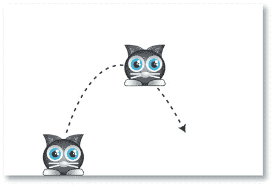

**图 9-6.** 按下空格键或上箭头键让猫咪跳跃。

要实现跳跃，你需要在 `Character` 类中使用以下两个属性：

```actionscript
public var isOnGround:Boolean = undefined;
public var jumpForce:Number = -10;
```

`isOnGround` 是一个布尔值，用于告知类对象是否在地面上。它被初始化为 `undefined`，因为在游戏开始时，你可能并不总能确定对象是否在地面上。

`jumpForce` 是角色跳跃时所用的力量。它需要向舞台顶部（即向上）运动，因此其值为负数。赋予它的具体数值同样需要反复试验来确定。你需要确保该值足够大，以抵消重力以及可能作用于该对象的任何其他力。

那么，物体如何知道自己是否在地面上呢？这取决于你正在设计的游戏，可能会变得相当复杂。因此，在开始任何涉及跳跃功能的项目时，你需要仔细思考这个问题。在这个简单的示例中，当猫咪位于舞台底部时，它就算“在地面上”。所以，你只需要在检查舞台底部边界的同一段代码中，将 `isOnGround` 设置为 `true` 即可。

```actionscript
//检查舞台边界
if (_character.x < 0)
{
  _character.vx = 0;
  _character.x = 0;
}
if (_character.y < 0)
{
  _character.vy = 0;
  _character.y = 0;
}
if (_character.x + _character.width > stage.stageWidth)
{
  _character.vx = 0;
  _character.x = stage.stageWidth - _character.width;
}
if (_character.y + _character.height > stage.stageHeight)
{
  _character.vy = 0;
  _character.y = stage.stageHeight - _character.height;
  _character.isOnGround = true;
}
```

这非常直观。在大多数涉及跳跃的游戏中，游戏角色还需要知道它们何时站在平台上。这使得检测地面变得稍微复杂一些，但你将在本章后面看到一个解决方案。让物体跳跃的逻辑发生在 `onKeyDown` 事件处理函数中。

```actionscript
public function keyDownHandler(event:KeyboardEvent):void
{
  if (event.keyCode == Keyboard.LEFT)
  {
    _character.accelerationX = -0.2;
  }
  else if (event.keyCode == Keyboard.RIGHT)
  {
    _character.accelerationX = 0.2;
  }
  else if (event.keyCode == Keyboard.UP
    || event.keyCode == Keyboard.SPACE)
  {
    if(_character.isOnGround)
    {
      _character.vy += _character.jumpForce;
      _character.isOnGround = false;
    }
  }
}
```

如果按下空格键或上箭头键，代码会检查物体是否在地面上。如果是，则将跳跃力值加到垂直加速度上，并将 `isOnGround` 设置为 `false`。

如果你使用 `if` 语句对物体施加速度限制，请确保在跳跃物体向上移动时不要进行此检查。这可能会给跳跃效果带来一种不自然的抑制感。

瞧，基本上就是这样。图 9-7 展示了这个系统是如何工作的。

## 如何让物体跳跃

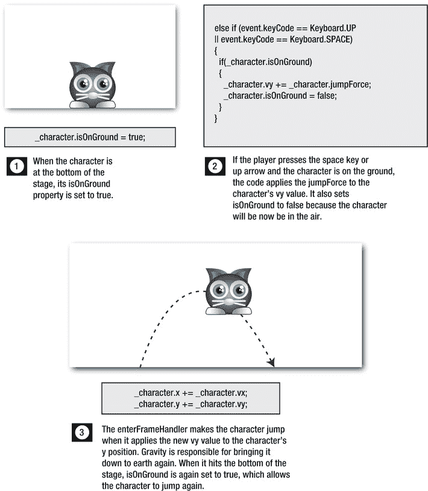

**图 9-7.** 如何让物体跳跃。

这是一段相互关联的代码构成的细致网络，需要仔细理解。因此，下面给出了完整的 `Jumping` 应用程序类，以便你能够看到它的完整上下文。我已将与跳跃效果相关的所有代码突出显示。

```actionscript
package
{
  import flash.display.Sprite;
  import flash.events.Event;
  import flash.events.KeyboardEvent;
  import flash.ui.Keyboard;

  [SWF(width="550", height="400",
    backgroundColor="#FFFFFF", frameRate="60")]

  public class Jumping extends Sprite
  {
    private var _character:Character = new Character();;

    public function Jumping()
    {
      //将角色添加到舞台
      stage.addChild(_character);
      _character.x = 250;
      _character.y = 175;

      //添加事件监听器
      stage.addEventListener
        (KeyboardEvent.KEY_DOWN, keyDownHandler);
      stage.addEventListener
        (KeyboardEvent.KEY_UP, keyUpHandler);
      stage.addEventListener
        (Event.ENTER_FRAME, enterFrameHandler);
    }
    public function keyDownHandler(event:KeyboardEvent):void
    {
      if (event.keyCode == Keyboard.LEFT)
      {
        _character.accelerationX = -0.2;
      }
      else if (event.keyCode == Keyboard.RIGHT)
      {
          _character.accelerationX = 0.2;
      }
      else if (event.keyCode == Keyboard.UP
        || event.keyCode == Keyboard.SPACE)
      {
        if(_character.isOnGround)
        {
          _character.vy += _character.jumpForce;
          _character.isOnGround = false;
        }
      }
    }
    public function keyUpHandler(event:KeyboardEvent):void
    {
      if (event.keyCode == Keyboard.LEFT
        || event.keyCode == Keyboard.RIGHT)
      {
        _character.accelerationX = 0;
      }
    }
    public function enterFrameHandler(event:Event):void
    {
      //应用加速度
      _character.vx += _character.accelerationX;

      //应用摩擦力
      _character.vx *= _character.friction;

      //应用重力
      _character.vy += _character.gravity;

      //限制速度，但角色向上移动时除外
      if (_character.vx > _character.speedLimit)
      {
        _character.vx = _character.speedLimit;
      }
      if (_character.vx < -_character.speedLimit)
      {
        _character.vx = -_character.speedLimit;
      }
      if (_character.vy > _character.speedLimit * 2)
      {
        _character.vy = _character.speedLimit * 2;
      }

      //当速度低于 0.1 时强制归零
      if (Math.abs(_character.vx) < 0.1)
      {
        _character.vx = 0;
      }
      if (Math.abs(_character.vy) < 0.1)
      {
        _character.vy = 0;
      }

      //移动角色
      _character.x += _character.vx;
      _character.y += _character.vy;

      //检查舞台边界
      if (_character.x < 0)
      {
        _character.vx = 0;
        _character.x = 0;
      }
      if (_character.y < 0)
      {
        _character.vy = 0;
        _character.y = 0;
      }
      if (_character.x + _character.width > stage.stageWidth)
      {
        _character.vx = 0;
        _character.x = stage.stageWidth - _character.width;
      }
      if (_character.y + _character.height > stage.stageHeight)
      {
        _character.vy = 0;
        _character.y = stage.stageHeight - _character.height;
        _character.isOnGround = true;
      }
    }
  }
}
```

### 为游戏添加音效

现在你有了一个精美、会弹跳、会跳跃的游戏角色。如果每次跳跃时都能配上音效，那该多棒啊！在游戏中播放音效其实一点也不难，本节我将向你展示具体方法。

打开章节源文件中的 `PlayingSounds` 项目文件夹。除了常见的文件夹外，你会发现一个名为 `sounds` 的新文件夹。里面包含一个名为 `bounce.mp3` 的 MP3 文件（图 9-8）。这个 MP3 文件会以与你之前嵌入图像完全相同的方式嵌入到应用程序类中。

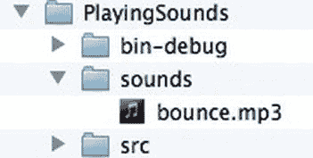

**图 9-8.** 将游戏音效放在 `sounds` 文件夹中，与项目其他文件在一起。

运行 SWF 文件，按下空格键。你会听到“砰”的一声，这种音效正是游戏角色跳跃时的典型声音。

以下是完整的 `PlayingSounds` 类。我将嵌入声音、创建声音对象以及播放声音的所有相关代码都加粗标注了出来。

# 在游戏中使用声音

要在游戏中使用声音，你需要导入两个类：`Sound` 和 `SoundChannel`。

```actionscript
import flash.media.Sound;
import flash.media.SoundChannel;
```

然后，在类定义中嵌入 MP3 文件，方式与嵌入图像完全相同。

```actionscript
[Embed(source="../sounds/bounce.mp3")]
private var Bounce:Class;
```

接着，你需要创建两个对象来帮助你播放声音。

*   **Sound 对象**：这是你想要播放的实际声音。

    ```actionscript
    private var _bounce:Sound = new Bounce();
    ```

*   **SoundChannel 对象**：这是一个为你播放声音的对象。

    ```actionscript
    private var _bounceChannel:SoundChannel = new SoundChannel();
    ```

你需要同时使用这两个对象来播放声音。你可以将 `Sound` 类想象成一张 CD，而 `SoundChannel` 则是实际加载并播放它的 CD 播放器。

然后，`SoundChannel` 对象可以在需要时播放 `Sound`。在这个例子中，它在你按下空格键时被调用。

```actionscript
_bounceChannel = _bounce.play();
```

其实就这么简单。记住这个格式，你就不会出错。

## 在游戏中集成音效

要了解如何在真实游戏环境中集成音效，请打开 `JumpingWithSounds` 项目文件夹。运行 SWF，调高电脑音量，现在每次角色跳跃时，你都会听到“砰”的一声。这是通过在玩家每次按下上方向键或空格键时播放弹跳音效来实现的，执行的指令如下：

```actionscript
_bounceChannel = _bounce.play();
```

项目文件夹中有一个 `sounds` 文件夹，里面包含了 `bounce.mp3` 文件。以下是 `JumpingWithSounds` 应用程序类中用于嵌入和播放声音的新代码。首先，导入 `Sound` 和 `SoundChannel` 类，以及本例所需的其他所有类。

```actionscript
import flash.display.Sprite;
import flash.events.Event;
import flash.events.KeyboardEvent;
import flash.ui.Keyboard;

//播放声音所需的类
import flash.media.Sound;
import flash.media.SoundChannel;
```

接下来，在类定义中嵌入 MP3 文件并创建声音对象。

```actionscript
public class JumpingWithSound extends Sprite
{
  //嵌入声音
  [Embed(source="../sounds/bounce.mp3")]
  private var Bounce:Class;

  //为声音创建 Sound 和 SoundChannel 对象
  private var _bounce:Sound = new Bounce();
  private var _bounceChannel:SoundChannel = new SoundChannel();

  private var _character:Character = new Character();
```

最后，当玩家按下上方向键或空格键时，由 `keyDownHandler` 播放声音。

```actionscript
else if (event.keyCode == Keyboard.UP
  || event.keyCode == Keyboard.SPACE)
{
  if(_character.isOnGround)
  {
    _bounceChannel = _bounce.play();
    _character.vy += _character.jumpForce;
    _character.isOnGround = false;
  }
}
```

像这样为游戏添加音效，关键在于选择正确的位置来调用声音的 `play` 方法。游戏中的大部分音效都会像这样短促，但如果你需要停止任何音效，可以调用声音对象的 `stop` 方法，如下所示：

```actionscript
_bounceChannel = _bounce.stop();
```

如果你使用的是需要循环播放的较长声音，下一节将向你展示具体方法。

## 循环播放音乐并设置音量和声道平衡

你的游戏中很可能会有需要在游戏过程中反复循环播放的音乐。你可能还需要控制声音的音量大小，以及左右扬声器之间的声音平衡。接下来的几个小节将介绍一些简单的技巧来帮助你完成这些操作。

### 循环播放声音

播放声音时，要循环播放声音，需要使用以下格式：

```actionscript
_soundChannel = _sound.play(startPosition, timesToPlay);
```

其中 `startPosition` 是一个以毫秒为单位的数字。请注意，`0` 表示声音的最开始，而 `1000` 表示声音开始后的一秒。`timesToPlay` 是希望声音播放的次数。因此，如果想从头开始播放声音并重复十次，代码可能如下所示：

```actionscript
_soundChannel = _sound.play(0, 10);
```

如果希望每次重复时声音都从第 5 秒（即 5000 毫秒）开始播放，请将 `5000` 作为第一个参数：

```actionscript
_soundChannel = _sound.play(5000, 10);
```

要让声音无限（或几乎无限）重复，需要使用一个小技巧。将第二个参数（循环次数）设置为 AS3.0 已知的最大可能数字。这个值实际上作为整数类的一个属性存储，可以像这样访问：

```actionscript
int.MAX_VALUE
```

`int.MAX_VALUE` 是整数可以拥有的最大值：2,147,483,647。这意味着声音不会永远循环，但它会循环足够长的时间，让玩家完成游戏——甚至可能在此之后继续循环几十年。以下是使用它让声音“永远”循环的方法：

```actionscript
_soundChannel = _sound.play(0, int.MAX_VALUE);
```

*如果循环播放那些没有明显开始或结束点的连续声音，可能会在声音再次播放前听到片刻的静音。这是因为某些 MP3 格式将 ID3 标签信息（歌曲名称、艺术家名称等）存储在文件的开头或结尾。这就是你听到的静音。如果这确实是个问题，请确保从音频软件中导出 MP3 文件时不包含 ID3 信息。大多数声音编辑器都有这个选项。如果无法访问原始未压缩的声音文件，请使用专门的音频编辑器（如 Audacity）从文件的开头或结尾修剪掉几毫秒的静音。你可以从以下地址下载 Audacity：*

# Flash 音频循环与控制

*`http://audacity.sourceforge.net/download/`*

*还需要下载并安装 LAME MP3 编码器，以便 Audacity 能够导出最终的 MP3 文件。你可以在以下地址找到 LAME 下载站点的链接：*

*`http://audacity.sourceforge.net/help/faq?s=install&item=lame-mp3`*

*有时，你也可以通过让声音从非零的起始位置开始播放来避免循环之间的几毫秒延迟。你需要进行一些实验来找到合适的数值，但`30`通常是一个不错的起点。*

```actionscript
_soundChannel = _sound.play(30, int.MAX_VALUE);
```

*这将跳过前 30 毫秒，这大致是声音间隙结束的位置。*

在需要更多灵活性和控制的情况下，可以使用`SOUND_COMPLETE`事件来创建循环。首先，在播放声音时，为`SoundChannel`对象添加一个`SOUND_COMPLETE`事件处理器。

```actionscript
_soundChannel = _sound.play(0);
_soundChannel.addEventListener
  (Event.SOUND_COMPLETE, loopSoundHandler);
```

接下来，创建一个`loopSoundHandler`，它会再次播放声音，然后添加另一个新的`SOUND_COMPLETE`监听器。

```actionscript
public function loopSoundHandler(event:Event):void
{
  if (_soundChannel != null)
  {
    //Play the sound
    _soundChannel = _sound.play(0);

    //Add a new listener
    _soundChannel.addEventListener
      (Event.SOUND_COMPLETE, loopSoundHandler);
  }
}
```

非常重要的是，这段代码首先通过仅在`_soundChannel`对象不为`null`时执行指令来检查声音通道是否实际存在。

同样，当音乐停止时，需要在程序中的任何位置移除监听器。

```actionscript
_soundChannel.stop();
_soundChannel.removeEventListener
  (Event.SOUND_COMPLETE, loopSoundHandler);
```

## 音量和声像设置

声音的**音量**是指声音的大小或轻柔程度。**声像**决定了声音有多少来自左扬声器或右扬声器。要控制这些属性，首先需要导入`SoundTransform`类。

```actionscript
import flash.media.SoundTransform;
```

然后需要两个`Number`类型的变量来存储音量和声像设置。

```actionscript
private var _volume:Number = 1;
private var _pan:Number = 0;
```

如果音量的值为`1`，表示音量为正常。如果为`0`，则声音完全静音。如果为`2`，则声音是原始音量的两倍。

声像值的范围在`-1`到`1`之间。请注意，`-1`表示声音完全来自左扬声器，`1`表示声音完全来自右扬声器，`0`表示声音在左右扬声器之间平衡分布。可以将声像值设置为此范围内的任何数字。如果将其设置为`0.5`，声音将主要来自右扬声器，但左扬声器也能听到，虽然声音较小。

选择了音量和声像的值后，可以使用它们来创建一个`SoundTransform`对象，如下所示：

```actionscript
var transform:SoundTransform = new SoundTransform(_volume, _pan);
```

最后一步是将这个`SoundTransform`对象应用到`SoundChannel`对象上，如下所示：

```actionscript
_soundChannel.soundTransform = transform;
```

`SoundChannel`对象有一个名为`soundTransform`的属性。如代码所示，将`SoundTransform`对象赋给该属性。是的，我知道，这是一个有点烦人且令人困惑的小环节需要去适应。而且`soundTransform`属性和`SoundTransform`类之间的唯一区别就是首字母的大小写！但是加油！你可以做到，一旦在实际中看到它，就不难了。为了帮助你，可以查看`LoopingMusic`项目文件夹并打开应用程序类。运行 SWF 或编译它，你会听到一些循环的游戏背景音乐。以下是应用程序类：

```actionscript
package
{
  import flash.display.Sprite;
  import flash.events.Event;

  //Classes needed to play sounds
  import flash.media.Sound;
  import flash.media.SoundChannel;
  import flash.media.SoundTransform;

  [SWF(width="550", height="400",
    backgroundColor="#FFFFFF", frameRate="60")]

  public class LoopingMusic extends Sprite
  {
    //Embed the sound
    [Embed(source="../sounds/music.mp3")]
    private var Music:Class;

    //Create the Sound and Sound channel
    //objects for the sound
    private var _music:Sound = new Music();
    private var _musicChannel:SoundChannel = new SoundChannel();

    //Variables needed to set volume and panning
    private var _volume:Number = 1;
    private var _pan:Number = 0;

    public function LoopingMusic()
    {
      _musicChannel = _music.play(30, int.MAX_VALUE);

      //Change the volume and pan settings
      _volume = 0.5;
      _pan = 0;

      //Create the SoundTransform object
      var transform:SoundTransform
        = new SoundTransform(_volume, _pan);

      //Add the SoundTransform object to the
      //musicChannel's soundTransform property
      _musicChannel.soundTransform = transform;
    }
  }
}
```

音乐设置为在程序启动时循环播放，跳过前 30 毫秒以避免音乐开始时的短暂间隙。

```actionscript
_musicChannel = _music.play(30, int.MAX_VALUE);
```

接下来设置了音量和扬声器声像值。

```actionscript
_volume = 0.5;
_pan = 0;
```

音量设置为正常响度的一半。因为声像值为零，音乐在左右扬声器之间平衡分布。尝试将声像值设置为`1`或`-1`，然后重新编译程序，听听扬声器声像的变化。

然后使用音量和声像值作为参数创建了`SoundTransform`对象。

```actionscript
var transform:SoundTransform
   = new SoundTransform(_volume, _pan);
```

它被创建为一个局部对象，这也是声音转换对象通常的创建方式。原因在于，只有当您像这样更改音量和平移设置时，才需要创建一个`SoundTransform`对象，并且您在类的其他位置可能永远不需要使用它。最后一步是，将这个新的`transform`对象应用到`musicChannel`对象的`soundTransform`属性上。

`_musicChannel.soundTransform = transform;`

这将设置新的音量和平移设置。每次您更改音量和平移设置时，都需要创建另一个临时的`SoundTransform`对象，并重新将其应用到`SoundChannel`对象上。

您只是刚刚接触了在 AS3.0 中使用声音的皮毛，但这足以让您在自己的游戏中开始使用声音。您还可以在《高级 Flash 游戏设计》（Advanced Game Design with Flash）一书中找到关于游戏中声音的全面介绍。

## 处理多个对象

现在您拥有了一个可以在舞台上弹跳和跳跃的角色，但舞台本身相当空旷。这只猫需要一些盒子来跳跃。如果能创建一个像图 9-9 所示的交互式游戏世界，那岂不是太棒了？

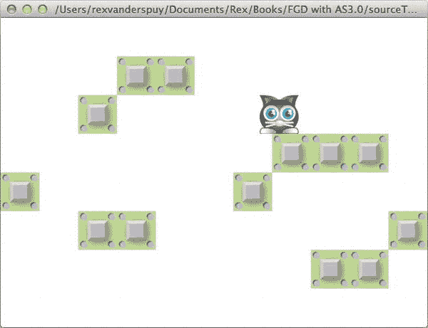

**图 9-9.** 平台游戏的雏形，其中有可供跳跃的盒子。

您可以轻松创建 13 个盒子，并使用`Collision.block`方法来检测它们与角色的碰撞，如下所示：

```
Collision.block(_character, _box1);
Collision.block(_character, _box2);
Collision.block(_character, _box3);
Collision.block(_character, _box4);
Collision.block(_character, _box5);
Collision.block(_character, _box6);
Collision.block(_character, _box7);
Collision.block(_character, _box8);
Collision.block(_character, _box9);
Collision.block(_character, _box10);
Collision.block(_character, _box11);
Collision.block(_character, _box12);
Collision.block(_character, _box13);
```

这 13 行代码完全可以正常工作。但谁真的想编写这么多重复的代码呢？

在您的游戏设计生涯更进一步之前，您需要学习一对相辅相成的编程技术：`循环（loops）`和`数组（arrays）`。您将把它们结合使用，来构建一个管理系统，用于处理舞台上的多个对象之间的交互。这包括创建大量对象、更改大量对象的属性以及检测大量对象之间的碰撞。在接下来的几页中，您将学习一些行业内的核心技巧，这些技巧将极大地扩展您的游戏能力。

### 使用`for`循环

如果您和我一样，可能会觉得编写或复制粘贴那十三行重复的代码是一件非常可怕的苦差事。难道计算机不应该是神奇且节省时间的设备，用来让您免除这种繁琐的工作吗？是的，它们应该是，而且确实有更好的方法。

那 13 条指令除了盒子对象名称的编号不同之外，其他方面完全相同。您能否创建一个基本模板，告诉 AS3.0 将其重复 13 次，并只插入正确的编号？是的，您可以！这是一种称为`循环（loop）`的编程装置。

循环用于重复执行一段代码特定的次数。在 AS3.0 中，您可以创建多种不同类型的循环，虽然它们做的事情几乎相同，但在不同情况下，某些循环会比其他的更合适。最常用的是`for`循环，它是一个以关键字`for`（意为*重复*这么多次）开始的块语句。`for`循环内的任何指令都会按照循环指定的次数重复执行——从一次到成百上千次。

`for`循环的结构乍一看可能有些奇怪和令人困惑，因为它的参数实际上包含三个独立的语句。

*   一个用于跟踪循环重复次数的变量。这被称为`循环索引变量（loop index variable）`，通常用字母`i`表示（它代表*索引，index*）。
*   一个条件语句，告诉循环何时应该停止。
*   一个语句，每次`for`循环重复时，都会为索引变量加 1。（虽然通常每次循环重复都加 1，但您可以通过多种不同的方式加减数字，以便在必要时微调循环。）每个语句之间用分号隔开。

下面是一个`for`循环的示例，它显示从 0 到 4 的数字：

```
for(var i:int = 0;  i < 5;  i++)
{
  trace(i);
}
```

如果您在类的构造方法中使用此代码，运行程序时您将看到以下跟踪消息：

```
0
1
2
3
4
```

在章节的源文件中，您会找到一个名为`ForLoop`的项目文件夹。下面是实现此系统的`ForLoop`应用程序类：

```
package
{
  import flash.display.Sprite;

  public class ForLoop extends Sprite
  {
    public function ForLoop()
    {
      for(var i:int = 0;  i < 5;  i++)
      {
        trace(i);
      }
    }
  }
}
```

编译后，您将在跟踪输出中看到从 0 到 4 的数字。

如果您将`for`循环的工作分解成更小的部分，就很容易理解它是如何工作的。它首先声明用于计数循环次数的变量。

`for(` `var i:int = 0;` `i < 5;  i++)`

这会创建一个名为`i`的局部整数变量，并初始化为 0。下一条语句告诉循环应重复多少次。

`for(var i:int = 0; i < 5;  i++)`

这是一个条件语句。它告诉循环在索引变量小于 5 时重复。在这个例子中，索引变量初始化为 0，所以循环将重复直到达到 4。您可以在这里使用任何类型的条件语句。

最后一条语句在循环中的指令每次运行时，将索引变量增加 1。

`for(var i:int = 0;  i < 5;  ` `i++` `)`

第一次运行循环时，`i`以其初始值 0 开始。下次重复时，`++`运算符为其加 1。这意味着`i`等于 1（因为 0 加 1 等于 1）。下一次循环重复时，再次为`i`加 1，结果值为 2。这在`i`小于 5 时重复。一旦`i`的值达到 5，循环会立即停止。

虽然 `i++` 是增加索引变量值最常用的方式，但你也可以使用任何语句来增减该变量。例如，`i += 2` 会使索引变量在每次循环重复时增加 2，而如果你希望循环反向计数，`i--` 则会使它减少 1。

如果你打开了 `ForLoop` 项目，可以尝试几种不同的值和条件语句，并在测试时观察输出结果。你可以将 `i` 初始化为任意数值，并使用任意条件来退出循环。以下是另一个示例，其中 `i` 初始化为 1，循环重复执行直到它等于 5：

```
for(var i:int = 1;  i <= 5;  i++)
{
  trace(i);
}
```

这将产生以下跟踪输出：

```
1
2
3
4
5
```

将索引变量初始化为 1 并在值为 5 时退出循环特别有用，因为它能非常清晰地表明循环的起始和结束位置。它从一数到五，就像普通人计数一样！

在本章中，你将了解几种使用 `for` 循环的不同方式。图 9-10 是一个快速参考图表，说明了 `for` 循环的工作原理。

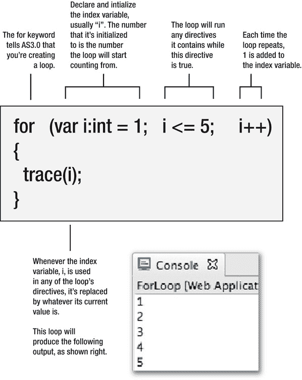

**图 9-10.** `for` 循环的工作原理

*虽然 `for` 循环是经久不衰的常用选择，但 AS3.0 也允许你以其他几种方式创建循环。你还可以创建 `while` 循环或 `do-while` 循环。它们与 `for` 循环的功能相同，但在某些特定情况下，它们细微的差别可能会派上用场。*

*`while` 循环在游戏开发中特别有用。它的语法如下：*

```
while(某个条件为真)
{
   //...执行此操作
}
```

*`while` 循环不会运行固定的次数；它们会持续运行直到条件变为假。在程序中使用 `while` 循环时，必须确保条件最终会变为假。如果条件始终为真，循环将“永远”运行，可能导致 Flash Player 挂起。通常，如果循环运行 15 秒仍未结束，Flash Player 会自动退出循环，但有时它不会这样做！请谨慎使用 `while` 循环，并在测试前务必保存你的工作。*

*本书不会详细讲解 `while` 和 `do-while` 循环，但值得进一步研究它们以了解其功能。如需更多信息，请参阅 Adobe 在线文档《为 Adobe Flash 编写 Adobe ActionScript 3.0 程序》中“ActionScript 语言和语法”一章的“循环”小节。*

## 使用数组

如果你理解了 `for` 循环的工作原理，那么编写检测多个对象碰撞的代码就已经完成了一半。构建这个功能的另一块拼图是数组。你可以将数组想象成一个大柜子，用于在一个地方存储大量对象。

实际上，数组可用于存储任何内容：变量、数字、字符串、对象、方法，甚至是其他数组。数组中的每个元素都使用一个数字进行索引。我们将通过一些实际示例来了解如何使用数组对象的索引号来访问和修改它们。

本书的下载包中有一个名为“Bug Catcher”的平台游戏案例分析，玩家需要用一个罐子收集飞行的虫子。让我们进入游戏状态，创建一个名为 `collectionJar` 的数组。在使用数组之前，你需要使用 `new` 关键字对其进行实例化。如果你想创建一个空的收集罐来装虫子，可以像这样创建：

## 数组基础

```
var collectionJar:Array = new Array();
collectionJar = [];
```

数组将其对象放在方括号内，如下所示：

```
[方括号内的任何东西都属于这个数组]
```

一对空括号表示该数组是空的，这就是你初始化 `collectionJar` 数组的方式。但数组不一定要从空开始。你可以在初始化时就让数组中已填充对象。

```
collectionJar = [fly, mosquito, bee];
```

数组中的所有对象都从 0 开始按顺序编号。这些数字称为`索引号`。在此示例中，`fly` 的索引号为 0，`mosquito` 的索引号为 1，`bee` 的索引号为 2。你可以使用数组访问运算符来查找哪个对象位于哪个索引号。示例如下：

```
collectionJar[1]
```

它的值是 `mosquito`，因为 `mosquito` 的索引号是 1。这其实非常简单。数组只是一个编号列表，其中的条目被称为`元素`。图 9-11 比较了一个空数组和一个包含三个元素的数组。

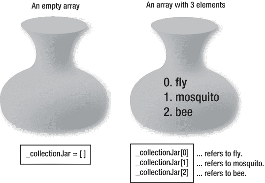

图 9-11. 数组与数组元素

将元素放入数组有几种方法。在之前的例子中，三个元素是在数组初始化时添加的。通常你会从一个空数组开始，然后根据需要向其中添加元素。

将元素放入数组的一种方法是直接将元素赋给数组索引中的某个位置。

```
collectionJar[2] = fly;
```

因此，当你的代码看到 `collectionJar[2]` 时，它会返回 `fly` 的值。

让我们看一个稍微具体一点的例子。本章的源文件包含一个名为 `BasicArray` 的文件夹。打开它并查看应用程序类。

```
package
{
  import flash.display.Sprite;

  public class BasicArray extends Sprite
  {
//声明数组
    private var _collectionJar:Array;

    public function BasicArray()
    {
//实例化数组
      _collectionJar = new Array();

//向数组添加元素
      _collectionJar[0] =  "fly";
      _collectionJar[1] =  "mosquito";
      _collectionJar[2] =  "bee";

//跟踪整个数组内容
      trace("Entire Array: " + _collectionJar);

//跟踪单个元素
      trace("Element 0: " + _collectionJar[0]);
      trace("Element 1: " + _collectionJar[1]);
      trace("Element 2: " + _collectionJar[2]);
    }
  }
}
```

如果你测试这段代码，跟踪输出将显示：

```
Entire Array: fly,mosquito,bee
Element 0: fly
Element 1: mosquito
Element 2: bee
```

从这个例子可以清楚地看到，数组就是存储容器。

## 向数组推送元素

另一种非常常见的向数组中添加元素的方法是使用数组内置的 `push` 方法。你可以使用 `push` 将元素“推入”数组，格式如下：

```
arrayName.push(elementName);
```

当你将一个对象推入数组时，它会获得一个比最后添加元素的索引号大 1 的索引号。这意味着，如果最后一个元素的索引号是 [2]，那么你推入的对象将获得索引号 [3]。

使用 `push` 非常方便，因为你无需操心该将元素添加到哪个索引号。数组会自动为你处理。

本章源文件包含一个名为 `ArrayPush` 的文件夹。将其作为项目打开，查看应用程序类。它和第一个示例相同，只是使用了 `push` 方法来添加元素。

```
_collectionJar.push("fly");
_collectionJar.push("mosquito");
_collectionJar.push("bee");
```

跟踪输出与第一个示例完全相同。你不需要担心索引号这一特性非常便捷。

*要从数组中移除元素，可以使用数组的 `pop` 方法。以下代码使用 `pop` 移除数组中的最后一个元素并将其赋值给一个变量：*

```
removedElement = _collectionJar.pop();
```

*如果最后一个元素是 `bee`，那么 `removedElement` 的值就是 `bee`。这也意味着 `_collectionJar` 现在只包含两个元素：`fly` 和 `mosquito`。*

你还可以使用 `splice` 方法来添加和移除数组中的元素。我将在下一章详细解释如何使用 `splice`。

## 循环遍历数组

当数组与循环结合使用时，它们会变得异常有用。你可以使用 `for` 循环遍历数组中的每一个元素，即使有数百个元素，也只需一行代码。数组和循环几乎总是这样搭配使用。让我们来看看如何用循环读取数组中的所有元素。

数组有一个名为 `length` 的内置属性，它能告诉你数组中有多少个元素。你可以像这样访问数组的 `length` 属性：

`arrayName.length`

`length` 属性的编号从 0 开始。这意味着，如果你有一个包含十个元素的数组，`length` 属性将是 `9`。

要查找数组中最后一个元素的索引号，你可以使用如下代码：

`arrayName.length - 1`

你可以使用数组的 `length` 属性来控制 `for` 循环的重复次数。下面是一个基本示例，展示了你可以使用的格式：

```
for (var i:int = 0;  i < arrayName.length;  i++)
{
  trace(arrayName[i]);
}
```

这段代码会显示数组中的所有元素，从元素 0 开始，一直运行到数组的末尾，无论数组有多长。

本章的源文件中包含一个名为 `ArrayLoop` 的文件夹。其中有一个示例，演示了如何使用 `for` 循环列出数组的内容。打开应用程序类并编译它来查看效果。

```
package
{
  import flash.display.Sprite;

  public class ArrayLoop extends Sprite
  {
    //声明数组
    private var _collectionJar:Array;

    public function ArrayLoop()
    {
      //实例化数组
      _collectionJar = new Array();

      //向数组添加元素
      _collectionJar.push("fly");
      _collectionJar.push("mosquito");
      _collectionJar.push("bee");

      for (var i:int = 0; i < _collectionJar.length; i++)
      {
        trace("元素 " + i + ": " + _collectionJar[i]);
      }
    }
  }
}
```

这会显示以下跟踪输出：

```
元素 0:  fly
元素 1:  mosquito
元素 2:  bee
```

这段小代码是游戏设计中最常见且最有用的代码之一。你将在略微不同的上下文中数百次或数千次使用它的变体，来完成从创建对象、移动对象、更改对象属性到检测碰撞等各种任务。

## 搜索数组

该系统的另一个有趣特性是，你可以通过加入一个 `if` 语句来创建基本的搜索功能。它非常简单：只需检查循环中的数组元素是否匹配某个搜索词。如果匹配，就找到了你要寻找的元素。

以下是搜索数组的基本格式：

```
for (var i:int = 0;  i < arrayName.length;  i++)
{
  if(arrayName[i] == "搜索词")
  {
    trace("搜索词已找到。");
    break;
  }
}
```

这里有一个新概念是关键字 `break`，它用于立即停止循环，而无需等待循环完成。当你使用循环搜索数组时，通常只寻找一个元素。一旦找到该元素，继续循环就没有意义了，因此你可以使用 `break` 提前停止它。因为你的程序不必进行任何不必要的检查，所以你的游戏会运行得更快。

你会在本章的源文件中找到一个名为 `ArraySearch` 的项目文件夹。打开它并查看应用程序类。它在循环内部使用了一个 `if` 语句，来检查数组是否包含名为 "mosquito" 的元素。一旦 `if` 语句找到正确的元素，就会运行一个 `break` 指令来停止循环继续。

# 数组操作与二维数组

```
package
{
  import flash.display.Sprite;

  public class ArraySearch extends Sprite
  {
    //声明数组
    private var _collectionJar:Array;

    public function ArraySearch()
    {
      //实例化数组
      _collectionJar = new Array();

      //向数组添加元素
      _collectionJar.push("fly");
      _collectionJar.push("mosquito");
      _collectionJar.push("bee");

      for (var i:int = 0; i < _collectionJar.length; i++)
      {
        if(_collectionJar[i] == "mosquito")
        {
          trace("在位置 " + i + " 找到 Mosquito");
          break;
        }
      }
    }
  }
}
```

如果你测试它，会看到如下输出：

```
在位置 1 找到 Mosquito
```

因为你包含了一个 `break` 指令，循环在此时停止。它永远不会检查元素 `[2]`，这是一件好事。循环已经找到了它要寻找的东西，因此无需再进一步检查。使用 `for` 循环搜索数组是一项基本的编程技术，从现在开始你会频繁地用到它。

### 数组中的数组

你可以在数组中存储任何内容，包括其他数组。你知道一个空数组看起来是这样的：

`[ ]`

它只是一对方括号。假设你想在第一个空数组中放入三个新数组。你可以这样做：

`[[ ],[ ],[ ]]`

现在第一个数组中包含了三个新的空数组。但这样查看会让人困惑，所以这里有一种更直观的方式来观察：

```
[
  [ ],
  [ ],
  [ ]
]
```

现在可以很清楚地看到，外层数组内部包含了三个新数组。这被称为**二维**数组，即数组中的数组。

假设你作为昆虫收藏家的爱好现在扩展了，不仅包括飞虫，还包含了鸟类和缓慢爬行的生物。你需要一个更大的收集罐！你不希望蛞蝓和蠕虫与鸟类混在一起，因为它们可能会被吃掉。所以你需要一个带有内部隔层的新罐子，用来分隔你收集的不同类型生物。你可以将飞虫放在一个区域，鸟类放在另一个区域，缓慢爬行的生物放在第三个区域。二维数组非常适合这种情况，它看起来是这样的：

```
_collectionJar
  = [
      ["mosquito", "bee", "fly"],
      ["lark", "magpie", "albatross"],
      ["snail", "slug", "worm"]
    ];
```

现在你有一个包含三个内部数组的数组——每种生物一个。（注意：最后一个数组后面没有逗号。还要注意：最后一个方括号后面有一个分号。）

每个内部数组只不过是包含数组的简单元素。这意味着如果你想要访问包含缓慢爬行生物的数组，你可以这样做：

`_collectionJar[2]`

这会得到 `snail`、`slug` 和 `worm`。

如果你想找出该数组的第二个元素是什么，你可以这样做：

`_collectionJar[2][1]`

这会得到 `slug`。

再举一个例子。如果你想找出第二个数组的第三个元素，你可以这样找到它：

`_collectionJar[1][2]`

这会得到 `magpie`。

在本章的源文件中，你会发现一个名为 `ArraysInsideArrays` 的项目文件夹，其中包含这个新收集罐的工作示例。以下是应用程序类：

```
package
{
  import flash.display.Sprite;

  public class ArraysInsideArrays extends Sprite
  {
    //声明数组
    private var _collectionJar:Array;

    public function ArraysInsideArrays()
    {
      //初始化二维数组
      _collectionJar
        = [
            ["mosquito", "bee", "fly"],
            ["lark", "magpie", "albatross"],
            ["snail", "slug", "worm"]
          ];

      //查看第一个数组的全部内容
      //mosquito, bee, fly
      trace("Array 0: " + _collectionJar[0]);

      //查看第二个数组的全部内容
      //lark, magpie, albatross
      trace("Array 1: " + _collectionJar[1]);

      //查看第二个数组的第一个元素
      //lark
      trace("First element of the second array: "
        + _collectionJar[1][0]);

      //查看第三个数组的第三个元素
      //worm
      trace("Third element of the third array: "
        + _collectionJar[2][2]);

      //查看第一个数组的第二个元素
      //bee
      trace("Second element of the first array: "
        + _collectionJar[0][1]);

      //查看整个二维数组的内容
      //mosquito, bee, fly, lark, magpie,
      //albatross, snail, slug, worm
      trace("Entire collection jar: " + _collectionJar);
    }
  }
}
```

以下代码的跟踪输出：

```
Array 0: mosquito,bee,fly
Array 1: lark,magpie,albatross
First element of the second array: lark
Third element of the third array: worm
Second element of the first array: bee
Entire collection jar:
mosquito,bee,fly,lark,magpie,albatross,snail,slug,worm
```

图 9-12 演示了这个二维数组的工作原理。

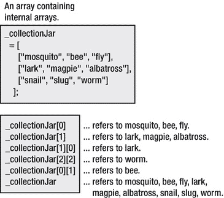

**图 9-12.** 理解二维数组

二维数组是一种非常高效的组织复杂信息的方式，你可以看到，如果你理解了这个系统，就很容易找到你想要的内容。在下一节中，你将看到如何使用二维数组来存储盒子的 `x` 和 `y` 坐标，以便轻松地将它们添加到舞台上正确的位置。

你需要对数组进行一些练习，才能在自己的代码中自如地使用它们。花一些时间研究这些示例文件，做些修改，并观察你的修改如何影响输出结果。这些示例是理解本章后续内容的关键，因此在继续之前务必确保你理解了它们。

### 创建多个盒子

我决定在平台游戏中放置 13 个盒子，并按图 9-13 所示定位在舞台上。

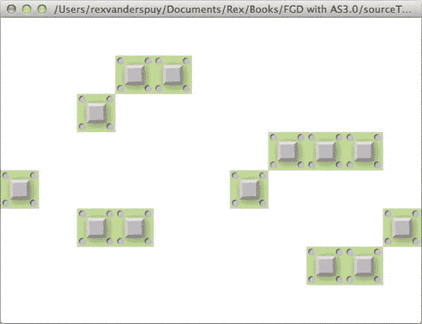

**图 9-13.** 在舞台上添加大量盒子

我首先在 Illustrator 中规划布局，这是构思关卡设计的有效方法。我打开了网格显示（`View > Show Grid`），并选择了对齐网格选项（`View > Snap to Grid`），这样能更轻松地将对象精确定位在网格线上。（我的盒子宽高均为 50 像素，因此我在 `Preferences > Guides & Grid` 中将网格线设置为每 50 像素显示一次。）图 9-14 展示了我在 Illustrator 中的关卡规划。当然，你不一定非要用 Illustrator；铅笔和方格纸同样能胜任。（没错，就用铅笔和纸，试试看！）

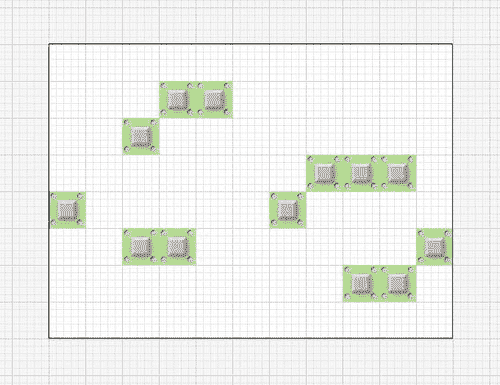

**图 9-14.** 使用 Illustrator 规划游戏盒子的位置

接着，我记下了每个盒子的 `x` 和 `y` 坐标，如下所示：

```
box1: x = 0, y = 200
box2: x = 100, y = 100
box3: x = 100, y = 250
...
```

我对所有 13 个盒子都进行了这样的操作。随后，我便拥有了通过循环和数组来创建这些盒子并将其添加到舞台所需的所有信息。

你会在本章的源文件中找到一个名为`MakingBoxes`的项目文件夹。`images`文件夹中包含一个50x50像素的盒子PNG图形。`src`文件夹中包含与第7章的“定时炸弹恐慌”项目中相同的`Box`类。代码要正常运行，这两个元素都必须存在于项目文件夹中。图9-15展示了`MakingBoxes`项目文件夹的结构。

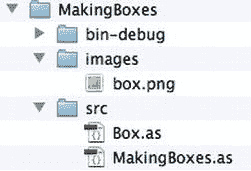

图9-15. 项目文件夹包含一个盒子PNG图像和一个用于嵌入图像的`Box`类

下面是完整的`MakingBoxes`应用程序类代码，其运行结果即图9-13所示。

```
package
{
  import flash.display.Sprite;

  [SWF(width="550", height="400",
  backgroundColor="#FFFFFF", frameRate="60")]

  public class MakingBoxes extends Sprite
  {
    //用于存储盒子的数组
    private var _boxes:Array = new Array();

    //用于存储盒子 x 和 y 坐标的二维数组
    private var _boxPositions:Array = new Array();

    public function MakingBoxes()
    {
      //设置盒子的 x 和 y 坐标
      _boxPositions
        = [
            [0, 200],
            [100, 100],
            [100, 250],
            [150, 50],
            [150, 250],
            [200, 50],
            [300, 200],
            [350, 150],
            [400, 150],
            [400, 300],
            [450, 150],
            [450, 300],
            [500, 250]
          ];

      //创建盒子
      for(var i:int = 0; i < _boxPositions.length; i++)
      {
        //创建一个盒子对象
        var box:Box = new Box();

        //将盒子添加到舞台
        addChild(box);
        box.x = _boxPositions[i][0];
        box.y = _boxPositions[i][1];

        //将其添加到 boxes 数组以供后续使用
        _boxes.push(box);
      }
    }
  }
}
```

要使这段代码生效，需要两个数组。

```
private var _boxes:Array = new Array();
private var _boxPositions:Array = new Array();
```

`_boxes`数组是存储全部十三个盒子的容器。`_boxPositions`数组则是一个二维数组，用于存储每个盒子的`x`和`y`坐标。

```
_boxPositions
  = [
      [0, 200],
      [100, 100],
      [100, 250],
      [150, 50],
      [150, 250],
      [200, 50],
      [300, 200],
      [350, 150],
      [400, 150],
      [400, 300],
      [450, 150],
      [450, 300],
      [500, 250]
    ];
```

`_boxPositions`包含13个数组。每个数组包含两个元素：第一个元素是盒子的`x`坐标，第二个元素是盒子的`y`坐标。

```
[x 坐标, y 坐标]
```

这些数字正是我当初用铅笔规划关卡时随手记下的。因为有13个盒子，所以每个盒子都对应一对`x`和`y`坐标。

`for`循环负责创建盒子对象、将其推入`_boxes`数组、添加到舞台，并借助`_boxPositions`二维数组完成定位。

```
for(var i:int = 0; i < _boxPositions.length; i++)
{
  //创建一个盒子对象
  var box:Box = new Box();

  //将盒子添加到舞台
  addChild(box);
  box.x = _boxPositions[i][0];
  box.y = _boxPositions[i][1];

  //将其添加到 boxes 数组以供后续使用
  _boxes.push(box);
}
```

`for`循环使用`_boxPosition`数组的`length`属性来确定重复次数，该次数与盒子坐标的数量相等。`_boxPositions`数组有13个元素，因此循环会重复13次。

```
for(var i:int = 0; i < _boxPositions.length; i++)
{...
```

像这样利用`length`属性来确定循环次数非常有用。这意味着，如果你决定在游戏中添加或移除盒子，只需在`_boxPositions`数组中添加或删除一对`x`和`y`坐标即可。`for`循环会自动根据坐标数量进行调整，你完全不需要修改循环代码。

循环首先执行的操作是创建一个盒子对象。

```
var box:Box = new Box();
```

接着，代码将此盒子添加到舞台。

```
addChild(box);
```

然后是最巧妙的一步：根据你在`_boxPositions`数组中输入的坐标，为盒子赋予`x`和`y`坐标。

```
box.x = _boxPositions[i][0];
box.y = _boxPositions[i][1];
```

这是如何工作的呢？如果你对循环和数组不熟悉，这可能会有点令人困惑，让我们来仔细看看。循环第一次运行时，`i`的值为零。这意味着上述代码实际上会变成这样：

```
box.x = _boxPositions[0][0];
box.y = _boxPositions[0][1];
```

首先，`_boxPositions[0]`是什么？它指的是`_boxPositions`数组中的第一个元素，也就是你记下的第一组`x`和`y`坐标。

```
[0, 200]
```

在这个小数组中，元素`0`是`x`坐标，元素`1`是`y`坐标。

```
_boxPositions[0][0] = 0
_boxPositions[0][1] = 200
```

如果你对此感到困惑，请参考前面关于二维数组的章节。其引用方式与那些示例中引用鸟类和昆虫的方式完全相同。这仅仅意味着第一个盒子的`x`和`y`坐标正在从`_boxPositions`数组复制到盒子对象的`x`和`y`属性中。你可以将`for`循环中的代码理解为：

```
box.x = 0;
box.y = 200;
```

循环第二次运行时，`i`的值为`1`。这意味着定位盒子的代码将如下所示：

```
box.x = _boxPositions[1][0];
box.y = _boxPositions[1][1];
```

`_boxPositions[1]`指的是`_boxPositions`的第二个元素，即存储第二个盒子坐标的数组。

```
[100, 100]
```

这意味着你可以像这样引用第二组`x`和`y`坐标：

```
_boxPositions[1][0] = 100
_boxPositions[1][1] = 100
```

最后，这也意味着在循环第二次运行时，用于定位盒子的两行代码被解释为：

```
box.x = 100;
box.y = 100;
```

循环运行次数与你拥有的坐标数量相同。这意味着它会对每一组坐标创建一个盒子，并将一组坐标分配给一个盒子。

`for`循环创建的`box`对象是局部的。这意味着它只在单次循环迭代中存在。循环总共会创建13个这样的`box`对象，但每次循环重复时，这些`box`对象都会被新的对象替换。因此，在它失效之前，你需要将其推入`_boxes`数组，以便保存它供后续使用。

```
_boxes.push(box);
```

现在盒子对象已安全存储于数组中，您可以在游戏中随时访问它来检测碰撞，甚至重新定位或制作动画！循环执行完毕后，所有 13 个盒子对象都将存放在`_boxes`数组中。

这是一个非常高效的小型系统，一旦您设置并运行它，它就会自动运行。您甚至无需过多思考，只需在需要创建大量对象并将其放置在舞台上时，复制并粘贴这段基础代码即可。除了对象名称外，您可以在无数游戏项目中直接使用这一基本格式，无需修改。

接下来的步骤是添加一些碰撞检测功能，让跑跳游戏角色能与盒子互动。最难的部分已经完成，您会发现添加碰撞检测其实异常简单。

## 与多个对象的碰撞处理

打开`LoopingThroughBoxes`项目文件夹并运行 SWF 文件。您会看到一个完全符合刚才所述机制的工作系统。猫咪角色现在可以奔跑跳跃于舞台上的盒子之间，探索游戏世界，如图 9-16 所示。玩起来乐趣十足，而您已掌握所有必要技能，完全可以独立制作类似内容并开发成完整游戏。

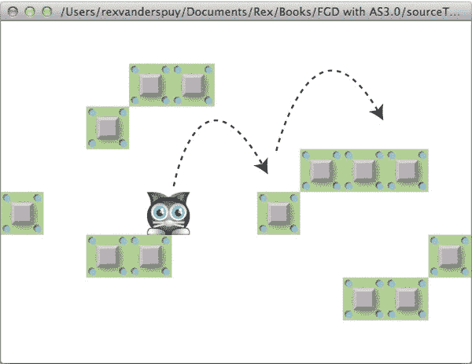

`图 9-16.` 结合物理与碰撞检测，构建平台游戏的基础。

别慌！这里没有新知识需要学习！这种复杂效果仅通过几行额外的简短代码即可实现，而且所有这些代码您都曾见过。我们来看看它是如何工作的。

查看`LoopingThroughBoxes`项目文件夹的内部结构，如图 9-17 所示。在`images`文件夹中，您会发现角色和盒子的 50x50 像素 PNG 图片。`sound`文件夹包含`bounce.mp3`声音文件。`src`文件夹中包含应用程序类、`Character`类、`Box`类，以及非常重要的`Collision`类。

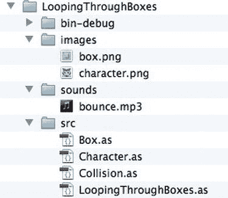

`图 9-17.` LoopingThroughBoxes 项目使用的文件

您还记得第 6 章和第 7 章中的`Collision`类吗？您曾用它来阻止两个对象，例如：

`Collision.block(_character, _box);`

这个代码片段正是本例中用于碰撞检测的核心代码。

`LoopingThroughBoxes`应用程序类综合运用了本章迄今为止的所有技术：声音、跳跃物理、以及通过数组和循环将对象添加到游戏中。所有这些您都应该熟悉！唯一新增的部分是`enterFrameHandler`中的`for`循环，它负责处理角色与盒子之间的碰撞检测。以下是完整的应用程序类，我将在后续页面中解释碰撞检测的工作原理。

```actionscript
package
{
  import flash.display.Sprite;
  import flash.events.Event;
  import flash.events.KeyboardEvent;
  import flash.media.Sound;
  import flash.media.SoundChannel;
  import flash.ui.Keyboard;

  [SWF(width="550", height="400",
    backgroundColor="#FFFFFF", frameRate="60")]

  public class LoopingThroughBoxes extends Sprite
  {
//嵌入声音
    [Embed(source="../sounds/bounce.mp3")]
    private var Bounce:Class;

//为声音创建声音和声音通道对象
    private var _bounce:Sound = new Bounce();
    private var _bounceChannel:SoundChannel = new SoundChannel();

    private var _character:Character = new Character();
    private var _boxes:Array = new Array();
    private var _boxPositions:Array = new Array();

    public function LoopingThroughBoxes()
    {
//设置盒子 x 和 y 坐标
      _boxPositions
        = [
            [0, 200],
            [100, 100],
            [100, 250],
            [150, 50],
            [150, 250],
            [200, 50],
            [300, 200],
            [350, 150],
            [400, 150],
            [400, 300],
            [450, 150],
            [450, 300],
            [500, 250]
          ];

//制作盒子
      for(var i:int = 0; i < _boxPositions.length; i++)
      {
//创建一个盒子对象
        var box:Box = new Box();

//将盒子添加到舞台
        addChild(box);
        box.x = _boxPositions[i][0];
        box.y = _boxPositions[i][1];

//将其添加到盒子数组中以备后续使用
        _boxes.push(box);
      }

//添加角色
      addChild(_character);
      _character.x = 150;
      _character.y = 300
```

```actionscript
//添加事件监听器
stage.addEventListener(KeyboardEvent.KEY_DOWN, keyDownHandler);
stage.addEventListener(KeyboardEvent.KEY_UP, keyUpHandler);
stage.addEventListener(Event.ENTER_FRAME, enterFrameHandler);
}
public function enterFrameHandler(event:Event):void
{
//应用加速度
_character.vx += _character.accelerationX;

//应用摩擦力
_character.vx *= _character.friction;

//应用重力
_character.vy += _character.gravity;

//限制速度，角色向上移动时除外
if (_character.vx > _character.speedLimit)
{
_character.vx = _character.speedLimit;
}
if (_character.vx < -_character.speedLimit)
{
_character.vx = -_character.speedLimit;
}
if (_character.vy > _character.speedLimit * 2)
{
_character.vy = _character.speedLimit * 2;
}

//当速度降至 0.1 以下时，强制归零
if (Math.abs(_character.vx) < 0.1)
{
_character.vx = 0;
}
if (Math.abs(_character.vy) < 0.1)
{
_character.vy = 0;
}

//移动角色
_character.x += _character.vx;
_character.y += _character.vy;

//检查舞台边界
if (_character.x < 0)
{
_character.vx = 0;
_character.x = 0;
}
if (_character.y < 0)
{
_character.vy = 0;
_character.y = 0;
}
if (_character.x + _character.width > stage.stageWidth)
{
_character.vx = 0;
_character.x = stage.stageWidth - _character.width;
}
if (_character.y + _character.height > stage.stageHeight)
{
_character.vy = 0;
_character.y = stage.stageHeight - _character.height;
_character.isOnGround = true;
}

for(var i:int = 0; i < _boxes.length; i++)
{
Collision.block(_character, _boxes[i]);

if(Collision.collisionSide == "Bottom")
{
//告诉角色，如果它站在平台上，
//那么它就在地面上
_character.isOnGround = true;

//通过施加与角色 vy 完全相反的作用力
//来抵消重力
_character.vy = -_character.gravity;
}
else if(Collision.collisionSide == "Top")
{
_character.vy = 0;
}
else if(Collision.collisionSide == "Right"
|| Collision.collisionSide == "Left")
{
_character.vx = 0;
}
}
}
public function keyDownHandler(event:KeyboardEvent):void
{
if (event.keyCode == Keyboard.LEFT)
{
_character.accelerationX = -0.2;
}
else if (event.keyCode == Keyboard.RIGHT)
{
_character.accelerationX = 0.2;
}
else if (event.keyCode == Keyboard.UP
|| event.keyCode == Keyboard.SPACE)
{
if(_character.isOnGround)
{
_bounceChannel = _bounce.play();
_character.vy += _character.jumpForce;
_character.gravity = 0.3;
_character.isOnGround = false;
}
}
}
public function keyUpHandler(event:KeyboardEvent):void
{
if (event.keyCode == Keyboard.LEFT
|| event.keyCode == Keyboard.RIGHT)
{
_character.accelerationX = 0;
}
}
}
```

唯一的新代码是 `enterFrameHandler` 中的 `for` 循环。

```actionscript
for(var i:int = 0; i < _boxes.length; i++)
{
Collision.block(_character, _boxes[i]);

if(Collision.collisionSide == "Bottom")
{
//告诉角色，如果它站在平台上，
//那么它就在地面上
_character.isOnGround = true;

//通过施加与角色 vy 完全相反的作用力
//来抵消重力
_character.vy = -_character.gravity;
}
else if(Collision.collisionSide == "Top")
{
_character.vy = 0;
}
else if(Collision.collisionSide == "Right"
|| Collision.collisionSide == "Left")
{
_character.vx = 0;
}
}
```

它会遍历 `_boxes` 数组中的所有盒子，并检查它们是否与角色发生碰撞。

```actionscript
for(var i:int = 0; i < _boxes.length; i++)
{
Collision.block(_character, _boxes[i]);
```

`Collision` 类包含一个名为 `collisionSide` 的静态字符串属性，它会告诉你碰撞发生在角色的哪一侧。你可以像这样访问 `collisionSide` 属性：

`Collision.collisionSide`

如果没有碰撞，`collisionSide` 的值将是 "No collision"。但如果发生碰撞，它的值将为 "Top"、"Bottom"、"Left" 或 "Right" 其中之一。你可以在 `if` 语句中使用 `collisionSide`，根据碰撞发生在角色的哪一侧，来对碰撞做出特定的处理。图 9-18 说明了这一点。

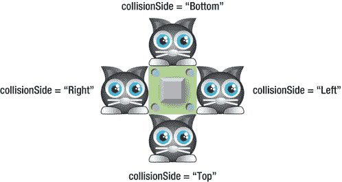

图 9-18. 使用 `Collision` 类的 `collisionSide` 属性，找出角色与盒子发生碰撞的是哪一侧。

你需要了解这一点的原因在于，这样当角色撞到这些侧面之一时，你可以将其速度设为零。这会产生盒子吸收角色作用力的效果，从而呈现出非常自然的外观效果。如果角色碰撞在顶部、左侧或右侧，只需将 `vy` 或 `vx` 设为零即可，如下所示：

```actionscript
else if(Collision.collisionSide == "Top")
{
_character.vy = 0;
}
else if(Collision.collisionSide == "Right"
|| Collision.collisionSide == "Left")
{
_character.vx = 0;
}
```

但如果角色从底部碰撞盒子，就需要解决一个技术细节。重力会持续将角色向下拉向舞台，因此你不能简单地通过将角色的 `vy` 设为零来使其停止。你必须通过赋予角色一个负的重力值来主动抵消重力，如下所示：

```actionscript
if(Collision.collisionSide == "Bottom")
{
_character.isOnGround = true;
_character.vy = -_character.gravity;
}
```

如果不这样做，重力会持续试图将角色向下拉入盒子，有时可能会导致角色卡在两个盒子相接的角落中。完全抵消重力可以彻底防止这种情况发生。

这里有一个有趣的小修改。你可以用以下代码替换之前的代码片段，让盒子变得有弹性：

```
_character.vy = -_character.vy / 2;
```

使用这行代码后，角色在落在平台顶部之前会轻微弹跳一下。如果你想制作一个非常有弹性的平台，比如蹦床，你可以像这样反转角色的速度：

```
_character.vy = -_character.vy;
```

或者，为了获得超级弹跳，可以乘以一个系数，像这样：

```
_character.vy = -_character.vy * 1.5;
```

当角色底部碰到平台顶部时，发生的另一件事是其 `isOnGround` 属性被设置为 `true`。

```
_character.isOnGround = true;
```

这与角色碰到舞台底部时发生的情况完全相同，并且会重新启用其跳跃能力。

这就是你需要了解的全部新代码！你现在有一个有趣的小玩具可以玩了。你将如何利用它来制作一款游戏？回想一下你在第 6 章、第 7 章和第 8 章中学到的技能，你会意识到你已经知道该怎么做了。

### 案例研究

现在你已经掌握了一些出色的新游戏设计技巧，可以用来制作多种类型的游戏。但在实际游戏中该如何应用这些技巧呢？在本书的下载包中，你将找到一个名为《案例研究：迷宫游戏与平台游戏》的额外章节，其中详细剖析了两款游戏。

- **《迷宫怪物大乱斗》**：一款以怪物穿梭复杂迷宫环境为特色的迷宫游戏。

- **《捕虫达人》**：一款包含新型敌人、人工智能技术、游戏状态管理器、物体朝向旋转详解以及舞台上对象堆叠顺序变更方法的平台游戏。

图 9-19 展示了这两款游戏的效果。

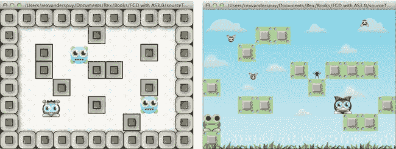

**图 9-19.** 本书下载包中的《迷宫怪物大乱斗》与《捕虫达人》案例研究

### 本章小结

本章涵盖了许多新技术，你将在自己的游戏项目中找到它们的用武之地。解决胜负条件的具体游戏逻辑以及为角色设计的人工智能，会因项目不同而各异。但希望本章能为你提供一些应对这些问题的思路，以及在自己的游戏中解决这些难题时需要考虑的要素。

本章对平台游戏、物理引擎和多游戏对象管理进行了基础介绍，但这里提供的所有构建模块都能让你起步，只需稍加规划和想象力，就能打造出相当复杂的游戏。加入一些解谜与任务完成元素，再添几个动画敌人，你便顺利踏上制作真正有趣游戏的道路。你还可以添加武器，甚至实现滚动视角，让玩家探索广阔区域。若再设计些赋予玩家特殊能力的道具或可驾驶的载具呢？

你所使用的碰撞检测代码还有一个额外优势：它能告诉你玩家击中平台的哪一侧。你可以将此逻辑应用于敌人碰撞，判断玩家是否踩在敌人头顶——这是在平台游戏中击败敌人的经典方式。你还可以改编物理代码，创造飞行类动作游戏（如《Joust》），或飞行救援/探索游戏（如《Lunar Lander》《Choplifter》《Defender》）。实际上，几乎所有 2D 平台游戏都已触手可及。至于移动平台？那可能会很有趣！

在下一章中，你将更深入地研究敌人人工智能和脚本化运动。我会展示使用鼠标的玩家控制方案，还会教你如何让物体在 360 度范围内移动并发射子弹。


