## 第 10 章 高级对象与角色控制

现在你已经掌握了构建各种游戏所需的所有技能，但还有更多值得学习的内容。本章我们将探讨以下实用技巧，助你开启专业级游戏设计项目之旅：

* 使用缓动实现平滑运动

* 用鼠标控制游戏角色

* 让物体沿旋转方向移动

* 向各个方向发射子弹

* 学习基础敌人人工智能：跟随、逃离及向玩家方向射击

* 复杂的玩家控制对象：飞船、鼠标控制的平台角色、汽车和坦克

本章内容庞杂且密度较高，不必强求一次性掌握所有技巧。我将其设计为一个工具箱，供你在解决特定设计问题时随时查阅。每次只取一小部分，并尽可能将技巧应用到你的项目中。

闲言少叙，开始游戏吧！

### 用鼠标移动对象

如果你开始专业设计游戏，客户可能期望游戏控制依赖鼠标而非键盘。如果你能仅用鼠标设计游戏控制，距离为 iPhone、iPad 或安卓手机平板等触屏设备设计游戏便仅一步之遥。

那么，让我们逐步了解如何用鼠标控制对象。

#### 将对象固定在鼠标位置

首先，使用 `Mouse` 类将对象固定在鼠标的 `x` 和 `y` 位置。在本章的源文件中，你会找到一个名为 `MousePointer` 的项目文件夹。运行 SWF 文件后，你会发现只需在舞台上移动鼠标，就能控制本章即将登场的明星角色——按钮仙子。图 10-1 展示了你将看到的效果。

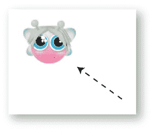

**图 10-1.** 移动鼠标让按钮仙子在舞台上飞翔。

移动鼠标时，鼠标指针消失，但对象仍精确固定在其所在位置。这一技巧可为你的任何游戏创建自定义鼠标指针。

所有代码均位于 `MousePointer` 应用程序类中，如下所示：

```actionscript
package
{
  import flash.display.Sprite;
  import flash.events.Event;
  import flash.ui.Mouse;
  import flash.events.MouseEvent;

  [SWF(width="550", height="400",
  backgroundColor="#FFFFFF", frameRate="60")]

  public class MousePointer extends Sprite
  {
    private var _fairy:Fairy = new Fairy();

    public function MousePointer()
    {
      stage.addChild(_fairy);

      //隐藏鼠标
      Mouse.hide();

      stage.addEventListener(Event.ENTER_FRAME, enterFrameHandler);
    }
    private function enterFrameHandler(event:Event):void
    {
      //将仙子居中于鼠标位置
      _fairy.x = mouseX - (_fairy.width / 2);
      _fairy.y = mouseY - (_fairy.height / 2);
    }
  }
}
```

此代码依赖于 `Mouse` 类的使用，因此首先需要导入它。

```actionscript
import flash.ui.Mouse;
```

构造函数方法通过 `Mouse` 类的 `hide` 方法隐藏鼠标。

```actionscript
Mouse.hide();
```

最后，它利用舞台的 `mouseX` 和 `mouseY` 属性，将仙子的位置固定并居中于现在不可见的鼠标上。

```actionscript
_fairy.x = stage.mouseX - (_fairy.width / 2);
_fairy.y = stage.mouseY - (_fairy.height / 2);
```

瞧，一个自定义鼠标指针就完成了！

### 使用缓动效果移动对象

在游戏场景中，你很可能希望角色移动时比单纯紧贴鼠标位置更优雅一些。你可以使用一种名为*缓动*的简单技术，让物体逐渐减速直至停止，并借此创建出非常精巧的物体移动系统。

在本章的源文件中，你会找到一个名为 `EasingWithMouse` 的文件夹。运行该 SWF 文件即可查看效果。移动鼠标，小精灵会追逐鼠标在舞台上移动，并优雅地缓动至鼠标下方位置。你可以在图 10-2 中看到这一效果。

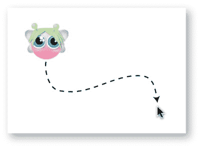

**图 10-2.** 小精灵跟随鼠标移动，并带有轻微延迟。

以下是实现该效果的应用程序类。其中有一个你之前未见过的新特性：`EASING` 这个值，它是一种特殊类型的值，称为*常量*。稍后我将解释常量的工作原理。

# ActionScript 缓动效果教程

```actionscript
package
{
  import flash.display.Sprite;
  import flash.events.Event;
  import flash.events.MouseEvent;
  import flash.ui.Mouse;

  [SWF(width="550", height="400",
  backgroundColor="#FFFFFF", frameRate="60")]

  public class EasingWithMouse extends Sprite
  {
    private var _fairy:Fairy = new Fairy();
    private const EASING:Number = 0.1

    public function EasingWithMouse()
    {
      stage.addChild(_fairy);
      stage.addEventListener(Event.ENTER_FRAME, enterFrameHandler);
    }
    private function enterFrameHandler(event:Event):void
    {
      //计算鼠标位置与小精灵中心点之间的距离
      var vx:Number
        = stage.mouseX - (_fairy.x + _fairy.width / 2);
      var vy:Number
        = stage.mouseY - (_fairy.y + _fairy.height / 2);  
      var distance:Number = Math.sqrt(vx * vx + vy * vy);

      //如果小精灵与鼠标距离超过 1 像素，则移动小精灵
      if (distance>= 1)
      {
        _fairy.x += vx * EASING;
        _fairy.y += vy * EASING;
      }
    }
  }
}
```

代码需要知道小精灵与鼠标之间的距离。它首先使用熟悉的代码计算一个距离向量。

```actionscript
var vx:Number
  = stage.mouseX - (_fairy.x + _fairy.width / 2);
var vy:Number
  = stage.mouseY - (_fairy.y + _fairy.height / 2);  
```

然后应用一个简单的公式——勾股定理，并将结果存入名为 `distance` 的变量中。

```actionscript
var distance:Number = Math.sqrt(vx * vx + vy * vy);
```

勾股定理指出：“直角三角形斜边的平方等于两直角边的平方和。”将其转化为实际的 AS3.0 代码，意味着你需要使用内置的 `Math.sqrt` 函数来求 `vx` 与 `vy` 各自平方之和的平方根。幸运的是，毕达哥拉斯是对的！每当你需要计算两点之间的距离时，使用他的公式即可。这将成为你游戏设计技巧库中的常客，在本章中你也会频繁使用它。

使用 `Math.sqrt` 的一个陷阱在于，它是你所能调用的最耗 CPU 的数学函数之一。如果能避免使用它，你将节省大量处理能力。

如何避免呢？尝试用脑力换 CPU 算力：使用手持计算器自己预先计算数值！

举个例子，假设你想在某个物体进入另一物体 75 像素范围内时执行某些代码。首先，计算距离的平方，如下所示：

```actionscript
var distanceSquared:Number = (vx * vx + vy * vy);
```

然后，当该距离小于 75 像素时执行代码，如下所示：

```actionscript
if (distanceSquared < 5625)
{
  //如果物体在范围内则执行的指令...
}
```

5625 从何而来？它是 75 × 75（即 75²）。通过自行计算该值，你可以省去 `Math.sqrt`，效果完全相同，只是你可能会注意到物体在舞台上移动得更流畅一些。

当然，5625 确实不是一个易于理解的数字，尤其是在设计和测试游戏时。不过，在最终优化阶段，你应始终考虑对任何像这样使用 `Math.sqrt` 的代码进行优化。

现在，程序已经知道了两点之间的距离，代码使用 `if` 语句来判断，当鼠标与小精灵之间的距离大于 1 像素时移动物体。

```actionscript
if (Math.abs(distance) >= 1)
{
  _fairy.x += vx * EASING;
  _fairy.y += vy * EASING;
}
```

## 缓动

缓动就是小精灵轻柔地“缓入”到鼠标下方位置时你所看到的效果。以下是实现该效果的两行代码：

```actionscript
_fairy.x += vx * EASING;
_fairy.y += vy * EASING;
```

使用一个简单的公式在 `ENTER_FRAME` 事件中即可非常容易地实现缓动，如下所示：

```actionscript
(当前位置 - 目标位置) * 缓动值;
```

通过改变缓动值，你可以让动画进行得更快或更慢。在下面的例子中，该值存储在一个名为 `EASING` 的常量中，其值为 `0.3`。

```actionscript
private const EASING:Number = 0.3;
```

将其改为更大的数值，例如 `0.5`，会使缓动效果发生得更快。将其改为更小的数值，例如 `0.1`，则会产生更慢的效果。

这是我们在示例中首次使用常量。常量与变量类似，只不过它们的值从不改变。它们是“恒定的”。你可以使用关键字 `const` 声明常量。按照惯例，常量总是用大写字母书写。程序员使用常量来确保不会意外覆盖程序中不应改变的值。AS3.0 不允许你在为常量赋值后更改其值。如果你知道自己将要使用的值不会或不应改变，请尽量养成使用常量而不是变量的习惯。

### 点击移动对象

只需稍作修改，就能让 Button Fairy 飞到你点击的舞台上的任意位置。打开 `ClickToMove` 项目文件夹并运行 SWF 文件。在舞台上任意位置点击，Button Fairy 就会从容地飞向那个点。如图 10-3 所示。

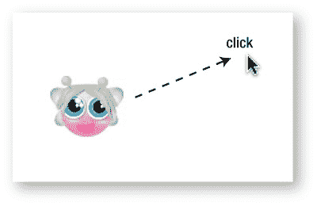

**图 10-3.** 点击舞台让 Button Fairy 飞向该处。

以下是实现此功能的代码：

```
package
{
  import flash.display.Sprite;
  import flash.events.Event;
  import flash.events.MouseEvent;
  import flash.ui.Mouse;

  [SWF(width="550", height="400",
  backgroundColor="#FFFFFF", frameRate="60")]

  public class ClickToMove extends Sprite
  {
    private const EASING:Number = 0.1
    private var _fairy:Fairy = new Fairy();

    //用于捕捉鼠标点击位置的变量
    private var _target_X:Number;
    private var _target_Y:Number;

    public function ClickToMove()
    {
      stage.addChild(_fairy);
      stage.addEventListener
        (Event.ENTER_FRAME, enterFrameHandler);
      stage.addEventListener
        (MouseEvent.MOUSE_DOWN, mouseDownHandler)
    }
    private function mouseDownHandler(event:MouseEvent):void
    {
      _target_X = stage.mouseX;
      _target_Y = stage.mouseY;
    }
    private function enterFrameHandler(event:Event):void
    {
//计算目标位置与仙子中心之间的距离
      var vx:Number
        = _target_X - (_fairy.x + _fairy.width / 2);
      var vy:Number
        = _target_Y - (_fairy.y + _fairy.height / 2);  
      var distance:Number = Math.sqrt(vx * vx + vy * vy);

      //如果距离目标位置超过 1 像素，则移动仙子
      if (distance >= 1)
      {
        _fairy.x += vx * EASING;
        _fairy.y += vy * EASING;
      }
    }
  }
}
```

当玩家用鼠标点击舞台上任意位置时，会调用 `mouseDownHandler` 方法。它将鼠标的位置存储在 `_target_X` 和 `_target_Y` 两个变量中。这两个数值用作移动仙子的目标点。这些值仅在玩家点击鼠标时才会改变。其余代码与之前的示例相同。

轻松缓动！

我们的小缓动公式是一段非常灵活、出色的代码，但如果你想在游戏中运用更高级的缓动效果，可以考虑安装并使用自定义的补间引擎。补间引擎是由热心的程序员编写的专用类，你可以将其添加到 AS3.0 代码库中，以各种有趣的方式为对象添加动画效果。现存的补间引擎实在太多，无法直接推荐哪一个更好，它们都非常出色，因此你需要自己做一些调研，看看哪些最适合你的游戏。以下是编写本文时最知名的 AS3.0 补间引擎：`Tweener`、`TweenLite`、`GTween`、`Twease` 和 `Tweensy`。

通过网络搜索可以找到它们当前的下载网站和安装说明。

但是，自己制作补间引擎或许是更好的选择！这并不难，Keith Peter 的杰作——*Foundation ActionScript 3.0 Animation* 和 *AdvancED ActionScript 3.0 Animation*（均由 Apress 出版）会向你展示如何实现。

### 案例分析：全方位发射抛射物

为了圆满结束关于鼠标驱动玩家控制系统的讨论，让我们看一个实际的例子，它考虑了某些游戏可能需要的复杂度。我们将以此作为玩家控制方案的原型，用于本章末尾的演示游戏《疯狂杀人蜂大混乱！》。

你可以在本章源文件的 `ButtonFairy` 项目文件夹中找到这个例子。运行 SWF 文件，你会看到可以通过拖拽鼠标让 Button Fairy 在舞台上飞行，这与上一节“使用缓动移动对象”中的示例非常相似。在这个版本中，一个橙色的圆圈（即仙子的“魔杖”）会围绕仙子旋转，并始终指向鼠标光标。点击鼠标左键，你可以向各个方向发射星星。星星在碰到舞台边界时会被移除。图 10-4 展示了运行效果。

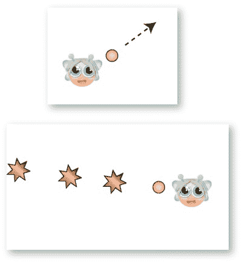

**图 10-4.** Button Fairy 朝着魔杖指向的方向飞行，并能向各个方向发射星星。

这是一个重要的示例，演示了以下关键的游戏设计技术：

*   如何让一个对象围绕另一个对象旋转

*   如何向各个方向发射抛射物

*   如何使用组合模式，通过单一的 `GameObject` 类来创建所有游戏对象

图 10-5 说明了项目结构。

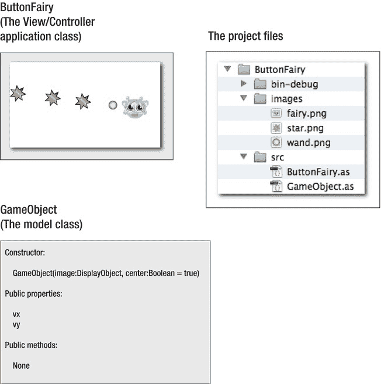

**图 10-5.** 项目类与文件

让 Button Fairy 在舞台移动的代码，与我们之前在“使用缓动移动对象”一节中看到的代码完全相同。移动魔杖和发射星星的新代码已添加进去，你将在后续篇幅中详细了解其工作原理。以下是实现所有功能的整个应用程序类：

# 制作游戏对象

所有对象的图像都嵌入到应用程序类中。每个单独的对象都通过组合方式制作，将图像发送给`GameObject`类，如下所示：

```actionscript
private var _fairy:GameObject = new GameObject(_fairyImage);
private var _wand:GameObject = new GameObject(_wandImage);
```

`GameObject`类包含了所有对象移动所需的`vx`和`vy`属性。当它通过构造函数方法接收到图像时，会显示图像并将其居中到包含它的精灵容器内。以下是实现这一功能的完整`GameObject`类：

```actionscript
package
{
    import flash.display.DisplayObject;
    import flash.display.Sprite;
    {
        public class GameObject extends Sprite
        {
            //公共属性
            public var vx:Number = 0;
            public var vy:Number = 0;

            public function GameObject
                (image:DisplayObject, center:Boolean = true)
            {
                //添加图像
                this.addChild(image);

                //如果"center"选项为 true，则居中图像
                if(center)
                {
                    image.x -= image.width / 2;
                    image.y -= image.height / 2;
                }
            }
        }
    }
}
```

`center`参数默认设置为`true`。这意味着对象的`x`和`y`位置将指向其中心点。在这个游戏示例中，这非常有用，因为我们希望小精灵居中于鼠标位置，魔法棒围绕小精灵中心旋转，并且星星从魔法棒中心点添加到舞台。将所有对象居中可以简化应用程序类中的代码。

---

```actionscript
package
{
  import flash.display.DisplayObject;
  import flash.display.Sprite;
  import flash.events.Event;
  import flash.events.MouseEvent;
  import flash.ui.Mouse;

  [SWF(width="550", height="400",
  backgroundColor="#FFFFFF", frameRate="60")]

  public class ButtonFairy extends Sprite
  {
    //嵌入图像
    [Embed(source="../images/fairy.png")]
    private var FairyImage:Class;
    [Embed(source="../images/wand.png")]
    private var WandImage:Class;
    [Embed(source="../images/star.png")]
    private var StarImage:Class;

    //私有属性
    private const EASING:Number = 0.1;
    private var _fairyImage:DisplayObject = new FairyImage();
    private var _wandImage:DisplayObject = new WandImage();

    //创建仙子和魔杖游戏对象
    //（GameObject 类会将图像居中）
    private var _fairy:GameObject = new GameObject(_fairyImage);
    private var _wand:GameObject = new GameObject(_wandImage);

    //存储鼠标与仙子中心之间角度的变量
    private var _angle:Number;

    //存储星星的数组
    private var _stars:Array = new Array();

    public function ButtonFairy()
    {
      //将仙子和魔杖添加到舞台
      stage.addChild(_fairy);
      stage.addChild(_wand);

      //隐藏鼠标
      Mouse.hide();

      //添加事件监听器
      stage.addEventListener
        (Event.ENTER_FRAME, enterFrameHandler);
      stage.addEventListener
        (MouseEvent.MOUSE_DOWN, mouseDownHandler);
    }
    private function enterFrameHandler(event:Event):void
    {
      //计算仙子中心与鼠标之间的角度
      _angle
        = Math.atan2
        (
          _fairy.y - stage.mouseY,
          _fairy.x - stage.mouseX
        );

      //围绕小精灵移动魔法棒
      var radius:int = -50;
      _wand.x = _fairy.x + (radius * Math.cos(_angle));
      _wand.y = _fairy.y + (radius * Math.sin(_angle));

      //计算鼠标与小精灵中心点的距离
      var vx:Number = stage.mouseX - _fairy.x;
      var vy:Number = stage.mouseY - _fairy.y;
      var distance:Number = Math.sqrt(vx * vx + vy * vy);

      //如果鼠标距离超过 1 像素，则移动小精灵
      if (distance >= 1)
      {
          _fairy.x += vx * EASING;
          _fairy.y += vy * EASING;
      }

      //移动星星
      for(var i:int = 0; i < _stars.length; i++)
      {
          var star:GameObject = _stars[i];
          star.x += star.vx;
          star.y += star.vy;

          //检查星星的舞台边界
          if (star.y < 0
          || star.x < 0
          || star.x > stage.stageWidth
          || star.y > stage.stageHeight)
          {
              //从舞台移除星星
              stage.removeChild(star);
              star = null;

              //从 _stars 数组中移除星星
              _stars.splice(i,1);

              //将循环计数器减一以补偿移除的星星
              i--;
          }
      }
    }
    private function mouseDownHandler(event:MouseEvent):void
    {
        //创建星星并添加到舞台
        var starImage:DisplayObject = new StarImage();
        var star:GameObject = new GameObject(starImage);
        stage.addChild(star);

        //将星星的起始位置设为魔法棒的位置
        star.x = _wand.x;
        star.y = _wand.y;

        //根据小精灵中心与鼠标之间的角度设置星星的速度
        star.vx = Math.cos(_angle) * -7;
        star.vy = Math.sin(_angle) * -7;

        //将星星推入 _stars 数组
        _stars.push(star);
    }
  }
}
```

如果你想使用此类创建游戏对象，但不想让图像居中，可以将`false`作为第二个参数传入，如下所示：

```actionscript
private var _fairy:GameObject = new GameObject(_fairyImage, false);
```

现在对象的`x`和`y`注册点将是其左上角，与本书中大多数示例的情况一致。

通过这一个类创建所有游戏对象是一种强大的编程技术，称为组合。它省去了为每个对象创建单独类的麻烦。如果你的所有游戏对象共享相同的属性，这是一个极好的解决方案。

关于组合的更多示例及其工作原理的详细解释，请参阅本书下载包中的附加章节《拖放游戏》。

## 让魔法棒围绕小精灵旋转

小精灵钮扣的魔法棒是一个黄色圆点，可以向各个方向发射星星。它围绕小精灵的中心旋转，并始终指向鼠标方向，如图 10-6 所示。

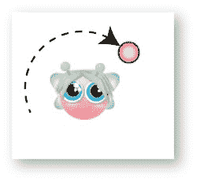

**图 10-6.** 魔法棒围绕小精灵中心旋转，并始终指向鼠标方向。

要实现这一点，首先需要找到鼠标与小精灵中心之间的角度。代码使用`Math.atan2`函数完成此操作。以下是计算鼠标与小精灵之间角度的代码：

```actionscript
_angle
    = Math.atan2
    (
        _fairy.y - stage.mouseY,
        _fairy.x - stage.mouseX
    );
```

AS3.0 有一个专门的函数`Math.atan2`，可以告诉你对象的旋转角度。使用它时，需要提供描述两个对象之间距离向量的任意`vx`或`vy`值。（有关距离向量的概念及如何查找，请回顾第 6 章。）在此示例中，距离向量由小精灵与鼠标在舞台上的位置差来描述：

```actionscript
    _fairy.y - stage.mouseY,
    _fairy.x - stage.mouseX
```

非常重要的一点是，使用`Math.atan2`时，请确保`vy`值是第一个参数，`vx`值是第二个参数，如下所示：

`Math.atan2(vy, vx)`

`Math.atan2`返回一个以弧度为单位的数值。不幸的是，这对旋转精灵对象没有直接用处。你需要将这个数值转换为度，这是`rotation`属性所期望的值类型。

要将弧度转换为度，可以使用一个简单的计算：将弧度值乘以 180 除以π（3.14）。AS3.0 内置了一个名为`Math.PI`的函数，可以返回π的值，让你的操作更简便。最终代码可能如下所示：

`Math.atan2(vy, -vx) * (l80/Math.PI)`

这会得到一个四舍五入的度数值，你可以将其应用于任何精灵的`rotation`属性。

关于旋转和`Math.atan2`工作原理的详细解释，请参阅本书下载包中的附加章节《案例研究：迷宫与平台游戏》。

我决定让魔法棒在 50 像素半径范围内围绕小精灵旋转。一个名为`radius`的变量定义了此距离。

`var radius:int = -50;`

负值使魔法棒偏离小精灵中心，而这恰好是鼠标指向的方向。

魔法棒的`x`和`y`位置通过将`radius`乘以使用两个专用函数`Math.cos`和`Math.sin`获得的角度比率来确定。这两个函数都将`_angle`值作为参数。然后将结果加到小精灵的`x`和`y`位置，使魔法棒随小精灵移动。

```actionscript
_wand.x = _fairy.x + (radius * Math.cos(_angle));
_wand.y = _fairy.y + (radius * Math.sin(_angle));
```

`Math.cos`和`Math.sin`是两个专门的三角函数，它们返回由角度测量形成的三角形两条边的比率。最终效果正如你在舞台上所见。

### 360 度发射星星

每次单击鼠标左键，代码都会调用 `mouseDownHandler` 函数，它会根据仙女棒指向的方向创建并发射星星。

```actionscript
private function mouseDownHandler(event:MouseEvent):void
{
  //创建一颗星星并将其添加到舞台
  var starImage:DisplayObject = new StarImage();
  var star:GameObject = new GameObject(starImage);
  stage.addChild(star);

  //设置星星的起始位置
  //为仙女棒的位置
  star.x = _wand.x;
  star.y = _wand.y;

  //设置星星的速度
  //基于仙女与鼠标中心点之间的角度
  star.vx = Math.cos(_angle) * -7;
  star.vy = Math.sin(_angle) * -7;

  //将星星推入 _stars 数组
  _stars.push(star);
}
```

每颗星星都使用 `GameObject` 类创建并添加到舞台，其方式与代码创建 `_fairy` 和 `_wand` 对象完全相同。

```actionscript
var starImage:DisplayObject = new StarImage();
var star:GameObject = new GameObject(starImage);
stage.addChild(star);
```

创建时，星星的 x 和 y 坐标与仙女棒的坐标相同。

```actionscript
star.x = _wand.x;
star.y = _wand.y;
```

然后，每颗星星都需要一个独特的速度，使其沿着鼠标指向的方向远离仙女。要找到这个速度，我们可以使用与旋转仙女棒相同的 `_angle` 值，并将其传递给 `Math.cos` 和 `Math.sin` 函数。如果将这些结果乘以 -7，将使星星以每帧 7 像素的速度远离仙女的中心。

```actionscript
star.vx = Math.cos(_angle) * -7;
star.vy = Math.sin(_angle) * -7;
```

接着，星星被推入 `_stars` 数组，以便我们可以像管理游戏中其他所有星星一样，移动并管理它。

```actionscript
_stars.push(star);
```

`enterFrameHandler` 中的 `for` 循环负责让星星移动并检查舞台边界。

```actionscript
for(var i:int = 0; i < _stars.length; i++)
{
  var star:GameObject = _stars[i];
  star.x += star.vx;
  star.y += star.vy;

  //检查星星的舞台边界
  if (star.y < 0
  || star.x < 0
  || star.x > stage.stageWidth
  || star.y > stage.stageHeight)
  {
    //从舞台移除星星
    stage.removeChild(star);
    star = null;

    //从 _stars 数组中移除星星
    _stars.splice(i,1);

    //将循环计数器减一
    //以补偿被移除的星星
    i--;
  }
}
```

循环首先通过将我们在 `mouseDownHandler` 中计算的 `vx` 和 `vy` 值加到 x 和 y 坐标上，使 `_stars` 数组中的每颗星星朝正确方向移动。

```actionscript
var star:GameObject = _stars[i];
star.x += star.vx;
star.y += star.vy;
```

然后检查星星是否越过了舞台边界。

```actionscript
if (star.y < 0
|| star.x < 0
|| star.x > stage.stageWidth
|| star.y > stage.stageHeight)
{…}
```

如果越界，则移除星星。首先，将其从舞台移除并将其值设为 `null`。

```actionscript
stage.removeChild(star);
star = null;
```

接着使用 `splice` 方法从 `_stars` 数组中删除该星星。

```actionscript
_stars.splice(i,1);
```

然后，代码必须将循环计数器减一，以补偿刚刚从数组中移除的星星。

```actionscript
i--;
```

如果不这样做，计数器就会偏差一位，循环将跳过下一个元素。

这里的新内容是使用 `splice` 从数组中移除元素。`splice` 使用两个参数：第一个是要移除元素的索引号，第二个是从该位置开始应移除的元素数量。

```markdown
```actionscript
splice(whereToRemoveTheElement, numberOfElementsToRemove);
```

在此例中，您要移除当前星星，其索引号为 `i`。如果循环处于第三次重复，那将是元素编号 `2`。（请记住，数组元素从零开始编号。）

在第二个参数中，`l` 是要移除的元素数量。在此例中，您只希望移除一个元素。

在此程序中，`splice` 的作用是从数组中移除星星，这样程序就不再需要移动它或检查其舞台边界。如果不将其从数组中拼接出来，数组会变得越来越大，并且程序将开始产生错误，因为它会包含对已使用 `removeChild` 从舞台移除的星星对象的引用。

你也可以使用 `splice` 向数组中插入元素。例如，如果你想将一个名为 `box` 的对象作为第三个元素插入数组，可以使用如下代码行：

```actionscript
array.splice(2, 0, box);
```

这会将 `box` 对象添加到索引位置 `2`。`0` 表示你没有删除最初位于位置 `2` 的元素。该对象将被推到位置 `3`，其后的任何对象也将被重新编号。

如果你想将一个对象插入数组并替换现有元素，可以使用以下格式：

```actionscript
array.splice(2, 1, box);
```

现在，`box` 对象将被插入到位置 `2`，但这也表示应从数组中删除一个元素。那将是原来位于位置 `2` 的元素。它现在已彻底消失，被 `box` 替换，并且数组中其余元素将不会被重新编号。

`splice` 是一个与数组配合使用的非常通用的方法，你肯定会在很多情况下发现它有助于管理游戏对象。

发射投射物的这段代码是作为一名游戏设计师需要了解的最重要的代码之一。如果你的任何游戏对象需要发射子弹，请回到本章的这一部分，并将此代码调整到你的游戏中。这是游戏编程的经典内容。

### 高级玩家控制系统

我们在本书中详细研究了多种不同类型的玩家控制系统，但这并不详尽。为了能够制作尽可能多样化的游戏，你可能还需要实现以下几种玩家控制方案：

- 鼠标控制的平台游戏角色

- 键盘控制的太空船

- 俯视角驾驶游戏中的汽车

- 可以旋转并从炮塔发射子弹的坦克

你可以在本书下载包中的奖励章节“高级玩家控制系统”中找到关于所有这些系统如何工作的工作示例和详细解释。图 10-7 展示了你将学习制作的各种游戏对象。

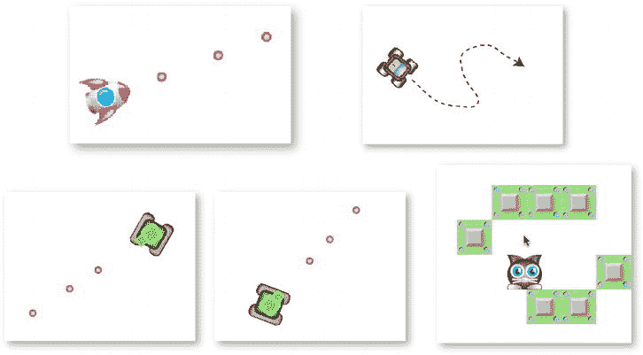

**图 10-7.** 高级玩家控制系统

### 敌人 AI 系统

我们已经仔细研究了玩家控制系统，但你的游戏敌人呢？它们制作起来很有趣，编程也很简单。正如你将在下一节中看到的，只需一些简单的技术和一点点常规逻辑，你就能构建出一些令人惊讶的复杂敌人人工智能系统。

你已经知道如何让一个对象跟随鼠标，而这一基本技能正是 AI 系统的核心，你可以对其进行修改以用于各种游戏场景。你只需混合搭配一些你已经掌握的技术，就可以设计出能够执行以下操作的敌人：

- 跟随玩家

- 逃离玩家

- 瞄准并向玩家发射子弹

让我们一探究竟。

#### 跟随另一个对象

打开 `Follow` 项目文件夹并运行 SWF 文件。你会看到，如果鼠标处于 200 像素范围内，杀手蜂会跟随并转向鼠标。图 10-8 展示了你将看到的景象。当它到达鼠标位置后，会像真正的蜜蜂一样执着地绕其盘旋。

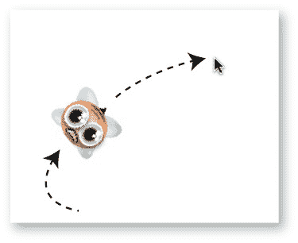

**图 10-8.** 蜜蜂转向鼠标并在舞台上跟随其移动。

蜜蜂是通过我们在 `ButtonFairy` 项目中使用的通用 `GameObject` 类创建的。以下是实现此效果的 `Follow` 应用程序类：

```
package
{
  import flash.display.DisplayObject;
  import flash.display.Sprite;
  import flash.events.Event;
  import flash.events.MouseEvent;
  import flash.ui.Mouse;

  [SWF(width="550", height="400",
  backgroundColor="#FFFFFF", frameRate="60")]

  public class Follow extends Sprite
  {
//嵌入图像
    [Embed(source="../images/bee.png")]
    private var BeeImage:Class;

//属性
    private const SPEED:Number = 3;
    private const TURN_SPEED:Number = 0.3;
    private const RANGE:Number = 200;
    private const FRICTION:Number = 0.96;
    private var _beeImage:DisplayObject = new BeeImage();
    private var _bee:GameObject = new GameObject(_beeImage);

//蜜蜂的旋转角度
    private var _beeAngle:Number;

    public function Follow()
    {
      stage.addChild(_bee);
      _bee.x = 275;
      _bee.y = 175;

//添加事件侦听器
      stage.addEventListener(Event.ENTER_FRAME, enterFrameHandler);
    }
    private function enterFrameHandler(event:Event):void
    {
//获取目标对象
      var target_X:Number = stage.mouseX;
      var target_Y:Number = stage.mouseY;

//计算目标与蜜蜂之间的距离
      var vx:Number = target_X - _bee.x;
      var vy:Number = target_Y - _bee.y;

      var distance:Number = Math.sqrt(vx * vx + vy * vy);
      if (distance <= RANGE)
      {
//计算移动量
        var move_X:Number = TURN_SPEED * vx / distance;
        var move_Y:Number = TURN_SPEED * vy / distance;

//增加蜜蜂的速度
        _bee.vx += move_X;
        _bee.vy += move_Y;

//计算总移动距离
        var moveDistance:Number
          = Math.sqrt(_bee.vx * _bee.vx + _bee.vy * _bee.vy);

//应用缓动效果
        _bee.vx = SPEED * _bee.vx / moveDistance;
        _bee.vy = SPEED * _bee.vy / moveDistance;

//将蜜蜂转向目标
//以弧度计算角度
        _beeAngle = Math.atan2(_bee.vy, _bee.vx);

//将弧度转换为度数，以便正确旋转蜜蜂
        _bee.rotation = _beeAngle * 180 / Math.PI + 90;
      }
//应用摩擦力
      _bee.vx *= FRICTION;
      _bee.vy *= FRICTION;

//移动蜜蜂
      _bee.x += _bee.vx;
      _bee.y += _bee.vy;
    }
  }
}
```

蜜蜂知道目标（鼠标）后，会计算自身与目标之间的距离。如果距离小于 `RANGE` 值（即 `200`），蜜蜂就会移动。

它使用的是我们本章前面介绍的缓动公式的一个变体。但这一公式稍微复杂一些，因为你需要限制蜜蜂的速度和转向速率。以下是代码执行的步骤以及完成每项任务所用的公式：

1. 代码计算出对象的移动量，并将这些值赋给 `move_X` 和 `move_Y` 变量：`var move_X:Number = TURN_SPEED * vx / distance;` `var move_Y:Number = TURN_SPEED * vy / distance;`

2. 这些新变量的值被用于修改速度：`_bee.vx += move_X;` `_bee.vy += move_Y;`
```

3. 蜜蜂新的 `vx` 和 `vy` 属性用于帮助计算所需的总移动距离：`var moveDistance:Number = Math.sqrt(_bee.vx * _bee.vx + _bee.vy * _bee.vy);`

4. 然后，代码利用这个新的距离值和 `SPEED` 常量来找到正确的速度：

   ```
   _bee.vx = SPEED * _bee.vx / moveDistance;
   _bee.vy = SPEED * _bee.vy / moveDistance;
   ```

   这是我们缓动公式的一个变体，其中 `SPEED` 表示缓动值。

5. 最后，代码将蜜蜂转向目标。这与本书中一直使用的旋转公式相同。加上 `+ 90` 是为了将蜜蜂对象的旋转偏移 90 度。否则，蜜蜂的前端会是其右侧。（这是因为对象绘制的方式是，其“正面”是蜜蜂头上的螫针。）你在此代码中使用的任何对象的朝向可能不同，因此你可能需要将 90 调整为你通过反复试验得出的数值，具体取决于你看到的对象旋转方向：`_bee.rotation = Math.atan2(_bee.vy, _bee.vx) * 180 / Math.PI + 90;`

如果目标不在蜜蜂的范围内，则会执行以下指令，通过摩擦力逐渐减慢蜜蜂的速度：

```
//应用摩擦力
_bee.vx *= FRICTION;
_bee.vy *= FRICTION;

//移动蜜蜂
_bee.x += _bee.vx;
_bee.y += _bee.vy;
```

一点简单的逻辑，加上对缓动公式进行一些仔细调整，你就能实现非常有效的跟随行为。

### 逃离玩家

创建完全相反的行为让蜜蜂逃离鼠标是非常容易的。要查看其效果，请打开 `RunAway` 项目文件夹并运行 SWF 文件。你会看到蜜蜂逃离鼠标，如图 10-9 所示。

我说这是相反的行为，是在最字面的意义上这么说的。应用程序类与前一个案例完全相同，只是三个加号被改成了减号。

蜜蜂的旋转是负的，以便指向相反方向，如下所示：

```
_bee.rotation
  = 180 * Math.atan2(_bee.vy, _bee.vx) / Math.PI - 90;
```

速度也是负的，如下所示：

```
_bee.x -= _bee.vx;
_bee.y -= _bee.vy;
```

就是这样！

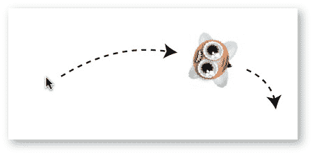

**图 10-9.** 靠得太近，蜜蜂就会飞走。

### 旋转并向鼠标位置射击

在最终的 AI 系统中，当鼠标进入射程时，蜜蜂会转向鼠标方向并发射子弹。你可以在 `RotateAndShoot` 项目文件夹中找到这个示例，图 10-10 展示了运行该 SWF 文件时你将看到的效果。

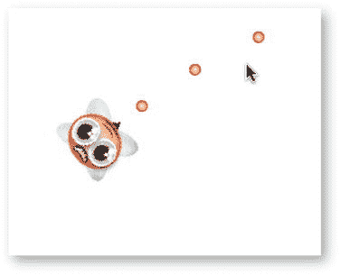

**图 10-10.** 蜜蜂飞向鼠标并向其发射子弹。

实现这一功能的代码融合了 `Follow` 示例，并增加了子弹发射系统。子弹通过一个定时器发射，该定时器在鼠标进入蜜蜂射程时启动。以下是实现此功能的应用程序类：

```markdown
# RotateAndShoot

```actionscript
package
{
  import flash.display.DisplayObject;
  import flash.display.Sprite;
  import flash.events.Event;
  import flash.events.MouseEvent;
  import flash.ui.Mouse;
  import flash.events.TimerEvent;
  import flash.utils.Timer;

  [SWF(width="550", height="400",
  backgroundColor="#FFFFFF", frameRate="60")]

  public class RotateAndShoot extends Sprite
  {
    //嵌入图片
    [Embed(source="../images/bee.png")]
    private var BeeImage:Class;
    [Embed(source="../images/bullet.png")]
    private var BulletImage:Class;

    //属性
    private const SPEED:Number = 3;
    private const TURN_SPEED:Number = 0.3;
    private const RANGE:Number = 200;
    private const FRICTION:Number = 0.96;
    private var _beeImage:DisplayObject = new BeeImage();
    private var _bee:GameObject = new GameObject(_beeImage);

    //蜜蜂的旋转角度
    private var _beeAngle:Number;

    //发射子弹的定时器
    private var _bulletTimer:Timer;

    //存储子弹的数组
    private var _bullets:Array = new Array();

    public function RotateAndShoot()
    {
      //将蜜蜂添加到舞台
      stage.addChild(_bee);
      _bee.x = 275;
      _bee.y = 175;

      //初始化定时器
      _bulletTimer = new Timer(1000);
      _bulletTimer.addEventListener
        (TimerEvent.TIMER, bulletTimerHandler);

      //添加事件监听器
      stage.addEventListener
        (Event.ENTER_FRAME, enterFrameHandler);
    }
    private function bulletTimerHandler(event:TimerEvent):void
    {
      //创建一颗子弹并添加到舞台
      var bulletImage:DisplayObject = new BulletImage();
      var bullet:GameObject = new GameObject(bulletImage);
      stage.addChild(bullet);

      //设置子弹的起始位置
      var radius:int = 30;
      bullet.x = _bee.x + (radius * Math.cos(_beeAngle));
      bullet.y = _bee.y + (radius * Math.sin(_beeAngle));

      //根据角度设置子弹速度
      bullet.vx = Math.cos(_beeAngle) * 2 + _bee.vx;
      bullet.vy = Math.sin(_beeAngle) * 2 + _bee.vy;

      //将子弹推入 _bullets 数组
      _bullets.push(bullet);
    }
    private function enterFrameHandler(event:Event):void
    {
      //获取目标对象
      var target_X:Number = stage.mouseX;
      var target_Y:Number = stage.mouseY;

      //计算目标与蜜蜂之间的距离
      var vx:Number = target_X - _bee.x;
      var vy:Number = target_Y - _bee.y;

      var distance:Number = Math.sqrt(vx * vx + vy * vy);
      if (distance <= RANGE)
      {
        //计算移动量
        var move_X:Number = TURN_SPEED * vx / distance;
        var move_Y:Number = TURN_SPEED * vy / distance;

        //增加蜜蜂的速度
        _bee.vx += move_X;
        _bee.vy += move_Y;

        //计算总移动距离
        var moveDistance:Number
          = Math.sqrt(_bee.vx * _bee.vx + _bee.vy * _bee.vy);

        //应用缓动效果
        _bee.vx = SPEED * _bee.vx / moveDistance;
        _bee.vy = SPEED * _bee.vy / moveDistance;

        //让蜜蜂朝向目标旋转
        //计算弧度角度
        _beeAngle = Math.atan2(_bee.vy, _bee.vx);

        //将弧度转换为角度以正确旋转蜜蜂
        _bee.rotation = _beeAngle * 180 / Math.PI + 90;

        //启动子弹定时器
        _bulletTimer.start();
      }
      else
      {
        _bulletTimer.stop();
      }

      //应用摩擦力
      _bee.vx *= FRICTION;
      _bee.vy *= FRICTION;

      //移动蜜蜂
      _bee.x += _bee.vx;
      _bee.y += _bee.vy;

      //移动子弹
      for(var i:int = 0; i < _bullets.length; i++)
      {
        var bullet:GameObject = _bullets[i];
        bullet.x += bullet.vx;
        bullet.y += bullet.vy;

        //检查子弹是否超出舞台边界
        if (bullet.y < 0
        || bullet.x < 0
        || bullet.x > stage.stageWidth
        || bullet.y > stage.stageHeight)
        {
          //从舞台移除子弹
          stage.removeChild(bullet);
          bullet = null;
          _bullets.splice(i,1);
           i--;
        }
      }
    }
  }
}
```

## 使用定时器发射子弹

当鼠标进入蜜蜂射程时，会设置一个定时器，每秒发射一颗子弹。如下面的 `enterFrameHandler` 的节选代码所示，若鼠标在射程内则启动定时器，超出射程则停止定时器：

```actionscript
if (distance <= RANGE)
{
  //…
  _bulletTimer.start();
}
else
{
  _bulletTimer.stop();
}
```

接着，`enterFrameHandler` 会遍历 `_bullets` 数组中的所有子弹来移动它们，并在子弹超出舞台边界时将其从游戏中移除。

### 随机时间间隔射击
```

你可以做一个小改动，让蜜蜂的射击行为更加真实。在现有代码中，蜜蜂每 1000 毫秒准时射击一次。你可以利用 `Timer` 类的 `delay` 属性来随机化这个时间。在 `bulletTimerHandler` 事件处理器中添加以下高亮显示的代码来观察效果：

```actionscript
private function bulletTimerHandler(event:TimerEvent):void
{
  var bulletImage:DisplayObject = new BulletImage();
  var bullet:GameObject = new GameObject(bulletImage);
  stage.addChild(bullet);
  var radius:int = 30;
  bullet.x = _bee.x + (radius * Math.cos(_beeAngle));
  bullet.y = _bee.y + (radius * Math.sin(_beeAngle));
  bullet.vx = Math.cos(_beeAngle) * 2 + _bee.vx;
  bullet.vy = Math.sin(_beeAngle) * 2 + _bee.vy;
  _bullets.push(bullet);

  //为下一颗子弹找到随机启动时间
  var randomFireTime:Number
    = Math.round(Math.random() * 1000) + 200;
  _bulletTimer.delay = randomFireTime;
}
```

现在，蜜蜂会在 200 到 1200 毫秒之间的随机时间间隔内射击。

如果你想为游戏创建任何类型的旋转敌人炮塔，这个 AI 系统正是你需要掌握的核心内容。只需将鼠标替换为其他游戏对象，蜜蜂就会追逐并射击该对象，我们将在下一个示例中看到这一点。

### 案例研究：杀手蜂大混乱！

我们在本章中制作了许多有趣的小玩具，只需稍加改造就能将它们变成真正的游戏。如果将按钮仙子与杀手蜂放在同一环境中会发生什么？那就会在《杀手蜂大混乱！》中上演两个死敌之间的终极火力对决。你可以在源文件中找到这个游戏，运行 SWF 文件即可试玩，如图图 10-11 所示。

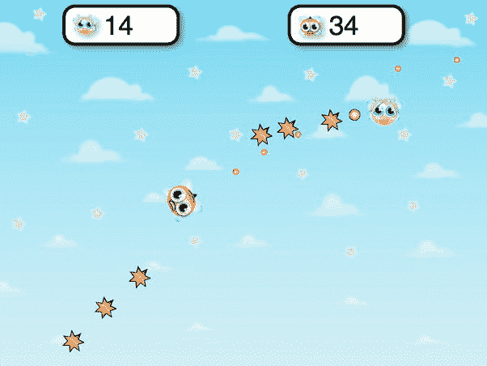

**图 10-11.** 按钮仙子能否从暴躁的杀手蜂手中拯救林地生物？

按钮仙子可以在屏幕上飞行并向蜜蜂射击。杀手蜂会向她飞来，如果她在射程范围内就会发射子弹。舞台顶部的记分板会记录双方各自命中的次数。

游戏中所有对象均使用通用 `GameObject` 类生成，因此无需自定义类来管理。这大大简化了游戏结构和代码，只需查看应用程序类就能了解游戏运行所需的一切信息。该应用程序类完全不包含新代码，只是利用本章已讲解的大部分代码实现的一个“大杂烩”示例。不过需要特别关注的是移动星星和子弹弹幕并检测碰撞的循环。这些循环必须确保不会对已移除的弹幕进行碰撞检测。接下来我们将详细分析其工作原理。

以下是 `KillerBeePandemonium` 应用程序类。你会看到所有控制不同对象移动的代码段都被封装在各自的方法中，这些方法均由 `enterFrameHandler` 调用。这样组织代码便于查找和处理不同功能模块。

```
package
{
  import flash.display.DisplayObject;
  import flash.display.Sprite;
  import flash.events.Event;
  import flash.events.MouseEvent;
  import flash.events.TimerEvent;
  import flash.text.*;
  import flash.ui.Mouse;
  import flash.utils.Timer;

  [SWF(width="800", height="600",
  backgroundColor="#FFFFFF", frameRate="60")]

  public class KillerBeePandemonium extends Sprite
  {
    //图像资源
    [Embed(source="../images/fairy.png")]
    private var FairyImage:Class;
    [Embed(source="../images/wand.png")]
    private var WandImage:Class;
    [Embed(source="../images/star.png")]
    private var StarImage:Class;
    [Embed(source="../images/background.png")]
    private var BackgroundImage:Class;
    [Embed(source="../images/bee.png")]
    private var BeeImage:Class;
    [Embed(source="../images/bullet.png")]
    private var BulletImage:Class;

    //属性
    private const SPEED:Number = 3;
    private const TURN_SPEED:Number = 0.3;
    private const RANGE:Number = 500;
    private const FRICTION:Number = 0.96;
    private const EASING:Number = 0.1;
    private var _fairyImage:DisplayObject = new FairyImage();
    private var _wandImage:DisplayObject = new WandImage();
    private var _backgroundImage:DisplayObject
      = new BackgroundImage();
    private var _beeImage:DisplayObject = new BeeImage();
    private var _fairy:GameObject = new GameObject(_fairyImage);
    private var _wand:GameObject = new GameObject(_wandImage);
    private var _bee:GameObject = new GameObject(_beeImage);
    private var _background:GameObject
      = new GameObject(_backgroundImage, false);
    private var _angle:Number;
    private var _beeAngle:Number;
    private var _stars:Array = new Array();
    private var _bullets:Array = new Array();
    private var _bulletTimer:Timer;
    private var _format:TextFormat = new TextFormat();
    private var _fairyScoreDisplay:TextField = new TextField();
    private var _beeScoreDisplay:TextField = new TextField();
    private var _fairyScore:int;
    private var _beeScore:int;

    public function KillerBeePandemonium()
    {
      //添加游戏对象
      stage.addChild(_background);
      setupTextFields();
      stage.addChild(_fairy);
      stage.addChild(_wand);
      stage.addChild(_bee);
      _bee.x = 275;
      _bee.y = 175;

      //初始化计时器
      _bulletTimer = new Timer(500);
      _bulletTimer.addEventListener
        (TimerEvent.TIMER, bulletTimerHandler);

      //隐藏鼠标
      Mouse.hide();

      //添加事件监听器
      stage.addEventListener
       (Event.ENTER_FRAME, enterFrameHandler);
      stage.addEventListener
       (MouseEvent.MOUSE_DOWN, mouseDownHandler);
    }
    private function setupTextFields():void
    {
      //设置文本格式对象
      _format.font = "Helvetica";
      _format.size = 44;
      _format.color = 0x000000;
      _format.align = TextFormatAlign.CENTER;

      //配置仙子的计分文本框
      _fairyScoreDisplay.defaultTextFormat = _format;
      _fairyScoreDisplay.autoSize = TextFieldAutoSize.CENTER;
      _fairyScoreDisplay.border = false;
      _fairyScoreDisplay.text = "0";

      //显示并定位仙子的计分文本框
      stage.addChild(_fairyScoreDisplay);
      _fairyScoreDisplay.x = 180;
      _fairyScoreDisplay.y = 21;

      //配置蜜蜂的计分文本框
      _beeScoreDisplay.defaultTextFormat = _format;
      _beeScoreDisplay.autoSize = TextFieldAutoSize.CENTER;
      _beeScoreDisplay.border = false;
      _beeScoreDisplay.text = "0";

      //显示并定位蜜蜂的计分文本框
      stage.addChild(_beeScoreDisplay);
      _beeScoreDisplay.x = 550;
      _beeScoreDisplay.y = 21;
    }
    private function enterFrameHandler(event:Event):void
    {
      moveFairy();
      moveBee();
      moveStars();
      moveBullets();
    }
    private function moveBullets():void
    {
      //移动子弹
      for(var i:int = 0; i < _bullets.length; i++)
      {
        var bullet:GameObject = _bullets[i];
        bullet.x += bullet.vx;
        bullet.y += bullet.vy;
```

```actionscript
//检查子弹的舞台边界
if (bullet.y < 0
|| bullet.x < 0
|| bullet.x > stage.stageWidth
|| bullet.y > stage.stageHeight)
{
  //从舞台上移除子弹
  stage.removeChild(bullet);
  bullet = null;
  _bullets.splice(i,1);
  i--;
}
//检查与精灵的碰撞
if(bullet != null
&& bullet.hitTestObject(_fairy))
{
  //更新分数、分数显示
  //并移除子弹
  _beeScore++;
  _beeScoreDisplay.text = String(_beeScore);
  stage.removeChild(bullet);
  bullet = null;
  _bullets.splice(i,1);
  i--;
}
      }
    }
    private function moveStars():void
    {
      //移动星星
      for(var i:int = 0; i < _stars.length; i++)
      {
        var star:GameObject = _stars[i];
        star.x += star.vx;
        star.y += star.vy;

        //检查星星的舞台边界
        if (star.y < 0
        || star.x < 0
        || star.x > stage.stageWidth
        || star.y > stage.stageHeight)
        {
          //从舞台上移除星星
          stage.removeChild(star);
          star = null;
          _stars.splice(i,1);
          i--;
        }
        //检查与蜜蜂的碰撞
        if(star != null
        && star.hitTestObject(_bee))
        {
          //更新分数、分数显示
          //并移除子弹
          _fairyScore++;
          _fairyScoreDisplay.text = String(_fairyScore);
          stage.removeChild(star);
          star = null;
          _stars.splice(i,1);
          i--;
        }
      }
    }
    private function moveBee():void
    {
      //获取目标对象
      var target_X:Number = _fairy.x;
      var target_Y:Number = _fairy.y;

      //计算目标与蜜蜂之间的距离
      var vx:Number = target_X - _bee.x;
      var vy:Number = target_Y - _bee.y;

      var distance:Number = Math.sqrt(vx * vx + vy * vy);
      if (distance <= RANGE)
      {
        //计算需要移动的量
        var move_X:Number = TURN_SPEED * vx / distance;
        var move_Y:Number = TURN_SPEED * vy / distance;

        //增加蜜蜂的速度
        _bee.vx += move_X;
        _bee.vy += move_Y;

        //计算总移动距离
        var moveDistance:Number
          = Math.sqrt(_bee.vx * _bee.vx + _bee.vy * _bee.vy);

        //应用缓动效果
        _bee.vx = SPEED * _bee.vx / moveDistance;
        _bee.vy = SPEED * _bee.vy / moveDistance;

        //将蜜蜂旋转至朝向目标
        //计算弧度角
        _beeAngle = Math.atan2(_bee.vy, _bee.vx);

        //将弧度转换为度数，以便正确旋转蜜蜂
        _bee.rotation = _beeAngle * 180 / Math.PI + 90;

        //启动子弹计时器
        _bulletTimer.start();
      }
      else
      {
        _bulletTimer.stop();
      }

      //施加摩擦力
      _bee.vx *= FRICTION;
      _bee.vy *= FRICTION;

      //移动蜜蜂
      _bee.x += _bee.vx;
      _bee.y += _bee.vy;
    }
    private function moveFairy():void
    {
      //计算精灵中心与鼠标之间的角度
      _angle
      = Math.atan2
       (
          _fairy.y - stage.mouseY,
          _fairy.x - stage.mouseX
        );

      //围绕精灵移动魔杖
      var radius:int = -50;
      _wand.x = _fairy.x + (radius * Math.cos(_angle));
      _wand.y = _fairy.y + (radius * Math.sin(_angle));

      //计算鼠标与精灵中心之间的距离
      var vx:Number = stage.mouseX - _fairy.x;
      var vy:Number = stage.mouseY - _fairy.y;  
      var distance:Number = Math.sqrt(vx * vx + vy * vy);

      //如果鼠标与精灵的距离超过 1 像素，则移动精灵
      if (distance >= 1)
      {
        _fairy.x += vx * EASING;
        _fairy.y += vy * EASING;
      }
    }

    //使用计时器让蜜蜂发射子弹
    private function bulletTimerHandler(event:TimerEvent):void
    {
      //创建一颗子弹并添加到舞台
      var bulletImage:DisplayObject = new BulletImage();
      var bullet:GameObject = new GameObject(bulletImage);
      stage.addChild(bullet);

      //设置子弹的起始位置
      var radius:int = 30;
      bullet.x = _bee.x + (radius * Math.cos(_beeAngle));
      bullet.y = _bee.y + (radius * Math.sin(_beeAngle));

      //根据角度设置子弹的速度
      bullet.vx = Math.cos(_beeAngle) * 5 + _bee.vx;
      bullet.vy = Math.sin(_beeAngle) * 5 + _bee.vy;

      //将子弹压入 _bullets 数组
      _bullets.push(bullet);

      //为下一颗子弹计算随机发射时间
      var randomFireTime:Number
        = Math.round(Math.random() * 1000) + 200;
      _bulletTimer.delay = randomFireTime;
    }

    //当鼠标点击时，让精灵按钮发射星星
    private function mouseDownHandler(event:MouseEvent):void
    {
      //创建一颗星星并添加到舞台
      var starImage:DisplayObject = new StarImage();
      var star:GameObject = new GameObject(starImage);
      stage.addChild(star);

      //设置星星的起始位置为魔杖的位置
      star.x = _wand.x;
      star.y = _wand.y;

      //根据精灵中心与鼠标之间的角度设置星星的速度
      star.vx = Math.cos(_angle) * -7;
      star.vy = Math.sin(_angle) * -7;

      //将星星压入 _stars 数组
      _stars.push(star);
    }
  }
}
```

正如我所提到的，在这段代码中需要特别注意的是，检查发射物与游戏对象碰撞的循环必须确保，如果发射物先前已经越过了舞台边界，它还没有被从游戏中移除。这就是为什么检查碰撞的`if`语句还必须确保对象不为`null`。

```
if(bullet != null
&& bullet.hitTestObject(_fairy))
{…
```

这虽然只是一个需要注意的小技术细节，但能确保你的游戏在运行时不会产生任何运行时错误。

## Flash 动画与发布你的游戏

本书大部分内容都集中在编写制作视频游戏所需的计算机代码上。这是最困难的部分，但除了编写代码之外，你还可以并且应该对你的游戏做更多的事情。如何轻松地为你的游戏创建动画对象，以及创建游戏后如何发布？你将在本书下载包中的附加章节“Flash 动画与发布你的游戏”中找到这两件事的答案。你将学习如何使用 Flash Professional 软件快速制作游戏动画，并通过 AS3.0 代码进行控制。此外，如果你想为手机和平板电脑制作游戏，你还将学习如何使用 Flash Builder 将游戏发布到这些平台。

## 总结

嘿，这本书已经读完了吗？是的，但感觉真正的乐趣才刚刚开始！如果你已经读到了书中的最后一部分，请为自己鼓掌：你已经成为一名游戏设计师了！凭借你在本书中学到的技能，你已经能够自信地应对绝大多数游戏设计场景。

然而，如果你和其他所有初学游戏设计的人一样，你会发现学习更多知识的欲望是无止境的。尽管你已经掌握了这么多知识，但前方仍有广阔的学习宇宙等待着你。以下是一些你可能想要探索的领域的快速汇总：

-   `Adobe 在线帮助文档：` Adobe 维护着优秀的在线文档，详细说明了 `AS3.0` 编程的大部分内容。你可以通过将网页浏览器指向 Adobe 的 ActionScript 技术中心来访问这些文档：[`www.adobe.com/devnet/actionscript.html`](http://www.adobe.com/devnet/actionscript.html)。在那里，你会找到指向 ActionScript 3 开发人员指南和适用于 Flash 平台的 ActionScript 3 参考的链接。我在本书中多次引用了这些文档中的章节，它们仍然是关于所有 Flash 和 `AS3.0` 相关事宜的最全面的主要来源。尽管它们讨论的主题和采用的方法都相当高级，但应该符合你当前的能力水平。花些时间阅读其中数百篇文章中的一部分，你一定会找到丰富的内容来激发你日益增长的编程技能。

-   `3D：` 随着 Flash Player 11 和 Stage 3D 的发布，Flash 已成为构建交互式 3D 世界和游戏的绝佳平台。你可以在此处的 Adobe Stage 3D 网站上了解如何使用 `AS3.0` 编写 3D 游戏：[`www.adobe.com/devnet/flashplayer/stage3d.html`](http://www.adobe.com/devnet/flashplayer/stage3d.html)。有一些 3D 游戏引擎可以帮助你使用 `AS3.0` 和 Flash 创建 3D 游戏：Alternativa、Flare3D、Away 3D 以及 Adobe 自家的 Proscenium。你还可以使用 Stage 3D 来制作 2D 游戏，并且能够完全利用计算机或移动设备的图形处理单元（GPU）来获得出色的性能。易于使用的 Starling 框架以及 `ND2D` 可以帮助你实现这一点。

-   `物理引擎：` 有一些优秀的类库可用于使用 `AS3.0` 进行精确的物理模拟。其中包括 `Box2D`、`Motor2`、`APE`、`Foam`、`Flave`、`World Construction Kit`、`JigLib` 和 `Glaze`。

-   `基于瓦片的游戏：` 在这种游戏设计风格中，舞台上的所有物体都被分配到网格中的方格中。然后代码在后台的数组中创建一个游戏的抽象模型，并使用该模型来更新舞台上的对象。棋盘游戏、策略游戏和某些益智游戏非常适合采用基于瓦片的方法。基于瓦片的游戏运行效率非常高，消耗相对较少的 CPU 资源和内存，并且如果你想要添加新的游戏关卡，扩展起来也非常容易。因此，基于瓦片的方法也适用于平台游戏和冒险游戏。

-   `向量数学与几何：` 如果你想创建涉及一定物理模拟的游戏，花点时间学习一些向量数学和 2D 几何知识是非常有益的。即使你认为自己不擅长数学，也请尝试一下——你可能会给自己一个惊喜。你可以立即将学到的知识应用到你的游戏中。

-   `保存游戏数据：` 如果你想在游戏中保存一些数据（例如分数或游戏关卡），以便玩家可以退出游戏并在稍后继续，你需要创建一个共享对象。这在 Adobe 在线文档 *为 Flash 编写 ActionScript 3.0* 的“网络与通信”一章中的“存储本地数据”部分有详细说明。

-   `多人游戏：` 与朋友一起玩游戏总是更有趣。要制作多人游戏，你需要将游戏数据存储在 Web 服务器上，以便其他玩家可以访问这些数据来更新他们自己的游戏画面。有很多方法可以实现这一点，但都需要研究额外的“服务器端技术”。你的 Flash 游戏将能够与这些服务器端技术进行通信，但要实现其中的大多数技术，你需要学习新的编程语言，如 `PHP` 或 `Java`。对诸如 `SmartFoxServer`、`ElectroServer` 和 `Pulse` 等 Java 套接字服务器进行一些研究。（Java 与 `AS3.0` 关系非常密切，所以你不会感到完全陌生。）你可以使用 `PHP` 为你的游戏创建一个高分榜，并且可以使用 `MySQL` 数据库来存储游戏数据。你可以通过将游戏数据存储在内容管理系统（CMS）中，并在 Flash 中使用 `XML` 访问这些数据，来直接避开 Java 和 `PHP`。Adobe 也提供了自己的 Flash Media 服务器。Media Development Server 是免费的，虽然功能有限，但它是在熟悉的环境中接触多人游戏技术的绝佳入门方式。正如你所看到的，有很多东西要学！但所有投入的时间都是值得的。

当然，这本书其实并没有真正结束——你只进行到一半。《Flash 高级游戏设计》接续本书的内容，涵盖了将你的技能提升到真正专业水平所需的所有高级技术。

正如每个游戏设计师所知，制作游戏比玩游戏有趣得多。就像一个刚刚学会调色和勾勒几个简单场景的艺术家一样，你只需要一点练习，就能走上创作杰作的道路。你现在已经在使用 Flash 和 `AS3.0` 进行游戏设计方面打下了坚实的基础——去制作一些精彩的游戏吧！

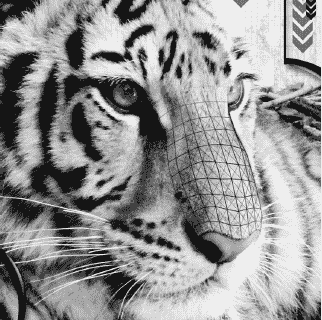
