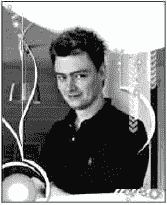

# 目录

- 嵌入图片
- 滚动效果
- 查看代码
- 改进滚动
- 更进一步优化滚动
- 深入探索
- 视差滚动
- 本章小结
- 第 6 章：碰撞检测
  - 使用 `hitTestObject` 进行基础碰撞检测
  - 使用 `hitTestObject`
  - 触发状态变化
  - 减少生命值条
  - 基于百分比使用 `scaleX` 缩放生命值条
  - 更新得分
  - 拾取与放下物体
  - 关于 `hitTestObject` 的坏消息
  - 使用边界框检测碰撞
  - 学会接受它
  - 创建子对象
  - 高级碰撞检测策略
  - 基于矢量的碰撞检测
  - 防止物体重叠
  - 使用 `Collision` 类进行编程
  - 再谈方法、实参与形参
  - 探究 `Collision.block` 方法
  - 本章小结
- 第 7 章：制作游戏
  - 制作游戏图形
  - 制作纹理箱子
  - 制作炸弹
  - 制作游戏角色
  - 设计游戏场景
  - 制作游戏结束画面
  - 编写游戏代码
  - 处理大量对象
  - 类到底是什么？
  - 查看 `TimeBombPanic` 应用类
  - 向游戏添加对象
  - 舞台边界
  - 角色与箱子的碰撞
  - 拆除炸弹
  - 使用计时器
  - 结束游戏
  - 创建滚动游戏环境
  - 准备滚动画稿
  - 向游戏添加对象
  - 滚动与舞台边界
  - 本章小结
- 第 8 章：制作更大规模的游戏
  - 理解游戏结构
  - 使用私有变量和方法
  - 编写游戏代码
  - 让 `LevelOne` 访问舞台
  - 确保 `LevelOne` 确实位于舞台上
  - `LevelOne` 类
  - 编写游戏角色代码
  - 编写怪物代码
  - 编写星星武器代码
  - 检测关卡结束条件
  - 结束关卡
  - 使用 `removeChild` 彻底清除对象
  - 通过派发事件在类之间通信
  - 事件冒泡
  - 完成第一关
  - 在第二关中向四个方向发射星星
  - 更多怪物大乱斗！
  - 在滚动游戏世界中移动对象
  - 智能怪物
  - 障碍物与寻路
  - 再谈游戏结构
  - 本章小结
- 第 9 章：物理、循环、数组与音效
  - 利用物理学实现自然运动
  - 用于物理模拟的游戏对象类
  - 加速度
  - 摩擦力
  - 弹跳
  - 重力
  - 跳跃
  - 为游戏添加音效
  - 在游戏中集成音效
  - 循环播放音乐与设置音量和声像级别
  - 处理大量对象
  - 使用数组
  - 创建大量箱子
  - 与大量对象进行碰撞
  - 案例研究
  - 本章小结
- 第 10 章：高级对象与角色控制
  - 使用鼠标移动对象
  - 将对象固定在鼠标位置
  - 通过缓动移动对象
  - 案例研究：向所有方向发射弹丸
  - 制作游戏对象
  - 让魔杖围绕精灵旋转
  - 360 度发射星星
  - 高级玩家控制系统
  - 敌方 AI 系统
  - 逃离玩家
  - 朝向鼠标旋转并射击
  - 使用计时器发射子弹
  - 案例研究：杀人蜂大混乱！
  - Flash 动画与发布游戏
- 索引

## 关于作者

`雷克斯·范德·斯普伊` 是一位自由交互媒体设计师，专精于 Flash/AS3.0 游戏设计、界面设计和 ActionScript 编程。他目前往返于加拿大、印度和南非之间。不编写电子游戏时，他会在世界各地漫游，弹奏西塔琴。

## 关于技术审校

`乔什·弗里尼` 目前是密歇根州大急流城费里斯州立大学数字动画与游戏设计项目的讲师。他教授专注于快速迭代开发与最大化可复用性的 Flash 游戏开发课程，并曾在密歇根 Flash 节上发表演讲。他喜欢桌游、远足、睡懒觉以及任何乐高相关的东西。他持续为任何有 Flash 问题需要解决的人提供咨询。

## 关于封面图片设计师

 `科内·范·多伦` 设计了本书的封面图片。在为 friends of ED 的《Foundation》系列设计新封面后，他开始致力于将技术与有机形态相结合，其成果现在出现在本书及该系列其他书籍的封面上。

科内的童年是在各种随手可及的东西上涂鸦度过的，随后他开始探索多媒体这个无限的世界——从此他的探索之旅便从未停止。他的座右铭一直是：“多媒体的唯一限制是想象力”，这句话不断推动他前进。

科内为众多国际客户工作，为多媒体杂志撰写专题文章，评测和测试软件，撰写多媒体研究，并参与了许多其他 friends of ED 的书籍项目。如果你喜欢科内的作品，请务必看看他在《New Masters of Photoshop: Volume 2》（friends of ED, 2004）中的章节。你可以在他的网站 [www.cornevandooren.com](http://www.cornevandooren.com) 上看到更多他的作品（并与他联系）。

### 引言

所以你想制作一款电子游戏。从何入手？需要学习什么？可以向谁寻求帮助？

如果你曾经问过这些问题，你就会知道找到答案有多么困难。多年前，在印度班加罗尔附近的一个小村庄里，我也曾问过自己同样的问题，当时我正在一所国际学校教授编程和互动媒体。我的所有学生都在玩游戏，他们都想创造游戏，但当时却没有全面的书籍或在线资源来指导他们如何实现这一目标。

稍作研究后，我发现了一件令人惊讶的事情：不仅基础游戏设计所需的编程知识相对较少，而且同一套技术还可以在不同的情境中反复使用，用来创建完全不同的游戏类型。这个过程充满乐趣，效果立竿见影，并且是一个极佳的创意宣泄口。这项研究的成果是一本内部使用的游戏设计教材，它构成了三门高中水平课程的基础，并启发了这本著作的诞生。

那还是在 Flash 4 和 5 那个几乎像史前时代的日子里，当时 ActionScript 编程语言还是 1.0 版本，Flash 拥有一些出色的内置交互式教程，一步步引导新手用户。那时似乎每个人都是初学者，所以相对容易找到那些假设读者没有背景知识的书籍和教程。

如今 ActionScript 已发展到 3.0 版本，事情就没那么简单了。ActionScript 语言变得强大得多，但也复杂得多。你为 AS3.0 找到的许多资源都聚焦于这种复杂性，让缺乏编程经验的初学者越来越难以获得全面的立足点来开始学习。讽刺的是，实际上 AS3.0 比 AS1.0 时代更易于构建游戏。本书剥离了 AS3.0 表面上的复杂性，直击你制作游戏所需掌握的核心知识。它充满乐趣且简单易学，任何人都能做到。

游戏设计是一件奇妙的事，你将要学习的内容，可谓是现实世界中能最接近创造魔法的事情。系好安全带，准备迎接一场激动人心的旅程——你很快就会为自己开始产出的作品感到惊讶。

### 关于第二版

本书第一版《Foundation Game Design with Flash》完全专注于如何使用 Flash Professional 软件制作游戏。过去，使用 Flash Professional 是制作 Flash 游戏的唯一途径，即使在其他技术逐渐普及后，它仍然是最好的方法。自第一版出版以来，将近三年过去了，AS3.0 已经焕发出新的生命力——它已成为为网页、桌面和移动设备制作游戏的最佳跨平台开发工具。对于初学者来说，它也是最容易学习的，并且与任何其他单一技术相比，它拥有最全面、集成度最高的游戏制作工具集。本版本将向你展示如何使用纯 AS3.0 代码以及一系列互补技术来构建游戏，从而在开发过程中获得最大的灵活性。使用 AS3.0 制作游戏从未如此有趣，而你的游戏所能触及的潜在受众也从未如此广泛。

### 排版约定

为了使本书尽可能清晰易懂，全书使用了以下文本约定：

重要词汇或概念通常在首次出现时以*斜体*突出显示。

代码以`等宽字体`呈现。

新增或更改的代码通常以**`粗体等宽字体`**呈现。

伪代码和变量输入以*`斜体等宽字体`*书写。

菜单命令以菜单  子菜单  子菜单的形式书写。

当我需要提醒你注意某些事情时，会像这样突出显示：

咳咳，别说我没提醒你。

有时代码在一行内放不下。发生这种情况时，我会使用像这样的箭头：。

```
这是一段非常非常长的代码，应该写在
            同一行而不换行。
```


## 第 1 章 - 编程基础：如何制作电子游戏

恭喜你拿起这本书！电子游戏设计是你能用电脑做的最有趣、最有创意的事情之一。你即将踏上一段非凡的旅程，而本书将全程指引你。

那么，如何制作电子游戏呢？虽然制作游戏的方法可能和本书的读者一样多，但一个很好的起点是使用一种名为`Flash`和`ActionScript`的技术。用这些技术学习制作游戏不仅容易，而且如果你有时间和想象力，还能利用它们制作出复杂度高、专业品质好的游戏。你还可以将游戏发布到台式机、笔记本电脑、互联网、手机和平板电脑上，而无需学习任何额外的技能。此外，如果你希望进一步深入学习，在制作`Flash`和`ActionScript`游戏过程中获得的所有技能都可以直接应用于使用其他技术的游戏设计。

使用`Flash`和`ActionScript`学习游戏设计实际上是一个两步的过程。

*   你需要学习如何为游戏制作图形和插画。这通常使用图形设计软件来完成，例如`Adobe Photoshop`、`Illustrator`、`Flash Professional`，或开源软件如`GIMP`（GNU 图像处理程序）。
*   你还需要学习一种名为`ActionScript`的编程语言。编程语言是一种类似于英语的语言，我们人类用它来与计算机交流。

当你创建好图形并编写好游戏程序后，你将在这本书中学到的底层技术就会将它们整合在一起，使你的游戏运行起来。

使用`Flash`和`ActionScript`制作游戏有两种常见方法。

*   你可以使用名为`Flash Professional`的软件，它由`Adobe`公司出品。这款软件允许你仅用一个软件就创建游戏的所有视觉图形并完成所有的计算机编程。
*   第二种方法是使用你喜欢的任何图形设计或插画软件来创建游戏图形，然后使用计算机编程代码编辑器（如`Flash Builder`或`Flash Develop`）来编写`ActionScript`代码，使你的游戏运行起来。

本书采用第二种方法。它更加灵活，因为你可以选择任何你熟悉且用着舒服的图形设计或编程软件。这也意味着你学到的技能不会依赖于`Adobe Flash Professional`软件的任何特定版本（该软件频繁更新），并且让你免于购买或升级它所需的不菲费用，这对于刚入行游戏设计的人来说可能是一个重大障碍。过去，制作`Flash`游戏的唯一方法就是使用`Adobe`的`Flash Professional`软件，但幸运的是，现在情况已不再如此。如今有更灵活得多的工具可用于制作`Flash`游戏，本书将向你展示如何使用它们。

全世界有成千上万的人以使用`Flash`设计游戏为职业。有了这本书并稍加练习，你也能成为他们中的一员。

### 基本要求

令人惊讶的是，电子游戏设计可以是一件技术含量相对较低的事情。以下是使用本书所需的基本设备。

#### 1. 一台电脑

你需要一台相当新式的电脑，运行`Windows`系统或最新版本的`Mac OS X`。

#### 2. 平面设计软件

你需要平面设计软件，例如`Photoshop`、`Photoshop Elements`、`Illustrator`，或者免费开源软件`GIMP`。`Photoshop`是地球上使用最广泛的平面设计软件，所以学习如何使用它非常有用；然而，它的价格也非常昂贵。你可以从`Adobe`的网站`www.adobe.com/products/photoshop.html`下载`Photoshop`。

你也可以使用`Adobe Illustrator`来制作所有的游戏图形，事实上，本书中的大多数游戏图形都是用它创建的。遗憾的是，它也同样昂贵，但如果你认真对待游戏设计，从长远来看，购买它并学习如何使用它绝对是值得的，因为它可能是目前最好的插画软件。你可以在`www.adobe.com/products/photoshop.html`找到`Adobe Illustrator`。

比`Illustrator`或`Photoshop`便宜得多的替代品是`Photoshop Elements`。`Elements`拥有完整版`Photoshop`的所有功能，只是缺少一些高端专业特性。对于创建游戏图形，你可能不需要那些专为摄影和印刷出版定制的高端功能。`Photoshop Elements`可能是一个非常好的选择。你可以从`www.adobe.com/products/photoshopel/`下载并购买它。

或者，你也可以省下这笔钱，下载免费的`GIMP`。就制作游戏图形而言，`GIMP`几乎能完成`Photoshop`能做的所有事情。一个很大的缺点是它的菜单和窗口与`Photoshop`差异巨大，因此你会发现很难按照本书的步骤操作。幸运的是，这个问题有一个很好的解决方案。你可以为`GIMP`安装一个名为`GIMPshop`的软件插件。`GIMPshop`能让`GIMP`的外观和功能与`Photoshop`完全一致。这意味着你可以按照本书以及任何其他`Photoshop`教程中的所有步骤操作，而无需为`Photoshop`那令人望而却步的价格花费一分钱。

你可以在`www.gimp.org/`找到免费的`GIMP`。在`www.gimpshop.com/`可以找到`GIMPshop`。

另一个选择是使用免费的基于网络的软件来创建游戏图形，例如`Aviary`。`www.aviary.com/` `Aviary`拥有许多与`Photoshop`和`Illustrator`相同的基本功能，并且无需你购买或安装任何东西。如果你的电脑上没有安装任何其他的图形设计或插画软件，并且还不确定是否要购买，`Aviary`可能是一个绝佳的起点。

#### 3. 计算机编程软件

你还需要计算机编程软件，要么是`Flash Builder`，要么是`Flash Develop`。这些软件被称为IDE（集成开发环境）。别被这个术语吓到！它们只是专门用来帮助你编写和编辑计算机编程代码的文本编辑器或文字处理器。通常，点击一个按钮，它们就能为你把完成游戏的所有部件整合在一起。

在撰写本文时，如果你是学生或失业的开发者，`Flash Builder`是免费的。但如果你两者都不是，那么全价购买它可能也是值得的，因为它能为你节省大量的时间和麻烦。`Flash Builder`目前有三个版本：教育版、标准版和专业版。使用本书只需要标准版。你可以通过访问`Adobe`的教育网站并按照链接查看自己是否符合免费使用教育版`Flash Builder`的条件。`www.adobe.com/devnet/edu.html`。你可以从`www.adobe.com/products/flash-builder-standard.html`下载并购买`Flash Builder`标准版。

如果你使用的是`Windows`系统，可以考虑使用完全免费且出色的`Flash Develop`。如果你更喜欢使用`Flash Develop`，那么使用它来应用本书中的技术并不会困难。本书中的所有游戏设计技术和编程代码都与`Flash Builder`和`Flash Develop`兼容。但是，如果你决定使用`Flash Develop`，你需要付出更多的努力来安装和使用它。安装和配置的某些方面可能有点棘手，所以除非你非常精通电脑，否则不要考虑一开始就用它。你可以从`www.flashdevelop.org`下载`Flash Develop`。

如果你决定使用`Flash Develop`，你还需要下载并安装两个额外的软件组件。首先，你需要`Adobe`的免费`Flex SDK`（软件开发工具包）。`Flex SDK`实际上是让你所有`Flash`游戏运行的幕后核心大脑。你可以从`Adobe`的网站`http://opensource.adobe.com/wiki/display/flexsdk/Flex+SDK`下载最新版本。

你还需要`Adobe Flash Player`软件的调试版本。你可以在`http://www.adobe.com/support/flashplayer/downloads.html`找到它。下载适用于你系统的、被称为内容调试器的`Flash Player`版本。`Flash Player`是真正运行你的游戏的软件。你需要这个特殊的调试版本，以便`Flash Develop`能在你编程代码出错时提醒你。

然而，如果你的电脑上已经安装了另一个版本的`Adobe Flash Player`，明智的做法是先卸载它，然后再安装新的调试版本。这样做可以防止出现一些奇怪的错误。你可以从`http://kb2.adobe.com/cps/141/tn_14157.html`下载适用于`Windows`的`Flash Player`卸载程序。如果你需要`Mac OSX`的`Flash Player`卸载程序，可以在`http://kb2.adobe.com/cps/909/cpsid_90906.html`找到它。卸载完当前的`Flash Player`版本后，再安装新的调试版本。

# 开发工具选择

除了 `Flash Builder` 和 `Flash Develop` 之外，还有很多其他可以用来编写 `ActionScript` 程序的 IDE，例如 `Eclipse`（适用于 Windows 和 Mac OSX）、`TextMate` 或 `XCode`（仅适用于 Mac OSX）。或者，稍微费点功夫，你也可以使用简陋的 `Notepad`（Windows）或 `TextEdit`（Mac OSX）应用程序。所有这些都需要你自己做一些研究来设置和使用，以制作 Flash 游戏，但许多专业的 Flash 游戏设计师都只使用它们。如果你才刚刚学习编程，我不会推荐其中任何一个，但当你积累一些经验后，或许可以考虑一下它们。

## Adobe Flash Professional

此外，你也可以选择使用 Adobe 的 `Flash Professional`，在同一个软件中同时制作游戏图形和编写编程代码。本书的奖励下载章节“Flash 动画与发布你的游戏”将演示如何做到这一点。从 `www.adobe.com/cfusion/tdrc/index.cfm?product=flash` 下载 `Flash Professional`。

完全使用 `Flash Professional` 制作游戏是本书第一版《Foundation Game Design with Flash》的主题。使用 `Flash Professional` 仍然是制作 Flash 游戏的好方法，而且可能仍然是最快、最简单的方法。但是，学习在不借助它的情况下制作游戏能为你带来诸多优势。这意味着你的技能不会局限于某一种特定的软件或某个软件版本。这意味着你可以自由选择任何你喜欢的软件来编程游戏和制作图形。这也意味着你正在培养的技能和工作风格，在时机成熟时，可以轻松地转移到其他游戏设计或编程技术上。这是我将在本书这一版本中采用的、更灵活的方法。