# 本书使用的软件

本书中的示例和操作说明均使用 Flash Builder、Photoshop（或 Photoshop Elements）以及 Illustrator。选择这些程序是因为它们易于获取、使用简单、无需复杂的安装或配置，并且同时适用于 Windows 和 Macintosh 系统。至少，要充分利用本书，您仅需这些软件即可。

第二章包含如何使用 Photoshop 的入门介绍。您将在第七章中学习如何使用 Illustrator 制作游戏图形。

如果您选择使用其他图形设计或编程软件，请确保在开始学习本书中的项目之前，仔细阅读其文档并熟练使用。

### 你需要了解的内容

本书假设您没有任何游戏图形制作经验或计算机编程经验。您将一步步踏上探索这些迷人世界的旅程。如果您想从零开始学习游戏设计且对此一无所知，那么本书就是您入门所需的一切。

话虽如此，游戏开发和 ActionScript 编程语言是庞大的课题，您甚至可以花费一生时间来学习。没有一本书能提供您在学*过程中可能遇到的所有问题的全部答案。如果您从未接触过专业图形设计软件，我强烈建议您在深入阅读本书之前，额外花些时间学习如何使用 Photoshop、GIMP 或 Illustrator。您将为游戏制作大量图形和插图，如果您能熟练制作图形，那么在处理游戏设计的编程部分时就会更有信心。花一个周末摆弄一下 Photoshop 或 GIMP，当您开始游戏编程时，就能轻松应对。以下是一些帮助您入门的资源。

如果您使用 Photoshop，请通读文档并完成 Adobe 在线帮助系统中的一些练习和示例项目。（要访问这些内容，请从 Photoshop 菜单中选择“帮助”“Photoshop 帮助”。）

如果您使用带有 GIMPshop 插件的 GIMP，则可以跟随任何为 Photoshop 设计的教程。一个不错的起点是 Adobe 的“入门”教程网站，其中包含许多关于基本 Photoshop 使用的实用视频。请访问：

`www.adobe.com/support/photoshop/gettingstarted/`

在网上搜索“Photoshop 初学者教程”也会出现大量教程网站，多到无法在此一一列举，但其中许多都非常优秀。

但是，如果您想立即深入，我也支持您！本书是一个绝佳的起点，也是您唯一需要的资源。

### 你不需要了解的内容

也许更令人眼界大开的是，利用本书您*不必*了解什么。

*   数学（反正不用懂太多！）
*   计算机编程
*   网站设计
*   图形设计
*   其他几乎所有东西！

事实上，我甚至允许您说“我讨厌电脑”，或者让您沉浸在将笨重钝器砸向显示器的幻想中。请放心，我在某个时刻也完全有过同样的感受！

### 一切关乎编程

本书的大部分内容是关于如何编写计算机程序。除了简要介绍如何使用 Photoshop 和 Illustrator 制作简单游戏图形外，我将把游戏设计中图形和插画方面的探索留给您，这些内容在其他资源中有详细介绍。

那么，什么是计算机程序？

计算机程序就像一个电影剧本，它告诉游戏中的角色和对象在特定条件下应该做什么以及如何表现。例如，假设您设计了一个游戏，玩家必须使用键盘上的方向键引导一只鸭子穿过一个充满饥饿鳄龟的池塘。鸭子如何知道按下方向键时它必须移动？您需要编写一个程序来告诉鸭子这样做。

ActionScript 是您将用来为游戏编写程序的计算机编程语言的名称。它是一种非常复杂且功能强大的语言，与 Java 密切相关。ActionScript 目前是第 3 版，简称为 `AS3.0`。它是学习编程的绝佳语言，原因如下：

*   它完全集成在 Flash Builder 和 Flash Develop 中，这意味着您通常可以立即在屏幕上看到代码运行的结果。这使得编程体验非常具体、令人满足，并且比学习许多其他编程语言的抽象程度要低得多。
*   `AS3.0` 的创造者 Adobe 做了大量工作，使得使用 `AS3.0` 编程的体验极其用户友好。它简化了技术障碍，使程序运行成为一键式过程。
*   `AS3.0` 是一种“真正的”编程语言，就像 Java 或 C++。用 `AS3.0` 学习编程的妙处在于，您学到的技能将直接适用于其他编程语言的学习，并且您可以在未来多年中不断构建这些技能。ActionScript 会持续存在，您可以与之共同成长。
*   使用 `AS3.0` 创建的游戏和程序是*跨平台*的，这意味着它们可以在任何计算机操作系统（Windows、Mac OSX 或 Linux）以及 iOS 和 Android 等移动平台上运行，只要该系统安装了 Adobe 的免费 Flash Player 软件。这是一个巨大的优势，因为这意味着您只需要学习一种技术——Flash，而不是多种。Flash 和 `AS3.0` 是目前唯一允许您无需学习任何新内容即可发布到所有这些平台的技术。Flash Player 是有史以来安装最广泛的软件之一，因此您无需为每个系统重写编程代码，即可确保游戏的潜在受众非常庞大。
*   互联网上有一个庞大的、友好的 `AS3.0` 开发者社区，他们投入了大量时间来编写教程并在在线论坛和讨论板上帮助他人。如果您在编写程序时遇到困难，只需在众多 Flash 和 ActionScript 讨论板上提问，您一定会得到有用的回复。


#### 编程？但我数学超烂！

本书作者也是如此！非程序员对计算机编程最大的误解之一，就是认为编程等同于某种数学。其实并非如此。它表面看起来可能相似，某些风格也为了方便从数学中借鉴而来，但整个底层系统完全不同。

这并不意味着本课程中完全用不到数学——你确实会用。用多少呢？你会用到加法、减法、乘法、除法，以及一些非常基础的代数（大概是五年级学过的那种）。数学难度仅此而已，而且你并不需要亲自计算。你只需知道如何告诉 AS3.0 替你做这些计算，就像使用计算器一样。

当然，如果你想，数学完全可以变得更复杂。在后面章节中，你会用到一点三角学来实现特定的运动效果。不过，你未必需要理解三角学实现这些效果的机制——只需知道如何在你的游戏上下文中使用它。本书在很大程度上是从非数学的角度编写的，因此全球的数学恐惧症患者都欢迎阅读！

*注意：虽然你确实不需要大量数学知识就能立即开始制作很棒的游戏，但深入理解用 AS3.0 编程在数学方面的可能性，绝对会让你作为游戏开发者拥有更多选择。有两本非常全面且可读性极强的书，在本书范围之外更详细地涵盖了这一领域：基思·彼得斯（Keith Peters）的《Foundation ActionScript 动画：让物体动起来！》以及多位作者合著的《Flash 数学创意》。这两本书都由 friends of ED 出版，是《Flash 游戏设计基础》的完美伴侣。你可以将书中讨论的所有技巧直接应用到本书的游戏项目中。*

#### 我已经会编程了！

本书尽可能做到对初学者友好，不假设读者有任何编程背景。然而，你们中的许多人可能是有经验的程序员，阅读本书是为了了解如何将现有的 AS3.0 技能用于创建游戏。别担心；虽然早期章节确实侧重于 Flash 和 ActionScript 的新手，但后面章节会涉及相当高级的面向对象编程领域，为你提供足够“啃”的内容。

如果你已经是程序员，我建议你直接跳到第 4 章，这是从头到尾使用编程技术构建完整游戏的第一章。如果觉得有点复杂，或者遇到不理解的术语和概念，就回退一两章，直到找到让你感到舒适的程度。否则，如果第 4 章看起来难度合适，那就直接开干吧！从编程角度看，从那一章开始，内容会变得有趣得多。

游戏设计中涉及的许多技术都非常专业化。即使你可能对 ActionScript 或编程了解不少，但如何运用这些技能来构建游戏，并不总是显而易见。本书的重点是游戏设计的架构，而非编程的具体细节。如果你有丰富的编程经验，本书将向你展示如何将这些技能用于完整的游戏开发中。

##### 我能制作什么样的游戏？

本书讲述如何制作二维动作、冒险和街机游戏；同时也涉及益智和逻辑游戏。Flash 是创建这类游戏的绝佳媒介。每一章都会指导你完成设计过程的每一步，但项目非常开放，鼓励你提出自己的原创方式，将技巧运用到你的游戏中。

本书不包含 3D 游戏，因为 3D 是一个庞大的主题，值得单独用一整本书来讲述。好在你在 2D 中学习到的大部分游戏设计技巧，尤其是游戏结构，都可以直接应用于 3D 游戏，几乎无需修改。不过，为了简化学习过程并确保材料尽可能聚焦和清晰，我决定专注于 2D 游戏。

##### 学习新术语

像任何大型专业领域一样，编程也伴随着大量需要学习的新术语。本书会尽量避开行话，采用稍长但具体的描述。然而，有些术语使用极为广泛，你应该努力记住它们，因为不了解可能会妨碍你从其他来源进一步学习。本书将在正文中解释所有新术语。

##### 打好基础

作为游戏开发者，你可以把自己想象成建筑师。任何大小或形状的建筑都有一些基本共同点：它们都有地基、墙壁和屋顶。无论你的房子是大是小、是简陋还是豪华，你都需要挖地基、砌墙、盖屋顶。之后，才能开始真正有趣的部分：设计室内布局、做景观、买家具、办暖房派对。

在本章剩余部分，你将编写一个非常简单的程序，它将为你在本书后续章节中创建的所有游戏和程序打下基础。如果你之前从未做过编程，或者刚刚开始掌握 AS3.0，本章就是为你准备的。

如果你有编程经验，你可能想跳到本章末尾，看看有多少技术和概念性内容是你熟悉的。请确保你熟悉了用于构建游戏和程序的结构，但如果一切看起来都很简单，你也可以自由跳过本章。

为了致敬计算机编程的历史，你将编写一个名为 `Hello World` 的程序。传统上，这是新手程序员在学习一种新编程语言时编写的第一个程序，因为它是最简单的完整程序。它做的事情很简单：只是输出 “Hello World! Can you read this?” 这句话。仅此而已！

这个程序可能看起来很初级，但通过编写它，你将实现两件非常重要的事情。

*   你将构建一个稳健且灵活的程序设计系统，它将成为本书所有项目的核心，并且很可能在你未来数年的个人项目中为你提供良好支持。
*   你将完成一次 AS3.0 编程速成课，为后续章节中一些非常重要的概念和技巧打下基础。

害怕编程？哈！怎么可能有你！在本章中，你将抓住编程这头“野兽”的犄角，把它摔倒在地！


好的，作为一名高级文档工程师和翻译员，我将严格遵循您提供的注意事项和示例，将给定的英文文本翻译成中文。

---


### 使用 Flash Builder

`Flash Builder` 是一款用于编写 AS3.0 程序和制作 Flash 游戏的综合性软件。接下来的几节将引导您了解如何设置和使用它的一些基础知识，为您阅读本书后续内容并编写游戏程序打下坚实的基础。

如果您使用的 `Flash Builder` 是随 Adobe Creative Suite 5.5 捆绑安装的，请注意它有一个奇怪的 bug。`Flash Builder` 需要 `Flash Player` 的调试版本来向您显示程序是否存在问题，并显示称为**跟踪输出**的特殊消息。当您安装 Adobe Creative Suite 时，`Flash Player` 的调试版本会自动安装，但出于某些奇怪的原因，当您尝试运行程序时，`Flash Builder` 有时会找不到它。相反，您会看到一条消息：“Installed Flash Player is not a debugger.”

解决这个问题的方法是卸载当前版本的 `Flash Player`，然后重新安装特殊的调试版本。要卸载当前版本，您需要一个可以从 Adobe 网站下载的特殊 `Flash Player` 卸载程序。

您可以在以下地址找到适用于 Windows 的 `Flash Player` 卸载程序：

`http://kb2.adobe.com/cps/141/tn_14157.html`

您可以在以下地址找到适用于 Mac OSX 的 `Flash Player` 卸载程序：

`http://kb2.adobe.com/cps/909/cpsid_90906.html`

一旦卸载了当前的 `Flash Player`，请退出正在运行的 `Flash Builder` 和您的网络浏览器，然后下载并安装最新版本的 `Flash Player` 调试版本，您可以在以下地址找到它：

`www.adobe.com/support/flashplayer/downloads.html`

如果您在项目工作中遇到了此问题，请从 `Flash Builder` 的代码编辑窗口中复制所有代码，并将其粘贴到一个具有新名称的新 ActionScript 项目中。之后一切应该都能正常运行。

Adobe 发布了一份关于如何使用 `Flash Builder` 的全面在线手册。您可以在以下地址找到它：

`http://help.adobe.com/en_US/flashbuilder/using/`

如果您对本章未涵盖的用法还有其他疑问，请务必参考该手册。

### 在 Flash Builder 中设置工作环境

在开始编写您的 Hello World 程序之前，让我们对 `Flash Builder` 的设置做一些调整，以便它更易于使用。

1.  启动 `Flash Builder`。您将看到一个起始页面，如图 1-1 所示。

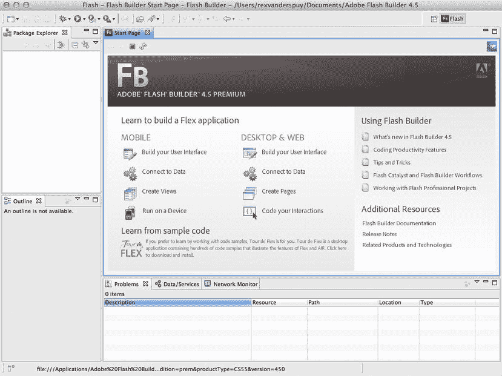

**图 1-1**. Flash Builder 主页面

图 1-1 显示了 `Flash Builder` 4.5 的界面，这是本书撰写时的当前版本。

*如果您使用的是未来不同的 `Flash Builder` 版本，例如 5 或 6，此处描述的一些具体细节可能会略有不同，但总体概念是相同的。如果您遇到无法解决的问题，请务必查阅 Adobe 针对您所用版本的最新文档。您可以在* [`http://help.adobe.com/en_US/flashbuilder/using`](http://help.adobe.com/en_us/flashbuilder/using)`/` *找到它。*

如果这是您第一次接触 `Flash Builder`，请不要被它吓到！您可能不理解此屏幕上的任何内容，但这并不重要。您只需要使用和理解 `Flash Builder` 大约 5% 的功能就可以开始制作 Flash 游戏了。这 5% 甚至更多的内容将在本章中介绍。另外的 95% 是专门的功能，很可能您在作为游戏程序员的整个职业生涯中都无需担心。

#### 创建一个新的空白 ActionScript 项目

现在，您将创建您的第一个 AS3.0 项目。`Flash Builder` 中的项目是包含您游戏所有编程代码的 AS3.0 文件夹和文件的集合。`Flash Builder` 会自动为您创建所有初始文件和文件夹。方法如下：

2.  在打开的 `Flash Builder` 中，选择“文件”  “新建”，然后选择“ActionScript 项目”。图 1-2 展示了在 Mac OSX 上运行的 `Flash Builder` 中此操作的样子。

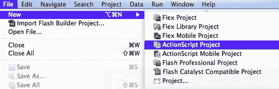

**图 1-2.** 创建一个 ActionScript 项目

将出现一个“新建 ActionScript 项目”对话框，如图 1-3 所示。

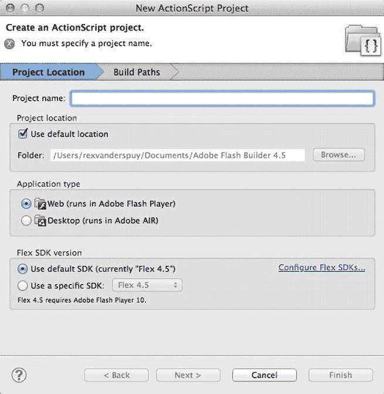

**图 1-3.** “新建 ActionScript 项目”对话框

您需要做的第一件事是给项目命名。您将其命名为 “HelloWorld”。

在“项目名称”字段中，输入“HelloWorld”（图 1-4）。注意 “Hello” 和 “World” 之间没有空格。这一点很重要，我稍后会解释原因。


**图 1-4.** 命名项目

如果这是您第一次运行 `Flash Builder`，您会注意到“使用默认位置”复选框已被选中，在其下方您会看到类似这样的内容：

`/Users/rexvanderspuy/Documents/Adobe Flash Builder 4.5/HelloWorld`

这是 `Flash Builder` 保存您工作的位置。当然，在您的计算机上会略有不同，但主要的是 `Flash Builder` 会将 `HelloWorld` 项目保存在您“文档”文件夹中名为 `Adobe Flash Builder 4.5` 的文件夹内。

`Flash Builder` 会自动为您选择此位置，但这可能不是保存您工作的最方便位置。让我们更改一下，以便将 `HelloWorld` 项目保存在名为 `FlashGames` 的文件夹中。

如果“使用默认位置”复选框已选中，请取消选中，如图 1-5 所示。

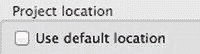

**图 1-5.** 不使用默认位置

现在，您可以将保存位置更改为计算机上您选择的任何位置。

更改保存位置，使 `HelloWorld` 项目位于名为 `FlashGames` 的文件夹中，如图 1-6 所示。再次注意，“Flash”和“Games”之间应该没有空格。图 1-6 显示了文本字段可能的样子。

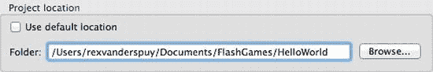

**图 1-6.** 您自己选择的位置

您也可以使用“浏览”按钮浏览到硬盘上您想要保存工作的任何位置。

3.  单击对话框右下角附近的“完成”按钮（图 1-7）。


**图 1-7.** 单击“完成”按钮

单击“完成”按钮后，`Flash Builder` 会生成一个新屏幕，看起来像 图 1-8。

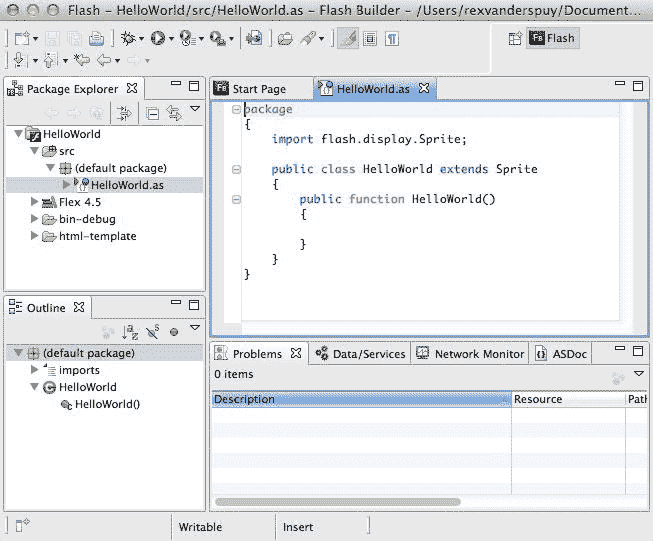

**图 1-8.** 项目屏幕

如果您是编程或 `Flash Builder` 的新手，这可能看起来像是一堆混乱的技术术语。可以这样理解：您实际上是在看一个用于编写计算机代码的文字处理器。只是有很多小按钮可以帮助您更轻松地工作，我会在本书的过程中逐步介绍其中大部分按钮的工作原理。到本章结束时，您将了解此屏幕的几乎所有内容。

您需要关注的主要区域是您编写代码的地方，我在 图 1-9 中突出显示了该区域。

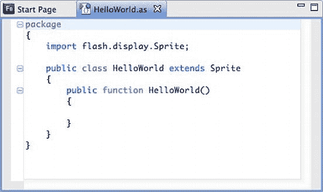

**图 1-9.** 编写代码的区域


这里是你编写所有计算机代码的地方。Flash Builder 已经自动在这个框中填充了一些它认为对你有用的起始代码。这些代码确实有用，但为了学习目的，我需要你将其全部删除，以便从一个完全空白的页面开始。

选中代码编辑窗口中的所有文本，如图 Figure 1-10 所示。

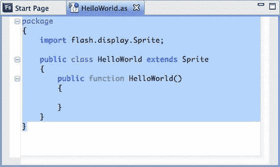

**图 1-10.** 选中预设代码

全部删除，使窗口完全清空，如图 Figure 1-11 所示。

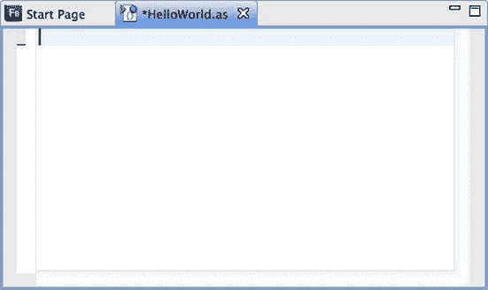

**图 1-11.** 完全空白的代码编辑窗口

现在你拥有了一个完全空白的代码编辑窗口。这就是你将编写第一个计算机程序的地方。

接下来，你需要对 Flash Builder 的配置进行一个小改动，告诉它在 Flash Player 窗口中直接运行你的程序，而不是在网页浏览器中。

### 告诉 Flash Builder 在 Flash Player 中运行你的程序

当你使用 Flash Builder 创建游戏时，它会获取你在编辑器中编写的编程代码，并在 Flash Player 软件中运行它。当你安装 Flash Builder 时，Flash Player 软件会自动安装在你的计算机上。然而，当你首次安装 Flash Builder 时，其设置会使它在网页浏览器中运行 Flash Player。这样既缓慢又低效，因为每次测试游戏时，你都必须等待浏览器窗口弹出。更好的方式是让 Flash Builder 在 Flash Player 窗口中直接运行你的游戏。幸运的是，只需对 Flash Builder 的配置进行一个小改动，就能轻松实现这一点。

1.  从屏幕顶部的 Flash Builder 主菜单中选择 `项目`  `属性`，如图 Figure 1-12 所示。

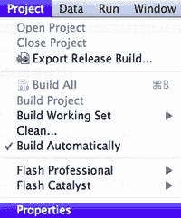

**图 1-12.** 选择 `属性` 选项

2.  一个新的项目属性窗口将会打开。从左侧菜单中选择 `ActionScript 编译器`，你应该会在右侧看到相关选项，如图 Figure 1-13 所示。

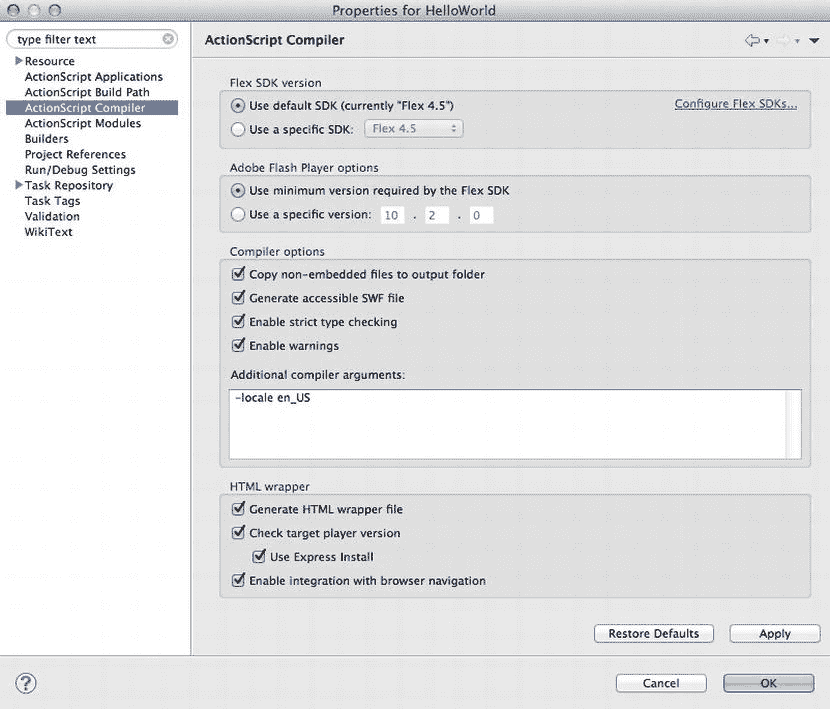

**图 1-13.** `ActionScript 编译器` 选项

3.  找到此屏幕底部附近的 HTML 包装器部分。取消选中名为 `生成 HTML 包装器文件` 的选项。现在它应该看起来像 Figure 1-14。


**图 1-14.** 不生成 HTML 包装器文件

这个选项会自动在网页浏览器中打开你的游戏。通过取消选中它，Flash Builder 将直接在 Flash Player 中打开你的游戏。

4.  选择 `确定` 按钮以保存此更改。

现在你已经准备好编写你的第一个 AS3.0 计算机程序了！

### 编写你的第一个程序

现在，你已经具备了开始编写第一个程序所需的大部分要素。在接下来的几个步骤中，你将执行以下操作：

1.  学习如何创建具有 `.as` 文件扩展名的 ActionScript 文件。
2.  创建一个包，将所有代码整齐地组织在一起。
3.  导入显示文本和图像所需的图形功能。
4.  创建一个类，作为你程序的第一个构建块。
5.  创建一个构造方法，触发程序中的首批操作运行。
6.  创建一个指令，即你希望程序执行的实际操作。
7.  导入 Flash 内置的 `Sprite` 类，以帮助你的程序显示输出。
8.  发布完成的 Flash 文件，以查看你所有辛勤工作的实际输出。

这个过程看似工作量很大，但完成后，你将拥有一个完整的系统框架，这将成为本书其余所有项目的基础，并为你自己构建程序和游戏提供一个灵活的根基。

### ActionScript 文件与 `.as` 文件扩展名

ActionScript 计算机程序是控制整个游戏的核心。它精确地告诉所有游戏角色和元素应该如何表现。ActionScript 程序是游戏最重要的组成部分，本书的大部分内容都致力于解释如何编写和理解它们。

ActionScript 程序本质上就是一个包含特殊单词和字符的文本文件。当你编写 ActionScript 计算机程序时，你只是在计算机上创建一个带有 `.as` 扩展名的简单文本文件。具有 `.as` 扩展名的文件被称为 ActionScript 文件或 AS 文件。

你可以在 Flash Builder 中通过查看代码编辑窗口的顶部来确认这一点。如果你按照本章的说明操作，代码编辑窗口顶部高亮显示的标签栏会显示 `HelloWorld.as`。Figure 1-15 显示了这一点。


**图 1-15.** Flash Builder 中代码编辑窗口顶部高亮显示的标签栏告诉你，你正在创建一个具有 `.as` 扩展名的 ActionScript 文件。

查看代码编辑窗口的左侧，你会找到包资源管理器，如图 Figure 1-16 所示。`HelloWorld.as` 文件将会被高亮显示。

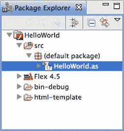

**图 1-16.** 包资源管理器显示项目中正在使用的文件和文件夹。

包资源管理器显示了你 ActionScript 项目中所有正在使用的文件和文件夹。目前你无需担心其中任何一个，除了 `HelloWorld.as` 文件。重要的是要知道，包资源管理器实际上显示的是 Flash Builder 在你的计算机上自动为你创建的真实文件和文件夹。包资源管理器告诉你，`HelloWorld.as` 文件位于一个名为 `src` 的文件夹中，而这个文件夹又位于一个名为 `FlashGames` 的文件夹中。

这些文件夹和文件在你的计算机上位于何处？

你可能还记得，当你在 Flash Builder 中创建 HelloWorld 项目时，你告诉它将项目保存在这里：

`/Users/rexvanderspuy/Documents/FlashGames/HelloWorld`

这意味着 HelloWorld 项目应该位于一个名为 `FlashGames` 的文件夹中，而这个文件夹又应该位于计算机的“文档”文件夹中。

真的是这样吗？让我们验证一下。

Figure 1-17 展示了我在计算机上打开“文档”文件夹时看到的情况。

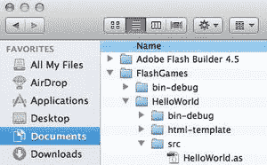

**图 1-17.** `HelloWorld.as` 文件以及 Flash Builder 所需的所有其他 ActionScript 项目文件，都已在您指定的位置自动创建。

是的，没错！

`HelloWorld.as` 文件位于一个名为 `src` 的文件夹中，`src` 是**源文件**的缩写。这些是包含计算机编程代码的文件。传统上，计算机程序员将他们的程序存储在名为 `src` 的文件夹中。你所有的 ActionScript 程序都将存储在名为 `src` 的文件夹中。Flash Builder 会自动为你完成此操作。

而 `src` 文件夹又存储在一个名为 `HelloWorld` 的父文件夹中，这是你项目的名称。`HelloWorld` 文件夹又存储在一个名为 `FlashGames` 的文件夹中。

这意味着，包资源管理器向你展示的是存储在计算机上的真实文件和文件夹。请记住，每当你对 Flash Builder 代码编辑窗口中的 AS 文件进行任何更改时，你都是在对你计算机上可以找到的真实文件进行真实更改。


### 这个我要带走！

上一节介绍了 Flash Builder 中的包资源管理器。它能帮你找到游戏项目中使用的所有文件和文件夹。但什么是包呢？

包是 AS3.0 程序的第一个基本构建块。它将所有 AS3.0 编程代码的片段组合在一起，并将所有代码包裹在 `package` 中。一个包由三部分组成。

* **关键字**：这个关键字被恰如其分地命名为 `package`。关键字是 AS3.0 能够理解并执行特殊任务（例如创建包！）的特殊单词。当你在程序中输入关键字时，Flash Builder 会将它们染成紫色和蓝色，以便你在代码中识别它们。
* **标识符**：标识符可以是任何你想给包起的名字。（它是可选的，本书中你不会使用包标识符。）
* **花括号**：花括号长这样：

```
{
}
```

> 它们用来将里面的内容保持在一起。你可以把它们想象成捆扎包的绳子。下面是一个简单的例子：

```
{
  两个花括号之间的任何内容都保持在一起
}
```

让我们为你的 Hello World 程序创建包。

1. 打开包含你在前面步骤中创建的空白 `HelloWorld.as` 文件的 AS3.0 编辑窗口。

2. 在编辑窗口中输入以下文本：

```
package
{

}
```

你的 ActionScript 编辑窗口现在应该看起来像 图 1-18。

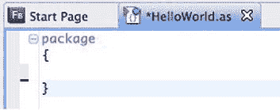

**图 1-18.** 在 `HelloWorld.as` 文件中创建一个包。

*请注意，你在左花括号和右花括号之间留了一个空行。这是因为你将在后续步骤中在该行插入一些内容。*

你刚刚创建的东西是程序员称之为 **块语句** 的东西。块语句定义了程序的特定部分，用于将花括号之间的所有代码组合在一起。在这种情况下，包块语句完全是空的，因为花括号之间除了一个空行什么也没有。但别担心；它不会空很久！

然而，在继续之前，值得更仔细地审视你究竟创建了什么。

当你在 ActionScript 编辑窗口开始输入代码时，你注意到单词 "package" 被编辑器自动染成了紫色。这是编辑器的一种有用的提示方式，告诉你刚刚输入的 是一个关键字——一个它能理解的单词。关键字也被称为 *保留字*。这意味着这些单词属于 ActionScript，而且只属于 ActionScript；你不能将它们用作包、类、变量或方法的名字（稍后将详细介绍）。`package` 关键字只是告诉 Flash："嘿，我正在创建一个包！" 这不太难，对吧？

在 `package` 关键字之后，是我们亲爱的小伙伴——花括号：

```
{
}
```

很可爱，不是吗？目前，它们完全是空的，里面什么也没有。但这很快就会改变。很快你就会往里面放些东西 `{就像这样！}`。

#### 精灵的一点魔法

精灵（Sprites）是超自然的生物——比如小精灵、仙女或宁芙——它们居住在森林溪流岸边附近的林地幽谷中，以及苍老的古橡树和柳树旁。奇怪的是，它们也住在 Flash 和 ActionScript 里。如果你想在屏幕上显示文本或图形，你必须召唤 AS3.0 的精灵。

AS3.0 的精灵住在一个叫库（library）的地方。库是一个庞大的计算机代码仓库，在你安装 Flash Builder 时它会自动安装。这个库包含数百段预先编写好的计算机代码，你可以在自己的程序中自由使用。精灵由库中的计算机代码片段构成，它们的工作是显示文本和图形。

这个库实际上是 Flex SDK 的一部分，它是所有 AS3.0 程序的大脑。当你从库中请求一些代码时，Flash Builder 会进入 SDK，在各个堆栈中翻找，并带回你正在寻找的东西，以便你可以在程序中使用它。它包含了使你的 Flash 游戏运行的核心计算机代码。你可以在 Flash Builder 安装目录下找到一个名为 `sdks` 的文件夹中找到 SDK。

同样重要的是要知道，Flash Builder 实际上只是与 SDK 交互的一个界面。制作 Flash 游戏真正需要的只是 SDK 和 Flash Player 的调试版本。只要你拥有这两个组件，你就可以使用 Flash Develop、TextMate、Eclipse、Xcode 或任何其他 IDE 来制作 Flash 游戏。

SDK 的一个伟大之处在于，如果 Adobe 推出了一个包含你想在游戏中使用的酷炫新功能的新版本 SDK，你只需在 Flash Builder 中下载并安装那个新 SDK 即可。SDK 是免费的，你不需要花任何钱来升级到新版本的 Flash Builder。

库是一个很大的地方，它被分成许多不同的部分。精灵住在哪里？它们住在库中一个叫做 **display** 的部分，而该部分又在库中一个更大的叫做 **flash** 的部分里。你可以通过以下路径找到它们：

```
flash.display.Sprite
```

每个单词之间的点表示库的一个新部分。这表明 `display` 部分是 `flash` 部分的一部分，而 `Sprite` 部分是 `display` 部分的一部分。这就像在说："从 `flash` 部分开始，然后跟着指示牌到 `display` 部分。在 `display` 部分你会找到精灵。" 但这还不够。你必须使用一个名为 `import` 的特殊关键字来显式地告诉程序调用精灵。`import` 关键字用于从库中取出代码，以便你可以在程序中使用它。

以下是导入精灵的方法：

```
import flash.display.Sprite;
```

这条指令告诉程序去库的 `flash.display` 部分获取一个 `Sprite`。这行代码被称为 **导入语句**。当你想使用库中的专用代码时，你会在你的 AS3.0 程序和游戏中使用许多导入语句。

请注意，在导入语句的最末尾有一个分号（`;`）。这是一个编程标点符号，意思是"执行我刚才告诉你的！" 你将在后续的示例中看到更多分号。

另外，非常重要的一点是，请注意 `Sprite` 中的 "S" 是大写的。我将在本书后面详细解释原因，但现在你只需知道，当你在 AS3.0 程序中使用 `Sprite` 这个词时，它必须是大写的。

现在你已经知道了什么是 `Sprite`，在哪里找到它，以及为了在程序中使用它需要编写的代码行，去获取一个 `Sprite` 吧！

1. 在代码编辑窗口中输入以下粗体文本。确保你将其输入在 *两个花括号之间*。

```
package
{
  import flash.display.Sprite;
}
```

注意这个新文本相对于左边缘是缩进的。当你添加新文本时，代码编辑器会自动为你做这件事。本书中的代码示例使用两个空格的缩进级别，但 ActionScript 编辑器窗口会以四个空格缩进你的代码，这完全没问题。

缩进表明你刚刚添加的新代码 *在* 包的花括号 *内部*。你很快就会发现像这样缩进代码是多么重要。

你可以通过按 Tab 键强制任何代码行进行缩进。

现在，你已经掌握了 AS3.0 精灵的魔力，可以随心所欲地显示文本和图形了！

你的代码编辑窗口现在应该看起来像 图 1-19。

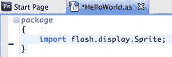

**图 1-19.** 从库中导入一个 `Sprite` 以帮助你显示文本和图像。


##### 不要翘课！

现在你已经创建了一个包并导入了`Sprite`，下一步就是在该包内部创建一个**类**。你可以将类视为构建 ActionScript 程序的基本模块。

2\. 保持你的 ActionScript 编辑器窗口打开，直接在包的尖括号内，添加以下粗体显示的文本：

```
package
{
  import flash.display.Sprite;

  public class HelloWorld extends Sprite
  {
  }
}
```

在`import`语句和新代码之间有一行空行。这是可选的，但正如你将在后续示例中看到的，它会使你的程序更易于阅读。

与`import`语句一样，新代码也从左边界缩进，以表明它位于包的尖括号内。

图 1-20 显示了你代码编辑窗口现在应有的样子。

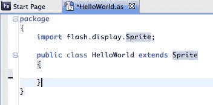

**图 1-20.** 在包内部创建一个类。

那么你刚刚做了什么？

你创建了一个名为`HelloWorld`的类。你是在包内部创建它的。`public`、`class`和`extends`这些词会显示为蓝色和紫色，表明它们是 AS3.0 识别的保留关键字。

你编写的任何 ActionScript 程序都必须至少包含一个类，但你在本书中将构建的大多数程序和游戏都会包含多个类。快速看一下这段新代码。

```
public class HelloWorld extends Sprite
{
}
```

这段代码被称为**类定义**。和包一样，类定义也有一对空的花括号悬空在那里。这表明，像包一样，它也是一个块语句。这些花括号目前是空的，所以这个类还做不了任何事情。这种情况很快就会改变。

类定义主要做三件事。

*   它创建了类。关键字`class`告诉 Flash 你正在创建一个类。就这么简单！
*   它赋予类一些要遵守的规则。这应该是显而易见的：你们中有多少人经历过没有规则的课堂？这段代码告诉 Flash 你正在创建的类是 **public（公共的）**。这意味着它所包含的信息可以被属于同一包或程序可能使用的任何其他包的其他任何类所共享。该类包含的信息对所有人都完全可用。（虽然本书大部分内容都使用公共类，但有时你可能希望阻止类之间共享信息，就像学校的足球队不想与竞争学校分享其战术一样。在这种情况下，你可以将类定义为 **internal（内部的）**。内部类只与驻留在同一包中的其他类共享信息。）
*   它赋予类一个标识符，即一个名称，可以是您选择的任何名称。在这个例子中，该类被命名为`HelloWorld`。

你并不是在经历既视感！你之前见过`HelloWorld`这个短语。它是你正在处理的 AS 文件的名称：`HelloWorld.as`。这并非巧合。当你创建一个类时，它必须保存在一个与类名完全相同的文件中。你创建的每一个新类，都必须创建一个与之共享相同类名的新 AS 文件。

*   最后，它**扩展（extends）** 了另一个类。这意味着它正在使用其他类来帮助其完成工作。在这种情况下，它使用了你在前一行代码中导入的那个大名鼎鼎的`Sprite`的魔力。关键字`extends`告诉`HelloWorld`类使用`Sprite`的魔力来使文本和图像可见。

这里涉及的内容很多，所以让我们用通俗易懂的英语来简化这一行新代码，以便你更好地理解它在说什么。

```
public class HelloWorld extends Sprite
{
}
```

它在说这些：“创建一个公共类，让你编写的其他代码可以轻松访问。这个新类的名称是`HelloWorld`。它扩展了另一个名为`Sprite`的类，这赋予了它显示文本和图像的魔法能力。”

图 1-21 阐释了这段新代码的含义。

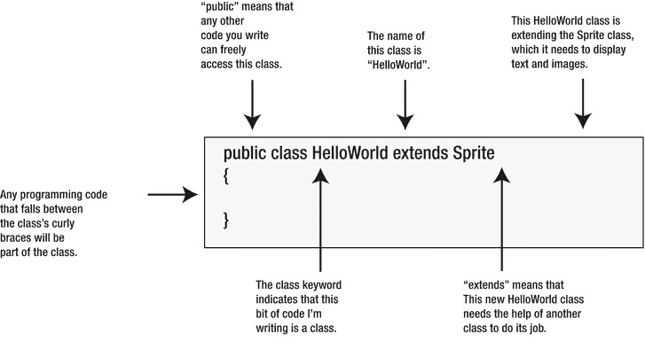

**图 1-21.** 类将容纳你程序的大部分代码，即游戏和程序的核心，位于它的两个花括号之间。

类定义的小小花括号仍然是空的。让我们来利用它们！

##### 使用构造方法

**构造方法**是程序中让事情发生的一部分。具体来说，一旦类被告知开始工作，它就会立即将类投入运行。它所包含的任何编程代码都会立即执行。如果单独的类定义只是一个空壳，那么构造方法就像它的心脏和肺。

3\. 让我们为`HelloWorld`类创建构造方法。将粗体显示的代码添加到你已经编写的代码中。

```
package
{
  import flash.display.Sprite;

  public class HelloWorld extends Sprite
  {
    public function HelloWorld()
    {

    }
  }
}
```

你的 ActionScript 编辑窗口现在应该看起来像图 1-22。

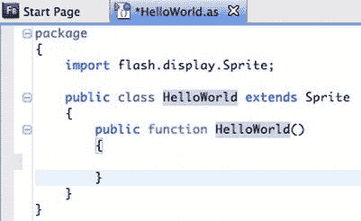

**图 1-22.** 在类内部添加构造方法。

如你所见，构造方法仅仅是一个带有空花括号的块语句，看起来和类定义非常相似。事实上，它具有相同的名称：`HelloWorld`。这并非偶然：所有类都需要具有与类名完全相同的构造方法。

你还会识别的另一个东西是关键字`public`。

```
public function HelloWorld()
{
}
```

与类定义一样，使用`public`一词告诉 Flash，构造方法可以自由地被来自不同包的不同类使用。（然而，AS3.0 语言的一个奇怪特性是，构造方法只能永远是公共的。）

这里有一个新东西是`function`关键字。

```
public function HelloWorld()
{
}
```

它告诉 Flash 你正在创建一个**函数定义**。函数定义就是执行动作的块语句。它们在你的程序中完成所有工作。你可以将函数定义想象成尽职的仆人，一旦你召唤他们，他们就会按照预先安排的杂务清单立刻行动起来。构造方法将始终是你创建类时编写的第一个函数定义，它有一个特殊的任务：一旦类被调用，并且在任何你可能使用的其他方法开始工作之前，立即运行它包含的任何动作。构造方法有点像首席仆人，天刚亮就起床，把所有其他仆人叫下床，在你还没找到拖鞋之前，就用一壶新沏的茶和早报来迎接你。

关于构造方法，你最后应该注意到的是方法名后面的括号，这里用粗体突出显示：

`HelloWorld()`

这些空的括号允许你在方法需要时，为其提供额外的信息，称为**参数**。你很快就会详细了解方法参数，但就目前而言，你只需要知道在创建函数定义时必须提供一对括号，即使这些括号是空的。


### 对齐代码

你可能已经注意到代码格式中有一个有趣的模式正在形成。就像一套空心木制俄罗斯套娃一样，`HelloWorld` 构造方法位于 `HelloWorld` 类内部，而该类又位于 `package` 块语句内部。每个项目都位于外层项目的一对花括号内，现在你有了三个层次的块语句。判断一个块语句在哪里结束、另一个从哪里开始的唯一方法，就是看块语句的花括号是打开还是闭合。

正如你所见，这很容易导致花括号产生混乱的纠结。如果你不能完全确定哪对花括号属于哪个块语句，你就可能在错误的地方添加新代码，并在尝试运行程序时遇到各种错误。

Flash Builder 自动为你做的代码格式化，在一定程度上有助于解决这种潜在的混乱。我建议你在本书的项目中使用这种格式化风格。图 1-23 展示了你可以在一个块语句的开括号和闭括号之间画一条假想的线。它非常清晰地显示了你应该在哪个缩进级别添加代码。

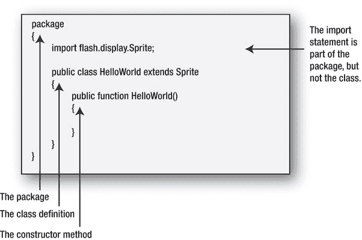

**图 1-23.** 通过保持每个块语句的开括号和闭括号沿一条假想线对齐，你可以确保在正确的位置添加代码。

从图 1-23 可以清楚地看到，`import` 语句是 `package` 的一部分，而不是类的一部分。你还可以看到，构造方法是类的一部分，因为它包含在类的花括号内。这要归功于缩进。

还有另一种可视化代码组织方式的方法。我一直在大量使用“块语句”这个术语。这个术语实际上非常具体地描述了如何使用缩进和花括号来组织代码。你可以把每一对花括号想象成一个空盒子或块。每次你创建另一个带有自己花括号对的语句时，你就在第一个块内部创建了一个新块。图 1-24 展示了到目前为止你在程序中创建了三个代码块。每个块都嵌套在另一个块内部。

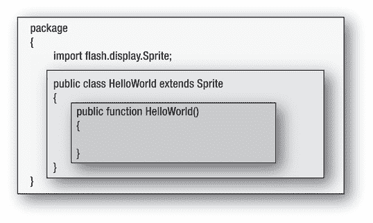

**图 1-24.** 每一对花括号包含一个代码块。块可以包含其他块。

编写代码时一个常见的困惑是不确定一个块语句在哪里结束，另一个在哪里开始。如果你使用这种建议的格式，并在编写时能看到这些假想的划分，这将真正帮助你防止意外地在错误的地方添加一行代码。

如果你在使用 Flash Builder，你可以使用其“大纲”窗口来查看程序中的所有代码块，以及你当前正在哪个块中工作。你可以在代码编辑窗口的左下方找到“大纲”窗口。图 1-25 展示了如果你已按照本章的指示操作到现在，你的“大纲”窗口会是什么样子。

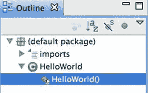

**图 1-25.** “大纲”窗口显示了你程序中的所有代码块。

“大纲”窗口清晰地显示你有三个块：`package`、类定义和构造方法。它甚至还添加了一些可爱的小图标来示意它们。`import` 语句是 `package` 块的一部分，因为它处于相同的缩进级别。

“大纲”窗口和代码编辑窗口是关联的。如果你点击“大纲”窗口中的一个块，代码编辑窗口会高亮显示同一个块，反之亦然。例如，如果你点击“大纲”窗口中的构造方法块，代码编辑窗口中的构造方法也会被高亮显示，如图 1-26 所示。

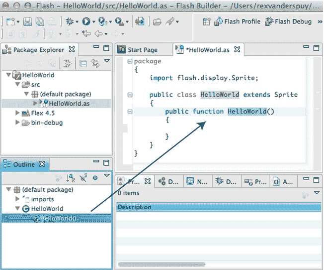

**图 1-26.** 如果你在“大纲”窗口中选择一个代码块，编辑窗口中相同的代码块会被高亮显示，反之亦然。

在长程序或复杂程序中，你可以使用“大纲”窗口快速找到你想要处理的代码块。

### 指令是什么？

你的程序需要的下一段代码是一条**指令**。计算机编程的一大乐趣在于能够像你是自己个人银河游轮的船长一样，随意抛出诸如“构造方法”和“指令”这样的术语。很简单，指令是你要程序执行的单个操作。它告诉你的程序：“现在就做这个！”方法由一个或多个指令组成，有了它们，程序就活了起来。

4. 你将添加到构造方法中的指令将告诉程序，在程序运行时在控制台窗口中显示“Hello World!”字样。将以下粗体文本添加到你的程序中：

```
package
{
  import flash.display.Sprite;

  public class HelloWorld extends Sprite
  {
    public function HelloWorld()
    {
trace("Hello World! Can you read this?");
    }
  }
}
```

你的代码编辑窗口现在应该看起来像图 1-27。

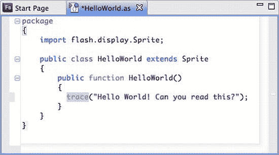

**图 1-27.** 将新的 `trace` 方法添加到你的代码中。它会显示引号内位于其括号之间的任何文本。

这是你编写的新代码行：

```
trace("Hello World! Can you read this?");
```

这被称为**trace 方法**。这是一种特殊的指令，告诉你的程序在调试时将括号内的任何内容发送到 Flash Builder 的控制台窗口。你还没看到控制台窗口，但很快你就会看到了！在这个例子中，`trace` 方法会将“Hello World! Can you read this?”这些文字发送到控制台窗口。这里的关键词是 `trace`。

如果你想使用 `trace` 向控制台窗口发送一些文本，该文本需要用引号括起来。AS3.0 有很多内置方法，比如 `trace`，你可以用它们来做各种有趣的事情，并且你将在本书的过程中详细了解其中的许多方法。

指令以分号（`;`）结尾。分号是一个基本的标点符号，让程序知道“指令结束了！执行这个任务！”它就像句子末尾的句号。每当你看到一行代码末尾有分号，你就知道这是一条指令。它告诉程序执行一个特定的操作。你之前在那行从库中导入 `Sprite` 的代码中也使用了分号。那行代码也是一条指令。

*如果你忘记在指令末尾添加分号，Flash Builder 会宽宏大量地假设你本意是要加一个。没有分号，你的程序仍然可以完美运行。谢谢你，Flash Builder！但为了良好的编程风格，你应该始终添加分号。如果你以后学习其他不那么宽容的编程语言（大多数都不宽容），你将已经养成了一个优秀的习惯。*

图 1-28 展示了在运行和调试程序时，`trace` 如何工作以在控制台窗口中显示文本，这是你在接下来的步骤中将要做的。

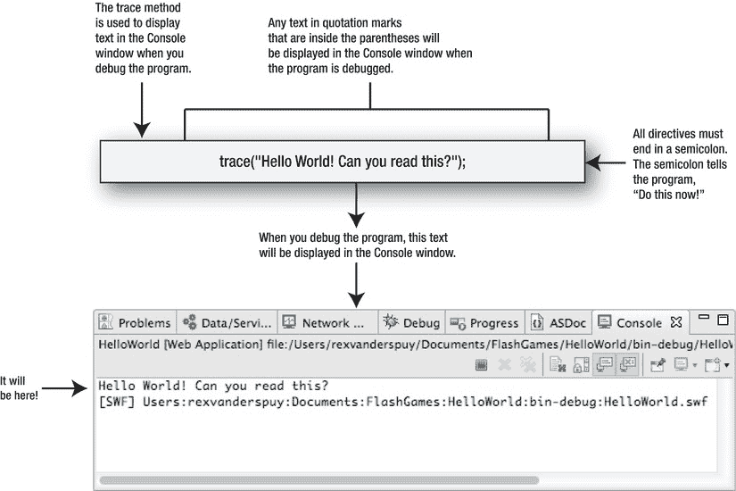

**图 1-28.** 在运行和调试程序时，使用 `trace` 方法在控制台窗口中显示文本。

但是，现在先别去控制台窗口找那段文字！直到你调试程序时才会看到它。你将在接下来的步骤中做这件事。


### 为代码添加注释

在查看程序实际功能之前，我们先为它增加一个新特性：**注释**。编写计算机程序时，经常需要为某段代码的功能写下简短说明。当你解决了一个复杂的编程问题，不确定下次再看代码时是否能理解时，注释尤其有用。它也能帮助其他可能阅读你代码的人更好地理解。

添加注释有两种方式。第一种是使用两个正斜杠（`//`）。在这两个正斜杠之后同一行添加的任何文本，都不会被 AS3.0 解释为编程代码。你可以写任何你喜欢的内容；程序运行时这些内容会被忽略。示例如下：

```
//Hi mom!! This is a comment. You can write whatever you like here.
```

有时你可能想写一段无法轻松塞进一行的长注释。这时可以创建**多行注释**。多行注释的写法如下：

```
/*
Anything between the opening and
closing multiline comment characters
will not be interpreted as
programming code.
*/
```

多行注释以字符序列 `/*` 开头，以字符序列 `*/` 结尾。你可以在它们之间任意多行上写任何内容。

除了给自己留笔记，注释在你想测试程序在缺少某些代码时的行为时，也非常适合用于禁用代码段。

1. 为了熟悉使用注释，在你的程序中添加一条注释。用以下粗体行修改你的代码：

```
package
{
  import flash.display.Sprite;

  public class HelloWorld extends Sprite
  {
    public function HelloWorld()
    {
      //The next line displays some text
      trace("Hello World! Can you read this?");
    }
  }
}
```

在继续之前，确保你的程序看起来如图 1-29 所示。

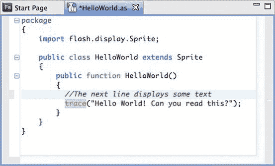

**图 1-29.** 在代码中添加一条注释。

ActionScript 编辑器窗口将注释显示为绿色，以便你轻松将其与编程代码区分开。

2. 最后，如果一切正常，保存 `HelloWorld.as` 文件。

现在你已经准备好查看程序运行的结果了。

### 运行程序并编译 SWF 文件

到目前为止，你只处理了一个文件，即 `HelloWorld.as` 文件。这是你的 ActionScript 程序，它被称为 AS 文件。这是你完成所有工作的文件，但它并非最终产品。

你的最终产品将是一个 SWF 文件。这是一个扩展名为 `.swf` 的文件。它是在 Web 浏览器的 Flash Player 中运行的文件，也是你可以上传到互联网或与他人共享的文件。创建 SWF 文件的行为被称为*编译*它。（这也被称为*构建*它，Flash Builder 正是由此得名。）

在 Flash Builder 中有两种编译 SWF 文件的方法。

* 你可以从 Flash Builder 的主菜单中选择“运行” “运行”，或点击工具栏中的绿色播放图标。执行此操作时，Flash Builder 会为你构建 SWF 文件到项目目录的 `bin-debug` 文件夹中，然后在 Flash Player 中启动它。
* 你可以从主菜单中选择“运行” “调试”，或点击工具栏中的小甲虫图标。这是一个更好的选择。它执行的操作与普通“运行”命令相同，但还会打开“控制台”窗口。“控制台”窗口会显示你在程序中使用的所有 `trace` 指令。它还会在“问题”窗口中给出错误消息，告诉你程序中是否犯了一些错误。当你选择“调试”选项时，它实际上会运行程序并启动调试器。一箭双雕！

在制作游戏时，你几乎只会使用“调试”选项，因为它在“控制台”和“问题”窗口中提供的信息极其有用。让我们通过调试程序并观察会发生什么来了解这点！

*从现在起，我将把调试选项称为**编译**。每当我在本书中要求你编译程序时，请点击那个小甲虫按钮。*

1. 从主菜单中选择“运行” “调试”，或点击工具栏中的小甲虫图标，如图 1-30 所示。Flash Builder 可能会询问你是否要在继续之前保存工作。如果你之前已经为此程序运行过调试器，它可能会询问你是否要终止任何现有的调试会话。在这两种情况下，都点击“确定”按钮。它还可能会询问你是否要打开 Flash Builder 的**调试透视图**。如果是，请选择“否”。（你将在本章末尾附近了解什么是调试透视图以及如何切换到它。）

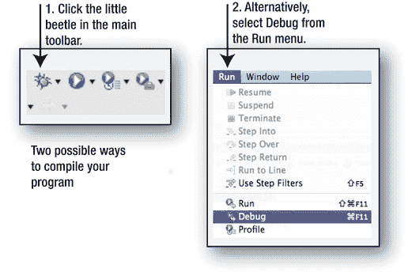

**图 1-30.** 选择两种编译程序的方式之一。

如果 Flash Builder 安装正确，并且你严格按照本章的所有说明操作，将会发生以下情况：

* Flash Builder 将启动一个 Flash Player 窗口。它会是空白的。这完全没问题，本就该如此！（如果你没有在“项目属性”面板中取消选中“生成 HTML 包装文件”选项，则会打开一个空白网页。请参阅本章开头附近的“告诉 Flash Builder 在 Flash Player 中运行你的程序”一节来防止这种情况发生。）
* Flash Builder 还将打开“控制台”窗口。你应该会在“控制台”窗口中看到“Hello World! Can you read this?”字样。图 1-31 展示了你应该看到的内容。“控制台”窗口还会显示一些技术信息，确认它已创建了 SWF 文件，即你的最终作品。

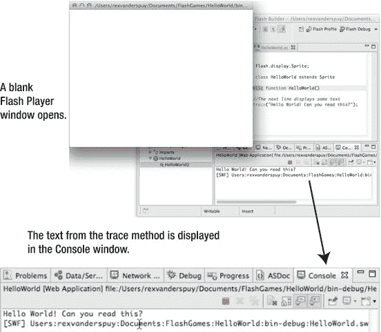

**图 1-31.** 编译你的程序，并在“控制台”窗口中查看结果。

如果你编译程序时发生了这种情况，那么恭喜你，你已经编程并运行了你的第一个计算机程序！如果这没有发生，而你收到了一些无法理解的奇怪错误消息，请继续阅读，看看能否找出问题所在。


当你编译程序时发生了什么

我们暂时假设你的程序完美运行，你看到了我在上一节中描述的结果，并且没有收到任何错误消息。以下是实际发生的情况：

当你点击调试（Debug）按钮时，Flash Builder 会将你的程序发送给一个名为**编译器**（compiler）的组件。编译器是 Flex SDK 中的一个软件，它的任务是将 AS3.0 代码转换为可在 Flash Player 中查看的 SWF 文件。同时，它还会检查你的代码中是否存在错误。如果有错误，它会发出警告；如果错误严重，则会阻止代码运行。

但如果代码运行正常，那么编译器会在控制台（Console）窗口中显示你的`trace`消息，并在`HelloWorld`项目目录的`bin-debug`文件夹中为你创建一个 SWF 文件。让我们验证一下它是否真的做到了。打开你的`bin-debug`文件夹查看一下。你的`HelloWorld`项目目录应该类似于图 1-32。

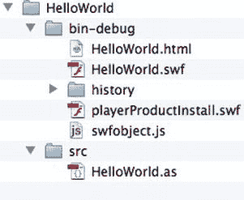

**图 1-32.** 当你编译程序时，AS3.0 编译器会在项目文件夹中为你创建一个 SWF 文件。

你感兴趣的是`HelloWorld.swf`文件。与你的项目同名的 SWF 文件将包含你在后续章节中制作的最终游戏。

但该目录下还有几个其他的文件和文件夹。它们对于本书中的任何项目都不是必需的，它们都是所谓的 **HTML 包装器**（HTML wrapper）的一部分。如果你希望将任何项目上传到互联网，这些文件是你需要的。即使你已告诉 Flash Builder 不要生成 HTML 包装器，这些文件仍然会被创建，只不过 Flash Builder 不会用它们来在网页浏览器中启动你的程序。让我们看看这些文件的作用——它们可能在某些时候对你有用。

*   **`HelloWorld.html`**：这是一个 HTML 文件（一个网页），当你运行和调试程序时，编译器会自动为你生成它。它包含播放 SWF 文件的代码。你可以使用这个 HTML 文件以及此目录中的其他文件，作为创建可发布到互联网的网页的基础，以便其他人能玩你的游戏。
*   **`swfObject.js`**：这是一个 JavaScript（JS）文件，它负责将 SWF 文件嵌入到 HTML 页面中，并检查通过互联网查看你游戏的用户是否安装了 Flash Player。
*   **`playerProdcutinstall.swf`**：这是一个 Flash 应用程序，如果用户当前的 Flash Player 版本与你的游戏不兼容，它会提示用户下载最新版本。
*   **`History`**：此文件夹包含专门的代码，允许用户使用浏览器的前进和后退按钮来导航你的游戏或网页应用程序。

详细介绍如何为网络发布 HTML 文件已超出了本书的范围，但理论上，你只需要将这五个文件和`History`文件夹上传到一个网址（URL），世界上的任何人都能玩你的游戏。你可以在 Adobe 网站上找到更多关于 Flash Builder 的 HTML 包装器的信息，网址是：

`http://help.adobe.com/en_US/flashbuilder/using/index.html`

以上就是当一切正常工作时你会看到的情况。但万一……

### 它没起作用怎么办？

可能有一小部分不幸的读者没有看到图 1-31 所示的输出。事实上，如果这是你第一次进行任何计算机编程，那么你几乎肯定会在某个地方犯一个小错误，从而阻止程序正常运行。别灰心！有很多可能出错的地方，而能够找出问题所在是学习过程中至关重要的一部分。

如果这是你第一次使用 Flash Builder 编译程序，那么很有可能 Flash Builder 没有正确安装，或者你没有安装调试版本的 Flash Player。如果你看到一条错误消息说“Installed Flash Player is not a debugger”，那么这很可能就是原因。请按照本章开头“使用 Flash Builder”部分的说明来解决这个问题。

如果 Flash Builder 安装正确，那么只需仔细检查你编写的代码，问题就能轻松解决。首先，当你点击调试按钮时，你可能会看到一个名为“Errors in Workspace”的对话框，如图 1-33 所示。

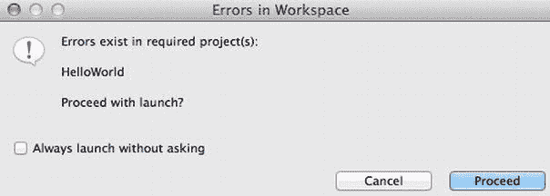

**图 1-33.** 编译程序时，Flash Builder 会告诉你代码中是否存在问题。

如果你看到这个对话框，请点击取消（Cancel）。这一点很重要，因为如果你点击继续（Proceed），即使代码中存在错误，Flash Builder 仍会尝试创建 SWF 文件。这可能会让你错误地认为你的程序运行正常，而实际上并非如此。在一个有数百行代码的复杂游戏项目中，这可能会让你忽视代码中的错误，而这些错误最终会表现为难以解决或检测的复杂 bug。

取消 SWF 的启动后，请查看 Flash Builder 工作区底部的“Problems”窗口。Problems 窗口会告诉你它认为你的代码中有多少个错误。点击“Errors”旁边的小三角形，你会看到一个列表，详细列出 Flash Builder 认为的问题所在。图 1-34 展示了一个例子。

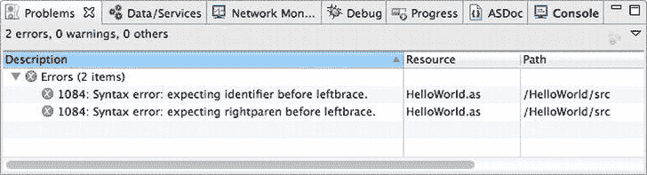

**图 1-34.** 点击 Problems 窗口中“Errors”旁边的三角形，可以查看程序中可能存在的错误。

我可以向你保证，它告诉你的内容在你看来可能完全是天书！你需要花费大量时间使用 Flash Builder，才能逐渐理解这些错误信息试图告诉你什么。然而，“语法错误”（syntax error）这个术语很重要。它意味着你编写了一些 AS3.0 语言无法理解的代码。这是 AS3.0 在说：“啊？”。这通常表明你打错了字或拼写错了某个东西。也可能意味着你忘记打开或关闭某个花括号或圆括号。或者你只是不小心遗漏了某些内容。这些消息的另一件令人困惑的事情是，Flash Builder 实际上并不知道问题出在哪里。错误信息很模糊。它们通常不会指向真正的问题所在，因此你必须运用你的推理能力来找出可能出错的地方。

但 Flash Builder 不会只给你留下模糊的错误信息；它会指出它认为问题存在于代码的哪个位置。如果你查看编辑器窗口的左侧，你会看到一个带有 X 的小红圈。Flash Builder 认为问题出在那行代码上。图 1-35 展示了一个例子。

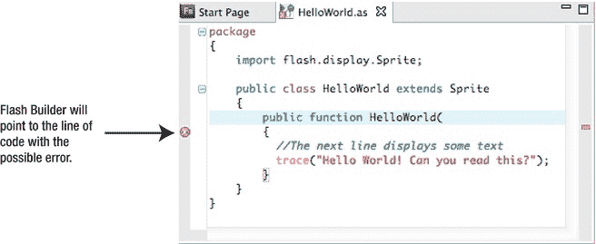

**图 1-35.** Flash Builder 会指出可能存在错误的代码行。


*注意：如果遇到一个不太严重但最好修复的小问题，Flash Builder 会用一个三角的黄色警告标志来提示你。这不会影响程序的正常运行，但如果放任不管，后续可能会引发更严重的问题。*

Flash Builder 高亮显示的那一行代码是一个重要线索！然而，这也很容易产生误导，因为 Flash Builder 只是指出了它无法理解你代码的那个位置。通常，真正的问题出现在*紧挨着这一行之前的位置*。

这可能会让人困惑！这里有个更具体的例子：想象你在森林里散步，被树根绊倒，头撞到了石头上。Flash Builder 会指出石头是问题所在。但你知道，真正的问题是那根树根。

仔细看看图 1-35，并将其与你在上一节中编写的最终代码进行比较。Flash Builder 指向的那一行看起来有什么问题吗？不，它完全没问题。

但看看紧挨着它的上一行。它看起来是这样的：

`public function HelloWorld(`

你发现什么问题了吗？是的！缺少了右括号。这行代码应该是这样的：

`public function HelloWorld()`

这类简单的错误非常容易犯，尤其是在你刚开始学习编程，对这一切都还完全不熟悉的时候。

但是，Flash Builder 并没有告诉你这就是问题所在。它指向的是它撞到的石头，而不是绊倒它的树根。不过，它确实为你指明了查找的方向。如果你修复了这段代码并再次调试程序，程序就会完美运行，所有的错误信息都会消失。

不幸的是，编译器并不知道你希望你的代码做什么；它只能告诉它期望什么以及它不理解什么。如果运气好，它能精确定位问题所在。但更多时候，它只是给你一个大致的查找方向和线索。这有点像两岁小孩指着自己的大脚趾喊疼。你知道问题出在那里，但究竟是图钉扎了、被蜜蜂蜇了，还是仅仅另一种“上次我这样做你给了我巧克力”的说法，补救措施则取决于经验、审慎的调查和周密的诊断。你需要自己明智地去分析，错误信息试图告诉你什么，以及你可能需要修复或更改什么，才能让程序正常运行。

如果不确定程序的问题出在哪里，问问自己是否可能遇到了以下一个或多个问题：

-   所有内容的拼写和大小写是否正确？
-   文件是否保存在正确的位置？文件夹和文件的拼写及大小写是否与包名和类名匹配？（如果你使用的是 Flash Builder，通常不会有这个问题，因为它会自动处理这些事情；但使用其他 IDE 则可能发生。）
-   所有 AS3.0 关键字（例如 `import`、`package` 和 `function`）是否显示为蓝色或紫色？如果某个关键字不是这种颜色，那就清楚地表明你可能拼写或大小写有误。
-   是否闭合了所有的花括号和圆括号？
-   你去厨房再倒一杯咖啡时，你的猫有没有跳到键盘上？

下面还有一些在调试程序时需要时刻牢记的通用指导原则：

-   如果收到多条错误信息，总是先修复第一条。后续的错误通常是由于部分代码依赖于前面的代码段正确运行所致。修复第一个错误，修正效果会级联传递，通常能奇迹般地修复其余错误。
-   检查*紧挨着 Flash 认为出问题的代码行的上一行*。通常，上一行的小错误自身可能不足以产生编译错误，但却足以导致下一行代码出错。
-   *在重新编译之前，一定要保存正在编辑的 AS 文件！*我必须强调，忽视这一点是常见疏忽。程序员发现并修复了一个错误，但重新发布 SWF 文件时却得到完全相同的错误信息。这是因为修复后没有保存文件，Flash 实际编译的是之前保存的旧版本文件。如果你使用 Flash Builder，这不是问题，因为它会在尝试运行代码前自动为你保存 AS 文件；但大多数其他 IDE 不会这样做。
-   在重新编译并测试程序之前，只做一处修改。如果你的程序之前运行正常，但在做了这次修改后突然停止工作，那么你就确切知道是什么导致了问题。如果你一口气做了五处修改后才运行和调试，程序出了问题，你就无法知道是这五处中的哪一处导致了故障。
-   最后，程序员的普适法则：尽早测试，频繁测试。多做测试，尽早解决大量微小的、可控的问题，以避免日后不得不处理那些能使项目停滞不前的巨大棘手问题。

除少数特殊情况外，这是本书最后一次对调试问题进行如此详细的讨论。从这以后，你就得靠自己了，但你越早获得调试自己代码的实践经验就越好。在这一领域，经验决定一切，而没有一个比棘手的调试问题更能磨砺你编程技能的磨刀石了。

另外，要习惯使用“问题”窗口——你会经常用到它！它将成为你查找和追踪问题时最亲密的盟友。


#### 常见错误消息

本节列出了一些在初次调试时可能遇到的常见错误消息，并针对问题可能的原因给出了建议。

- `1087：语法错误：程序结束后发现额外字符。`  
  您可能忘记打开或关闭某个花括号。
- `1116：用户定义的命名空间属性只能在类定义的顶层使用。`  
  您在类定义中拼错了一个关键字。例如，将“public”拼成了“pulbic”。
- `1071：语法错误：在属性 public 之后应为定义关键字（如 function），但实际为 clas。`  
  您将单词“class”拼写成了“clas”。当拼错关键字时，通常会出现此错误。
- `1084：语法错误：在 exteds 之前应包含左花括号。`  
  您拼错了单词“extends”。
- `1017：未找到基类 Sprie 的定义。`  
  您拼错了单词“Sprite”。
- `1017：未找到基类 Sprite 的定义。`  
  您拼错了以下代码行中的某个单词，例如“flash”或“display”：  
  `import flash.display.Sprite;`  
  您也可能遗漏了单词之间的某个点号。
- `1114：public 属性只能在包中使用。`  
  您可能拼错了单词“package”。
- `1153：构造函数只能声明为 public。`  
  您在构造函数方法中拼错了单词“public”。
- `1071：语法错误：在属性 public 之后应为定义关键字（如 function），但实际为 functon。`  
  您拼错了单词“function”。
- `在源路径‘HelloWorld’中找到的文件，其名称必须与文件‘HeloWorld’内部的类定义名称相同。`  
  您在类定义中将“HelloWorld”拼写成了“HeloWorld”。
- `1008：函数‘HeloWorld’的返回值没有类型声明。`  
  您在构造函数方法中将“HelloWorld”拼写成了“HeloWorld”。
- `1084：语法错误：在左花括号之前应包含标识符。`  
  您忘记关闭一个括号。
- `1180：调用了可能未定义的方法 trae。`  
  您将“trace”拼写成了“trae”。
- `1084：语法错误：在分号之前应包含右括号。`  
  您忘记关闭一个括号。

别被这些错误消息吓到！您很快就会理解它们想要传达的信息，通过仔细检查代码，您总能找到问题的根源。

#### 对照原始源文件确认程序

如果您对本书中的任何代码有疑问，可以下载我编写的原始源文件，并与您的代码进行核对。您可以从本书的下载页面 [`www.apress.com`](http://www.apress.com) 下载这些文件。打开您正在学习的章节的文件夹，您会发现文件夹和文件的组织结构与我书中所描述的一致。您可以在 Flash Builder 中直接打开任何单个文件，或者将整个文件夹作为 Flash Builder 项目打开。

要将源文件作为项目打开，请从主菜单中选择“文件”“导入 Flash Builder 项目”。会打开一个新对话框，询问您是要导入文件还是项目文件夹。选择“项目文件夹”，然后点击“完成”。该项目将被导入到 Flash Builder 中，之后您就可以像运行和调试自己的程序一样，对它进行运行和调试。

如果您要导入的项目文件夹与 Flash Builder 中当前打开的项目同名，请在导入之前重命名该项目文件夹。

### 关于 Flash Builder 的更多信息

Flash Builder 是一款复杂的软件，包含的功能远多于您平时可能用到的。让我们快速了解一下其中一些最实用的功能。

#### 编辑窗口的特性与怪癖

ActionScript 编辑窗口有一些高级功能，不幸的是，对于初学者来说，如果您不了解它们，这些功能可能会导致一些令人沮丧的怪现象。它们可能让您的工作看起来好像消失了，或者无法正常运行。然而，随着经验积累，您会发现这些功能其实非常有用。

##### 折叠代码

首先，编辑窗口允许您*折叠*代码。请看窗口最左侧，您会看到一些小的减号。每个代码块旁边都有一个减号。如果您点击其中一个减号，该代码块就会折叠成一行。看起来您的代码完全消失了，但实际上并没有。点击代码块旁边新出现的加号，您的代码就会再次显示出来。如果您正在处理一个非常长的程序，并希望暂时隐藏部分代码以免干扰您处理其他部分，这个功能就很有用。图 1-36 对此进行了说明。

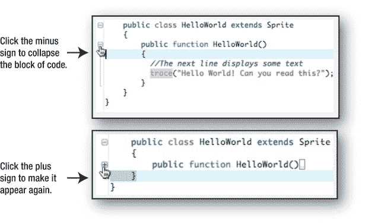

**图 1-36.** 如果您想清理编辑窗口的杂乱，可以折叠当前不处理的代码块。


### 断点

如果你正在处理一个复杂的程序，只想测试其中一部分而非全部，可以在代码中添加一个**断点**。添加断点后，代码将在该位置停止运行。如果你知道后面某处存在错误，但只想测试到确认无误的代码段为止，这非常有用。

不过，如果不经意地在左侧边距上双击，也很容易意外地添加断点。作为初学者，你可能不会注意到这些断点的存在，只会发现程序无法正常运行。虽然不会收到任何错误提示，但程序似乎会在中途停止。如果遇到这种情况，请检查并确保没有意外添加任何断点，如果有则将其删除。

通过在编辑窗口的左侧边距上双击，即可在代码中添加断点。你会看到出现一个蓝色的小圆点，如图 1-37 所示。

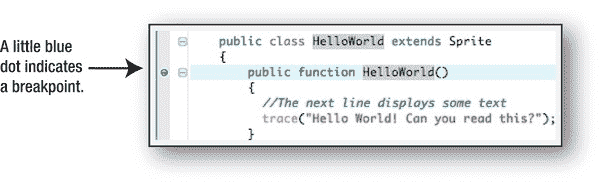

**图 1-37.** 在代码中添加断点将使其在断点处停止运行。这对于检查代码中哪些部分正常工作、哪些部分有问题非常有用。

添加断点后，当运行并调试代码时，程序会在该处停止。这意味着它不会执行紧随其后的跟踪语句，你将在控制台窗口中只看到一条消息，提示 SWF 文件已创建。

要移除断点，只需再次双击它。完成此操作后，重新运行并调试程序，程序应能顺利执行完毕。

然而，有时你可能想利用断点来检查哪些代码段工作正常，哪些有问题。在这种情况下，可以保留断点，并打开“断点”视图窗口。通过选择“运行”  “调试”  “其他” 可以使“断点”视图可见。此时会打开一个新的“显示视图”窗口。打开“调试”文件夹，选择“断点”，然后单击“确定”按钮，如图 1-38 所示。

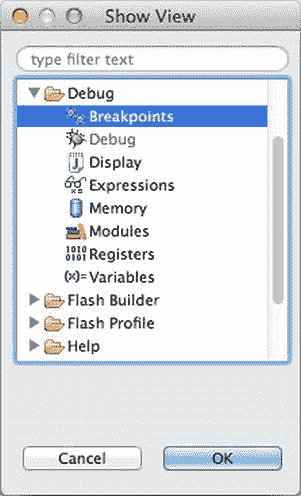

**图 1-38.** 显示“断点”视图窗口以帮助管理断点。

现在，Flash Builder 工作区底部会出现一个新的“断点”窗口，如图 1-39 所示。其中将显示代码中的所有断点。

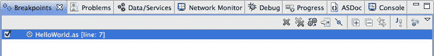

**图 1-39.** 显示“断点”窗口以查看代码中断点的位置。

“断点”窗口的右上角自带菜单栏。你可以通过取消勾选来停用某个断点。如果双击某个断点，代码编辑窗口中的光标将跳转到你添加该断点的位置。你可以选中断点，然后单击菜单栏中的 X 按钮来移除它们。其中许多选项同样可以在 Flash Builder 的“运行”菜单中找到。

如果在带有断点的情况下运行和调试代码，并且想查看程序从该点继续执行会发生什么，可以选择“项目”菜单中的“恢复”命令，如图 1-40 所示。

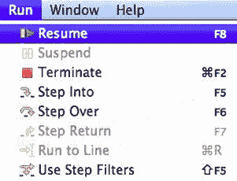

**图 1-40.** 从断点处恢复运行，可显示程序从该点继续执行后的情况。

在同一个“运行”菜单中，你还可以*单步跳过*断点。如果你在某一行（你认为包含错误的那一行）设置了断点，并希望在不执行该行的情况下测试程序，这一功能就很有用。它会从程序中忽略有疑问的那一行，并显示没有该行时程序将如何运行。

断点还有一些更高级的功能，比如设置条件断点。你可以在 Adobe Flash Builder 文档中“Flash Builder 中的调试工具”一章找到更多相关信息，网址为：

`http://help.adobe.com/en_US/flashbuilder/using/index.html`

当你开始编写冗长、复杂的程序时，就会逐渐体会到断点在帮助测试以及将代码中正常工作部分与问题部分区分开来时有多么实用。断点是必不可少的调试工具。

### 透视

Flash Builder 有一个名为**透视**的功能，它可以改变工作区中窗口的排列方式。如果你刚安装并开始使用 Flash Builder，很可能使用的是名为 **Flash** 的透视。Flash 透视以我在本书中描述的方式排列工作区，即编辑窗口左侧为包资源管理器和大纲窗口，底部为控制台和问题窗口。

没有理由更改这个透视，但了解如果你愿意，是完全可以更改的，这一点很重要。此外，在探索 Flash Builder 的过程中，你可能意外切换了透视，导致无法回到我一直介绍的标准 Flash 透视。

Flash Builder 工具栏的右上角有用于切换透视的按钮，如图 1-41 所示。

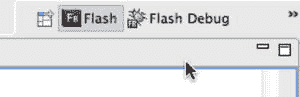

**图 1-41.** 通过切换透视来改变 Flash Builder 工作区中窗口的排列方式。

当前选中的透视将通过凹陷的按钮显示。图 1-40 显示当前选中的是 Flash 工作区。如果选择 Flash 调试透视会怎样？图 1-42 展示了它的外观。

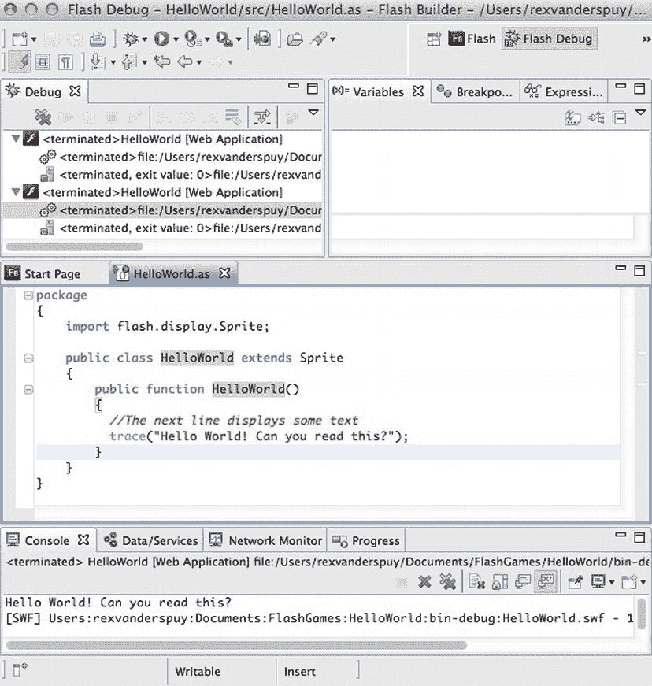

**图 1-42.** Flash 调试透视

所有用于解决问题和调试程序的窗口都以合理的布局呈现，且易于访问。“断点”窗口位于右上角，此外还有两个新窗口：“变量”和“表达式”。

Flash Builder 还包含许多其他透视。你可以通过单击“打开透视”按钮，然后单击“其他”来找到它们，如图 1-43 所示。

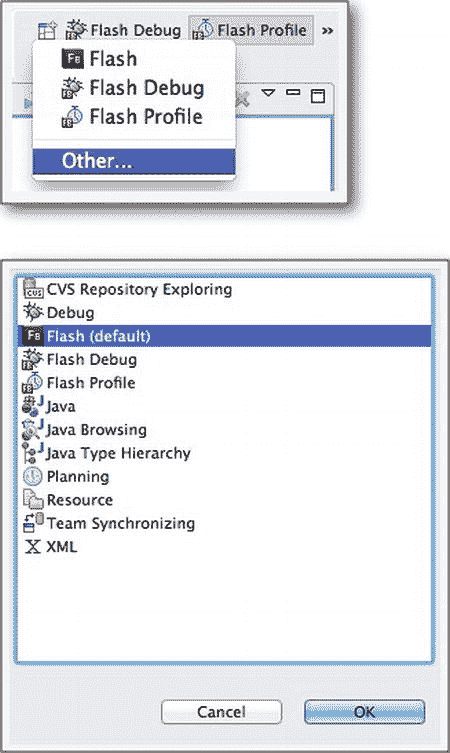

**图 1-43.** 如果需要，有许多透视可供选择。

你应该了解这些透视的存在，但在完成本书的项目时，很可能不需要用到它们。

另一个需要记住的问题是，如果你双击任何窗口的标题栏，它将会展开至充满整个工作区。再次双击它即可使其缩小。

### 创建程序的干净编译

有时你编译程序时，尽管没有出现错误消息，但程序的行为似乎并不符合预期。你对程序所做的最近更改似乎没有生效，而且你完全找不到代码中的错误。

如果发生这种情况，你需要通过对程序进行干净编译来重置编译器。为此，请选择“项目”  “清理”。选择要清理的项目，然后单击“确定”按钮。编译器将从头开始重新编译你的程序。


#### 创建 SWF 文件的发布版本

当你的程序或游戏完全完成后，最好创建一个**发布版本**。这个 SWF 文件比你在运行和调试程序时创建的 SWF 文件体积略小。体积更小的原因是它不包含任何调试信息或 `trace` 语句。发布版本的 SWF 应该是你的最终产品。

要创建发布版本的 SWF 文件，请从 Flash Builder 的主菜单中选择 `项目`  `导出发布版本`。系统将打开一个新窗口，其中包含一些你很可能永远不需要更改的选项。点击 `完成` 按钮，Flash Builder 就会为你生成 SWF 文件。

完成后，你会在项目文件夹中一个名为 `bin-release` 的文件夹里找到发布版 SWF，如图 Figure 1-44 所示。

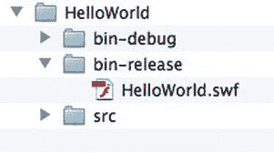

**图 1-44.** 创建一个发布版 SWF，其体积小于调试过程中创建的 SWF 文件。

### 关于 AS3.0 和 Flash Player 的更多内容

在这一过程结束时，你会得到一个 SWF 文件。只要同一台电脑上也安装了 Flash Player，你就可以将它带到任何电脑上运行。SWF 文件需要借助 Flash Player 才能运行，这一事实非常重要。作为游戏设计师，你需要知道为什么会这样，以及这可能给你带来哪些限制。让我们更深入地看看发布 SWF 文件时后台究竟发生了什么。

AS3.0 是一种**高级编程语言**。像 Java、C++ 和 Visual Basic 这样的高级编程语言，是为了方便人类轻松阅读、编写和理解而设计的。它们使用真正的英语词汇，例如 `function` 和 `class`，并使用英语语法元素，如引号和分号。但计算机并不理解英语。如果你今晚试图请电脑帮你洗碗，我猜你只会得到一片沉默。（如果不是这样，请务必告知相关人员，最好是专业人士！）

在最基本的层面上，计算机只理解由 1 和 0 组成的二进制语言。所有 AS3.0 代码都必须被翻译成二进制代码，计算机才能理解。幸运的是，你不需要手动完成这项工作，所以可以收起笔和纸了。Flash 内置了一个编译器（一种翻译代码的软件组件）来为你完成这个任务。

请记住，与用 C++ 或 Visual Basic 等语言编写程序不同，Flash 的编译器不会将你的代码编译成计算机中央处理器（CPU，即计算机的主要“大脑”）可以直接读取的形式。它编译代码的目的仅仅是让 Flash Player 软件能够读取。

在运行任何 AS3.0 程序之前，你的系统上必须安装 Flash Player 软件，因为 Flash Player 的职责就是向 CPU 解释你的代码。正因如此，AS3.0 和 Java 一样，被称为**解释型编程语言**。解释型语言使用一种称为**虚拟机**的软件，它在 CPU 和你的程序之间充当解释器。Flash Player 就是 AS3.0 的虚拟机。

与直接编译到 CPU 的语言相比，解释型语言有许多优势。最重要的是，这意味着你的程序可以在任何安装了 Flash Player 的操作系统（Windows、Linux 或 Mac OS X）上完美且完全一致地运行。你只需编写一次代码，而为了每个可用操作系统编写的 Flash Player 会负责确保你的代码正确运行。另一个优势是，Flash Player 保护其运行的计算机免受你可能编写的、意外导致系统冻结或崩溃的代码的影响。所有这些都使得解释型语言成为非常方便和可靠的编程语言。

然而，解释型语言的一个主要缺点在于性能方面。**性能**是一个计算机术语，基本上是指你的程序运行效率或速度。想象一下去一个你不会说当地语言的外国，但有一位翻译陪同，他辛苦地翻译你说的每一个字，然后再把每个回答翻译回英语。这将是一个非常缓慢和繁琐的过程。不幸的是，当你运行 AS3.0 程序时，Flash Player 和 CPU 之间发生的情况正是如此。到底有多慢？确切数字很难获得，但一个合理的估计是，比代码被编译为二进制机器语言并直接在 CPU 上运行慢 10 到 20 倍。（这里说的 `慢`，是指 CPU 处理你程序要求它执行的每条指令或计算的快慢程度。）

Adobe 在 Flash Player 的每一代迭代中都做了大量工作来提升性能，但对于那些依赖榨干系统每一分处理能力来最大化游戏性能的游戏开发者来说，这仍然是一个主要障碍。这就是需要大量处理能力来计算几何图形的 3D Flash 游戏，为何难以与游戏主机（如 Xbox、PlayStation 和 Wii）上丰富的 3D 图形辉煌相抗衡的原因。游戏主机使用定制的编译器，将所有游戏代码优化后，直接作为机器语言在其特定处理器上运行。

不过，如果你最终考虑进入主机游戏设计领域，使用 Flash 仍然会让你处于相当有利的位置：当你准备迈出那一步时，通过使用 AS3.0 编程所学的技能可以直接应用于主机编程。AS3.0 编程环境也可能是一个你能学到的、最用户友好的编程环境。而且，嘿，用 Flash 制作一个游戏，把它发布到网上，你就拥有了一个潜在的全球受众——这就是力量！


### 命名规范

在本章结束之前，我们来快速了解一下编程实践中的一个方面：**命名规范**。你可能已经注意到，你为文件、类和方法所起的名称有些特别之处。看看为 AS 文件选择的文件名：`HelloWorld`。

它看起来是不是有点奇怪？确实如此。你会注意到 `H` 和 `W` 是大写的，而且两个单词之间没有空格。这是一种程序员们亲切地称为**驼峰命名法**（也被称为**驼峰式记法**）的命名风格。你能猜出为什么叫这个名字吗？我相信你一定能！

使用驼峰命名法，你可以使用多个单词来编写复合短语。单词之间不用空格分隔，但你和 AS3.0 仍然可以轻松地阅读这个短语。在复合名称中间使用空格，对于编程来说就像鸡舍里进了狐狸——无论如何都要避免！当 AS3.0 代码编译器在不应出现空格的地方遇到空格时，它会直接报错，因此程序员们发明了驼峰命名法，作为一种无需空格就能高效编写复合单词或短语的方式。同时，你也应避免在文件夹名称中使用空格，因为如果你使用了 Flash Builder 以外的 IDE，底层的 Flex SDK 在编译代码时将无法处理包含空格的路径。

驼峰命名法是命名规范的一个重要特征。命名规范是程序员在开始项目之前约定的一套规则，用于创建包、变量、类、对象、方法和文件的命名风格。通过严格遵守这些命名规范，程序员能够更好地避免因拼写错误或代码中元素大小写不正确而导致的常见错误。此外，他们仅凭命名的大小写方式，就能轻松判断出所处理的是哪种编程对象。

本书中你将用到两种驼峰命名法：

- **小驼峰命名法**：`startsWithLowerCaseLetter`。你将把它用于包名、变量、方法和实例。
- **大驼峰命名法**：`StartsWithUpperCaseLetter`。你将把它用于类名和构造方法名。同时也会用于 AS 类文件的名称，例如 `HelloWorld.as` 和 `Main.as`，这些文件的名称必须与它们在文件中定义的类名完全一致。

由于 ActionScript 是一种区分大小写的编程语言，请记住 `helloWorld` 与 `HelloWorld` 不同，而它们与 `helloworld` 也各不相同。确保你严格按照文本中出现的格式遵循所有大小写规则，否则你的程序将无法运行。如果你写了一个看似方方面面都完美无缺但就是无法运行的程序，请检查你的拼写和大小写！这是新手程序员最常犯的错误之一，而且很多程序员都能讲出一些令人头疼的调试故事——一直调试到凌晨 4 点，最终揪出的罪魁祸首竟然只是一个拼写错误或大小写错误。对于这一点，本书作者拒绝评论！

### 本章总结

做得好！你已经编写并发布了你的第一个 AS3.0 程序！其实没那么难，对吧？事实上，恭喜你通过了本书中最困难的章节之一。我已经为后续所有的游戏和项目打下了编程基础，你会发现，在你作为游戏设计师的职业生涯中，你将反复使用同样的格式来搭建程序。

本章涵盖了大量的理论内容，如果你刚接触编程，可能会觉得有些部分有点晦涩难懂。我理解你的感受！但你不必完全理解所有理论才能制作游戏。最重要的是，你知道需要用什么编程代码来获得你想要的结果。更深层次的理解会随着时间的推移而来，通过大量的试错，并尽可能多地在自己的项目中进行实验，你自然会领悟。

大多数程序员通常不愿与外界分享的一个深藏的秘密是：世界上大量软件都是建立在一点点理解和大量复制粘贴之上的。这本身就是学习过程的一部分。当然，你需要确切地知道需要复制粘贴哪些代码片段，以及如何修改它们来获得你想要的结果，而这只有经验（以及本书！）才能教会你。但随着时间推移，你会很快识别出那些常见的代码段，并像最优秀的程序员一样熟练地复制粘贴。

我鼓励你重温本章中那些第一遍读时可能有点模糊的部分，在继续深入学习之前，力求对它们有扎实的理解。如果你还没完全掌握，也不必担心！只要你成功让那个小小的 Hello World 程序运行起来，并且大致理解了它为何能工作，那么你就已经入行了！

在下一章中，你将暂时告别编程，学习如何使用 Photoshop 为你的游戏制作图形。在第 3 章中，你将看到如何运用本章学到的技能，结合这些图形，开始编程你的第一个交互式游戏世界。


## 第 2 章


### 制作游戏图形

在接下来的两章中，你将学习视频游戏设计的两项最核心技能：如何制作游戏图形，以及如何为它们编写程序。游戏设计中所有最重要的核心技术都涵盖在这两章中。正是这些技术，将成为你在本书后续制作其余游戏项目时的基础。

`Flash Builder` 仅用于编写程序代码，而非制作游戏所需的图形。因此，你需要使用一些图形软件来制作这些图形。本章将介绍如何使用 Photoshop 制作游戏图形。在下一章中，我将向你展示如何使用 AS3.0 程序代码为这些图形编程，使它们实现完全交互。

*本章假定你几乎没有或完全没有使用过 Photoshop 或任何其他图形设计软件的经验。它将从最基础的内容讲起，涵盖所有基本知识。如果你在计算机图形制作方面经验丰富，可以快速浏览本章，了解一下需要制作哪些图形、它们应使用的文件名以及保存的位置和方式。虽然本章重点介绍使用最广泛的图形设计软件 Photoshop，但你可以使用任何你喜欢的能生成 `PNG` 文件的软件：Fireworks、GIMP、Illustrator，或任何其他你用得顺手的软件。*

到本章结束时，你将创建出图 2-1 中所示的背景游戏世界。

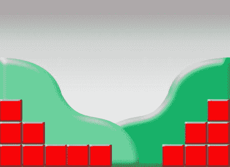

**图 2-1.** 背景游戏世界

你还将使用基本形状创建一个游戏角色，如图 2-2 所示。


**图 2-2.** 游戏角色

此外，你还会制作一些用于控制该角色的按钮图形，如图 2-3 所示。

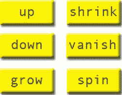

**图 2-3.** 用于控制游戏角色的按钮

所有这些图形都将用 Photoshop 制作，并保存为名为 `PNG`（便携式网络图形）的文件格式。对于 Flash 游戏来说，`PNG` 图像文件通常是最佳选择。

以下是本章你将学到的内容：

*   如何在 Photoshop 中打开新文件。
*   如何使用 Photoshop 工具创建基本形状。
*   如何使用图层来组织形状。
*   如何为图形应用特殊效果。
*   如何将图形保存为 `PNG` 文件，以便随后使用 AS3.0 进行编程。

那么，让我们开始构建一个游戏世界吧！

*Photoshop 是一款复杂的软件，拥有成千上万种可供更改和自定义的设置。而且，稍不注意，你很容易不小心“自定义”界面布局，几次无意的点击就会导致窗口、面板和工具消失——而且似乎是永久消失。如果你是 Photoshop 新手，正在探索该软件，这个问题尤其突出。你可能会将某个窗口拖拽或点击到无影无踪。*

*幸运的是，让所有这些窗口重新出现在正确的位置相当容易。Photoshop 使用了一种名为**工作区**的概念，它是一组窗口和工具面板的集合，根据你正在做的工作类型，这些窗口和面板会以不同的排列方式分组。当你首次安装并启动 Photoshop 时，它会加载一个名为**基本功能**的工作区。没有理由更改这个工作区，我建议你在学习期间使用它，因此本书中的操作说明也是基于这个工作区编写的。*

*以下是确认你正在基本功能工作区中操作的方法。你也可以通过从 Photoshop 主菜单中选择“窗口”“工作区”来确认。你应该会看到“基本功能”旁边有一个对勾。在同一个菜单的下方，你会看到一个名为“复位基本功能”的选项。这就是神奇选项！如果你丢失了任何窗口或工具面板，并且到处都找不到，选择“复位基本功能”，它们就会全部弹回到你首次启动 Photoshop 时所处的位置。你还会在工作区左上角附近看到一个名为“基本功能”的大按钮。如果它看起来是按下的状态，说明你正在“基本功能”工作区中工作。*

*你还可以从 Photoshop 工作区顶部主菜单栏的“窗口”菜单中有选择地隐藏或显示窗口和工具面板。所有在工作区中可见的窗口和面板旁边都会有一个对勾。如果你正在寻找某个窗口，但在屏幕上找不到，请从“窗口”菜单中选中它。*

### 创建游戏世界背景

在第一部分中，你将创建一个背景游戏环境，你的角色将居住在其中。我将一步步地引导你完成整个过程，最后你将制作出一张看起来像图 2-4 一样的图片。

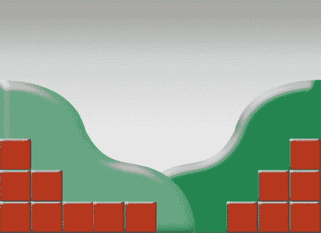

**图 2-4.** 游戏世界

#### 在 Photoshop 中创建新文件

首先，启动 Photoshop 并设置一个新文件，用于绘制背景场景。

1.  启动 Photoshop。
2.  从主菜单中选择“文件”“新建”。将打开一个对话框，询问你正在创建的新文件的名称以及你想要设置的图像尺寸。以下是需要更改的选项：
    *   名称：`background`
    *   宽度：550 像素
    *   高度：400 像素

你可以保留所有其他设置不变。完成后，“新建”文件对话框应该看起来像图 2-5 这样。

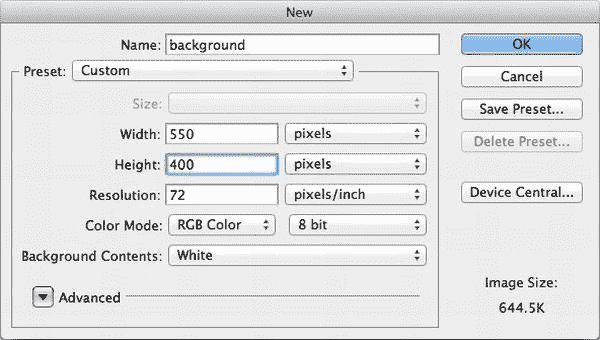

**图 2-5.** “新建”文件对话框应该看起来像这样。

*如果你看到的“新建”文件对话框与此不完全相同，很可能是你使用的 Photoshop 版本与我的略有不同。本书编写时使用的是 Photoshop CS 5.1，这是出版时的最新版本。如果你使用的是更早或更新的版本，你看到的一些选项可能不完全相同，或者位置稍有不同。不过，我可以向你保证，它们肯定都在那里！请运用你的判断力和智慧去寻找它们。*

*Adobe 在每个版本之间都会对工具和菜单项的布局和位置进行微小的调整，但很少进行大刀阔斧的改动。事实上，在我使用 Photoshop 的 20 年里，本章将要描述的基本功能几乎没有太大变化。这是一件好事，因为这意味着你投入学习 Photoshop 的时间往往是一项不错的长期投资。这也意味着，如果你使用的是更老版本的 Photoshop，哪怕是像 Photoshop 5 这样已有 10 年历史的版本，你仍然可以遵循本章的大部分说明，制作出很棒的游戏图形。*

点击“确定”按钮，会打开一个全新的空白窗口，这就是你将用来绘制背景的窗口。这被称为**画布**。图 2-6 显示了你会看到的内容。

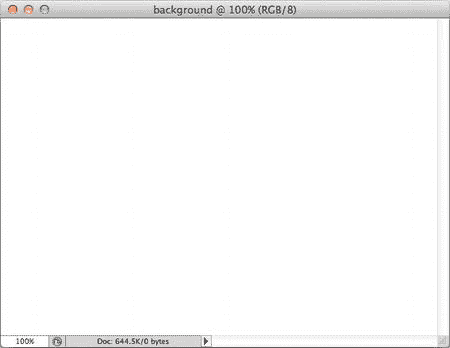

**图 2-6.** 用于绘制背景场景的空白画布


#### 什么是像素？

当你创建新的空白画布时，你为其指定了宽度 550 像素和高度 400 像素。那么什么是像素呢？

像素是构成计算机图形的微小方块，是你在屏幕上能看到的最小单位。没有任何东西能比像素更小。如果你放大计算机图形，你会看到它是由无数微小的方块组成的，这些方块就是像素。图 2-7 展示了一个示例。

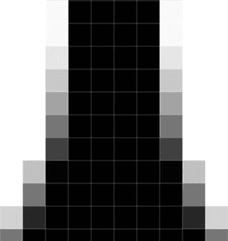

**图 2-7.** 像素是构成计算机图形的微小方块。

需要明确的是，你创建的新空白画布实际上就是这些微小方块构成的网格。目前你还看不到它们，因为它们全是白色的，但它们确实存在。这张看似平淡无奇、在未经训练的人眼中毫无特色的新画布，实际上是由 22 万个白色像素组成的。图 2-8 对此进行了说明。

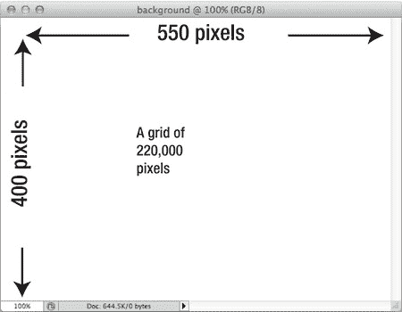

**图 2-8.** 看似空白的画布，实际上是由称为像素的微小白色方块组成的网格。

将这块画布视为像素网格来思考非常重要。在下一章中，你将看到如何访问和控制这个隐形网格中每一个点上所有游戏元素的位置。

*注：像素是计算机图形的基本构件，但并非唯一。还有另一种使用`矢量`制作计算机图形的方法。使用`矢量`制作的图形，其最基本元素是线条而不是方块。Photoshop 专精于使用像素创建图形，而 Illustrator 和 Flash Professional 等软件则使用`矢量`。在后面的章节中，你将学习如何利用`矢量`为你的游戏制作精美的插图。*

*Photoshop 的图形工具也使用`矢量`作为其基本构件。*

#### 绘制天空

在 Photoshop 工作区的左侧，你可以找到工具箱。Photoshop 的大多数绘图工具都在这里。工具箱有一个可能让人困惑的特点：许多工具是隐藏的，只有在某个按钮上按住鼠标左键时才会显示出来。操作后会显示一个列表，列出该按钮组中所有分组的工具。然后你可以从列表中选择你需要的工具。你需要一些练习和经验才能找到并记住哪些工具属于哪些按钮组，但你会逐渐掌握的。图 2-9 显示了大多数重要的绘图工具隐藏的位置。如果在后续指示中你找不到我要求你使用的工具，可以回头参考这张插图。

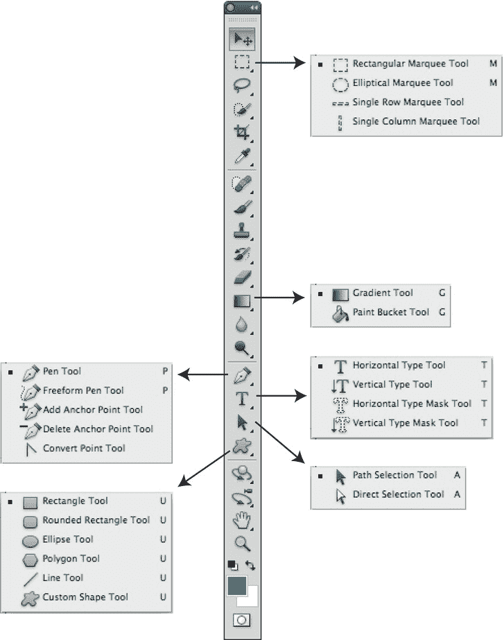

**图 2-9.** 在任何按钮组上按住鼠标左键，即可显示 Photoshop 的隐藏工具。

你要绘制的第一个东西是一片蓝色的天空，它将构成场景其余部分的背景。在接下来的步骤中，你将学习如何使用`矩形工具`绘制一个方块，为其填充颜色，并使用渐变赋予其自然的深度感。

在工具箱中选择`矩形工具`。当你在工具箱中看到它的图标显示为按下的按钮时，就表示已正确选中，如图 2-10 所示。

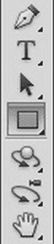

**图 2-10.** 选择`矩形工具`。

接下来，你要为矩形选择一种颜色。有两个地方可以操作。在工具箱的左下角，你会看到两个重叠的方块。选择上方的方块可以选取对象的前景色。选择后面的方块可以选取其背景色。如果需要，你可以点击弯曲的箭头图标来交换这些颜色。图 2-11 对此进行了说明。

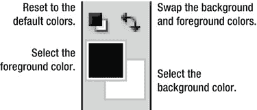

**图 2-11.** 选择对象的前景色或背景色。

Photoshop 还有一个沿着工作区顶部排列的`选项栏`。它是*上下文相关的*，这意味着你在此处看到的按钮和设置会根据你选择的工具而变化。通过一些经验，你将逐渐了解在不同工具激活状态下可以在此选择哪些工具和选项。当`矩形工具`处于激活状态时，你可以在`选项栏`中更改其颜色，如图 2-12 所示。


**图 2-12.** 上下文相关的`选项栏`允许你更改许多工具选项，包括颜色。

*注：如果出于某种原因你找不到`选项栏`，它可能被隐藏了。要显示它，请从 Photoshop 的主菜单中选择“窗口”  “选项”。“选项”旁边应有一个勾选标记。*

*在`选项栏`正上方是应用程序栏。你可以使用它来更改画布的缩放百分比，以及修改 Photoshop 显示面板和窗口的方式。*

按照前述方法，点击工具箱或`选项栏`中的前景色选择框。

颜色选择器窗口会打开，让你选择一种颜色。使用窗口中间的滑块选择一种颜色，然后在其左侧的大方块中选择该颜色的深浅（亮度）。标记为“新的”方框会显示新颜色看起来的样子，并与当前所选颜色进行对比。如果觉得选择太多，可以点击“颜色库”按钮，加载一组预选的颜色供你选择。图 2-13 显示了颜色选择器的外观。


**图 2-13.** 在颜色选择器中选择一种颜色。


除了使用颜色选择器，你也可以从工作区右侧的“颜色”或“色板”面板中选择颜色。点击“色板”选项卡，会显示许多小色块（称为色板）供你选择。当鼠标悬停在某个色板上时，鼠标指针会变成吸管图标，这是一种巧妙的提示，表明你可以吸取颜色用于绘制。当你用吸管选择一种颜色后，它会显示在颜色选择器窗口的“新建”框中，如图 2-14 所示。


**图 2-14.** 也可以从“色板”面板中选择颜色。

你也可以直接点击色板，无需打开颜色选择器。该颜色会直接应用到当前处理的矩形或其他形状上。

“色板”面板中默认显示的色板已经涵盖了不错的起始颜色选择，但还有更多颜色可用。点击面板最右侧那个像列表旁边带向下箭头的小按钮，会弹出一个颜色合集列表供你选择。找到一个你喜欢的合集。如果想恢复默认色板，从同一列表中选择`重置色板`即可。

接下来你要绘制天空背景，所以选择一种亮蓝色。完成后点击颜色选择器窗口中的“确定”按钮。你选择的新颜色会出现在工具面板底部的前景色色框中。

返回空白画布。按住鼠标左键并拖动，绘制一个正方形或矩形，如图 2-15 所示。它的颜色应与上一步选择的颜色一致。


**图 2-15.** 在新工作区中绘制一个矩形。

这样还不错，但你真正想要的是让蓝色矩形填满整个屏幕。让我们在下一步中解决这个问题。

选择工具面板顶部的“移动工具”。移动工具允许你在画布上移动对象，以及调整其大小或旋转对象。一旦选中它，选项栏会提供一些你需要更改的选项。其中有一项非常重要：一个名为`显示变换控件`的复选框。

确保`显示变换控件`已被勾选。如果没有勾选此选项，你将无法轻松调整对象大小或旋转对象。图 2-16 展示了移动工具按钮和选项栏应有的样子。


**图 2-16.** 选择移动工具，并确保选项栏中的`显示变换控件`复选框已被选中。

一旦你选择了已勾选`显示变换控件`的移动工具，你会注意到你绘制的矩形四个角、各边以及中心出现了小方块。这些称为拖拽手柄。当移动工具处于选中状态时，你可以用鼠标拖拽这些手柄来调整矩形的大小和旋转角度。

当鼠标移动到其中一个手柄上时，你会看到两种图标之一出现。对角指向的箭头表示你可以调整矩形大小（这也称为缩放）。弯曲的箭头表示你可以旋转它。图 2-17 展示了如何使用这些拖拽手柄来改变矩形的大小或方向。


**图 2-17.** 使用移动工具调整对象大小或旋转对象。

像这样改变绘图对象的大小和方向，在 Photoshop 的术语中被称为变换。你可以通过从 Photoshop 主菜单选择`编辑`  `变换路径`或`编辑`  `变换`来找到更多变换选项。你会在其中找到以下选项：`缩放`（调整大小）、`旋转`、`斜切`、`扭曲`、`透视`和`变形`。你还可以找到按固定量翻转和旋转对象的选项。

使用移动工具和拖拽手柄调整矩形大小，使其填满整个画布，如图 2-18 所示。此时画布应完全变为蓝色。


**图 2-18.** 调整矩形大小以填满整个画布。

调整大小完成后，按下 `Enter` 键。这会应用变换，并且你需要在此操作之后才能再次激活 Photoshop 的许多选项。你也可以通过再次选择移动工具来应用变换。Photoshop 会弹出一个对话框询问你是否要应用变换，点击“确定”即可接受。

当你正在调整形状或选区的大小或旋转时，Photoshop 会禁用主菜单中的大部分选项以及右侧面板中的许多按钮。如果你发现自己在操作时遇到按钮看似冻结或菜单选项莫名变灰，很可能是因为你忘记了应用正在处理的形状上的变换。按 `Enter` 键立即应用，或者选择移动工具打开确认窗口。之后一切都会正常运作！

现在你已经拥有一个蓝色背景，它将作为天空的基础。保持原样也可以，但让我们通过添加渐变使其更具层次感，从而让效果更好。


##### 添加渐变

渐变是一种逐渐变化的颜色，可以从浅到深，也可以从一种颜色过渡到另一种。在接下来的步骤中，你将给矩形添加渐变，使其顶部为深蓝色，底部为浅蓝色。这将营造出天空消失于地平线的视觉效果。

当你使用 Photoshop 的形状（如圆形和矩形）时，可以通过“图层样式”菜单为其应用渐变。选择“图层” “图层样式” “渐变叠加”（图 2-19）。


**图 2-19.** 选择“渐变叠加”图层样式。

一旦选中“渐变叠加”，矩形将被填充一个简单的渐变，同时“图层样式”窗口将打开，并且自动选中“渐变叠加”选项，如图 2-20 所示。


**图 2-20.** “图层样式”窗口让你可以在形状上创建和编辑渐变。

要编辑渐变，请单击“图层样式”窗口中的渐变框。此时会打开“渐变编辑器”窗口，如图 2-21 所示。


**图 2-21.** 单击渐变框内部。

你可以通过选择和移动`色标`来更改渐变的颜色和透明度。`色标`指的是窗口下半部分那根长渐变条四个角上的小方块。底部的色标决定渐变的颜色，顶部的色标决定其透明度（即`不透明度`）。图 2-22 对此进行了说明。


**图 2-22.** 使用渐变预览条中的色标来自定义渐变。

色标是比较灵巧的东西。你需要稍微摆弄一下才能掌握它们的使用方法。你可以来回滑动它们来改变渐变的起始和结束位置。你可以在渐变预览条的顶部或底部任意位置单击来添加新的色标，也可以通过将色标拖离来删除它们。

顶部的色标控制渐变的不透明度。当你单击一个不透明度色标时，“渐变编辑器”中的`不透明度`选项会被激活，你就可以控制该渐变区域的透明度。`0%` 的不透明度表示完全透明，`100%` 则表示完全不透明（实色），因此 `50%` 会使渐变在该色标位置处于半透明状态。图 2-23 对此进行了说明。


**图 2-23.** 如果选中一个不透明度色标，你可以通过更改其不透明度百分比来控制渐变在该点的透明度。

你会注意到，如果更改了`不透明度`值，渐变下方会出现棋盘格图案。这是 Photoshop 在向你表示颜色是透明的。

`位置`选项决定了色标应放置在渐变的哪个百分比位置。它只是用鼠标拖动色标的另一种替代方式。

底部的色标控制渐变中的颜色。如果双击一个颜色色标，会打开“拾色器”窗口，让你可以选择该部分渐变的颜色。我们下一步就来操作。

双击渐变预览条左侧的颜色色标。“拾色器”窗口就会打开（Photoshop 称之为`选择色标颜色`窗口）。选择一种漂亮的浅蓝色，可以从“拾色器”窗口中选择，也可以从“色板”面板中选择，如图 2-24 所示。


**图 2-24.** 更改渐变的颜色。

在`选择色标颜色`窗口中单击`确定`。你选择的新颜色将应用到该色标位置的渐变上。

接下来要做的是更改颜色中点，它决定了渐变的中心位置。颜色中点是渐变预览条底部的一个小圆圈。为了得到更自然的天空渐变效果，请将颜色中点圆点向左滑动，直到`位置`选项显示约为 `25%`，如图 2-25 所示。


**图 2-25.** 更改渐变的中间点。

当你对渐变的显示效果满意时，请在“渐变编辑器”窗口中单击`确定`。现在你应该拥有一个看起来像图 2-26 那样的渐变。


**图 2-26.** 目前得到的渐变。

这幅图有点问题！你的天空实际上是上下颠倒的。所以你需要将渐变的方向旋转 90 度，让深色部分位于顶部，浅色部分位于底部。

“图层样式”窗口应该仍然处于打开状态。找到`角度`选项，将渐变的角度设置为 `-90`，可以直接在文本框中输入数值，或者用鼠标转动`角度`滚轮，如图 2-27 所示。矩形的渐变会随之旋转，天空现在看起来就正过来了。


**图 2-27.** 将渐变角度旋转 90 度。

单击“图层样式”窗口中的`确定`按钮，将渐变应用到矩形上。

*除了旋转渐变，你也可以使用移动工具旋转矩形形状本身。*

“图层样式”窗口还允许你将渐变类型从本例中使用的`线性`，更改为`径向`、`角度`、`对称的`或`菱形`。`径向`渐变对于为圆形形状创建伪 3D 效果特别有用。图 2-28 展示了这些不同渐变类型的效果。


**图 2-28.** Photoshop 中不同的渐变样式。

渐变在 Photoshop 中是一个复杂的话题，学习它们的最佳方法是创建一些形状，并在“渐变编辑器”中试验各种设置，看看能产生什么样的效果。如果你创建了一个特别喜欢的渐变，“渐变编辑器”允许你保存它，以便以后将其载入到另一个形状中。

#### 绘制山丘

天空完成后，是时候为场景添加一些绿色的背景山丘了。你需要在天空的前方绘制山丘。但在开始之前，你必须了解一项重要的 Photoshop 技术：如何使用图层来组织对象在画布上的深度位置。


##### 理解图层

图层能让你组织图形，使其位于其他图形的上方或下方。`图层`面板位于 Photoshop 工作区的右下角。如果你按照本章之前的说明操作，现在应该有两个图层：一个空白背景图层和你在前面步骤中绘制的矩形形状。

每个图层旁边都有看起来像眼睛的图标。点击这些图标，可以暂时让该图层在画布上不可见，从而让你看到下方的图层。（再次点击眼睛图标即可让图层重新可见。）

如果某个图层旁边有锁图标，表示该图层无法编辑。背景图层将始终处于锁定状态。你也可以通过选中图层并点击`图层`面板顶部附近的“锁定”按钮来锁定任意图层。如果你在该图层上进行了大量图形工作，并希望防止意外搞砸，锁定图层会非常有用。

你可以通过选中图层并调整不透明度滑块，来单独更改每个图层的不透明度（透明度）。如果将图层的不透明度设置为低于 100%，你将能够看到其下方的图层。

你可以使用`图层`面板底部的按钮来创建和删除图层。图 2-29 展示了这些基本功能及其所在位置。


**图 2-29。** `图层`面板让你能够组织图形，使其位于其他图形的上方或下方。

每个图层还会告诉你关于该图层上内容的大量信息。你可以看到第二个图层上有一个形状；那就是你的天空矩形。你可以看到它应用了一个特殊的图层效果，`fx`图标就说明了这一点。你还可以看到它是一个渐变叠加效果。实际上，如果你想编辑渐变效果，只需双击`图层`面板中的`渐变叠加`，就会弹出`图层样式`窗口，让你对渐变进行任意修改。你可以通过点击效果名称旁边的眼睛图标，暂时隐藏你已创建的效果。你也可以通过点击`效果`旁边的眼睛图标，来隐藏一个图层上的所有效果。

如果你想为图层添加任何其他特殊效果，可以点击面板底部的小`FX`按钮，然后从列表中选择一个效果。图 2-30 展示了`图层`面板的这些功能。


**图 2-30。** `图层`面板让你能够添加、编辑或隐藏可能应用于图形的任何效果。

工作时，请特别留意你从`图层`面板左上角选项菜单中选择的混合模式。混合模式决定了一个图层如何与其下方的图层进行交互。如果你使用非“正常”的混合模式，可以产生一些有趣且通常很漂亮的图层效果。然而，对于简单的游戏图形，你可能不需要用到这些，因此你很可能希望始终将混合模式设置为“正常”。

不过，你工作时总有可能会意外更改混合模式。如果你注意到你的游戏图形突然变得暗淡、透明、出现奇怪的轮廓或疯狂的迷幻效果，那很有可能是不小心切换了图层的混合模式。

如你所见，`图层`面板让你对工作成果拥有极大的控制权。不过，虽然在创建自己的游戏图形时你可能会用到所有这些功能，但眼下你无需担心其中的大部分。最重要需要了解的是：*上方图层上的任何内容都会遮盖下方图层上的内容。*

在开始在新图层上绘制之前，先给天空图层命名并锁定它，以防止意外选中或更改它。

双击`图层`面板中的“形状 1”文字。这会使文本处于可编辑状态。将其改为“天空”。（按 Enter 键应用名称更改。）给图层命名是一个好习惯，这样你可以轻松找到它们。当你在处理包含 20 或 30 个图层的复杂图形时，你会体会到这个习惯的好处。

点击挂锁按钮来锁定图层。同样，在完成图层上的工作后锁定它们也是一个好习惯，这样你在上方的新图层上工作时就不会意外选中或更改它们。（你可以通过再次选中锁定的图层并点击挂锁按钮来轻松解锁图层以便再次编辑。）现在，你的“天空”图层应该看起来像图 2-31 所示。


**图 2-31。** 为图层命名并锁定它，以防止意外更改。

这里还有很多我没有提及的非常高级的图层功能。你在创建本书中的游戏图形时不需要用到它们中的任何一个，因为其中许多功能是专门用于照片编辑的。但要全面了解它们的功能，请参考 Adobe 最新的在线文档，网址为：

`http://help.adobe.com/en_US/photoshop/cs/using/index.html`

浏览到名为“图层”的章节。

让我们为你的游戏世界场景创建一些丘陵，这样你就能实际看到这个概念的应用。

##### 使用钢笔工具绘图

Photoshop 的钢笔工具允许你创建复杂的形状。尽管它被称为钢笔，但它的工作方式并不像已知宇宙中存在的任何钢笔。最好将钢笔工具视为一种制作点，然后用直线连接这些点的方法。将足够多的点连接起来，你就有了一个形状。然后你可以弯曲形状中的线条，以制作出带有曲线的真正复杂的形状。学会正确使用钢笔工具是你能够掌握的最强大、最灵活的图形设计技巧之一。


好的，作为高级文档工程师和翻译员，我将遵循您的注意事项和示例，将给定的英文文本翻译成中文。


##### 锚点与路径

你将要在游戏世界中创建两座小山。每座山将位于不同的图层上。对于第一座山，请点击“图层”面板底部的“创建新图层”按钮（它看起来像一个折了一角的新页面）。一个新图层将出现在“天空”图层上方。双击这个新图层的名称，将其命名为“Hill 1”。图 2-32 展示了你的新图层应有的样子。


**图 2-32.** 创建一个新图层来绘制小山。

现在你有三个图层了，你将要在这新的“Hill 1”图层上进行下一步绘制。

从“工具”面板中选择`钢笔工具`（图 2-33）。


**图 2-33.** 钢笔工具

你将使用`钢笔工具`，通过创建一系列点并用直线连接它们，来粗略地绘制出山的轮廓。在后续步骤中，你将通过添加曲线来优化它。

选择`钢笔工具`后，在画布上的任意位置单击一次（你现在正在“Hill”图层上绘制）。会出现一个黑色方块，这被称为**锚点**；它是你形状的起点。


**图 2-34.** 使用钢笔工具单击以添加一个锚点

以锯齿状的方式，向下并向第一个点的左侧单击，以添加更多锚点，如图 2-35 所示。你会注意到，每次添加一个点，它都会通过一条线与前一个点连接起来。这被称为**路径**。


**图 2-35.** 通过单击添加更多锚点来创建路径。

如果在 Photoshop 中操作失误想要撤销操作，老办法 `编辑`  `撤销` 或 `CRTL+Z`（Windows）或 `Command+Z`（Mac OS X）可以撤销你上一步的操作。

然而，Photoshop 默认只设置成撤销上一步的操作，并不能多步撤销。如果你已经做了好几步操作，然后意识到需要返回并撤销五六步，可以打开 Photoshop 的“历史记录”面板（`窗口`  `历史记录`）。“历史记录”面板记录了你最近执行的 20 步操作，如图 2-36 所示。你可以通过点击这些历史记录中的任意一步，将项目恢复到之前的状态。

你可以使用“历史记录”面板底部的“相机”按钮对你的工作进行快照。如果你即将开始项目中复杂或试验性的阶段，且不想冒丢失已完成工作的风险，这是一个好主意。当你拍摄快照时，Photoshop 会保存当前状态下的一个工作版本，你可以通过点击“历史记录”面板顶部的快照来恢复到该状态。但快照不会随图像文件一起保存，因此如果你想恢复到快照状态，需要在关闭正在处理的文件之前进行。


**图 2-36.** 通过“历史记录”面板回溯时间以撤销之前的操作。

继续绘制路径，使其看起来像图 2-37 所示。你可以通过点击你添加的第一个锚点来完成形状。当你这样做时，你会注意到`钢笔工具`旁边出现了一个小“O”图标。这表示你将**闭合路径**。当你闭合一条路径时，你就创建了一个形状。


**图 2-37.** 闭合路径以创建山的粗略形状。

在单击添加锚点时按住 `Shift` 键，你可以绘制出点之间呈固定 90 度和 45 度角的完美直线。

锚点决定了你的形状将是什么样子。如果你对锚点放置的位置不满意，移动它们很容易。从“工具”面板中选择`直接选择工具`。大家都称之为**白色箭头**，它正是此意。使用白色箭头点击任意一个锚点并将其拖拽到新位置，如图 2-38 所示。你可以使用这个工具移动任意锚点并改变形状。


**图 2-38.** 使用直接选择工具（白色箭头）移动锚点。

`钢笔工具`和白色箭头总是这样配合使用。实际上，在钢笔和白色箭头之间切换非常频繁，因此值得学习其键盘快捷键。选中`钢笔工具`后，按住 `Ctrl` 键（Windows）或 `Command` 键（Mac OS X），钢笔会暂时变为白色箭头。这是个便捷的快捷键，因为如果你在 Photoshop 中使用`钢笔工具`制作大量游戏图形，你会在这两个工具之间来回切换成千上万次。

你可以使用**黑色箭头**（`路径选择工具`）拖拽整个形状路径，从而在画布上移动它。图 2-39 展示了这一点。


**图 2-39.** 使用路径选择工具（黑色箭头）在画布上移动整个路径。

添加和删除锚点很简单。要添加一个点，选择`钢笔工具`并将其移动到路径上的任意一条线上。你会看到钢笔旁边出现一个小加号图标。点击路径上的那个位置，就会添加一个新的锚点。（它会使用一个名为**方向线**的新特性来添加这个新锚点，你将在下一节中了解它们如何工作。）

你可以用类似的方式删除锚点。将`钢笔工具`移动到一个现有的锚点上，你会看到旁边出现一个减号图标。点击该锚点，它就会消失。图 2-40 展示了如何添加和删除锚点。

如果你使用的是旧版本的 Photoshop，可能无法如此轻松地添加和删除锚点。你很可能会需要从“工具”面板中选择`添加锚点`或`删除锚点`钢笔工具才能达到同样的效果。


**图 2-40.** 使用钢笔工具添加和删除锚点。

如果你知道如何使用`钢笔工具`通过添加和删除锚点来创建路径，并且知道如何使用白色箭头移动它们，你就掌握了在 Photoshop 中创建复杂形状的基本技能。然而，到目前为止，你只处理了带有直线的形状。在下一节中，我将向你展示如何制作带有曲线的形状。


##### 使用方向手柄创建曲线

要使形状弯曲，你需要在锚点上添加方向手柄。

从“工具”面板中选择“转换点工具”。单击其中一个锚点。然后，在按住鼠标左键的同时，将其拖过画布。此时会出现两个方向手柄；你可以使用它们在锚点处弯曲路径。通过拖拽和旋转来拉长方向手柄，曲线就会变得更大。图 2-41 展示了这一点。


**图 2-41.** 拖拽并旋转方向手柄以添加曲线

第一次使用“转换点工具”时，你可以同时移动两个方向手柄。它们会保持连接并朝同一方向移动。但是，当你再次单击并拖拽一个方向手柄时，你会发现你只会移动其中一个手柄。使用“转换点工具”进行第二次点击会断开两个手柄之间的连接。这实际上没问题，因为能够独立移动方向手柄对于微调曲线非常有用，如图 2-42 所示。


**图 2-42.** 使用“转换点工具”独立拖拽和旋转方向手柄。这可以让你微调曲线。

但是，如果你想再次同时移动两个方向手柄怎么办？你可以使用“直接选择工具”（那个白色箭头）来实现。

从“工具”面板中选择白色箭头。按住 `Alt` 键（Windows）或 `Option` 键（OS X）并拖拽其中一个方向手柄。你会看到它们又开始一起移动了。松开 `Alt`/`Option` 键后，你可以再次使用白色箭头独立移动方向手柄（参见图 2-43）。


**图 2-43.** 使用白色箭头并按住 `Alt`（Windows）或 `Option`（OS X）键可同时移动两个方向手柄。

通过结合使用这些技巧，你可以非常精细地控制形状的曲线。让我们在下一步中运用它们。

运用这些技巧，让你的形状尽可能接近图 2-44 的样子。你需要让它看起来有点像从侧面看到的滑雪坡道。


**图 2-44.** 完成的形状路径

如果你是初次使用“钢笔工具”和方向手柄，你可能第一次尝试就无法完美做到。事实上，你几乎肯定不行。这没什么好担心的！制作带有曲线的形状没有什么神奇的公式；你只需要不断尝试使用这些工具，直到对结果满意为止。使用“历史记录”面板撤销任何错误。但实际上你无法真正犯错——只需继续尝试。坚持按照这些指导进行练习，你很快就会掌握要领。正确使用“钢笔工具”需要大量的练习，但这是你可以学到的最有用、最强大的图形设计技能之一。

##### 调整路径大小

如果你已经创建了一条路径，并想将其放大或缩小，请从“工具”面板中选择黑色箭头。在 Photoshop 工作区顶部的选项栏中选择“显示定界框”。用黑色箭头单击你已绘制的路径。你会看到它被一个带有角上手柄的定界框包围。拖拽这些手柄来调整路径大小，使你想要的形状变得尽可能大或小。图 2-45 展示了这一点。


**图 2-45.** 使用黑色箭头调整路径大小。

为了这个项目的需要，请将你绘制的这个路径调整得相当大。

调整路径大小并将其定位，使其填满画布的左侧。请记住，在完成大小和位置的调整后，按 `Enter` 键以应用变换。你的画布现在应该看起来类似于图 2-46。


**图 2-46.** 调整路径大小并定位。


##### 用颜色填充路径

你刚刚绘制的路径代表了想要制作形状的轮廓，但只有用颜色填充后，它才能成为游戏图形中可用的内容。Photoshop 工作区右侧的“路径”面板可以让你实现这一点。

要想让接下来的技巧生效，你需要先用黑色箭头工具选中上一节中绘制的路径。用黑色箭头点击路径一次将其选中。你可以通过形状路径周围带角点拖动手柄的黑色定界框来判断它是否被选中，如图 2-47 所示。


**图 2-47.** 确保形状路径仍被黑色箭头工具选中。

在成功为路径应用颜色之前，你还需要进行一项重要的设置。保持黑色箭头工具选中状态，点击 Photoshop 工作区顶部选项栏中的“添加到形状区域(+)”按钮。图 2-48 展示了该按钮的位置。如果未选中此按钮，后续步骤将无法正常进行。正是这个按钮能让你用颜色填充形状路径的内部区域。（如果按钮呈灰色无法点击，说明你未先用黑色箭头选中路径。用箭头点击路径使其选中，然后重试。）


**图 2-48.** 在黑色箭头选项栏中点击“添加到形状区域(+)”按钮。

接下来，为你的形状选择一种颜色。使用本章前面学到的技巧，在工具面板的前景色色框中选择一种亮绿色（图 2-49）。


**图 2-49.** 选择一种绿色前景色。

打开“路径”面板，它作为标签选项位于包含“图层”面板的同一窗口中。如图 2-50 所示，你会看到刚绘制的路径的小缩略图，底部还有一些按钮。这些按钮可以让你用颜色填充路径、用画笔描边、将路径转换为选区或删除路径。如果你为路径指定一个独特的名称，Photoshop 会自动将路径随文档保存，以便日后在其他地方复用。我将我的路径命名为“Hill”。


**图 2-50.** “路径”面板允许你用颜色填充路径。

点击“路径”面板底部的“用前景色填充路径”按钮。形状路径将被填充为绿色的前景色，如图 2-51 所示。


**图 2-51.** 用前景色填充路径。

如有必要，你可以点击黑色箭头选项栏中的“从形状区域减去(-)”按钮来撤销此效果。这将填充周围区域，而保持形状为空。

现在你的画布应类似于图 2-52。


**图 2-52.** 山坡现在已被颜色填充。

这里到底发生了什么？你在前面章节中绘制的路径只是一个模板。你现在所做的事情就是将颜色倒入这个模板。颜色被倒在了图层的透明表面上。这就像使用模板在透明塑料片上给形状上色。

你唯一关心的是刚刚倒在图层上的颜色。你可以完全删除路径，因为它已经完成了使命，你不再需要它了。让我们删除它。

路径应该仍被黑色箭头工具选中。（你可以通过路径周围的定界框确认这一点。）如果未被选中，用黑色箭头点击路径一次。按下键盘上的`Delete`键，路径就会消失。

剩下的就是一个漂亮的绿色山坡。在下一节中，你将复制这个山坡，更改其颜色，并将其重新定位到画布右侧第一个山坡的后面。

当你熟练掌握了钢笔工具及其相关工具和技巧后，可以尝试使用自由钢笔工具。你会喜欢它的，它就像一支真正的笔！你可以徒手绘制形状，然后使用转换点工具和白色箭头来微调形状。


##### 复制、修改与排列图层

你的场景中需要两座山丘。但与其费尽周折再建一座，不如直接复制已有的那座，然后稍作修改。

在`图层`面板中选中`山丘 1`图层后，从主菜单中选择`图层` > `复制图层`。（你也可以右键点击`山丘 1`图层，选择`复制图层`。）此时会弹出`复制图层`对话框，要求你为新图层命名。将其命名为`山丘 2`，如图 5-53 所示。点击`确定`按钮。


**图 2-53.** 复制图层。

完成此操作后，你会看到`山丘 1`图层上方出现了一个名为`山丘 2`的新图层（图 2-54）。这两个图层看起来一模一样。


**图 2-54.** 新图层被复制出来，悬浮在第一个图层之上。

现在画布上有了两座山丘，尽管看起来只有一座。这是因为你刚刚创建的新图层与第一个图层位置完全相同——新山丘直接叠放在第一座山丘之上。将其移开，你就能看到两座山丘了。

选择`移动工具`。在`选项`栏中，勾选`自动选择`，并从选项菜单中选择`图层`。`自动选择`功能允许`移动工具`在你点击对象时自动选中正确图层上的物体，这非常方便。如果不更改此设置，你需要先在`图层`面板中点击要操作的图层，然后才能移动该图层的内容。同时进行此操作时，请确保`显示变换控件`也已选中。图 2-55 展示了`移动工具`选项应有的状态。


**图 2-55.** 自动选择图层让移动工具在你点击对象时自动选中正确图层上的物体。

保持`移动工具`选中状态，移动画布上的山丘。这样，下方图层上的第一座山丘就会神奇地显露出来，如图 2-56 所示。


**图 2-56.** 移动新复制的山丘，露出下方图层上的原始山丘。

将其水平翻转，使其朝向与第一座山丘相反的方向。从 Photoshop 主菜单中选择`编辑` > `变换` > `水平翻转`。山丘将翻转过来，面向另一侧，如图 2-57 所示。


**图 2-57.** 水平翻转新山丘。

现在来更改新山丘的颜色。在`前景色`色块中选择一种深绿色。

选择`油漆桶工具`。点击新山丘内部，它将被填充上新的颜色（图 2-58）。


**图 2-58.** 选择油漆桶工具并点击新山丘内部以更改其颜色。

选择`移动工具`，将山丘移至画布左下角，如图 2-59 所示。


**图 2-59.** 将新山丘移到其位置上。

你创建的这座颜色更深的新山丘应位于第一座山丘之后，这样看起来就像在远处更远一点的地方。让我们移动它的图层，使其位于第一座山丘图层下方。

在`图层`面板中，将`山丘 2`图层拖拽到`山丘 1`图层下方。松开鼠标，现在你应该能看到深绿色山丘位于浅绿色山丘之后，如图 2-60 所示。


**图 2-60.** 将山丘 2 拖拽到山丘 1 下方，以重新排列画布上山丘的图层顺序。

能够像这样重新排列图层，是 Photoshop 最基本却最强大的技巧之一。

你的山丘看起来更好了，但让我们更进一步：使用一种称为*斜面与浮雕*的技巧，为它们增加一点 3D 效果。


##### 斜面与浮雕

斜面与浮雕这两种互补效果能使对象呈现浅层立体感。浮雕效果使对象看起来像是压印在表面上，而斜面效果则让它显得略微凸起于表面。图 2-61 展示了斜面与浮雕效果。


**图 2-61.** 斜面与浮雕效果

在 Photoshop 中应用此类效果时，需要牢记一个重要概念：你并非将效果直接应用于你绘制的实际图像，而是应用于包含该对象的图层。这就是为什么它们被称为图层效果。该图层上的任何图形元素都会受到你应用于该图层的所有效果的影响。这与许多其他图形和绘图软件不同，那些软件中效果是直接应用于图形对象的。

那么，现在为你的山丘应用斜面效果。选择`Hill 1`图层，然后从`FX`菜单中选择`斜面与浮雕`，如图 2-62 所示。


**图 2-62.** 从`FX`菜单中选择`斜面与浮雕`。

此时会打开`图层样式`窗口。你在之前处理渐变时见过这个窗口。但现在选中了`斜面与浮雕`选项，这样你就可以应用其中任何一种效果了。

从`样式`菜单中选择`内斜面`。确保已勾选`预览`选项，这样你就能看到更改对画布上图形的影响。尝试调整各种设置，直到获得你喜欢的效果。如果取消勾选“使用全局光”选项，效果会更加显著。图 2-63 展示了我`图层样式`窗口的设置情况，图 2-64 则显示了山丘应用斜面效果后的结果。但无论你怎么做，现在都先别点`确定`按钮！


**图 2-63.** `图层样式`窗口允许你为选定图层设置并应用`斜面与浮雕`效果。


**图 2-64.** 完成后的斜面效果

创建斜面与浮雕效果很大程度上就是不断调整设置，直到找到你喜欢的效果为止。

保存这个图层样式，以便你能将其应用于第二个山丘。点击`图层效果`窗口中的`新建样式`按钮。会弹出一个`新建样式`窗口。输入名称`Hill`，然后点击`确定`按钮（图 2-65）。


**图 2-65.** 保存此样式以便日后使用。

在`图层样式`窗口中点击`确定`，将斜面效果应用于山丘。

接下来，你将把同样的效果应用于第二个山丘。

选择`Hill 2`图层。

打开`样式`面板，你可以在与`颜色`面板相同的窗口组中找到它。`样式`面板以缩略图列表形式显示了一些可以应用于图层的预设样式。列表中的最后一个就是你刚才创建并保存的`Hill`样式。点击它，你会看到样式立即应用于第二个山丘。图 2-66 展示了你将看到的效果。


**图 2-66.** 在`样式`面板中点击`Hill`样式，将已保存的样式应用于第二个山丘。

你已完成山丘的处理，因此锁定`Hill 1`和`Hill 2`图层，以防止在后续步骤中意外编辑它们。选择要锁定的图层，然后点击挂锁按钮。图层上会出现挂锁图标（图 2-67）。


**图 2-67.** 锁定图层以防止进一步编辑。

现在你有了一个包含天空和山丘的漂亮背景场景。下一节，你将为前景添加一些方块，并学习如何使用选区来制作形状。

##### 使用矩形选框工具制作方块

到目前为止，我向你展示了两种用 Photoshop 制作形状的方法。第一种是使用`矩形`形状工具来制作天空。第二种是使用`钢笔工具`创建路径并用颜色填充路径。在本节中，你将学习第三种方法：如何创建选区并用颜色填充它。

你可以在`工具`面板顶部找到 Photoshop 的选区工具。它们通常用于选择照片的某个区域进行编辑，例如复制、粘贴或删除部分内容，但它们也是一种快速简便的制作形状的方法。你将使用`矩形选框工具`为游戏世界场景的前景制作一些方块。

点击`图层`面板中的新建图层按钮，在山丘图层上方创建一个新图层。将其命名为“Box”（图 2-68）。


**图 2-68.** 在之前的图层上方创建一个新图层。

从`工具`面板中选择`矩形选框工具`。你将用它来制作精确尺寸为 50 x 50 像素的方形块。`选项`栏允许你创建固定大小的选区。找到`样式`选项，并从菜单中选择`固定大小`。输入`宽度`为“50 px”和`高度`为“50 px”。添加“px”（代表像素）很重要；否则，如果你没有在 Photoshop 首选项中更改默认单位，Photoshop 可能会认为你使用的是以厘米为单位的尺寸。确认你的`选项`栏看起来像图 2-69。


**图 2-69.** 选择`矩形选框工具`并将其设置为 50 x 50 像素的固定大小。

Photoshop 称这些为“选框”选择工具，因为当你使用它们选择内容时，选区会被一圈移动的动画线条包围，看起来有点像电影或剧场霓虹灯广告牌的闪光。它们的另一个俏皮名称是“行军蚁”。

点击画布。一个由虚线移动边框界定的正方形会出现在画布上，如图 2-70 所示。它的尺寸正好是 50 x 50 像素。


**图 2-70.** 点击画布添加一个 50 x 50 像素的选择方块。

这就是一个选区。如果你以常规方式使用它，可以复制选区下方的内容，或者将图像粘贴到其中。相反，你将用它来制作一个方块游戏盒子。在接下来的几个步骤中，你将为其添加黑色外边框，用颜色填充，并赋予它斜面效果。

右键单击并选择选项菜单中的`描边`。在制作图形时，你可以将“描边”理解为 Photoshop 中表示“轮廓”的术语。（不过在其他上下文中，描边的用途远不止是勾勒形状。）会打开一个新窗口，允许你设置边框选项。将宽度设置为 5 px，并选择一个漂亮的黑色。完成后点击`确定`，你会看到选区现在有了黑色边框。图 2-71 展示了效果。


**图 2-71.** 为选区添加边框。

接下来，添加填充颜色。右键单击并从选项菜单中选择`填充`。会打开一个`填充`窗口。在`内容`部分从菜单中选择`颜色`。标准的`拾色器`窗口会打开，让你选择颜色。选择一种亮红色，完成后在`填充`窗口中点击`确定`。方形选区现在被你选择的颜色填充了。图 2-72 展示了你的方块现在应该看起来的样子。


**图 2-72.** 为选区添加填充颜色。

你也可以通过选择前景色，然后使用`油漆桶工具`在选区内部点击来填充选区。


如果你想用渐变填充选区，请使用渐变工具（它与油漆桶工具位于同一个按钮组中）。使用时，在选区中点击并拖动，选区将使用前景色和背景色填充渐变。你可以通过在选项栏中双击渐变预览来编辑渐变。

现在你已经有了一个带黑色边框的红色正方形。但请注意，选区仍然处于激活状态。你不再需要它了，所以请取消选区。从主菜单中选择`选择`→`取消选择`，或按`Ctrl+D`（Windows）或`Command+D`（Mac OS X）来取消选择。选框（即那些闪烁的黑线）将会消失。

接下来，为你的红色正方形添加一个斜面效果。点击图层调板底部的`FX`按钮，使用你在上一节学到的技术为正方形应用斜面效果。你的正方形看起来可能会像图 2-73 所示。


**图 2-73.** 添加斜面效果。

现在你有了一个很棒的通用游戏方块。再复制几个来装饰你场景的前景。

使用移动工具选择正方形。将鼠标悬停在正方形上，并按住`Alt`（Windows）或`Option`（Mac OS X）键。你会看到鼠标图标变为双箭头。按住鼠标左键并拖动。Photoshop 会在其自身的新图层上创建一个完全相同的正方形副本。（你也可以像上一步那样复制图层，但这没那么有趣！）图 2-74 展示了这一技巧。


**图 2-74.** 按住`Alt`（Windows）或`Option`（Mac OS X）并拖动以复制正方形。

使用同样的技巧再制作 10 或 15 个这样的正方形。使用移动工具将它们沿着画布底部排列，就像一堆积木块。（确保在选项栏中勾选了移动工具的`自动选择图层`选项。这样只需点击画布上的正方形即可轻松选择其图层。）完成后的最终场景看起来会像图 2-75 所示。


**图 2-75.** 最终的背景场景

当你在画布上复制和移动这些小方块时，注意不要点击方块正中央的小十字标记。这是决定方块旋转中心的位置。如果你想要让对象偏离中心轴旋转，实际上可以移动这个中心点，这通常非常有用。但是，如果你在尝试复制方块时意外地从中心十字标记拖拽，复制操作将被禁用，取而代之的是你发现自己在画布上随意拖动这个小小的中心十字标记。要重置以便重新开始复制，请双击该方块。最好从方块的内角开始拖拽，这样可以避免意外调整它们的大小或移动它们的中心位置。

现在，以适合 Flash 游戏使用的格式保存你的工作。

##### 保存图像

要在 AS3.0 游戏或程序中使用你刚刚创建的图像（你将在下一章进行操作），你必须将其保存为 PNG 格式。PNG 是一种*压缩文件格式*。压缩文件具有非常小的文件体积，这意味着它们可以在互联网上快速加载，并且占用的硬盘空间很小。PNG 是一种高质量图像文件格式，体积小，但能保留图像中的透明区域。（其他压缩文件格式如 JPEG 或 GIF 不能保留透明度，尽管 GIF 具有有限的 1 位透明度，但它不能保留任何不透明度的渐变变化，例如阴影或半透明渐变效果中的变化。）

PNG 文件的唯一问题是无法编辑它们。这意味着如果你决定对图像进行更改，你在 Photoshop 中工作时保存的所有图层、样式或其他设置都将丢失。

出于这个原因，你需要保存图像文件的两个版本。第一个版本应为 PSD（Photoshop 文档）格式。PSD 文件体积较大，但你可以对它们进行修改。第二个文件应为压缩后的 PNG 文件。你将无法编辑此文件，但它是你将在游戏中使用的文件。如果你需要对图像进行任何更改，请先在 PSD 文件中进行修改，然后从该 PSD 文件创建 PNG 文件。

以下是保存你的工作并创建将在下一章使用的 PNG 文件的方法：

从 Photoshop 的主菜单中选择`文件`→`存储为`。如果这是你第一次保存工作，请将其命名为"background"，并确保在格式菜单中选择"Photoshop"。在你的电脑上选择一个位置保存文件，然后点击保存按钮。（如果此时弹出"最大化兼容性"窗口，直接点击`确定`忽略即可。）

接下来，将图像保存为 PNG 文件。从主菜单中选择`文件`→`存储为 Web 和设备所用格式`。将打开一个新窗口，其中显示许多用于优化图像质量和文件大小的不同设置。在此窗口右上角的预设菜单中，选择`PNG-24`。图 2-76 显示了此步骤的样式。点击保存按钮。将打开一个新窗口，允许你在需要时更改文件名并选择保存位置。为文件选择一个位置，然后点击保存按钮。


**图 2-76.** 存储为 Web 和设备所用格式窗口允许你将工作保存为压缩的 PNG 文件。

你现在保存了图像文件的两个版本：一个可供编辑的 PSD 版本，以及一个可在 AS3.0 游戏和程序中使用的 PNG 版本。

检查你保存这些图像的位置。你应该会看到这两个文件：

*   `background.psd`
*   `background.png`

你已经为你的游戏世界准备好了背景图像；现在你可以运用你所有新的 Photoshop 技能来制作一个游戏角色了。

#### 制作游戏角色

如果你已经完成了本章中的所有练习和指导，那么你现在已经掌握了一套使用 Photoshop 制作游戏图形的综合技能。Photoshop 的功能远不止这些，但就绘图和制作图形而言，我几乎已经涵盖了所有内容。剩下的主要就是练习所学内容、磨练技能以及调整一些设置。

让我们运用这些技术来制作一个游戏角色。我会指导你创建新文件，并在这个过程中给你一些指点，但我会让你自己完成大部分工作。嘿，你拥有技能、想象力，以及至关重要的历史记录面板，所以别害怕。大胆去做吧！


#### 创建新文件

在开始绘制之前，先打开一个新的 Photoshop 文档文件。

从 Photoshop 的主菜单中选择 `文件`  `新建`。

将此新文件命名为“角色”。将宽度和高度均设置为 100 像素。

非常重要的一点是，将`背景内容`设置为透明。这样，你绘图中任何透明或未填充的区域都将允许背景透出。你可以通过检查背景是否充满了棋盘格图案来判断自己是否在透明背景上绘图。

图 2-77 展示了新窗口应有的样子。


**图 2-77.** 创建一个尺寸为 100 x 100 的新文件。将背景内容设置为透明。

点击`确定`按钮，打开一个新的空白画布。

画布会有点小，因此从主菜单中选择`视图`  `放大`，直到找到你满意的大小。更便捷的方法是，按住 `Ctrl`（Windows）或 `Command`（Mac OS X）键，同时按键盘上的加号（`+`）和减号（`-`）键来放大和缩小。

Photoshop 中还有更多放大选项。你可以使用`工具`面板中的放大镜，在你想要放大的图像部分周围拖拽出一个选区。双击放大镜可使图像恢复到正常放大比例。在画布的左下角，你会看到一个带有百分比的数字——那就是你当前的缩放比例。你可以在此处输入任何你喜欢的缩放百分比。你也可以从`选项栏`正上方的`应用程序栏`更改缩放百分比。

现在，你可以开始绘制了！

#### 绘制你的角色

你的新画布是 100 x 100 像素的正方形。在绘制游戏角色时，尽量填满画布边框内的所有空间。这一点在本节后面的章节中尤其重要，以便让你的游戏角色的边缘看起来能够接触到游戏世界的边缘。

仅使用本章中的技术，图 2-78 展示了我创建的游戏角色。


**图 2-78.** 一个游戏角色

请注意，背景充满了灰色和白色的棋盘格图案。这表明背景是透明的，这正是让游戏世界从角色边缘透出所需要的。如果你在创建新文件时选择了`背景内容：透明`，你的 Photoshop 画布就会看起来像这样。如果你忘了这样做，可以通过点击`背景`图层中的眼睛图标使其透明。

在处理这个角色的过程中，你将学到很多关于 Photoshop 的知识，并且完成后你很可能还会产生更多问题。让我们再看看一些可能对此项目有帮助的技巧。

##### 制作圆形

圆形？是的，当然！到目前为止，本章中你还没有制作过任何圆形形状，但它们非常容易制作。只需选择`圆形工具`（与`矩形工具`属于同一按钮组）或`椭圆选框工具`（与`矩形选框工具`属于同一按钮组）。然后按照制作矩形形状时使用的相同技巧操作即可。按住鼠标拖动的同时按下 `Shift` 键，可以将圆形强制变为正圆。按住鼠标拖动的同时按下 `Alt`（Windows）或 `Option`（OS X）键，可以从圆心开始绘制圆形。

##### 链接与编组图层

有时，你的图形会包含涉及跨多个图层形状的复杂特征。在这些情况下，将所有这些图层作为一个整体来操作会非常有用。Photoshop 有两个功能可以帮助你实现这一点：链接图层和编组图层。

通过链接图层，你可以只选择其中一个图层，就能选中所有链接图层上的图形。然后，你可以将这些图层作为一个整体进行移动、调整大小或旋转。当我在处理我的猫咪角色时，我将构成猫眼睛的白色和黑色形状链接了起来。这使得在画布上移动眼睛变得很容易，因为我不需要分别选择黑色和白色部分。

要链接图层，请按住 `Shift` 键并点击所有你想要链接的图层（按住 `Shift` 键可以让你选择多个项目）。然后点击`图层`面板底部的链条按钮。图 2-79 对此进行了说明。


**图 2-79.** 链接图层以将它们作为一个整体进行操作。

另一个选项是编组图层。通过编组图层，你可以在`图层`面板中创建一个文件夹，并将相关的图层组织到其中。然后你可以打开和关闭这个文件夹，以减少`图层`面板中的杂乱。

要编组两个或更多图层，请按住 `Shift` 键并用鼠标左键点击选择这些图层。从 Photoshop 的主菜单中选择`图层`  `图层编组`。然后你会看到你选择的图层被组织到`图层`面板中的一个文件夹里。点击文件夹名称旁边的小三角可以打开和关闭它。给这个文件夹起一个名字，以便提醒你里面有哪些图层。图 2-80 展示了我如何将猫咪角色的脚部图层组织到它们自己的文件夹中。


**图 2-80.** 将相关图层编组以减少图层面板中的杂乱。

创建组之后，你可以通过按住 `Alt`（Windows）或 `Option`（Mac OS X）键并将图层拖入组中，将图层移到组里。

要取消图层编组，请选择组的名称，然后从 Photoshop 的主菜单中选择`图层`  `取消图层编组`。

##### 保存你的游戏角色

当你完成角色的制作后，按照保存背景图像时使用的相同步骤进行保存。确保保存文件的两个版本：PSD 文件和 PNG 文件。确保这两个文件分别命名为 `character.psd` 和 `character.png`。

### 制作按钮

在第 3 章中，你将构建一个互动玩具，通过点击按钮来控制你的游戏角色。你需要一些可以点击的按钮，所以接下来你将制作这些按钮。在第 3 章中，你将向这些按钮附加一些 AS3.0 编程代码，以使它们能够工作。

你需要制作六个按钮，它们看起来就像图 2-81 中所示的那样。


**图 2-81.** 六个按钮

制作它们会很容易，因为你可以在一个 Photoshop 文件中完成所有按钮的制作。让我们看看如何操作。

#### 创建新文件

到现在为止，你应该已经很擅长这个了，但让我们再次回顾一下创建新 Photoshop 文档的基本步骤，以确保你没有遗漏任何重要内容。

从 Photoshop 的主菜单中选择`文件`  `新建`。

将此新文件命名为“按钮”。

将宽度设置为 100 像素，高度设置为 50 像素。

将`背景内容`设置为透明。

点击`确定`按钮，打开一个新的空白画布。


#### 绘制按钮

在 Photoshop 中，您可以通过两种方式制作正方形或圆形：使用形状工具或选择工具。您在本章中已经使用过这两种方法。

但它们之间有一个重要区别。当您使用选择工具创建形状时，Photoshop 会通过在画布上绘制像素（微小的方块）来制作形状。而使用形状工具时则不会这样。形状工具创建的形状是通过 `**矢量**` 制作的，矢量是基于线条的数学公式。无论将形状放大多少倍，您都看不到任何像素。使用矢量制作的形状编辑起来稍微容易一些，因为如果您调整形状大小，Photoshop 无需重新计算所有像素的位置，也无需可能轻微扭曲它们。

但矢量形状有一个缺点。默认情况下，您无法将它们与图层效果（如斜角、浮雕或投影）结合使用。这是因为这些图层效果只作用于像素，而非矢量形状。您需要对形状工具选项进行一点小调整，才能使这些图层效果生效。您需要强制形状工具使用像素而不是矢量。在接下来的步骤中，在制作按钮时，我将向您展示如何操作。

1.  从工具面板中选择 `矩形形状`。
2.  在工具面板的前景色颜色框中选择一种漂亮的亮黄色。
3.  在选项栏中，点击 `填充像素` 按钮。这是一个神奇的按钮，它能让您使用形状工具绘制像素。
4.  在画布上绘制一个黄色矩形。在画布的右侧和底部留出大约 4 到 5 个像素的空间。这样您就有空间放置将在后续步骤中添加的投影效果。图 2-82 展示了此过程的外观。

   

   **图 2-82.** 使用 `填充像素` 选项让形状工具使用像素。

   形状现在填充了像素，这意味着您可以使用任何图层效果。在接下来的步骤中，您将添加斜角和浮雕效果。

5.  点击图层面板底部的 `FX` 按钮，然后选择 `斜角和浮雕`。在 `图层样式` 窗口中进行任何您喜欢的更改，以获得漂亮的斜角效果。
6.  保持 `图层样式` 窗口打开，点击左侧选项菜单中的 `投影`。投影选项将打开。`**投影**` 能为图像添加轻微的阴影效果，增强其 3D 外观。

   设置以下投影选项：

   *   不透明度：75
   *   角度：120
   *   距离：4
   *   大小：4

   图 2-83 展示了投影选项的外观。

   

   **图 2-83.** 投影选项

   记住，您可以通过在图层面板中双击效果名称来随时编辑这些效果。

7.  当您对斜角和投影效果的外观满意后，在 `图层样式` 窗口中点击 `确定`。完成后，您的画布和图层可能看起来像 图 2-84。

   

   **图 2-84.** 应用了斜角和投影效果的按钮

8.  最后，给图层命名，例如“按钮背景”，并锁定图层以防止进一步编辑。

您的按钮几乎完成了；接下来您需要做的就是添加一些文字。

#### 使用文字工具

Photoshop 的文字工具非常易于使用。您将使用 `横排文字工具` 在按钮上添加单词“up”。

从工具面板中选择 `横排文字工具`。选项栏让您选择字体、大小和颜色。选择一个漂亮的大号字体，并确保颜色为黑色。（默认颜色会是您刚使用的前景色，所以如果您希望文字在按钮背景上可见，需要更改颜色。）

*如果您需要添加沿着画布垂直排列的文字，请选择 `直排文字工具`。*

点击画布并输入单词“up”。一旦您点击画布添加文字，Photoshop 会自动为您创建一个新图层。使用 `移动工具` 将文字定位到按钮的中心。图 2-85 展示了我的按钮外观以及我使用的文字选项。


**图 2-85.** 设置文字工具选项并向按钮添加一些文字。

当您向画布添加文字时，Photoshop 会自动为其创建一个新图层，图层名称与您输入的文本相同。但是，只有在您切换工具（例如选择 `移动工具`）然后再添加更多文字时才会发生这种情况。如果您不切换工具，Photoshop 会将新文字添加到同一个图层。在这种情况下，请手动点击图层面板底部的 `创建新图层` 按钮来创建新图层。

一个按钮完成了。现在让我们制作剩下的按钮。


#### 制作更多按钮

你需要总共制作六个按钮，按钮标签分别为`up`、`down`、`grow`、`shrink`、`vanish`和`spin`。所有按钮外观完全一致，唯一区别在于文本。你可以将每个按钮存为独立的`PSD`文件，这没有问题，但最终会得到六个需要管理的`Photoshop`文件以及配套的六个`PNG`文件。有一种方法可以简化这个过程。

我将向你展示一个经典技巧：将所有按钮保存在一个`PSD`文件中，然后利用这个文件生成所需的六个`PNG`文件——每个按钮对应一个。

其原理如下：按钮背景放在最底层，背景上方放置六个文本图层，每个图层对应不同的按钮标签文本。所有文本图层默认隐藏（使用眼睛图标），只显示其中一个。这意味着每次只显示一个按钮标签。接着，基于按钮背景和当前可见的文本标签生成该按钮的`PNG`文件。生成后，隐藏当前文本并显示下一个标签所在的图层，再用此状态生成下一个按钮的`PNG`文件。

实践操作时更容易理解，让我们开始吧！

首先，确保你的图层与图 2-86 类似：按钮背景上方应有一个文本图层，且按钮背景图层已锁定。


**图 2-86.** 当前按钮图层状态

点击`up`图层的眼睛图标将其隐藏，画布上的文本会消失。

选择横排文字工具，在画布上输入单词`down`。画布和图层现在应类似图 2-87。


**图 2-87.** 在隐藏图层上方添加新文本。

如果想确保新文本对齐，可临时显示`up`图层，将`down`文本直接置于其上方，完成后再隐藏`up`图层。

接下来，隐藏刚创建的`down`图层，使画布上的文本消失。

再次选择横排文字工具，在画布上输入单词`grow`。画布和图层现在应类似图 2-88。


**图 2-88.** 添加另一层按钮文本，该层应是唯一可见的。

是否已看出规律？所有按钮标签都按此方式添加，但每次只显示一个。重复此过程，直到添加完所有需要的按钮文本。

继续添加`shrink`、`vanish`和`spin`的文本图层。完成后，除`up`图层和`button background`图层外，其他所有图层均设为不可见。最终图层和画布应如图 2-89 所示。


**图 2-89.** 完成后的按钮

#### 保存工作并生成`PNG`文件

现在你拥有一个包含所有按钮图形所需的`Photoshop`文档。首先将其保存为`PSD`格式，以免丢失辛苦成果。从主菜单中选择“文件”“存储为”，选择一个方便的位置保存文件。

现在可以用此文件生成六个`PNG`文件，每个按钮对应一个。从`up`按钮开始。

选择“文件”“存储为 Web 和设备所用格式”，将预设选项设为`PNG-24`。

如果“存储为 Web 和设备所用格式”选项变灰无法选择，可能是误用了 32 位颜色模式。请选择“图像”“模式”，然后选择`16 位/通道`或`8 位/通道`。`Photoshop`会询问是否合并图层——**不要合并**！合并图层会将所有图层压缩为一层，导致无法选择性隐藏和显示。点击“不合并”按钮。“存储为 Web 和设备所用格式”选项即可重新使用。

点击“存储”按钮，将`PNG`文件命名为`upButton`。确保小写字母`u`、大写字母`B`，且单词之间无空格。这是第 1 章讨论的小驼峰命名法（`lowerCamelCase`）示例。从现在起，本书中所有图像都将采用此命名规范。

`Photoshop`主工作区将重新可见。点击`up`图层的眼睛图标将其隐藏。

点击`down`图层的眼睛图标使其可见。此时应仅看到按钮背景上的文本`down`，如图 2-90 所示。


**图 2-90.** 仅保留`down`文本可见。

选择“文件”“存储为 Web 和设备所用格式”，`PNG-24`选项应已设置。点击“存储”按钮。

选择存储位置，并将新文件命名为`downButton`，遵循相同的小驼峰命名规范。点击“存储”按钮生成`PNG`文件。

是否已看出规律？应该如此！按照相同系统为剩余四个按钮标签创建`PNG`文件，分别保存为`grow.png`、`shrink.png`、`vanish.png`和`spin.png`。

完成后，你的电脑上应保存有`buttons.psd`文件以及六个`PNG`文件。

### 检查工作

本章你完成了很多工作！在继续之前，请双重确认计算机上是否已保存以下文件：

*   `background.psd`文件及其配套的`background.png`文件。
*   `character.psd`文件及其配套的`character.png`文件。
*   `buttons.psd`文件及其六个配套的`PNG`文件：`up.png`、`down.png`、`grow.png`、`shrink.png`、`vanish.png`和`spin.png`。

`PNG`文件最为重要，因为下一章你将使用它们，结合`AS3.0`编程代码创建交互游戏世界。图 2-91 展示了这些`PNG`文件应有的样式和文件名。


**图 2-91.** 本章结束时创建的`PNG`文件

如果文件与此一致，你就可以开始学习第 3 章的编程内容了！

### 更多关于`Photoshop`的内容

`Photoshop`还有很多值得学习的地方；本章内容仅触及表面。你已经掌握了开始制作专业级游戏图形所需的大部分重要技巧，这些技能也许已足够。但如果你充满好奇（应该如此！），还有更多内容值得探索。最好的起点可能是 Adobe 的权威文档《使用`Photoshop`》。你可以从以下链接下载`PDF`文件：

```
http://help.adobe.com/en_US/photoshop/cs/using/photoshop_cs5_help.pdf
```

（发布时的最新版本适用于`Photoshop CS5`。如需匹配您所用`Photoshop`版本的文档，请搜索 Adobe 网站。）

《使用`Photoshop`》详尽介绍了`Photoshop`的众多功能，包括本书篇幅无法涵盖的绘画和图像编辑。如果你对`Photoshop`工作原理或功能的任何细节有疑问，都能在该文档中找到答案。

你还可以在 Adobe `Photoshop`帮助网站找到更多资源，包括同一文档的`HTML`版本：

```
http://help.adobe.com/en_US/photoshop/cs/using/index.html
```

如果已完成本章学习，你将能够充分利用这些资源，并顺利踏上成为`Photoshop`专家的道路。


### 本章小结

如果你刚开始学习计算机图形学，希望你享受了本章关于绘制基本游戏对象和角色的内容。Photoshop 的绘图和设计工具让你拥有极大的控制权，只需稍加练习就能轻松上手。对于设计游戏角色和环境来说，它们非常理想。

我快速介绍了大量新知识，所以如果你是第一次使用 Photoshop，不妨稍作休息，进一步尝试探索。创建一个新的空白 `PSD` 文件，绘制一些对象和角色。你很快就能熟练操作，如果你和我一样，Photoshop 很快就会成为你最喜爱的绘图应用程序。第 7 章 将介绍另一种图形和插画应用——Adobe Illustrator，使用起来同样乐趣无穷。

本章中，你制作了一些基础的游戏图形。下一章，你将通过一些简单的编程魔法让这些图形生动起来。


## 第 3 章

## 编程对象

在第 2 章中，你创建了一个游戏角色、一个游戏世界背景和一些按钮。本章将教你如何运用 AS3.0 编程代码来对这些图像进行编程，让它们发挥实际作用！

本章涵盖了一些非常重要的 AS3.0 编程概念和技巧：

- 如何将图像文件加载到 Flash Player 中
- 如何在舞台上定位对象
- 什么是变量以及如何使用它们
- 变量类型
- 如何创建可被编程代码定位的对象
- 点语法
- 方法调用与函数定义
- 方法参数与形参
- 事件侦听器
- 如何编程按钮以控制舞台上的对象

完成本章后，你将拥有一个完全可交互的游戏角色，通过点击按钮即可控制它。图 3-1 展示了你将能够实现的效果。


**图 3-1.** 用按钮控制游戏角色。

### 但我有点害怕编程！

尽管本章会介绍很多重要的编程理论，但你最需要掌握的核心内容是：你在 ActionScript 编辑窗口中输入的编程代码如何改变舞台上对象的行为。理论固然重要，但如果你一时不能完全理解，也不必担心。这些知识需要大量练习才能深入掌握。我们将通过许多实际示例来学习，你也会有很多机会来实践新技能。慢慢来，在感觉准备好之前不要急于求成。

正如任何司机都应该对汽车引擎的工作原理有个大致了解一样，如果你只是想开车，并不需要成为机械工程师。如果你以后对代码的某些细节有具体疑问，随时可以回头查阅这些理论。只要你大致理解输入的代码如何影响舞台上的对象，并能自信地在项目中使用这些代码，你就已经胜券在握。

请始终牢记，编程是一种帮助你表达自我的创造性工具，就像画笔之于艺术家。它可以帮助创作绘画，但如果没有艺术家的想象力——也就是你——它便毫无用处。

本章实际上分为两个部分。第一部分，我将教你如何从文件中加载图像并在 Flash Player 中显示它们。第二部分，我将教你如何对对象进行编程，让它们活起来。

那么，我们如何获取在第 2 章中创建的图像，并在 Flash Player 中显示它们呢？

### 加载和显示图像

在开始任何编程之前，我们先来看看需要解决的问题。

在你的电脑上的某个位置，有一些 `PNG` 文件，你想在 Flash Player 窗口中显示它们。我们如何将它们从所在的文件夹中提取到 Flash Player 中？图 3-2 展示了我们的难题。


**图 3-2.** 如何将图像文件加载到 Flash Player 中？

这实际上是一个四步问题：

首先，我们需要知道图像在电脑上的存储位置，并获取其地址。

接着，你需要将图像的地址发送给一个称为**加载器**的东西。加载器是一个临时容器，它利用地址从电脑上的任何位置将文件加载到你的程序中。

图像进入加载器后，下一步是将其复制到一个 `Sprite` 中。还记得精灵吗？我们在第 1 章中简单讨论过它们。精灵能够创造游戏魔法，它们将成为你游戏的核心。你可以把精灵看作一个包含图像的盒子，它知道如何与游戏的其他部分通信。当图像被复制到 `Sprite` 中后，你可以为其附加 AS3.0 编程代码，从而完全控制它在 Flash Player 中的行为。

最后一步是将该 `Sprite` 添加到**舞台**上。舞台就是你看到的空白 Flash Player 窗口。舞台是所有动作发生的地方。只有将游戏精灵添加到舞台上，你才能看到它们。

所以，首先你需要获取图像的地址，用加载器检索图像，将其复制到 `Sprite` 中，最后添加到舞台。接下来，我们将用 AS3.0 代码完成所有这些步骤。图 3-3 说明了这个基本概念。


**图 3-3.** 在 Flash Player 中加载和显示图像的一般过程

> **注意：** 本书大部分项目将使用 `Sprite` 对象，但你也应该知道还有另外两种选择。图像加载后，你还可以将其复制到 `MovieClip` 或 `Bitmap` 中。本书不会涉及 `Bitmap` 对象，但你可以在下载章节“使用 Flash Professional 并发布你的游戏”中了解 `MovieClip` 对象的所有内容。`MovieClip` 对象与 `Sprite` 对象完全相同，唯一区别在于前者可以包含预先规划好的动画场景。


#### 设置新的 AS3.0 项目

在开始编程之前，我们将创建一个新的 AS3.0 项目，并将我们在第 2 章中创建的图像文件复制到其项目目录中。

在你的 IDE（Flash Builder 或 Flash Develop）中创建一个新的 ActionScript 项目，并将其命名为“GameWorld”。如果你对如何创建 AS3.0 项目还有些模糊，请回顾一下第 1 章。如果你使用的是 Flash Builder，你的项目目录将类似于图 3-4。

*注意：另外，如果你使用的是 Flash Builder，你可以从本章的源文件中导入 `GameWorldSetup` 文件夹。该文件夹包含了我们将用于启动此项目的基础设置文件，其中包括所有示例图像。要导入项目到 Flash Builder，请从 Flash Builder 的主菜单中选择 `File`  `Import Flash Builder Project`。在打开的新窗口中选择 `Project folder`。浏览到该文件夹，选中它，然后点击 `Open` 按钮。在导入窗口中点击 `Finish` 以加载项目。*

*但是，请抵制这种诱惑！在你当前的学习阶段，你需要通过系统地手动键入代码来练习。这是深入理解代码并与之建立联系的最佳方式。此外，在键入代码时你肯定会犯一些小错误，你需要了解这些错误是什么以及如何修复它们。*


**图 3-4.** 使用 Flash Builder 创建新 ActionScript 项目时的默认项目目录

在 `GameWorld` 文件夹中，创建一个名为 `images` 的新子文件夹。将你在第 2 章中制作的所有 PNG 文件复制到这个新的 `images` 文件夹中。你的 `GameWorld` 项目文件夹现在应该看起来像图 3-5。请注意，你的 PNG 图像文件必须与此处显示的命名完全一致，否则后续步骤将无法进行。


**图 3-5.** 创建一个 `images` 文件夹并将 PNG 文件复制到其中。

我们现在准备开始添加一些程序代码。这段初始代码的任务只是用一些基本设置来初始化程序，以便我们能够开始工作。你现在可能还无法理解其中的任何内容，但再过几页你就会明白了。先盲目地输入代码，我会在后面解释一切。

将以下代码复制到 ActionScript 编辑器窗口中。

```as3
package
{
  import flash.net.URLRequest;
  import flash.display.Loader;
  import flash.display.Sprite;
  import flash.events.MouseEvent;

  [SWF(width="550", height="400",
    backgroundColor="#FFFFFF", frameRate="60")]

  public class GameWorld extends Sprite
  {
    public function GameWorld()
    {
      trace("This is the game world!");
    }
  }
}
```

确认你的编辑器窗口看起来像图 3-6。


**图 3-6.** 程序的起始部分

编译程序。在 Flash Builder 中，这意味着点击调试按钮（如果你使用的是 Flash Develop，请选择 `Project`  `Test Movie`）。你应该会看到一个空白的 Flash Player 窗口以及跟踪消息“This is the game world!”。如果你没有看到此消息或收到了一些错误信息，请仔细检查你是否打错了任何内容，并将你的工作与本章源文件中 `GameWorldSetup` 项目文件夹内的文件进行比对。

我们现在准备为程序添加核心内容。但在此之前，让我们先了解这些新增代码的作用。

#### 理解设置文件

你会注意到，我们编写的代码与第 1 章中的 `HelloWorld` 程序代码非常相似。你应该能识别出所有主要部分：`package`、加载 `Sprite` 的 `import` 语句、类定义以及构造方法。它们的结构完全相同。唯一的区别是，我在 `package` 代码块中插入了一些新代码。这些代码很重要，并且在本书的许多项目中你都会用到，所以我们来看看它的作用。

##### import 语句

你从第 1 章中应该记得，`import` 语句用于从库中加载代码。这个库是一个巨大的、海量的预编写代码仓库，是 Flex SDK 的一部分。如果你的程序需要执行特定任务，你可以导入这些代码片段中的任何一个来使用。这些“代码片段”被称为**类**。你总能通过其名称以大写字母开头来识别一个类。我们在第 1 章中编写的 `HelloWorld` 程序就是一个类，而我们正在本章编写的 `GameWorld` 程序也是一个类。

我们的程序导入了四个类：

```as3
import flash.net.URLRequest;
import flash.display.Loader;
import flash.display.Sprite;
import flash.events.MouseEvent;
```

最后面的 `Sprite`、`Loader`、`URLRequest` 和 `MouseEvent` 就是这些类的名称。你永远不会看到这些类本身，也不需要看到。它们被无形地导入到你的程序中，并在后台运行。你只需要知道你想使用的类的名称。别担心，我会随时告知你它们具体是什么以及何时需要它们。你很快就会开始识别出这些“常客”。

在类名前面，是用点连接起来的词语，比如 `flash.display` 和 `flash.events`。这些是库中存放这些类的文件夹。

这些 `import` 语句的顺序可以任意。

我们可以看到，我们的程序将导入四个类。它们的作用如下：

*   **`Sprite`**：容器，帮助你在舞台上控制和显示图像。
*   **`Loader`**：一个临时容器，负责从你的项目目录将图像加载到 AS3.0 程序中。
*   **`URLRequest`**：理解你计算机上的目录位置，例如 `../images/background.png`。
*   **`MouseEvent`**：允许你使用鼠标与游戏对象交互的代码。

我们在本章中将要编写的所有代码都需要这些类的帮助。


##### 使用元数据标签设置 Flash Player

你可能会注意到，编译程序时，会打开一个空白的 Flash Player 窗口。这个 Flash Player 窗口具有一些你可以控制的属性。例如，你想让它有多大？它的背景颜色应该是什么？它应该以多快的频率更新动画显示？所有这些属性（以及更多其他属性）都通过一个**元数据标签**来控制。在我们的程序中，它看起来像这样：

```actionscript
[SWF(width="550", height="400",
  backgroundColor="#FFFFFF", frameRate="60")]
```

这段代码创建了一个宽 550 像素、高 400 像素的 Flash Player 窗口。它用白色背景填充 Flash Player 窗口，并以每秒 60 帧的速度更新画面。

元数据标签用方括号括起来，像这样：

`[Anything inside these square brackets is metadata]`

在这个例子中，元数据标签描述了你程序编译后所创建的 SWF 文件的属性。所有 SWF 属性及其赋予的值都包含在内部圆括号中。

`[SWF(set all the swf file properties here)]`

请仔细查看这个元数据标签。你能看出它设置了哪四个属性吗？它们分别是：

-   **width：** Flash Player 窗口的宽度，单位为像素。
-   **height：** Flash Player 窗口的高度，单位为像素。
-   **backgroundColor：** Flash Player 窗口的背景颜色。你在这里看到的奇怪字符串 `#FFFFFF` 是一个**十六进制**颜色代码。十六进制代码是一种使用字母和数字组合来描述颜色的标准化方法。`#FFFFFF` 是白色的代码。它告诉 SWF 文件在 Flash Player 启动时显示白色背景。

在网上搜索“十六进制颜色表”可以得到一份包含各种颜色及其对应十六进制代码的详尽列表，你也可以在我们第 2 章提到的 Photoshop 调色板中找到它们。以下是一些常见颜色的代码：

-   黑色：`#000000`
-   白色：`#FFFFFF`
-   红色：`#FF0000`
-   蓝色：`#0000FF`
-   绿色：`#00FF00`
-   黄色：`#FFFF00`
-   橙色：`#FF9900`
-   紫色：`#CC33FF`

> **注意：** 你可以将黑色简写为 `#000`，白色简写为 `#FFF`。如果十六进制代码中的所有 6 个字符都相同，那么你只需要使用前 3 个字符。

-   **frameRate：** SWF 显示更新的频率。“60”表示每秒更新 60 次，也就是 **每秒帧数** (fps)。这决定了动画显示的流畅度。对于你的游戏来说，30 到 60 之间的任何数字都能带来流畅的动画效果。更高的帧率会让你的电脑处理器在显示游戏动画时更费力一些，但画面效果会更好。对于 Flash 游戏来说，60 帧/秒的效果很棒，并且对 CPU 的负担也不算太大。

尝试对元数据标签做一些修改，你会立刻在 Flash Player 中看到效果。尝试修改元数据标签中加粗显示的属性值：

```actionscript
[SWF(width="100", height="200",
backgroundColor="#000", frameRate="60")]
```

再次编译程序，你会看到 Flash Player 现在只有 100 像素宽、200 像素高，并且填充了黑色背景，如图 3-7 所示。完成后，记得将其改回原始值。


**图 3-7.** 使用元数据标签更改 Flash Player 中运行的 SWF 属性。

为什么我们把宽度和高度属性设置为 550 和 400？因为这与我们在第 2 章中创建的 `background.png` 图片文件的尺寸完全相同。当然，你可以为你的游戏使用任何你想要的宽度和高度。

元数据标签还可以用于将图片、声音和字体嵌入到游戏中，我们将在本书后面介绍其中一些用途。然而，我们刚刚介绍的这个 SWF 元数据标签将是我们编写所有程序的标准配置，你可能不需要更改它的任何属性。

> **请务必确保 SWF 元数据标签紧跟在 import 语句之后，并且正好在类定义之前。这是它在程序中唯一能正常工作的位置。**

##### 加载并显示 `background.png` 图片

现在，我们准备将第一张图片 `background.png` 加载到程序中。让我们向程序添加新代码，看看它是否有效。我将在后续页面中解释代码的每个细节。

将以下加粗文本添加到 `GameWorld.as` 文件中（完成后，你的 ActionScript 编辑器窗口将如图 3-8 所示。请注意，原来的 `trace` 指令已被删除。）：

```actionscript
package
{
  import flash.net.URLRequest;
  import flash.display.Loader;
  import flash.display.Sprite;
  import flash.events.MouseEvent;

  [SWF(width="550", height="400",
    backgroundColor="#FFFFFF", frameRate="60")]

  public class GameWorld extends Sprite
  {
    //声明我们需要的变量
    public var backgroundURL:URLRequest;
    public var backgroundLoader:Loader;
    public var background:Sprite;

    public function GameWorld()
    {
      //将背景添加到舞台
      backgroundURL = new URLRequest();
      backgroundLoader = new Loader();
      background = new Sprite();

      backgroundURL.url = "../images/background.png";
      backgroundLoader.load(backgroundURL);
      background.addChild(backgroundLoader);
      stage.addChild(background);
    }
  }
}
```


**图 3-8.** 向程序添加新代码。

> **请记住，任何以双斜杠 `//` 开头的代码行都是注释。它们不是程序的一部分，只是关于代码功能的说明。你不必在程序中包含注释——它们完全不影响程序的运行。**

编译程序。如果 `background.png` 文件位于项目目录中的正确文件夹内，并且你已完全按照此处显示的代码进行复制，你将看到 Flash Player 打开并显示背景图片，如图 3-9 所示。


**图 3-9.** 程序加载并显示背景图片。

> **如果在编译此代码时收到任何错误消息，请参考第 1 章中关于调试代码的部分，以了解可能出错的原因。在此项目中，你可能会收到一条特别奇怪的错误消息：**
>
> `SecurityError: Error #2000: No active security context.`
>
> **这完全不是一条有用的错误消息！但我可以确切地告诉你它的含义：你拼错了文件名，或者错误地输入了指向 `background.png` 文件或其他某个图片文件的路径。**

##### 这是如何工作的？

到目前为止我们使用的程序格式与第 1 章中 `HelloWorld` 程序使用的格式完全相同。如果你认为对这段代码的基本结构有任何不理解的地方，请参考该章节。这里有许多你以前从未见过的代码行，我将详细介绍它们的工作原理。


#### 创建精灵和加载器对象

在本章开头，我解释了为了将计算机文件夹中的图像加载到程序中，我们需要三样东西：

- 我们需要知道图像文件的位置。
- 我们需要一个加载器将其加载到程序中。
- 我们需要一个精灵来通过编程代码控制图像。

这正是我们新代码的前几行为程序所做的准备。

第一行创建了一个叫做**变量**的东西。这就是这行代码的作用。变量的名称是：

`backgroundURL`

`public var backgroundURL:URLRequest;`

`backgroundURL`将承担一项特殊任务，即告诉程序在你的计算机上哪里可以找到`background.png`文件。

*URL 代表统一资源定位符。是的，我知道这完全是个毫无意义的短语，但你会在各处看到它，所以你需要学会它。它仅仅意味着“到哪里去找文件”。它可以是一个硬盘上的文件路径，也可以是一个网站地址。你经常会看到网站地址被称为 URL。*

代码接下来创建了另一个变量，叫做`backgroundLoader`。

`public var backgroundLoader:Loader;`

`backgroundLoader`将是我们的加载器对象。它会将图像从计算机文件夹中的位置加载到程序中。

然后代码创建了第三个变量，叫做`background`。

`public var background:Sprite;`

`background`将是我们的精灵对象。我们在程序中将要进行的所有有趣操作都将围绕这个对象展开。

我们还没有真正创建这些对象，只是告诉程序我们已经创建了将存储它们的变量。

仔细看这三行代码，你会发现它们的结构是相同的。还要注意这三行都以分号结尾。这意味着它们*执行某些操作*。执行某些操作的编程代码被称为指令（我们在第 1 章中讨论过指令）。你可以通过是否以分号结尾来判断它是否为指令。

用编程术语来说，这些指令被称为**变量声明**。我们已经创建了三个**变量**：

`backgroundLoader`
`background`
`backgroundURL`

图 3-10 详细说明了变量声明的结构。


**图 3-10.** 变量声明

哇，一下子要吸收这么多内容！而且，变量到底是什么？

让我们稍作休息，了解一下变量是什么以及如何使用它们。

##### 变量

你可以把**变量**想象成存储信息的小盒子。每个盒子都有自己的名字，并存储不同类型的信息。

图 3-11 展示了三个虚构的变量：`score`、`name`和`enemy`。每个变量名都与一个包含信息的盒子相关联。


**图 3-11.** 变量就像存储信息的盒子。

如果你需要使用盒子里的信息，只需在程序中的任何地方引用盒子的名称即可。例如，如果你想了解当前分数，使用变量名`score`；程序会将其解释为 41。如果你想引用敌人精灵，使用单词`enemy`。

你还可以随时清空盒子并放入新信息。这就是“可变”的含义！

变量就是这样：带有名称的存储容器。

##### 变量类型

如果你要整理许多装满不同类型物品的小盒子，有时了解每个盒子应该包含什么**类型**的信息会很有用。想象一下你有一个糖罐，却不小心把一袋盐倒进去了。当阿姨们来喝茶时，这可能会出问题！你需要确保你装填的是糖罐。

在 AS3.0 中，你可以告诉变量它应该存储什么类型的信息。为此，使用冒号后跟类型名称，如下所示：

`:Sugar`

如果你的厨房存在于 AS3.0 的宇宙中，你可以像这样标记橱柜里的容器：

`smallBluePlasticTub:Sugar; glassJar:Salt;`

这种标记可以防止你把错误的东西放进错误的容器，从而毁了茶话会。妈妈会为你感到骄傲的！

图 3-12 展示了你为变量分配类型后，它们可能的样子。这可以防止你将错误类型的物品放入错误的容器中。（在 AS3.0 中，任何由字母组成的信息被称为**字符串**，即“一串字母或单词”。）


**图 3-12.** 为变量分配类型，这样就不会将错误类型的信息或对象放入错误的容器中。

##### 创建空盒子

让我们快速回顾一下我们最初的三行新代码：

`public var backgroundLoader:Loader;`
`public var background:Sprite;`
`public var backgroundURL:URLRequest;`

现在它们对你来说是否更清晰了一些？

这些指令正在创建名为`backgroundLoader`、`background`和`backgroundURL`的空存储容器。

这些存储容器在哪里？它们正空置在程序中，等待我们向里面填充内容。如果你能看到它们，它们看起来会有点像图 3-13。


**图 3-13.** 三个等待填充内容的空盒子

让我们往这些盒子里放点东西吧！


##### 创建实例与对象

到目前为止，我们的代码创建了三个空变量。下一步就是往这些"箱子"里填充有用的东西。我们要用对象来填充它们。这正是接下来的三个 `new` 指令所做的事：

```
backgroundURL = new URLRequest();
backgroundLoader = new Loader();
background = new Sprite();
```

现在，我们的空变量不再为空；它们被来自我们导入的三个类的程序代码填满了。它们变成了有用的对象。对象是编程元素，是类的副本，我们可以通过程序代码来控制它们。

等等，在弄糊涂之前，我们先退一步想想！

请记住，类是库中预先编写好的程序代码的名称。你看不到那段程序代码，也不想看到它，你只需要知道它的类名就能使用它。我们的程序导入了四个类：`URLRequest`、`Loader`、`Sprite` 和 `MouseEvent`。这四个类都包含我们程序中需要使用到的专用代码。

同样，请记住，你总能识别出一个类，因为它的首字母是大写的。你能在上面的代码行中看到我们导入的三个类的名称吗？你应该能看到！等号右边是类，左边是变量。图 3-14 说明了这一点。


**图 3-14.** 通过类创建新对象

过程是这样的：类被从库中复制出来，其代码被放入变量中。变量中装满了类所包含的所有专用代码，从而赋予了它们源类所拥有的全部能力。“复制”的另一种说法是“创建实例”。AS3.0 的术语中，*实例* 指的是任何包含类副本的变量。

这三个变量现在变成了它们所源自类的*实例*。例如，`background` 变量现在是一个 `Sprite` 实例，而 `backgroundLoader` 变量现在是一个 `Loader` 实例。

这三行代码都包含了关键字 `new`。`new` 关键字的职责是“创建类的一个新实例”。

变量名后面紧跟的是等号。等号的职责是将类的新实例赋值给变量。

*在继续深入之前，让我们仔细看看这个等号的确切用途。在 AS3.0 中，等号被称为**赋值运算符**，因为它用于将等号右边的值赋给左边的变量。这与数学中等号的使用方式截然不同，这种差异常常让新手程序员犯糊涂。在数学中，等号表示“等于”。在编程中，等号表示“获取……的值”。*

*这里有一个非常简单的例子。假设你有一个变量，想在游戏中用来跟踪玩家的得分。我们就叫它 `playersScore`。假设游戏中某个玩家得了 12 分，你想要游戏记住这个数字，以便判断玩家表现如何。你可以用等号将数字 12 复制到 `playersScore` 变量中，就像你把重要数字记在笔记本上供日后参考一样。代码可能看起来像这样：*

```
playersScore = 12;
```

*AS3.0 会直接将其解释为：“`playersScore` 变量获取值 12。” 现在，每当程序看到 `playersScore` 变量时，就会亮起一盏小灯，并想：“啊哈！那意味着 12！”*

图 3-15 精确地说明了这个过程是如何工作的。


**图 3-15.** 使用 `new` 关键字创建类的实例

归根结底，我们的三个空变量不再为空。它们充满了我们可以在程序中访问的程序代码。

- `backgroundURL` 中装满了 `URLRequest` 类的一个副本。
- `backgroundLoader` 中装满了 `Loader` 类的一个副本。
- `background` 中装满了 `Sprite` 类的一个副本。

图 3-16 展示了这些变量现在被填充了什么内容。


**图 3-16.** 变量现在是类的实例。它们变成了对象。

这个过程的结果是，我们的变量被转换成了对象。对象是类的实例（副本），你可以通过程序代码来定位它。对象是使用 AS3.0 编程的核心。

*对象还是变量？*

*请记住，变量只是一个空盒子。当类的实例被复制到其中时，它就变成了一个对象。这就像毛毛虫变成蝴蝶一样。*

*所有对象最初都是不起眼的变量，但并非所有变量都会变成对象。在本节中，我将使用**变量**这个名称来指代任何包含单一项普通数据的东西。以下是一些例子：*

```
playersScore = 14;
name = "Player's name";
```

*这些是用于存储单个信息片段的简单容器。*

*我将使用**对象**这个名称来指代任何使用 `new` 关键字创建的复杂事物。以下是一些例子：*

```
background = new Sprite();
button = new SimpleButton();
```

*当你看到 `new` 关键字时，你就知道我在创建一个对象。*

*（从纯粹的技术角度来看，AS3.0 程序中的一切都是对象。从概念上讲，当你进入更高级的编程时，了解这一点很重要，但在你学习阶段，先不要纠结于这个不一致之处，因为它只会让你更困惑。）*

你可能会好奇类名后面的空括号是做什么用的。它们的存在是为了在创建实例时，提供类完成其工作所需的任何额外细节。从图 3-16 中可以看到，它们完全是空的。我们接下来会看到如何用有用的信息来填充括号。


##### 在舞台上显示图像

到目前为止，我们的代码创建了三个空变量并将它们转换为对象。现在我们可以利用这些对象在舞台上显示背景图像。接下来的三行代码将完成这项工作。

```
backgroundURL.url = "../images/background.png";
backgroundLoader.load(backgroundURL);
background.addChild(backgroundLoader);
```

第一行新代码告诉 `backgroundURL` 对象在项目目录中哪里可以找到 `background.png` 文件。你可以看到对象名称后面跟着“.url”（如下高亮所示）

```
backgroundURL.url = "../images/background.png";
```

点号表示 `url` 是 `backgroundURL` 的一个**属性**。`url` 的作用是存储文件的位置。在这个例子中，它存储了在你的计算机上查找 `background.png` 文件的位置。引号中的文本 `"../images/background.png"` 通过等号被复制到这个 `url` 属性中。我们将在后续页面中详细讨论*属性*究竟是什么意思。但现在，你可以把它想象成对象内部用于存储特定信息的一个容器。`url` 属性就像是 `backgroundURL` 对象内部的一个储物柜，它知道图像的位置地址。

图 3-17 精确地说明了这行代码是如何工作的，以及我们的程序是如何开始填充有用信息的。


**图 3-17.** 告诉程序在哪里找到图像文件。

*如果你不熟悉文件路径名，这段文本可能会让你感到困惑：*

*`../images/background.png`*

*这是你文件的位置；也就是 URL。*

*如果你把它分解成几个部分，就更容易理解了。最后一部分是图像文件的名称——也就是我们要加载的图像：*

*`background.png`*

*很简单！*

*在此之前是存放它的文件夹名称：*

*`images/`*

*正斜杠表示这是一个文件夹。*

*我们的程序还需要知道在哪里找到 `images` 文件夹。这就是以下字符的作用：*

*`../`*

*两个点和一条正斜杠告诉程序在当前目录的上一级目录中查找 `images` 文件夹。这是什么意思呢？*

*图像是由编译程序时创建的 SWF 文件加载的。在这个例子中，它是位于 `bin-debug` 文件夹中的 `GameWorld.swf` 文件。如果我们尝试使用以下路径名查找文件，是找不到的：*

*`images/background.png`*

*这是因为程序会在 SWF 文件运行的文件夹内部查找 `images` 文件夹，也就是在 `bin-debug` 文件夹内。而 `images` 文件夹并不在 `bin-debug` 文件夹内部，而是在它的上一级。因此，我们必须告诉程序在当前目录的上一级目录中查找 `images` 文件夹。这就是 `../` 的含义：“检查上一层目录”。*

*图 3-18 展示了这是如何工作的。*

*务必牢记，如果你改变了 SWF 文件的位置，也必须相应地移动 `images` 文件夹，否则你的图像将无法加载，并且会收到一条错误信息：“No active Security context”（没有活动的安全上下文）。这仅仅意味着 SWF 找不到这些图像。*


**图 3-18.** `"../"` 告诉程序在 SWF 文件运行文件夹的上一级目录中查找 `images` 文件夹

下一行代码使用了 `backgroundURL` 所包含的文件位置，并将其发送给加载器对象。

```
backgroundLoader.load(backgroundURL);
```

记住，`backgroundLoader` 是 `Loader` 的一种类型。它是一个 `Loader` 对象。`Loader` 对象的工作是加载东西。它通过紧随点号后的关键词 `load` 来完成这项任务（如下高亮所示）：

```
backgroundLoader.load(backgroundURL);
```

`load` 就是所谓的**方法**。方法是帮助对象执行动作的操作。在这个例子中，`load` 方法将我们在 `backgroundURL` 中指定的图像加载到 `backgroundLoader` 中。方法通常后面跟着括号，并且它们对括号内的任何信息进行操作。括号内的任何内容都被称为该方法的**参数**。我们很快就会详细探讨什么是方法以及它们是如何工作的。现在，你只需要知道 `load` 方法已将 `backgroundURL` 加载到了 `backgroundLoader` 中。图 3-19 说明了这行代码的作用。


**图 3-19.** 将图像路径加载到 `backgroundLoader` 中。

*我们在本书中之前见过一个方法。你还记得第 1 章中的这行代码吗？*

*`trace("Hello World! Can you read this?");`*

*`trace` 就是一个方法。它使用其后括号内的文字在控制台窗口中显示该文本。寻找后面跟着括号的小写单词，你就找到了一个方法！*

`backgroundLoader` 是一个用于存放你想加载到程序中的文件的临时存储容器。这是加载文件的必要步骤，但它本身并没有太大用处。让我们通过将图像文件添加到我们的背景精灵中来使其更有用。

```
background.addChild(backgroundLoader);
```

`background` 是一个 `Sprite` 对象。`Sprite` 对象是你实际上可以在舞台上看到的东西。你在游戏中编写的大部分程序都将涉及控制 `Sprite` 对象。你可以把 `Sprite` 想象成一个包含图像并在舞台上移动的盒子。

`Sprite` 对象有一个叫做 `addChild` 的方法。如果你把 `Sprite` 想象成一个保护性的父级，那么每当你使用 `addChild` 时，你就是在给这个 `Sprite` 一个需要照看的东西。在这个例子中，`addChild` 将 `backgroundLoader` 的内容添加到了 `background` 这个 `Sprite` 中。`backgroundLoader` 的内容是什么？就是我们的图像。图 3-20 说明了这行代码是如何工作的。


**图 3-20.** 使用 `addChild` 方法将加载器中的图像添加到 `background` 精灵中。

图像现在安全地处于 `background` 精灵对象的父级保护之下，但我们还不能在舞台上看到它。这就是我们编写的最后一行新代码的工作：

```
stage.addChild(background);
```

AS3.0 有一个名为 `stage` 的内置对象。每当你使用 `stage.addChild()` 方法时，括号内的任何内容都会显示在舞台上（只要它是一个 `Sprite`、`MovieClip` 或 `Bitmap` 对象）。

在这行代码中，`addChild` 所做的是获取 `background` 精灵对象，并将其添加到所谓的**显示列表**中。任何在显示列表上的实例在舞台上都是可见的。现在我们可以看到我们的背景图像了……耶！图 3-21 展示了在我们这个小跳蛙游戏中，这最后一道障碍如何最终呈现出一个可见的图像。


**图 3-21.** 在最后一步，使用 `addChild` 将 `background` 精灵中的图像添加到舞台。

从图 3-21 中你可以看到，这实际上只是将图像从一个对象传递到下一个对象，直到它最终出现在舞台上。在本章稍后的部分，我将向你展示一些快捷方式，可以将其中一些步骤合并起来，从而让你少打很多字。但现在，请先掌握这个体系，因为它清楚地揭示了变量如何变成对象，以及对象又如何被用来实现各种功能的基本机制。


#### 理解代码结构

我们编写这段代码所使用的结构与第一章 `HelloWorld` 项目中使用的结构完全相同。所有的代码块都在这里：`package`（包）、`class`（类）定义以及 `constructor`（构造器）方法。我们一直在向这个结构中编写代码。请仔细审视你目前已编写的代码，看看是否能识别出这个结构。

我们已经将特定的代码片段写入了特定的代码块中。如果你理解了其中的原因，程序对你来说就会变得更有意义。以下是每个代码块应该包含的内容：

- **`package` 代码块**：`import`（导入）语句和 SWF 元标签。这是程序运行所需的基本配置。
- **`class` 定义代码块**：在这里声明你的变量和对象。这些都是你将要创建并希望在程序中使用的所有事物。
- **`constructor` 方法代码块**：在这里创建并执行一些操作来设置你的游戏。所有有趣的事情都从这里开始！

我们将在程序中添加更多代码块，但它们都将建立在**这个基本结构**之上。事实上，你编写的每一个 AS3.0 游戏和程序都将使用这个基本结构。如图 3-22 所示。


**图 3-22**。一个 AS3.0 程序的基本结构

#### 在舞台上定位精灵

我们总共有七张图片需要添加到舞台上。我们将使用完全相同的模式来添加剩余的图片。接下来，让我们添加游戏角色。

请仔细在类定义中，紧接在我们之前编写的代码之后，添加以下加粗的代码行：

```
public class GameWorld extends Sprite
{
  //声明我们需要的变量
  public var backgroundURL:URLRequest;
  public var backgroundLoader:Loader;
  public var background:Sprite;

  //角色
  public var characterURL:URLRequest;
  public var characterLoader:Loader;
  public var character:Sprite;
  public function GameWorld()
  {...
```

现在，在构造器方法中，紧接在上一节添加的代码之后，添加这些新的加粗代码行。

```
public function GameWorld()
{
  //将背景添加到舞台
  backgroundURL = new URLRequest();
  backgroundLoader = new Loader();
  background = new Sprite();

  backgroundURL.url = "../images/background.png";
  backgroundLoader.load(backgroundURL);
  background.addChild(backgroundLoader);
  stage.addChild(background);

  //将角色添加到舞台
  characterURL = new URLRequest();
  characterLoader = new Loader();
  character = new Sprite();

  characterURL.url = "../images/character.png";
  characterLoader.load(characterURL);
  character.addChild(characterLoader);
  stage.addChild(character);
}
```

你应该能看到这段代码与我们用于显示背景的代码完全相同。其功能是相同的。唯一的区别是变量名和图像的文件路径。我只是将所有名称中的 "background" 替换成了 "character"。

编译程序，你应该会看到你的游戏角色现在出现在 Flash Player 窗口的左上角，如图 3-23 所示。


**图 3-23**。将游戏角色添加到舞台。

*当你向舞台添加对象时，最后添加的对象总是显示在最先添加的对象之上。这称为**堆叠顺序**，你将在第 9 章中学到更多关于如何控制它的知识。*

我的猫咪角色坐在那里看起来相当可爱，但让我们使用一些 AS3.0 代码将它移动到舞台中央。

##### 理解对象的 `x` 和 `y` 位置

舞台高 550 像素，宽 400 像素。我们知道这一点，因为这些是我们输入到 SWF 元标签中的值。

```
[SWF(width="550", height="400",
backgroundColor="#FFFFFF", frameRate="60")]
```

这意味着舞台实际上只是一个 550x400 的像素网格。左上角是位置 0。当你向舞台添加一个 `Sprite`（精灵）时，它总是将其添加到位置 0，如图 3-24 所示。


**图 3-24**。舞台是一个像素网格。

网格上的水平位置称为 `X`，垂直位置称为 `Y`。你可以通过引用其 `x` 和 `y` 坐标来引用网格上的任何位置。例如，如果你想引用网格的正中心，可以这样描述：

```
x = 275
y = 200
```

图 3-25 对此进行了说明。


**图 3-25**。使用 `x` 和 `y` 坐标描述网格上的任意点。

我们可以通过编写如下代码将角色移动到舞台中央：

```
character.x = 275;
character.y = 200;
```

`Sprite` 对象具有名为 `x` 和 `y` 的属性。你分配给这些属性的任何数字都会将 `Sprite` 移动到舞台上该坐标处。图 3-26 展示了如果我们使用上述代码，角色在舞台上的位置。


**图 3-26**。使用 `x` 和 `y` 属性定位 `Sprite` 对象。

但角色居中了吗？完全没有！这是因为 `Sprite` 对象是从其左上角开始移动的。这被称为**注册点**。

如果你想让精灵居中，必须从 `x` 和 `y` 坐标中减去其宽度的一半和高度的一半。

我们知道角色 `Sprite` 高 100 像素，宽 100 像素（这正是我们在第 2 章中制作的图像大小。）这意味着如果我们希望角色完全居中于舞台中央，必须从 `x` 位置减去 50，并从 `y` 位置减去 50。我们使用的代码看起来像这样：

```
character.x = 225;
character.y = 150;
```

图 3-27 显示了这些 `x` 和 `y` 位置将使角色精确居中于舞台。


**图 3-27**。使用 `x` 和 `y` 属性定位 `Sprite` 对象。

现在让我们使用这段代码，在我们的 `GameWorld` 程序中实际地将角色居中于舞台。

直接在您刚编写的新代码之后，输入以下加粗的代码。

```
characterURL.url = "../images/character.png";
characterLoader.load(characterURL);
character.addChild(characterLoader);
stage.addChild(character);

character.x = 225;
character.y = 150;
```

编译代码，你将看到角色精确地居中于舞台，如图 3-28 所示。


**图 3-28**。角色在舞台上居中。

现在让我们使用这些新技术，沿着舞台左侧加载、显示并定位这些按钮。


##### 显示和定位按钮

接下来，我们需要加载六个按钮并定位它们。只需重复相同的代码模式，但将“background”和“character”替换为以下按钮名称：“`upButton`”、“`downButton`”、“`growButton`”、“`shrinkButton`”、“`vanishButton`”和“`spinButton`”。

我们先一起添加上移按钮，然后由你自行添加其余按钮。

在类定义中现有代码之后，添加以下加粗的新代码。

```
public class GameWorld extends Sprite
{
  //声明所需变量
  public var backgroundURL:URLRequest;
  public var backgroundLoader:Loader;
  public var background:Sprite;

  //角色
  public var characterURL:URLRequest;
  public var characterLoader:Loader;
  public var character:Sprite;

  //upButton
  public var upButtonURL:URLRequest;
  public var upButtonLoader:Loader;
  public var upButton:Sprite;

  public function GameWorld()
  {...}
```

接下来，在构造函数方法中添加以下加粗的新代码。将其直接添加到你编写的用于设置角色 `x` 和 `y` 属性的代码之后。我列出了整个构造函数方法块，以便你能在正确的上下文中看到所有代码。

```
public function GameWorld()
{
  //向舞台添加背景
  backgroundURL = new URLRequest();
  backgroundLoader = new Loader();
  background = new Sprite();

  backgroundURL.url = "../images/background.png";
  backgroundLoader.load(backgroundURL);
  background.addChild(backgroundLoader);
  stage.addChild(background);

  //向舞台添加角色
  characterURL = new URLRequest();
  characterLoader = new Loader();
  character = new Sprite();
  characterURL.url = "../images/character.png";
  characterLoader.load(characterURL);
  character.addChild(characterLoader);
  stage.addChild(character);
  character.x = 225;
  character.y = 150;

  //添加上移按钮
  upButtonURL = new URLRequest();
  upButtonLoader = new Loader();
  upButton = new Sprite();
  upButtonURL.url = "../images/up.png";
  upButtonLoader.load(upButtonURL);
  upButton.addChild(upButtonLoader);
  stage.addChild(upButton);
  upButton.x = 25;
  upButton.y = 25;
}
```

编译程序，你会看到上移按钮位于舞台左上角附近，如图 3-29 所示。


**图 3-29**。将上移按钮添加到舞台。

按照完全相同的方式，将剩余的 5 个按钮添加到舞台。最终效果应如图 3-30 所示。


**图 3-30**。将所有按钮添加到舞台。

以下是正确对齐按钮所需的 `x` 和 `y` 位置：

```
downButton.x = 25;
downButton.y = 85;

growButton.x = 25;
growButton.y = 145;

shrinkButton.x = 25;
shrinkButton.y = 205;

vanishButton.x = 25;
vanishButton.y = 265;

spinButton.x = 25;
spinButton.y = 325;
```

你将会进行大量的输入，但这是学习过程中重要的一环。你需要直观地感受逐字逐句键入 ActionScript 3.0 代码的过程，从而培养与它的内在熟悉感。你还需了解自己在编写代码时会犯哪些类型的错误。每次为新按钮添加代码后，都要编译程序以确保一切运行正常。尽早发现错误至关重要。

在接下来的两章中，你将学习一些新的快捷方法和技巧，它们将大幅减少加载图片所需的代码量——仅为我们这里所用代码的一小部分。但通过本章中这种较为繁琐的方式，我们揭示了变量使用、类运用和对象创建的基本原理。制作游戏需要掌握这些知识。

如果你对编写的代码有任何疑问，本章末尾提供了完整的代码清单。你也可以从本章的源文件中下载名为 `GameWorldLoadedImages` 的项目文件夹。截至当前节点的所有代码都在该文件夹中。

### 按钮编程

本项目的下一步是对按钮进行编程，以便通过点击按钮来控制游戏角色。但在深入具体操作方法之前，让我们先退一步，审视一下你将编写的代码背后的一些基本原理。这些内容并不难，但你会接触到许多新概念，需要快速吸收。你需要将它们分解成可管理的部分，逐一学习。

所以，倒上一杯印度香料奶茶，舒舒服服地坐在沙发上。暂时放下编程，详细了解一下以下主题：

- 点语法
- 方法
- 事件侦听器

这三个元素将协同作用于你将编写的新代码中。

*下一节包含大量理论内容，但均为可选阅读。你可能会发现，只需卷起袖子，看看这些概念在实际编程中是如何运作的，反而能理解得更好。可以考虑直接跳到“让按钮生效”一节，那里将把这些理论付诸实践。如果之后觉得需要更深入地了解代码的运行机制，随时可以再回到本节。*

*学习编程就是编写一点代码并观察效果。不要让理论或技术术语拖累或困扰你！如果感到困惑，不妨直接开始处理本书下一个实践项目，并仔细留意你的代码产生的效果。这是最好的学习方法。*

#### 理解点语法

你可能一直好奇，在编写过的代码片段之间出现的那些点究竟有什么具体作用。这些点有三个主要功能。

首先，它们可以告诉你任何给定对象的层级关系。例如，看看下面这个你见过多次的 `import` 语句：

`import flash.display.Sprite;`

这些点表明 `Sprite` 是 `display` 的一部分，而 `display` 又是 `flash` 的一部分。这就是描述如何在库中找到 `Sprite` 类的层级关系。

这些点还能帮助你访问对象的**属性**。属性是关于对象的特定信息，例如其大小、颜色或位置。我们刚刚看到，可以通过更改 `character` 对象的 `x` 和 `y` 属性将其定位在舞台上。你可以通过以下方式引用 `x` 和 `y` 属性：

`character.x`
`character.y`

点用于表明 `x` 和 `y` *属于* `character` 对象。本章稍后我们将详细介绍属性。

最后，点可以表明对象正在使用方法执行特定任务。下面是我们刚编写过的代码中的一个示例：

`stage.addChild(character);`

这个点表明 `stage` 对象正在使用 `addChild` 方法使角色显示出来。

这种使用点来访问对象及其属性和方法的系统称为**点语法**。它是 ActionScript 3.0 及其相关编程语言（如 C++ 和 Java）的关键特性。

#### 方法

到目前为止，我在本书中已经多次提及方法，但在深入之前，我们应详细了解一下它们究竟是什么以及如何运作的。

方法在程序中执行某种有用的操作。它们由两部分组成：

- **函数定义**：这一部分是一段代码块，包含执行所需任务的指令。
- **方法调用**：这一部分是一个单词，用于激活函数定义中的指令。

让我们仔细看看这两个要素。


##### 使用方法调用

到目前为止，你已经在这本书中看到过三种方法调用：`trace`、`addChild` 和 `load`。以下是它们的使用方式：

`trace("Hello World!");`
`stage.addChild(background);`
`backgroundLoader.load(backgroundURL);`

我们程序中发生的一切有趣的事情，到目前为止都归功于方法调用。

方法调用的一个优点在于，你无需知道它们实际如何工作就能使用它们。你知道 `trace` 究竟如何显示文本，或者 `addChild` 如何将 `Sprite` 放到舞台上吗？你当然不知道——你只需要知道如何使用它来获得你想要的结果。方法实际完成这项工作的方式是其**函数定义**的一部分，我们稍后将讨论函数定义。

你总能识别出方法调用，因为它的名称后面总是跟着括号。括号内的内容是方法完成其工作所需的额外信息。在编程术语中，这些额外信息被称为**参数**。参数就是括号中的内容。

以下是一个 `trace` 方法调用的示例：

`trace("Wow! This is an argument!");`

括号内引号中的文本就是该方法调用的参数。另一个示例如下：

`stage.addChild(character);`

这并不意外。你之前见过这个！`addChild()` 是方法调用，而 `character` 是方法的参数。任何作为 `addChild` 方法参数提供的 `Sprite` 对象名称都会显示在舞台上。

关键字 `stage` 和方法名之前的点告诉我们，这是一个属于 `stage` 的方法。舞台正在使用该方法来完成其工作。

有些方法不需要参数就能完成工作。没有参数的方法调用只需使用空括号。示例如下：

`simpleMethod();`

即使这个方法调用没有参数，你仍然需要提供空括号。

##### 使用函数定义

除了一个例外，到目前为止本书中使用的所有方法都已内置于 AS3.0 语言中。（唯一的例外是在 `HelloWorld` 和 `GameWorld` 项目中创建的构造函数方法。构造函数方法是一种用于初始化类的特殊函数定义。）你很幸运，因为这些内置方法非常有用，为你节省了一些工作。然而，作为一名程序员，你可以创建自己的方法。如果你的程序需要执行任何特定的任务，你可以创建一个专门完成该任务的方法。

要创建自己的方法，你需要定义它。以下是定义方法的基本格式：

```
public function methodName():void
{
  //在此处添加指令
}
```

这被称为**函数定义**。函数定义是块语句，你可以通过它们由一对花括号构成这一特点来识别。正如我们在第 1 章中所学，花括号形成了一段代码“块”。花括号内的任何代码都是该块的一部分。程序是通过组合使用许多这样的块来构建的。

函数定义以关键字 `function` 开头，后跟方法名，然后是括号。如果方法调用不使用任何参数（额外信息），则括号为空。如果方法调用使用参数，则括号内必须包含一个**参数**（稍后你将了解如何使用方法参数）。

括号之后是**类型声明**，它是一个冒号，后跟一个描述该方法可能返回给程序其余部分的信息类型的词。你之前见过类型。还记得这些吗？

`:Sugar`
`:Salt`
`:Sprite`

方法也需要包含类型。然而，许多方法不需要向程序的其余部分返回任何信息，因此它们的类型是无关紧要的。要指定一个方法不返回任何信息，你可以指定返回类型为 `void`。如下所示：

`:void`

在你被所有这些新信息搞得不知所措之前，花点时间看一下图 3-31 和图 3-32，熟悉方法调用的样子以及函数定义的结构。


**图 3-31**. 基本方法的格式


**图 3-32**. 使用参数提供的额外信息的方法的格式

##### 使用一个基本方法

让我们看看如何在程序中使用一个非常简单的例子。

创建一个新的 AS3.0 项目，并在编辑器窗口中输入以下代码：

```
package
{
  import flash.display.Sprite;

  public class MethodWithoutParameters extends Sprite
  {
    public function MethodWithoutParameters()
    {
      displayText();
    }

    public function displayText():void
    {
      trace("This is text from the function definition");
    }
  }
}
```

编译该程序，你将看到显示以下跟踪信息：

`This is text from the function definition`

该程序的结构非常重要。方法调用 `displayText()` 位于程序的构造函数块内。原因在于，构造函数方法内的任何内容都在程序首次启动时立即运行。`displayText` 函数定义紧跟构造函数块之后。通过图解更容易看清这一点，请查看图 3-33，它展示了程序块是如何组织的。


**图 3-33**. `displayText` 函数定义是类块的一部分。

图 3-34 说明了方法调用和函数定义如何协同工作来显示文本。


**图 3-34**. `displayText` 方法如何工作

始终牢记，方法是两部分系统：你必须创建一个函数定义来定义方法，然后需要一个方法调用来使用它。你可以在本章源文件中的 `MethodWithoutParameters` 项目文件夹中找到该程序的工作示例。


#### 创建方法的参数与形参

简单的 `displayText` 方法运行得相当不错，但它有一个局限性——它显示的文字始终是固定的。如果你能让这个方法每次被调用时都能传入新的文字来显示，那岂不是更好？

当然可以！新的方法调用可能像这样：

`displayText("你可以在这里写下任何你喜欢的文字！");`

现在的调用中包含了**实参（argument）**。这个实参就是你想要显示的文本。

为了显示这段文本，你需要使用**形参（parameter）** 重写函数定义。形参就是一个用于存储新信息的变量。这个变量可以在函数定义中的任何位置使用，以访问方法调用发送过来的信息。

这其实非常简单，来看一下：

```
public function displayText(textYouWantToDisplay:String):void
{
  trace(textYouWantToDisplay);
}
```

如果你在程序中使用这个方法并运行它，就会看到这条消息：“你可以在这里写下任何你喜欢的文字！”

让我们用一个简单程序来测试一下。

创建一个名为 `MethodWithParameters` 的 AS3.0 项目。

在编辑器窗口中输入以下代码：

```
package
{
  import flash.display.Sprite;

  public class MethodWithParameters extends Sprite
  {
    public function MethodWithParameters()
    {
      displayText("你可以在这里写下任何你喜欢的文字！");
    }

    public function displayText(textYouWantToDisplay:String):void
    {
      trace(textYouWantToDisplay);
    }
  }
}
```

编译程序，你会看到以下跟踪消息：

`你可以在这里写下任何你喜欢的文字！`

现在看看我们的方法变得多么灵活。将 `displayText` 方法调用改为以下内容：

`displayText("这是一段新的文本");`

再次编译程序，你会看到：

`这是一段新的文本`

这个系统的美妙之处在于，你只需要编写一次函数定义。只需改变方法调用实参中的文字，就能改变方法显示的文字。例如，你可以使用以下任何方法调用，跟踪输出都会随之改变：

`displayText("所有这些文字");`
`displayText("可以随时按你想要的方式更改");`
`displayText("而无需修改函数定义");`

这让方法变得非常通用。理解的关键在于：

- 方法调用实参中的文字被发送到函数定义。
- 函数定义将该文字存储在一个变量中。该变量名称由形参提供。在本例中，变量名是 `textYouWantToDisplay`。

每当你在函数定义中使用 `textYouWantToDisplay` 时，它都会被替换为方法调用实参中提供的文字。图 3-35 展示了这一切是如何工作的。


**图 3-35**。基本方法的格式

*注：你会发现变量 `textYouWantToDisplay` 被指定为 `String` 类型。`String` 变量是包含文本的变量。我们将在第 4 章中详细讨论它们。*

你可以在本章源文件的 `MethodWithParameters` 文件夹中找到这个可运行的示例程序。

#### 使用多个实参与形参

方法可以使用多个实参或形参。使用多个形参的函数定义如下所示：

```
public function methodName (valueOne:Type,  valueTwo:Type):void
{
  //指令...
}
```

形参只需要在括号内用逗号分隔即可。

如果函数定义使用了多个形参，方法调用也需要发送相同数量的实参。以下是包含两个实参的方法调用示例：

`methodName(argumentOne,  argumentTwo);`

你只需用逗号分隔实参即可。你可以用同样的方式创建任意数量形参的方法。

*在编程生涯的某个时刻，你可能需要调用一个方法，但事先不知道需要多少个参数。假设你有一个方法需要记录去杂货店购买的物品，而你永远不知道会买多少件。今天你可能有 3 件物品，像这样：*

*`methodName (itemOne,  itemTwo,  itemThree);`*

*明天你可能有 5 件物品，像这样：*

*`methodName (itemOne,  itemTwo,  itemThree,  itemFour,  itemFive);`*

*为了避免编写两个不同的函数定义，你可以创建一个方法，将接收到的实参存储在一个数组中。我将在第 9 章中介绍数组，所以你或许只需将这些信息存档以备将来参考。函数定义将如下所示：*

```
*function methodName (...itemArray):void*

*{*

*  //指令…*

*}*
```

*所有实参都作为元素存储在一个名为 `itemArray` 的数组中。参数名前的三个点表示该参数是一个数组，而不是一个变量。（目前，你可以把数组想象成可以存储大量变量的大文件柜。）*

如果你是编程新手，在真正掌握这些内容之前，你需要多练习使用方法并查看不同的示例。别担心！在接下来的章节和篇幅中，我会给你提供大量的练习机会。没有人能一开始就完全理解方法。只要把这章放在手边，并尝试本章源文件中的一些示例程序即可。你会在本书中看到许多方法的实际应用示例，并逐渐习惯使用它们。


##### 理解事件与事件侦听器

事件是程序中发生的各种情况。你通常会乐于让程序中的大多数事件自动处理，无需费心关注细节。但有些事件（比如按钮点击）你需要了解，以便指定在它们发生时执行特定操作。

AS3.0 允许你为对象附加事件侦听器。事件侦听器会“侦听”程序中发生的事件。当事件发生时，侦听器会触发相应的操作指令。你可以把事件侦听器想象成一只极其聪明且爱吠叫的小狗。你训练它不仅在遇到入侵者时狂吠，还能在吠叫的同时拨打警察局的电话，并向电话那头的警官报出你家地址。多么聪明的小狗！而你在 AS3.0 中通过事件侦听器就能拥有这样一只小狗。

创建事件侦听器分为三个步骤。你需要按以下步骤设置并在程序中使用它们：

1.  从 Flash 的 `events` 包中导入一个事件类。
2.  通过调用 AS3.0 内置的 `addEventListener` 方法，为对象添加一个事件侦听器。该方法的调用包含多个参数，例如要侦听的事件类型以及事件发生时要执行的操作。
3.  创建一个事件处理函数，这是一个专门的函数定义，用于告诉程序事件发生时该做什么。它“处理”该事件。事件处理函数包含一个特殊参数，允许它接收一个事件对象，该对象提供了关于所发生事件的相当多的信息。你可以在程序中使用这些信息。

理解事件侦听器工作原理的最佳方式是观察一个实际运行的例子。让我们编写一个简单的程序，展示一个你能创建的最基本的事件侦听器。

创建一个名为 `EventListener` 的新 AS3.0 项目。

在代码编辑器中输入以下程序：

```
package
{
  import flash.display.Sprite;
  import flash.events.MouseEvent;

  public class EventListener extends Sprite
  {
    public function EventListener()
    {
      stage.addEventListener(MouseEvent.CLICK, clickHandler);
    }
    public function clickHandler(event:MouseEvent):void
    {
      trace("You clicked on the stage");
    }
  }
}
```

编译程序。用鼠标点击空白的 Flash Player 窗口。每次点击时，你都会看到屏幕上显示“You clicked on the stage”这条跟踪信息。


**图 3-36**。每次点击舞台时，你都会看到显示跟踪信息。

让我们来看看这个程序是如何工作的。

###### 导入事件类

要使用事件侦听器，首先要导入 AS3.0 的一个事件类。在本书中，你将最常使用 `MouseEvent` 和 `KeyboardEvent` 类，尽管还有很多其他类。`MouseEvent` 类的 `import` 语句如下所示：

```
import flash.events.MouseEvent;
```

一旦导入，你就可以用它来了解鼠标正在做什么，比如点击事物或在舞台上移动。

###### 添加事件侦听器

下一步是添加一个事件侦听器，用于检测鼠标何时被点击。

```
stage.addEventListener(MouseEvent.CLICK, clickHandler);
```

事件侦听器通常被添加到对象上。“stage”和“addEventListener”之间的点表示该侦听器已连接到舞台。

让我们把这个指令分解成更小的部分。最重要的是这个方法调用：

```
addEventListener
```

这是对 AS3.0 内置方法之一的调用。它用于注册事件，以便侦听器可以开始其工作。

在最基本的情况下，`addEventListener` 方法调用接受两个参数：

```
(MouseEvent.CLICK, clickHandler)
```

第一个参数是你要侦听的事件类型。在本例中，你正在侦听鼠标点击。描述要侦听的事件类型的格式是使用导入的事件类名，后跟一个点，然后是你感兴趣的事件：

```
MouseEvent.CLICK
```

你要侦听的事件类型是 `CLICK` 事件。我相信你能猜到，它侦听的是鼠标点击。（事件名称总是用大写字母书写。）

*事件名称用大写书写的*原因*是它们实际上是一种称为**常量**的编程元素。常量总是用大写字母书写，这是它们遵循的命名约定。（你将在第 9 章中了解如何使用常量。）`CLICK` 常量内置于 AS3.0 的 `MouseEvent` 类中。*

第二个参数是事件发生时你要调用的函数定义。我们的示例程序使用了这个：

```
clickHandler
```

这是事件处理函数的名称。它的名称必须与包含你希望在鼠标按钮被点击时运行的指令的函数定义的名称完全匹配。


##### 使用事件处理器

以下是在示例程序中事件处理器的模样：

```
public function clickHandler(event:MouseEvent):void
{
  trace("You clicked on the stage");
}
```

它与你之前在方法章节中看到的函数定义完全一样。然而，事件处理器有两个独特之处，使其有别于普通的函数定义。

第一个区别在于命名。按照惯例，事件处理器的名称总是以单词 *handler* 结尾。程序员选择给事件处理器起类似 `clickHandler`、`moveHandler` 或 `someOtherKindOfEvnetHandler` 这样的名称，以便在其他函数定义中易于识别。你也可以随意为事件处理器起任何你喜欢的名字，但如果遵循这个惯例，你的工作会稍微轻松一些。本书的剩余部分都将遵循这一惯例。

第二个区别在于函数定义的参数：

`(event:MouseEvent)`

事件处理器必须声明一个特殊的事件变量，并且该变量的类型必须与发生的事件类型相同，例如 `MouseEvent`。

这个事件变量是什么？它实际上是当事件发生时，由 AS3.0 自动创建的一个对象。其工作原理如下：

想象一下用鼠标点击舞台。一旦发生点击，就会触发一个 `CLICK` 事件。AS3.0 将这个 `CLICK` 事件发送给所谓的**事件调度器**。（你不需要了解事件调度器的太多细节，只需知道它有点像在你程序中徘徊，监听事件的微型软件机器人。但你永远不会直接看到它或与它交互。）一旦它听到你告诉它要监听的事件，它就会拿出一个笔记本，记录下关于该事件的大量信息。例如，如果你点击了一个按钮，它可以告诉你点击的按钮名称以及点击发生在舞台上的哪个位置。所有这些信息被封装成一个**事件对象**，并发送给事件处理器（即为响应事件发生而编程运行的函数定义）。然而，事件处理器必须创建一个变量作为其参数来接收这个事件对象。即使你可能实际上不需要在函数定义中使用这个事件对象，AS3.0 也要求你创建一个变量作为参数来容纳它。

那么这个事件对象包含哪些信息呢？你可以使用 `trace` 来显示其内容来一探究竟。你可以修改示例函数定义，使其看起来像这样：

```
public function clickHandler(event:MouseEvent):void
{
  trace(event);
}
```

现在，如果你再次编译程序，然后点击舞台，你会看到类似这样的跟踪消息：

```
[MouseEvent type="click" bubbles=true cancelable=false eventPhase=2 localX=360 localY=139
stageX=360 stageY=139 relatedObject=null ctrlKey=false altKey=false shiftKey=false
buttonDown=false delta=0]
```

信息量真大！其中一些信息可能非常有用，尽管对于我们现在要做的事情来说并非必需。在本书后面，你将学习如何访问这些信息并在你的游戏中使用它们。

你可以使用点语法访问所有这些信息。你只需要使用事件对象的名称，后跟一个点，再跟上你需要访问的事件对象的属性。基于前面的例子，你可以使用以下代码来找出鼠标点击舞台处的 `x` 位置：

```
function onClick(event:MouseEvent):void
{
  trace(event.stageX);
}
```

如果舞台上有其他对象，你可以使用 `target` 属性找出被点击对象的名称。使用 `event.target` 将返回你所点击对象的名称：

```
function onClick(event:MouseEvent):void
{
  trace(event.target);
}
```

如果在示例代码中使用它，它将输出以下内容：

```
[object Stage]
```

这就是舞台。

很快你就会看到，我们将如何使用事件监听器来编程控制游戏角色的按钮。

图 3-37 给出了这个示例程序如何工作的总体概述。


**图 3-37.** 一个演示事件监听器的简单程序

##### 了解其他事件

这个示例向你展示了如何使用 `MouseEvent` 类中的 `CLICK` 事件。`MouseEvent` 类包含许多其他你肯定会用到的事件。表 3-1 显示了事件名称及其功能。


这些事件中的许多不适用于你在示例中使用的舞台对象，但它们都适用于 `Sprite` 对象。以下是一些如何使用 `addEventListener` 注册这些事件的示例：

```
addEventListener(MouseEvent.ROLL_OVER, onRollOver);
addEventListener(MouseEvent.ROLL_OUT, onRollOut);
addEventListener(MouseEvent.MOUSE_MOVE, onMouseMove);
```

图 3-38 展示了创建事件监听器的基本模型以及事件发生时发生的情况。


**图 3-38.** 事件监听器的工作原理

像学习方法一样，在你完全掌握事件监听器的工作原理之前，需要一些实践和更多实用示例。在本书的后续内容中，你将会看到许多事件监听器实际应用的例子，因此你将有很多机会进行实验，并在不同上下文中观察它们的效果。事件监听器的优点在于它们都使用完全相同的格式。你暂时不必完全理解它们工作的每一个细节；你只需要知道如何使用它们来为你的游戏获得想要的结果。


好的，作为一名高级文档工程师和翻译员，我将严格按照您提供的注意事项和示例，将给定的英文文本翻译成中文。


##### 让你的按钮工作起来

既然我们已经了解了点表示法、方法和事件监听器，就可以运用这些技巧来为我们的 `GameWorld` 项目中的按钮编写程序了。我们来编写一个向上按钮，当点击它时显示一条消息。

1.  确保 `GameWorld` 项目已打开。
2.  在你之前编写的代码后面，直接添加以下加粗显示的代码。

    *为了节省本书篇幅，我省略了你在类定义中编写的所有变量声明，以及在构造方法中用于创建、显示和定位对象的所有代码。我所有这些代码都用注释代替了，所以你需要小心地将这段新代码插入到你自己项目中的正确位置。如果你对在何处添加这段新代码有任何疑问，请查看本章源文件中的 `GameWorldButtonTest` 文件。它包含了下一步完整的可运行代码。你也会在本章末尾找到该项目完整完成的代码清单。*

    ```
    package
    {
      import flash.display.Loader;
      import flash.display.Sprite;
      import flash.events.MouseEvent;
      import flash.net.URLRequest;

      [SWF(width="550", height="400",
        backgroundColor="#FFFFFF", frameRate="60")]

      public class GameWorld extends Sprite
      {
        //所有变量声明…

        public function GameWorld()
        {
          //所有用于创建、显示和定位对象的代码…

          //添加按钮监听器
          upButton.addEventListener(MouseEvent.CLICK, upButtonHandler);
        }
        public function upButtonHandler(event:MouseEvent):void
        {
          trace("你点击了向上按钮");
        }
      }
    }
    ```

3.  编译程序。程序运行时，点击舞台上的向上按钮。你会看到追踪消息 “你点击了向上按钮。” 图 3-39 显示了你会看到的效果。

    

    **图 3-39.** 点击向上按钮来测试你的按钮事件。

到目前为止，这个非常简单的小程序很好地展示了对象、点表示法、方法和事件监听器是如何协同工作的。但它还没有任何真正有趣的功能。要使其真正具有交互性，并将其作为制作游戏的基础，我们需要了解更多关于 `Sprite` 对象以及如何控制它们的内容。

### 使用属性控制 Sprite 对象

使用 AS3.0 进行游戏设计，很大一部分内容就是学习如何控制 `Sprite` 对象。这通常是通过改变 `Sprite` 的属性来实现的。在本章中，我们已经遇到了两个 `Sprite` 属性：`x` 和 `y` 属性。我们学会了如何改变这些属性来定位舞台上的对象。让我们更仔细地看看 `Sprite` 属性是什么，以及你能用它们做什么。

属性是你可以通过代码控制的对象特征。这些特征是什么？它们可以是附加到你所创建对象上的变量。或者，它们可以是属于 `Sprite` 类的一些内置属性。这些内置属性对游戏设计师尤其有用。

`Sprite` 类拥有大量你可以访问、使用，有时甚至修改的属性。但是，对于本书中大多数游戏所需的交互类型，你只需频繁使用少数几个属性。更为难得的是，它们也是用起来非常有趣的属性！表 3-1 列出了这些属性。


还有一些额外的属性用于在 3D 空间中变换对象。本书中你不会用到它们，但你应该知道它们的存在，并在有机会时尝试使用。虽然它们的主要目的是作为创建 3D 对象和空间的构建块，但你可能会在你的一些游戏中将它们用于特殊效果。表 3-2 展示了你可能想了解的 3D 属性。


使用所有这些属性可以非常有趣，而且它们很容易使用。在接下来的几节中，我们将在我们的 `GameWorld` 项目中使用它们，将角色对象变成一个交互式玩具。

#### 上下移动

我们要做的第一件事是编写向上和向下按钮的程序，使角色在舞台上上下移动。有几种方法可以编写这些按钮的程序。为了确切演示 `x` 和 `y` 属性是如何工作的，以及如何改变它们，我们将从最简单的方法开始，然后稍微修改一下程序，使其效果更逼真一些。

在 `GameWorld.as` 文件中添加或更改以下加粗显示的代码（我们将在下一节中详细了解它的工作原理）：

```
package
{
  import flash.display.Loader;
  import flash.display.Sprite;
  import flash.events.MouseEvent;
  import flash.net.URLRequest;

  [SWF(width="550", height="400",
    backgroundColor="#FFFFFF", frameRate="60")]

  public class GameWorld extends Sprite
  {
    //所有变量声明…

    public function GameWorld()
    {
      //所有用于创建、显示和定位对象的代码…

      //添加按钮监听器
      upButton.addEventListener(MouseEvent.CLICK, upButtonHandler);
      downButton.addEventListener
        (MouseEvent.CLICK, downButtonHandler);
    }
    public function upButtonHandler(event:MouseEvent):void
    {
      character.y = 100;
    }
    public function downButtonHandler(event:MouseEvent):void
    {
      character.y = 200;
    }
  }
}
```

*本书中代码示例的最大行宽是 70 个字符。然而，你要编写的许多 AS3.0 代码行会远比这个长得多。为了使这些代码示例易于阅读，而又不必使用令人困惑的换行符，我对长代码行采用了一种简单的格式化系统。*

*我将在**运算符**处断开长代码行。运算符可以指以下任何字符：`( ) = + - * / || !`*

*然后我会缩进两个空格，并从该点继续编写代码行。*

*这是你刚刚编写的程序中的一个示例。下面的代码段太长，无法放入一行：*

*`downButton.addEventListener(MouseEvent.CLICK, downButtonHandler);`*

*所以我在左括号处断行，另起一行，缩进两个空格，然后从该点继续代码：*

*`downButton.addEventListener`*

*`  (MouseEvent.CLICK, downButtonHandler);`*

*你如何为代码添加空格或缩进不会影响程序的运行方式。只需记住，分号会始终告诉你指令在哪里结束。*

*我们将在本书中编写一些非常长的单行代码。我将向你展示一些格式化它们的策略，以便在遇到它们时更容易阅读。*

编译程序。点击向上和向下按钮，观察角色在舞台上上下移动。图 3-40 展示了你会看到的效果。


**图 3-40.** 点击按钮使角色在舞台上上下移动。

这太神奇了，不是吗？有趣的是，如此简单的效果看起来却如此令人满足，尤其是在你为这个程序付出了这么多努力之后。

你应该能认出大部分新代码。你为向下按钮创建了一个事件监听器和一个处理函数。你还在按钮事件处理函数中添加了两条指令，以便在点击按钮时改变角色的 `y` 位置属性。


#### 逐步移动

按钮已经生效：它们能让我的猫咪角色在舞台上上下移动。但跳跃幅度太大了，而且只能让它在两个位置之间来回移动。如果能以细微、渐进的增量移动角色，并且不受限于两个点，那该多好啊？这样效果会更逼真，玩起猫咪玩具来也更有趣。幸运的是，这很容易实现：

1.  用以下加粗的新文本更新 `upButtonHandler` 和 `downButtonHandler` 中的指令：
    ```
    public function upButtonHandler(event:MouseEvent):void
    {
      character.y = character.y - 15;
    }
    public function downButtonHandler(event:MouseEvent):void
    {
      character.y = character.y + 15;
    }
    ```
2.  编译程序。再次点击向上和向下按钮，现在猫咪会朝任一方向移动 15 像素。好多了！

但这是如何实现的呢？一旦理解了，背后的逻辑其实非常简单。让我们看看 `downButtonHandler` 的指令：

`character.y = character.y + 15;`

这条指令获取猫咪当前的 `y` 位置，加上 15 像素，然后将新的总数重新赋值给猫咪当前的 `y` 位置。可以这样理解：猫咪的新位置是点击按钮前的位置加上 15 像素的组合。你想让猫咪在舞台上向下移动，所以需要*增加*它的 `y` 位置。

我知道，这有点让人脑筋转不过弯！让我们再分解一下。在我的程序中，角色的起始位置是 150 像素。每当程序看到 `character.y` 时，都会将其解释为“150 像素”。你设置了程序，使得每次点击向下按钮时，都会在角色的 y 位置上加 15 像素。这就是指令中加粗部分所做的事情：

`character.y = character.y + 15;`

它只是给猫咪的 y 位置加上了 15，所以猫咪的新 y 位置是 165。因此你实际上可以这样写这条指令：

`character.y = 165;`

真的很简单，不是吗？

下次点击按钮时，发生的情况完全相同，只是此时 `character.y` 的起始值是 165 像素。再次加上 15 像素，新值就变成了 180。每次点击按钮，都会在该位置上再增加 15 像素，结果就是猫咪看起来像是在舞台上逐渐向下移动。

##### 追踪输出

为了帮助你理解其工作原理，可以在程序的事件处理函数中添加一条 `trace` 指令：

1.  将以下加粗代码添加到 `upButtonHandler` 和 `downButtonHandler` 中：
    ```
    public function upButtonHandler(event:MouseEvent):void
    {
      character.y = character.y - 15;
      trace(character.y);
    }
    public function downButtonHandler(event:MouseEvent):void
    {
      character.y = character.y + 15;
      trace(character.y);
    }
    ```
2.  再次编译程序。

多次点击向下按钮。每次点击，你都会看到 `character.y` 属性的新值以 `trace` 消息的形式显示出来。虽然你的数字会有所不同，但效果与你在图 3-41 中看到的情况类似。每次点击，数值都会增加 15。

点击向上按钮，随着角色在舞台上向上移动，会产生相反方向的数值。


**图 4-41.** 每点击一次向下按钮，角色的 y 位置增加 15 像素。

使用 `trace` 指令是帮助你弄清楚代码正在做什么的好方法，并且在测试和调试本书中的项目时，你会经常使用它。

##### 使用递增和递减运算符

有一种稍微更高效的方式来编写这段代码。像你刚才所做的那样增量更新值，是一种非常常见且有用的操作，因此 AS3.0 提供了专门的运算符来为你完成这项工作。

***运算符** 是像 `=`、`-`、`+` 和 `*` 这样的符号，它们对值执行专门的操作，例如赋值、加法或减法。*

你将使用的两个新运算符被称为**递增**和**递减**运算符。让我们更新 `upButtonHandler` 和 `downButtonHandler`，以便它们使用这些运算符：

1.  更改 `upButtonHandler` 和 `downButtonHandler`，使其与下面的代码匹配。（我没有包含 `trace` 指令，如果你愿意可以将其删除。保留它们也没问题，不会影响程序的运行。）
    ```
    public function upButtonHandler(event:MouseEvent):void
    {
      character.y -= 15;
    }
    public function downButtonHandler(event:MouseEvent):void
    {
      character.y += 15;
    }
    ```
2.  编译程序，再次点击向上和向下按钮。

程序的功能完全相同，但我通过使用递减运算符简化了代码：

`-=`

以及递增运算符：

`+=`

这些运算符通过将新值重新赋值回原始属性来工作。`-=` 运算符减去该值，`+=` 运算符则加上该值。

递增和递减是游戏设计师的基本工具，所以要习惯使用它们，因为从现在开始你会经常用到它们。


##### 限制移动范围

你可能已经注意到，小猫在舞台上可以无限向上或向下移动。实际上，你可以让角色一直移动到舞台顶部，并继续无限延伸超出边界。能够以如此具体的方式对“无限”这样的抽象概念进行建模，确实有一种存在主义式的魅力，但这对于你的游戏来说毫无帮助！

你必须使用条件语句来限制角色的移动范围。你可以通过 `if` 关键字来创建条件语句。条件语句会检查角色的 `y` 坐标是否在允许范围内；如果不在，它就会阻止事件处理程序中的指令执行。

`if` 语句非常容易实现。它是一个块语句，你可以将其放置在程序中的任何位置，用于检查某个特定条件是否为真。如果条件为真，则块内的指令会执行；如果条件为假，则这些指令不会执行。

下面是一个用通俗的英语解释 `if` 语句如何工作的例子：

```
if (括号内的条件为真)
{
  ... 则运行大括号内的指令。
}
```

现在，让我们在你刚写好的方法中实际使用一个 `if` 语句来测试一下。我们将阻止我们的游戏角色移出舞台的顶部或底部边界。

1.  将以下加粗显示的代码添加到程序中：
    ```
    public function upButtonHandler(event:MouseEvent):void
    {
      if(character.y> 0)
      {
        character.y -= 15;
      }
    }
    public function downButtonHandler(event:MouseEvent):void
    {
      if(character.y< 300)
      {
        character.y += 15;
      }
    }
    ```
2.  编译程序，再次尝试点击向上和向下按钮。现在角色被阻止移出舞台顶部和底部了。这正是我们想要达到的效果！

让我们看看 `if` 语句在 `upButtonHandler` 方法中是如何工作的：

```
if(character.y> 0)
{
  character.y -= 15;
}
```

使其工作的关键在于括号内的条件语句：

`if(character.y> 0)`

条件语句用于检查某个特定条件是真还是假。上面的条件语句正在检查小猫的 `y` 坐标是否大于 0。如果条件结果为真，则执行花括号内包含的指令。请记住，0 是舞台最顶部的 `y` 值，而角色的 `y` 坐标是从其左上角开始测量的。

条件语句使用条件运算符来进行检查。这个 `if` 语句中使用的条件运算符是“大于运算符”。它看起来像这样：

`>`

这个运算符检查其左侧的值（角色的 `y` 坐标）是否大于右侧的值。AS3.0 中提供了许多条件运算符，表 4-3 列出了最常用的一些。


请将这张表放在手边，因为在接下来的项目中，你会非常频繁地用到其中的许多运算符。

检查角色是否向下移动过多的代码可能稍微难以理解一些：

```
if(character.y< 300)
{
  character.y += 15;
}
```

这基本上是在说：“当角色的 `y` 坐标小于 300 时，允许角色在舞台上向下移动 15 像素”。这意味着如果角色的 `y` 坐标等于或大于 300，角色就不会移动。

但数字 300 是从哪来的呢？我们知道舞台顶部的 `y` 坐标是 0，舞台底部的 `y` 坐标是 400。如果我们想阻止角色移出舞台底部，难道不应该用 400 吗？

在这个例子中却不是这样，我们必须使用 300，原因如下：

关于我们的游戏角色，有两个重要的事实需要记住：

*   它的 `y` 坐标是从其左上角测量的。
*   它有 100 像素高。

这意味着当它的脚（底部）接触到舞台底部时，它的左上角仍位于舞台底部上方 100 像素的位置。为了精确地阻止它的脚越过舞台底部，我们必须在其左上角位于 `y` 坐标为 300 时停止移动它。这等于舞台高度减去角色的高度。如果我们在 400 时停止它，角色的整个身体早已消失了。在你的程序中测试一下，看看效果吧！

当我们在第 5 章中讨论设置舞台边界时，会更详细地研究这个问题。


#### 放大与缩小

玩弄 `Sprite` 的属性可以带来很多乐趣。接下来，我们要借鉴《爱丽丝梦游仙境》中的做法，使用 `scaleX` 和 `scaleY` 属性让角色变大或变小：

1. 仔细将以下**粗体**显示的新代码添加到 `GameWorld.as` 文件中：
   ```
   package
   {
     import flash.net.URLRequest;
     import flash.display.Loader;
     import flash.display.Sprite;
     import flash.events.MouseEvent;

     [SWF(width="550", height="400",
       backgroundColor="#FFFFFF", frameRate="60")]

     public class GameWorld extends Sprite
     {
       //所有变量声明...

       public function GameWorld()
       {
         //所有用于创建、显示和定位对象的代码...

         //添加按钮监听器
         upButton.addEventListener(MouseEvent.CLICK, upButtonHandler);
         downButton.addEventListener
           (MouseEvent.CLICK, downButtonHandler);
         growButton.addEventListener
           (MouseEvent.CLICK, growButtonHandler);
         shrinkButton.addEventListener
           (MouseEvent.CLICK, shrinkButtonHandler);
       }
       public function upButtonHandler(event:MouseEvent):void
       {
         if(character.y> 0)
         {
           character.y -= 15;
         }
       }
       public function downButtonHandler(event:MouseEvent):void
       {
         if(character.y< 300)
         {
           character.y += 15;
         }
       }
       public function growButtonHandler(event:MouseEvent):void
       {
         character.scaleX += 0.1;
         character.scaleY += 0.1;
       }
       public function shrinkButtonHandler(event:MouseEvent):void
       {
         character.scaleX -= 0.1;
         character.scaleY -= 0.1;
       }
     }
   }
   ```
2. 编译程序，然后点击放大和缩小按钮。现在您可以改变角色的大小，如图 Figure 3-42 所示。


**Figure 3-42.** 点击放大和缩小按钮来改变猫的大小。

*您会注意到角色是从其左上角开始改变大小的。这是因为左上角是其注册点所在位置。如果角色能从其中心均匀地放大或缩小，效果会更自然。在本章末尾，我将向您展示如何居中 `Sprite` 的注册点来实现这种效果。*

`growButtonHandler` 和 `shrinkButtonHandler` 的基本功能与向上和向下按钮的处理程序相同。但这里使用的是 `scaleX` 和 `scaleY` 属性来水平和垂直缩放角色，而不是使用 `y` 属性。您需要同时使用这两个属性才能均匀缩放。如果只使用其中一个，比如 `scaleX`，角色腹部会变得非常胖，但高度却完全不会增加。（试试看！）

*实际上，既然您知道可以同时改变两个属性，您也可以用 `x` 和 `y` 属性来尝试。要让角色在舞台上沿对角线移动，您可以修改向上和向下按钮的事件处理程序，使其如下所示：*

```
public function upButtonHandler(event:MouseEvent):void
{
  if(character.y> 0)
  {
    character.y -= 15;
    character.x += 10;
  }
}
public function downButtonHandler(event:MouseEvent):void
{
  if(character.y< 300)
  {
    character.y += 15;
    character.x -= 10;
  }
}
```

试试看！

`scaleX` 和 `scaleY` 属性使用的值代表对象缩放的比例。这意味着所有对象在其原始大小下，该值均为 1。如果您想将对象的尺寸加倍，就需要将 `scaleX` 和 `scaleY` 的值设为 2。在您添加的新代码中，每次点击按钮，猫的缩放比例就会增加或减少 0.1，这相当于其原始大小的 10% 变化。

将 `scaleX` 和 `scaleY` 属性与 `height` 和 `width` 属性进行对比是很有趣的。它们都能修改对象的大小，但 `height` 和 `width` 属性使用的是像素值。让我们对 `growButtonHandler` 和 `shrinkButtonHandler` 做一些小改动来测试一下。为了让效果更有趣，我们对高度和宽度使用不同的数值，这样角色就不会在各方向上均匀改变大小了。

1. 对 `growButtonHandler` 和 `shrinkButtonHandler` 进行以下修改，用**粗体**显示的代码替换原始代码：
   ```
   public function growButtonHandler(event:MouseEvent):void
   {
     character.height += 25;
     character.width += 15;
   }
   public function shrinkButtonHandler(event:MouseEvent):void
   {
     character.height -= 25;
     character.width -= 15;
   }
   ```
2. 编译程序。

多次点击放大和缩小按钮，您会注意到角色逐渐被拉伸或压扁，如图 Figure 3-43 所示。这是因为，虽然角色精确地有 100 像素高和 100 像素宽，但这些指令分别为高度和宽度增加了不同的像素数。如果您为高度和宽度提供完全相同的值，它就会在两个维度上均匀地放大和缩小。


**Figure 3-43.** 以不同的增量改变高度和宽度来压扁或拉伸一个方形对象。


#### 消失！

接下来这个小技巧将使用 `visible` 属性让角色消失。`visible` 属性与你之前看到的其他属性略有不同，因为它使用**布尔**值。布尔值是只能为 `true` 或 `false` 的值。这可以让你利用一点编程手法来制作一个切换按钮。你只需一个按钮就能切换（或开关）猫的可见性。

1.  将以下新代码以粗体形式添加到 `GameWorld.as` 文件中：

```
package
{
  import flash.net.URLRequest;
  import flash.display.Loader;
  import flash.display.Sprite;
  import flash.events.MouseEvent;

  [SWF(width="550", height="400",
    backgroundColor="#FFFFFF", frameRate="60")]

  public class GameWorld extends Sprite
  {
    //所有变量声明...

    public function GameWorld()
    {
      //所有创建、显示和定位对象的代码...

      //添加按钮监听器
      upButton.addEventListener(MouseEvent.CLICK, upButtonHandler);
      downButton.addEventListener
        (MouseEvent.CLICK, downButtonHandler);
      growButton.addEventListener
        (MouseEvent.CLICK, growButtonHandler);
      shrinkButton.addEventListener
        (MouseEvent.CLICK, shrinkButtonHandler);
      vanishButton.addEventListener
        (MouseEvent.CLICK, vanishButtonHandler);
    }
    public function upButtonHandler(event:MouseEvent):void
    {
      if(character.y> 0)
      {
        character.y -= 15;
      }
    }
    public function downButtonHandler(event:MouseEvent):void
    {
      if(character.y< 300)
      {
        character.y += 15;
      }
    }
    public function growButtonHandler(event:MouseEvent):void
    {
      character.height += 15;
      character.width += 15;
    }
    public function shrinkButtonHandler(event:MouseEvent):void
    {
      character.height -= 15;
      character.width -= 15;
    }
    public function vanishButtonHandler(event:MouseEvent):void
    {
      character.visible = false;
    }
  }
}
```

2.  编译程序并点击消失按钮。猫会消失。图 3-44 展示了你将……看不到的画面！


**图 3-44.** 通过将 `visible` 属性设置为 `false` 来让对象消失。

实现消失效果的关键指令是 `vanishButtonHandler` 中的这一行：

`character.visible = false;`

与你见过的其他属性一样，`visible` 属性只是通过点符号附加到对象上。但不同的是，这是你遇到的第一个使用布尔值 `false` 的属性。该指令的意思是："不，角色不可见。"

点击消失按钮后，小猫不仅消失了，而且是永久消失。再怎么点按钮也无法让它回来。实际上，猫仍然作为可编程的对象存在于舞台上，只是你看不见它。怎样才能让猫再次可见呢？

有两种方法。一种方法是创建另一个按钮，并用与可见性按钮完全相同的代码进行编程，只不过将 `visible` 属性的值设为 `true`，像这样：

`character.visible = true;`

第二种方法更有趣一些：使用单个按钮让猫既能消失又能重新出现。

如果要切换的两个状态可以用 `true` 和 `false` 值来定义，AS3.0 提供了一种非常简单的方法来制作切换按钮，即使用非运算符。非运算符就是一个感叹号，像这样：

`!`

它的字面意思是"非"。当与布尔值一起使用时，它表示"相反的值"。你可以将非运算符放在任何布尔值前面，将其解读为相反的值。下面我们在 `vanishButtonHandler` 中使用非运算符，将消失按钮变成切换按钮：

1.  修改 `vanishButtonHandler` 中的指令，使其如下所示：

```
public function vanishButtonHandler(event:MouseEvent):void
{
  character.visible = !character.visible;
}
```

2.  编译程序并点击消失按钮几次。你应该每次点击都能看到猫出现和消失。

这就是你赋给 `visible` 属性的新值：

`!character.visible;`

它的字面意思是"当前角色可见状态的相反值"。如果猫当前的可见状态是 `true`，则相反状态将是 `false`。如果当前状态是 `false`，则状态将被解读为 `true`。

程序首次运行时，角色显然可见。它的 `visible` 属性为 `true`。当点击消失按钮时，程序将 `!character.visible` 解读为 `false`。角色消失了！第二次点击按钮时，角色的 `visible` 属性现在为 `false`，因此程序将 `!character.visible` 解读为 `true`。角色重新出现！

以这种方式使用非运算符的妙处在于，你永远不需要知道 `visible` 属性是 `true` 还是 `false`。程序会为你跟踪这一点。而且你只需要一个按钮就可以在这两种状态之间切换。

你可以将非运算符的这一特性用于任何接受布尔值（`true` 或 `false`）的变量或属性，从而在两个状态之间切换。布尔值在游戏设计中极为有用，用于跟踪诸如敌人是死是活、物品是否已拾取、门是锁着还是没锁等情况。无论你在何处使用布尔值，你很可能都会找到非运算符的巧妙用途，就像你在这里用到的一样。


##### 旋转

接下来我们要编写旋转按钮的代码，让角色围绕其注册点旋转。这将演示如何使用 `rotation` 属性。

1.  在已有代码中添加以下粗体标注的新代码：

```
package
{
  import flash.net.URLRequest;
  import flash.display.Loader;
  import flash.display.Sprite;
  import flash.events.MouseEvent;

  [SWF(width="550", height="400",
    backgroundColor="#FFFFFF", frameRate="60")]

  public class GameWorld extends Sprite
  {
    //所有变量声明...

    public function GameWorld()
    {
      //所有用于创建、显示
      //和定位对象的代码...

      //添加按钮监听器
      upButton.addEventListener(MouseEvent.CLICK, upButtonHandler);
      downButton.addEventListener
        (MouseEvent.CLICK, downButtonHandler);
      growButton.addEventListener
        (MouseEvent.CLICK, growButtonHandler);
      shrinkButton.addEventListener
        (MouseEvent.CLICK, shrinkButtonHandler);
      vanishButton.addEventListener
        (MouseEvent.CLICK, vanishButtonHandler);
      spinButton.addEventListener
        (MouseEvent.CLICK, spinButtonHandler);
    }
    public function upButtonHandler(event:MouseEvent):void
    {
      if(character.y> 0)
      {
        character.y -= 15;
      }
    }
    public function downButtonHandler(event:MouseEvent):void
    {
      if(character.y< 300)
      {
        character.y += 15;
      }
    }
    public function growButtonHandler(event:MouseEvent):void
    {
      character.height += 15;
      character.width += 15;
    }
    public function shrinkButtonHandler(event:MouseEvent):void
    {
      character.height -= 15;
      character.width -= 15;
    }
    public function vanishButtonHandler(event:MouseEvent):void
    {
      character.visible = false;
    }
    public function spinButtonHandler(event:MouseEvent):void
    {
      character.rotation += 20;
    }
  }
}
```

2.  点击旋转按钮。现在角色会围绕其左上角轴线旋转，如图 3-45 所示。


**图 3-45.** 点击按钮使角色旋转。

`rotation` 属性的使用方法与之前学习的其他属性非常相似：

`character.rotation += 20;`

`rotation` 属性接受圆的角度值，因此你可以使用的范围是 0 到 360。正值使对象顺时针旋转，负值使其逆时针旋转。旋转的中心是对象自身的中心注册点。在这个例子中，它是我的猫的左耳。下一节我将展示如何创建注册点位于正中心的 `Sprite` 对象。

##### 更多属性？

本章开头表格中还有两个重要属性尚未在这个小交互玩具中使用：

*   `alpha`：控制对象的透明度，接受 0（完全透明）到 1（完全不透明或实体）之间的值。
*   `x`：控制对象的水平位置，与其“同伙” `y` 属性一样，接受以像素为单位的值。

这些属性的功能与你已使用的属性非常相似。因此，这里有一个小任务给你：何不创建一对能让猫左右移动的按钮，以及另一对能让猫逐渐消失和重新出现的按钮？我相信你能搞定！同时也可以尝试操作 3D 属性：`z`、`rotationX`、`rotationY`、`rotationZ` 和 `scaleZ`。

玩得开心，完成测试后我们下一节见。


### 居中精灵

正如你刚刚所见，旋转按钮工作正常，但如果你能让角色围绕其中心点旋转，岂不是更好？放大和缩小按钮也能工作，但你的角色是从其左上角开始放大和缩小的。对于大多数游戏来说，你希望这些效果从对象的实际中心点发生。

正如我们本章前面讨论过的，这与角色的注册点位于其左上角有关。当你将一个 PNG 图像文件加载到 `Sprite` 中时，AS3.0 会自动以这种方式对齐它。

但这是为什么呢？让我们退后几步，回想一下当你在程序中加载图像并将其显示在舞台上时会发生什么。

你会记得，图像是被加载到一个 `Loader` 对象中的。然后这个 `Loader` 被添加到一个 `Sprite` 对象中。最后，这个 `Sprite` 被添加到舞台上。图 3-46 展示了这一点。


**图 3-46.** 图像由三个对象包含：`Loader`、`Sprite` 和舞台。

所以，尽管你在舞台上只能看到角色的图像，但实际上它被一个不可见的 `Sprite` 包围着，而这个 `Sprite` 里又包含一个不可见的 `Loader`。这就像我们那套套娃一样！请记住这一点。

你知道舞台是一个网格，并且你可以使用 `x` 和 `y` 属性将 `Sprite` 对象放置在网格上的任意位置。但你还不知道的是，包含图像的 `Sprite` *本身也是一个网格*。当你向 `Sprite` 添加图像时，图像加载器的左上角会被定位在 `x` 和 `y` 为 0,0 的位置——*位于 Sprite 自身的网格内部*。0,0 就是 `Sprite` 的注册点。图 3-47 展示了它的样子。


**图 3-47.** `Sprite` 将图像加载器放置在其局部网格的 0,0 位置。

这突显了一个非常重要的概念。一个图像实际上有两个坐标：它的**舞台坐标**和它在包含它的 `Sprite` 内部的**局部坐标**。请记住这一点，因为你通常需要同时了解这两个坐标，才能精确调整游戏中对象的位置。

`Sprite` 局部网格中的 0,0 位置就是它的注册点。你可以在图 3-47 中清晰地看到这一点。猫的左耳位于 0,0 点。如果我们想让注册点位于猫图像的中心，我们必须移动 `Sprite` 网格内部的图像加载器，使其居中于 0,0 位置上方。图 3-48 展示了我们需要实现的目标。


**图 3-48.** 将图像加载器居中于 `Sprite` 的 0,0 点上方，以实现注册点居中。

如果我们能做到这一点，角色将从其中心进行放大、缩小和旋转。所有这些都可以通过两行简单的代码完成。让我们看看如何操作。

1.  在 `GameWorld.as` 文件中找到你将角色添加到舞台的代码段。请仔细添加下面以粗体显示的新代码。
    ```
    //Add the character to the stage
    characterURL = new URLRequest();
    characterLoader = new Loader();
    character = new Sprite();
    characterURL.url = "../images/character.png";
    characterLoader.load(characterURL);
    characterLoader.x = -50;
    characterLoader.y = -50;
    character.addChild(characterLoader);
    stage.addChild(character);
    character.x = 225;
    character.y = 150;
    ```
2.  编译程序。

你首先会注意到角色不再位于舞台中央。它向左上方偏移了 50 像素，如图 3-49 所示。


**图 3-49.** 角色现在偏移了 50 像素。

如果你在本章中一直保持专注，现在应该清楚为什么会发生这种情况。你刚刚添加的新代码将图像加载器对象向左移动了 50 像素，向上移动了 50 像素。

```
characterLoader.x = -50;
characterLoader.y = -50;
```

你已将其定位*在 Sprite 内部*。因为角色正好是 100 像素见方，所以图像加载器现在直接居中于 `Sprite` 的注册点上方。

这很好，但这也意味着你需要通过将所有角色的 `x` 和 `y` 属性值调整 50 像素来补偿这一点。如果你想让角色在舞台上居中，要像这样在你之前用于居中的值上加 50 像素：

```
character.x = 275;
character.y = 200;
```

如果你修改这些属性并再次编译程序，角色的正中心现在将位于舞台的正中心。

嘿，现在去试试放大、缩小和旋转按钮吧！我们现在得到了我们想要的效果——它们都从角色的中心发生，如图 3-50 所示。我们已成功地将图像居中于 `Sprite` 的注册点上方。


**图 3-50.** 从中心进行放大、缩小和旋转。

为了保持简单，本书中的大部分代码都将 `Sprite` 的注册点保持在左上角。但正如你所见，在很多情况下，居中注册点对于实现某些效果至关重要。


### 代码总结

我们在本章中编写了大量的 AS3.0 代码！为了让你对已编写的内容没有任何疑问，以下是 `GameWorld` 项目的完整最终代码。我使用**粗体**高亮注释作为主要代码段的标题，以便你轻松查看各部分的组织方式。在本章的源文件中，你还可以在 `GameWorldFinished` 文件夹中找到该项目的可运行示例。

```
package
{
  import flash.display.Loader;
  import flash.display.Sprite;
  import flash.events.MouseEvent;
  import flash.net.URLRequest;
  [SWF(width="550", height="400",
    backgroundColor="#FFFFFF", frameRate="60")]

  public class GameWorld extends Sprite
  {
    //声明所需的变量
    public var backgroundURL:URLRequest;
    public var backgroundLoader:Loader;
    public var background:Sprite;

    //角色
    public var characterURL:URLRequest;
    public var characterLoader:Loader;
    public var character:Sprite;

    //向上按钮
    public var upButtonURL:URLRequest;
    public var upButtonLoader:Loader;
    public var upButton:Sprite;

    //向下按钮
    public var downButtonURL:URLRequest;
    public var downButtonLoader:Loader;
    public var downButton:Sprite;

     //放大按钮
    public var growButtonURL:URLRequest;
    public var growButtonLoader:Loader;
    public var growButton:Sprite;

    //缩小按钮
    public var shrinkButtonURL:URLRequest;
    public var shrinkButtonLoader:Loader;
    public var shrinkButton:Sprite;

    //消失按钮
    public var vanishButtonURL:URLRequest;
    public var vanishButtonLoader:Loader;
    public var vanishButton:Sprite;

    //旋转按钮
    public var spinButtonURL:URLRequest;
    public var spinButtonLoader:Loader;
    public var spinButton:Sprite;

    public function GameWorld()
    {

      //将背景添加到舞台
      backgroundURL = new URLRequest();
      backgroundLoader = new Loader();
      background = new Sprite();

      backgroundURL.url = "../images/background.png";
      backgroundLoader.load(backgroundURL);
      background.addChild(backgroundLoader);
      stage.addChild(background);

      //将角色添加到舞台
      characterURL = new URLRequest();
      characterLoader = new Loader();
      character = new Sprite();
      characterURL.url = "../images/character.png";
      characterLoader.load(characterURL);
      character.addChild(characterLoader);
      stage.addChild(character);
      character.x = 225;
      character.y = 150;

      //添加上按钮
      upButtonURL = new URLRequest();
      upButtonLoader = new Loader();
      upButton = new Sprite();
      upButtonURL.url = "../images/up.png";
      upButtonLoader.load(upButtonURL);
      upButton.addChild(upButtonLoader);
      stage.addChild(upButton);
      upButton.x = 25;
      upButton.y = 25;

      //添加下按钮
      downButtonURL = new URLRequest();
      downButtonLoader = new Loader();
      downButton = new Sprite();
      downButtonURL.url = "../images/down.png";
      downButtonLoader.load(downButtonURL);
      downButton.addChild(downButtonLoader);
      stage.addChild(downButton);
      downButton.x = 25;
      downButton.y = 85;

      //添加放大按钮
      growButtonURL = new URLRequest();
      growButtonLoader = new Loader();
      growButton = new Sprite();
      growButtonURL.url = "../images/grow.png";
      growButtonLoader.load(growButtonURL);
      growButton.addChild(growButtonLoader);
      stage.addChild(growButton);
      growButton.x = 25;
      growButton.y = 145;

      //添加缩小按钮
      shrinkButtonURL = new URLRequest();
      shrinkButtonLoader = new Loader();
      shrinkButton = new Sprite();
      shrinkButtonURL.url = "../images/shrink.png";
      shrinkButtonLoader.load(shrinkButtonURL);
      shrinkButton.addChild(shrinkButtonLoader);
      stage.addChild(shrinkButton);
      shrinkButton.x = 25;
      shrinkButton.y = 205;

      //添加消失按钮
      vanishButtonURL = new URLRequest();
      vanishButtonLoader = new Loader();
      vanishButton = new Sprite();
      vanishButtonURL.url = "../images/vanish.png";
      vanishButtonLoader.load(vanishButtonURL);
      vanishButton.addChild(vanishButtonLoader);
      stage.addChild(vanishButton);
      vanishButton.x = 25;
      vanishButton.y = 265;

      //添加旋转按钮
      spinButtonURL = new URLRequest();
      spinButtonLoader = new Loader();
      spinButton = new Sprite();
      spinButtonURL.url = "../images/spin.png";
      spinButtonLoader.load(spinButtonURL);
      spinButton.addChild(spinButtonLoader);
      stage.addChild(spinButton);
      spinButton.x = 25;
      spinButton.y = 325;

      //添加按钮监听器
      upButton.addEventListener
        (MouseEvent.CLICK, upButtonHandler);
      downButton.addEventListener
        (MouseEvent.CLICK, downButtonHandler);
      growButton.addEventListener
        (MouseEvent.CLICK, growButtonHandler);
      shrinkButton.addEventListener
        (MouseEvent.CLICK,shrinkButtonHandler);
      vanishButton.addEventListener
        (MouseEvent.CLICK, vanishButtonHandler);
      spinButton.addEventListener
        (MouseEvent.CLICK, spinButtonHandler);
    }

    //事件处理函数
    public function upButtonHandler(event:MouseEvent):void
    {
      if(character.y> 0)
      {
        character.y -= 15;
        //可选：
        //character.x += 10;
      }
    }
    public function downButtonHandler(event:MouseEvent):void
    {
      if(character.y< 300)
      {
        character.y += 15;

        //可选：
        //character.x -= 10;
      }
    }
    public function growButtonHandler(event:MouseEvent):void
    {
      character.scaleX += 0.1;
      character.scaleY += 0.1;

      //可选：
      //character.height += 25;
      //character.width += 15;
    }
    public function shrinkButtonHandler(event:MouseEvent):void
    {
      character.scaleX -= 0.1;
      character.scaleY -= 0.1;

      //可选：
      //character.height -= 25;
      //character.width -= 15;
    }
    public function vanishButtonHandler(event:MouseEvent):void
    {
      character.visible = !character.visible;
    }
    public function spinButtonHandler(event:MouseEvent):void
    {
      character.rotation += 20;
    }
  }
}
```

### 总结

无论你是否意识到这一点，你现在已经掌握了相当丰富的技能，可以用来构建非常丰富的交互式游戏世界。在本章中，我们探讨了构建这些游戏世界所需的基本技术——实际上你并不需要更多技巧。如果你理解了如何创建、显示和控制 `Sprite` 对象，以及如何使用事件监听器在游戏中触发动作，你就掌握了本书其余项目所需的基础知识。

在第 4 章中，我们将构建第一个完整的游戏。这是一个猜数字游戏，它将极大地拓展你的编程技能。你将学习如何分析玩家的输入以创建基本的人工智能系统，如何使用方法来模块化程序，如何添加交互式文本，以及如何通过随机数让玩家（毫不夸张地说）持续猜测！


## 第 4 章


#### 决策制定

本章将是你首次真正接触如何设计一款完整的游戏。虽然它只是一个短小精悍的简单游戏，却包含了游戏设计的所有基本结构元素，这些元素你将来会反复用到。输入与输出、决策制定、得分记录、判断玩家胜负、随机数生成以及提供再来一局的机会——这些功能全部囊括其中。你还会更深入地研究变量和`if`语句。此外，你将学习如何通过将冗长的代码段分解成细粒度的方法来实现程序模块化。学完本章后，你将拥有基于此简单模型构建复杂逻辑游戏所需的一切技能。

你要构建的游戏是一个简单的猜数字游戏。游戏会要求你猜一个介于 0 到 99 之间的数字。如果猜得过高或过低，游戏会提示你，直到你通过排除法找出神秘数字。完成后的游戏效果如图 4-1 所示。


**图 4-1.** 猜数字游戏

实际上，你将分阶段构建这个游戏。先从最基础的版本开始，然后逐步添加更多功能，比如限制猜测次数、向玩家提供更详细的游戏状态信息、随机化神秘数字以及增加重新游戏的选项。你还会学习如何制作随交互方式改变外观的游戏按钮。

听起来很复杂？游戏的每个阶段都是独立的，因此你可以在进入下一阶段之前稍作休息，吸收并尝试新技巧。当所有部分组合在一起时，你会惊讶于它的简洁与易用。

### 使用文本

上一章你学习了如何加载、显示和定位图像。但在大多数游戏中，你需要将图像与文本结合使用，而且文本通常会根据游戏状态的变化而改变。本章你将首先学习如何使用`TextField`和`TextFormat`对象创建并应用交互式文本。

#### 设置项目

我先为你准备一个基础程序，它会在舞台上创建两个文本字段，并输出一条"游戏已启动"的跟踪消息。你可能对这段新代码不太理解，但我将在后续章节中逐一解释。如果你不想手动输入所有代码，可以在本章的源文件中找到这个设置文件，项目文件夹名为`NumberGuessingGameSetup`。

1.  新建一个 AS3.0 项目，并在编辑器窗口中输入以下程序：

    ```
    package
    {
      import flash.net.URLRequest;
      import flash.display.Loader;
      import flash.display.Sprite;
      import flash.events.MouseEvent;
      import flash.events.KeyboardEvent;
      import flash.ui.Keyboard;
      import flash.text.*;

      [SWF(width="550", height="400",
      backgroundColor="#FFFFFF", frameRate="60")]

      public class NumberGuessingGame extends Sprite
      {
        //创建文本对象
        public var format:TextFormat = new TextFormat();
        public var output:TextField = new TextField();
        public var input:TextField = new TextField();

        public function NumberGuessingGame()
        {
          setupTextfields();
          startGame();
        }
        public function setupTextfields():void
        {
          //设置文本格式对象
          format.font = "Helvetica";
          format.size = 32;
          format.color = 0xFF0000;
          format.align = TextFormatAlign.LEFT;

          //配置输出文本字段
          output.defaultTextFormat = format;
          output.width = 400;
          output.height = 70;
          output.border = true;
          output.wordWrap = true;
          output.text = "这是输出文本字段";

          //显示并定位输出文本字段
          stage.addChild(output);
          output.x = 70;
          output.y = 65;

          //配置输入文本字段
          format.size = 60;
          input.defaultTextFormat = format;
          input.width = 80;
          input.height = 60;
          input.border = true;
          input.type = "input";
          input.maxChars = 2;
          input.restrict = "0-9";
          input.background = true;
          input.backgroundColor = 0xCCCCCC;
          input.text = "";

          //显示并定位输入文本字段
          stage.addChild(input);
          input.x = 70;
          input.y = 150;
          stage.focus = input;
        }
        public function startGame():void
        {
          trace("游戏已启动")
        }
      }
    }
    ```

2.  编译该程序。你会在输出面板看到"游戏已启动"的跟踪消息。Flash Player 窗口将打开，显示两个文本字段。较大的字段用红色文字显示"这是输出文本字段"。较小的字段带有灰色背景和闪烁的光标，你可以在其中输入猜测的数字。图 4-2 展示了运行效果。


**图 4-2.** 编译设置程序后的效果

别被代码吓到。它没有包含任何超出前一章范围的概念——只是呈现方式略有不同。下面我们来了解它的工作原理。

#### 需要导入的类

你会注意到，本程序导入了前一章中所有的类，但也新增了一些。以下是新增的导入代码：

```
import flash.events.KeyboardEvent;
import flash.ui.Keyboard;
import flash.text.*;
```

前两行导入了`KeyboardEvent`和`Keyboard`类。如果你想制作玩家通过键盘交互的游戏，就需要这两个特殊的类。在本项目中你将使用键盘交互功能，并且会随着程序开发看到这两个类的具体应用。

第三行很有意思，因为它没有指定具体的类，而是用了一个星号：

```
import flash.text.*;
```

星号表示"导入所有文本类"。AS3.0 库中有一个名为`flash.text`的部分，包含所有用于显示和操作文本的类。这些类数量众多，在游戏中需要显示文本时，大部分都会用到。与其逐个导入每个类，不如直接用星号代替类名，程序会自动从`flash.text`加载所有类。如果逐个导入，你需要编写四条像这样的导入语句：

```
import flash.text.TextFormat;
import flash.text.TextField;
import flash.text.TextFormatAlign;
import flash.text.TextFieldAutoSize;
```

使用星号导入所有类与逐个导入在技术层面没有优劣之分，前提是你清楚自己会用到程序中的所有类。如果你确定某个类不会被使用，最好逐个导入，以便排除不需要的类。导入未使用的类会延长代码编译时间，因为 AS3.0 编译器在生成 SWF 文件时仍需浏览这些未使用的类。不过，导入不必要的类不会影响游戏的运行性能。

你可以使用星号从任何 AS3.0 代码包中导入所有类。例如，要导入显示包中的所有类，可以这样写：

```
import flash.display.*;
```

在本项目中你将用到所有这些类。


#### 创建 TextFormat 和 TextField 对象

你可能还记得第 3 章中提到，创建一个对象（例如 `Sprite`）需要两个步骤。

首先，你必须声明一个变量来存放 `Sprite` 对象，如下所示：

`public var gameCharacter:Sprite;`

接着，你需要使用 `new` 关键字将该变量转换为 `Sprite` 对象。

`gameCharacter = new Sprite();`

你在上一章中写了很多类似这样的代码。但你可能不知道的是，你可以将这两行代码合并为一行，如下所示：

`public var gameCharacter:Sprite = new Sprite();`

这行代码一步到位地声明了变量并创建了对象。结果是一样的：你最终得到了一个 `Sprite` 对象，但省下了一行代码。

有时在编写程序时，在程序启动时你并不确切知道变量将包含哪种类型的对象。这是因为在某些复杂程序中，你要创建的对象直到程序开始运行时才存在。在这种情况下，你需要先声明变量，然后在程序后面再创建对象。你将在本书后面的章节中看到这为何重要的示例。

然而，在程序初次初始化时，你通常能确切知道要创建哪种类型的对象。在这种情况下，可以一步完成变量声明和对象创建。类定义中的前三行新代码就是这样做的：

```
public class NumberGuessingGame extends Sprite
{
  public var format:TextFormat = new TextFormat();
  public var output:TextField = new TextField();
  public var input:TextField = new TextField();
}
```

它们创建了一个 `TextFormat` 对象和两个 `TextField` 对象。

`TextFormat` 对象名为 `format`。它的工作是确定文本在舞台上的外观：例如其字体、颜色、大小以及文本对齐方式。

`TextField` 对象名为 `input` 和 `output`。这些对象是你在舞台上实际看到的文本。编译此程序时，你在舞台上看到了这两个对象：`output` 字段位于顶部，`input` 字段是它下方那个带有灰色背景的小字段。

我们来了解一下这些 `TextFormat` 和 `TextField` 属性是如何工作的。

#### 设置文本格式

查看 `setupTextfields` 函数定义，你会看到以下四行代码：

```
format.font = "Helvetica";
format.size = 32;
format.color = 0xFF0000;
format.align = TextFormatAlign.LEFT;
```

这段代码设置了 `format` 对象的四个属性。你可能还记得第 3 章中提到，所有对象都有属性，你可以更改这些属性来实现不同的效果。你应记得 `Sprite` 对象具有诸如 `x`、`y`、`visible`、`scaleX` 和 `scaleY` 等属性。

`format` 是一个 `TextFormat` 对象，其属性决定了文本在舞台上的外观。以下是它正在设置的四个属性：

-   **font** 是你希望文本显示所用的字体。此示例使用了 Helvetica。你可以使用计算机上安装的任何字体的名称。用引号将字体的确切名称括起来。
    
    在测试游戏时，`font` 属性工作正常，但如果游戏在另一台计算机上运行，而该计算机没有安装与你指定的完全相同的字体，则字体显然无法加载。它将被 Flash Player 认为可能接近的另一种字体所替代。如果你希望游戏中的字体在所有计算机上看起来完全一致，无论该字体是否已安装，都必须使用一种称为**字体嵌入**的技术。嵌入字体有时会产生奇怪的结果，但本章末尾的“字体嵌入快速指南”部分将介绍如何做到这一点。
    
-   **color** 是字体的十六进制颜色代码。你可以使用任何喜欢的十六进制代码；只需在其前面加上 `0x`。此示例使用了 `0xFF0000`，这是红色的十六进制代码。
-   **size** 是字体大小。
-   **Align** 是文本的对齐方式：左对齐、右对齐或居中对齐。以下是如果你想更改对齐方式可以使用的属性值：
    -   `TextFormatAlign.LEFT`
    -   `TextFormatAlign.RIGHT`
    -   `TextFormatAlign.CENTER`

*你可能想知道为什么设置 align 属性的值看起来如此奇怪。*

`TextFormatAlign.LEFT`

`TextFormatAlign` 是一个特殊的内置类，仅包含用于对齐文本的属性。（你可以通过它以大写字母开头来判断它是一个类。）类名后面是一个点。你知道，点后面跟随的要么是属性，要么是方法。在此例中，点后面跟随的是属性，例如 `LEFT` 和 `RIGHT`。

这些属性全部用大写字母书写，因为它们是称为**常量**的编程元素。你将在第 9 章中了解常量是什么以及如何使用它们。但常量的一个特点是它们始终用大写字母书写。

在图 4-3 中，你可以看到所有这些文本属性的效果。


**图 4-3.** 格式属性如何影响文本

这些是四个最常用的 `TextFormat` 属性，但还有许多其他属性。表 4-1 展示了其他可用属性。


此外，还有几个极少使用的文本属性：`kerning`、`tabStops`、`target` 和 `url`。你可以在 Adobe AS3.0 文档的 `TextFormat` 章节中了解有关这些属性的更多信息，网址为 [`http://help.adobe.com/en_US/ActionScript/3.0_ProgrammingAS3/`](http://help.adobe.com/en_US/ActionScript/3.0_ProgrammingAS3/)。

`TextFormat` 对象决定了文本的外观，但并不决定文本的实际内容。显示实际文本是 `TextField` 对象的工作。


##### 配置并显示输出文本

`TextField` 对象的工作非常简单，就是显示文本。你的程序有两个 `TextField` 对象：`output` 和 `input`。在这个程序中，`output` `TextField` 的工作是告诉你游戏中正在发生什么。以下是配置它并将其显示在舞台上的所有代码：

```java
// 配置输出文本字段
output.defaultTextFormat = format;
output.width = 400;
output.height = 70;
output.border = true;
output.wordWrap = true;
output.text = "这是输出文本字段";

// 显示并定位输出文本字段
stage.addChild(output);
output.x = 70;
output.y = 65;
```

来看看这段代码是如何工作的。

`output` `TextField` 需要知道它应该如何被格式化。

`output.defaultTextFormat = format;`

`defaultTextFormat` 是一个 `TextField` 属性，它决定了文本应如何被格式化。你在等号右侧给它赋的值是什么？就是你的 `format` 对象！你告诉 `output` `TextField`，它应该使用你刚刚配置好的 `format` 对象。这样一来，任何由 `output` `TextField` 显示的文本都将继承 `format` 对象的所有特性。

接下来的五行代码设置了一些非常重要的属性。

```java
output.width = 400;
output.height = 70;
output.border = true;
output.wordWrap = true;
output.text = "这是输出文本字段";
```

`width` 和 `height` 属性决定了文本字段的大小。你可以使用任意像素值。图 4-4 展示了宽度为 400、高度为 70 时，与文本周围边框的尺寸相匹配。


**图 4-4。** `width` 和 `height` 属性决定了文本字段的大小。

*通常你会发现，让文本字段的高度和宽度根据其所含文本的大小自动设置会很方便。在这种情况下，就不要设置 `height` 和 `width` 属性。而是使用下面这行代码：*

*`output.autoSize = TextFieldAutoSize.LEFT;`*

*`autoSize` 属性使用特殊的 `TextFieldAutoSize` 类来自动调整文本字段的大小，无论文本是大是小。`LEFT` 表示文本在字段中左对齐。此处可以使用的其他值还有 `RIGHT` 和 `CENTER`。*

`border` 属性决定了文本是否有边框。如果设置为 `true`，边框可见，正如你在图 4-4 中看到的。如果你完全不设置 `border` 属性，或将其值设为 `false`，边框将不可见。

**自动换行** 是指当文本触及右边距时自动换到新行。`wordWrap` 属性很重要，因为它用来告诉文本字段：当第一行文本太长时，是否强制将其从第一行换到第二行。

图 4-5 展示了将 `wordWrap` 属性设置为 `true` 或 `false` 对长行文本产生的不同效果。


**图 4-5。** 文本字段的换行样式

当 `wordWrap` 设置为 `true` 时，文本在触及文本字段的右边距时会创建新行。当设置为 `false` 时，则不会换行，因此如果文本字段长度不够，文本可能会被截断。

在 `output` `TextField` 上设置的最后一个属性是最重要的。它就是 `text` 属性。它决定了文本字段中实际会显示哪些文字。

`output.text = "这是输出文本字段";`

你可以将这些文字改为任何你喜欢的文字，无论你输入什么，都会显示在文本字段中，正如你在图 4-6 中看到的。


**图 4-6。** `text` 属性决定了文本字段中显示哪些文字。

在编写游戏时，你会经常更改 `output` `TextField` 的 `text` 属性，并且你会看到这会产生多么重要的效果。

设置好所有属性后，最后要做的事情就是将 `output` `TextField` 添加到舞台上并定位。

```java
stage.addChild(output);
output.x = 70;
output.y = 65;
```

这与你在前一章中添加和定位 `Sprite` 对象的方式完全相同。


##### 配置和显示输入字段

以下是配置并显示 `input` 文本字段的代码：

```
//配置输入文本字段
format.size = 60;
input.defaultTextFormat = format;
input.width = 80;
input.height = 60;
input.border = true;
input.type = "input";
input.maxChars = 2;
input.restrict = "0-9";
input.background = true;
input.backgroundColor = 0xCCCCCC；
input.text = ""；
```

```
//显示并定位输入文本字段
stage.addChild(input);
input.x = 70;
input.y = 150;
stage.focus = input;
```

`input` TextField 的作用是接收用户输入。你可以实际在其中输入内容，并且当你的游戏编程完成后，所有这些信息都会传入游戏。在编写猜数字游戏时，你将使用 `input` TextField 来输入猜测的数字。

`input` TextField 使用了与 `output` 字段相同的所有属性，例如 `height`、`width` 和 `border`，但它还使用了一些专门的新属性。

它们的相似之处在于，两个文本字段都使用相同的格式对象来决定字体样式、大小、颜色和对齐方式。但请看应用格式设置的上方那一行代码：

```
format.size = 60;
input.defaultTextFormat = format;
```

在将格式应用于 `input` 字段之前，`format` 对象的 `size` 属性被设置为 60。这是因为我希望 `input` TextField 与 `output` TextField 的格式完全相同，但字号要更大一些。因此，在将 `format` 对象分配给 `input` 字段之前，我首先将 `format` 对象的 `size` 属性更改为 60。这样既放大了字号，又保持了样式、颜色和对齐方式不变。你可以在图 4-7 中看到这一点。


**图 4-7.** 两个文本字段的文字格式相同，只是输入字段的字号更大。

这省去了我创建全新 `TextFormat` 对象的麻烦，不过如果除了字号之外还需要更改更多内容，我可能还是会这样做。

在设置了 `height`、`width` 和 `border` 之后，接下来的几行代码尤为重要。

```
input.type = "input";
```

将 `type` 属性设置为 "input" 允许你在字段中输入文本。这意味着你可以直接在其中输入。（另一个可设置的值是 "dynamic"，它阻止用户输入。所有新创建的 `TextField` 对象默认都会自动设置为 "dynamic"。）

`maxChars` 限制了你只能输入最多两个字符。

```
input.maxChars = 2;
```

在这个猜数字游戏中这一点很重要，因为你希望玩家猜测 0 到 99 之间的一个数字。你不希望玩家输入超过两位数的数字，例如 134 或 746。

下一个属性 `restrict` 用于阻止玩家输入数字以外的任何字符。

```
input.restrict = "0-9";
```

试着在 `input` 字段中输入字母。你会发现无法输入。你只能输入数字 0 到 9。这对于你的游戏也很重要。这是一个猜数字游戏，如果玩家输入了像 "bicycle" 这样的词作为猜测，你那可怜的游戏会发生什么呢？像这样限制玩家输入意味着你的游戏不必处理这类意外信息。

如果你只想将文本字段限制为大写字母 A、B 和 C，可以像这样设置 `restrict` 属性：

```
input.restrict = "ABC";
```

你可以通过用连字符分隔范围中的首尾字符来限制数字或字母的范围。以下是一些示例：

-   要只允许大写字母 M 到 O，请使用 "M-O"。
-   要允许所有大写字母，请使用 "A-Z"。
-   要将输入限制为仅小写字母，请使用 "a-z"。
-   要允许大小写字母，请使用 "A-Za-z"。

作为程序员，你的工作往往可以通过限制某些类型的输入来得到改善，因为如果用户输入了程序不知道如何处理的内容，整个程序可能会停止运行。

你会注意到 `input` 字段有一个浅灰色背景。这要归功于接下来的两行代码：

```
input.background = true;
input.backgroundColor = 0xCCCCCC;
```

在分配背景颜色之前，你需要先将 `background` 属性设置为 `true`。然后你可以将任何喜欢的十六进制颜色代码分配给 `backgroundColor` 属性。

`input` 字段显示并定位在舞台上的方式与输出字段完全相同，但最后一行代码很重要：

```
stage.focus = input;
```

这会在 `input` 文本字段中创建一个闪烁的光标。

当舞台上的某个对象（例如按钮或文本字段）被用户选中时，我们称之为拥有**焦点**。当输入文本字段获得焦点时，会出现一个闪烁的光标，用户输入的任何内容都会自动输入到该字段中。请注意，焦点是内置 `Stage` 类的一个属性，它位于所有显示对象（你在舞台上能看到的所有对象）层级结构的根部。当 SWF 文件运行程序时，会自动创建 `Stage` 类的一个实例（为了方便起见，就叫做 `Stage`）。要将焦点分配给一个文本字段，你只需要像此处这样将文本字段对象的名称赋值给 `stage.focus` 属性。

如果需要移除文本字段的焦点，可以将其设置为 `null` 值，例如：

```
stage.focus = null；
```

`TextField` 对象还有许多其他属性可以设置，表 4-2 列出了其中最有用的属性。


还有很多更专业的 `TextField` 属性；你可以在 Adobe 的参考文档中找到关于它们的更多信息，网址为 `http://help.adobe.com/en_US/FlashPlatform/reference/actionscript/3/flash/text/TextField.html`。

你会很高兴地了解到，这差不多就是你在 Flash 游戏中处理文本所需了解的全部内容。现在让我们以这个设置文件为基础，开始编写你的第一款游戏。

### 构建一个简单的猜数字游戏

我们将分三个阶段来构建猜数字游戏，这样你可以在增加复杂性之前扎实掌握这些技术。第一阶段是最基础的版本，但却是最重要的，因为它包含了游戏的核心。

游戏开始时，要求玩家猜测一个 0 到 99 之间的数字。它会告诉玩家猜测的数字是太高还是太低，直到最终猜中正确的数字。在这个版本中，玩家可以无限次猜测，但在第二阶段，你会对此进行限制并增加一些更有趣的功能。


#### 理解程序结构

到目前为止，你的程序中存在一些需要仔细审视的微妙之处，在开始编写游戏前必须先弄清楚这些。你可能还记得第 1 章中提到，任何放在构造方法中的代码都会在程序启动时立即执行。让我们来看看当前游戏构造方法的内容：

```
public function NumberGuessingGame()
{
  setupTextfields();
  startGame();
}
```

这与前几章中密密麻麻写满代码的构造方法截然不同。现在你只有两条简洁的指令：

```
setupTextfields();
startGame();
```

这些是什么？它们是**方法调用**。方法调用会触发方法的函数定义，执行其包含的指令。这里被“调用”的方法分别是`setupTextfields`和`startGame`。这意味着构造方法一旦运行，就会立即让这两个方法执行各自分配的任务。

首先运行的是`setupTextfields`方法。你刚才已经详细研究过它了：它负责设置并显示两个文本字段。以下是省略了实际代码的简化版本，用注释代替了原始代码：

```
public function setupTextfields():void
{
  //设置并显示输入和输出字段...
}
```

随后，构造方法会运行`startGame`方法：

```
public function startGame():void
{
  trace("Game started")
}
```

目前这个方法没做太多事情，只是显示一条简单的跟踪消息让你知道一切正常，但很快你就会开始往里面编写代码了。

通过将构造方法的工作拆分成两个独立的方法，你开始对程序进行**模块化**。程序模块化是一种将相关代码整合成单一单元的做法，便于管理和维护。模块化代码被分解成小型、相关的单元，而无需在杂乱无章的大段代码中翻找。这有助于你专注于程序的特定区域，而不会被无关代码干扰。

在你的程序中，用于设置文本字段的代码与游戏机制毫无关系。事实上，你之后可能再也不需要触碰这段设置代码。因此，将其与程序的其他部分分离是合理的，这样你就不用被它打扰。我已经通过把所有显示文本字段的代码放在`setupTextFields`方法中实现了这一点。

同样，所有初始化游戏的代码都放在`startGame`方法中。这意味着当你编写这部分代码时，可以忽略程序的其他部分，只关注`startGame`方法。这将极大地帮助你集中精力并组织工作。

此外，这意味着在玩过游戏后，如果想再玩一次，你只需再次运行`startGame`方法即可。除非你已经像这样把所有游戏初始化代码移到了独立的方法中，否则这是不可能实现的。在本章末尾创建“再玩一次”按钮时，你就会体会到这有多方便。

图 4-8 展示了构造方法如何启动`setupTextFields`和`startGame`方法。


**图 4-8.** 构造方法将程序设置工作分担给两个不同的方法。

在后续章节中，你还会看到更多关于如何编写模块化代码的示例。

#### 深入学习变量

你的首要任务是初始化游戏中需要的一些基本变量。其中最重要的是玩家需要猜出的神秘数字。你还需要初始化输出文本字段中玩家看到的第一条消息。这两个值都通过变量来赋值。要查看具体操作，请按照以下步骤进行：

1. 在类定义中添加以下加粗文本：
```
public class NumberGuessingGame extends Sprite
{
  //创建文本对象
  public var format:TextFormat = new TextFormat();
  public var output:TextField = new TextField();
  public var input:TextField = new TextField();

  //游戏变量
  public var startMessage:String;
  public var mysteryNumber:uint;
}
```
2. 将以下文本添加到`startGame`方法中（删除现有的`trace`指令）：
```
public function startGame():void
{
  //初始化变量
  startMessage = "我正在想一个 0 到 99 之间的数字";
  mysteryNumber = 50;

  //初始化文本字段
  output.text = startMessage
  input.text = "";
}
```
3. 编译程序。你应该会看到输出文本字段中显示“我正在想一个 0 到 99 之间的数字”，而`input`文本字段应为空白，如图 4-9 所示。


**图 4-9.** 游戏现已初始化。

你做的第一件事是在类定义中声明了两个新变量。你在前几章已经使用过变量，但这里有个新东西——变量类型（冒号后面的部分）。

```
public var startMessage:String;
public var mysteryNumber:uint;
```

这些变量类型`String`和`uint`是什么意思？

你可能还记得上一章中，当你创建用于保存`Sprite`对象的变量时，你声明它们的类型为创建该对象的类。下面这行代码是什么意思？

```
public var character:Sprite;
```

它的意思是`character`变量是`Sprite`类型。你刚刚写的新代码与此非常相似。这一行表示`startMessage`是`String`类型：

```
public var startMessage:String;
```

而这一行表示`mysteryNumber`是`uint`类型（代表**无符号整数**）：

```
public var mysteryNumber:uint;
```

好吧，这听起来有点抽象，对吧？别担心，很快就会变得清晰！

让我们退一步思考。当你声明一个变量时，需要告诉程序这个变量将存放什么类型的信息。你将用这个变量来存储数字还是文字？如果是数字，那具体是哪种数字？这听起来可能有些繁琐，但 AS3.0 需要这些信息来确保你不会试图混合使用包含文字的变量和包含数字的变量，或任何其他可能不兼容的数据类型。

那么，变量类型有哪些呢？以下是 AS3.0 中变量可以使用的所有数据类型：


*   `Boolean` 可取两个值之一：`true` 或 `false`；其默认值为 `false`。
*   `Number` 是任意数字，例如整数（也称为**整数**）和包含小数位的数字（也称为**浮点数**）。
*   `int` 代表**整数**，即没有小数位的整数，可为正数或负数。由于 CPU 无需计算小数位，使用它可以提升程序性能。如果你确定不需要使用小数，通常优先使用 `int` 类型而非 `Number` 类型。`int` 类型的默认值为 `0`。
*   `uint` 代表**无符号整数**。`uint` 是仅限正数的整数，是比 `int` 类型更精简的版本，因此是其中运算速度最快的。尽可能使用它以获得最佳性能。`uint` 的默认值为 `0`。
*   `String` 可以是字母、单词或短语——任何文本。你甚至可以用 `String` 类型存储数字，但这样做时，数字会被解释为文本，无法对其进行数学运算。`String` 类型的默认值为 `null`，意为“无任何类型的数据”。
*   `Object` 是一个通用类型。AS3.0 中的 `Object` 类是所有其他对象的基类。`Object` 类也默认值为 `null`。
*   `void` 是一种非常特殊的类型，仅用于不返回值的**方法**。它不用于变量。它只能包含一个值：`undefined`。`undefined` 值与 `null` 值非常相似，区别在于它用于变量尚未分配数据类型，或变量包含数字或 `Boolean` 值的情况。到目前为止，所有方法都已声明为 `void` 类型。
*   `*`（星号）用于创建没有特定类型的变量，或者需要变量足够灵活以在不同时间包含不同类型时，用星号替换类型名称。例如，你可能会使用如下代码行：`variableName:*;`
*   此变量现在可以保存任何类型的数据。关于星号的使用有一条建议：不要用它！除非你有极其充分的理由要求变量能包含多种类型的数据，否则你就是在给程序埋下潜在麻烦。强制变量为特定类型是 AS3.0 的一大优势，因为它能防止因错误类型数据存入错误类型变量而导致的 bug 和错误。这类错误通常极难调试。

*注意：`int`、`uint` 和 `void` 数据类型以小写字母开头；其他类型均以大写字母开头。*

你可以将这些数据类型先记下来，但在本书的后续内容中，你将用到它们全部。在今天的内容中，你已接触到其中的两种：`startMessage` 是 `String` 类型，而 `mysteryNumber` 是 `uint` 类型。

`startGame` 方法做的第一件事就是为这些变量赋值。

```
startMessage = "I am thinking of a number between 0 and 99";
mysteryNumber = 50;
```

接下来发生的事是将 `startMessage` 变量中的文本复制到输出文本字段的 `text` 属性中。

```
output.text = startMessage;
```

当然，`output` 就是舞台上的文本字段。你也可以轻松地将这行代码写成如下形式，结果完全相同：

```
output.text = "I am thinking of a number between 0 and 99";
```

为什么你要多此一举创建额外的 `startMessage` 变量，而不是直接分配文本呢？

首先，你练习了创建 `String` 变量——这个理由不算坏，对吧？其次，有时将程序中所有需要用到的文本存储在变量中，并集中在一处访问是很有用的。如果你知道程序中所有文本都分配给了 `startGame` 方法中的变量，那么需要修改时就不必在代码中四处寻找。对于像这个猜数字游戏这样的小程序来说，这并非要紧事，但在更大的程序中，这可能会成为真正的麻烦。最后，你要确保 `input` 文本字段完全空白，以便玩家可以自由输入任何内容。要清除文本字段中的所有字符，为其分配一对空引号，如下所示：

```
input.text = "";
```

空引号对于字符串变量而言，就如同 `0` 对于数字变量：它仅表示那里还没有文本。


##### 监听按键

在第 3 章中，你通过点击按钮让游戏世界发生了一些事情。在这个游戏中，你将通过按下键盘上的 Enter 键来触发事件。你需要编写的代码遵循与按钮代码相同的格式。

*   你需要创建一个监听按键的事件监听器。
*   你需要创建一个事件处理函数，告诉程序按下按键时应该发生什么。

现在，让我们在你的程序中添加一个事件监听器和处理函数来捕获按键操作。

1.  将以下新代码（加粗部分）直接添加到之前编写的代码下方：

```
public function startGame():void
{
  //初始化变量
  startMessage = "I am thinking of a number between 0 and 99";
  mysteryNumber = 50;

  //初始化文本字段
  output.text = startMessage
  input.text = "";

//添加一个按键事件监听器
  stage.addEventListener(KeyboardEvent.KEY_DOWN, keyPressHandler);
}
public function keyPressHandler(event:KeyboardEvent):void
{
  if (event.keyCode == Keyboard.ENTER)
  {
    trace(input.text);
  }
}
```

请仔细输入这段代码——在该新代码之后，你的程序末尾应该再增加两个右大括号。图 4-10 显示了添加这段新代码后，你的代码编辑器应该看起来的样子。


**图 4-10.** 将新代码添加到程序的末尾。

2.  编译程序。在`input`字段中输入一些数字，然后按下 Enter 键。你会看到你输入的数字以跟踪消息的形式显示出来。图 4-11 展示了这一过程。


**图 4-11.** 你在输入字段中输入的任何数字都会以跟踪消息的形式显示出来。

你的代码首先向舞台添加了一个监听器。它的工作方式与你在第 3 章中使用的按钮监听器完全相同，区别在于它监听的是按键。

`stage.addEventListener(KeyboardEvent.KEY_DOWN, keyPressHandler);`

`KeyboardEvent` 类（你已在本项目中将该类与其他类一起导入）有一个特殊的 `KEY_DOWN` 属性，你可以用它来检测键盘上按下的任何键。当检测到按键时，监听器会调用 `keyPressHandler` 来确定应该执行什么操作。

```
public function keyPressHandler(event:KeyboardEvent):void
{
  if (event.keyCode == Keyboard.ENTER)
  {
    trace(input.text);
  }
}
```

正如你在第 3 章中学到的，事件监听器会在一个特殊的事件对象中向事件处理函数发送大量信息。你可以在处理函数的参数中看到这个事件对象：它的名称是 `event`。图 4-12 高亮显示了这一点。


**图 4-12.** 事件对象存储了大量关于所发生事件的信息，包括按下的键。

所有事件处理函数都必须包含一个事件对象来存储这些信息——这是基本要求。包含键盘信息的事件对象被类型化为 `KeyboardEvent` 对象，如下所示：

`event:KeyboardEvent`

它们直接声明在事件处理函数中，如下面加粗的代码所示：

```
private function onKeyDown(event:KeyboardEvent):void
{...
```

你可以随时访问这个`event`对象来使用它包含的信息。其中一条信息就是被按下键的键码数字。这个数字存储在事件变量的一个名为`keyCode`的属性中。你可以像下面这样访问它：

`event.keyCode`

它包含被按下键的键码数字。这很重要，因为这意味着你可以利用这个信息来判断键盘上哪个键被按下了。键码是一个数字（例如 40 或 37），对应键盘上的一个特定键。幸运的是，你不需要知道或记住这些键码到底是什么。`Keyboard`类包含了方便的常量属性，如 `LEFT`、`RIGHT`、`UP`、`DOWN` 和 `ENTER`，你可以用它们来代替实际的键码数字。

一个`if`语句检查按下的键是否是 Enter 键。

```
if (event.keyCode == Keyboard.ENTER)
{
  trace(input.text);
}
```

代码检查`event`对象的键码是否与 `Keyboard.ENTER` 的值匹配。如果匹配，则执行 `trace` 指令。`trace` 指令显示`input`字段的`text`属性的值——也就是你在舞台上输入的任何内容。真巧妙！

Enter 键的键码数字是 13。实际上，你也可以将条件语句写成下面这样，它同样可以正常工作：

```
if (event.keyCode == 13)
{
  trace(input.text);
}
```

说实话，如果你打算这样写，我也不会阻止你！但是，AS3.0 的`Keyboard`类包含了大量预定义的常量，这些常量已经代表了这些数字，例如 `Keyboard.ENTER`，所以你不需要记住键盘上每个键对应的数字。相反，你只需要使用`Keyboard`类中那些易读易记的 `Keyboard` 属性。你将在第 5 章中了解到更多这些 `Keyboard` 属性。

*实际上，`Keyboard`类包含了键盘上每个键的常量。如果你想查看完整的列表，请将你的网络浏览器指向 [`http://help.adobe.com/en_US/FlashPlatform/reference/actionscript/3/flash/ui/Keyboard.html#?filter_flash=cs5&filter_flashplayer=10.2&filter_air=2.6`](http://help.adobe.com/en_US/FlashPlatform/reference/actionscript/3/flash/ui/Keyboard.html#?filter_flash=cs5&filter_flashplayer=10.2&filter_air=2.6)*

现在，你已经有办法直接从玩家那里获取信息并传入程序。将其应用到你的游戏中，看看它是如何工作的。


##### 做出判断

你的程序已经做了大量工作，但目前为止它还没有实现任何实际功能。现在你需要构建游戏的核心逻辑，让程序能够判断玩家输入的数字是过大、过小还是正确。

你可以使用 `if/else` 语句来实现这一点。请注意，`if/else` 语句与你之前在第 3 章学过的简单 `if` 语句非常相似，区别在于当被检查的条件为假时，它会提供额外的执行路径。

以下是上一章你见过的基础 `if` 语句示例：

```
if (这个条件或变量为真)
{
执行此指令。
}
```

但如果条件不成立呢？显然，`if` 语句内部的指令不会执行。但如果你希望*执行其他操作*呢？这时就需要引入关键字 `else`。下面是一个简单 `if/else` 语句的示例：

```
if (这个条件或变量为真)
{
  执行此指令...
}
else
{
  如果条件或变量不为真，则执行此指令...
}
```

如果条件不成立，程序会直接跳转到 `else` 代码块花括号内的第二条指令。这使程序可以在两个备选方案中做出选择，并且至少会执行其中之一。

你可以更进一步，通过增加 `else if` 语句来引入第三种或更多可能的选择。来看看它是如何工作的：

```
if (这个条件或变量为真)
{
  执行此指令。
}
else if (其他某个条件或变量为真)
{
  执行此指令。
}
else
{
  如果两者都不为真，则执行此指令。
}
```

这个 `if/else` 语句会依次检查每个条件。如果第一个条件为假，就跳至第二个条件。如果第二个条件也为假，则执行 `else` 代码块中的最后一条指令作为默认值。

这种格式非常适合数字猜谜游戏，因为你需要程序检查三种可能的情况：

- 如果玩家的猜测小于神秘数字。
- 如果玩家的猜测大于神秘数字。
- 如果玩家的猜测恰好等于神秘数字。

要在程序中实现这种判断逻辑，你首先需要找到一种方法，将舞台上 `input` 文本字段中的数字传入程序以便处理。这很容易实现。

- 你需要创建一个名为 `currentGuess` 的新变量，用于存储玩家在 `input` 文本字段中输入的数字。你将使用这个新变量将 `input` 文本字段中的文本从字符串转换为数字，以便 `if/else` 语句能够处理它。
- 你需要实现当玩家按下键盘上的 Enter 键时触发某些操作。
- 你需要创建一个名为 `playGame` 的新方法。它的职责是分析玩家的输入，并判断猜测的数字是过小、过大还是正确。

让我们开始吧！

1. 在类定义中，紧接在你之前添加的两个新变量之后，添加以下新变量 `currentGuess`：

```
public class NumberGuessingGame extends Sprite
{
  //创建文本对象
  public var format:TextFormat = new TextFormat();
  public var output:TextField = new TextField();
  public var input:TextField = new TextField();

  //游戏变量
  public var startMessage:String;
  public var mysteryNumber:uint;

  public var currentGuess:uint;
```

2. 编写 `playGame` 方法。将其添加在你的代码中 `startGame` 方法之后、`keyPressHandler` 方法之前。如果你不确定添加位置，请参考图 4-13。

```
public function playGame():void
{
  currentGuess = uint(input.text);
```


```actionscript
if (currentGuess > mysteryNumber)
{
    output.text = "That's too high.";
}
else if (currentGuess < mysteryNumber)
{
    output.text = "That's too low.";
}
else
{
    output.text = "You got it!";
}
```


**图 4-13.** 在 `startGame` 和 `keyPressHandler` 之间添加 `playGame` 方法。

实际上，只要该方法位于类定义中自己的代码块内，添加在哪个位置其实并不重要。不过，我倾向于将事件处理程序放在程序末尾，以保持代码整洁。

3.  现在需要将 `keyPressHandler` 连接到 `playGame` 方法。这样，当按下回车键时，`playGame` 方法就会运行。修改 `keyPressHandler`，将 `trace` 方法替换为 `playGame()` 方法调用，如下所示：

```actionscript
public function keyPressHandler(event:KeyboardEvent):void
{
    if (event.keyCode == Keyboard.ENTER)
    {
        playGame();
    }
}
```

4.  编译程序。在 `input` 字段中输入一个数字，然后按回车键。游戏现在会告诉你猜的数字是太高、太低还是正确（参见 图 4-14）。


**图 4-14.** 通过 `if`/`else` 语句，游戏可以判断玩家的猜测是否正确。

当你按下回车键时，键盘事件监听器会调用 `keyPressHandler`。如果按下的是回车键，则会调用 `playGame` 方法。`playGame` 方法会分析玩家的输入并显示结果。图 4-15 展示了按下回车键时代码的执行路径。


**图 4-15.** 按下回车键时发生的事件

让我们来看看 `playGame` 方法是如何工作的。

```actionscript
public function playGame():void
{
    currentGuess = uint(input.text);

    if (currentGuess > mysteryNumber)
    {
        output.text = "That's too high.";
    }
    else if (currentGuess < mysteryNumber)
    {
        output.text = "That's too low.";
    }
    else
    {
        output.text = "You got it!";
    }
}
```

第一条指令可能有点令人费解。

```actionscript
currentGuess = uint(input.text);
```

这到底是怎么回事？它将 `input` 字段中的文本复制到 `currentGuess` 变量中。但不仅如此，它还将输入数据从纯文本转换为数字。

当你在 `input` 文本字段中输入文本时，该文本会作为 String 对象存储在字段的内置 `text` 属性中。String 对象是单词或字母，通常可以通过它们被引号包围而识别出来。即使你输入的是数字，这些数字也会被解释为文本行中的字符，而不是可以数学处理的数据。对于字符串来说，`"789"` 只是另一个像 `"bike"` 或 `"elephant"` 一样的单词。这就产生了一个问题，因为游戏依赖于玩家输入能够被识别为数字的数字。

因此，你需要做的是将 `input` 字段的 `text` 属性中的数据从字符串转换为数字。由于 0 到 99 的数字都是正数且不含小数，因此将它们解释为 `uint` 类型的数据是合理的。

在 AS3.0 中转换数据类型非常容易。你所需要做的就是用括号将要转换的数据括起来，然后加上你想要转换成的类型名称。这就是下面这段粗体代码的作用：

```actionscript
currentGuess = uint(input.text);
```

它将 `input` 字段的 `text` 变量中的字符串转换为 `uint` 类型的数字。这种将一种数据类型转换为另一种数据类型的过程称为**类型转换**。在本书中，你会经常遇到类型转换。为了确保 AS3.0 的编译器能正确运行代码，通常需要将数据或对象转换为特定类型。

*另一种转换变量的方法是使用 `as` 关键字。你可以这样编写上面那行代码：*

```actionscript
currentGuess = input.text as uint;
```

*这行代码非常易读，效果完全相同。完全取决于你更喜欢哪种转换风格。*

现在，`currentGuess` 变量中有了一个数字，你可以使用 `if`/`else` 语句来分析它。

```actionscript
if (currentGuess > mysteryNumber)
{
    output.text = "That's too high.";
}
else if (currentGuess < mysteryNumber)
{
    output.text = "That's too low.";
}
else
{
    output.text = "You got it!";
}
```

其背后的逻辑非常简单。如果 `currentGuess` 变量大于 `mysteryNumber`，则在 `output` 文本字段中显示 `"That's too high"`。如果小于 `mysteryNumber`，则显示 `"That's too low"`。如果既不太低也不太高，那只剩下一个可能：数字正确。`output` 文本字段会显示 `"You got it!"`。

其实并不难，对吧？如果你理解了它的工作原理，那么你可能会很高兴地知道，编写 `if`/`else` 语句将是你游戏设计项目逻辑的核心。而且，实际上并没有比这更复杂的了。
```


#### 显示游戏状态

逻辑运行得很好，但你实际上无法赢得或输掉游戏。游戏会给你无限次数的猜测机会，甚至在你猜对神秘数字后，你还能一直玩下去！这又一次让我们得以一窥永恒的奥秘以及地球上生命转瞬即逝的本质，但玩起来可一点都不有趣！

为了限制猜测次数，程序需要更清楚地了解游戏的状态，以及在达成胜利或失败条件时该如何处理。你将分两步解决这个问题，首先从显示游戏状态开始。

要判断玩家是赢是输，游戏首先需要知道更多信息。

-   游戏结束前，玩家还剩多少次猜测机会。
-   玩家已经进行了多少次猜测。这实际上是可选信息，但实现起来很有趣，所以我们来试试看。

当一个程序需要关于某事物的更多信息时，通常意味着你需要创建更多的变量来捕获和存储这些信息。这正是你接下来要做的：创建两个新变量，分别命名为 `guessesRemaining` 和 `guessesMade`。你还会创建第三个变量 `gameStatus`，用于在 `output` 文本字段中显示这些新信息。

1.  将以下三个新变量添加到类定义中，紧接在前几步添加的其他变量下方：
    ```
    public class NumberGuessingGame extends Sprite
    {
      //创建文本对象
      public var format:TextFormat = new TextFormat();
      public var output:TextField = new TextField();
      public var input:TextField = new TextField();

      //游戏变量
      public var startMessage:String;
      public var mysteryNumber:uint;
      public var currentGuess:uint;
      public var guessesRemaining:uint;
      public var guessesMade:uint;
      public var gameStatus:String;
    ```

2.  在 `startGame` 方法中初始化这三个新变量，如下所示：
    ```
    public function startGame():void
    {
      //初始化变量
      startMessage = "I am thinking of a number between 0 and 99";
      mysteryNumber = 50;

      //初始化文本字段
      output.text = startMessage
      input.text = "";
      guessesRemaining = 10;
      guessesMade = 0;
      gameStatus = "";

      //为按键添加事件监听器
      stage.addEventListener(KeyboardEvent.KEY_DOWN, keyPressHandler);
    }
    ```

3.  将以下加粗的代码添加到 `playGame` 方法中：
    ```
    public function playGame():void
    {
      guessesRemaining--;
      guessesMade++;
      gameStatus
        = "Guess: " + guessesMade + ", Remaining: " + guessesRemaining;
      currentGuess = uint(input.text);

      if (currentGuess > mysteryNumber)
      {
        output.text = "That's too high." + "\n" + gameStatus;
      }
      else if (currentGuess < mysteryNumber)
      {
        output.text = "That's too low." + "\n" + gameStatus;
      }
      else
      {
        output.text = "You got it!";
      }
    }
    ```

4.  编译程序并玩游戏。`output` 文本字段现在会显示你还剩多少次猜测机会以及你已经猜了多少次。图 4-16 展示了游戏可能的样子。


**图 4-16.** 游戏会跟踪剩余猜测次数和已猜测次数。

接下来我们看看这段新代码做了什么。

##### 使用后缀运算符按一递增或递减变量值

新代码为这三个新变量分配了初始值。

```
guessesRemaining = 10;
guessesMade = 0;
gameStatus =  "";
```

游戏结束前玩家的总猜测次数存储在 `guessesRemaining` 变量中。你将它初始化为 10，但当然可以更改这个值来让游戏变得更难或更容易。你还想统计玩家进行了多少次猜测，所以创建了 `guessesMade` 变量来存储这一信息。游戏开始时，玩家显然还没有进行任何猜测，因此 `guessesMade` 变量被设为 0。`gameStatus` 变量是一个 `String`，用于输出这些新信息，你马上就会看到它是如何做到的。它最初不包含任何文本（被赋值为一对空引号）。

现在看看 `playGame` 方法中的前两个新指令。

```
guessesRemaining--;
guessesMade++;
```

当你玩游戏时，你会注意到输出文本字段中的“剩余猜测次数”减少 1，而“已猜测次数”增加 1。这都归功于两行代码，它们使用了极其方便的**后缀运算符**。

还记得上一章讨论过的递增和递减运算符吗？如果你想将某个值增加 1，可以编写如下代码：

```
numberVariable += l;
```

事实证明，递增 1 是程序员希望程序经常执行的操作。实际上，这种情况太常见了，以至于 AS3.0 为此提供了特殊的简写形式：双加号，这是一种特殊类型的运算符，称为后缀运算符。你可以用它重写之前的代码行，就像这样：

```
numberVariable++;
```

它会完成完全相同的事情：给变量的值加 1。你可以使用另一个后缀运算符——双减号，以完全相同的方式从变量值中减去 1，就像这样：

```
numberVariable--;
```

后缀运算符每次指令执行时都将变量的值改变 1。`playGame` 事件处理程序中的指令在每次按下 Enter 键时执行，这当然也就对应了每次玩家进行猜测。因此，让 `guessesRemaining` 和 `guessesMade` 变量在每次按键时更新，是跟踪玩家已猜测次数的绝佳方式。

游戏开始时，`guessesRemaining` 变量被初始化为 10。第一次点击猜测按钮时，会执行以下指令：

```
guessesRemaining--;
```

它会减去 1，使新值变为 9。下一次点击时，同样的指令再次运行，第二次减去 1，使其值变为 8。在游戏剩余时间里，每次按下 Enter 键都会减去 1。

`guessesMade` 变量做同样的事情，但使用的是双加号来使其值加 1。当你测试游戏时，可以通过输出文本字段中值的更新方式清楚地看到这是如何工作的。


##### 字符串拼接

让我们在程序中再创建一个名为 `gameStatus` 的新变量。你已将这个变量声明为 `String` 类型，这意味着它将用于存储文本。它首次出现在以下指令中：

```
gameStatus
  = "Guess: " + guessesMade + ", Remaining: " + guessesRemaining;
```

（这是一行非常长的代码，为了便于在本书中打印，我通过在等号处换行将其分成了两行。在你的程序中，你可以将所有内容保持在一行不间断的代码中，如图 4-17 所示。）


**图 4-17.** 将较长的代码段保留在同一行。

对于初学者来说，这可能是一段令人望而生畏的代码。它到底是做什么的？

你在游戏中第一次进行猜测时，会在输出文本字段的第二行看到以下文本：

`Guess: 1, Remaining: 9`

这段文本必须有来源，而正是前面的那条指令负责将其拼接在一起。

仔细想想：当你第一次点击“Guess”按钮时，`guessesRemaining` 和 `guessesMade` 变量的值是多少？（它们是 9 和 1。）

好的，那么让我们假设你用它们所代表的实际数字 9 和 1 替换了指令中使用的变量名。结果大致如下：

```
gameStatus = "Guess: " + 1 + ", Remaining: " + 9;
```

讲得通，对吧？很好，现在让我们假装加号消失了，所有内容都放在一对引号内：

```
gameStatus = "Guess: 1, Remaining:  9";
```

啊哈！你现在能看出它们是如何拼接在一起的吗？这正是输出文本字段中显示的那段文本。图 4-18 展示了从原始指令到最终在输出文本字段中显示的整行文本是如何被解释的。


**图 4-18.** 从厨房到餐盘：字符串拼接实战！

这条指令使用加号将各个独立元素连接在一起，形成一段连贯的文本字符串。这在计算机编程中被称为字符串拼接。它的含义仅仅是“用加号将文本连接起来”。当你需要将不变的文本与会变化的变量混合使用时，这是一个非常有用的技术。由于变量的值会改变，整个文本字符串也会相应地自动更新。这实际上非常简单，但在程序运行时却是一种神奇的现象。

当你使用加号拼接字符串时，它们没有任何数学意义——它们就像针脚一样，用于将所有的文本片段缝合成长长的一段。在程序中，所有这些拼接的最终结果会被复制到 `gameStatus` 变量中，因此无论何时需要显示这段文本，你只需使用 `gameStatus` 变量即可。而这正是接下来这段代码所做的。

*你应该注意一个小的技术细节：下面的指令实际上混合了 `String` 和 `uint` 变量：*

```
gameStatus = "Guess: " + guessesMade + ", Remaining: " + guessesRemaining;
```

*在程序中，你将 `gameStatus` 变量声明为 `String` 类型。这意味着它不能包含数字，除非以数字字符的形式（这些字符会被像字母或单词一样解释）。然而，你将 `guessesRemaining` 和 `guessesMade` 变量都声明为 `uint` 变量（它们会被解释为数字）。它们与普通文本连接在一起，并被复制到 `gameStatus` 字符串变量中。分配变量类型的目的不就是为了防止字符串和数字之间这种混搭吗？这怎么可能？*

*事实上，你可以通过加号将数字变量与字符串连接在一起使用，但当你这样做时，AS3.0 会将数字变量的值转换为字符串。`guessesRemaining` 和 `guessesMade` 变量中的数据类型保持为 `uint` 不变，但它们包含的值在赋值给 `gameStatus` 字符串变量时会被转换为字符串。这对于你目前的使用目的非常有用：显示包含由程序更新的数字的文本。这在程序中是一个如此常见的需求，以至于 AS3.0 会自动进行这种类型转换。*

现在你已经将 `gameStatus` 变量打包好并准备就绪，你可以在 if/else 语句中充分利用它了。新的代码部分以粗体突出显示：

```
if (currentGuess > mysteryNumber)
{
  output.text = "That's too high." + "\n" + gameStatus;
}
else if (currentGuess < mysteryNumber)
{
  output.text = "That's too low." + "\n" + gameStatus;
}
else
{
  output.text = "You got it!";
}
```

你正在使用字符串拼接将 `gameStatus` 变量的内容添加到输出文本字段中。但这里有一些你之前没见过的东西。

`"\n"`

反斜杠后跟字母 n 被称为换行符。换行符会强制其后的任何文本另起一行。这就是为什么游戏会在第一段文本下方显示游戏状态信息的原因。

你可以在任何字符串的中间使用换行符，将文本分成两行或更多行。这里有一个例子：

```
"This text\nis broken in the middle."
```

它会显示为：

```
This text
is broken in the middle.
```

在程序中，你通过字符串拼接将换行符与其余文本连接在一起。使用示例文本时，看起来如下：

```
"This text" + "\n" + "is broken in the middle."
```

结果完全相同，但代码更容易阅读，因为换行位置在视觉上非常清晰。

##### 嘿，到底为什么要使用 gameStatus 变量？

还有最后一点你需要快速了解，你可能会对 if/else 语句中代码的编写方式有疑问。你本可以在 if/else 语句的前两条指令中不使用 `gameStatus` 变量，像这样编写：

```
if (currentGuess > mysteryNumber)
{
  output.text
    = "That's too high." + "\n" + "Guess: "
    + guessesMade + ", Remaining: " + guessesRemaining;
}
else if (currentGuess < mysteryNumber)
{
  output.text
    = "That's too low." + "\n" + "Guess: "
    + guessesMade + ", Remaining: " + guessesRemaining;
}
else
{
  output.text = "You got it!";
}
```

那么，既然不用它也能轻松实现，为什么你还要费心去创建一个专门的 `gameStatus` 变量呢？很明显，那会是一大段代码，使得 if/else 语句更难阅读，而且你还得把它完整地写两遍。

另一个原因可能不那么明显：如果你把那串文本整洁地存储在 `gameStatus` 变量中，并且需要对其进行任何修改，你只需要修改一次。程序中任何使用了 `gameStatus` 变量的地方都会自动更新为新文本。在一个像这个猜数字游戏一样的小程序里，这可能不是什么大问题，但如果在一个更大的程序中，同一个文本需要在不同地方使用 10 次或 20 次，更新起来就会非常繁琐。

无论何时，当你在任何程序中发现自己反复使用大量相同的文本时，试着把它存储在一个变量中。从长远来看，这会为你节省大量的输入工作和麻烦。


##### 使用 `uint` 与 `int` 变量

你是否尝试过超出游戏提示的十次机会继续猜数？如果试过，你会发现输出文本字段显示的内容类似这样：

`Remaining: 4294967295`

（如果数字显示不全，你可能需要向下滚动输出文本字段才能看到。）

此刻，你还没有编写玩家用尽猜测次数时游戏结束的逻辑，因此即使十次机会用完后，`guessesRemaining` 变量仍会持续减 1。当它越过 0 时，会突然跳变为这个疯狂的长数字：4294967295。不，这并非你的程序要加入一个密谋推翻人类的秘密电脑僵尸网络；背后其实有非常有趣的逻辑。

你将 `guessesRemaining` 变量声明为 `uint` 类型，这种类型仅能存储正整数。它永远不能为负数。当声明为 `uint` 类型的变量试图变为负数时，恰恰会发生相反的情况：它会翻转至最大可能值，恰好是 4294967295。

了解这一点非常重要，因为有时你需要或想要知道某个数字是否已进入负数区间。在这种情况下，请确保将变量声明为 `int` 类型。（如前所述，`int` 代表 *integer*（整数），即可为正数或负数的整数。）

要查看将 `guessesRemaining` 变量改为 `int` 类型对程序的影响，请尝试以下操作并观察结果！

1.  在类定义中修改声明 `guessesRemaining` 变量的代码行，将其类型设为 `int`：`public var guessesRemaining:int;`
2.  编译程序。
3.  按 Enter 键超过十次。你应该会看到 `Remaining` 值变为负数，如下所示：

`Remaining: -3`

每当你决定声明变量类型时，请牢记这一点。

##### 胜负判定

现在游戏已掌握足够信息来判断玩家是否获胜或失败。你只需找到一种方式说：“嘿，游戏结束了！”并告知玩家他们的表现如何。

为此，请在程序中添加以下内容：

*   一个名为 `gameWon` 的布尔型（`true`/`false`）变量，当游戏获胜时设置为 `true`，未获胜时设置为 `false`。
*   一个名为 `checkGameOver` 的方法，用于检查玩家是否还有足够的剩余猜测次数继续游戏。
*   一个名为 `endGame` 的方法，用于告知玩家他们是获胜还是失败。

下一段代码的一个关键方面在于，它向你展示了如何利用方法将代码模块化。正如本章开头讨论的，*模块化编程*是将复杂代码分解为更小、更易管理的部分（即*模块*）的一种方式。模块可以是任何执行特定有用功能的代码片段，例如类或方法。请查看以下代码中添加的两个新方法，看看你是否能理解它们如何用于实现程序的模块化。

1.  在类定义中添加新的 `gameWon` 变量。

```  
public class NumberGuessingGame extends Sprite
{
  // 创建文本对象
  public var format:TextFormat = new TextFormat();
  public var output:TextField = new TextField();
  public var input:TextField = new TextField();

  // 游戏变量
  public var startMessage:String;
  public var mysteryNumber:uint;
  public var currentGuess:uint;
  public var guessesRemaining:int;
  public var guessesMade:uint;
  public var gameStatus:String;
  public var gameWon:Boolean;
```

2.  在 `startGame` 方法中将其初始值设为 `false`。

```  
public function startGame():void
{
  // 初始化变量
  startMessage = "我正在想一个介于 0 到 99 之间的数字";
  mysteryNumber = 50;

  // 初始化文本字段
  output.text = startMessage
  input.text = "";
  guessesRemaining = 10;
  guessesMade = 0;
  gameStatus = "";
  gameWon = false;

  // 添加键盘按下的事件侦听器
  stage.addEventListener(KeyboardEvent.KEY_DOWN, keyPressHandler);
}
```

3.  将以下粗体代码添加到 `startGame` 方法中。在其正下方添加两个新方法 `checkGameOver` 和 `endGame`。

```  
public function playGame():void
{
  guessesRemaining--;
  guessesMade++;
  gameStatus = "已猜: " + guessesMade + ", 剩余: " + guessesRemaining;
  currentGuess = uint(input.text);
```


```actionscript
if (currentGuess > mysteryNumber)
{
    output.text = "That's too high." + "\n" + gameStatus;
    checkGameOver();
}
else if (currentGuess < mysteryNumber)
{
    output.text = "That's too low." + "\n" + gameStatus;
    checkGameOver();
}
else
{
    output.text = "You got it!";
    gameWon = true;
    endGame();
}
}
public function checkGameOver():void
{
    if (guessesRemaining < 1)
    {
        endGame();
    }
}
public function endGame():void
{
    if (gameWon)
    {
        output.text
            = "Yes, it's " + mysteryNumber + "!" + "\n"
            + "It only took you " + guessesMade + " guesses.";
    }
    else
    {
        output.text
            = "No more guesses left!" + "\n"
            + "The number was: " + mysteryNumber + ".";
    }
}
```

4. 将以下指令从`startGame`方法中的`if`语句中删除。这段文本将被`endGame`方法的新文本替换。将其保留实际上无伤大雅，但显得冗余：`output.text = "You got it!";`
5. 编译程序并玩游戏。现在它会阻止你猜测超过十次，并告诉你是否赢了或输了。图 4-19 展示了如果你猜对时游戏可能的样子。


**Figure 4-19.** 游戏现在可以分出胜负。

游戏需要判断玩家是否用完了所有猜测次数。在你添加新代码之前，你可以统计猜测次数，但程序不知道如何处理这些信息。新代码解决了这个问题。

新方法通过将步骤分解为可管理的部分，帮助实现了程序的模块化。让我们简要浏览一下所有这些新代码是如何组合在一起的。

首先，你需要帮助游戏判断玩家是否还能继续游戏。你在`startGame`方法中`if/else`语句的前两个代码块中添加了相同的`checkGameOver`方法调用，如下所示（以粗体突出显示）：

```actionscript
public function playGame():void
{
    guessesRemaining--;
    guessesMade++;
    gameStatus = "Guess: " + guessesMade + ", Remaining: " + guessesRemaining;
    currentGuess = uint(input.text);

    if (currentGuess > mysteryNumber)
    {
        output.text = "That's too high." + "\n" + gameStatus;
        **checkGameOver();**
    }
    else if (currentGuess < mysteryNumber)
    {
        output.text = "That's too low." + "\n" + gameStatus;
        **checkGameOver();**
    }
    else
    {
        output.text = "You got it!";
        gameWon = true;
        endGame();
    }
}
```

这两个新指令是对`checkGameOver`方法的调用。因此，一旦程序读取到其中一个指令，它会立即跳转到`checkGameOver`方法的函数定义处，并执行其中包含的任何指令。

`checkGameOver`函数的定义如下所示：

```actionscript
public function checkGameOver():void
{
    if (guessesRemaining < 1)
    {
        endGame();
    }
}
```

该方法会检查玩家剩余的猜测次数。如果次数足够，则无事发生，游戏继续。但如果`guessesRemaining`小于 1，则通过调用`endGame`方法来结束游戏。

```actionscript
public function endGame():void
{
    if (gameWon)
    {
        output.text
            = "Yes, it's " + mysteryNumber + "!" + "\n"
            + "It only took you " + guessesMade + " guesses.";
    }
    else
    {
        output.text
            = "No more guesses left!" + "\n"
            + "The number was: " + mysteryNumber + ".";
    }
}
```

`endGame`方法通过检查`gameWon`变量是`true`还是`false`来判断游戏是赢了还是输了。然后它会显示相应的消息。（你能弄清楚字符串拼接是如何用来显示这些消息的吗？将代码与你在游戏输出文本字段中看到的内容进行比较。我相信你一定能做到！）

*`if`语句的工作原理是：如果括号内的条件为真，则执行其指令。对于布尔型变量，有两种方法可以检查它们是`true`还是`false`。你可以使用相等运算符（双等号）并将其与`true`或`false`值进行比较，如下所示：*

*`if(gameWon == true)`*

*如果`gameWon`为`false`，则此语句被视为假，指令不会执行。如果`gameWon`为`true`，则此语句被视为真，指令会执行。*

*从上一章你应该已经熟悉了这种检查真假条件的方式。然而，如果你要检查的条件恰好是一个布尔变量的值，那么使用以下简写形式会更方便，并且通常能使代码更易读：*

*`if(gameWon)`*

*因为`gameWon`的值只能是`true`或`false`，所以它提供的信息与第一个示例完全相同。*

*在本书中，你将使用此方式作为在`if`语句中检查布尔变量值的首选方法。`if(gameWon)`非常接近英语短语“If the game is won.”（如果游戏赢了）。精心选择变量的名称有助于让你的程序更易读。*

程序如何知道`gameWon`变量是`true`还是`false`？

你在`startGame`方法中将`gameWon`初始化为`false`。这意味着除非你在游戏的某处将其更改为`true`，否则它将始终为`false`。只有当玩家实际满足获胜条件时，你才会将其更改为`true`。在这个游戏中，玩家只有一种获胜方式：猜中正确的数字。

这使得事情变得非常简单，因为你知道如果玩家仍有足够的猜测次数，并且他们猜中了正确的数字，那么他们一定赢了。所以你只需要在检查玩家猜测是否正确的同一个`if/else`块中将`gameWon`变量设为`true`并调用`endGame`方法即可。很简单！

不信？看看`playGame`方法中`if/else`语句执行此操作的部分（以粗体文本显示）：

```actionscript
public function playGame():void
{
    guessesRemaining--;
    guessesMade++;
    gameStatus = "Guess: " + guessesMade + ", Remaining: " + guessesRemaining;
    currentGuess = uint(input.text);

    if (currentGuess > mysteryNumber)
    {
        output.text = "That's too high." + "\n" + gameStatus;
        **checkGameOver();**
    }
    else if (currentGuess < mysteryNumber)
    {
        output.text = "That's too low." + "\n" + gameStatus;
        **checkGameOver();**
    }
    else
    {
        output.text = "You got it!";
        **gameWon = true;**
        **endGame();**
    }
}
```

思考一下`if/else`语句背后的逻辑。如果玩家仍有足够的猜测次数，游戏将继续。如果游戏还在继续，并且玩家猜对了数字，那么他们一定赢了。然后将`gameWon`变量设为`true`，并执行`endGame`方法中的指令。当`endGame`方法运行时，其条件语句注意到`gameWon`为`true`，并显示消息告知玩家她已获胜。


#### 使用方法进行模块化编程

你是否注意到，代码中通过 `checkGameOver` 和 `endGame` 方法实现了模块化？实际上，你也可以不借助这些方法，将所有判断条件塞进一个极长的 `if/else` 语句中来完成程序。但若真这么做，部分代码就不得不重复编写两次，整个程序也会变得难以阅读和调试。

将特定任务模块化封装到独立的方法中，你可以单独修改或调试这些代码片段，而无需改动（甚至可能破坏）其他正常运行的程序部分。这也意味着，每当需要执行某个任务时，无需重复编写已写过的代码，只需调用对应的方法即可。

使用方法实现代码模块化可能需要一些练习，在看过更多示例并在自己的项目中尝试使用之前，你可能会觉得有些烧脑。不妨先观察当前游戏的运行机制，尝试理解方法与方法调用之间的关联关系。图 4-20 展示了各模块如何协同工作。你可以将每个代码块视为程序中的一个模块。


**图 4-20.** 使用方法将特定任务模块化。

#### 完善优化

俗话说，开发软件时 30% 的时间用来让它跑起来，剩下 70% 的时间则用来让它跑得更好。猜数字游戏就是这条原则的最佳例证。它虽然可玩，但缺少许多玩家会吐槽的功能。

以下是一些可改进的方向：

- 玩家获胜后，游戏仍在继续计数猜的次数。
- 神秘数字呢？如果每次玩都是 50，那游戏的可重复性就太差了。可以通过随机生成神秘数字来解决。
- 最好添加一些按钮来操作游戏，比如加入“再玩一次”按钮。

是时候撸起袖子，看看能否解决这些问题了！

##### 处理随机数

我们先解决随机数问题，因为几乎可以肯定，你在多数游戏项目中都会用到随机数。AS3.0 内置了一个名为 `Math` 的类，其中包含许多实用的数字处理方法。其中之一是 `random` 方法，它能生成 0 到 1 之间的随机数。其用法如下：

```
Math.random()
```

你可以像给其他变量赋值一样，将这个随机数赋给一个变量，例如：

```
randomVariable = Math.random();
```

虚构变量 `randomVariable` 现在被赋值为 0 到 1 之间的随机数，最多包含 16 位小数。所以它可能是任何值，例如 `0.3669164208535294` 或 `0.5185672459021346`。

一个带有 16 位小数的 0 到 1 之间的随机数有什么用呢？实际上，几乎毫无用处。不过，我们可以稍作调整，让它变得更有用。

首先，游戏中的随机数通常需要是整数。必须去掉那些小数位！你能想象猜数字游戏的神秘数字如果是 `33.6093155708325684` 会有多可怕吗？去掉所有小数后，你会得到类似 `33` 这样更人性化的数字。

幸运的是，`Math` 类内置了几个方法，可以帮助你对小数进行向上或向下取整：

- `Math.round` 用于四舍五入。例如，`Math.round(3.4)` 返回 `3`。`Math.round(3.8)` 返回 `4`。`Math.round(3.5)` 也返回 `4`。
- `Math.floor` 始终向下取整。`Math.floor(3.2)` 返回 `3`。`Math.floor(3.9)` 也返回 `3`。
- `Math.ceil` 始终向上取整。`Math.ceil(3.2)` 返回 `4`，`Math.ceil(3.9)` 也返回 `4`。（`ceil` 是什么？它是 *ceiling*（天花板）的缩写。天花板向上，地板向下。明白了吗？）

要将这些方法与 `Math.random` 结合使用，需要采用如下格式：

```
Math.round(Math.random())
```

想想这段代码在做什么。`Math.random()` 生成一个 0 到 1 之间且带有大量小数的随机数。假设它生成了一个毫无用处的数字，比如 `0.6781340985784098`。你可以把上面的代码想象成这样：

```
Math.round(0.6781340985784098)
```

如何对这个数字取整？向上取整，结果如下：

```
1
```

但如果随机数较小呢？

```
Math.round(0.2459678308703125)
```

它会被向下取整为：

```
0
```

这意味着，你可以使用 `Math.round(Math.random())` 这一行代码，生成一个有 50% 概率为 0 或 1 的随机数。虽然还不是游戏所需，但也并非毫无用处。在你的游戏中，有很多场景需要计算某件事发生的 50% 概率，而这段小代码正好能派上用场。

*实际上，你可以用这段代码生成随机的布尔值。假设你有一个名为 `rainToday` 的布尔变量。可以初始化为 `false`。*

```
rainToday = false;
```

*唉，要是真的不下雨就好了！为了更真实一点，可以给它一个 50% 的概率为 true 或 false。只需在 `if/else` 语句中使用 `Math.round(Math.random())` 代码片段，并判断它是否等于 1 即可。代码可能如下：*

```
if(Math.round(Math.random()) == 1)
{
  rainToday = true;
}
else
{
  rainToday = false;
}
```

*`Math.round(Math.random())` 生成数字 1 或 0 的概率正好各为 50%。如果恰好是 1，则执行第一条指令，`rainToday` 变为 true。如果是 0，今天就不下雨！*

所以 0 到 1 之间的随机数稍微有点用了，但还不是游戏真正需要的。如何得到一个 0 到 99 之间的数字呢？方法如下：


`Math.floor(Math.random() * 100)`

星号是 AS3.0 中的乘法运算符。`* 100`表示乘以 100。这行代码将随机数乘以 100，然后用`Math.floor`向下取整，使其最小可能为 0，最大为 99。这样就能生成一个完美的、范围在 0 到 99 之间的随机整数。

以下是另一种理解方式。假设随机数为 0.3378208608542148，那么代码将如下所示：

`Math.floor(0.3378208608542148 * 100)`

乘以 100 后，随机数将变成：

`Math.floor(33.78208608542148)`

小数点向右移动了两位，得到了一个便于处理的大数值。但令人头疼的小数问题依然存在！别担心，`Math.floor`通过向下取整解决了这个问题。最终结果令人满意：

`33`

非常适合猜数字游戏！图 4-21 展示了这一过程的实际示例。


**图 4-21.** 从无用变有用：使用`Math.random`和`Math.floor`生成指定范围内的随机整数。

如果你需要一个 1 到 100 之间的随机数，可以使用如下代码：

`Math.ceil(Math.random() * 100);`

`Math.ceil`向上取整，因此最小值为 1，最大值为 100。

只需更改乘以的数值，即可将此格式应用于任何数字范围。以下是一些示例：

- `Math.ceil(Math.random() * 10)` 生成 1 到 10 之间的随机数。
- `Math.ceil(Math.random() * 27)` 生成 1 到 27 之间的随机数。
- `Math.ceil(Math.random() * 5)` 生成 1 到 5 之间的随机数。

使用`Math.ceil`能确保随机数范围从 1 开始，因为任何小于 1 的数（如 0.23）都会被向上取整为 1。这样你就不必处理 0 值，而在游戏所需的数字范围中，0 通常没什么用。但如果你确实希望 0 也包含在范围内，可以使用`Math.round`。`Math.round(Math.random() * 100)`将生成一个 0 到 100 之间的随机数。

_ 如果要在非 1 或 0 为起始的范围内生成随机数，该怎么办？_

_ 假设你需要一个 10 到 25 之间的数字。这意味着有 15 个可能的数字：10、11、12……一直到 25。你只需生成一个 0 到 15 之间的随机数，然后加上 10，将其推至所需范围。代码如下：_

`Math.round(Math.random() * 15) + 10`

_ 这样理解：随机数在 0 到 15 之间。假设是 8，然后加上 10，得到 18。这样你就得到了 10 到 25 之间的随机数范围。_

现在，运用你学到的随机数知识来修改游戏。

1.  用加粗的新代码修改`startGame`方法。除了随机化`mysteryNumber`变量外，你还要添加一个用于测试的`trace`指令，以便检查数字是否真的是随机的。（注意，`trace`指令中使用了字符串拼接，使显示的消息更易读。）

```
    public function startGame():void
    {
      //初始化变量
      startMessage = "我正在想一个 0 到 99 之间的数字";
      mysteryNumber = Math.floor(Math.random() * 100);

      //初始化文本字段
      output.text = startMessage
      input.text = "";
      guessesRemaining = 10;
      guessesMade = 0;
      gameStatus = "";
      gameWon = false;

      //追踪神秘数字
      trace("神秘数字：" + mysteryNumber);

      //添加键盘按键事件监听器
      stage.addEventListener(KeyboardEvent.KEY_DOWN, keyPressHandler);
    }
```

2.  编译程序并开始游戏。神秘数字现在是一个 0 到 99 之间的随机数。你还会看到一条追踪信息显示"神秘数字：？？"，以便确认一切按预期运行。图 4-22 展示了游戏可能呈现的示例。


**图 4-22.** 随机化神秘数字


#### 禁用回车键

游戏中目前有一个古怪的错误：如果玩家赢了游戏但继续按回车键，游戏仍然会继续计数猜测次数。你可以在输出文本字段中看到这一点，如图 4-23 所示。


**图 4-23.** 随机化神秘数字

如果你思考一下程序的工作方式，这完全合理，因为回车键本身无法知道游戏是否结束；它只是尽职尽责地继续执行你分配给它的任务。

要修复这个问题，你需要在游戏结束时做三件事：

1. 从舞台对象中移除`keyPressHandler`事件监听器。
2. 禁用`input`文本字段，使其无法输入任何文本。
3. 调暗`input`文本字段，以便明显看出它已被禁用。这是可选的，但这是一个很好的视觉提示，告诉玩家游戏已结束。

只需要两行非常直接的代码。

1. 在`endGame`方法中添加以下加粗显示的代码：
```
public function endGame():void
{
  if (gameWon)
  {
    output.text
      = "Yes, it's " + mysteryNumber + "!" + "\n"
      + "It only took you " + guessesMade + " guesses.";
  }
  else
  {
    output.text
      = "No more guesses left!" + "\n"
      + "The number was: " + mysteryNumber + ".";
  }
  stage.removeEventListener
  (KeyboardEvent.KEY_DOWN, keyPressHandler);
  input.type = "dynamic";
  input.alpha = 0.5;
}
```

2. 编译程序并试玩游戏。游戏结束后，你将无法在`input`字段中输入更多文本，并且`input`字段会变暗，如图 4-24 所示。


**图 4-24.** 游戏结束时禁用并调暗输入文本字段

所有新代码都添加在`endGame`方法的函数定义内部，因为其指令仅在游戏结束时运行。

第一条新指令从`Stage`对象中移除事件监听器：

`stage.removeEventListener(KeyboardEvent.KEY_DOWN, keyPressHandler);`

添加这行代码后，按下回车键时不会发生任何事情，但你仍然可以在`input`字段中输入文本。要防止这种情况，你需要使用以下代码行专门禁用`input`文本字段：

`input.type = "dynamic";`

`TextField`对象可以是两种类型："input"或"dynamic"。（这些值是字符串，因此你需要用引号将它们括起来。）显示游戏状态的`output`文本字段是"dynamic"类型，这意味着它可以显示文本，但不允许用户在其中输入。当你首次创建`TextField`对象时，所有对象默认都是"dynamic"类型。你可能还记得，当你创建`input`字段时，你将其类型设置为"input"。这行新代码所做的是将其切换回"dynamic"，从而阻止你向其中输入文本。

最后一条新指令调暗了舞台上的按钮。使用`input`文本字段的`alpha`属性并将其设置为 0.5，使其变为半透明：

`input.alpha = 0.5;`

为了帮助你保持代码更加模块化，你实际上可以将所有这些与禁用手游相关的指令移动到它们自己的方法中，也许命名为`disableGame`。然而，在数字猜谜游戏这样的小程序中，这可能得不偿失。在你力所能及的地方模块化代码，但同时也要根据时机是否合适或实用来判断。

你可以在本章源文件的`NumberGuessingGameFinished`文件夹中找到截至目前编写的所有游戏代码。

#### 制作真正漂亮的按钮

在第 3 章中，你创建了按钮来控制交互式游戏角色。这些按钮虽然有效，但有些局限。当你点击它们时，它们没有反应或提供任何反馈。当你与大多数游戏或软件中的按钮交互时，你会注意到它们有三种重要的行为方式：

- 当鼠标悬停在它们上方时，会有高亮效果。
- 当你点击或按住鼠标按钮时，按钮通常会变暗或略微改变位置，看起来就像被按下一样。
- 当鼠标离开时，按钮恢复正常。

这三种基本的按钮状态被称为**弹起**、**悬停**和**按下**。图 4-25 展示了 Adobe Illustrator 工具栏中一个典型的按钮示例。


**图 4-25.** 弹起、悬停和按下按钮状态的典型示例

一旦你开始留意，你会到处看到这三种按钮状态。这三种不同按钮状态的具体外观总是会因插画师的个人风格或当下的设计时尚而有所不同，因此对于它们应该是什么样子并没有规则。这三种状态有数百种变体。

像这样的交互式按钮很容易制作，但需要一些规划。首先，你需要每个按钮状态的三张 PNG 图片。这三张图片的大小必须完全相同。它们之间的唯一区别应该是每个按钮状态效果的细微变化。

在第 2 章中，你学习了如何制作许多相同大小的按钮，只改变其文本。现在，你不仅可以改变文本，还可以改变按钮上的高亮效果来指示每个状态。对于每一个按钮，你都需要三张独立的图片。

为了让你上手，在回到数字猜谜游戏之前，我为你准备了一个小项目。

1. 创建三张 PNG 图片，每张代表三种按钮状态之一。将这些图片命名为`buttonUp.png`、`buttonOver.png`和`buttonDown.png`。图 4-26 展示了示例按钮的样子。（我使用 Adobe Illustrator 的内置符号库快速制作了这些按钮。我将在第 7 章中介绍 Adobe Illustrator。）你的按钮状态不必看起来像这样。我的按钮图片尺寸是 50×57 像素，但你可以制作任意大小的按钮。主要的是，三张图片的大小必须完全相同；否则，在编程时按钮状态将无法正确对齐。

    

    **图 4-26.** 弹起、悬停和按下按钮状态

2. 在本章的源文件中，你会找到一个名为`Buttons`的项目文件夹。它有一个名为`images`的子文件夹。你可以在那里找到我的三个示例 PNG 文件。将你的三个按钮 PNG 文件复制到`images`文件夹中，用你的文件替换我的文件，如图 4-27 所示。

    

    **图 4-27.** 将你的 PNG 按钮状态复制到 Buttons 项目的 images 文件夹

3. 导入`Buttons`项目并编译`Buttons.as`文件。你的按钮将出现在舞台上，大致居中。点击它并观察会发生什么。鼠标指针会变成手形图标悬停在按钮上，所有按钮状态都按预期工作。跟踪消息会告诉你鼠标触发了哪个状态。图 4-28 显示了你将看到的内容。

    

    **图 4-28.** 测试你的按钮


##### 理解概念

我们先回顾一下如何将图像载入程序中。一张`PNG`文件会从`images`文件夹载入到一个加载器对象中，接着该加载器对象被添加到一个`Sprite`对象里，然后包含已载入图像的`sprite`对象会被放置在舞台上。图 4-29 说明了单个按钮图像的工作原理，不过这并非新知识——这正是你在上一章加载所有图像时所做的操作，很简单吧！


**图 4-29.** 将一张图像载入程序的过程

要制作一个具有三种状态的按钮，需要将三张图像都载入到一个`sprite`对象中。没错，你没听错：在一个`sprite`对象里放入三张图像！不过，在任何时刻只有其中一张图像是可见的。按钮状态的图像会根据鼠标操作显示或隐藏。图 4-30 阐释了这一概念。


**图 4-30.** 将一张图像载入程序的过程

如果你理解了这个概念，那么代码就很容易理解了。让我们来看看`Buttons.as`文件中实现这一功能的代码。

##### 载入图像并显示按钮

`Buttons.as`文件出乎意料地长，因此你首先需要查看载入按钮图像并将按钮`sprite`添加到舞台的特定代码。在接下来的内容中，你将了解所有这些代码如何与程序的其他部分协同工作。高亮注释说明了每段代码的作用。

以下是类定义中创建三个图像加载器和单个按钮`sprite`的代码：

```
//创建 URLRequest 对象以获取图像路径
public var buttonUpURL:URLRequest
  = new URLRequest("../images/buttonUp.png");
public var buttonOverURL:URLRequest
  = new URLRequest("../images/buttonOver.png");
public var buttonDownURL:URLRequest
  = new URLRequest("../images/buttonDown.png");

//为图像创建加载器
public var buttonUpImage:Loader = new Loader();
public var buttonOverImage:Loader = new Loader();
public var buttonDownImage:Loader = new Loader();

//创建一个包含图像的单 Spritesprite
public var button:Sprite = new Sprite();
```

这里没有任何新内容；你在上一章已经见过所有这些代码。唯一的小区别是我在创建`URLRequest`对象时使用了一种简写方式。`AS3.0`允许你在创建`URLRequest`对象的同时指定文件路径，就像这样：

```
public var buttonUpURL:URLRequest
  = new URLRequest("../images/buttonUp.png");
```

你可以看到图像文件的路径包含在括号内。这样就省去了在程序后面编写这行代码的麻烦：

```
buttonUpURL.url = "../images/buttonUp.png";
```

下一步是加载图像，这在程序运行时发生。

```
buttonUpImage.load(buttonUpURL);
buttonDownImage.load(buttonDownURL);
buttonOverImage.load(buttonOverURL);
```

但接下来要注意的是，除了`buttonUpImage`之外，所有图像的`visible`属性都被设置为 false。

```
buttonUpImage.visible = true;
buttonDownImage.visible = false;
buttonOverImage.visible = false;
```

然后将所有三张图像添加到`button`这个`sprite`中。

```
button.addChild(buttonUpImage);
button.addChild(buttonDownImage);
button.addChild(buttonOverImage);
```

它们都以完全相同的方式对齐在`button`这个`sprite`上——注册点位于左上角。你可以将它们想象成三张完美叠放在一起的扑克牌，但只有`buttonUpImage`是可见的。

接着，`button`这个`sprite`设置了一些特定属性，使其行为像一个真正的按钮。

```
button.buttonMode = true;
button.mouseEnabled = true;
button.useHandCursor = true;
button.mouseChildren = false;
```

让我们来看看这些属性各自的作用。

*   **buttonMode** 将`sprite`对象转换为按钮。当鼠标悬停时，它会显示手形图标。如果按钮处于活动状态，它还允许通过 Enter 键或空格键接受点击事件。`buttonMode`值可以为 true 或 false。
*   **mouseEnabled** 决定`sprite`对象是否可以接受鼠标事件。其默认值为 true，因此你实际上不需要特意编写代码将其设置为 true。但重要的是要知道，如果你希望阻止按钮被点击，可以将其设置为 false。
*   **useHandCursor** 决定当鼠标移动到按钮上时，鼠标箭头图标是否会变为指向手形。你可以将其设置为 true 或 false。一旦将`buttonMode`属性设置为 true，`useHandCursor`就会默认变为 true，因此你无需特意进行设置。但同样，重要的是要知道，如果需要，你可以关闭此功能。
*   **mouseChildren** 决定鼠标是否可以与`sprite`内部的任何其他对象进行交互。在这个示例中，按钮`sprite`内部有三个对象：你载入其中的三张图像。`AS3.0`将这些内部对象称为**子对象**。当你创建按钮时，不希望鼠标直接与这些子对象交互，而只希望鼠标与父级按钮`sprite`交互。这意味着你应该始终将`mouseChildren`属性设置为 false。否则，程序将难以判断鼠标是打算点击按钮还是点击其包含的图像。

最后，将`button`这个`sprite`添加到舞台并大致居中。

```
stage.addChild(button);
button.x = 225;
button.y = 175;
```

现在图像已载入按钮，按钮也已放置在舞台上，你可以使用鼠标事件来决定显示哪张图像了。


##### 理解鼠标事件

代码为 `Sprite` 按钮添加了四个监听器，并配有相应的事件处理函数。

```
button.addEventListener(MouseEvent.ROLL_OVER, overHandler);
button.addEventListener(MouseEvent.MOUSE_DOWN, downHandler);
button.addEventListener(MouseEvent.ROLL_OUT, resetHandler);
button.addEventListener(MouseEvent.CLICK, clickHandler);
```

每个监听器控制着不同状态的显示。在上一章中，你仅使用了 `CLICK` 事件。其他监听器的工作方式完全相同，区别在于它们由不同的鼠标动作触发。接下来看看它们在程序运行时的具体表现。

当鼠标滑过按钮时，会触发 `ROLL_OVER` 事件。此事件通过显示 `buttonOverImage` 并隐藏其他状态，营造出高亮效果。

```
public function overHandler(event:MouseEvent):void
{
  buttonUpImage.visible = false;
  buttonDownImage.visible = false;
  buttonOverImage.visible = true;
}
```

图 4-31 展示了这一效果。


**图 4-31.** ROLL_OVER 事件

当鼠标左键在按钮上按下时，会触发 `MOUSE_DOWN` 事件。这模拟了按下按钮的效果（参见图 4-32）。

```
public function downHandler(event:MouseEvent):void
{
  buttonUpImage.visible = false;
  buttonDownImage.visible = true;
  buttonOverImage.visible = false;
}
```


**图 4-32.** MOUSE_DOWN 事件

当鼠标左键离开按钮时，会触发 `ROLL_OUT` 事件。此时，按钮会重置为弹起状态（参见图 4-33）。


**图 4-33.** ROLL_OUT 事件

当鼠标左键被单击时，会触发 `CLICK` 事件。在此示例中，它使按钮再次回到弹起状态。其效果与 `ROLL_OUT` 事件相同。

```
public function clickHandler(event:MouseEvent):void
{
  buttonUpImage.visible = true;
  buttonDownImage.visible = false;
  buttonOverImage.visible = false;
}
```

至此，你已经了解了控制按钮显示的全部四个按钮事件。以下是 `Buttons.as` 文件的完整代码，以便你在完整的上下文中查看：

```
package
{
  import flash.net.URLRequest;
  import flash.display.Loader;
  import flash.display.Sprite;
  import flash.events.MouseEvent;

  [SWF(width="550", height="400",
  backgroundColor="#FFFFFF", frameRate="60")]

  public class Buttons extends Sprite
  {
    //创建 URLRequest 对象，获取图片路径
    public var buttonUpURL:URLRequest
      = new URLRequest("../images/buttonUp.png");
    public var buttonOverURL:URLRequest
      = new URLRequest("../images/buttonOver.png");
    public var buttonDownURL:URLRequest
      = new URLRequest("../images/buttonDown.png");

    //为图片创建加载器
    public var buttonUpImage:Loader = new Loader();
    public var buttonOverImage:Loader = new Loader();
    public var buttonDownImage:Loader = new Loader();

    //创建一个 Sprite 来容纳这些图片
    public var button:Sprite = new Sprite();

    public function Buttons()
    {
      makeButton();
    }
    public function makeButton():void
    {
      //加载图片
      buttonUpImage.load(buttonUpURL);
      buttonDownImage.load(buttonDownURL);
      buttonOverImage.load(buttonOverURL);

      //隐藏除弹起状态外的所有图片
      buttonUpImage.visible = true;
      buttonDownImage.visible = false;
      buttonOverImage.visible = false;

      //将图片添加到按钮 Sprite 中
      button.addChild(buttonUpImage);
      button.addChild(buttonDownImage);
      button.addChild(buttonOverImage);

      //设置 Sprite 的按钮属性
      button.buttonMode = true;
      button.mouseEnabled = true;
      button.useHandCursor = true;
      button.mouseChildren = false;

      //将按钮 Sprite 添加到舞台
      stage.addChild(button);
      button.x = 225;
      button.y = 175;

      //为按钮添加事件监听器
      button.addEventListener(MouseEvent.ROLL_OVER, overHandler);
      button.addEventListener(MouseEvent.MOUSE_DOWN, downHandler);
      button.addEventListener(MouseEvent.ROLL_OUT, resetHandler);
      button.addEventListener(MouseEvent.CLICK, clickHandler);
    }
    public function overHandler(event:MouseEvent):void
    {
      buttonUpImage.visible = false;
      buttonDownImage.visible = false;
      buttonOverImage.visible = true;
      trace("over");
    }
    public function downHandler(event:MouseEvent):void
    {
      buttonUpImage.visible = false;
      buttonDownImage.visible = true;
      buttonOverImage.visible = false;
      trace("down");
    }
    public function clickHandler(event:MouseEvent):void
    {
      buttonUpImage.visible = true;
      buttonDownImage.visible = false;
      buttonOverImage.visible = false;
      trace("click");
    }
    public function resetHandler(event:MouseEvent):void
    {
      buttonUpImage.visible = true;
      buttonDownImage.visible = false;
      buttonOverImage.visible = false;
      trace("reset");
    }
  }
}
```

该程序的结构与本书前面介绍的其他程序完全相同。唯一需要指出的是，构造函数将其创建按钮的工作委托给了 `makeButton` 方法。

```
public function Buttons()
{
  makeButton();
}
```

这与你在数字猜谜游戏的构造函数中用于模块化代码的技术相同。

这是一种非常常见的创建交互式按钮的方法，但 AS3.0 还提供了一个专门的类 `SimpleButton`，它是创建交互式按钮的一种非常高效的方式。使用 `SimpleButton` 类需要对 AS3.0 编程有深入的理解，但学完本书后，你应该具备足够的技能来轻松驾驭它。关于 `SimpleButton` 类的使用细节，在《Flash 高级游戏设计》中有详细介绍，你也可以在 Adobe 的 AS3.0 文档中了解更多信息：[`help.adobe.com/en_US/FlashPlatform/reference/actionscript/3/flash/display/SimpleButton.html#?filter_flash=cs5&filter_flashplayer=10.2&filter_air=2.6`](http://help.adobe.com/en_US/FlashPlatform/reference/actionscript/3/flash/display/SimpleButton.html#?filter_flash=cs5&filter_flashplayer=10.2&filter_air=2.6)


##### 为数字猜谜游戏添加按钮

现在，我要交给你一项精细的工作：将 `Buttons.as` 文件中的代码与 `NumberGuessingGame.as` 文件合并。完成后的数字猜谜游戏将拥有一个可点击的按钮，其点击效果与按下回车键相同。

别慌，你不需要学习任何新代码或新技术。只要理解如何向程序添加代码——放在何处及其作用——你就能完成这项任务。这将是一次很好的练习，能确保你充分掌握前四章讲解的所有概念。完成后，游戏界面将类似于图 4-34。


**图 4-34.** 带有交互式按钮的数字猜谜游戏

以下是需要完成的事项：

1.  将 `Buttons` 项目文件夹中的 `images` 文件夹复制到 `NumberGuessingGame` 文件夹中。
2.  将所有用于创建和设置按钮的代码保留在独立的 `makeButton` 方法中。然后，在数字猜谜游戏的构造函数中调用该方法，如下所示：
    ```
    public function NumberGuessingGame()
    {
      setupTextfields();
      makeButton();
      startGame();
    }
    ```
3.  将按钮事件监听器添加到 `startGame` 方法中。这样，如果你将来想添加“再玩一次”按钮，就能轻松地重新初始化游戏。按钮事件监听器应添加在以下位置：
    ```
    public function startGame():void
    {
      //初始化变量
      startMessage = "我正在想一个介于 0 到 99 之间的数字";
      mysteryNumber = Math.floor(Math.random() * 100);

      //初始化文本字段
      output.text = startMessage
      input.text = "";
      guessesRemaining = 10;
      guessesMade = 0;
      gameStatus = "";
      gameWon = false;

      //追踪神秘数字
      trace("神秘数字: " + mysteryNumber);

      //添加键盘按键事件监听器
      stage.addEventListener(KeyboardEvent.KEY_DOWN, keyPressHandler);

      //添加按钮事件监听器
      button.addEventListener(MouseEvent.ROLL_OVER, overHandler);
      button.addEventListener(MouseEvent.MOUSE_DOWN, downHandler);
      button.addEventListener(MouseEvent.ROLL_OUT, resetHandler);
      button.addEventListener(MouseEvent.CLICK, clickHandler);
    }
    ```
4.  当玩家点击按钮时，游戏应读取输入字段中的数字。你已有名为 `playGame` 的方法来分析输入。只需将其连接到按钮的 `CLICK` 事件即可，具体如下：
    ```
    public function clickHandler(event:MouseEvent):void
    {
      buttonUpImage.visible = true;
      buttonDownImage.visible = false;
      buttonOverImage.visible = false;
      playGame();
    }
    ```
    由于已将代码模块化到各个方法中，因此将按钮连接到现有的 `playGame` 方法变得非常容易。你完全不需要为游戏编写任何新代码。无论是按回车键还是点击按钮，都会调用同一个方法。

###### 在游戏结束时禁用按钮

当按钮在游戏中正常运作后，你可能希望在游戏结束时禁用它，就像禁用回车键一样。为此，请在 `endGame` 方法的末尾添加以下粗体文本中的代码：

```
public function endGame():void
{
  if (gameWon)
  {
    output.text
      = "是的，就是 " + mysteryNumber + "!" + "\n"
      + "你只猜了 " + guessesMade + " 次。";
  }
  else
  {
    output.text
      = "没有剩余猜测次数了！" + "\n"
      + "这个数字是: " + mysteryNumber + "。";
  }
  stage.removeEventListener
    (KeyboardEvent.KEY_DOWN, keyPressHandler);
  input.type = "dynamic";
  input.alpha = 0.5;

  button.removeEventListener(MouseEvent.ROLL_OVER, overHandler);
  button.removeEventListener(MouseEvent.MOUSE_DOWN, downHandler);
  button.removeEventListener(MouseEvent.ROLL_OUT, resetHandler);
  button.removeEventListener(MouseEvent.CLICK, clickHandler);
  button.alpha = 0.5;
  button.mouseEnabled = false
}
```

这段新代码移除了所有监听器，使按钮不再具备任何功能。同时，它让按钮变得透明，作为按钮已失效的视觉提示。最后，将按钮的 `mouseEnabled` 属性设为 `false`，使其不再响应鼠标操作。图 4-35 展示了最终效果。


**图 4-35.** 在游戏结束时使按钮变暗并禁用

这需要你编写大量新代码！如果你不确定最终效果，可以在本章源文件的 `NumberGuessingGameWithButton` 文件夹中找到截止到这一步的完整项目。以下是游戏到目前为止所有代码的完整清单：

```
package
{
  import flash.net.URLRequest;
  import flash.display.Loader;
  import flash.display.Sprite;
  import flash.events.MouseEvent;
  import flash.events.KeyboardEvent;
  import flash.ui.Keyboard;
  import flash.text.*;

  [SWF(width="550", height="400",
  backgroundColor="#FFFFFF", frameRate="60")]

  public class NumberGuessingGame extends Sprite
  {
    //创建文本对象
    public var format:TextFormat = new TextFormat();
    public var output:TextField = new TextField();
    public var input:TextField = new TextField();

    //创建按钮对象
    public var buttonUpURL:URLRequest
      = new URLRequest("../images/buttonUp.png");
    public var buttonOverURL:URLRequest
      = new URLRequest("../images/buttonOver.png");
    public var buttonDownURL:URLRequest
      = new URLRequest("../images/buttonDown.png");
    public var buttonUpImage:Loader = new Loader();
    public var buttonOverImage:Loader = new Loader();
    public var buttonDownImage:Loader = new Loader();
    public var button:Sprite = new Sprite();

    //游戏变量
    public var startMessage:String;
    public var mysteryNumber:uint;
    public var currentGuess:uint;
    public var guessesRemaining:int;
    public var guessesMade:uint;
    public var gameStatus:String;
    public var gameWon:Boolean;

    public function NumberGuessingGame()
    {
      setupTextfields();
      makeButton();
      startGame();
    }

    public function setupTextfields():void
    {
      //设置文本格式对象
      format.font = "Helvetica";
      format.size = 32;
      format.color = 0xFF0000;
      format.align = TextFormatAlign.LEFT;

      //配置输出文本字段
      output.defaultTextFormat = format;
      output.width = 400;
      output.height = 70;
      output.border = true;
      output.wordWrap = true;
      output.text = "这是输出文本字段";

      //显示并定位输出文本字段
      stage.addChild(output);
      output.x = 70;
      output.y = 65;
```


```actionscript
//配置输入文本字段
format.size = 60;
input.defaultTextFormat = format;
input.width = 80;
input.height = 60;
input.border = true;
input.type = "input";
input.maxChars = 2;
input.restrict = "0-9";
input.background = true;
input.backgroundColor = 0xCCCCCC;
input.text = "";

//显示并定位输入文本字段
stage.addChild(input);
input.x = 70;
input.y = 150;
stage.focus = input;
}
public function makeButton():void
{
//加载图片
buttonUpImage.load(buttonUpURL);
buttonDownImage.load(buttonDownURL);
buttonOverImage.load(buttonOverURL);

//除向上状态的图片外，
//其他图片设置为不可见
buttonUpImage.visible = true;
buttonDownImage.visible = false;
buttonOverImage.visible = false;

//将图片添加到按钮精灵中
button.addChild(buttonUpImage);
button.addChild(buttonDownImage);
button.addChild(buttonOverImage);

//设置精灵的按钮属性
button.buttonMode = true;
button.mouseEnabled = true;
button.useHandCursor = true;
button.mouseChildren = false;

//将按钮精灵添加到舞台
stage.addChild(button);
button.x = 175;
button.y = 155;
}
public function startGame():void
{
//初始化变量
startMessage = "我正在想一个 0 到 99 之间的数字";
mysteryNumber = Math.floor(Math.random() * 100);

//初始化文本字段
output.text = startMessage
input.text = "";
guessesRemaining = 10;
guessesMade = 0;
gameStatus = "";
gameWon = false;

//跟踪神秘数字
trace("神秘数字：" + mysteryNumber);

//添加键盘按下事件监听器
stage.addEventListener
(KeyboardEvent.KEY_DOWN, keyPressHandler);

//添加按钮事件监听器
button.addEventListener(MouseEvent.ROLL_OVER, overHandler);
button.addEventListener(MouseEvent.MOUSE_DOWN, downHandler);
button.addEventListener(MouseEvent.ROLL_OUT, resetHandler);
button.addEventListener(MouseEvent.CLICK, clickHandler);
}
public function playGame():void
{
guessesRemaining--;
guessesMade++;

gameStatus
= "已猜：" + guessesMade
+ "，剩余：" + guessesRemaining;
currentGuess = uint(input.text);

if (currentGuess > mysteryNumber)
{
output.text = "猜得太大了。" + "\n" + gameStatus;
checkGameOver();
}
else if (currentGuess < mysteryNumber)
{
output.text = "猜得太小了。" + "\n" + gameStatus;
checkGameOver();
}
else
{
output.text = "你猜对了！";
gameWon = true;
endGame();
}
}
public function checkGameOver():void
{
if (guessesRemaining < 1)
{
endGame();
}
}
public function endGame():void
{
if (gameWon)
{
output.text
= "没错，就是 " + mysteryNumber + "！" + "\n"
+ "你只用了 " + guessesMade + " 次就猜对了。";
}
else
{
output.text
= "没有剩余猜测次数了！" + "\n"
+ "数字是：" + mysteryNumber + "。";
}
//禁用回车键
stage.removeEventListener
(KeyboardEvent.KEY_DOWN, keyPressHandler);
input.type = "dynamic";
input.alpha = 0.5;

//禁用按钮
button.removeEventListener
(MouseEvent.ROLL_OVER, overHandler);
button.removeEventListener
(MouseEvent.MOUSE_DOWN, downHandler);
button.removeEventListener
(MouseEvent.ROLL_OUT, resetHandler);
button.removeEventListener
(MouseEvent.CLICK, clickHandler);
button.alpha = 0.5;
button.mouseEnabled = false;
}
public function keyPressHandler(event:KeyboardEvent):void
{
if (event.keyCode == Keyboard.ENTER)
{
playGame();
}
}
public function overHandler(event:MouseEvent):void
{
buttonUpImage.visible = false;
buttonDownImage.visible = false;
buttonOverImage.visible = true;
}
public function downHandler(event:MouseEvent):void
{
buttonUpImage.visible = false;
buttonDownImage.visible = true;
buttonOverImage.visible = false;
}
public function clickHandler(event:MouseEvent):void
{
buttonUpImage.visible = true;
buttonDownImage.visible = false;
buttonOverImage.visible = false;
playGame();
}
public function resetHandler(event:MouseEvent):void
{
buttonUpImage.visible = true;
buttonDownImage.visible = false;
buttonOverImage.visible = false;
}
}
```

#### 管理复杂代码

这是一个很长的程序，但请注意，代码的主体部分与游戏机制无关。大约 70% 的代码用于设置、显示和管理文本字段与按钮。在大型游戏项目中，你会发现大部分代码都像这个游戏一样，用于显示图形和管理用户界面。

使用小而精的方法将代码模块化的重要性之一，就在于它能让你将可视化元素的编程与游戏逻辑的编程分离开来。这样做能让游戏编写变得容易得多，因为当你完成一个方法的编程后，就无需再查看它了。你可以将精力集中在另一个方法的代码上。

尽管如此，在一个包含数百个不同图形元素的复杂游戏中，这种方法也只能帮你到一定程度。你需要学习如何进一步模块化代码，以便能够完全封装那些无需再处理的代码。在第 7 章中，你将学习如何利用多个类来制作游戏，这能在一定程度上解决问题。最终的解决方案是采用一种更高级的方法，即使用一种名为“模型-视图-控制器”（`MVC`）的编程*设计模式*。本书不涵盖 `MVC` 的详细内容，但你可以在本书的续作《Flash 高级游戏设计》中找到所有相关信息。

不过，在你仍在学习的过程中，使用方法进行代码模块化已经能帮助你走得很远，并且你会在这一过程中学到很多。以下是一些让你的游戏和程序更易于管理的思路：

*   创建非常具体的方法，只执行一两个任务——绝不多做。
*   将所有可视化元素（如按钮、文本、游戏角色、游戏对象和背景）的设置和显示工作都放在各自独立的方法中。这一点很重要，这样它们就不会干扰使游戏运行的关键逻辑编程。
*   将所有事件处理程序放在程序的末尾。在编写并测试完事件处理程序后，你几乎不需要再去查看它们。如果它们都整齐地排列在程序末尾，就能被巧妙地隐藏起来。

在接下来的章节中，你将在代码中看到所有这些技巧的实际应用。


#### 项目扩展

这是本书中第一个完整的游戏。但它真的完成了吗？

游戏设计是一件有趣的事情。游戏，即使是复杂的游戏，也永远不会真正完成。设计师们只是在游戏运行得足够好、没有人抱怨时，才停止对它们的工作。通常，如果设计师有足够的时间、耐心和想象力，游戏还可以添加许多深层次的复杂性或额外的功能。耐心和想象力似乎是游戏设计师取之不尽的资源。通常是*时间*这个因素会从中作梗。

你还能为这个游戏添加不少内容。以下是一些想法。

##### 制作一个“再玩一次”按钮

在游戏结束时显示一个按钮，让玩家可以再玩一次。我不打算解释如何实现，因为你已经知道怎么做了！你知道如何制作按钮、设置对象属性以及创建和调用方法。通过自己创建一个“再玩一次”按钮，你将练习过去四章学到的所有技能：从设计图形到编写代码。你还会遇到一些从未想象过的问题，最终解决它们，当一切正常运行时，你会感觉如履云端。

完成后，你的猜数字游戏可能看起来像图 4-36 这样。


**图 4-36.** 创建一个“再玩一次”按钮来重新开始游戏。

以下是一些提示，帮助你进行：

* 当你首次创建“再玩一次”按钮并将其添加到游戏时，它需要被禁用且不可见。
* `endGame`方法应该启用“再玩一次”按钮。
* 在按钮被点击后，你需要禁用它。你可以直接在它的 CLICK 事件处理程序中完成。
* 当你点击“再玩一次”按钮时，它需要重新开始游戏。你可以通过在“再玩一次”按钮的 CLICK 事件处理程序中调用`startGame`方法来实现。
* 你需要在游戏重新开始时重新启用 Enter 键和猜测按钮。你会在哪里添加代码来实现这一点？

如果你彻底卡住了，你可以在本章源文件的`PlayAgain`文件夹中找到带有“再玩一次”按钮的完成版游戏。

祝你好运！

##### 追踪猜测记录

你将游戏设置为允许十次猜测，但有些玩家可能没有耐心记住他们之前猜过什么。你可以添加另一个文本字段，显示他们所有的历史猜测，并在他们做出新猜测时添加进去。

为此，你需要一个新的文本字段，或许叫做`guessHistory`。你可以创建一个名为`previousGuesses`的新字符串变量，将所有猜测存储为一段文本字符串，每个数字之间用空格分隔。每当玩家做出新猜测时，你可以将其添加到`previousGuesses`变量中，然后更新`guessHistory`文本字段。以下是这段代码核心部分的示例：

```
previousGuesses += currentGuess + "  ";
guessHistory.text = previousGuesses;
```

这行代码在`playGame`方法中会工作得很好。你能看出第一行指令中的代码是如何用空格分隔每个数字的吗？

##### 添加视觉显示

一个类似“吊死鬼”游戏的视觉显示，用来展示玩家表现如何（或者多糟糕！），是一种有趣的增强。你可以创建十张图片，显示十种不同的“吊死鬼”状态。使用`visible`属性，根据游戏进程有选择地显示或隐藏每种状态。每种状态可以逐步向玩家展示他们离失败有多近，就像在“吊死鬼”游戏中，粉笔人形象添加肢体一样。

##### 扭转局面

一个更高级且有趣的项目是改变游戏规则，让程序来猜一个*你*心中所想的数字。这将是一个全新的程序，但你现在已经具备让它运作起来的所有技能。

想试试看吗？这里有个提示：要让这个游戏工作，你需要使用除法运算符。你已经见过乘法运算符了。

```
*
```

你曾使用乘法运算符将随机数乘以 100。除法运算符看起来像这样：

```
/
```

它是一个简单的正斜杠。你可以在任何指令中使用它来对两个数进行除法运算。

```
100 / 2
```

这个示例的结果是 50。然后你可以将这个计算结果赋值给一个指令中的变量。示例如下：

```
computersGuess = (100 / 2);
```

你能看出我的思路吗？我不打算剧透，让你自己琢磨剩下的部分！这对你来说会是一个有难度的项目，但你能做到。并且，在此过程中学到的东西，将让你对自己作为游戏程序员的技能成长和风格获得宝贵的洞察。


#### 嵌入字体快速指南

如果你想确保游戏中的字体在你之外的电脑上也能正确显示，就需要将字体嵌入。嵌入字体后，字体文件会被存储在 SWF 文件中，这样玩家无需在电脑上安装该字体也能正常显示。以下是嵌入字体的操作步骤：

1.  在项目目录中创建一个名为`fonts`的文件夹，并将字体文件复制到该文件夹中。（字体文件通常具有`.ttf`、`.otf`或`.ttc`文件扩展名。）
2.  字体嵌入需通过元标签实现。在类定义的开头添加以下代码：
    ```
    public class EmbeddedFonts extends Sprite
    {
      [Embed
        (
          source="../fonts/Optima.ttc",
          embedAsCFF="false",
          fontName="embeddedFont",
          fontWeight="normal",
          advancedAntiAliasing="true",
          mimeType="application/x-font"
        )
      ]
      private var EmbeddedFontClass:Class;
    ```

这段代码最重要的是：`source`参数必须提供项目目录中字体文件的**准确路径**。

1.  将`format`对象的`font`属性设置为`"embeddedFont"`，该值应与代码中`fontName`参数指定的名称一致。
    ```
    format.size = 32;
    format.color = 0x000000;
    format.font = "embeddedFont"
    ```
2.  将文本字段的`embedFonts`属性设置为`true`。
    ```
    output.embedFonts = true;
    ```

发布后，SWF 文件就能在任何电脑上正确显示该字体。

本章的源文件中有一个名为`EmbeddedFonts`的文件夹，其中包含该系统的可运行示例。它使用嵌入式字体显示一行文本。以下是完整的`EmbeddedFont`类：

```
package
{
  import flash.display.Sprite;
  import flash.text.*;

  public class EmbeddedFonts extends Sprite
  {
    [Embed
      (
        source = "../fonts/Optima.ttc",
        embedAsCFF = "false",
        fontName = "embeddedFont",
        fontWeight = "normal",
        advancedAntiAliasing = "true",
        mimeType = "application/x-font"
      )
    ]
    private var EmbeddedFontClass:Class;

    //创建格式和文本字段对象
    public var format:TextFormat = new TextFormat();
    public var output:TextField = new TextField();

    public function EmbeddedFonts()
    {
      //1. 配置格式
      format.size = 32;
      format.color = 0x000000;

      //字体名称必须与 Embed 标签中的"name"参数一致
      format.font = "embeddedFont";

      //2. 配置文本字段
      output.defaultTextFormat = format;
      output.embedFonts = true;
      output.autoSize = TextFieldAutoSize.LEFT;
      output.antiAliasType = flash.text.AntiAliasType.ADVANCED;
      output.border = false;
      output.defaultTextFormat = format;
      output.text = "你想显示的文本。";
      stage.addChild(output);
      output.x = 50;
      output.y = 175;
    }
  }
}
```

嵌入式字体的行为有时会有些怪异，具体表现往往取决于你试图嵌入的字体文件。如果遇到问题，可首先尝试从 Embed 元标签中删除以下这行代码：

`embedAsCFF = "false",`

通常这行代码就能解决问题。

### 总结

本章中介绍的猜数字游戏非常重要，原因如下：

*   这是本书中第一个完整的、真正的游戏。虽然它体量小巧，但包含了完整可运行游戏应具备的所有要素。尽管你后续能构建更复杂的大型游戏，但猜数字游戏是解决游戏设计问题的典范。如果你能理解其中的游戏设计问题及解决方案，那么在尝试更具挑战性的项目时，你将处于非常有利的位置。
*   你现在已经掌握了输入输出、变量、方法、`if/else`语句、按钮与键盘事件，以及通过方法实现程序模块化。这些主题代表了计算机编程的核心概念。你现在拥有了强大的编程能力，可以构建多种基于逻辑的游戏。
*   为尽量简化内容，本章重点聚焦于游戏的内部逻辑和结构。但这并不意味着你不能将这些技术与前章中控制舞台上视觉对象的技术相结合。事实上，**你绝对应该将这些技术结合起来！**稍加创意，你就能构建出完全视觉化、基于逻辑和谜题的复杂冒险游戏。

在继续阅读本书之前，不妨稍作休息，根据目前已学的技术自己创作一个游戏。没有什么方式比亲自尝试更能促进学习了，这也会让你对后续章节中更高级的技术有更深的理解。

在第第五章中，你将详细了解如何通过键盘控制舞台上的对象。这将是你从设计**游戏**迈向设计**视频游戏**的重要基石。


## 第五章
## 控制玩家角色

游戏首先要实现的功能之一，就是让玩家能在舞台上移动某个对象。游戏对象可以通过鼠标或键盘来移动。本章将介绍如何用键盘控制游戏对象。

本章涵盖以下主题：

*   使用`KEY_DOWN`、`KEY_UP`和`ENTER_FRAME`事件。
*   将玩家角色限定在舞台边缘以及屏幕环绕处理。
*   滚动：垂直滚动、水平滚动和视差滚动。
*   如何将图像嵌入游戏。

### 使用键盘控制玩家角色

游戏最基本的功能之一，就是让玩家能用键盘控制游戏角色。这并不难实现，其技术核心是使用 AS3.0 的两个内置类：`KeyboardEvent`类和`Keyboard`类。只需在程序顶部将其与其他导入的类一起导入即可。

```
import flash.events.KeyboardEvent;
import flash.ui.Keyboard;
```

你在第四章中已经使用过这两个类，实现了玩家按键盘回车键在输入文本字段中输入文字的功能。`KeyboardEvent`和`Keyboard`类包含的方法和属性，能帮助你让玩家通过键盘与游戏互动。就像`MouseEvent`类的属性一样，很快你就能闭着眼睛熟练使用所有这些新方法和新属性了。


#### 用键盘控制对象——错误的方式！

用键盘控制对象有两种方法：正确的方式和错误的方式。我们先来看看错误的方式。

为什么要学习错误的方式呢？因为用错误的方式实现玩家键盘控制非常直接易懂。哦，而且它其实也能用。但即使你永远不会在某个游戏里用它来控制玩家角色，作为一种判断玩家按了哪些键的通用技术，你也会发现它有无穷的其他用途。它也是理解正确键盘控制方式的基础，而正确方式会在同一底层系统上增加额外的灵活性和优化层。如果你先理解了错误方式如何工作，就能更好地理解和欣赏正确的做法。不过别担心，我会一步步讲解。当你把所有部分拼凑起来时，会惊讶于这个过程如此简单。

让我们编写一个简单的程序来演示这一点。

1. 创建一个名为 `SimpleKeyboardControl` 的新 ActionScript 项目。
2. 在项目文件夹中，创建一个名为 `images` 的子文件夹。
3. 将你在第 2 章中创建的 `character.png` 文件复制到 `images` 文件夹中。完成后，你的项目文件夹应如图 Figure 5-1 所示。


**图 5-1.** 将 `character.png` 文件复制到 `images` 文件夹中。

4. 在代码编辑器窗口中编写以下程序。（如果你不想全部手动输入，可以在本章源文件的 `SimpleKeyboardControl` 文件夹中找到完成后的程序。）

```
package
{
  import flash.net.URLRequest;
  import flash.display.Loader;
  import flash.display.Sprite;
  import flash.events.KeyboardEvent;
  import flash.ui.Keyboard;
  [SWF(width="550", height="400",
    backgroundColor="#FFFFFF", frameRate="60")]

  public class SimpleKeyboardControl extends Sprite
  {
    //创建游戏角色对象
    public var characterURL:URLRequest
      = new URLRequest("../images/character.png");
    public var characterImage:Loader = new Loader();
    public var character:Sprite = new Sprite();
    public function SimpleKeyboardControl()
    {
      //加载图片并将角色添加到舞台
      characterImage.load(characterURL);
      character.addChild(characterImage);
      stage.addChild(character);
      character.x = 225;
      character.y = 150;

      //添加 KeyboardEvent 监听器
      stage.addEventListener
        (KeyboardEvent.KEY_DOWN,  keyDownHandler);
    }
    public function keyDownHandler(event:KeyboardEvent):void
    {
      if (event.keyCode == Keyboard.LEFT)
      {
        character.x -= 10;
      }
        else if (event.keyCode == Keyboard.RIGHT)
      {
        character.x += 10;
      }
      else if (event.keyCode == Keyboard.DOWN)
      {
        character.y += 10;
      }
      else if (event.keyCode == Keyboard.UP)
      {
        character.y -= 10;
      }
    }
  }
 }
```

5. 编译程序。你的游戏角色将出现在舞台上。你可以使用方向键在舞台中移动它，如图 Figure 5-2 所示。


**图 5-2.** 使用键盘方向键在舞台上移动游戏角色。

我肯定你已注意到这种玩家角色控制方案存在一些明显问题，但在展示解决方案之前，我们先快速了解一下它的工作原理。首先要做的是将 `KeyboardEvent` 和 `Keyboard` 类导入程序。

```
import flash.events.KeyboardEvent;
import flash.ui.Keyboard;
```

`Keyboard` 类的主要任务是让判断玩家按了哪些键更简单。`KeyboardEvent` 类允许你为舞台添加事件监听器来监听按键。这正是构造函数中这段代码所做的：

`stage.addEventListener(KeyboardEvent.KEY_DOWN, keyDownHandler);`

这与你在第 4 章中使用的事件监听器相同，工作方式也一样。它的任务是检测键盘上是否有按键被按下。它会调用 `keyDownHandler`，后者的任务是处理这个事件。

```
public function keyDownHandler(event:KeyboardEvent):void
{
  if (event.keyCode == Keyboard.LEFT)
  {
    character.x -= 10;
  }
  else if (event.keyCode == Keyboard.RIGHT)
  {
    character.x += 10;
  }
  else if (event.keyCode == Keyboard.DOWN)
  {
    character.y += 10;
  }
  else if (event.keyCode == Keyboard.UP)
  {
    character.y -= 10;
  }
}
```

*正如你在第 4 章中学到的，`Keyboard.LEFT`、`Keyboard.RIGHT`、`Keyboard.DOWN` 和 `Keyboard.UP` 代表 AS3.0 关联到键盘按键的数字。这些数字被称为键码。*

*AS3.0 使用的键码基于 ASCII，这是一种将数字解释为字符的固定标准。例如，ASCII 数字 65 代表大写字母 A。然而，不同操作系统映射这些码到键盘按键的方式并不完全相同。如果你在 Windows 电脑上使用键码设计并测试游戏，然后在另一个操作系统（如 OS X）上运行 SWF，你使用的键码可能不匹配 OS X 的键盘映射。因此，最好使用 `Keyboard` 类的内置键属性（如 `LEFT` 和 `RIGHT`）而不是实际的键码数字。*

*如果你需要使用这些属性未表示的键，则必须使用键码数字。请务必在每个游戏运行的操作系统上仔细测试这些键码，确保它们正确映射到所有系统上的对应按键。*

*如果你使用 Flash Professional 软件构建游戏，在构建和测试过程中某些键可能不起作用。Flash Professional 为快捷键保留了一些键（例如 Ctrl 和 S 用于保存文件）。因此，如果你在游戏中使用了这些键或组合键，需要在测试时按住 Shift 键来覆盖 Flash Professional 自身对这些键的使用。在发布的 SWF 中这些键将正常工作。*

非常简单，`keyPressHandler` 包含一个 if/else 语句，判断哪个键被按下，然后通过向角色的 `x` 或 `y` 位置增加或减少 10 像素来向左、右、下或上移动角色。

这很容易理解，但为什么它运行得这么差呢？当你测试程序时，可能注意到了几个大问题：

- 角色移动时抖动。
- 当你按下方向键之一时，角色开始移动前会有轻微延迟。
- 你一次只能在一个轴（`x` 或 `y`）上移动角色。你可以左右或上下移动角色，但不能沿对角线移动。尝试同时按上箭头和左箭头；它只会按照你最后按下的键的方向移动角色。如何才能让角色沿对角线移动呢？


这些问题是由于计算机键盘的**按键缓冲区**导致的。当你按下键盘上的一个键时，键盘只向计算机报告该键被按下了一次；它不知道这个键是否被*按住不放*。计算机操作系统内置了按键重复功能，它会以固定的时间间隔重新发送`KEY_DOWN`事件。按键重复功能对于文字处理器等程序是必要的，例如，你可以按住一个键来重复输入屏幕上的字符。你无法控制按键重复的运行方式，其结果在 Flash 游戏中就是你在舞台上看到的抖动移动。

为了解决这个问题，你需要绕开按键缓冲区，让按键不直接移动对象。你可以用按键来确定对象的方向和速度，但你需要找到另一种方法来实际移动对象。

#### 正确控制键盘！

既然你已经知道 AS3.0 如何检测你按下了哪些键，你就可以使用同样的基本系统来优化键盘控制程序。

这里有很多新东西，但别慌！一旦你让程序运行起来，我会一步一步地分解所有内容，向你精确解释其工作原理。但现在，先快速总结一下你需要做什么：

- 你必须导入 AS3.0 的`Event`类，以便使用其`ENTER_FRAME`属性。
- 你必须创建两个新变量：`vx`和`vy`。这些变量将存储对象的垂直和水平速度。
- 你必须修改`keyDownHandler`，使其不再改变角色的位置。取而代之的是，它用对象应移动的速度和方向来更新`vx`和`vy`变量。
- 你必须添加一个名为`keyUpHandler`的事件处理函数。它的工作是检测方向键何时被释放。当它们被释放时，它将角色的速度设置为 0。
- 你必须创建一个名为`enterFrameHandler`的新事件处理函数，它使用`vx`和`vy`变量来实际移动角色。

让我们编写一个新程序来演示所有这些特性。

1.  创建一个名为`KeyboardControl`的新 ActionScript 项目。
2.  在项目目录中创建一个`images`文件夹，并将`character.png`文件复制到其中。
3.  在代码编辑器中编写以下程序：

```
package
{
  import flash.net.URLRequest;
  import flash.display.Loader;
  import flash.display.Sprite;
  import flash.events.KeyboardEvent;
  import flash.ui.Keyboard;
  import flash.events.Event;

  [SWF(width="550", height="400",
    backgroundColor="#FFFFFF", frameRate="60")]

  public class KeyboardControl extends Sprite
  {
    //创建游戏角色对象
    public var characterURL:URLRequest
      = new URLRequest("../images/character.png");
    public var characterImage:Loader = new Loader();
    public var character:Sprite = new Sprite();

    //创建并初始化 vx 和 vy 变量
    public var vx:int = 0;
    public var vy:int = 0;

    public function KeyboardControl()
    {
      //加载图像并将角色添加到舞台
      characterImage.load(characterURL);
      character.addChild(characterImage);
      stage.addChild(character);
      character.x = 225;
      character.y = 150;

      //添加事件监听器
      stage.addEventListener
        (KeyboardEvent.KEY_DOWN, keyDownHandler);
      stage.addEventListener
        (KeyboardEvent.KEY_UP, keyUpHandler);
      stage.addEventListener
        (Event.ENTER_FRAME, enterFrameHandler);
    }
    public function keyDownHandler(event:KeyboardEvent):void
    {
      if (event.keyCode == Keyboard.LEFT)
      {
        vx = -5;
      }
      else if (event.keyCode == Keyboard.RIGHT)
      {
        vx = 5;
      }
      else if (event.keyCode == Keyboard.UP)
      {
        vy = -5;
      }
      else if (event.keyCode == Keyboard.DOWN)
      {
        vy = 5;
      }
    }
    public function keyUpHandler(event:KeyboardEvent):void
    {
      if (event.keyCode == Keyboard.LEFT
        || event.keyCode == Keyboard.RIGHT)
      {
        vx = 0;
      }
      else if (event.keyCode == Keyboard.DOWN
        || event.keyCode == Keyboard.UP)
      {
         vy = 0;
      }
    }
    public function enterFrameHandler(event:Event):void
    {
      //移动玩家
      character.x += vx;
      character.y += vy;
    }
  }
}
```

4.  编译程序。使用方向键在舞台上移动角色。现在的移动非常平滑，你还可以对角移动角色——这正是你想要的角色控制方式！

你可以在本章的源文件中找到完整的`KeyboardControl`程序。让我们来看看这个新程序与你编写的第一个程序有何不同。

#### 使用速度移动

首先要留意的是两个新的整数变量`vx`和`vy`，它们存储了角色的速度——即移动的快慢。实际上，这里需要更精确一点。你存储的其实不是对象的*速率*，而是**速度**。

速度包含了速率和方向。这对初学者来说有时是个令人困惑的概念，因此值得更详细地讨论一下。请看这个指令：

```
vx = -5;
```

`vx`指的是 x 轴（水平方向）的速度。这实际上告诉了你两件事。首先，5 是每帧你想要角色移动的像素数。你将 SWF 文件的帧率设置为 60 fps，这意味着对象每帧将移动 5 个像素，即每秒 300 像素。所以这是第一件事：它的速率。

注意负号。

```
vx = -5;
```

这又告诉了你什么？记住，舞台最左边的 x 值为 0。向右移动时，x 值增加。向左移动时，x 值减小。这意味着那些负的 x 值实际上指向了*左侧*，正的值指向了*右侧*。因此，这个指令告诉了你速度和方向，也就是速度。

`向左移动 5 像素。`

再举一个例子：

```
vy = +5;
```

`vy`指的是对象在 y 轴（垂直方向）上的速度。舞台最顶端的 y 值为 0。向下移动舞台时，y 值增加。这个指令表示：

`向下移动 5 像素。`

这就是它的速度！其实并不难，对吧？图 5-3 是一个示意图，展示了正负值如何表明方向。


**图 5-3.** 你可以通过判断 x 或 y 值是正还是负来确定移动方向。

如果这一切看起来平淡无奇且显而易见，那太好了！就应该如此！现在让我们看看所有这些关于速度的讨论是如何融入程序中的。

*选择变量名`vx`和`vy`已经成为指代水平和垂直速度变量的编程惯例，因此本书中也沿用此约定。大多数看到`vx`和`vy`的编程者都会立即明白它们的含义。这只是一个大家似乎都遵循的不成文编程规则，且没人知道原因。当然，你可以给这些变量起任何你喜欢的名字，比如`velocityX`和`velocityY`（这两个名字更具描述性，可能使你的程序更易读）。但是，惯例有时很难打破，因此本书坚持使用`vx`和`vy`。*


##### 使用新的 `keyDownHandler`

`keyDownHandler` 与你在本章中看到的第一个程序相比略有变化。

```
public function keyDownHandler(event:KeyboardEvent):void
{
  if (event.keyCode == Keyboard.LEFT)
  {
    vx = -5;
  }
  else if (event.keyCode == Keyboard.RIGHT)
  {
    vx = 5;
  }
  else if (event.keyCode == Keyboard.UP)
  {
    vy = -5;
  }
  else if (event.keyCode == Keyboard.DOWN)
  {
    vy = 5;
  }
}
```

`if/else` 语句不再直接改变角色的 `x` 或 `y` 属性，而是仅使用适当的速率来更新 `vx` 和 `vy` 变量。实际移动对象的工作交给了 `enterFrameHandler` 处理。稍后会详细说明，但首先让我们快速看看另一个新的事件处理器：`keyUpHandler`。

##### 使用 `keyUpHandler`

在第一个简单的键盘控制程序中，向舞台添加了一个名为 `keyDownHandler` 的事件处理器，其任务是监听按键按下。`keyDownHandler` 的有趣之处在于，它只知道按键何时被按下，而不知道何时被释放。事实证明，对于游戏而言，知道按键被抬起与知道按键被按下同样重要。因此，AS3.0 中 `KeyboardEvent` 类有一个名为 `KEY_UP` 的便捷小属性，可以告诉你这些信息。你已在附加到舞台对象的指令中使用了 `KEY_UP` 属性作为事件监听：

`stage.addEventListener(KeyboardEvent.KEY_UP, keyUpHandler);`

它监听那些被*释放*的按键，并将这些信息发送到 `keyUpHandler`，以便你进行相应操作。但你为什么想知道某个按键是否不再被按下呢？

试想一下：你修改了 `keyDownHandler`，使得当游戏玩家按下某个方向键时，角色的速率改变 5 像素。这很好，因为当你按下某个方向键时，你显然希望角色移动。但当你停止按下某个方向键时呢？合理的情况是角色也应停止。然而，除非你明确告诉程序这一点，否则它不知道你的意图，角色就会无休止地一直移动下去。在简单的键盘控制程序中，`keyDownHandler` 直接改变角色的 `x` 和 `y` 属性时这不成问题，但现在你使用了速率，并将实际移动任务交给了 `enterFrameHandler`，这就成了一个重大问题。

`keyUpHandler` 的任务是检查是否有方向键被释放，然后将角色的速率设置为 0。这正是以下代码的作用：

```
public function keyUpHandler(event:KeyboardEvent):void
{
  if (event.keyCode == Keyboard.LEFT
    || event.keyCode == Keyboard.RIGHT)
  {
    vx = 0;
  }
  else if (event.keyCode == Keyboard.DOWN
    || event.keyCode == Keyboard.UP)
  {
    vy = 0;
  }
}
```

这段代码应该非常浅显易懂，但有一项内容对你来说是全新的：**或运算符**。它看起来像这样：

`||`

它由两个**管道符**组成。管道符是一条竖线，你可以在键盘上靠近花括号或斜杠键的位置找到它。仔细看看，它就在那里！

`||` 运算符用于条件语句中，帮助你判断某件事*或*另一件事是否为真。

看一下这行代码：

```
if (event.keyCode == Keyboard.LEFT
  || event.keyCode == Keyboard.RIGHT)
{...
```

它的字面意思是：

```
如果左箭头键被按下，
或者右箭头键被按下，
则执行以下操作。
```

释放左箭头键或右箭头键会将水平速率设置为 0；角色将停止向左或向右移动。由于这两种条件的结果完全相同，因此将它们合并到一个带有 `||` 运算符的语句中是很合理的。这非常高效地节省了额外几行冗余代码。


##### 使用 `enterFrameHandler`

`enterFrameHandler` 才是真正让角色移动的关键。它由一个使用 `Event` 类中 `ENTER_FRAME` 属性的事件监听器触发。要使用它，你首先必须在类定义中通过以下导入指令引入 `Event` 类：

```
import flash.events.Event;
```

然后，在构造方法中设置事件监听器，指令如下：

```
addEventListener(Event.ENTER_FRAME, onEnterFrame);
```

它的格式与另外两个监听器相同，但有一个重要的区别：该监听器并未附加到 `stage` 对象上。那么它附加到了哪里？不附加到对象而直接添加事件监听器意味着该监听器会*直接附加到它所在的类本身*；在本例中，即是你正在编写的实际程序 `KeyboardControl` 类。这点目前意义不大，但当你在第 8 章开始研究使用不同类构建游戏时，它会变得非常重要。

当事件监听器被触发时，它会调用 `enterFrameHandler`。

```
public function enterFrameHandler(event:Event):void
{
  // 移动角色
  character.x += vx;
  character.y += vy;
}
```

这个事件处理程序的功能非常简单：它获取 `vx` 和 `vy` 变量中的水平与垂直速度，并将其赋值给角色的 `x` 和 `y` 属性。这就让物体动了起来。耶！

但是等等，调用这个处理程序的事件是什么？你知道程序中其他事件是由按键按下或松开触发的。`KeyboardEvent.KEY_DOWN` 和 `KeyboardEvent.KEY_UP` 在这方面不言自明，但 `Event.ENTER_FRAME` 究竟是什么事件？

先泡杯茶，再往火里添根柴。这里有个小故事，或许能帮你理解其中原理。Flash 技术最初是为制作动画而设计的，而动画是一门从静态物体中创造运动幻觉的艺术。Flash 借用的许多概念都来自动画产业，该产业使用赛璐珞胶片来创造这种幻觉。以下简要介绍胶片动画的工作原理：

**胶片**是一长条赛璐珞（塑料），由一系列称为**帧**的小方块组成。每一帧包含一幅图像，而每一帧中的图像与其前一帧的图像只有细微差别。如果有足够多这样略有不同的图像以足够快的速度在观众眼前闪过，这些单独的静态图像就会看起来像是一个连续运动的图像。这种运动幻觉被称为**视觉暂留**，是所有电影、视频、动画乃至游戏动画的基础。

要创造令人信服的运动幻觉，这些略有不同的图像需要以至少每秒 12 次（也称为帧率，fps）的速度在观众眼前闪过。大多数卡通动画都是以 12fps 的速度进行动画的。要获得真正流畅自然的运动，你需要将帧率提高到大约 24fps。24fps 是电影院放映的电影和高质量动画电影所使用的帧率。视频则使用大约 30fps 的帧率。

在这个项目中，帧率设置为 60，这是游戏常见的帧率。这意味着舞台上所有对象每秒更新 60 次。每次舞台进行这样的更新，就相当于“进入一帧”。因此程序每秒*进入一帧*60 次。

简而言之，这就是 `Event.ENTER_FRAME` 的含义。每次程序进入新的一帧时，`ENTER_FRAME` 事件就会被触发。因此，你放在由 `ENTER_FRAME` 事件调用的处理程序中的任何指令，每秒都会运行 60 次。它会在程序运行的整个过程中持续执行，直到你移除该事件监听器为止。

在当前程序中，以下两行指令每秒运行 60 次：

```
player.x += vx;
player.y += vy;
```

这使得物体看起来像是在移动。原理如下：

假设角色位于 x 坐标为 100 的位置。如果游戏玩家按下左箭头键，`vx` 变量被赋值为-5。当 SWF 文件下一次进入新帧时，-5 被加到角色当前的 x 位置上。物体新位置变为 95。在下一帧中，-5 再次被加到角色的 x 位置上，因此新位置变为 90。如果松开左箭头键，`vx` 变量被赋值为 0。然后零被加到角色的 x 位置上（使用 `+=` 运算符），因此它的位置保持在 90，并且停止移动。

很巧妙，对吧？

为了让角色在屏幕上移动，似乎需要费不少周折。请稍安勿躁；这种方法的好处将在本书稍后部分，当你研究使用物理模拟实现自然运动时，会变得非常明显。如果你能先计算出速度，那么在使用它更新游戏角色位置之前，你可以用它做各种有趣的事情。耐心点，我的孩子；一切都会揭晓！

`ENTER_FRAME` 事件是 AS3.0 中面向游戏设计师最重要的事件之一。它是使用 AS3.0 编程代码移动物体的基础。你将要学习的大部分新技术都将由 `ENTER_FRAME` 事件触发，因此你会发现从现在起，`enterFrameHandler` 将成为一个相当忙碌的小地方——很快它就会充满新朋友和愉快的闲聊。

##### 设置舞台边界

既然你已经能让小玩家角色在舞台上移动，请注意你可以让它完全移出舞台边缘，并且如果你愿意，可以一直走下去，永无止境。游戏设计师主要使用三种策略来防止这种情况发生。

*   在舞台边缘阻挡移动。
*   屏幕环绕，即玩家从舞台左侧离开，然后从右侧出现。
*   滚动，即角色处在一个非常大的环境中，背景移动以显示未探索的区域。

你将逐一研究这些技术。


### 在舞台边缘阻止移动

与大多数编程问题一样，如果你理解了所要实现的目标背后的逻辑，那么你需要做的就是找到一种用编程代码表达该逻辑的方法。以下是这段代码实现功能背后的逻辑：

*如果角色到达屏幕边缘，就将其推回。*

嗯，说起来容易做起来难？我们来看看。

AS3.0 没有任何方法可以将“屏幕边缘”作为一个整体来表示，但你可以访问内置的`stage`对象。它包含`stageWidth`和`stageHeight`属性，可以告诉你舞台的大小。也许你可以利用这些属性来确定舞台的上、下、左、右边界，然后当你发现角色的`x`或`y`位置超出了这些边界时，就阻止它移动。

听起来可行？试试看！请按以下步骤操作：

1. 将以下代码添加到`enterFrameHandler`中：

```
public function enterFrameHandler(event:Event):void
{
  //移动角色
  character.x += vx;
  character.y += vy;

  //在舞台边缘阻止角色
  if (character.x < 0)
  {
    character.x = 0;
  }
  if (character.y < 0)
  {
    character.y = 0;
  }
  if (character.x + character.width > stage.stageWidth)
  {
    character.x = stage.stageWidth - character.width;
  }
  if (character.y + character.height > stage.stageHeight)
  {
    character.y = stage.stageHeight - character.height;
  }
}
```

2. 编译程序，并使用方向键将角色移动到舞台边缘。当角色的任何一侧接触到边缘时，它就会停止移动，如图 5-4 所示。


**图 5-4.** 角色在到达舞台边缘时停止移动。

让我们详细看看这段代码是如何阻止角色越过舞台的左侧、顶部、右侧和底部边缘的。

你知道舞台最左侧的`x`位置值为 0。请记住，你的角色的注册点（即测量其`x`和`y`位置的点）是其左上角。这意味着你可以使用以下逻辑来阻止角色越过舞台左侧：

*如果角色的 x 位置小于零，则将其精确设置为零。*

在代码中，同样的逻辑如下所示：

```
if (character.x < 0)
{
  character.x = 0;
}
```

如果角色从右向左移动，其`x`位置值会逐渐减小。如果它移动得足够远，其`x`值最终会达到零，甚至变为负数。当这种情况发生时，代码会将角色推回，使其正好处于位置零——即舞台的左边缘。图 5-5 说明了这一工作原理。


**图 5-5.** 角色在到达舞台边缘时停止移动。

即使角色实际上确实略微移动到了你设定的舞台边界之外，你也从未看到它这样做；你只能看到它被强制推回的那个位置。

这个逻辑同样适用于检查舞台顶部边界的代码。

*如果角色的 y 位置小于零，则将其精确设置为零。*

```
if (character.y < 0)
{
  character.y = 0;
}
```

如果角色越过舞台顶部，它会被强制推回到`y`位置为零。

检查舞台右侧和底部边界会稍微复杂一些。原因在于角色的`x`和`y`位置是从其左上角测量的。这意味着你需要在角色的左上角*到达*右侧和底部边界*之前*就阻止它。如果你在角色的左上角到达舞台右侧或底部时才阻止它，那么角色的身体可能已经消失在边缘之外了。图 5-6 说明了这个问题。


**图 5-6.** 你不能直接使用角色的`x`和`y`位置将其停在舞台的右侧和底部边缘。

你需要提前多少停止呢？刚好是其宽度或高度的量。图 5-7 显示了为什么这样有效。


**图 5-7.** 通过加上角色的宽度和高度，可以精确地将其停在右侧和底部边缘。

你可以通过使用内置的`height`和`width`属性来获取角色的高度和宽度。

```
character.height
character.width
```

你在第 2 章中创建的角色对象的高度和宽度为 100 像素。因此，在这个项目中，`character.height`和`character.width`将等于 100。

要找到舞台右侧边缘和底部的像素值，请使用舞台对象内置的`stageWidth`和`stageHeight`属性。

```
stage.stageWidth
stage.stageHeight
```

舞台的尺寸是 550 x 400 像素。这意味着`stage.stageWidth`属性的值是 550，`stage.stageHeight`属性的值是 400。

以下是精确地将角色停在右侧和底部边缘所需执行的操作：

1. 首先，*将角色的宽度或高度加到其`x`或`y`位置。* 这将为你提供角色前缘的位置。
2. 如果该前缘的值大于舞台的右侧或底部边缘，则将角色移回到一个`x`或`y`位置，该位置等于舞台尺寸减去角色的高度或宽度。

因此，以下是`if`语句中检查角色的`x`和`y`位置是否已越过舞台右侧和底部边界的代码：

```
if (character.x + character.width > stage.stageWidth)
{
  character.x = stage.stageWidth - character.width;
}
if (character.y + character.height > stage.stageHeight)
{
  character.y = stage.stageHeight - character.height;
}
```

它弥补了角色的高度和宽度，并使其精确地停在舞台边界处。图 5-8 展示了这一概念的实际应用。


**图 5-8.** 使用对象的宽度实现精确的屏幕边界

使用角色和舞台的内置`height`和`width`属性的好处在于，你无需知道两者中的任何一个有多大。无论游戏角色或舞台的尺寸如何，这段代码都可以保持不变地工作。

你可以在本章源文件中的`StageBoundaries`文件中找到此代码的完整版本。


### 屏幕环绕

**屏幕环绕**是指对象从舞台一侧消失，然后从对侧重新出现。这是一种非常有趣的效果，实现起来也非常简单。实际上，实现此效果所用的逻辑，几乎与你用于在舞台边缘阻止移动的逻辑完全*相反*。让我们试试看！

1.  将 `enterFrameHandler` 中的条件语句修改为与加粗文本一致：

```
public function enterFrameHandler(event:Event):void
{
  //移动角色
  character.x += vx;
  character.y += vy;

  //屏幕环绕
  if (character.x + character.width < 0)
  {
    character.x = 550;
  }
  if (character.y + character.height < 0)
  {
    character.y = 400;
  }
  if (character.x > stage.stageWidth)
  {
    character.x = 0 - character.width;
  }
  if (character.y > stage.stageHeight)
  {
    character.y = 0 - character.height;
  }
}
```

2.  编译程序。
3.  使用方向键将角色移动到舞台边缘。躲猫猫！它从对侧出现了（参见图 5-9）。

   

   **图 5-9.** 屏幕环绕

在详细了解了如何在舞台边缘停止对象之后，我相信你已经能理解这段代码的作用了。除了逻辑恰好相反这一点令人愉悦外，它几乎完全一样！它利用对象的宽度和高度来判断对象是否已完全消失在舞台边缘之外。一旦检测到这种情况，它就会将对象定位在舞台对侧，刚好在可见边界之外。这创造了一种错觉，仿佛对象被困在某种圆柱形的无尽平面上。我通常在本书中会抱怨这类事情，但这次，这太棒了！好好享受吧！当然，屏幕环绕是《吃豆人》和《小行星》等许多经典老游戏的特色，现在你已经知道如何在需要时实现它了。

你可以在本章源文件的 `ScreenWrapping` 文件夹中找到这个屏幕环绕示例的完整代码。

### 嵌入图像

在继续深入学习之前，让我们看看另一种将图像加载到游戏中的系统。我将向你展示如何将图像嵌入到程序中。

到目前为止，你是这样将图像加载到程序中的：

首先，你创建了一个 `URLRequest` 和一个 `Loader` 对象。

```actionscript
public var characterURL:URLRequest
  = new URLRequest("../images/character.png");
public var characterImage:Loader = new Loader();
```

然后，你将图像加载到 `Loader` 对象中。

```actionscript
characterImage.load(characterURL);
```

这种加载图像的系统称为**运行时**加载。图像不是在程序编译时加载，而是在 SWF 文件运行时加载。实际上，是编译好的 SWF 文件在加载这些图像，而不是你的程序。SWF 文件会读取你图像文件夹中 PNG 文件的路径，并加载图像。

运行时加载很有用，因为它意味着你可以在不重新编译程序的情况下更改游戏中的任何图像。只需将不同的图像放入图像文件夹，编译好的 SWF 文件就会自动读取新图像。

然而，运行时加载有一个致命缺陷：图像加载速度比代码运行速度慢。这意味着你的程序可能在所有图像加载完成之前就开始运行。如果你在运行每秒更新代码 60 次的 `ENTER_FRAME` 事件，情况尤其如此，它可能导致各种问题。

AS3.0 的 `Loader` 类有许多内置的方法和属性，允许你监控已加载图像的状态，并仅在图像加载完成后才初始化程序。这需要相当多的额外编码来设置和管理，但是，如果你的项目出于某种原因需要运行时加载，这可能是唯一的解决方案。你可以在 AS3.0 的文档中找到关于 `Loader` 类允许你执行此操作的属性和方法的更多信息，文档地址是 `http://help.adobe.com/en_US/FlashPlatform/reference/actionscript/3/flash/display/Loader.html?filter_flash=cs5&filter_flashplayer=10.2&filter_air=2.6`。

然而，对于你将处理的大多数游戏来说，有一种更可靠、更简单且更好的方法。你可以将图像直接嵌入到程序中。这意味着在代码运行之前，程序就可以立即使用这些图像。这也意味着编译好的 SWF 文件不依赖于外部的图像文件夹。

以下是向程序嵌入图像的步骤：

1.  导入 `DisplayObject` 类。

```actionscript
import flash.display.DisplayObject;
```

将此导入语句添加到程序中的其他导入语句中。

2.  在类定义中添加这两行代码：

```actionscript
[Embed(source="../images/character.png")]
public var CharacterImage:Class;
```

第一行是 `Embed` 元标签。它告诉程序在哪里查找图像文件。（当你嵌入图像时，文件路径是相对于 AS 文件，而不是 SWF 文件。）

第二行创建了一个 `Class` 变量。图像直接存储在此变量中。（请注意，它的名称以大写字母开头，这表明它是一个类。）

非常重要的一点是，这两行代码必须像这样一起出现，并且按此顺序。你不能将它们分开或在它们之间添加任何其他代码。这只是 AS3.0 语法中的一个奇怪特性。

3.  从上一步创建的 `Class` 变量创建图像对象。

```actionscript
public var characterImage:DisplayObject = new CharacterImage();
```

此新图像对象必须被类型化为 `DisplayObject`。

4.  最后，你需要将图像对象添加到容器 Sprite 中，方式与之前示例中添加加载器对象完全相同。

```actionscript
character.addChild(characterImage);
```

图 5-10 说明了嵌入图像的工作原理。


**图 5-10.** 将图像嵌入到程序中

由于它能解决所有问题，像这样嵌入图像将成为本书后续项目中加载图像到游戏的首选系统。你将在下一节看到一个如何嵌入图像的实用示例。

*你可以嵌入任何类型的文件，而不仅仅是图像文件。在第 9 章中，你将学习如何嵌入声音；在第 11 章中，你将学习如何嵌入 SWF 文件。*


### 滚动效果

**滚动**是一种让玩家能够在远超舞台尺寸的广阔环境中移动的视觉效果。如同中国古代的长卷在木桌上缓缓展开，背景会随之移动，使角色能够探索舞台边界之外的空间。

虽然很难说哪个游戏系列更胜一筹，但要说游戏设计中几乎所有的核心理念，都能在两大经典游戏系列《**超级马力欧兄弟**》和《**塞尔达传说**》中以不同形式体现，这一点恐怕争议不大。游戏设计师需要考虑的关于优秀游戏设计的方方面面，几乎都能在这两款游戏中找到，滚动效果也不例外。

《超级马力欧兄弟》主要采用了**横向卷轴**的方式。也就是说，当玩家移动到屏幕左边缘或右边缘时，背景会向左或向右移动。这类游戏的视角通常设计成从侧面观察场景。《塞尔达传说》则使用了**俯瞰式多轴滚动**。在俯瞰式滚动中，你可以从正上方俯视环境，就像一只飞在天空的鸟，俯瞰着下方的大地。多轴滚动允许玩家角色自由地向任何方向移动（上、下、左、右），而环境背景会随之滚动以保持角色位于视野中。

实际上，大多数使用滚动效果的游戏都是这两种系统的结合。本章将先介绍其中更复杂的多轴滚动，最后再快速讲解横向卷轴。当你熟练掌握这里讲解的滚动技术后，就能实现这两种系统的任意组合。

实现滚动系统首先需要一张比舞台大得多的背景场景。在本例中，你将使用一张非常大的图片。

1.  找一张你认为适合滚动系统的大图。任何宽度和高度大于 1000 像素的图片都适用于本示例。我决定让我那只勤劳的小猫角色去太空度个假：前往火星的卫星之一——火卫一。幸运的是，美国国家航空航天局（NASA）提供了大量免版税照片，包括我能够下载到的火卫一超高分辨率图像。（要自行下载高分辨率太空场景，请访问 `http://photojournal.jpl.nasa.gov/`。任何标记为“全分辨率”的图片尺寸都足够大。）
2.  将下载的照片重命名为 `background`。注意：这很可能是一张扩展名为 `.jpg` 的 JPEG 图片。如果是这样，你需要在后续的示例代码中使用文件名 `“background.jpg”`。
3.  创建一个名为 `BasicScrolling` 的新 ActionScript 项目。
4.  在 `BackgroundScrolling` 项目目录中创建一个 `images` 文件夹，然后将你的背景图片和角色图片复制进去。
5.  在代码编辑器中编写以下程序。（你可以在本章源文件的 `BasicScrolling` 文件夹中找到这段完整的代码。）

```
package
{
  import flash.display.Sprite;
  import flash.display.DisplayObject;
  import flash.events.KeyboardEvent;
  import flash.ui.Keyboard;
  import flash.events.Event;

  [SWF(width="550", height="400",
    backgroundColor="#FFFFFF", frameRate="60")]

  public class BasicScrolling extends Sprite
  {
    //嵌入背景图像
    [Embed(source="../images/background.png")]
    public var BackgroundImage:Class;
    public var backgroundImage:DisplayObject
      = new BackgroundImage();
    public var background:Sprite = new Sprite();

    //嵌入角色图像
    [Embed(source="../images/character.png")]
    public var CharacterImage:Class;
    public var characterImage:DisplayObject = new CharacterImage();
    public var character:Sprite = new Sprite();

    //创建并初始化 vx 和 vy 变量
    public var vx:int = 0;
    public var vy:int = 0;

    public function BasicScrolling()
    {
      //添加背景
      background.addChild(backgroundImage);
      stage.addChild(background);
      background.x = -1325;
      background.y = -961;

      //添加角色
      character.addChild(characterImage);
      stage.addChild(character);
      character.x = 225;
      character.y = 150;

      //添加事件侦听器
      stage.addEventListener
        (KeyboardEvent.KEY_DOWN, keyDownHandler);
      stage.addEventListener
        (KeyboardEvent.KEY_UP, keyUpHandler);
      stage.addEventListener
        (Event.ENTER_FRAME, enterFrameHandler);
    }

    public function keyDownHandler(event:KeyboardEvent):void
    {
      if (event.keyCode == Keyboard.LEFT)
      {
        vx = -5;
      }
      else if (event.keyCode == Keyboard.RIGHT)
      {
        vx = 5;
      }
      else if (event.keyCode == Keyboard.UP)
      {
        vy = -5;
      }
      else if (event.keyCode == Keyboard.DOWN)
      {
        vy = 5;
      }
    }
    public function keyUpHandler(event:KeyboardEvent):void
    {
      if (event.keyCode == Keyboard.LEFT
        || event.keyCode == Keyboard.RIGHT)
      {
        vx = 0;
      }
      else if (event.keyCode == Keyboard.DOWN
        || event.keyCode == Keyboard.UP)
      {
        vy = 0;
      }
    }
    public function enterFrameHandler(event:Event):void
    {
      //移动背景
      background.x -= vx;
      background.y -= vy;

      //检查舞台边界
      if (background.x > 0)
      {
        background.x = 0;
      }
      if (background.y > 0)
      {
        background.y = 0;
      }
      if (background.x < stage.stageWidth - background.width)
      {
        background.x = stage.stageWidth - background.width;
      }
      if (background.y < stage.stageHeight - background.height)
      {
        background.y = stage.stageHeight - background.height;
      }
    }
  }
}
```

6.  请记住，如果你使用的是 JPEG 文件，则可能需要将 `“background.png”` 改为 `“background.jpg”`。`[Embed(source="../images/background.jpg")]`
7.  编译程序。使用方向键在舞台上移动角色，你会看到自己可以在火卫一的表面上飞翔！（参见图 5-11。）


**图 5-11.** 太空度假！

#### 查看代码

让我们来看看这个程序中引入的一些新代码和概念。


### 嵌入角色与背景图像

为了嵌入图像，程序首先导入了 `DisplayObject` 类。

```
import flash.display.Sprite;
import flash.display.DisplayObject;
import flash.events.KeyboardEvent;
import flash.ui.Keyboard;
import flash.events.Event;
```

图像被嵌入在类定义中。实现这一功能的代码与你刚才看到的示例完全相同。请记住，即使嵌入了图像，如果要将其显示在舞台上，最终还是需要将其复制到 `Sprite` 对象中。这就是为什么代码要为角色和背景分别创建对应的 `Sprite` 对象。

```
public class BasicScrolling extends Sprite
{
  //嵌入背景图像
  [Embed(source="../images/background.png")]
  public var BackgroundImage:Class;
  public var backgroundImage:DisplayObject = new BackgroundImage();
  public var background:Sprite = new Sprite();

  //嵌入角色图像
  [Embed(source="../images/character.png")]
  public var CharacterImage:Class;
  public var characterImage:DisplayObject = new CharacterImage();
  public var character:Sprite = new Sprite();

  //创建并初始化 vx 和 vy 变量
  public var vx:int = 0;
  public var vy:int = 0;

  public function BasicScrolling()
  {...}
```

包含图像的 `Sprite` 随后会以与之前程序相同的方式，在构造方法中被添加到舞台上。

```
public function BasicScrolling()
{
  //添加背景
  background.addChild(backgroundImage);
  stage.addChild(background);
  background.x = -1005;
  background.y = -761;

  //添加角色
  character.addChild(characterImage);
  stage.addChild(character);
  character.x = 225;
  character.y = 150;

  //添加事件监听器
  stage.addEventListener
    (KeyboardEvent.KEY_DOWN, keyDownHandler);
  stage.addEventListener
    (KeyboardEvent.KEY_UP, keyUpHandler);
  stage.addEventListener
    (Event.ENTER_FRAME, enterFrameHandler);
}
```

但请注意定位背景的这行代码：

```
background.x = -1325;
background.y = -961;
```

这值得进一步解释。

### 定位背景

我使用的火卫一图像非常大：尺寸为 2561 x 1922 像素。而舞台只有 550 x 400 像素。我想将背景添加到舞台上并使其居中——这样在游戏开始时，火卫一的中心点就能显示在舞台上。这意味着我需要在背景的 `x` 和 `y` 位置分别取其宽度和高度的一半的负值。然后，还需要在 `x` 位置加上舞台宽度的一半，在 `y` 位置加上舞台高度的一半。请记住，对象的定位是从其左上角开始的。并且舞台左上角的 `x` 和 `y` 值均为 0。这意味着，如果我将背景的初始 `x` 位置设为 -1005，`y` 位置设为 -761，那么游戏开始时背景将相对于舞台居中。图 5-12 说明了其原理。


**图 5-12.** 使背景相对于舞台居中。

当然，大部分背景隐藏在舞台之外。但它将正好位于舞台中心的正上方。

要使你自己的背景图像居中，请将图像的高度和宽度除以一半，然后减去舞台宽度和高度的一半。通过在前面加上负号使这些数字变为负数，并将这些负数用作背景的 `x` 和 `y` 位置。如果你不想手动计算（又何必自己算呢？），只需让 AS3.0 像下面这样自动为你完成即可：

```
background.x = -(background.width - stage.stageWidth) / 2;
background.y = -(background.height - stage.stageHeight) / 2;
```

这段代码将使任何尺寸的大型背景图像居中。

角色在舞台上居中。实际上，在整个过程中，角色从未离开它在舞台中央的位置。看起来它像是在移动，但实际上并没有。这就是滚动幻象的全部内容，接下来我将解释其工作原理。

### 滚动背景

那么，如果角色不移动，移动的是什么呢？是背景。在 `enterFrameHandler` 的代码中，`background` 对象成为了新的关注中心。

你所做的仅仅是逆转了之前用于移动角色的一部分逻辑。当你按下方向键时，它们会沿着你希望角色移动的*相反*方向移动 `background` 对象。这就是为什么你需要在这两行代码中给 `vx` 和 `vy` 变量加上负号：

```
background.x += -vx;
background.y += -vy;
```

这便制造出了角色在移动的幻象，而实际上是背景对象在向相反方向移动。啊，电子游戏程序员那狡黠的手段！

条件判断语句用于阻止背景对象在其边缘触及舞台边缘时继续移动。

```
if (background.x > 0)
{
  background.x = 0;
}
if (background.y > 0)
{
  background.y = 0;
}
if (background.x < stage.stageWidth - background.width)
{
  background.x = stage.stageWidth - background.width;
}
if (background.y < stage.stageHeight - background.height)
{
  background.y = stage.stageHeight - background.height;
}
```

至于它为何如此运作，其中的逻辑推导就留给你自己去琢磨了，但这不过是用于阻止角色移出舞台边缘的那套逻辑的又一种变体应用而已。


### 更好的滚动

这个简单的滚动系统实际上可以让你走得很远，但有几个问题可以通过微调来解决：

- 当可滚动区域达到其极限时，角色将无法一直移动到舞台边缘。试着按住右箭头键，看看你能走多远。到某个时候，背景会停止移动，但玩家无法一直走到舞台的右侧。这似乎是一种人为的限制，在许多动作或冒险游戏中，这对玩家来说会是一个令人沮丧的限制。图 5-13 说明了这个问题。


**图 5-13.** 当背景达到其可滚动区域的极限时，角色无法一直移动到舞台边缘。

- 另一个潜在问题是滚动背景*总是*在滚动。对于许多游戏来说，如果背景只在角色*接近*舞台边缘时才滚动，可能更有意义。否则，角色应该自由探索，而背景不应移动。

以下是解决这些问题的方法。你可以建立一个系统，根据角色和背景对象各自的位置，来确定是应该移动角色还是背景对象。如果背景对象已经达到了其移动极限，那么角色应该可以自由移动到舞台边缘。此外，如果玩家没有靠近任何舞台边缘，那么他应该可以在不移动背景对象的情况下自由移动。

实现这一点的诀窍是设置一个假想的**内部边界**，它是舞台内部一个正好为舞台高度和宽度一半的矩形区域。角色可以在内部边界内自由移动；当它到达边界边缘时，它将停止移动，而背景开始滚动。当背景达到其滚动极限时，一直阻挡玩家前进的内部边界将扩展到舞台的极限，以允许玩家移动到舞台边缘。

你将要创建的内部边界，并不像玩家和背景对象那样是一个真实的对象。相反，它只是定义了这些边界的上、下、左、右的四个数字。实际上，找出这些数字的逻辑与设置真实舞台边界的逻辑完全相同；你只是将它们缩小了一半。

你将分两个阶段构建此代码，以便了解其工作原理。（有关此代码的完整最终工作版本，请参阅本章源代码文件中的 `BetterScrolling.as` 文件。）

1.  你可以创建一个新的 ActionScript 项目，或者修改上一个示例中的代码。以下是整个程序的代码清单；所有新代码都已用粗体文本突出显示。

```
package
{
  import flash.display.Sprite;
  import flash.display.DisplayObject;
  import flash.events.KeyboardEvent;
  import flash.ui.Keyboard;
  import flash.events.Event;

  [SWF(width="550", height="400",
    backgroundColor="#FFFFFF", frameRate="60")]

public class BetterScrolling extends Sprite
  {
    //嵌入背景图像
    [Embed(source="../images/background.png")]
    public var BackgroundImage:Class;
    public var backgroundImage:DisplayObject
      = new BackgroundImage();
    public var background:Sprite = new Sprite();

    //嵌入角色图像
    [Embed(source="../images/character.png")]
    public var CharacterImage:Class;
    public var characterImage:DisplayObject = new CharacterImage();
    public var character:Sprite = new Sprite();

    //创建并初始化 vx 和 vy 变量
    public var vx:int = 0;
    public var vy:int = 0;

    //内部边界的变量
    public var rightInnerBoundary:uint;
    public var leftInnerBoundary:uint;
    public var topInnerBoundary:uint;
    public var bottomInnerBoundary:uint;

public function BetterScrolling()
    {
      //添加背景
      background.addChild(backgroundImage);
      stage.addChild(background);
      background.x = -(background.width - stage.stageWidth) / 2;
      background.y = -(background.height - stage.stageHeight) / 2;
      //添加角色
      character.addChild(characterImage);
      stage.addChild(character);
      character.x = 225;
      character.y = 150;

      //定义内部边界变量
      rightInnerBoundary
        = (stage.stageWidth / 2) + (stage.stageWidth / 4);
      leftInnerBoundary
        = (stage.stageWidth / 2) - (stage.stageWidth / 4);
      topInnerBoundary
        = (stage.stageHeight / 2) - (stage.stageHeight / 4);
      bottomInnerBoundary
        = (stage.stageHeight / 2) + (stage.stageHeight / 4);

      //添加事件监听器
      stage.addEventListener
        (KeyboardEvent.KEY_DOWN, keyDownHandler);
      stage.addEventListener
        (KeyboardEvent.KEY_UP, keyUpHandler);
      stage.addEventListener
        (Event.ENTER_FRAME, enterFrameHandler);
    }

    public function keyDownHandler(event:KeyboardEvent):void
    {
      if (event.keyCode == Keyboard.LEFT)
      {
        vx = -5;
      }
      else if (event.keyCode == Keyboard.RIGHT)
      {
        vx = 5;
      }
      else if (event.keyCode == Keyboard.UP)
      {
        vy = -5;
      }
      else if (event.keyCode == Keyboard.DOWN)
      {
        vy = 5;
      }
    }
    public function keyUpHandler(event:KeyboardEvent):void
    {
      if (event.keyCode == Keyboard.LEFT
        || event.keyCode == Keyboard.RIGHT)
      {
        vx = 0;
      }
      else if (event.keyCode == Keyboard.DOWN
        || event.keyCode == Keyboard.UP)
      {
        vy = 0;
      }
    }
    public function enterFrameHandler(event:Event):void
    {
      //禁用移动背景的代码
      //background.x -= vx;
      //background.y -= vy;

      //移动玩家
      character.x += vx
      character.y += vy;

      //在内部边界边缘停止角色
      if(character.x < leftInnerBoundary)
      {
        character.x = leftInnerBoundary;
        background.x -= vx;
      }
      if(character.x + character.width > rightInnerBoundary)
      {
        character.x = rightInnerBoundary - character.width
        background.x -= vx;
      }
      if(character.y < topInnerBoundary)
      {
        character.y = topInnerBoundary;
        background.y -= vy;
      }
      if(character.y + character.height  > bottomInnerBoundary)
      {
        character.y = bottomInnerBoundary - character.height;
        background.y -= vy;
      }
```


```actionscript
//检查舞台边界
if (background.x > 0)
{
  background.x = 0;
}
if (background.y > 0)
{
  background.y = 0;
}
if (background.x < stage.stageWidth - background.width)
{
  background.x = stage.stageWidth - background.width;
}
if(background.y < stage.stageHeight - background.height)
{
  background.y = stage.stageHeight - background.height;
}
```

2.  编译程序，使用方向键移动角色。现在你可以在舞台内部边界内自由移动角色。当角色到达内部边界的边缘时，背景开始滚动，如图 5-14 所示。


**图 5-14.** 角色可在内部边界内自由移动。当角色到达其中一条边缘时，角色停止移动，背景开始滚动。

代码首先通过这四个新变量定义了内部边界。你之前在类定义中声明了这些新变量。

```actionscript
public var rightInnerBoundary:uint;
public var leftInnerBoundary:uint;
public var topInnerBoundary:uint;
public var bottomInnerBoundary:uint;
```

然后在构造方法中设置它们的值。

```actionscript
rightInnerBoundary
  = (stage.stageWidth / 2) + (stage.stageWidth / 4);
leftInnerBoundary
  = (stage.stageWidth / 2) - (stage.stageWidth / 4);
topInnerBoundary
  = (stage.stageHeight / 2) - (stage.stageHeight / 4);
bottomInnerBoundary
  = (stage.stageHeight / 2) + (stage.stageHeight / 4);
```

这是你第一次编写使用除法运算符的代码。它由正斜杠（`/`）字符表示，意为“除以”。

你能理解这些边界是如何计算出来的吗？（试试看，其实并不难！）最终你会得到一个面积为舞台一半大小的内部区域。

以下是 `enterFrameHandler` 中真正实现整个系统运转的新增代码：

```actionscript
//移动玩家
character.x += vx
character.y += vy;

//在内部边界边缘停止角色
if (character.x < leftInnerBoundary)
{
  character.x = leftInnerBoundary;
  background.x -= vx;
}
else if (character.x + character.width > rightInnerBoundary)
{
  character.x = rightInnerBoundary - character.width
  background.x -= vx;
}
if (character.y < topInnerBoundary)
{
  character.y = topInnerBoundary;
  background.y -= vy;
}
else if (character.y + character.height > bottomInnerBoundary)
{
  character.y = bottomInnerBoundary - character.height;
  background.y -= vy;
}
```

可以看到，我们再次移动了角色。但它只能在内部边界范围内移动。让我们看看第一个 `if` 语句是如何工作的。

```actionscript
if (character.x < leftInnerBoundary)
{
  character.x = leftInnerBoundary;
  background.x -= vx;
}
```

条件语句检查玩家的左边缘是否小于左侧内部边界。如果是，则将玩家强制拉回到该边缘。这与之前用于在舞台边缘停止角色的逻辑完全相同。

但下一行代码很有意思。

```actionscript
background.x -= vx;
```

背景开始移动了！这其实就是全部逻辑。代码非常简洁，但在程序运行时产生的效果却显得相当复杂。

#### 更好的滚动效果

你还有一个问题需要解决。当滚动背景到达极限时，角色仍然无法移动到舞台边缘。为此，你需要临时扩展边界，并在玩家返回舞台中心时将其移回原位。只需在恰当位置添加几行非常简单的代码即可实现。

1.  在 `enterFrameHandler` 中添加以下加粗的行：

```actionscript
public function enterFrameHandler(event:Event):void
{
  //移动玩家
  character.x += vx
  character.y += vy;

  //检查内部边界  
  if (character.x < leftInnerBoundary)
  {
    character.x = leftInnerBoundary;
    rightInnerBoundary
      = (stage.stageWidth / 2) + (stage.stageWidth / 4);
    background.x -= vx;
  }
  else if (character.x + character.width > rightInnerBoundary)
  {
    character.x = rightInnerBoundary - character.width
    leftInnerBoundary
      = (stage.stageWidth / 2) - (stage.stageWidth / 4);
    background.x -= vx;
  }
  if (character.y < topInnerBoundary)
  {
    character.y = topInnerBoundary;
    bottomInnerBoundary
      = (stage.stageHeight / 2) + (stage.stageHeight / 4);
    background.y -= vy;
  }
  else if
  (character.y + character.height > bottomInnerBoundary)
  {
    character.y = bottomInnerBoundary - character.height;
    topInnerBoundary
      = (stage.stageHeight / 2) - (stage.stageHeight / 4);
    background.y -= vy;
  }

  //检查舞台边界
  if (background.x > 0)
  {
    background.x = 0;
    leftInnerBoundary = 0;
  }
  else if (background.y > 0)
  {
    background.y = 0;
    topInnerBoundary = 0;
  }
  else if
  (background.x < stage.stageWidth - background.width)
  {
    background.x = stage.stageWidth - background.width;
    rightInnerBoundary = stage.stageWidth;
  }
  else if
  (background.y < stage.stageHeight - background.height)
  {
    background.y = stage.stageHeight - background.height;
    bottomInnerBoundary = stage.stageHeight;
  }
}
```

2.  编译程序并尝试运行。现在角色可以探索整个区域，直达舞台边缘。

这段代码的工作原理是：当背景达到其移动极限时，将内部边界扩展到舞台边缘。让我们看看代码中第一个 `if` 语句是如何工作的（新增代码以粗体突出显示）。

```actionscript
if (background.x > 0)
{
  background.x = 0;
  leftInnerBoundary = 0;
}
```

如果你按下左方向键，`background` 对象将持续移动，直到条件语句检测到其达到极限。此时，它会停止 `background` 对象的移动，并为 `leftInnerBoundary` 变量赋予一个新值，该值等于舞台左侧的 `x` 值。你知道舞台最左侧的 `x` 位置值为零。这使得角色能够一直移动到舞台边缘。图 5-15 展示了其工作原理。


**图 5-15.** 当背景对象停止移动时，边界被扩展，从而允许角色移动到舞台边缘。

问题解决了！但你又制造了另一个问题：如果玩家移回舞台中心，如何才能将边界移回其原始位置？


不妨这样思考：假设角色已经移动到了舞台的最左侧边缘，如图 图 5-15 所示。当它回到舞台中央时，不需要立即移动背景对象，直到角色抵达右侧内边界才需要移动。如果出现这种情况，你就知道可以安全地将左侧内边界重置回初始位置。这就是新增粗体代码行的作用：

```
else if (character.x + character.width > rightInnerBoundary)
{
  character.x = rightInnerBoundary - character.width
  leftInnerBoundary
    = (stage.stageWidth / 2) - (stage.stageWidth / 4);
  background.x -= vx;
}
```

图 5-16 展示了这一过程。


**图 5-16.** 当角色到达右侧边界时，左侧边界重置到初始位置。

本节添加的其他新代码行，对于其余三个边界都遵循完全相同的逻辑。

你可以在本章源文件的 `EvenBetterScrolling` 文件夹中找到该代码的完整工作示例。

### 进一步探索

通过这些滚动示例，你可以为自己的游戏获得相当多的实用经验。你能想象出的任何类型的滚动系统，都会以某种组合方式使用这些相同的技术。实际上你已经攻克了最难处理的滚动类型——垂直和水平组合滚动，因此如果你需要制作一个仅需水平滚动的游戏，那将是小菜一碟。技术完全相同，只是代码量减半，因为只需要检查 x 轴上的边界即可。

但这并非关于滚动的最终定论，实际上这只是个开始。审视一些你最喜欢的游戏，仔细观察它们是如何实现滚动的。你会发现其中许多游戏以非常巧妙的方式修改了滚动的时机和方式。然而，所有这些的核心都基于你在本章中看到的示例。

当需要同时滚动背景和前景游戏对象时，情况会变得稍微复杂一些。你将在第 7 章中了解如何实现这一点。

#### 视差滚动

还有一种滚动技术值得一提，因为它应用广泛且效果极其显著：**视差滚动**。

**视差**是一种视觉效果，即物体的位置似乎会随观察视角的改变而发生变化。游戏中的视差滚动效果用于营造浅景深的错觉。这是一种简单的 3D 效果，远处的背景物体移动速度比近处的前景物体慢，从而产生慢速移动物体更远的错觉。视差滚动甚至能给简单的 2D 游戏带来非常强烈的视觉冲击。

实现起来非常容易。首先，你需要将背景场景拆分为两张独立的图像。第一张用于远处的物体，比如山脉或云朵。你可以将其命名为 `distantBackground`。将其高度设为与舞台相同（400 像素），但宽度要很长，比如超过 2000 像素。图 5-17 展示了可能的效果。


**图 5-17.** 用于远处物体的远景背景对象

接下来，你需要一张用于近处物体的图像。你可以将其命名为 `foreground`。使其尺寸与远景背景完全相同。图 5-18 展示了可能的效果。


**图 5-18.** 用于近处物体的前景对象

将它们都添加到舞台上，居中放置，然后添加你的游戏角色，形成一个场景（图 5-19）。


**图 5-19.** 将两个背景组件与游戏角色一起添加到游戏中。

现在你需要做的只是让 `distantBackground` 对象以比 `foreground` 对象更慢的速度移动。你使用的指令可能如下所示：

```
foreground.x += -vx;
foreground.y += -vy;
distantBackground.x += -vx / 2;
distantBackground.y += -vy / 2;
```

当游戏角色移动时，远景背景以前景一半的速度移动，使其看起来仿佛在远处。试试看！效果非常迷人。而且，你也可以毫不费力地添加第三个元素作为极远景背景对象，以更慢的速度移动。

为了帮助你开启自己的视差滚动实验，可以查看本章源文件中的 `ParallaxScrolling` 程序。以下是实现该效果的代码：

```
package
{
  import flash.display.Sprite;
  import flash.display.DisplayObject;
  import flash.events.KeyboardEvent;
  import flash.ui.Keyboard;
  import flash.events.Event;

  [SWF(width="550", height="400",
    backgroundColor="#FFFFFF", frameRate="60")]

  public class ParallaxScrolling extends Sprite
  {
    //嵌入远景背景图像
    [Embed(source="../images/distantBackground.png")]
    public var DistantBackgroundImage:Class;
    public var distantBackgroundImage:DisplayObject
      = new DistantBackgroundImage();
    public var distantBackground:Sprite = new Sprite();

    //嵌入前景图像
    [Embed(source="../images/foreground.png")]
    public var ForegroundImage:Class;
    public var foregroundImage:DisplayObject
      = new ForegroundImage();
    public var foreground:Sprite = new Sprite();

    //嵌入角色图像
    [Embed(source="../images/character.png")]
    public var CharacterImage:Class;
    public var characterImage:DisplayObject = new CharacterImage();
    public var character:Sprite = new Sprite();

    //创建并初始化 vx 变量
    public var vx:int = 0;

    //内边界的变量
    public var rightInnerBoundary:uint;
    public var leftInnerBoundary:uint;
```


```actionscript
public function ParallaxScrolling()
{
    //添加远景
    distantBackground.addChild(distantBackgroundImage);
    stage.addChild(distantBackground);
    distantBackground.x
        = -(distantBackground.width - stage.stageWidth) / 2;
    distantBackground.y = 0;

    //添加前景
    foreground.addChild(foregroundImage);
    stage.addChild(foreground);
    foreground.x = -(foreground.width - stage.stageWidth) / 2;
    foreground.y = 0;

    //添加角色
    character.addChild(characterImage);
    stage.addChild(character);
    character.x = 225;
    character.y = 290;

    //定义内部边界变量
    rightInnerBoundary
        = (stage.stageWidth / 2) + (stage.stageWidth / 4);
    leftInnerBoundary
        = (stage.stageWidth / 2) - (stage.stageWidth / 4);

    //添加事件监听器
    stage.addEventListener
        (KeyboardEvent.KEY_DOWN, keyDownHandler);
    stage.addEventListener
        (KeyboardEvent.KEY_UP, keyUpHandler);
    stage.addEventListener
        (Event.ENTER_FRAME, enterFrameHandler);
}

public function keyDownHandler(event:KeyboardEvent):void
{
    if (event.keyCode == Keyboard.LEFT)
    {
        vx = -5;
    }
    else if (event.keyCode == Keyboard.RIGHT)
    {
        vx = 5;
    }
}

public function keyUpHandler(event:KeyboardEvent):void
{
    if (event.keyCode == Keyboard.LEFT
        || event.keyCode == Keyboard.RIGHT)
    {
        vx = 0;
    }
}

public function enterFrameHandler(event:Event):void
{
    //移动玩家
    character.x += vx

    //检查内部边界
    if (character.x < leftInnerBoundary)
    {
        character.x = leftInnerBoundary;
        rightInnerBoundary
            = (stage.stageWidth / 2) + (stage.stageWidth / 4);
        distantBackground.x -= vx / 2;
        foreground.x -= vx;
    }
    if (character.x + character.width > rightInnerBoundary)
    {
        character.x = rightInnerBoundary - character.width
        leftInnerBoundary
            = (stage.stageWidth / 2) - (stage.stageWidth / 4);
        distantBackground.x -= vx / 2;
        foreground.x -= vx;
    }

    //检查舞台边界
    if (foreground.x > 0)
    {
        foreground.x = 0;
        distantBackground.x
            = -(distantBackground.width - stage.stageWidth) / 4;
        leftInnerBoundary = 0;
    }
    if (foreground.x < stage.stageWidth - foreground.width)
    {
        foreground.x = stage.stageWidth - foreground.width;
        distantBackground.x
            = ((distantBackground.width - stage.stageWidth) / 4) * -3;
        rightInnerBoundary = stage.stageWidth;
    }
}
```

这段代码使用了本章介绍的所有技术。不过，相比之前的例子，它的代码量更少，因为滚动只发生在 x 轴上。

其中有段代码需要说明一下。当滚动到达前景左边界的极限时，前景会停止移动。这与你在前一个例子中看到的效果相同。但此时，你还需要让远景也停止移动。由于远景的移动速度是前景的一半，你不能简单地将它的 x 位置设为零。你需要将其 x 位置设为：负（宽度减去舞台宽度后的四分之一）。

```
if (foreground.x > 0)
{
  foreground.x = 0;
  distantBackground.x
    = -(distantBackground.width - stage.stageWidth) / 4;
  leftInnerBoundary = 0;
}
```

又一个烧脑的问题！不过，或许图 5-20 能帮你理清思路。


**图 5-20.** 由于远景以一半的速度移动，你必须将其 x 位置设为：负（宽度减去舞台宽度后的四分之一）。

左边界也需要同样的处理技巧。

```
else if (foreground.x < stage.stageWidth - foreground.width)
{
  foreground.x = stage.stageWidth - foreground.width;
  distantBackground.x
    = ((distantBackground.width - stage.stageWidth) / 4) * -3;
  rightInnerBoundary = stage.stageWidth;
}
```

别被这些数学计算吓倒。直接使用即可，它确实有效！

### 本章总结

那么，就这些了吗？当然不是！本章让你初步体验了如何设置玩家控制方案，但还有更多可以优化的空间。在本书后续章节中，你将学习如何修改这些模型，将加速度、摩擦力和重力融入角色的移动中。你还将看到一种玩家控制方案，使游戏可以通过鼠标而非键盘来操作。

在本章中，你解决了一些游戏设计中极其重要的问题，这些问题将在后续章节的不同情境中反复出现。你可以自己尝试一下这些技术。准备好了之后，我们第 6 章见。届时，我将向你展示如何利用碰撞检测创建一个对象可以与之交互的环境。


# 第 6 章

#### 碰撞检测

欢迎来到一个有趣的章节！在这些篇幅中，你将构建一个充满巧妙游戏设计技巧的互动游乐场，并可以在此基础上扩展，创建完全交互的二维环境，也就是我们常说的动作冒险游戏！从碰撞检测、建造墙壁到拾取和丢弃物体，这里应有尽有。发挥一点想象力，你就能用这些非常简单的技术创作出不同类型的游戏。嘿，恭喜自己：从第一页开始，你已经走了很远！你所有的努力即将得到回报。

在本章末尾，我将介绍 `Collision` 类，这是一个专为本书设计的自定义类。它包含一个专门处理对象间复杂碰撞的方法，你可以将其用于任何游戏项目中。


### 使用 `hitTestObject` 进行基础碰撞检测

大多数电脑游戏之所以好玩，本质上是它们对现实世界的一种简化模拟。与现实世界一样，游戏中包含一些你可以通过某种方式与之互动的物体。这些物体可能是阻挡你前进的墙壁、帮助你的朋友，或是伤害你的敌人。

要创建这类可互动的物体，首先需要一种方法来检测一个物体是否与另一个物体接触。在电脑游戏编程中，这被称为碰撞检测。碰撞检测只是游戏编程术语，指的是物体相互碰撞时发生的情况。AS3.0 提供了一种非常简单的方法来检测物体间的碰撞：`hitTestObject` 方法。

`hitTestObject` 方法能给你带来多么强大的功能，这着实令人惊叹。在接下来的页面示例中，你将了解如何使用它来实现以下功能：

- 更改动态文本框中的文字。
- 触发状态变化。
- 减少生命值计量条。
- 更新分数。
- 拾取和放下物体。

只要发挥一点想象力，你就能运用这些技巧制作出丰富多样的游戏。

在本章的源文件中，你会找到一个名为 `BasicCollisionDetection` 的项目文件夹，它展示了 `hitTestObject` 的工作方式。编译该项目，你会看到一个类似图 6-1 的场景。使用方向键在舞台上移动猫咪角色，观察猫咪撞到怪物时会发生什么。输出文本字段中会显示“Hey!!!”字样。如果你将玩家角色移离敌人，文本字段会再次显示“No collision...”。


**图 6-1.** 使用 `hitTestObject` 更改文本字段中的文字。

查看实现这一切的代码，对你来说是一次很好的复习机会，可以回顾至今所学的所有概念和技巧。它嵌入并显示了图像，使用了动态文本字段，实现了键盘控制，并将构造器方法中的任务模块化到了三个独立的方法中。你现在应该能理解所有这些代码了，但如果有些地方你还不太明白，那么在接触更复杂的内容之前，现在可能是重新查阅书中相关章节的好时机。

所有这些代码中，只有一种你之前没见过的新技巧：使用 `hitTestObject` 方法。它用于在游戏角色碰撞时更改输出文本字段中的文字。我在下面 `BasicCollisionDetection` 程序的代码清单中将其高亮标出。你能弄清楚它是如何工作的吗？

```
package
{
  import flash.display.Sprite;
  import flash.display.DisplayObject;
  import flash.events.KeyboardEvent;
  import flash.ui.Keyboard;
  import flash.events.Event;
  import flash.text.*;

  [SWF(width="550", height="400",
    backgroundColor="#FFFFFF", frameRate="60")]

  public class BasicCollisionDetection extends Sprite
  {
//创建文本对象
    public var format:TextFormat = new TextFormat();
    public var output:TextField = new TextField();
    public var input:TextField = new TextField();

//嵌入角色图像
    [Embed(source="../images/character.png")]
    public var CharacterImage:Class;
    public var characterImage:DisplayObject = new CharacterImage();
    public var character:Sprite = new Sprite();

//嵌入怪物图像
    [Embed(source="../images/monsterNormal.png")]
    public var MonsterNormalImage:Class;
    public var monsterNormalImage:DisplayObject
      = new MonsterNormalImage();
    public var monster:Sprite = new Sprite();

//创建并初始化 vx 和 vy 变量
    public var vx:int = 0;
    public var vy:int = 0;

public function BasicCollisionDetection()
    {
      setupTextfields();
      createGameObjects();
      setupEventListeners();
    }
    public function setupTextfields():void
    {
//设置文本格式对象
      format.font = "Helvetica";
      format.size = 32;
      format.color = 0xFF0000;
      format.align = TextFormatAlign.LEFT;

//配置输出文本字段
      output.defaultTextFormat = format;
      output.width = 300;
      output.height = 36;
      output.border = true;
      output.text = "";

//显示并定位输出文本字段
      stage.addChild(output);
      output.x = 125;
      output.y = 65;
    }
    public function createGameObjects():void
    {
//将怪物添加到舞台
      monster.addChild(monsterNormalImage);
      stage.addChild(monster);
      monster.x = 125;
      monster.y = 150;

//将角色添加到舞台
      character.addChild(characterImage);
      stage.addChild(character);
      character.x = 300;
      character.y = 150;
    }
    public function setupEventListeners():void
    {
      stage.addEventListener
        (KeyboardEvent.KEY_DOWN, keyDownHandler);
      stage.addEventListener
        (KeyboardEvent.KEY_UP, keyUpHandler);
      stage.addEventListener
        (Event.ENTER_FRAME, enterFrameHandler);
    }
    public function keyDownHandler(event:KeyboardEvent):void
    {
      if (event.keyCode == Keyboard.LEFT)
      {
        vx = -5;
      }
      else if (event.keyCode == Keyboard.RIGHT)
      {
        vx = 5;
      }
      else if (event.keyCode == Keyboard.UP)
      {
        vy = -5;
      }
      else if (event.keyCode == Keyboard.DOWN)
      {
        vy = 5;
      }
    }
    public function keyUpHandler(event:KeyboardEvent):void
    {
      if (event.keyCode == Keyboard.LEFT
        || event.keyCode == Keyboard.RIGHT)
      {
        vx = 0;
      }
      else if (event.keyCode == Keyboard.DOWN
        || event.keyCode == Keyboard.UP)
      {
        vy = 0;
      }
    }
    public function enterFrameHandler(event:Event):void
    {
//移动玩家
      character.x += vx;
      character.y += vy;

//碰撞检测
if (character.hitTestObject(monster))
{
output.text = "Hey!!!";
}
else
{
output.text = "No collision...";
}
    }
  }
}
```

让我们来了解一下 `hitTestObject` 是如何工作的。


#### 使用 `hitTestObject`

`hitTestObject` 方法可用于检测任意两个对象是否发生碰撞。假设你有一个名为 `car` 的 Sprite 对象，玩家可以控制它；另有一个名为 `wall` 的 Sprite 对象。在你的游戏中，如果玩家的汽车撞到墙壁，它应该发生碰撞。

用通俗的语言来说，你会想编写类似下面这样的计算机代码：

```
if (the car hits the wall)
{
  the car must crash;
}
```

在 AS3.0 代码中，它的实现可能如下所示：

```
if(car.hitTestObject(wall))
{
  car.crash();
}
```

`hitTestObject` 方法通过点语法附加到 `car` 对象上。它有一个参数 `(wall)`，其中包含了你想要检测碰撞的对象名称。图 6-2 展示了这一切是如何协同工作的。


**图 6-2.** 在条件语句中使用 `hitTestObject` 方法来检测两个对象之间的碰撞。

通常，你会在 if 语句的条件表达式中使用 `hitTestObject` 方法。如果对象相互接触，该方法会返回布尔值 `true`，并执行 if 语句内部的指令。如果返回值为 `false`（即对象未接触），则不会执行 if 语句内部的指令。

以下是在 BasicCollisionDetection 程序中更改输出字段文本显示的代码片段：

```
public function enterFrameHandler(event:Event):void
{
  //移动玩家
  character.x += vx;
  character.y += vy;

  //碰撞检测
  if (character.hitTestObject(monster))
  {
    output.text = "嘿!!!";
  }
  else
  {
    output.text = "无碰撞...";
  }
}
```

它非常简单，只是检查两个对象是否接触。如果接触，则在 `output` 文本字段中显示“嘿!!!”。如果没有接触，则显示“无碰撞…”字样。

非常重要的是，请注意这个 `hitTestObject` if 语句位于 `enterFrameHandler` 内部。这意味着程序会以每秒 60 次的频率检查碰撞。这就是为啥当猫和怪物接触时，显示内容会立刻变化；而当它们不接触时，又会立刻恢复的原因。`hitTestObject` 几乎总是在 `enterFrameHandler` 内部使用。

仅仅几行代码就能产生如此强大的效果，是不是很神奇？而且还有更棒的！

### 触发状态变更

你可以在检测碰撞的 if 语句内部放置任意所需的指令。在接下来的示例中，当碰撞发生时，怪物的外观会发生改变。我们先来看看效果，然后再为你解释其工作原理。

打开本章源文件中的 StateChange 项目。编译并运行项目，观察当对象碰撞时会发生什么：怪物会张开它的嘴。图 6-3 展示了你将看到的效果。


**图 6-3.** 当猫撞到怪物时，怪物会张开嘴。

以下是实现这一功能的程序清单。请注意，这里有两张不同的怪物图像被添加到了同一个 Sprite 对象中。这听起来是否耳熟？没错！（提示：回想一下第 3 章中的按钮！）

```
package
{
  import flash.display.Sprite;
  import flash.display.DisplayObject;
  import flash.events.KeyboardEvent;
  import flash.ui.Keyboard;
  import flash.events.Event;

  [SWF(width="550", height="400",
    backgroundColor="#FFFFFF", frameRate="60")]

  public class StateChange extends Sprite
  {
    //嵌入角色图像
    [Embed(source="../images/character.png")]
    public var CharacterImage:Class;
    public var characterImage:DisplayObject = new CharacterImage();
    public var character:Sprite = new Sprite();

    //嵌入怪物图像
    [Embed(source="../images/monsterNormal.png")]
    public var MonsterNormalImage:Class;
    public var monsterNormalImage:DisplayObject
      = new MonsterNormalImage();
    [Embed(source="../images/monsterScared.png")]
    public var MonsterScaredImage:Class;
    public var monsterScaredImage:DisplayObject
      = new MonsterScaredImage();
    public var monster:Sprite = new Sprite();

    //创建并初始化 vx 和 vy 变量
    public var vx:int = 0;
    public var vy:int = 0;

    public function StateChange()
    {
      createGameObjects();
      setupEventListeners();
    }
    public function createGameObjects():void
    {
      //组合怪物并将其添加到舞台
      monster.addChild(monsterNormalImage);
      monster.addChild(monsterScaredImage);
      monsterScaredImage.visible = false;
      stage.addChild(monster);
      monster.x = 125;
      monster.y = 150;

      //将角色添加到舞台
      character.addChild(characterImage);
      stage.addChild(character);
      character.x = 300;
      character.y = 150;
    }
    public function setupEventListeners():void
    {
      stage.addEventListener
        (KeyboardEvent.KEY_DOWN, keyDownHandler);
      stage.addEventListener
        (KeyboardEvent.KEY_UP, keyUpHandler);
      stage.addEventListener
        (Event.ENTER_FRAME, enterFrameHandler);
    }
    public function keyDownHandler(event:KeyboardEvent):void
    {
      if (event.keyCode == Keyboard.LEFT)
      {
        vx = -5;
      }
      else if (event.keyCode == Keyboard.RIGHT)
      {
        vx = 5;
      }
      else if (event.keyCode == Keyboard.UP)
      {
        vy = -5;
      }
      else if (event.keyCode == Keyboard.DOWN)
      {
        vy = 5;
      }
    }
    public function keyUpHandler(event:KeyboardEvent):void
    {
      if (event.keyCode == Keyboard.LEFT
        || event.keyCode == Keyboard.RIGHT)
      {
        vx = 0;
      }
      else if (event.keyCode == Keyboard.DOWN
        || event.keyCode == Keyboard.UP)
      {
        vy = 0;
      }
    }
    public function enterFrameHandler(event:Event):void
    {
      //移动玩家
      character.x += vx;
      character.y += vy;
```

```actionscript
//碰撞检测
if (character.hitTestObject(monster))
{
  monsterScaredImage.visible = true;
  monsterNormalImage.visible = false;
}
else
{
  monsterScaredImage.visible = false;
  monsterNormalImage.visible = true;
}
}
}
```

首先你会注意到，程序里嵌入了两种不同的怪物图片：`monsterNormal.png` 和 `monsterScared.png`。图 6-4 展示了它们的样子。这两张图片尺寸完全相同——唯一的区别在于怪物的嘴巴。


**图 6-4.** 怪物的两种不同状态

以下是嵌入这些图片并创建怪物精灵（Sprite）的代码。

```actionscript
[Embed(source="../images/monsterNormal.png")]
public var MonsterNormalImage:Class;
public var monsterNormalImage:DisplayObject
  = new MonsterNormalImage();

[Embed(source="../images/monsterScared.png")]
public var MonsterScaredImage:Class;
public var monsterScaredImage:DisplayObject
  = new MonsterScaredImage();

public var monster:Sprite = new Sprite();
```

同样要注意的是，即使创建了两张图片，也只有一个怪物精灵（`monster` Sprite）。这套机制的关键在于**两张图片都被添加到了同一个精灵中**。不过，程序启动时只有 `monsterNormal` 图片是可见的。以下是将两张图片组合成怪物精灵（`monster` Sprite）的代码：

```actionscript
monster.addChild(monsterNormalImage);
monster.addChild(monsterScaredImage);
monsterScaredImage.visible = false;
stage.addChild(monster);
```

`monsterScared` 图片的 `visible` 属性被设为 `false`，因此它是隐藏的。这与你在第 3 章中创建不同按钮状态时使用的技术完全相同。怪物精灵（`monster` Sprite）包含两张完美对齐、上下重叠的图片，就像叠放的扑克牌。但在任何时刻，只有其中一张图片是可见的。通过选择性地显示其中一张图片，你就能让怪物改变外貌。

游戏中你选择的任何条件都可以触发怪物外貌的变化。在这个例子中，当两个角色碰撞时就会发生。下面是使用 `hitTestObject` 实现此功能的 `if` 语句：

```actionscript
if (character.hitTestObject(monster))
{
  monsterScaredImage.visible = true;
  monsterNormalImage.visible = false;
}
else
{
  monsterScaredImage.visible = false;
  monsterNormalImage.visible = true;
}
```

这个 `if` 语句根据猫和怪物是否接触，来隐藏其中一张图片。这是一个极其简单但极其有用的效果。

你可以用同样的技术来创建具有非常复杂状态的游戏对象。想象你有一个包含 10 或 20 张不同图片的对象。你可以根据游戏中事件的变化来选择性地显示这些图片。这是创建复杂游戏的基础，而这一切都源于这个简单的技巧。

#### 减少生命值条

许多游戏使用**生命值条**来决定游戏何时结束。当游戏角色撞到像怪物这样的坏东西时，生命值条会逐渐缩小。当生命值条消失时，游戏结束。

实现生命值条非常简单。它巧妙地利用了 `width` 属性。你可以在本章源文件的 `HealthMeter` 项目文件夹中找到生命值条运行的示例。编译程序，你会看到图 6-5 所示的效果。当游戏角色碰撞时，生命值条会减少。当它完全减到零时，会通过跟踪输出显示“游戏结束”。


**图 6-5.** 物体碰撞时减少生命值条。

生命值条由两张独立的图片组成：`meterInside.png` 和 `meterOutside.png`。它们尺寸和宽度相同（200 x 28 像素）。图 6-6 展示了它们的样子。


**图 6-6.** 构成生命值条的两张图片

非常重要的一点是，`meterOutside` 的 PNG 图片内部是透明的。它只是一个黑色的边框。这意味着它后面的任何东西都会透出来。

这两张图片被组合到一个精灵（Sprite）中。这与你在上一个例子中用两个状态创建怪物对象（`monster`）的概念相同。这次唯一不同的是，内部和外部这两张图片是同时可见的。

这个程序的大部分代码与前面两个例子的代码几乎相同，所以我们来看看不同之处。首先，两张图片都被嵌入到程序中。

```actionscript
[Embed(source="../images/meterInside.png")]
public var MeterInsideImage:Class;
public var meterInsideImage:DisplayObject
  = new MeterInsideImage();

[Embed(source="../images/meterOutside.png")]
public var MeterOutsideImage:Class;
public var meterOutsideImage:DisplayObject
  = new MeterOutsideImage();

public var meter:Sprite = new Sprite();
```

一个名为 `meter` 的单个精灵对象将被用来组合它们。这发生在 `createGameObjects` 方法初始化程序时。

```actionscript
meter.addChild(meterInsideImage);
meter.addChild(meterOutsideImage);
stage.addChild(meter);
meter.x = 125;
meter.y = 65;
```

外部图片在内部图片之后添加，这样它就会覆盖在内部图片之上，完美地将它框起来。

`enterFrameHandler` 包含碰撞代码并显示“游戏结束”消息。

```actionscript
public function enterFrameHandler(event:Event):void
{
  //移动玩家
  character.x += vx;
  character.y += vy;

  //碰撞检测
  if (character.hitTestObject(monster))
  {
    if(meterInsideImage.width > 0)
    {
      meterInsideImage.width--;
    }
  }
  if(meterInsideImage.width < 1)
  {
    trace("Game over");
  }
}
```

第一个 `if` 语句检查碰撞。如果发现碰撞，它会每帧将生命值条的宽度减少 1 像素。但它还进行了一个额外的检查。只有当宽度大于零时，它才会减少宽度。这可以防止宽度变为负数——如果没有这个额外检查，就会发生这种情况。

```actionscript
if (character.hitTestObject(monster))
{
  if(meterInsideImage.width > 0)
  {
    meterInsideImage.width--;
  }
}
```

在这个简单的例子中，防止生命值条宽度变为负数其实并非必要。但在一个复杂的游戏程序中，你可能会有其他依赖于生命值条宽度值的代码，如果代码未预期到负数值，游戏可能会产生错误。

这是你第一次看到在一个 `if` 语句内部使用另一个 `if` 语句。这被称为**嵌套 if 语句**，是一种非常常见的编程结构。嵌套的 `if` 语句允许你在第一个条件通过（为真）后，对逻辑进行微调以检查其他条件。（之所以叫嵌套 `if` 语句，是因为它舒适地嵌在第一个语句里面，就像巢里的蛋。如果你把这一页侧过来看，我确信你能想象出一只乌鸦或喜鹊在第二个 `if` 语句形成的缩进里筑一个非常舒适的巢。）

`enterFrameHandler` 在发现生命值条宽度小于 1 像素时，也会显示一条跟踪消息“游戏结束”。

```actionscript
if(meterInsideImage.width < 1)
{
  trace("Game over");
}
```

在一个像样的游戏中，你可以改为在文本字段中显示“游戏结束”。或者，你也可以在舞台上方显示整个游戏结束的图片，并提供一个让玩家重新开始的按钮。
```


#### 使用 `scaleX` 按百分比缩放计量器

你也可以使用 `scaleX` 属性来改变计量器的大小。`scaleX` 根据对象的比例改变其尺寸。它允许你基于百分比而非固定像素值来调整计量器的宽度。这种方式通常更可取，因为无论计量器长短如何，它都会以相同的比例缩减。

`scaleX` 值为 `1` 时表示对象为原始大小。你可以通过每帧将 `scaleX` 属性减去 `0.01` 来将计量器缩小 1%。

如果你想用 `scaleX` 复制健康计量器的示例，可以使用以下代码：

```
if (character.hitTestObject(monster))
{
  if(meterInsideImage.scaleX > 0)
  {
    meterInsideImage.scaleX -= 0.02;
  }
}
if(meterInsideImage.scaleX <= 0)
{
  trace("Game over");
}
```

值为 `0.02` 时，每帧将计量器缩小 2%，因此计量器将在 50 帧后缩小至 `0`。

按百分比缩放非常有用，因为你可以用计量器来图表化游戏中可能使用百分比的其他数据。

#### 更新分数

大多数游戏通过根据玩家表现更新分数来追踪胜负。以下示例展示了如何更新分数，并在达到特定分数时结束游戏。打开本章源文件中的 `UpdateScore` 项目文件夹并尝试运行。每次猫撞到怪物时，分数增加 1。当分数达到 `5` 时，会显示一条“Game over”跟踪信息。图 6-7 展示了你将看到的内容。


**图 6-7.** 使用碰撞检测来增加分数。

这段代码需要解决一个问题。请记住，碰撞检测代码运行在 `enterFrameHandler` 内部。`enterFrameHandler` 每秒更新 60 次。如果发生碰撞，所有碰撞代码也会被每秒触发 60 次。如果该代码的任务是在碰撞发生时更新分数，那么分数将每秒更新 60 次，直到对象不再接触。

这意味着什么？如果碰撞代码每帧将分数更新 `1`，那么超过 3 秒后分数将激增至 `180`。你可以从之前的示例中看到这种效果：当对象接触时，健康计量器每帧持续减少。

这不是更新分数的正确方式。分数应该只在对象首次接触时更新一次，即使它们保持接触，也不应再次更新。你必须找到一种方法，检测首次碰撞，然后阻止第二次碰撞被记录——直到对象分离。

你可以使用一个布尔变量来实现这一点，该变量根据我刚刚描述的条件打开或关闭碰撞检测。以下是实现这一功能的关键代码。首先，你需要在类定义中创建两个新变量。

```
public var score:uint = 0;
public var collisionHasOccurred:Boolean = false;
```

`score` 是一个数字，用于追踪两个对象碰撞的次数。游戏开始时它被设为 0。`collisionHasOccurred` 负责追踪是否已经发生过碰撞。程序启动时它被设为 `false`。如果发生碰撞，它会被设为 `true`，以防止检测到第二次碰撞。这个变量对于评分系统的正常工作至关重要，接下来你将看到原因。

`enterFrameHandler` 负责移动角色、检测碰撞、更新分数以及检查游戏是否结束。以下是 `enterFrameHandler` 中的全部代码：

```
public function enterFrameHandler(event:Event):void
{
  //移动玩家
  character.x += vx;
  character.y += vy;

  //碰撞检测
  if (character.hitTestObject(monster))
  {
    if(! collisionHasOccurred)
    {
      score++;
      output.text = String(score);
      collisionHasOccurred = true;
    }
  }
  else
  {
    collisionHasOccurred = false;
  }

  //检查游戏是否结束
  if(score == 5)
  {
    trace("Game over");
  }
}
```

让我们分解这段代码，看看发生了什么以及为什么。首先，代码检查角色与怪物之间是否有碰撞。

```
if (character.hitTestObject(monster))
{...
```

如果有碰撞，下一个 `if` 语句检查对象之间的碰撞*是否尚未发生*。没错，你没有误读上一句；我们想要检查碰撞是否*尚未*发生。这就是这行代码的作用：

```
if(!collisionHasOccurred)
{...
```


它会检查 `collisionHasOccurred` 变量是否为 `false`。通常，条件语句会检查某些条件或变量是否为真，但这次不同。相反，你使用了非运算符来检查 `false` 条件。非运算符是一个感叹号（`!`）。当它用于布尔变量前的条件语句中时，它会使得 `if` 语句内部的指令能够执行，如同该布尔值为 `false` 一样。

那么，它真的是 `false` 吗？在程序启动时，你将 `collisionHasOccurred` 初始化为 `false`，因此当第一次碰撞发生时，它的值为 `false`，`if` 语句内部的所有指令都会执行。

```
score++;
output.text = String(score);
collisionHasOccurred = true;
```

这行代码会更新分数和动态文本框，但它还做了一件非常重要的事：它将 `collisionHasOccurred` 变量设为 `true`。

为什么这很重要？请记住，所有这些代码都运行在 `enterFrameHandler` 内部。这意味着如果物体仍然接触，在恰好 1/60 秒后，同一个 `if` 语句将*第二次*被调用。

```
if(!collisionHasOccurred)
{
  score++;
  output.text = String(score);
  collisionHasOccurred = true;
}
```

你希望这段代码只运行一次，因为你只希望对象首次接触时更新分数。幸运的是，当这段代码第一次运行时，`collisionHasOccurred` 变量已被设为 `true`，因此它会阻止代码第二次运行。这意味着没有任何指令被执行，分数和文本框只更新一次。

完美——这正是你想要的！

但还有另一个问题。你希望在物体分离并在游戏后续时刻再次碰撞时，分数*再次*更新。如果 `collisionHasOccurred` 仍然设为 `true`，这种情况就不会发生。你必须设法将其重置为 `false`，以便在未来的碰撞中更新分数。

这非常简单；你只需在物体*未碰撞*时将 `collisionHasOccurred` 设为 `false`。`if/else` 语句的第二部分负责处理这个问题，如下面加粗的代码所示：

```
if (character.hitTestObject(monster))
{
  if(! collisionHasOccurred)
  {
    score++;
    output.text = String(score);
    collisionHasOccurred = true;
  }
}
else
{
collisionHasOccurred = false;
}
```

是的，我知道你在想什么。如果你是编程新手，这种逻辑可能会让你觉得有点烧脑！这是到目前为止你见过的关于逻辑运算符和 `if` 语句最复杂的用法。如果你不能立刻理解，或者觉得自己短时间内写不出同样复杂的代码，也不要太灰心。多看几遍，晚上躺在床上时琢磨一下，过几天再回来看，并在自己的游戏中尝试使用。它会慢慢变得清晰——相信我！观察他人如何解决问题，然后在自己的游戏中尝试这些解决方案，是学习编程极为重要的一环。为了帮助你理解，图 6-8 展示了实际流程。


**图 6-8.** 防止分数在一次碰撞中重复更新。

*这段代码也展示了类型转换的另一个例子。你回想一下，类型转换是一种将一种变量类型转换为另一种的系统。*

*`score` 变量被声明为 uint 数字类型。*

*`public var score:uint = 0;`*

*你需要 `score` 变量是数字类型，以便每次碰撞时通过加 1 来更新它，如下所示：*

*`score++;`*

*因此分数可能是 1、5、14 或任何数字，取决于物体碰撞的次数。当需要将这个数字显示在文本框中时，问题就出现了。`TextField` 对象只能以字符串（字母或单词）形式显示信息。这意味着你需要将 `score` 变量的值转换为文本字段可以显示的字符串字符。这就是类型转换发挥作用的地方。你的代码可以强制将 `score` 变量作为字符串读取，如下所示：*

*`String(score)`*

*现在，`score` 的值就可以直接在 `output` 文本框中显示了，如下所示：*

*`output.text = String(score);`*

##### 检查游戏是否结束

`score` 变量也用于判断游戏何时结束。`enterFrameHandler` 内部一个非常简单的 `if` 语句会在分数达到 5 时显示一条追踪消息。

```
if(score == 5)
{
  trace("Game over");
}
```

但你会很快发现这个系统有一个问题。在分数达到 5 之后，程序仍在继续给分数加 1 并显示“Game over”消息，如图 6-9 所示。为了正确工作，当分数达到 5 时，程序应该停止计算碰撞次数，而且“Game over”消息应该只显示一次。


**图 6-9.** 程序应该在分数达到 5 时停止计算碰撞，但它没有。

你可以通过应用一些简单的逻辑轻松解决这个问题。

*只有当分数小于 5 时才检查碰撞。*

你知道该怎么做！只需用另一个 `if` 语句包围碰撞检测代码，如下所示：

```
if(score < 5)
{
  if (character.hitTestObject(monster))
  {
    if(! collisionHasOccurred)
    {
      score++;
      output.text = String(score);
      collisionHasOccurred = true;
    }
  }
  else
  {
    collisionHasOccurred = false;
  }

  //检查游戏是否结束
  if(score == 5)
  {
    trace("Game over");
  }
}
```

用这段新代码重新编译程序，你会注意到分数现在在达到 5 时停止累加，并且“Game over”消息只显示一次。图 6-10 说明了这一点。


**图 6-10.** 再添加一个简单的 `if` 语句，当分数达到 5 时游戏结束。

你会发现，在游戏中需要解决的许多“可能令人困惑的编程问题”（Potentially Puzzling Programming Problems），都可以通过应用像这样非常简单的逻辑来解决。


### 拾取和放下物体

现在是时候让猫和怪物放下分歧、和平相处了！在接下来的例子中，你将看到如何让猫拾取一个物体并将其带给怪物。使用本章迄今讨论的技术，这非常容易实现。

你可以在本章源文件的`PickingUpObjects`文件夹中找到这个效果的工作示例。将猫角色移动到星星上方，按下空格键，猫会拾取星星。将星星带到怪物处，再次按下空格键，猫会放下星星，并且会在跟踪消息中显示“Thanks!!”。图 6-11 展示了这一过程。


**图 6-11.** 拾取星星并将其带给怪物

该程序使用一个名为`characterHasStar`的布尔变量来确定猫是否正在携带星星。它在类定义中创建时被初始化为`false`。

`public var characterHasStar:Boolean = false;`

你可能会认为`enterFrameHandler`现在是让游戏中发生有趣事情的主角。毕竟，过去 40 多页中展示的大多数新技术都涉及在其中放置指令。但别忘了，你还有几个同样有用但有些被忽视的方法，如果你能为它们找到用武之地，它们随时准备听候差遣。这一次，`keyDownHandler`将闪耀登场。下面加粗的文本突出显示了`keyDownHandler`中使该程序运行的代码。

```
public function keyDownHandler(event:KeyboardEvent):void
{
  if (event.keyCode == Keyboard.LEFT)
  {
    vx = -5;
  }
  else if (event.keyCode == Keyboard.RIGHT)
  {
    vx = 5;
  }
  else if (event.keyCode == Keyboard.UP)
  {
    vy = -5;
  }
  else if (event.keyCode == Keyboard.DOWN)
  {
    vy = 5;
  }

  if (event.keyCode == Keyboard.SPACE
  && character.hitTestObject(star))
  {
    if (!characterHasStar)
    {
      character.addChild(star);
      star.x = 0;
      star.y = 0;
      characterHasStar = true;
    }
    else
    {
      stage.addChild(star);
      star.x = character.x;
      star.y = character.y;
      characterHasStar = false;
      if (monster.hitTestObject(star))
      {
        trace("Thanks!!");
      }
    }
  }
}
```

要理解这是如何工作的，请思考在玩家角色能够拾取或放下星星之前，需要满足哪些条件。

- 游戏玩家需要按下空格键。你可以通过如下条件语句检查这个条件：

```
if(event.keyCode == Keyboard.SPACE)
```

- 角色对象需要接触到星星。你可以通过如下条件语句检查这个条件：

```
if(character.hitTestObject(star))
```

如果这两件事同时发生，你就知道玩家要么试图拾取星星，要么试图放下星星。但重要的是，**这两个条件必须同时成立**。为什么？嗯，很明显，如果猫没有碰到星星，它就不能拾取星星。游戏还需要知道玩家*想要*拾取物体，而按下空格键正是告诉它这一点。

要检查两个条件是否同时成立，你可以使用**与运算符**将它们组合成一个条件语句。你在第 3 章中简要了解过与运算符，但直到现在你才真正看到它的实际应用。与运算符是一个双与符号（`&&`）。

它在这行代码的第一个新`if`语句中被使用：

```if (event.keyCode == Keyboard.SPACE
&& character.hitTestObject(star))
{…}
```

太好了！在一行代码中，你就可以检查拾取或放下物体的条件是否都已满足。但是究竟是哪一个呢？拾取还是放下？

这很容易判断。如果这两个条件都为真，并且猫还没有拿到星星，你就知道需要拾取星星。如果猫已经拿到了星星，你就知道应该放下星星。这只需要一个额外的嵌套`if/else`语句来检查`characterHasStar`变量是否为`false`。以下是这个逻辑的简化版本：

```
if (the character doesn't have the star)
{
   Pick the star up…
}
else
{
   Drop the star…
}
```

请记住这一点，因为实际代码如下所示：

```
if (!characterHasStar)
{
  character.addChild(star);
  star.x = 0;
  star.y = 0;
  characterHasStar = true;
}
else
{
  stage.addChild(star);
  star.x = character.x;
  star.y = character.y;
  characterHasStar = false;
  if (monster.hitTestObject(star))
  {
    trace("Thanks!!");
  }
}
```

现在是不是稍微明白一些了？图 6-12 展示了所有这些逻辑是如何转化为代码的。


**图 6-12.** 拾取和放下星星的代码

但代码实际上是如何拾取和放下物体的呢？首先，让我们看看拾取星星的指令。

```
character.addChild(star);
star.x = 0;
star.y = 0;
characterHasStar = true;
```

代码使用`addChild`方法将星星设为角色的**子对象**。

```
character.addChild(star);
```

这与您用来将多个图像添加到单个`Sprite` 的技术相同。这里，您将星星`Sprite`添加到角色`Sprite`。这基本上将星星粘在了角色身上。所以，就像一只小鸭子，无论猫去哪里，星星都紧随其后。

然后代码将星星的`x`和`y`位置设为`0`。

```
star.x = 0;
star.y = 0;
```

因为星星刚刚成为角色的子对象，它现在使用角色`Sprite`的内部坐标系，而不是舞台的坐标系。`x`和`y`位置为`0`意味着它被定位在角色的左上角，在角色`Sprite`内部。图 6-13 说明了这一点。


**图 6-13.** 当星星成为角色的子对象时，它成为角色局部坐标系的一部分。

你现在给星星的任何`x`和`y`位置都将引用角色`Sprite`*内部*的这些坐标。

最后一件事是将`characterHasStar`变量设为`true`，这可以防止程序在角色已经拥有星星的情况下再次尝试拾取它。

```
characterHasStar = true;
```

放下星星的指令同样简单明了。

```
stage.addChild(star);
star.x = character.x;
star.y = character.y;
characterHasStar = false;
if (monster.hitTestObject(star))
{
  trace("Thanks!!");
}
```

代码首先使用`addChild`方法再次将星星设为舞台的子对象。这使它从猫的束缚中解放出来。

```
stage.addChild(star);
```

星星现在再次成为舞台坐标系的一部分，而不是角色`Sprite`的坐标系。

`stage`对象是舞台上*所有*对象的父对象，包括`character`和`monster`。作为舞台子对象的对象处于食物链的顶端，自由自在。星星现在不再需要盲目地跟随角色，可以随心所欲地惹上它自己的麻烦了。

接下来，代码为星星赋予与角色相同的`x`和`y`位置。

```
star.x = character.x;
star.y = character.y;
```

这将星星固定在舞台上的当前位置，使其看起来像是被放下了。

`characterHasStar`变量被设为`false`，允许角色稍后再次拾取星星。

```
characterHasStar = false;
```

最后，代码实际上还做了一点额外的工作。它添加了以下`if`语句：

```
if (monster.hitTestObject(star))
{
  trace("Thanks!!");
}
```


它检查怪物是否碰到了星星。如果是，会显示跟踪消息“Thanks!!”。啊……终于有朋友了！（你可以在本章源文件的`PickingUpObjects`文件夹中找到这个示例的完整代码。）

### 关于`hitTestObject`的坏消息

首先，请允许我说：我非常喜欢`hitTestObject`方法！从这些示例中你可以看到，仅用几行代码、一点想象力和一点简单的逻辑，它就能给你带来巨大的能力。我相信你的脑海里肯定已经充满了各种游戏创意。如果你还有任何疑虑，我现在就向你确认：是的，你已经拥有了开始制作它们所需的所有技能！我不会阻止你。去吧，如果你感到灵感迸发，可以先暂停阅读本章，开始动手构建游戏。无限可能的世界在等着你！

但在你继续深入阅读本书之前，让我们更仔细地看看`hitTestObject`的工作原理。亲爱的读者，这一点必须说明：`hitTestObject`隐藏着一个深暗的秘密，如果你不理解它，它将会拖垮你的游戏。

#### 检测边界框碰撞

AS3.0 是如何知道两个物体正在接触的呢？所有显示对象（你可以在舞台上看到的对象）都被一个假想的矩形框包围，这个框被称为**边界框**。边界框定义了`hitTestObject`检查碰撞的对象区域。边界框是看不见的，但它确实存在。图 6-14 展示了上一个示例中对象的边界框。


**图 6-14.** 边界框定义了对象对碰撞敏感的区域。

每当一个边界框的任何部分与另一个对象的边界框的任何部分相交时，就会检测到碰撞。图 6-15 展示了一些示例。


**图 6-15.** 当边界框接触或相交时，就会检测到碰撞。

如果物体是方形的或矩形的，这完全没问题，但如果它们不是呢？仔细看看图 6-15：其中一个碰撞与其他不同！第三个碰撞的边界框重叠了，即使实际的物体本身并没有接触。你可以在图 6-16 中清晰地看到这一点。


**图 6-16.** 即使表示物体形状的图像没有接触，边界框也会判定为碰撞。

公平地说，这不是`hitTestObject`本身的问题；它的工作就是检查两个对象边界框之间的碰撞。它就是这样工作的。如果这对你不适用，你需要决定是修改游戏和对象的结构使其工作，还是寻找其他进行碰撞检测的方法。

有很多不使用`hitTestObject`进行碰撞检测的方法，但让我们看看它相对于更复杂方法的一些优势，以及如何让你的游戏利用好它。

`hitTestObject`有两个很大的优点，使其成为进行碰撞检测的首选：它易于理解、易于实现，并且对 CPU 或 Flash Player 压力很小。在游戏设计中，性能考虑会主导许多设计决策，仅凭最后这个原因就足以激励你去探索如何从不起眼的`hitTestObject`中榨取出最多的价值。

那么，你能在使用`hitTestObject`的同时，让它对不规则形状的物体也能合理工作吗？

让我们看看一些解决方案。

#### 学会与之共存

第一个解决方案，实际上算不上一个真正的解决方案，是根据`hitTestObject`施加给你的限制来设计游戏。限制可以是一种巨大的优势，就像按照十四行诗的规则写诗可以是一种优势一样。它们可以帮助你集中精力并简化设计——只管去问问莎士比亚吧！

如果你知道`hitTestObject`最适合方形或矩形物体，那么就把你的物体相应地设计成方形。

看看本章示例中使用的猫和怪物游戏角色。它们都是方形的，但除非你实际看到围绕它们绘制的方形轮廓，否则你不会知道这一点。它们被设计成大部分边缘和角落都与设计它们时所处的网格方格的边缘对齐。这意味着角色形状不填充边界框的地方非常少，因此当碰撞发生时，物体的形状几乎总是重叠的。

然而，在图 6-16 所示的情况下，当一个方形物体的角落与一个圆形物体的角落相交时，你该怎么办？这两个物体上都有一些点，即使可见形状没有重叠，也会检测到碰撞。

这不是整个系统的致命弱点吗？如果物体移动得足够快，那就不是，而在大多数游戏中，它们都会移动得很快。圆形星星边缘的空隙最大处不超过 5 个像素。请记住，这些示例中的角色对象以每`1/60`秒 5 像素的速度移动。那真的很快。速度如此之快，空隙又如此之小，以至于玩游戏的人永远不会注意到碰撞是不准确的。

当然，如果物体移动得较慢，你就会遇到问题。但这部分要说明的是：设计你的游戏，使其*不*成为问题。让你的物体矮胖一些，并且移动得合理快速。如果你能做到这一点，`hitTestObject`将是你唯一需要的工具。

看看你最喜欢的一些 2D 游戏。所有角色和物体似乎都有点圆胖和方形，这不是很有趣吗？他们正在应对与你完全相同的限制。欢迎加入视频游戏设计师俱乐部！


### 创建子对象

使用`hitTestObject`改进碰撞检测的最简单方法，是在主对象内部创建子对象，并用它们来检查碰撞。

让我们继续处理方形猫与圆形星星的碰撞问题。如果你在猫的精灵（`Sprite`）内部创建一个更小的矩形对象来定义碰撞区域，就能极大地改进它们之间的碰撞检测。你可以将这个子对象命名为`collisionArea`。

如果在`if`语句中将其与`hitTestObject`一起使用，代码可能如下所示：

```
if(collisionArea.hitTestObject(star))
{
  //碰撞处理指令…
}
```

当然，你需要将`collisionArea`子对象的`visible`属性设置为`false`，使其完全透明。你不需要看到它，只需用它作为主对象内部的形状来定义碰撞区域。

你可以在本章源文件的`SubObjects`项目文件夹中找到此类系统的运行示例。图 6-17 显示了运行 SWF 文件时的效果。猫的中央有一个白色小方块，它跟随猫在舞台上移动。当猫的图像触碰到星星时，不会发生碰撞；但如果白色方块触碰到星星，则会检测到碰撞。这个白色方块是猫的子对象，也是用于判断是否发生碰撞的碰撞区域。


**图 6-17.** 使用子对象在主对象内部创建碰撞区域。

你可以制作一个正方形的 PNG 图像文件，将其嵌入程序，并使用`addChild`将其作为角色的子对象。这种方法可行，与之前在角色中创建星星子对象的原理相同。不过，对于创建简单形状，AS3.0 有更好的方法。AS3.0 内置了一个名为`Shape`的类，允许你在舞台上绘制基本形状。本例使用`Shape`类通过 AS3.0 代码绘制一个正方形，然后将该正方形作为子对象添加到角色中。碰撞检测代码随后检查正方形与星星之间是否发生碰撞，而不是检查角色与星星。

以下是`SubObjects`示例程序中的代码工作原理。首先，导入`Shape`类。

```
import flash.display.Shape;
```

然后，在类定义中创建一个名为`square`的`Shape`对象。

```
public var square:Shape = new Shape();
```

`createGameObjects`方法负责绘制一个 50x50 像素的白色正方形，并将其添加到角色精灵中。

```
square.graphics.beginFill(0xFFFFFF);
square.graphics.drawRect(0, 0, 50, 50);
square.graphics.endFill();
character.addChild(square);
square.x = 25;
square.y = 25;
```

它还通过将`square`的`x`和`y`坐标设置为 25，使其在角色精灵中居中。

绘制正方形的任务由 AS3.0 的`graphics`包完成，任何`Shape`或`Sprite`对象都可以使用该包。代码首先使用`beginFill`方法为正方形选择颜色：`square.graphics.beginFill(0xFFFFFF);`

你可以在其括号中使用任何十六进制颜色代码。`0xFFFFFF`是白色的十六进制代码。

接下来，代码使用`drawRect`方法绘制正方形：

`square.graphics.drawRect(0, 0, 50, 50);`

前两个参数`0`和`0`决定形状距离左上角的偏移量。你不需要偏移，因此设置为 0。后两个参数`50`和`50`是正方形的宽度和高度，单位为像素。这正好是角色对象（100x100 像素）的一半大小。你可以使用`drawRect`方法绘制任意尺寸的矩形。

绘制代码的最后一部分使用了`endFill`方法：

`square.graphics.endFill();`

这基本上意味着“绘制完成，停止填充颜色”。

这三行代码绘制了一个 50x50 像素的白色正方形。接下来的代码将正方形添加到角色精灵中，并将其相对于角色左上角的位置偏移 25 像素，从而使其完美居中。

```
character.addChild(square);
square.x = 25;
square.y = 25;
```

你可以在图 6-18 中看到这段代码的效果。很迷人！


**图 6-18.** 绘制一个正方形并将其居中于角色对象内部。

*以上是对 AS3.0 绘图包的快速介绍，它允许你通过 AS3.0 代码绘制各种简单形状。本书后续不会再使用它，但《高级 Flash 游戏设计》中有详细讲解。你也可以在 Adobe 的 AS3.0 文档中找到关于如何使用它的非常详细的信息：[`http://help.adobe.com/en_US/FlashPlatform/reference/actionscript/3/flash/display/Graphics.html`](http://help.adobe.com/en_US/FlashPlatform/reference/actionscript/3/flash/display/Graphics.html)*。

为了使白色方块不可见，以免遮挡角色的脸，只需在最后一段代码中添加这一行：

`square.visible = false;`

现在，角色携带着这个正方形子对象，你可以在`enterFrameHandler`中使用它来检查与星星的碰撞。代码非常直接：

```
if (square.hitTestObject(star))
{
  output.text = "Collision!"
}
else
{
  output.text = "No collision"
}
```

当然，这种碰撞检测仍然不完美。它避免了猫的耳朵碰到星星边界框的空角时被检测到碰撞的问题，但仍然不是角色图像与星星之间的精确碰撞检测。这重要吗？很可能并不重要。

仔细看看你喜欢的一些 2D 游戏中的碰撞检测，你会发现你常常可以只是轻微碰到敌人而不会触发碰撞。在《大金刚》中跳过木桶或在《超级马里奥兄弟》中躲避龟壳时，这种模糊的碰撞检测无数次救了我一命，而且从未让人觉得游戏有问题。

这归结为仔细思考游戏中的碰撞检测，并决定哪些碰撞重要，哪些不重要。让我们再看一下猫和星星的问题。如果猫的耳朵碰到其边界框的空角就捡起星星，这真的合理吗？绝对不合理，如果真的发生了，看起来肯定不对劲。星星与猫的身体稍微重叠而不触发碰撞是可以接受的吗？很可能，因为一旦猫用包含爪子在内的身体部位触碰到星星，碰撞就会发生。这对玩家来说是有意义的。轻微重叠可以被解释为深度浅（或许是猫的毛发），玩家不会注意到有什么不对劲。

然而，如果你测试后发现这看起来确实很别扭，你可以在猫的区域添加更多矩形子对象来改进或微调碰撞精度。你可以根据需要添加任意多个此类子对象。唯一的缺点是，你需要编写更多代码来检查这些碰撞。如果子对象数量巨大，它们可能会开始拖慢游戏速度。尽管如此，这仍然是一个很好的解决方案，通过明智地使用这种方法，几乎没有什么碰撞检测问题是解决不了的。

这完全是一门艺术，而非科学。如果你能妥当平衡，你将拥有一个极其舒适和自然的碰撞检测系统。为`hitTestObject`喝彩！


### 高级碰撞检测策略

`HitTestObject` 将在本书大部分内容中频繁出现，但最终你的游戏需要更精确的碰撞检测方式。以下是可供研究的几种技术：

* `hitTestPoint`。这是与 `hitTestObject` 相关的方法。它检测单个点是否与物体的形状相交。但它仅适用于矢量图形，你可以通过 AS3.0 的 `Shape` 类用代码制作，或使用 Flash Professional 软件绘制。以下是使用 `hitTestPoint` 方法的格式：

  ```
  if(vectorShape.hitTestPoint(pointX, pointY, true))
  {
    //碰撞处理指令…
  }
  ```

  如果 `pointX` 和 `PointY` 碰到矢量图形，碰撞将注册为 `true`，碰撞处理指令将运行。`hitTestPoint` 实际上能告知点是否碰到物体的实际形状，而不仅仅是其边界框。

  这看起来似乎有用，但几乎从未用于游戏。不是因为其功能不佳，而是事实上有更好、更有用、更精确的方法来检测形状之间的碰撞。因此大多数游戏设计师会跳过它，去追求更高级的技术。但请不要完全忽视它；你可能会在某些游戏中找到其创新用途。更多关于 `hitTestPoint` 的信息，可查阅 [`http://help.adobe.com/en_US/FlashPlatform/reference/actionscript/3/flash/display/DisplayObject.html?filter_flash=cs5&filter_flashplayer=10.2&filter_air=2.6#hitTestPoint()`](http://help.adobe.com/en_US/FlashPlatform/reference/actionscript/3/flash/display/DisplayObject.html?filter_flash=cs5&filter_flashplayer=10.2&filter_air=2.6#hitTestPoint())。

* `BitmapData.hitTest`。正确使用这个 AS3.0 方法，将引导你找到碰撞检测的终极目标：形状间的像素级完美碰撞。这需要高级的 AS3.0 和编程知识才能使用，但当你完成本书学习时，将掌握所有必要技能。你将在《Flash 高级游戏设计》中了解使用 `BitmapData.hitTest` 进行复杂碰撞检测所需的一切知识。

* 运用数学。或许令人惊讶的是，判断两个物体是否碰撞的最佳方式是完全放弃 AS3.0 内置的 `hitTestObject` 等方法，自己计算。这不仅提供高精度，而且如果用数学方法处理碰撞，你的游戏运行速度会快得多。在高级层面，你可以使用**向量数学**对各种形状和大小的物体进行极其精确的碰撞检测（你将在《Flash 高级游戏设计》中了解具体做法）。不过，你也可以用更简单的数学方法对矩形形状进行非常精确的碰撞检测，这对于你可能编写的 95% 的游戏来说已经足够。

那么，让我们来看看另一种会在你的游戏中发挥巨大作用的碰撞检测方法。

#### 使用基于向量的碰撞检测

到目前为止，你看到的碰撞检测代码能告知两个物体何时接触，你也能利用这些信息来改变变量和物体属性的值。然而，大多数游戏需要更进一步。你需要物体在碰撞时能作出某种物理反应。例如，如果游戏角色撞到箱子，箱子应该阻挡其移动。或者，如果游戏角色发现一块岩石，或许应该能够推动它绕舞台移动。

AS3.0 没有内置功能来实现这些。你当然可以做到这些，但必须从头编写所有代码来实现。这意味着要学习一些简单的数学知识，并花时间理解代码的工作原理。不要因此退缩——在此过程中学到的技能对你作为游戏设计师的职业生涯将是无价之宝，而且你能够将这些相同的技术直接应用于任何其他游戏设计技术或编程语言。

**基于向量的碰撞检测**是视频游戏设计的深奥技巧之一。学会它，你将能在游戏中精确控制所有碰撞检测与反应。你将使用它来防止两个物体重叠，使一个物体阻挡另一个物体的移动。


##### 防止对象重叠

如果你希望一个游戏对象（比如一个盒子）能够阻挡游戏角色的移动，你就必须找到一种方法来防止角色和盒子重叠。但是，你只有知道它们在碰撞时重叠了多少，才能做到这一点。`hitTestObject` 对此毫无帮助，因为它完全不提供碰撞中对象之间重叠量的任何信息。图 6-19 说明了这个问题。


**图 6-19.** 如果你知道对象在碰撞中的重叠量，就可以将它们分开。但你该如何计算出来呢？

如果你知道对象之间的重叠量，你就可以精确地按照这个量将它们分开。该如何计算呢？解决方案是使用**向量**。

你可以将向量想象成连接对象的假想线。所谓"假想"，是指它们仅以数字形式存在；你在舞台上无法看到它们。但是，如果你在游戏对象的中心之间画出这些假想线，你就能判断对象是否接触，以及它们重叠的具体量。如果你知道重叠量，就能以刀刃般的精度将它们分开。这一切都是通过一些简单的数学计算完成的。具体原理如下：

首先，你需要计算第一个对象中心到第二个对象中心之间的向量。你可以用两个变量来描述这个向量。

*   `vx`：告知你向量的宽度。"vx" 代表 "沿 x 轴的向量"。
*   `vy`：告知你向量的高度。"vy" 代表 "沿 y 轴的向量"。

如果你有存储这些信息的 `vx` 和 `vy` 变量，那么你就创建了一个可以在游戏中使用的向量。图 6-20 展示了如何使用 `vx` 和 `vy` 变量来描述两个游戏对象之间的距离。


**图 6-20.** `vx` 和 `vy` 变量描述了向量的宽度和高度。

你在图 6-20 中看到的距离向量就是我之前提到的假想线。你在舞台上看不到它。它之所以存在，仅仅是因为 `vx` 和 `vy` 变量描述了它的高度和宽度。

在图 6-20 中，你可以轻易看出两个对象在 x 轴上相距 5 个单位，在 y 轴上相距 5 个单位。这就是 `vx` 和 `vy` 变量要告诉你的全部信息。很简单吧！

*如果你需要知道距离向量的确切长度，可以使用勾股定理。勾股定理是一个非常常用、久经考验的公式。以下是使用 `vx` 和 `vy` 变量计算对象间精确距离的方法：*

```
distance = Math.sqrt(vx * vx + vy * vy);
```

*`Math.sqrt` 是 AS3.0 的一个内置方法，它返回参数中任何值的平方根。*

*在图 6-20 中，`vx` 和 `vy` 变量的值分别为 5 和 5。如果你将它们代入上面的公式，结果如下：*

```
distance = Math.sqrt(5 * 5 + 5 * 5);
```

*如果你在 AS3.0 中运行这段代码，将会得到以下结果：*

```
distance = 5.9
```

*这正是你在图 6-20 中看到的两个对象间距离向量的长度。*

*能够像这样计算出对象间的精确距离，对于游戏开发来说极其有用。如果你知道哪些对象更接近，你的游戏角色就可以根据它们与其他对象的距离远近，来决定去哪里或应该避开什么。本章中不需要使用勾股定理，但你将在第 10 章中再次遇到它。*

现在你有了一个能告诉你两个对象间距离的向量，如何用它来判定它们是否接触呢？首先，你必须计算两个对象的组合半宽和组合半高。这是什么意思呢？取第一个对象的宽度，除以一半。然后取第二个对象的宽度，同样除以一半。将这两个数相加，得到的就是对象的组合半宽。示例如下：

```
combinedHalfWidths
  = (objectOne.width / 2) + (objectTwo.width / 2);
```

然后对对象的高度做同样的事情。

```
combinedHalfHeights
  = (objectOne.height / 2) + (objectTwo.height / 2);
```

图 6-21 展示了这些数字的含义。


**图 6-21.** 找出对象的组合半高和组合半宽。

你可以看到这确实是简单的数学计算。但看起来也可能像一堆无用的信息！其实不然。以下是其重要性所在：

> *如果组合半宽和组合半高小于 `vx` 和 `vy` 变量，那么对象就是接触的。*

让我们来实际了解一下其原理：

1.  想象一下猫咪角色正在舞台上移动。你想知道它是否碰到了盒子。将 `vx` 和 `vy` 变量与对象的组合半高和组合半宽进行比较。如果 `vx` 和 `vy` 变量的值大于组合半宽和组合半高，那么就没有发生碰撞。图 6-22 说明了这一点。


**图 6-22.** 如果 `vx` 和 `vy` 变量大于对象的组合半宽和组合半高，则未发生碰撞。

2.  但是如果猫咪悄悄靠近舞台的右边缘会发生什么？一旦它的 `vx` 值变得小于组合半宽，就可能即将发生碰撞。但目前还没有发生，因为 `vy` 值仍然大于组合半高。你可以在图 6-23 中看到这一点。


**图 6-23.** 如果 `vx` 值变得小于组合半宽，则可能发生碰撞。

3.  如果 `vx` 和 `vy` 值都小于组合半宽和组合半高，那么可以肯定对象正在碰撞。图 6-24 展示了这一点。


**图 6-24.** 如果 `vx` 和 `vy` 值都小于组合半宽和组合半高，则肯定发生了碰撞。

4.  既然你知道发生了碰撞，就必须将对象分开。只有你知道它们重叠了多少，才能做到这一点。如何计算出来呢？通过从组合半宽和组合半高中减去 `vx` 和 `vy` 的值，如图 6-25 所示。


**图 6-25.** 计算出重叠量。

5.  最后一步是分开对象，使它们不再接触。既然你知道对象重叠了多少，这就很容易做到了。只需从对象的 x 和 y 位置中减去重叠量即可，如下所示：

```
character.x = character.x - overlap_X;
character.y = character.y - overlap_Y;
```

这等同于说：

> *角色的新位置将与其旧位置相同，减去重叠量。*

这会将对象移出碰撞。图 6-26 说明了这一点。


**图 6-26.** 从角色的当前位置减去重叠量，将其移出碰撞。

通常，在 x 轴或 y 轴上的重叠会稍微多一些。在这种情况下，你应该沿着重叠量最小的轴向移动对象，使其脱离碰撞。


好的，作为高级文档工程师，我将遵循您提供的格式指南和示例，对给定的文本进行排版。


你是否对理论感到了困惑？但我之前不是承诺过这本书里不会有太多数学内容吗？幸运的是，你不需要了解这些数学知识就能在游戏中使用它。接下来我将向你展示如何操作。

### 使用 `Collision` 类进行编程

如果你理解了这些基本概念，接下来要做的就是弄清楚如何在游戏中运用它们。你很快就会进行实践，但其方式与你在这本书中之前编写的任何代码都截然不同。你将把这段代码作为一个完全独立的类的一部分来使用。这个类叫做 `Collision`，你可以在本章的源文件中找到它。

但类到底是什么？你可以把类看作是程序的一个独立组件。你可以将不同的类链接在一起，使它们能够共享代码并协同工作，从而构建复杂的游戏和程序。如何做到这一点将是本书后续大部分内容的重点，所以如果现在觉得这听起来有些吓人，不必慌张！我将提供一些易于掌握的小步骤。

从技术上讲，你之前编写的每个程序都是一个类。我一直称它们为计算机程序，但实际上你一直在编写类。你之所以能看出来，是因为你所有的程序都包含了一个叫做类定义的代码块。

`public` `class` `PickingUpObjects extends Sprite`
`{…`

到目前为止，你所有的程序都包含在一个类中。这对于学习和构建短小的程序来说非常棒，但随着你的游戏复杂度的提升，你会发现将游戏的各个组件拆分到不同的类中会高效得多。

让我们来看看这些新概念和理论的一个实际应用。在本章的源文件中，你会找到一个名为 `BlockingMovement` 的项目文件夹。打开 `src` 文件夹。你会看到它包含两个 AS 文件，如图 6-27 所示。


**图 6-27.** `BlockingMovement` 程序使用两个类来完成其工作。

这些 AS 文件，`BlockingMovement.as` 和 `Collision.as`，都是类。`BlockingMovement.as` 是主类。它是启动程序并让一切运转起来的类。程序的主类被称为**应用程序类**。你在本书中迄今为止编写的所有类都是应用程序类。

另一个类是 `Collision.as`。这个类包含专门化的代码，用于帮助应用程序类完成其工作。事实上，它包含了代表你刚刚看到的碰撞逻辑的所有代码。如果你希望一个游戏对象阻挡另一个游戏对象的移动，就可以使用这个类。

将所有碰撞代码放在它自己的类中，有几个很好的理由。

-   `Collision` 类包含的代码非常有用，你会在许多游戏项目中用到它。与其为每个你想使用它的游戏从头编写所有代码，不如直接复制该类并将其放到任何项目的 `src` 文件夹中。然后你就可以使用 `Collision` 类的所有代码，而无需重写其中任何部分。
-   如果你不想了解 `Collision` 类中的代码，也完全不需要查看或理解它如何工作。它是一个自包含的“黑盒”。你可以在主程序中非常轻松地使用它，而无需完全弄懂它。

让我们看看这两个类是做什么的。打开 `BlockingMovement` 项目并编译程序。将猫角色移到箱子旁边。角色无法穿过箱子——这是一个固体环境边界。一个输出文本字段会告诉你角色的哪一侧正在接触箱子。图 6-28 显示了你会看到的内容。


**图 6-28.** 猫被箱子从各个方向阻挡。

实现这一切的代码非常简单。大部分代码与本章中的其他示例相同。所有的魔法都发生在 `enterFrameHandler` 中。以下加粗的代码完成了所有工作：

```
public function enterFrameHandler(event:Event):void
{
  //Move the player
  character.x += vx;
  character.y += vy;

  //Collision code
  Collision.block(character, box);
}
```


```
// 在输出文本字段中显示碰撞方向
output.text = Collision.collisionSide;
```

没错，真的只有一行代码！

```
Collision.block(character, box);
```

它将 `character` 和 `box` 对象发送给 `Collision` 类的 `block` 方法。`Collision.block` 方法负责所有阻止对象重叠的工作。你无需关心它如何实现，只需在希望阻止任意两个游戏对象之间的移动时使用这一行代码即可。这段代码能工作，是因为 `Collision` 类与 `BlockingMovement` 类位于同一个 `src` 文件夹中。图 6-29 展示了这两个类如何协同工作。


**图 6-29.** 角色和箱子对象被发送到 Collision 类的 block 方法中。

`Collision.block` 是一种特殊的方法，称为**静态方法**。静态方法是属于外部类的方法，你可以在主程序中使用它们。

要在你的程序中使用静态方法，只需使用该方法所属的类名，后跟一个点，再跟方法名和括号即可。示例如下：

```
ClassName.methodName();
```

你之前已经见过静态方法，只是当时没有意识到。在第 4 章中，你用过 AS3.0 的一个特殊内置方法：

```
Math.random()
```

是不是很眼熟？没错，它就是一个静态方法！`random` 是 AS3.0 的 `Math` 类中的一个方法。它的专有功能是生成一个介于 0 和 1 之间的随机数，并且你可以在程序中任何其他类里使用它。像这样使用的静态方法通常被称为**工具方法**。它们在你的程序中完成一些实用的小功能，只要提供你需要的结果，你无需关心它们如何工作。

你可以通过在方法定义中添加关键字 `static` 来将任何类的方法变为静态方法，如下所示：

```
static public function block(r1:Sprite, r2:Sprite):void
{ …
```

这段代码的另一个额外特性是，它能告诉你碰撞发生在角色的哪一侧。

```
output.text = Collision.collisionSide;
```

这行代码读取了 `Collision` 类内部的一个 `String` 变量，并将其显示在输出文本字段中。

这段代码还有一个额外的好处。只需做一个小小的改动，你就可以让角色推着箱子在舞台上移动。你只需要交换方法参数中对象的顺序即可。将 `box` 放在前面，然后是 `character`，像这样：

```
Collision.block(box, character);
```

重新编译程序并观察效果。现在猫可以推着箱子在舞台上移动，如图 6-30 所示。


**图 6-30.** 交换 Collision.block 方法中参数的顺序，让猫推着箱子在舞台上移动。

这怎么可能？通过改变参数的顺序，代码的效果作用在了箱子上，而不是角色上。唯一的区别在于，因为角色在移动，箱子必须不断调整自身位置到角色移动方向的前方，以防止两个对象重叠。

这就是使用 `Collision` 类的方法！

如果你对新代码可以工作感到满意，并且不太纠结于细节，可以直接跳到下一章。最重要的是，你拥有了一个可以在任何游戏中使用的绝佳小工具。如果你现在对基于向量的碰撞检测原理、为什么需要使用它，以及如何在自定义类中使用静态方法有了大致了解，这已经足够了。就像 `Math.random` 一样，`Collision.block` 是一个随时可供你使用的工具方法，你不需要知道它如何工作。

但如果你是个代码发烧友，请继续往下读！

### 再探方法、实参和形参

`Collision.block` 方法使用了两个实参。它们可以是游戏中的任意 Sprite 对象。在前面的例子中，它们是 `character` 和 `box` 对象。

```
Collision.block(character, box);
```

这些实参被发送到函数定义中的形参里（你可以在 `Collision` 类中找到它，稍后就会看到）。形参已用高亮标出。

```
static public function block(r1:Sprite, r2:Sprite):void
{ …
```

我在第 3 章中讨论过如何使用方法形参，但在继续之前，让我们再回顾一下。

假设你想编写一个方法，其任务是显示水果的名称。我们称这个方法为 `fruitDisplay`。你希望能够给它任何水果的名称，然后这个方法应该接收这些名称并以跟踪消息的形式显示出来。

这个方法不知道水果的名称会是什么；你可以发送给它任何能想到的水果。它只知道你会给它两个名称。你可以编写类似下面的代码：

```
fruitDisplay("apple", "orange");
```

水果的名称在方法名后面的括号中提供，这被称为实参。你提供了水果的名称作为字符串（用引号括起来的单词），并用逗号分隔。现在，方法的函数定义的任务就是利用这些信息做点有用的事情。

下面是 `fruitDisplay` 方法的函数定义：

```
public function fruitDisplay
  (parameterOne:String, parameterTwo:String):void
{
  trace(parameterOne,  parameterTwo);
}
```

如果你在程序中运行这段代码，你会看到以下跟踪消息：

```
apple orange
```

你可以在程序中随时更改方法调用中的实参来显示不同的水果。例如，你可能会厌倦苹果和橙子，然后在程序稍后的位置写下这行代码：

```
fruitDisplay("mango", "banana");
```

然后你会看到以下跟踪消息：

```
mango banana
```

你完全没有修改方法本身；你所做的只是更改了方法调用中的实参。当实参被发送到方法的函数定义时，它们被复制到形参中，这里用高亮标出：

```
function fruitDisplay
  (parameterOne:String,  parameterTwo:String):void
{
  trace(parameterOne,  parameterTwo);
}
```

形参只是可以在函数定义中任何地方使用的变量。因为你期望它们接收字符串值，所以你将它们的变量类型设置为 `String`，就像对待其他任何变量一样。

这两个形参的值包含了方法调用传递给它们的任何值。这意味着，每当方法使用变量名 `parameterOne` 和 `parameterTwo` 时，它都会用 `apple` 和 `orange` 或 `mango` 和 `banana` 或你选择发送的其他任何值来替换它们。这种系统的美妙之处在于，你可以将这种方法用于许多不同的相关任务，而无需知道变量的具体值。

下面是另一个例子。我们创建一个方法来对三个数字求和并显示结果。它可能看起来像这样：

```
public function add(one:int,  two:int, three:int):void
{
  trace(one + two + three);
}
```

然后你可以使用方法调用来使用这个方法，可能像这样：

```
add(4,10,6);
```

它会显示以下跟踪消息：

```
20
```

你提供的任意三个数字都会得到不同的结果。我相信你已经开始看到这有多实用了。


### 返回值的方法

你也可以创建向主程序返回结果的方法。假设你有一个名为 `add` 的方法，用于将两个数字相加，代码可能如下所示：

```
public function add(numberOne:Number, numberTwo:Number):Number
{
  var result:Number = numberOne + numberTwo;
  return result;
}
```

该方法将两个参数相加，并将结果存储到名为 `result` 的变量中。随后，关键字 `return` 将 `result` 的值发送回主程序。你可以在主程序中像这样使用此方法：

```
anyVariable = add(23, 13);
```

`add` 方法的 `result` 值将被复制到 `anyVariable` 中。在此例中，`anyVariable` 的值将变为 36。

要在方法中使用返回值，方法的函数定义必须指定该方法将返回的值类型。在本例中，它返回一个 `Number` 类型，你可以看到函数定义中的最后一项，如下高亮所示：

```
public function add(numberOne:Number, numberTwo:Number):Number
```

方法可以向主程序返回任何类型的值，例如 `String` 或 `Sprite` 对象。只需确保在函数定义中指定正确的返回类型，就像前面的代码一样。（你可以在本章源文件的 `ReturningAValue` 项目文件夹中找到该系统的实际示例。）

### 将 Block 方法的参数与碰撞类结合使用

如你所见，若想阻止 `character` 对象穿过 `box`，你可以编写如下所示的方法调用：

```
Collision.block(character, box);
```

这在本程序中可能有效，但如果你有另一个游戏，需要阻止一只 `mouse` 穿过一条溪流呢？无需更改方法函数定义的任何内容，只需使用这行代码：

```
Collision.block(mouse, stream);
```

该方法以通用方式编写，因此无需预先知道具体要阻止哪些对象，只需知道它们将是两个 `Sprite` 对象即可。你可以在任何上下文中重复使用完全相同的代码。

### 查看 Collision.block 方法

那么，现在你没有任何借口说你不理解方法参数和形参了！准备好迎接更大的挑战了吗？让我们看看 `Collision` 类，并准确理解代码是如何工作的。

**警告！** 代码有点复杂，你几乎肯定无法立即理解。实际上，更有利的做法是，等你的编程技能再精进一些，过几章后再回头阅读本章的这一部分。

在开始之前，请翻回几页，找到名为“防止对象重叠”的部分，并尝试熟悉你需要解决的问题。如果你理解了问题以及用于解决问题的逻辑，那么所有新代码所做的就是将那个逻辑转换成 AS3.0 代码。让我们逐步解析 `Collision` 类，看看有哪些新内容以及它是如何工作的。

以下是整个 `Collision` 类。你会看到很多你不理解的代码，但暂时不必担心。我将在接下来的几页中带你一一解读。请注意，`r1` 和 `r2` 分别代表“矩形一”和“矩形二”。在你刚刚看到的示例中，`r1` 是 `character`，`r2` 是 `box`。

```
package
{
  import flash.display.Sprite;

  public class Collision
  {
    static public var collisionSide:String = "";

    public function Collision()
    {
    }
    static public function block(r1:Sprite, r2:Sprite):void
    {
      //计算距离向量
      var vx:Number
        = (r1.x + (r1.width / 2))
        - (r2.x + (r2.width / 2));

      var vy:Number
        = (r1.y + (r1.height / 2))
        - (r2.y + (r2.height / 2));

      //检查 vx
      //是否小于组合半宽
      if(Math.abs(vx) < r1.width / 2 + r2.width / 2)
      {
        //可能正在发生碰撞！检查
        //vy 是否小于组合半高
        if(Math.abs(vy) < r1.height / 2 + r2.height / 2)
        {
          //碰撞已发生！很好！
          //找出 X 轴和 Y 轴上的重叠大小
          var overlap_X:Number
            = r1.width / 2
            + r2.width / 2
            - Math.abs(vx);

          var overlap_Y:Number
            = r1.height / 2
            + r2.height / 2
            - Math.abs(vy);

          //碰撞发生在重叠量 *最* 小的轴上。让我们确定
          //是哪条轴

          if(overlap_X >=  overlap_Y)
          {
            //碰撞发生在 X 轴上
            //但在哪一侧？vy 可以告诉我们
            if(vy > 0)
            {
              collisionSide = "Top";

              //将矩形移出碰撞
              r1.y = r1.y + overlap_Y;
            }
            else
            {
              collisionSide = "Bottom";

              //将矩形移出碰撞
              r1.y = r1.y - overlap_Y;
            }
          }
          else
          {
            //碰撞发生在 Y 轴上
            //但在哪一侧？vx 可以告诉我们
            if(vx > 0)
            {
              collisionSide = "Left";

              //将矩形移出碰撞
              r1.x = r1.x + overlap_X;
            }
            else
            {
              collisionSide = "Right";

              //将矩形移出碰撞
              r1.x = r1.x - overlap_X;
            }
          }
        }
        else
        {
          //未发生碰撞
          collisionSide = "No collision";
        }
      }
      else
      {
        //未发生碰撞
        collisionSide = "No collision";
      }
    }
  }
}
```

这是本书到目前为止你遇到的最复杂的代码，但我将把它拆分开来，一次只分析一小部分。第一个奇怪的地方是 `Collision` 类的构造方法。


```as3
public function Collision()
{
}
```

记住，类*必须*有一个构造函数，且构造函数的名称必须与类名完全相同。构造函数内的任何指令都会在类实例化时立即执行。

这个构造函数完全是空的，这看起来可能有些奇怪。原因是你没有任何需要执行的初始化指令。像这样写一个空的构造函数是完全可行的。事实上，如果你愿意，甚至可以完全省略整个构造函数，尽管通常认为省略它是一种不良的编程习惯。（如果你省略了它，AS3.0 在编译程序时会自动添加。）

接下来是 `block` 方法的函数定义。

```as3
static public function block(r1:Sprite, r2:Sprite):void
{…
```

`static` 关键字意味着你可以使用以下格式，在任何其他类中直接调用此方法：

`Collision.block`

这很方便，因为如果这个方法没有被声明为 `static`，你就需要先使用 `new` 关键字创建该类的一个实例，像这样：

`public var collision:Collision = new Collision();`

然后你才能像这样使用 `block` 方法：

`collision.block(character, box);`

通过将方法声明为 `static`，你就不必费心先创建类的实例了。

关于这个函数定义，另一个重要的部分是它的参数。

`(r1:Sprite, r2:Sprite)`

这些是类型为 `Sprite` 的局部变量。在 `BlockingMovement` 应用类中，你使用了这行代码来调用该方法：

`Collision.block(character, box);`

`character` 和 `box` 都是 `Sprite` 对象，因此 `r1` 和 `r2` 也应该是 `Sprite` 对象类型。当方法被调用时，对 `character` 对象的引用会被复制到 `r1` 变量中，对 `box` 对象的引用则被复制到 `r2` 变量中。每当你在方法体中看到 `r1` 和 `r2` 时，如果这有助于你更好地理解代码的工作原理，你可以在脑海中将它们替换为 `character` 和 `box`。（这里的 "r" 只是 "矩形 rectangle" 的缩写。在这段代码中保持变量名简短，可以使代码更紧凑，也更易读。）

`block` 方法开头的几行代码创建了 `vx` 和 `vy` 变量，用于定义对象之间的距离向量。

```as3
var vx:Number
  = (r1.x + (r1.width / 2))
  - (r2.x + (r2.width / 2));

var vy:Number
  = (r1.y + (r1.height / 2))
  - (r2.y + (r2.height / 2));
```

这是位于角色和盒子之间的假想线。该向量是从对象的*中心*绘制的。要找到中心点，需要将它们的宽度和高度的一半值加到其左上角的 x 和 y 坐标上。最终得到的是一个从角色中心指向盒子中心的向量。记住，一对 `vx` 和 `vy` 变量总是描述一个单一的向量。（如果你对此还有点模糊，请回顾图 6-20 复习一下原因。）

既然已经定义了向量，代码就会按步骤检查 `vx` 和 `vy` 是否小于组合后的半宽。记住，如果小于，则发生碰撞。这一切都是通过一系列嵌套的 `if` 语句完成的。这是第一个：

```as3
if(Math.abs(vx) < r1.width / 2 + r2.width / 2)
{…
```

这段代码并没有看起来那么吓人！它的意思就是：

*`如果(vx 值小于 r1 的半宽加上 r2 的半宽)`*
*`{…`*

再看一眼那个 `if` 语句。现在明白了吗？就像我保证的那样，这不过是点简单的数学运算。

但其中有一处新内容：

`Math.abs(vx)`

`Math.abs` 是 AS3.0 的内置方法之一。（是的，它是一个静态方法！）它的作用是求出一个数字的**绝对值**。绝对值只能是正数；被强制求绝对值的负数会去掉其符号。假设你在这样一行代码中使用了 `Math.abs`：
`Math.abs(-27);`

它会返回：

`27`

为什么这对你有用？如果第一个对象的 x 坐标值小于第二个对象，那么 `vx` 的值将为负数。负数值会使代码变得过于复杂，因为你需要额外的 `if` 语句来处理它。只处理正值对你来说更简单。

那么，如果代码发现 `vx` 小于组合半宽会怎样？它会检查 `vy` 是否小于组合半高。

```as3
if(Math.abs(vy) < r1.height / 2 + r2.height / 2)
{…
```

如果结果为真，那么你就知道绝对发生碰撞了。这就是图 6-24 所示的情况。下一步是计算 x 轴和 y 轴上的重叠量，然后使用这些量来确定碰撞发生在对象的哪一侧：顶部、左侧、底部还是右侧。

重叠量被存储在两个名为 `overlap_X` 和 `overlap_Y` 的变量中。计算方式如下：

```as3
var overlap_X:Number
  = r1.width / 2 + r2.width / 2 - Math.abs(vx);
var overlap_Y:Number
  = r1.height / 2 + r2.height / 2 - Math.abs(vy);
```

你会注意到这些变量没有使用 `public` 关键字声明。这是因为它们仅是方法内部使用的变量，不属于该类。它们不能在 `block` 方法之外使用。这些被称为**局部变量**。在本书的剩余部分，你会看到更多关于局部变量工作的示例。

既然知道了重叠量，你只需将重叠值与 `vx` 和 `vy` 值进行比较，就能找出碰撞发生在第一个对象的哪一侧。当代码知道这一点后，它就能使用正确的重叠值来重新定位对象，使其不再与第二个对象接触。

```as3
if(overlap_X >=  overlap_Y)
{
//碰撞发生在 X 轴上
//但发生在哪一侧？vy 能告诉我们
  if(vy > 0)
  {
    collisionSide = "Top";

//将矩形移出碰撞
    r1.y = r1.y + overlap_Y;
  }
  else
  {
    collisionSide = "Bottom";

//将矩形移出碰撞
    r1.y = r1.y - overlap_Y;
  }
}
else
{
//碰撞发生在 Y 轴上
//但发生在哪一侧？vx 能告诉我们
  if(vx > 0)
  {
    collisionSide = "Left";

//将矩形移出碰撞
    r1.x = r1.x + overlap_X;
  }
  else
  {
    collisionSide = "Right";

//将矩形移出碰撞
    r1.x = r1.x - overlap_X;
  }
}
```

这就是全部内容了。你可以看到逻辑有些复杂，但如果你花几分钟时间在脑海中仔细地跟随代码一步步执行，你也会发现它其实相当简单。

作为额外功能，`Collision` 类有一个名为 `collisionSide` 的 `String` 变量。

`static public var collisionSide:String = "";`

它的作用是记录碰撞发生的侧面。对于你的一些游戏来说，了解这些信息可能很有用。事实上，了解这些信息对于编写平台游戏至关重要，正如你将在第 9 章中看到的那样。

`collisionSide` 被声明为一个 `static` 变量。这意味着你可以在主应用类中像这样访问这个变量：

`Collision.collisionside`

这将返回 `collisionSide` 变量的当前文本。你可以在游戏场景中像这样使用它：

```as3
if(Collision.collisionSide == "Bottom")
{
  //角色正站在盒子上方，
  //所以释放蜂群吧！
}
```

我将把实际编写这个游戏的任务留给你，靠你的技巧和想象力去实现。（我已经迫不及待想玩到它了！）
```


### 摘要

碰撞检测是游戏设计中一个相当宏大的主题。希望本章的初步介绍能激发你对后续内容的兴趣。

不过在跳入下一章之前，你可能想稍作休息，动手制作一个游戏。嘿，别害怕，你能做到！毕竟，这正是本书的核心——制作你自己的游戏。如果你将本章的碰撞检测技术与上一章的角色控制技巧（以及你在猜数字游戏中学习到的逻辑分析方法）结合起来，你就拥有了制作一些相当精良游戏所需的所有工具。

而这正是你在下一章要做的事情。你将运用截至目前学到的所有技能，将它们整合起来，制作出你的第一款真正的视频游戏！


## 第 7 章

## 制作游戏

现在你已具备开始制作真正游戏所需的所有技能。但具体该怎么做呢？如何从零散的小示例跨越到完整的大游戏，这可能并不显而易见，但别担心。在本章中，我将向你精确演示如何实现这一跨越。我将带你一步步地了解如何仅使用你已经学过的技术来制作一款视频游戏。（好吧，我承认，我还会偷偷加入一两个小技巧！）

你将亲历制作游戏的全过程——从图形到编程。你要制作的游戏是一个非常简单的物品收集游戏。玩家需要在 10 秒倒计时结束前收集五颗炸弹并将其拆除。图 7-1 展示了游戏的样子。


**图 7-1.** 在时间耗尽前拆除炸弹！

我将利用本章的机会向你介绍另一个有用的游戏图形创作工具：Adobe Illustrator。如果你对 Illustrator 的工作原理感到好奇，却又因其表面的复杂性而却步，本章将教你开始使用它所需的一切知识。但你不必非得使用 Illustrator 来制作这些图形；你也可以使用 Photoshop 或任何其他能生成 PNG 文件的图形设计或插画软件来制作。

你还会学到一项有趣的编程新技巧：如何制作计时器。我将向你展示如何将每个游戏对象封装成独立的类，从而大幅减少主应用程序类中所需的代码量。

是时候制作你的第一款真正游戏了！

### 制作游戏图形

你的游戏需要五张 PNG 图片。以下是它们的名称和尺寸：

*   `character.png`（宽：50 像素，高：50 像素）
*   `box.png`（宽：50 像素，高：50 像素）
*   `bomb.png`（宽：40 像素，高：30 像素）
*   `background.png`（宽：550 像素，高：400 像素）
*   `gameOver.png`（宽：300 像素，高：150 像素）

图 7-2 展示了我为这个项目设计的样子。你可以按照自己的喜好设计这些 PNG 文件。只要它们的名称和尺寸与上述一致，就能在游戏程序中使用。


**图 7-2.** 你将制作的游戏图形

我已经使用 Adobe Illustrator CS5.0 制作了所有这些图形，并将在后续的逐步指南中向你展示具体方法。我会从最简单的图形开始，以最复杂的图形结束。完成后，你将拥有使用 Illustrator 创作自己游戏图形所需的所有技能。

本章假定你已经学习过第 2 章的内容，或者已经知道如何使用 Photoshop。

#### 制作纹理盒子

你要制作的第一个图形是图 7-3 所示的纹理游戏盒子。这种多用途盒子是视频游戏的基本元素，我将借此机会向你展示一些最实用的基础 Illustrator 绘图技巧。


**图 7-3.** 纹理游戏盒子

##### 熟悉 Adobe Illustrator

当你首次启动 Adobe Illustrator 时，你会发现工具和工作区与 Photoshop 惊人地相似，这让人感到安心。但当你开始使用它时，很快就会发现，尽管外观相似，却存在一些根本性的差异。面板的位置不同，使用的许多概念不同，一些键盘快捷键也不同。Photoshop 和 Illustrator 之间有相当多的重叠之处，这恰恰是起初让人困惑的原因。正当你以为知道如何操作时，Illustrator 却改变了游戏规则，让你碰壁。但解决方法很简单！不要把它看作是 Photoshop 的类似物——将其视为一个完全不同的程序。抛开任何先入为主的期望，下定决心从头开始学习。这绝对值得付出努力，因为事实上，一旦你掌握了要领，用 Illustrator 制作游戏图形反而*比*Photoshop *更容易*。Illustrator 更加宽松，不那么挑剔，而且灵活得多。和 Photoshop 一样，学习使用 Illustrator 是一项不错的长期投资。它是目前使用最广泛、功能最强大的图形设计软件包之一，现在花时间认真学习它，将为你未来多年的发展打下坚实基础。

但与 Photoshop 一样，Illustrator 也是一款极其复杂的软件。它可以在无数种配置下进行定制，并且达到任何特定效果通常都有十种或更多种方法。在本章中，我将带你进行一次范围相当窄的 Illustrator 之旅；我将只涉及它实际功能的大约 5%。不过，和 Photoshop 之旅一样，你会很高兴地知道，你学到的这 5%正是你在游戏图形工作中 95%的时间里会使用的技巧。在完成本章学习后，你将能够熟练使用 Illustrator 来创建大量用于游戏的图形，这些技能也将是学习更高级技巧的重要垫脚石——如果你感到灵感迸发的话……你也应该感到振奋！

Illustrator 和 Photoshop 之间最重要的区别之一是，Illustrator 主要是一个制作**矢量图形**的工具。矢量图形是由线条而非像素构成的图片。而 Photoshop 完全是关于像素的。使用矢量绘图实际上是 Illustrator 的一大特色，因为这意味着你可以将图像缩放到任意尺寸，而不会损失分辨率质量。此外，绘制完成后，你可以选择是将其作为 PNG 文件（使用像素）还是 SWF 文件（使用矢量）用于你的游戏中。这两种类型在你的 Flash 游戏中都可以使用。

*本书中的所有 Flash 游戏都使用 PNG 文件，但你可以同样轻松地使用 SWF 文件。你可以通过选择“文件”“导出”，然后选择“Flash (swf)”格式，来保存你在 Illustrator 中制作的任何图形。*

*选择使用 SWF 还是 PNG 文件实际上取决于风格和个人偏好。PNG 图形通常对 Flash Player 处理器的压力稍小。这对于通常处理器负荷很重的游戏来说是有利的。另一方面，使用 SWF 图形的游戏可以缩放到任意尺寸，而不会损失分辨率质量。你更喜欢哪种？两种都试试再决定吧！*

在这个项目中你将使用像素，所以第一件事就是告诉 Illustrator 将像素作为它的通用度量单位。通过选择“编辑”“首选项”~“单位”（Windows）或“Illustrator”“首选项”（OS X）打开“首选项”菜单。选择“单位”，并将“常规”选项更改为“像素”。

现在，你将创建你的第一个 Illustrator 文件并开始绘图！


### 设置工作区

启动 Illustrator 并创建一个名为 `box` 的新文档。

在 Illustrator 主菜单中选择 **文件** > **新建**。**新建文档**对话框将打开。更改此窗口中的参数，使其与以下内容匹配（图 7-4 展示了你的**新建文档**窗口应呈现的样子）：

-   **名称**：`box`
-   **宽度**：`50 px`
-   **高度**：`50 px`
-   **单位**：`Pixels`
-   **颜色模式**：`RGB`（如果看不到此选项，请点击 **高级** 按钮使其可见。）


**图 7-4.** 新文档的参数

宽度和高度以像素为单位指定，但这些实际上只是应用到最终 PNG 文件上的数字。你的所有绘图都将使用矢量完成，这意味着如果你日后改变主意想调整最终图像的大小，你的插图也可以缩放到任意尺寸。Illustrator 有一个**像素预览**视图，可以显示矢量图形在像素化后的样子，你很快会了解如何使用它。

另外，非常重要的一点是**颜色模式**必须设置为 `RGB`。`RGB` 代表**红**、**绿**、**蓝**，指的是可见光谱。这是一种在任何投射光的媒介（如电脑显示器或电视屏幕）上使用的颜色解释方式，也是你在制作游戏时应该始终使用的模式。另一种广泛使用的颜色系统是 `CMYK`，代表**青**、**品红**、**黄**和**黑**（“黑”指黑色）。它用于书籍和杂志等印刷图像，描述了油墨涂覆到纸张上的底层过程。

你会注意到最后一个选项叫做**将新建对象对齐到像素网格**。这实际上是一个非常实用的功能，因为它会将你的图形微调到与底层像素网格精确对应的位置。对于你正在制作这类非常小的图像，有时这样操作可能会有点麻烦，因为像素相对较大，你的线条和形状会被大幅度地调整。但对于实现真正的像素级精确度而言，它是必不可少的，所以可以考虑在某个时刻选择此选项。

点击 **确定** 按钮，你会看到一个空白绘图表面，称为**画板**。画板与 Photoshop 中的画布相同——这是你进行所有绘图的地方。你可以在画板周围的灰色区域绘图，但你在那里绘制的任何内容都不会出现在最终图像中。画板周围的灰色区域是尝试技巧或绘图元素的好地方。如果发现能用得上，你可以将它们复制或拖入最终作品。

如果你需要对画板进行任何更改，例如更改其大小，请单击**工具**栏中的**画板工具**（图 7-5）。然后，你可以在贯穿 Illustrator 工作区顶部的**控制面板**中调整画板大小或更改其任何属性。（实际上，你可以在一个 Illustrator 文档中拥有多个画板，如果你正在创建许多共享某些元素的不同游戏图形，这可能会很有用。你可以在不同画板之间复制和粘贴，而不是在不同文档之间操作。）


**图 7-5.** 使用画板工具更改绘图区域的大小和属性。

*与 Photoshop 一样，Illustrator 允许你选择不同的工作区，这些工作区是工具和面板的自定义布局。默认工作区称为**基本功能**，我建议你目前坚持使用这个。你可以通过从 Illustrator 主菜单中选择**窗口** > **工作区**，或单击**控制面板**右上角的**基本功能**按钮来更改工作区。如果你因为四处拖动画板、将它们停靠在不寻常的地方或打开/关闭它们而弄得一团糟，只需从这两个菜单中重新选择**基本功能**工作区，所有内容都会重置回原始位置。*

### 选择颜色

我总是苦于为我的游戏选择合适的颜色。幸运的是，你可以让 Illustrator 从预设的色板选项中为你选择，从而简化颜色选择。你可以在工作区右侧的**面板**栏中找到**色板**面板。


**图 7-6.** 打开色板面板。

打开面板时，你会看到一组基本的色板，如图 7-6 所示，但 Illustrator 实际上还有许多其他颜色色板集合，它们隐藏在**色板**面板的菜单中。

1.  单击面板右上角的**色板**面板菜单按钮。选择**打开色板库**。将出现一整个不同色板颜色组合的列表。选择你喜欢的任何一个。我为这个项目选择了**儿童用品**，因为它是一组明亮、欢快的颜色，非常适合视频游戏。图 7-7 显示了色板库的查找位置。新的色板将在它们自己的面板中打开。


**图 7-7.** 从色板库中选择一组新的色板。

现在你有一组不错的明亮、饱和及柔和的颜色可供选择。

### 绘制外部形状

首先，你要绘制盒子的外部形状。这是一个应用了内发光效果的绿色矩形。

1.  从**工具**栏中选择**矩形工具**（图 7-8）。

    

    **图 7-8.** 选择矩形工具。

2.  单击**工具**栏中的前景色选择器，然后单击一个绿色色板。将描边（轮廓）颜色设为无。（通过选择**工具**面板中的描边颜色选择器，然后单击带有红色斜线的小按钮来完成此操作。如果操作成功，描边颜色上应该有一条匹配的红色斜线。）图 7-9 显示了**工具**栏中的前景色和描边颜色应呈现的样子。

    

    **图 7-9.** 选择绿色前景色并将描边颜色设置为无。

3.  同时按住鼠标左键和 **Shift** 键，从画板的最左上角拖动到最右下角。一个实心绿色正方形将填满整个画板，如图 7-10 所示。使用**矩形工具**拖动时按住 **Shift** 键，可以让你绘制出完美的正方形。

    

    **图 7-10.** 单击并拖动以绘制一个绿色矩形。

4.  确保矩形仍处于选中状态。（如果没有，请使用黑色箭头工具重新选中它。）选择 **效果** > **风格化** > **内发光**。**内发光**窗口将打开，让你配置该效果。确保选中**预览**选项，并使用以下设置配置效果：

    - **模式**：`Normal`
    - **不透明度**：`80`
    - **模糊**：`9px`
    - **中心**

最终效果将如图 7-11 所示。关于如何选择这些设置没有固定规则——只需随意调整，直到你对效果的样子感到满意为止。


**图 7-11.** 为矩形添加内发光。

如果你需要修改此效果，或你可能添加到绘图对象上的任何其他效果，请确保选中该对象，然后打开**外观**面板（图 7-12）。单击效果名称进行修改。你也可以从**外观**面板修改对象的所有其他视觉属性。


**图 7-12.** 外观面板允许你修改对象的所有视觉属性，例如效果、颜色和不透明度。


### 绘制内部形状

接下来，你将绘制一个带圆角的内层正方形。你需要使用半透明渐变填充它，并添加一个投影效果，使其看起来像是浮在外层正方形之上。

1.  从工具栏中选择`圆角矩形工具`（图 7-13）。`圆角矩形工具`可让你绘制带圆角的方形和矩形。


**图 7-13.** 选择`圆角矩形工具`。

2.  点击工作区顶部`控制面板`中的`首选项`按钮。将`圆角半径`设置为`8px`，然后点击`确定`按钮，如图 7-14 所示。圆角半径决定了矩形边角的圆化程度。（你也可以在绘制矩形时，通过按键盘上的上箭头或下箭头来交互式地更改圆角半径。）


**图 7-14.** 在`首选项`窗口中设置圆角矩形的圆角半径。

3.  在你绘制的第一个矩形上方绘制一个任意尺寸的圆角矩形，如图 7-15 所示。其填充颜色无关紧要，但不应有描边颜色。


**图 7-15.** 确保新的圆角矩形没有描边颜色。

4.  确保这个新矩形仍处于选中状态，并在`控制面板`的`X`、`Y`、`W`（宽度）和`H`（高度）字段中输入以下数值：

*   `X: 25`
*   `Y: 25`
*   `W: 35`
*   `H: 35`

这将为正方形设定精确的高度和宽度，并将其居中，如图 7-16 所示。


**图 7-16.** 在`控制面板`中输入精确的尺寸和位置。

*现在画板上有两个绘图对象。如果你使用黑色箭头双击其中任何一个，Illustrator 将切换至`隔离模式`。此模式会调暗并禁用画板上除选中对象之外的所有其他对象，以便于你处理选中项。要退出隔离模式，请在选中对象之外的位置双击鼠标。*

接下来，你将使用半透明渐变填充这个新正方形。

1.  打开`渐变`面板。从`色板`面板中将一个浅蓝色色板拖放到渐变预览最左侧的渐变滑块上。再从`色板`面板中将一个黑色色板拖放到渐变预览最右侧的渐变滑块上。将渐变中点滑块向右移动约 75%。图 7-17 对此进行了说明。


**图 7-17.** 通过将色板拖入渐变滑块来创建渐变。

2.  选择最右侧的渐变滑块（此时应为黑色），并将`不透明度`值更改为`0`。此时你应该能看到此渐变填充应用到你所绘制的新正方形上。
3.  在工具栏中选择`渐变工具`。你会看到正方形上出现一个长条。这被称为`渐变批注器`。它是一个非常有用的工具，让你可以通过在画板上移动它来交互式地更改渐变的旋转角度、尺寸和位置。图 7-18 显示了你将看到的内容。你可以使用此工具拖拽、旋转、调整大小和变形渐变；你还可以更改渐变的颜色和颜色分布。


**图 7-18.** 选择`渐变工具`以显示`渐变批注器`。

4.  旋转并定位`渐变批注器`，使渐变沿正方形的对角线方向，从左上角延伸到右下角，如图 7-19 所示。


**图 7-19.** 旋转并重新定位渐变。

现在添加一个浅投影效果，为内层正方形增加一些深度感。

1.  确保内层正方形仍处于选中状态，然后从 Illustrator 的主菜单中选择`效果`  `风格化`  `投影`。`投影`窗口将打开（参见图 7-20）。输入以下数值：

*   `模式: 正常`
*   `不透明度: 30`
*   `X 偏移: 1px`
*   `Y 偏移: 1px`
*   `模糊: 2px`


**图 7-20.** 为内层正方形添加投影。

确保选中`预览`选项，以便在设置这些数值时能够看到正方形上的变化。同样，这只是一个选择看起来效果不错的设置的问题。

现在在方框的边角添加一些铆钉。

1.  从工具栏中选择`椭圆工具`。它与`矩形工具`属于同一按钮组。为其设置深绿色填充颜色。
2.  按住`Shift`键，在外层正方形左上角点击并拖动绘制一个小圆。图 2-21 对此进行了说明。使用`椭圆工具`绘制时按住`Shift`键可让你绘制出完美的正圆。


**图 7-21.** 在左上角绘制一个圆形。

3.  使用你刚学到的渐变技巧，用线性渐变填充深绿色圆形。它应该顶部颜色深，底部颜色浅。你的最终结果应该类似图 7-22 所示。


**图 7-22.** 在左上角绘制一个圆形。

4.  在第一个圆内部绘制一个较小的深绿色圆形，如图 7-23 所示。


**图 7-23.** 添加一个较小的圆。

*如果你需要完美对齐两个或多个对象，可以使用 Illustrator 的对齐按钮。使用时，按住`Shift`键并用黑色箭头点击所有你想要对齐的对象。对齐按钮将出现在工作区顶部的`控制面板`中。点击任意按钮，你会看到对象神奇地对齐到正确位置。*

*如果你需要将较小的对象居中于较大的对象内部（就像制作这些铆钉时一样），请确保两个圆都被选中，然后点击`水平居中对齐`按钮，接着点击`垂直居中对齐`按钮。*

再复制几个这个铆钉，用于其他三个边角。

1.  使用黑色箭头点击时按住`Shift`键，可以让你选择多个对象。同时选中内圆和外圆。如果你看到两个圆周围都出现了蓝色定界框，就说明操作正确，如图 7-24 所示。


**图 7-24.** 按住`Shift`键点击以选择多个对象。

2.  从主菜单中选择`对象`  `编组`。编组对象允许你将多个对象作为一个对象来处理。这意味着你可以在画板上移动、复制和粘贴一组对象，它们会作为一个整体保持在一起。你可以通过双击来编辑组中的单个单元。你可以通过选择`对象`  `取消编组`来取消对象的编组。
3.  现在两个圆已编组为一个整体，选择`编辑`  `复制`（或使用键盘快捷键：Windows 系统为`Ctrl+C`，OSX 系统为`Command+C`）。选择`编辑`  `贴在前面`（或快捷键：Windows 系统为`Ctrl+F`，OSX 系统为`Command+F`）。这会复制该编组并将其直接粘贴到原编组的正上方。
4.  将复制的编组移动到正方形的右上角，如图 7-25 所示。


**图 7-25.** 使用`复制`/`贴在前面`命令复制编组的圆形，并将新副本移动到正方形的右上角。


5.  再次使用`粘贴到前面`两次，将复制出的铆钉移至正方形底部两个角，如图图 7-26 所示。


**图 7-26.** 再复制两个铆钉并放置到相应位置。

至此，您的多功能游戏盒就完成了！

不过，到目前为止您一直在使用矢量图形进行绘制。最终在游戏中使用的`PNG`图像将由像素组成。它会是什么样呢？要查看效果，请从 Illustrator 主菜单中选择`视图`  `像素预览`。您将看到 50×50 像素游戏盒中像素的具体效果，如图图 7-27 所示。


**图 7-27.** 像素预览让您看到绘图在像素层面呈现的效果。

这完美展示了矢量图与位图的区别：线条与点阵。实际上，如果您愿意，完全可以全程开启`像素预览`进行绘制。有时这种模式对确保精细作品的像素对齐十分必要，尤其针对小尺寸图形。在下一节设计炸弹图案时，您会体会到它的实用性。（取消勾选`视图`菜单中的`像素预览`即可关闭该模式。）

最后一步是保存作品。

1.  从主菜单中选择`文件`  `另存为`。在电脑上选择保存 Illustrator 文档的位置，点击`保存`按钮。（Illustrator 文档的扩展名为`.ai`。）
2.  现在需要制作`PNG`版本。从主菜单中选择`文件`  `存储为 Web 和设备所用格式`。从`预设`菜单中选择`PNG-24`。点击`保存`按钮，为完成的`PNG`图像选择保存位置。

以上内容涵盖了 Illustrator 的多种不同技巧。让我们加快节奏，设计炸弹图案吧。


#### 制作炸弹

绘制炸弹图形可以让您有机会使用 Illustrator 的钢笔工具和星形工具，并展示如何将两个或多个形状合并为一个。

1.  新建一个 Illustrator 文档，命名为`bomb`。保持所有新文档设置与绘制盒子时相同，但将宽度改为`40`，高度改为`30`。
2.  选择`椭圆`工具。按住`Shift`键并拖动，绘制一个与画板高度相等的正圆。（如果要以圆心为起点绘制圆形，请按住`Alt`（Windows）或`Option`（OSX）键。）
3.  为圆形填充一个颜色极深、近乎黑色的径向渐变，如图 7-28 所示。将圆形放置在画板的左侧。

    

    **图 7-28.** 绘制一个带有深色径向渐变的圆形。

4.  选择`渐变`工具。使用渐变注释器重新定位渐变中心，使其最亮区域靠近圆形的左上方（图 7-29）。这将产生高光效果，赋予圆形一种立体感，仿佛它是一个球体。

    

    **图 7-29.** 旋转并移动渐变以创建球体高光效果。

5.  绘制一个大小约为圆形五分之一的黑色矩形。使用白色箭头工具收窄左右两个角。Illustrator 中的箭头工具与 Photoshop 中的完全相同。最终你会得到一个类似图 7-30 的形状。

    

    **图 7-30.** 绘制一个收窄的黑色矩形。

6.  旋转这个新形状并将其移动到圆形的左上边缘。让它与圆形略微重叠，如图 7-31 所示。

    

    **图 7-31.** 将新形状移动到圆形上方。

    接下来的技巧是将新形状移动到圆形的后方。在 Photoshop 中，你可以通过将新形状的图层移到圆形图层下方来实现。Illustrator 与 Photoshop 一样有图层，但你通常不需要使用它们。形状通常通过调整它们在单个图层上的堆叠顺序来进行分层。让我们看看如何操作。

7.  确保新形状仍处于选中状态。在主菜单中选择`对象`  `排列`  `后移一层`。新形状将定位到圆形下方，如图图 7-32 所示。

    

    **图 7-32.** 将新形状移动到圆形后方。

    将形状移动到其他形状的前方或后方，在 Illustrator 中是如此常见的操作，以至于你可能很想学习实现此操作的键盘快捷键。首先，按住`CTRL`（Windows）或`Command`键（OSX）。然后按下方括号键`[`和`]`，即可在堆叠顺序中将对象前移或后移。如果同时按住`Shift`键，所选形状将跳转到堆叠顺序的最顶层或最底层。这个方法非常有效，你会发现通常只有在处理非常复杂的形状时才需要使用图层。

    现在将这两个形状合并在一起。

8.  在主菜单中选择`窗口`  `路径查找器`，打开`路径查找器`面板。`路径查找器`面板有多个按钮，可以让你合并或减去形状。
9.  按住`Shift`键，使用黑色箭头分别点击两个形状以同时选中它们。你也可以通过选择主菜单中的`选择`  `全部`来选择所有形状。或者使用方便的键盘快捷键：`Ctrl+A`（Windows）或`Command+A`（OSX）。当两个形状都被选中时，你会看到它们都被蓝色的定界框包围。图 7-33 显示了应呈现的样子。

    

    **图 7-33.** 同时选中两个形状。

10.  点击`路径查找器`面板中的`联集`按钮，如图 7-34 所示。此时两个形状已合并成一个。

    

    **图 7-34.** 使用路径查找器面板合并形状。

当你这样合并形状时，下方形状会继承上方形状的着色品质。你会注意到，收窄的矩形现在与覆盖着它的圆形黑色径向渐变无缝融合。你也可以使用`路径查找器`菜单从一个形状中减去另一个形状。有时间的话可以尝试一下，你会发现它在制作复杂的复合形状时非常有用。

接下来是制作炸弹的导火索。你将使用`钢笔`工具绘制一条路径来完成此操作。Illustrator 的`钢笔`工具与 Photoshop 中的完全相同，如果你不确定如何使用，请回顾第 2 章中的相关部分。在绘制和调整路径时，你需要在黑色箭头、白色箭头和`转换锚点`工具之间频繁切换，因此掌握以下键盘快捷键非常有用：

*   黑色箭头（选择工具）：`V`
*   白色箭头（直接选择工具）：`A`
*   转换锚点：`Shift+C`
*   另外，不妨也记一下`钢笔`工具本身的快捷键：`P`

（黑白箭头的快捷键很容易记，因为字母`A`和`V`看起来有点像箭头。）

使用这些工具绘制炸弹的导火索。

1.  绘制一条类似图 7-35 的曲线路径。（操作时确保未选择填充或描边颜色，这样更容易集中精力精确绘制路径。）

    

    **图 7-35.** 使用钢笔和箭头工具为导火索绘制路径。

2.  选择一种深棕色作为描边颜色。
3.  打开`描边`面板。将粗细设置为`0.25`。对于线条来说，这通常是窄得不可思议的宽度，但由于你的炸弹图形非常小，你会发现这个宽度非常合适。（通常情况下，你会将线条粗细设置在`1`到`5`像素之间。）`描边`面板允许你设置线条和轮廓的所有属性，还允许你进行一些有用的操作，比如添加箭头或更改线条样式。图 7-36 展示了在哪里找到`描边`面板以及它的外观。

    

    **图 7-36.** 描边面板允许你更改线条的所有属性。

    现在，你要为你绘制的路径添加一种艺术画笔描边。

4.  打开`画笔`面板，如图 7-37 所示。

    

    **图 7-37.** 画笔面板允许你为线条选择画笔样式。

5.  你将加载`艺术画笔-油墨`画笔库，它隐藏在`画笔`菜单中。点击`画笔`面板右上角的菜单按钮。选择`打开画笔库`  `艺术`  `艺术画笔-油墨`。这将把`艺术画笔-油墨`画笔库作为一个新面板打开。
6.  从`艺术画笔-油墨`画笔库中选择`锥形圆角`画笔，如图 7-38 所示。你会看到画笔样式被应用到你绘制的路径上，最终效果应该类似图 7-39。

    

    **图 7-38.** 为炸弹的导火索选择一种艺术画笔样式。

    

    **图 7-39.** 画笔样式被应用到路径上。

7.  你需要将导火索移动到炸弹形状的后方。确保导火索仍被选中，然后从主菜单中选择`对象`  `排列`  `置于底层`。（你也可以右键点击它，从选项菜单中选择`排列`  `置于底层`，或者在 Windows 中按住`Shift+Ctrl+`，或在 OSX 中按住`Shift+Command+[`。）现在导火索将位于炸弹后方，如[图 7-40 所示。

    

    **图 7-40.** 使用“置于底层”命令将导火索定位在炸弹形状后方。

    最后一步是在导火索的末端添加一个火花。你将使用`星形`工具来完成此操作。

8.  从工具栏中选择`星形`工具（图 7-41）。你可以在与矩形和椭圆工具相同的按钮组中找到它。

    

    **图 7-41.** 星形工具允许你绘制星星。

9.  `星形`工具名副其实：你可以用它绘制星星！点击并拖动以绘制星形，但在释放左键之前，按下键盘上的上、下箭头键。这将增加或减少星形的角点数。当对角点数量满意后，释放鼠标左键。
10.  为星形添加径向渐变填充。将渐变的中心设为黄色，外部设为红色。将星形定位在导火索末端，并调整其大小至合适尺寸。图 7-42 展示了可能得到的效果。

    

    **图 7-42.** 使用星形工具为导火索添加火花。

你可以通过`效果`  `模糊`菜单添加高斯模糊来改善此效果，但在本例中，由于图形尺寸很小，这不会对它在最终游戏舞台上的显示效果产生任何影响。

因为这是一个非常小的图像，你需要确保所有像素都保持在画板边界内，并且所有内容都对齐良好。选择`视图`  `像素预览`来查看图像的实际像素效果。Illustrator 在将矢量转换为像素方面做得不错，但永远比不上你自己的眼睛。你可能会发现图像的某些部分超出了画板边缘，比如图 4-43 中的火花。如果是这样，请将它们移回内部。（你可以使用键盘上的箭头键非常精确地移动。如果在按箭头键的同时按住`Shift`键，可以以更大的增量移动对象。）利用`像素预览`的机会，重新定位或调整任何看起来不合适的部分。当你处理小型图形（大多数游戏图形都是如此）时，最好在设计过程中间歇性地打开`像素预览`，以便快速捕获此类小问题。


**图 7-43.** 使用像素预览重新定位、对齐或重新调整任何外观异常的图形。

最后，保存文件并创建 PNG 图像。

1.  选择`文件`  `另存为`，并在你的计算机上找到合适的位置保存文件。
2.  选择`文件`  `存储为 Web 和设备所用格式`。将文件保存为 PNG 格式。

接下来，通过创建一个简单的游戏角色来学习更多有用的 Illustrator 技巧。


#### 制作游戏角色

游戏角色由几个基本形状构成，你可以将其作为起点，发挥自己的创意来设计游戏角色。

#### 设置文档并绘制身体

1.  创建一个新的 Illustrator 文档，宽度和高度设置为 50 x 50 像素。将文档命名为 `character`。
2.  使用椭圆工具绘制一个略微扁平的椭圆。为其添加一个从浅蓝到深灰的径向渐变。移动渐变的中点，使其大约位于 85% 的左侧位置。这个椭圆将作为角色的身体。将椭圆定位，使其底边与画板底部对齐。为其设置 1pt 的黑色描边颜色。图 7-44 展示了预期效果。


**图 7-44.** 使用椭圆工具绘制角色的身体。

#### 绘制天线

游戏角色需要一对闪亮的金属天线。在接下来的几个步骤中，你将用两个部分制作第一根天线，将它们组合在一起，然后连接到身体上。

1.  首先，绘制一个小而细长的椭圆形。你可以在画板边缘之外的灰色绘图区域绘制它，以便有足够的操作空间。

在“色板”面板中，点击面板右上角的菜单按钮。选择 `打开色板库` > `渐变` > `金属`。这将打开一个渐变面板，其中模拟了光线在不同类型金属上的反射效果。选择 `钢色径向` 渐变作为椭圆的填充颜色。将其描边颜色设置为无。图 7-45 展示了椭圆此时的外观。


**图 7-45.** 绘制一个椭圆并用金属渐变填充。

色板库中有多种像这样的渐变预设，你在为游戏对象上色时肯定会经常用到。有空不妨花些时间探索一下。

2.  选择渐变工具。使用渐变批注器移动渐变，使白色高光位于椭圆的左上角。压扁渐变，使其形状与椭圆相同，但稍微小一点。拖动定义渐变区域的虚线线上的小黑圆圈即可实现此操作。你可以在图 7-46 中看到这一点。


**图 7-46.** 扭曲渐变，使其形状与椭圆大致相同。

绘制一个略微倾斜的锥形矩形。使用转换路径工具将其底部弯曲。它看起来应该有点像图 7-47。这将成为天线的底座。


**图 7-47.** 绘制天线的底座。

将新锥形矩形的描边颜色设置为无。选择吸管工具，点击你在步骤 5 中绘制的椭圆的中心。锥形矩形现在将填充与椭圆相同的渐变，如图 7-48 所示。


**图 7-48.** 使用吸管工具为天线底座填充与椭圆相同的渐变。

3.  选择渐变工具，重新定位锥形矩形上的渐变，使其中心刚好在底座上方。同时使其稍微更宽更长。你可以在图 7-49 中看到结果。


**图 7-49.** 重新定位天线底座上的渐变。

将椭圆移动到矩形锥形端的上方，并使用 `对象` > `排列` > `置于顶层` 命令将其置于最前面。同时选中两个形状并组合它们（从主菜单中选择 `对象` > `编组`）。图 7-50 显示了结果。


**图 7-50.** 将天线的两个部件编组，以便将它们作为一个整体移动。

现在你拥有了一根漂亮的金属天线，可以粘到角色的身体上。

4.  定位并旋转编组后的天线，使其在画板的左上角向外倾斜。在定位时，你可能希望打开“像素预览”，以确保没有杂散像素越过画板边界。调整天线的尺寸和比例，直到你对其附着在身体上的外观满意为止。请记住，如果需要，你可以双击编组内的任何形状进入隔离模式进行单独编辑。图 7-51 展示了最终结果。


**图 7-51.** 将天线连接到身体上。

#### 制作第二根天线

你将通过复制第一根天线，然后使用“镜像”命令将其翻转来制作第二根天线。

1.  确保编组后的天线仍处于选中状态。选择 `编辑` > `复制`，然后选择 `编辑` > `贴在前面`。这将制作天线的精确副本，并将其粘贴到原件的正上方。
2.  从主菜单中选择 `对象` > `变换` > `镜像`。将打开“镜像”窗口。选择类型为“垂直”，并将角度设置为 90 度。点击“确定”按钮，你将看到新复制的天线被翻转了过来（图 7-52）。

    

    **图 7-52.** 镜像复制的天线。

3.  将新天线移动到身体的左侧，如图 7-53 所示。

    

    **图 7-53.** 身体和两根天线

最后需要做的事情是重新定位第二根天线上的渐变，使其看起来光线以与第一根天线相同的角度照射到它。

4.  双击新天线中的椭圆进入隔离模式。选择渐变工具，用它旋转渐变并将其中心移动到左上角。最终效果应类似于图 7-54。

    

    **图 7-54.** 校正第二天线上高光的位置。

身体和天线已经完成；接下来你将处理角色的眼睛。


#### 制作角色的眼睛

角色的眼睛非常简单，由三个圆形组成。

1.  在左侧触角下方绘制一个白色圆形（图 7-55）。
    
    **图 7-55**. 眼睛的第一个圆形

    在第一个圆形内部绘制一个更小的圆形。用蓝色到白色的径向渐变填充它（图 7-56）。
    
    **图 7-56**. 用径向渐变填充第二个圆形。

2.  在第二个圆形内部添加一个更小的黑色圆形。用黑色到深灰色的径向渐变填充它（图 7-57）。这是眼睛的瞳孔。
    
    **图 7-57**. 用深色径向渐变填充第三个圆形。

3.  绘制三个大小不同的白色圆形，并将其按图 7-58 所示放置。这些被称为高光。它们模拟环境光反射，为角色的眼睛增添生气与活力。
    
    **图 7-58**. 添加三个高光。

4.  将所有圆形编组。复制它们以制作第二只眼睛。将第二只眼睛放置在身体右侧。

图 7-59 展示了角色拥有新眼睛后的样子。

**图 7-59**. 角色的眼睛

#### 添加微笑

目前角色看起来有点过于严肃了。你应该让它有点值得微笑的事情。

1.  在眼睛正下方绘制一个拉长的椭圆。给它一个 1pt 的黑色描边轮廓和粉色填充颜色，如图 7-60 所示。
    
    **图 7-60**. 绘制一个带有黑色轮廓的粉色椭圆。

2.  确保它被选中，然后从主菜单中选择**效果**  **变形**  **弧形**。将打开“变形选项”窗口。设置以下选项：
    - 样式：弧形
    - 水平
    - 弯曲：-17%

    完成后点击**确定**按钮，椭圆将变形为微笑的形状，如图 7-61 所示。
    
    **图 7-61**. 使用弧形变形效果让角色微笑。

Illustrator 有大量的变形效果，您可以利用它们快速轻松地将简单形状转换为非常复杂的形状。

#### 召唤造型师！

通过在两根触角之间简单地添加三个三角形，为角色添加头发。

1.  从工具栏中选择**多边形工具**。多边形工具与矩形和椭圆工具位于同一按钮组中。您可以使用它通过按上箭头或下箭头键来创建任意边数的多边形。单击并拖动以创建一个多边形，但在释放鼠标按钮之前，按下下箭头键。当多边形变成三角形时释放鼠标按钮。
2.  为三角形填充黑色，并将其放置在两根触角之间、身体后方，如图 7-62 所示。调整其大小使其恰到好处。
    
    **图 7-62**. 使用多边形工具绘制一个黑色三角形。

3.  复制此三角形，并使用**编辑**  **贴在后面**命令将副本粘贴到原件后面。将其移动到第一个三角形的左侧，并旋转使其与身体的曲线对齐。再制作一个三角形副本，并将其放置在第一个三角形的右侧。最终，您的角色将拥有一个尖刺发型，如图 7-63 所示。打开**像素预览**以确保任何三角形的尖点没有超出画板。
    
    **图 7-63**. 角色的新发型

您快完成了！您只需给角色添上脚。

#### 绘制鞋子

您将使用钢笔工具绘制鞋子，并为其添加一个简单的从深色到浅色的线性渐变。

1.  使用**钢笔工具**粗略绘制出左鞋的形状（图 7-64）。
    
    **图 7-64**. 绘制基本路径。

2.  使用**转换锚点工具**将边缘变圆（图 7-65）。
    
    **图 7-65**. 将边缘变圆。

3.  为鞋子添加白色到灰色的线性渐变填充。
4.  使用黑色箭头调整、缩放或重新定位鞋子，使其恰好适合画板的左半部分。使用**像素预览**确认这一点（图 7-66）。
    
    **图 7-66**. 在像素预览模式下使用黑色箭头微调鞋子的大小和位置。

5.  如果一切看起来不错，再复制一只鞋子。然后从主菜单中选择**对象**  **变换**  **对称**，将新的鞋子副本翻转过来。将其移动到角色的右侧。

角色基本完成了！图 7-67 展示了它现在的样子。

**图 7-67**. 即将完成的游戏角色

您可以让角色保持这个样子，这在游戏中已经足够好了。但让我们再更进一步。

#### 增添额外的可爱感

最后的润色是给角色添加红润的脸颊。

1.  在角色眼睛下方添加两个圆形。用透明到浅粉色的径向渐变填充它们。效果很微妙，但为角色的深度和生动性增添了一些东西。您最终的目标图像应该看起来像图 7-68。
    
    **图 7-68**. 添加一些红润的脸颊。

2.  最后，保存您的工作并创建 `character.png` 文件。

下一步是设计游戏背景屏幕。


### 设计游戏场地

我不会一步步教你如何制作游戏背景，而是会解释它是如何制作的。这里没有用到任何新技巧，而且你现在的 Illustrator 技能应该已经足够让你轻松创作出类似的效果。

我首先创建了一个 550 x 400 像素的文档。为了简化工作，我让 Illustrator 的网格可见，并将网格单元格大小设置为 50 x 50 像素。游戏中没有对象大于 50 像素见方，因此以此为基本尺寸来规划游戏场地的布局是合理的。

要设置网格大小，请选择 编辑  首选项  参考线和网格 (Windows) 或 Illustrator  首选项  参考线和网格 (OSX)。将 `网格线间隔：` 选项设置为 `50px`。

定义好网格单元格大小后，通过选择 视图  显示网格 使其可见。然后选择 视图  对齐到网格 选项，这样对象就会整齐地对齐到网格方块上。

完成这些后，我复制了我的盒子图形。我移除了角上的铆钉，并将它复制到每个网格方块中。然后我将所有方块编组，并在“透明度”面板中将其不透明度设置为 40%。图 7-69 展示了其效果。


**图 7-69.** 创建游戏背景的过程

为了制作边框，我首先创建了一个新图层。我沿着周边复制了盒子图形。我将它们编组，并添加了阴影效果，使其看起来像是边框略微漂浮在主游戏场地上方。然后，我绘制了一个带白色描边颜色的黑色圆角矩形，放置在顶部边框上。这里将显示游戏计时器。最终结果可以在 图 7-70 中看到。


**图 7-70.** 完成的背景图形

“游戏结束”图形同样很容易制作。

### 制作游戏结束图形

为了制作“游戏结束”图形的爆炸效果，我首先绘制了一个简单的星形，并填充了红黄径向渐变。然后，我从“效果”菜单中添加了“鱼眼弯曲”效果，只是为了让它稍微膨胀一点。接着，我从“效果”菜单中添加了“内凹和外凸”效果。简单的投影完成了最终效果，你可以在 图 7-71 中看到最终效果。制作它花了不到 30 秒。


**图 7-71.** 应用于星形以创建卡通爆炸效果的各种效果。

实际上，这只是在那些效果菜单中调整参数的问题，直到我在画板上看到满意的结果为止。

3D 文字同样很容易制作。我使用 Emulogic 字体键入了“GAME OVER”字样。我给了文字亮绿色填充和白色轮廓颜色。然后，我应用了“效果”  “3D”菜单中的“凸出和斜角”效果。同样，这只需要调整效果参数，直到结果看起来不错为止。最后，我稍微旋转了文字。图 7-72 显示了最终结果。又花了 30 秒，时间花得值！


**图 7-72.** 使用“凸出和斜角”效果创建 3D 文字。

图 7-73 显示了最终的“游戏结束”图形。当此图形在游戏中显示时，“You Won!”或“You Lost!”字样将显示在“GAME OVER”文字下方。


**图 7-73.** 完成的游戏结束图形

所有图形都完成了，所以将 PNG 文件复制到游戏项目的 images 文件夹中。现在让我们看看如何编程实现这个游戏。

*关于 Adobe Illustrator，你现在已经掌握足够多的知识，可以开始制作复杂的游戏图形了。但是，你肯定还想了解更多关于 Illustrator 的知识，首先要查阅的是 Illustrator 自带的帮助菜单。选择 帮助  Illustrator 帮助，Adobe 帮助应用程序将打开，按章节逐一介绍 Illustrator 的功能及其使用方法。*

*Adobe 还维护着一个优秀的教程网站，其中包含许多关于如何使用基本功能和实现特殊效果的视频。你可以在 Adobe 的支持网站 [`www.adobe.com/support/illustrator/`](http://www.adobe.com/support/illustrator/) 上找到更多信息。*

### 编程实现游戏

`Time Bomb Panic` 结合了你在本书中学到的所有编程技巧。当你查看代码时，你会发现其中 90% 或多或少与你在前几章中使用的代码相同。这很好，因为它表明你可以在真实游戏的上下文中使用你一直在学习的所有代码。没有太多新的东西需要学习。

那么你之前没见过的那 10% 呢？以下是你要学习的新内容：

*   如何创建和使用 `Timer` 对象。像随机数一样，定时器对于大多数类型的视频游戏都是必不可少的。
*   如何为所有游戏对象创建单独的类。
*   如何使用自定义方法来简化和减少重复代码。

你将全面了解所有这些新特性，以及游戏处理你之前见过的几种技术的特定方式，例如：

*   盒子和炸弹之间的碰撞检测。
*   舞台边界。
*   检查游戏是否结束。
*   显示游戏结束图像。

当你完成时，你应该拥有制作类似复杂度游戏所需的所有信心。

### 处理多个对象

在你查看主应用类的代码之前，必须克服一个大问题：这个游戏中有很多对象。如果你在开始编程游戏之前找不到管理它们的方法，你将陷入数百行重复代码的泥潭。

有多少个对象？你已经创建了五个游戏图形，所以至少有五个。但其中许多图像，如盒子和炸弹，在游戏中会被多次使用。仔细看看 图 7-74。根据你现在对游戏编程的了解，你认为你需要处理多少个对象？


**图 7-74.** 如果一个游戏有很多对象，你如何让代码易于管理？

你有 14 个盒子、5 个炸弹、1 个角色、1 个背景、1 个可见文本字段，以及在游戏结束时出现的“游戏结束”图形。这个“游戏结束”图形还包含另一个文本字段。总共有 24 个对象。在前几章的示例程序中，最多只有五个。

为什么这是个问题？想想看，你仅仅是为了创建并向游戏添加一个对象就需要编写多少代码。首先，你必须嵌入图像，创建 `DisplayObject` 容器，并创建包含的 `Sprite`，如下所示：

```
[Embed(source="../images/character.png")]
public var CharacterImage:Class;
public var characterImage:DisplayObject = new CharacterImage();
public var character:Sprite = new Sprite();
```

然后，你必须将图像添加到 `Sprite`，将 `Sprite` 添加到舞台，并定位它，如下所示：

```
character.addChild(characterImage);
stage.addChild(character);
character.x = 300;
character.y = 150;
```

这仅仅是针对一个对象的八行代码。对于这个游戏中的 24 个对象，你需要将这段相同的代码重复 24 次。仅仅为了将所有对象添加到游戏中，你最终会得到 192 行重复的代码。

这简直无法管理，所以让我们学习一种更好的方法。你将把所有对象都放在它们各自的类中，然后使用一个自定义方法来将它们添加到舞台上并定位它们。


#### 什么是类（class）？

我已经讨论了很多关于类的内容，但如果你对我试图解释的内容理解不多，也不必担心。除非你面前有一个真实、鲜活的类，否则这可能是一个非常抽象的概念。所以，让我们来看一些真实、鲜活的类吧！

在这本书中，你已经见过很多类了。

- `AS3.0` 的内置类，比如 `Sprite`、`TextField` 和 `Event`，你可以将它们导入到程序中。
- 你编写主程序时使用的应用类，比如 `PickingUpObjects`、`KeyboardControl` 或 `NumberGuessingGame`。到目前为止，我一直称它们为“程序”，但它们实际上是“应用类”。
- 第 6 章中的 `Collision` 类，它是一个专门的类，帮助你创建游戏对象之间的碰撞边界。

很好，但类到底是什么？简而言之，它只是你游戏中的一个“东西”。你可以为你想要在游戏中使用的任何对象创建一个类。这些对象可以是抽象的代码片段，比如 `Collision` 类，也可以是你在舞台上看到的真实游戏对象。

那么，如果“类”只是一个“东西”，这是否意味着你应该能够为游戏中的每一个东西都创建一个类？当然可以！为了证明这一点，打开 `TimeBombPanic` 项目文件夹，查看 `src` 文件夹。你会看到这些文件（也如图 7-75 所示）：

- `TimeBombPanic.as`
- `Collision.as`
- `Character.as`
- `Box.as`
- `Bomb.as`
- `Background.as`
- `GameOver.as`


**图 7-75**。Time Bomb Panic 中使用的类。每个游戏对象都有一个类。

现在你知道了，`TimeBombPanic.as` 是应用类——主程序。而且你知道 `Collision.as` 是你在第 6 章中编写的专门类。但你可以清楚地看到，现在还有五个类，分别对应你在本章第一部分用 Illustrator 绘制的五个游戏对象。

这些类是做什么的？非常简单。它们所做的只是将嵌入的图像加载到自身中。为了证明这一点，让我们看看 `Character` 类。

```
package
{
  import flash.display.DisplayObject;
  import flash.display.Sprite;

  public class Character extends Sprite
  {
    //Embed the image
    [Embed(source="../images/character.png")]
    public var GameObjectImage:Class;
    public var gameObjectImage:DisplayObject
      = new GameObjectImage();

    public function Character()
    {
      this.addChild(gameObjectImage);
    }
  }
}
```

`Character` 类的工作就是显示 `character.png` 图像。仅此而已！而且你已经见过所有这些代码——它就是那六行你总是用来嵌入和显示图像的相当冗长的代码。

这为什么有用？这意味着，因为你已经在这个类中编写了这段代码，你永远不必再写一遍，并且可以在你编写的任何其他游戏中重复使用它。你很快就会看到它的作用。

我需要指出两个细节。首先，`Character` 类继承了 `Sprite` 类。

```
public class Character extends Sprite
```

这意味着你使用 `Character` 类创建的任何游戏对象，本质上都是 `Sprite` 对象。`extends` 关键字意味着 `Character` 类已经*继承*了 `Sprite` 类的所有属性和方法。这意味着你可以使用所有你通常与 `Sprite` 对象一起使用的属性和方法。像 `x`、`y`、`visible`、`alpha` 这样的属性，或者像 `addChild` 这样的方法，都对你用这个新的 `Character` 类创建的任何对象起作用。

*这是一个重要的编程概念，称为继承。当你使用 `extends` 关键字时，你正在创建的新类会“继承”被扩展类的所有属性和方法。继承是面向对象编程（OOP）风格的一个关键特性。`AS3.0` 是一种 OOP 语言，`Java`、`C++`、`C#` 和 `Objective C` 也是如此。*

这也意味着你不必创建一个单独的 `Sprite` 对象并将图像添加到其中。图像已经封装在一个 `Sprite` 中，因为 `Character` 扩展了 `Sprite` 类。

所有这一切意味着 `Character` 对象能够做 `Sprite` 对象能做的一切事情，而且还额外显示了游戏角色的图像。

但是 `character.png` 实际上是在哪里显示的呢？它不是显示在舞台上。它是在*这个*类内部显示的。这就是这行代码的作用：

```
this.addChild(gameObjectImage);
```

关键字 `this` 表示“这个类”。这行代码的意思是你正在将 `gameObjectImage` 添加到*这个* `Character` 类中。结果是，无论何时你在游戏中使用 `Character` 类对象，`character.png` 图像都会自动显示出来。它是这个类的一部分。

为什么你之前没有像在其他程序中那样使用 `stage.addChild()`？那是因为只有应用类才能直接将东西添加到舞台上。在这种情况下，应用类是 `TimeBombPanic.as`。你很快就会看到它如何将 `Character` 类对象添加到舞台上。

所以现在你知道了，`Character` 类只是负责显示 `character.png` 图像。但是 `Bomb`、`Box`、`Background` 和 `GameOver` 类又是做什么的呢？完全相同的事情：它们显示你在本章第一部分设计的图像。事实上，每个类中的代码几乎相同。看看 `Box` 类：

```
package
{
  import flash.display.DisplayObject;
  import flash.display.Sprite;

  public class Box extends Sprite
  {
    //Embed the image
    [Embed(source="../images/box.png")]
    public var GameObjectImage:Class;
    public var gameObjectImage:DisplayObject
      = new GameObjectImage();

    public function Box()
    {
      this.addChild(gameObjectImage);
    }
  }
}
```

`Box` 类和 `Character` 类之间的唯一区别是名称和它嵌入的 PNG 文件。浏览其他类，你会发现它们都遵循这个完全相同的格式。

那么，既然你已经有了这些类，并把你的游戏图形塞进了里面，你该如何使用它们呢？你首先必须从它们创建对象，这可以在应用类中完成。

当然，你已经知道如何创建对象：使用 `new` 关键字。你可以像这样从 `Character` 类创建一个对象：

```
public var character:Character = new Character();
```

然后你可以像这样将它添加到舞台上：

```
stage.addChild(character);
```

现在你可以在游戏中的任何地方使用 `character` 对象，它就像你创建过的任何其他 `Sprite` 对象一样工作。但一个额外的好处是，它已经包含了 `character.png` 图像。

这在需要创建多个对象副本时会节省大量工作。Time Bomb Panic 中有 14 个箱子。你不需要为每个箱子创建 14 个单独的类。你只需要一个父级 `Box` 类，就可以创建它的 14 个实例（副本）。每个实例都会自动包含嵌入的 `box.png` 图像。这让你省去了输入几十行重复代码的麻烦。

以下是如何仅用一个 `Box` 类创建多个箱子实例的方法。首先，在应用类中创建几个 `box` 对象。

```
public var box1:Box = new Box();
public var box2:Box = new Box();
public var box3:Box = new Box();
```

你可以像这样将它们添加到舞台上：

```
stage.addChild(box1);
stage.addChild(box2);
stage.addChild(box3);
```


看不到任何 Embed 元标签！`box1`、`box2` 和 `box3` 都包含了嵌入到其父类 `Box` 中的 `box.png` 图像。

现在你明白类是如何作为游戏中的“事物”了吗？

这五个简单的类目前只包含了图像，但你可以将任何你喜欢的东西放入一个类中。在下一章中，你将看到如何将逻辑代码放入其中，从而创建具有极其复杂和自主行为的对象。

图 7-76 演示了这些对象类如何与应用程序类协同工作，以生成你在舞台上看到的图像。


**图 7-76**。应用程序类从游戏对象类生成游戏对象。

既然你已经知道你的五个游戏对象是自包含的类，那么让我们来看看整个 `TimeBombPanic` 应用程序类，我将向你展示它们是如何在游戏中被使用的。

#### 查看 `TimeBombPanic` 应用程序类

我将在下面列出整个 `TimeBombPanic` 应用程序，以便你在本章后续内容中参考它。你会认出一些非常熟悉的代码，但也会看到一些新内容。我将逐步为你详细解释所有这些代码是如何工作的。

```
package
{
  import flash.display.DisplayObject;
  import flash.display.Sprite;
  import flash.events.Event;
  import flash.events.KeyboardEvent;
  import flash.text.*;
  import flash.ui.Keyboard;
  import flash.events.TimerEvent;
  import flash.utils.Timer;

  [SWF(width="550", height="400",
    backgroundColor="#FFFFFF", frameRate="60")]
  public class TimeBombPanic extends Sprite
  {
    //创建文本对象
    public var format:TextFormat = new TextFormat();
    public var output:TextField = new TextField();
    public var input:TextField = new TextField();
    public var gameResult:TextField = new TextField();

    //创建游戏对象
    public var character:Character = new Character();
    public var background:Background = new Background();
    public var gameOver:GameOver = new GameOver();

    //炸弹
    public var bomb1:Bomb = new Bomb();
    public var bomb2:Bomb = new Bomb();
    public var bomb3:Bomb = new Bomb();
    public var bomb4:Bomb = new Bomb();
    public var bomb5:Bomb = new Bomb();

    //箱子
    public var box1:Box = new Box();
    public var box2:Box = new Box();
    public var box3:Box = new Box();
    public var box4:Box = new Box();
    public var box5:Box = new Box();
    public var box6:Box = new Box();
    public var box7:Box = new Box();
    public var box8:Box = new Box();
    public var box9:Box = new Box();
    public var box10:Box = new Box();
    public var box11:Box = new Box();
    public var box12:Box = new Box();
    public var box13:Box = new Box();
    public var box14:Box = new Box();

    //创建计时器
    public var timer:Timer;

    //创建并初始化 vx 和 vy 变量
    public var vx:int = 0;
    public var vy:int = 0;

    //用于统计已拆除炸弹数量的 bombsDefused 变量
    public var bombsDefused:uint = 0;

    public function TimeBombPanic()
    {
      createGameObjects();
      setupTextfields()
      setupEventListeners();
    }
    public function createGameObjects():void
    {
      //添加背景
      addGameObjectToStage(background, 0, 0);

      //添加角色
      addGameObjectToStage(character, 50, 50);

      //添加箱子
      addGameObjectToStage(box1, 100, 100);
      addGameObjectToStage(box2, 150, 100);
      addGameObjectToStage(box3, 200, 100);
      addGameObjectToStage(box4, 150, 150);
      addGameObjectToStage(box5, 100, 250);
      addGameObjectToStage(box6, 200, 250);
      addGameObjectToStage(box7, 250, 250);
      addGameObjectToStage(box8, 250, 200);
      addGameObjectToStage(box9, 300, 100);
      addGameObjectToStage(box10, 300, 300);
      addGameObjectToStage(box11, 350, 250);
      addGameObjectToStage(box12, 400, 100);
      addGameObjectToStage(box13, 400, 200);
      addGameObjectToStage(box14, 400, 250);

      //炸弹
      addGameObjectToStage(bomb1, 105, 160);
      addGameObjectToStage(bomb2, 205, 310);
      addGameObjectToStage(bomb3, 305, 260);
      addGameObjectToStage(bomb4, 355, 310);
      addGameObjectToStage(bomb5, 455, 110);

      //添加 gameOver 图像，并在游戏开始时使其不可见
      addGameObjectToStage(gameOver, 125, 50);
      gameOver.visible = false;

      //初始化计时器
      timer = new Timer(1000);
      timer.addEventListener(TimerEvent.TIMER, updateTimeHandler);
      timer.start();
    }
    public function setupTextfields():void
    {
      //设置文本格式对象
      format.font = "Helvetica";
      format.size = 38;
      format.color = 0xFFFFFF;
      format.align = TextFormatAlign.CENTER;

      //配置输出文本字段
      output.defaultTextFormat = format;
      output.autoSize = TextFieldAutoSize.CENTER;
      output.border = false;
      output.text = "0";

      //显示并定位输出文本字段
      stage.addChild(output);
      output.x = 265;
      output.y = 7;

      //配置并显示 gameResult 文本字段
      format.color = 0x000000;
      format.size = 32;
      gameResult.defaultTextFormat = format;
      gameResult.autoSize = TextFieldAutoSize.CENTER;
      gameResult.text = "你赢了！";
      gameOver.addChild(gameResult);
      gameResult.x = 145;
      gameResult.y = 160;
    }
    public function setupEventListeners():void
    {
      stage.addEventListener
       (KeyboardEvent.KEY_DOWN, keyDownHandler);
      stage.addEventListener
       (KeyboardEvent.KEY_UP, keyUpHandler);
      stage.addEventListener
       (Event.ENTER_FRAME, enterFrameHandler);
    }
    public function updateTimeHandler(event:TimerEvent):void
    {
      output.text = String(timer.currentCount);

      //当计时器达到 10 时停止
      if(timer.currentCount == 10)
      {
        checkGameOver();
      }
    }
    public function enterFrameHandler(event:Event):void
    {
      //移动玩家
      character.x += vx;
      character.y += vy;

      //舞台边界
      if (character.x < 50)
      {
        character.x = 50;
      }
      if (character.y < 50)
      {
        character.y = 50;
      }
      if (character.x + character.width > stage.stageWidth - 50)
      {
        character.x = stage.stageWidth - character.width - 50;
      }
      if (character.y + character.height > stage.stageHeight -50)
      {
        character.y = stage.stageHeight - character.height - 50;
      }

      //箱子碰撞代码
      Collision.block(character, box1);
      Collision.block(character, box2);
      Collision.block(character, box3);
      Collision.block(character, box4);
      Collision.block(character, box5);
      Collision.block(character, box6);
      Collision.block(character, box7);
      Collision.block(character, box8);
      Collision.block(character, box9);
      Collision.block(character, box10);
      Collision.block(character, box11);
      Collision.block(character, box12);
      Collision.block(character, box13);
      Collision.block(character, box14);
```


```actionscript
// 炸弹碰撞检测代码
if(character.hitTestObject(bomb1) && bomb1.visible == true)
{
  bomb1.visible = false;
  bombsDefused++;
  checkGameOver();
}
if(character.hitTestObject(bomb2) && bomb2.visible == true)
{
  bomb2.visible = false;
  bombsDefused++;
  checkGameOver();
}
if(character.hitTestObject(bomb3) && bomb3.visible == true)
{
  bomb3.visible = false;
  bombsDefused++;
  checkGameOver();
}
if(character.hitTestObject(bomb4) && bomb4.visible == true)
{
  bomb4.visible = false;
  bombsDefused++;
  checkGameOver();
}
if(character.hitTestObject(bomb5) && bomb5.visible == true)
{
  bomb5.visible = false;
  bombsDefused++;
  checkGameOver();
}
}
public function checkGameOver():void
{
  if(bombsDefused == 5)
  {
    gameOver.visible = true;
    gameResult.text = "你赢了！";
    character.alpha = 0.5;
    background.alpha = 0.5;
    timer.removeEventListener
      (TimerEvent.TIMER, updateTimeHandler);
    stage.removeEventListener
      (Event.ENTER_FRAME, enterFrameHandler);
  }
  else if(timer.currentCount == 10)
  {
    gameOver.visible = true;
    gameResult.text = "你输了！";
    character.alpha = 0.5;
    background.alpha = 0.5;
    timer.removeEventListener
      (TimerEvent.TIMER, updateTimeHandler);
    stage.removeEventListener
      (Event.ENTER_FRAME, enterFrameHandler);
  }
}
public function addGameObjectToStage
  (gameObject:Sprite, xPos:int, yPos:int):void
{
  stage.addChild(gameObject);
      gameObject.x = xPos;
  gameObject.y = yPos;
}
public function keyDownHandler(event:KeyboardEvent):void
{
  if (event.keyCode == Keyboard.LEFT)
  {
    vx = -5;
  }
  else if (event.keyCode == Keyboard.RIGHT)
  {
    vx = 5;
  }
  else if (event.keyCode == Keyboard.UP)
  {
    vy = -5;
  }
  else if (event.keyCode == Keyboard.DOWN)
  {
    vy = 5;
  }
}
public function keyUpHandler(event:KeyboardEvent):void
{
  if (event.keyCode == Keyboard.LEFT
    || event.keyCode == Keyboard.RIGHT)
  {
    vx = 0;
  }
  else if (event.keyCode == Keyboard.DOWN
    || event.keyCode == Keyboard.UP)
  {
    vy = 0;
  }
}
}
}
```

#### 向游戏中添加对象

你知道所有游戏对象都是类。要在游戏中调用它们，你需要从类中创建对象并将其添加到舞台上。`character`、`background` 和 `gameOver` 对象是这样创建的：

```actionscript
public var character:Character = new Character();
public var background:Background = new Background();
public var gameOver:GameOver = new GameOver();
```

从 `Bomb` 类创建了 5 个对象，从 `Box` 类创建了 14 个对象。以下是简化后的代码：

```actionscript
public var bomb1:Bomb = new Bomb();
...
public var bomb5:Bomb = new Bomb();

public var box1:Box = new Box();
...
public var box14:Box = new Box();
```

是的，这是一长串代码，但相比于不使用类的情况，代码量减少了近四分之三。在后续章节中，你将看到如何让这段代码变得更加紧凑。

现在你需要使用 `addChild()` 将对象添加到舞台上，然后设置它们的 `x` 和 `y` 坐标。通常你会这样写：

```actionscript
stage.addChild(character);
character.x = 225;
character.y = 150;
```

在这个游戏中这样写完全没问题，只不过这次你需要处理 22 个对象，而不是仅仅三四个。你肯定不想为此写 66 行代码——那该是多无聊的苦差事！如果能将每个对象的代码缩减到一行，那就太好了。当然可以！

我为这个游戏创建了一个自定义方法，叫做 `addGameObjectToStage`。以下是如何使用它将一个游戏对象添加到舞台上：

```actionscript
addGameObjectToStage(character, 50, 50);
```

该方法接受三个参数：对象名称、`x` 坐标和 `y` 坐标。

你可以在 `TimeBombPanic` 应用类中程序清单大约四分之三的位置找到这个方法的函数定义。

```actionscript
public function addGameObjectToStage
  (gameObject:Sprite, xPos:int, yPos:int):void
{
  stage.addChild(gameObject);
  gameObject.x = xPos;
  gameObject.y = yPos;
}
```

它将对象添加到舞台上，并分配你在方法参数中给定的 `x` 和 `y` 坐标。

*有一个需要注意的小技术细节：该方法的函数定义将传入的参数 `gameObject` 的类型声明为 `Sprite`。*

*`gameObject:Sprite`*

*不过，本游戏中所有游戏对象的类型都是 `Character`、`Background`、`Box`、`GameOver` 和 `Bomb`，它们都不是 `Sprite` 类型。但请记住，当你创建游戏对象类时，它们都扩展了 `Sprite` 类，就像这样：*

*`public class Character extends Sprite`*

*这意味着 `Sprite` 是父类。通过在方法参数中将对象声明为其父类类型，你可以使该方法非常通用，从而适用于所有继承自同一父类的对象。*

仔细思考游戏程序中可能存在的任何重复代码片段，你经常会发现可以编写像这样的自定义方法来为你完成这些繁重的工作。

#### 舞台边界

在这个游戏中，你会注意到角色无法越过游戏场地外围的方格边界，如图 Figure 7-77 所示。


**图 7-77**。角色无法越过游戏场地边界。

因为你自己设计了背景图形，所以你知道实际上没有任何物理障碍物阻止角色越过这条边界——它只是一个图像。但它看起来确实像一道坚固的边界。实现这种错觉非常容易。代码所做的只是在每个坐标轴上将舞台边界缩小 50 像素，实际上相当于舞台每边都变小了 50 像素。以下是来自 `enterFrameHandler` 实现此功能的 `if` 语句，其中修改后的舞台边界已高亮显示：

```actionscript
if (character.x < 50)
{
character.x = 50;
}
if (character.y < 50)
{
character.y = 50;
}
if (character.x + character.width > stage.stageWidth - 50)
{
character.x = stage.stageWidth - character.width - 50;
}
if (character.y + character.height > stage.stageHeight -50)
{
character.y = stage.stageHeight - character.height - 50;
}
```

游戏场地的边界宽度为 50 像素，因此代码只需要在 `x` 和 `y` 两个坐标轴上对此进行补偿即可。

#### 角色与方块的碰撞

《定时炸弹恐慌》使用了我在 第 6 章 中介绍过的同一个 `Collision` 类。本游戏的唯一区别在于，`enterFrameHandler` 中调用了 14 次 `Collision.block` 方法——每个方块调用一次。以下是实现此功能的简化代码：

```actionscript
Collision.block(character, box1);
...
Collision.block(character, box14);
```

没有比这更简单的了。它工作得很好，不过在 第 10 章 中，你将学习如何使用 **for 循环** 更高效地处理多个对象之间的碰撞，这样就不必把同一行代码重复输入 14 次了。


#### 拆除炸弹

`bombsDefused` 变量负责统计角色已收集的炸弹数量。它在游戏开始时于类定义中创建并初始化为 0。

`public var bombsDefused:uint = 0;`

`enterFrameHandler` 函数会检查角色与炸弹之间的碰撞。五个炸弹对象各自对应一个 `if` 语句。当角色与炸弹碰撞时，炸弹的 `visible` 属性会被设为 `false`，这实质上就是将炸弹从游戏中移除。随后 `bombsDefused` 变量增加 1，另一行代码会检查游戏是否结束。以下是检测与第一个炸弹碰撞的 `if` 语句：

```
if(character.hitTestObject(bomb1) && bomb1.visible == true)
{
  bomb1.visible = false;
  bombsDefused++;  
  checkGameOver();
}
```

从游戏中移除对象的方法有很多，但将其设为不可见是最简单的方式。不过需要注意，虽然舞台上看不到某个对象了，但它依然存在。这意味着如果角色与炸弹碰撞后，炸弹的 `visible` 属性被设为 `false`，这并不能阻止角色再次与其碰撞，只是角色碰撞的会是一个隐形炸弹而非可见炸弹。

这种情况是不能允许的，因此需要在 `if` 语句中添加额外检查，确保角色只与可见炸弹碰撞。

```
if(character.hitTestObject(bomb1) && bomb1.visible == true)
{...
```

如果任何炸弹不可见，说明它已被拆除，这个 `if` 语句就会被忽略。

在更新 `bombsDefused` 变量之后，这些 `if` 语句最后会调用 `checkGameOver` 方法：

`checkGameOver();`

这个方法的作用是判断游戏是否结束，你很快就会了解它的工作原理。

### 使用计时器

本游戏的一个全新功能是使用计时器统计从开始到现在的秒数。如果十秒过去了玩家还未拆除所有炸弹，玩家就会输掉游戏。

我们先通过一个非常聚焦的示例程序来看看计时器如何工作，然后我会展示在《炸弹恐慌计时》中如何使用计时器。

#### 理解计时器

在本章的源文件中，你会找到一个名为 `UsingATimer` 的项目文件夹。打开并编译它。它会从 0 计数到 10 秒。到达 10 秒后，计数会重新开始。图 7-78 展示了你会看到的效果。


**图 7-78.** 从 0 到 10 计数秒数

`UsingATimer` 应用程序类使用计时器更新一个文本字段。以下是整个程序。我已将所有与创建和使用 `Timer` 对象相关的代码高亮显示。

```
package
{
  import flash.display.Sprite;
  import flash.text.*;
  import flash.events.TimerEvent;
  import flash.utils.Timer;

  public class UsingATimer extends Sprite
  {
    //Timer 对象
    public var timer:Timer;

    //Text 对象
    public var output:TextField = new TextField();
    public var format:TextFormat = new TextFormat();

    public function UsingATimer()
    {
      //初始化计时器
      timer = new Timer(1000);
      timer.addEventListener(TimerEvent.TIMER, updateTimeHandler);
      timer.start();

      //设置文本格式对象
      format.font = "Helvetica";
      format.size = 200;
      format.color = 0x000000;
      format.align = TextFormatAlign.CENTER;

      //配置输出文本字段
      output.defaultTextFormat = format;
      output.autoSize = TextFieldAutoSize.CENTER;
      output.border = true;
      output.text = "0";

      //显示并定位输出文本字段
      stage.addChild(output);
      output.x = 200;
      output.y = 100;
    }
    public function updateTimeHandler(event:TimerEvent):void
    {
      output.text = String(timer.currentCount);

      //当计数达到 10 时重置并重新启动计时器
      if(timer.currentCount == 10)
      {
        timer.reset();
        timer.start();
      }
    }
  }
}
```

要在程序中使用计时器，首先需要导入 `Timer` 和 `TimerEvent` 类。

```
import flash.events.TimerEvent;
import flash.utils.Timer;
```

计时器是对象，因此需要用与其他对象相同的方式来创建它们。首先，在类定义中声明计时器变量。

`public var timer:Timer;`

然后在构造函数方法中使用 `new` 关键字将其转化为 `Timer` 对象。

`timer = new Timer(1000);`

`Timer` 类需要一个参数，即代表毫秒的数字。（一毫秒等于千分之一秒。本例中的一千毫秒等于一秒。）

AS3.0 中的计时器通过以固定间隔触发事件来工作。在本例中，你希望每秒触发一次事件。该事件的作用是将舞台上的输出文本字段数值加 1。但要实现这一点，需要为刚创建的 `timer` 对象添加一个 `TimerEvent` 事件监听器。

`timer.addEventListener(TimerEvent.TIMER, updateTimeHandler);`

接下来，需要使用 `Timer` 类的 `start` 方法来实际启动计时器。

`timer.start();`

现在，`timer` 对象每秒都会触发 `updateTimeHandler` 事件处理函数。

```
public function updateTimeHandler(event:TimerEvent):void
{
  output.text = String(timer.currentCount);

  //当计数达到 10 时重置并重新启动计时器
  if(timer.currentCount == 10)
  {
    timer.reset();
    timer.start();
  }
}
```

`Timer` 对象有一个名为 `currentCount` 的属性，它会告诉你自从计时器启动以来，计时器事件触发了多少次。`updateTimeHandler` 将该值复制到舞台上的输出文本字段中。

`output.text = String(timer.currentCount);`

你可以像这里一样使用 `currentCount`：显示事件被触发的次数。`if` 语句使用 `currentCount` 来检查是否已过去十秒；如果是，则调用 `Timer` 类的 `reset` 和 `start` 方法：

```
timer.reset();
timer.start();
```


`reset` 会停止计时器，并将 `currentCount` 重置为零。要重新启动计时器，需再次使用 `start` 方法。（如果你需要在任何游戏中完全停止计时器，可以使用 `stop` 方法，它会停止计时但不重置 `currentCount`。）

创建 `Timer` 对象时，你可以传入第二个参数，即 `repeatCount`。这个数字告诉计时器应重复多少次。通过修改创建 `timer` 对象的指令，可以观察到使用 `repeatCount` 的效果，如下所示：

`timer = new Timer(l000, 5);`

重新编译程序后，你会看到数字计数到 5。之后，事件处理程序便不再被调用。

还有一些 `Timer` 类的属性你应该了解。如果需要更改事件之间的时间间隔，可以使用 `delay` 属性。例如，如果你希望计时器事件每半秒触发一次，可以将 `delay` 设置为 500 毫秒，如下所示：

`timer.delay = 500;`

如果需要知道计时器当前是否正在运行，可以使用 `running` 属性，计时器运行时返回 `true`，否则返回 `false`。

最后，你可以使用 `TimerEvent` 类的 `TIMER_COMPLETE` 属性，在计时器完成时触发事件。

`timer.addEventListener(TimerEvent.TIMER_COMPLETE, timerCompleteHandler);`

这是关于计时器工作原理的基础介绍。你可以使用 `Timer` 对象创建倒计时器、让对象间歇性地移动，或者根据玩家完成任务所需的时间计算其得分。

这个示例程序以及《定时炸弹危机》的另一个特点是，文本字段会自动设置其高度和宽度。这是通过 `TextFieldAutoSize` 类实现的，如下所示：

`output.autoSize = TextFieldAutoSize.CENTER;`

#### 在《定时炸弹危机》中使用计时器

《定时炸弹危机》中的计时器创建和使用方式与示例程序完全相同。它每秒触发一次 `updateTimeHandler`，代码如下：

```
public function updateTimeHandler(event:TimerEvent):void
{
  output.text = String(timer.currentCount);

  //计时器达到 10 时停止
  if(timer.currentCount == 10)
  {
    checkGameOver();
  }
}
```

它只做两件事。首先，用当前时间更新输出文本字段。

`output.text = String(timer.currentCount);`

如图 7-79 所示，这会在舞台上显示当前时间。


**图 7-79**。输出文本字段显示计时器的 `currentCount` 属性。

`updateTimeHandler` 做的第二件事是检查游戏是否结束。

```
if(timer.currentCount == 10)
{
  checkGameOver();
}
```

它仅在计时器达到 10 时检查游戏是否结束。那么这个神秘的 `checkGameOver` 方法到底做了什么呢？

#### 结束游戏

游戏有两种结束方式：玩家拆除五颗炸弹，或计时器达到 10。每次玩家与炸弹碰撞时，都会调用 `checkGameOver` 方法。而且，正如你刚才所见，当 `timer.currentCount` 值等于 10 时也会调用它。以下是 `checkGameOver` 方法的代码：

```
public function checkGameOver():void
{
  if(bombsDefused == 5)
  {
    gameOver.visible = true;
    gameResult.text = "You Won!";
    character.alpha = 0.5;
    background.alpha = 0.5;
    timer.removeEventListener(TimerEvent.TIMER, updateTimeHandler);
    stage.removeEventListener(Event.ENTER_FRAME, enterFrameHandler);
  }
  else if(timer.currentCount == 10)
  {
    gameOver.visible = true;
    gameResult.text = "You Lost!";
    character.alpha = 0.5;
    background.alpha = 0.5;
    timer.removeEventListener(TimerEvent.TIMER, updateTimeHandler);
    stage.removeEventListener(Event.ENTER_FRAME, enterFrameHandler);
  }
}
```

可以看到，它只是简单地检查这两个条件。如果玩家拆除了五颗炸弹，游戏获胜；反之，如果计时器达到 10，游戏失败。

如果玩家获胜，将执行这些指令：

```
gameOver.visible = true;
gameResult.text = "You Won!";
character.alpha = 0.5;
background.alpha = 0.5;
timer.removeEventListener(TimerEvent.TIMER, updateTimeHandler);
stage.removeEventListener(Event.ENTER_FRAME, enterFrameHandler);
```

你可以在 图 7-80 中看到效果。


**图 7-80**。当玩家获胜时，显示 `gameOver` 对象。

首先，`gameOver` 对象被显示出来。

`gameOver.visible = true;`

在通过构造函数初始化游戏时，`gameOver` 对象的 `visible` 属性被设为 `false`。游戏结束时，它被设为 `true`，从而在舞台上可见。

接着，代码在 `gameResult` 文本字段中显示 "You Won!"。

`gameResult.text = "You Won!";`

`gameResult` 文本字段实际上是 `gameOver` 对象的一个子级。它在构造函数中创建时，并未被设为舞台的子级，而是直接添加到了 `gameOver` 中，如下所示：

```
gameOver.addChild(gameResult);
gameResult.x = 145;
gameResult.y = 160;
```

这意味着它是 `gameOver` 对象的一部分。为其设置的 `x` 和 `y` 坐标是 `gameOver` 对象内部的局部坐标。这与你在第 6 章中将子对象嵌入单个 Sprite 的技巧相同。在此处这样做很有用，因为这意味着 `gameResult` 文本字段的可见性和位置将由它的父级 `gameOver` 对象决定。它们是一个整体。

`checkGameOver` 方法中的指令还会在游戏结束时，通过以下两行代码使背景和角色变暗：

```
character.alpha = 0.5;
background.alpha = 0.5;
```

这是给玩家的一个视觉提示，表明游戏已不再活跃。

最后，代码禁用了 `enterFrameHandler`，并将 `updateTimeHandler` 从计时器中移除。

```
timer.removeEventListener(TimerEvent.TIMER, updateTimeHandler);
stage.removeEventListener(Event.ENTER_FRAME, enterFrameHandler);
```

移除 `enterFrameHandler` 实际上会冻结游戏，因为游戏角色停止移动，碰撞代码也停止运行。从计时器中移除 `updateTimeHandler` 也会使计时停止。

显示获胜或失败结果的代码唯一的区别在于：当玩家失败时，`gameResult` 文本字段中显示 "You Lost!"，如 图 7-81 所示。

`gameResult.text = "You Lost!";` 


**图 7-81**。如果玩家失败，`gameResult` 文本字段中显示 "You Lost!"。

整个过程就是这样。游戏结束！


### 创建滚动游戏环境

第一款真正的游戏完成后，你还可以进行许多微调来让它更完善。可以添加一个“再玩一次”按钮，也可以调整计时器让游戏变得更简单或更难。作为更大的挑战，你甚至可以设计并编程实现游戏的新关卡来增加难度。（下一章将介绍如何制作多关卡游戏。）

一个明显的改进是，你可以创建一个更大、会滚动的游戏环境。事实上，你几乎肯定会想要这样做——能够构建一个潜在的巨大游戏世界的诱惑实在太大了。你在第 5 章中已经学会了如何制作滚动游戏世界。但在那个例子中，只有背景会滚动。当游戏世界中存在其他物体（如盒子和炸弹）时，情况会变得稍微复杂些。这是因为每次背景滚动时，前景中的游戏对象都必须调整自身位置来适应滚动。这并不难实现，你只需要正确计算对象的位置坐标即可。接下来我将演示具体做法。

在本章的源文件中，你会找到 `TimeBombScroll` 项目文件夹。打开并编译应用程序类（`TimeBombScroll.as`），你会看到游戏现在占据的场地是原来的四倍。任何时候都只能看到场地的四分之一。当角色在游戏世界中移动时，背景会随之滚动。如图 7-82 所示。


**图 7-82**. 大型滚动游戏世界

让我们看看这是如何实现的。

#### 准备滚动所需的素材

首先需要制作一张大型背景图片。本例中的背景图片是原图的四倍大小：1100 像素×800 像素。我将其命名为`bigBackground.png`，如图 7-83 所示。


**图 7-83**. 制作一张大背景图片。

我为这张新背景图片创建了一个名为`BigBackground`的类。

此外，我还需要将包围时间显示文字的黑色圆角矩形从边框分离出来。因为该黑色矩形应固定在舞台的某个位置，不随背景滚动。我将这张黑色矩形图片命名为`timeDisplay.png`，并为其创建了一个名为`TimeDisplay`的类。`TimeDisplay`和`BigBackground`类与你本章中看到的其他游戏对象类完全相同。

#### 向游戏添加对象

我使用`BigBackground`和`TimeDisplay`类创建了背景和时间显示对象，代码如下：

```actionscript
public var background:BigBackground = new BigBackground();
public var timeDisplay:TimeDisplay = new TimeDisplay();
```

然后将它们添加到舞台并定位：

```actionscript
addGameObjectToStage
  (
    background,
    -(background.width - stage.stageWidth) / 2,
    -(background.height - stage.stageHeight) / 2
  );
addGameObjectToStage(timeDisplay, 200, 5);
```

背景居中所用的公式与你在第 6 章中使用的一致。

请确保在将所有其他对象添加到舞台**之后**再添加`timeDisplay`对象。这样能保证在游戏滚动时，它会浮在其他对象之上。

背景位置确定后，就可以开始添加游戏对象了。但现在面对的是广阔空间，你不能再用简单的舞台坐标来定位它们。你需要提供相对于背景放置位置的坐标。这些对象大多数在游戏开始时都处于舞台之外。

幸运的是，这很容易实现。只需将游戏对象的 x 和 y 坐标与背景的 x 和 y 坐标相加即可。以下是第一个盒子的定位方式：

```actionscript
addGameObjectToStage(box1, background.x + 100, background.y + 100);
```

这会将盒子放置在背景左上角右方 100 像素、下方 100 像素的位置。如图 7-84 所示。


**图 7-84**. 游戏对象相对于背景对象的 x 和 y 位置进行定位。

这非常方便，因为如果你将来更改背景的初始起始位置，盒子的位置会自动调整进行补偿。

所有游戏对象都像这样相对于背景位置进行定位：

```actionscript
//盒子
addGameObjectToStage(box1, background.x + 100, background.y + 100);
addGameObjectToStage(box2, background.x + 200, background.y + 300);
addGameObjectToStage(box3, background.x + 400, background.y + 450);
addGameObjectToStage(box4, background.x + 100, background.y + 600);
addGameObjectToStage(box5, background.x + 300, background.y + 700);
addGameObjectToStage(box6, background.x + 500, background.y + 200);
addGameObjectToStage(box7, background.x + 600, background.y + 600);
addGameObjectToStage(box8, background.x + 500, background.y + 500);
addGameObjectToStage(box9, background.x + 700, background.y + 200);
addGameObjectToStage(box10, background.x + 700, background.y + 400);
addGameObjectToStage(box11, background.x + 800, background.y + 500);
addGameObjectToStage(box12, background.x + 100, background.y + 700);
addGameObjectToStage(box13, background.x + 900, background.y + 300);
addGameObjectToStage(box14, background.x + 800, background.y + 200);

//炸弹
addGameObjectToStage(bomb1, background.x + 55, background.y + 710);
addGameObjectToStage(bomb2, background.x + 255, background.y + 310);
addGameObjectToStage(bomb3, background.x + 355, background.y + 160);
addGameObjectToStage(bomb4, background.x + 855, background.y + 510);
addGameObjectToStage(bomb5, background.x + 755, background.y + 610);
```

要使其正常工作，你必须确保在设置游戏对象的 x 和 y 坐标**之前**，先设置好背景的 x 和 y 坐标。


#### 滚动与舞台边界

以下是 `enterFrameHandler` 中用于滚动背景和游戏对象的全部代码。它使用一个名为 `scroll` 的自定义方法来执行滚动游戏对象的实际工作。我将在后续页面中解释这一切的工作原理。

```
//计算滚动速度
var temporaryX:int = background.x;
var temporaryY:int = background.y;

//检查舞台边界
//1. 检查内部边界
if (character.x < leftInnerBoundary)
{
  character.x = leftInnerBoundary;
  rightInnerBoundary
    = (stage.stageWidth / 2) + (stage.stageWidth / 4);
  background.x -= vx;
}
else if (character.x + character.width > rightInnerBoundary)
{
  character.x = rightInnerBoundary - character.width
  leftInnerBoundary
    = (stage.stageWidth / 2) - (stage.stageWidth / 4);

  background.x -= vx;
}
if (character.y < topInnerBoundary)
{
  character.y = topInnerBoundary;
  bottomInnerBoundary
    = (stage.stageHeight / 2) + (stage.stageHeight / 4);
  background.y -= vy;
}
else if (character.y + character.height > bottomInnerBoundary)
{
  character.y = bottomInnerBoundary - character.height;
  topInnerBoundary
    = (stage.stageHeight / 2) - (stage.stageHeight / 4);
  background.y -= vy;
}

//2. 背景舞台边界
if (background.x > 0)
{
  background.x = 0;
  leftInnerBoundary = 0;
}
if (background.y > 0)
{
  background.y = 0;
  topInnerBoundary = 0;
}
if (background.x < stage.stageWidth - background.width)
{
  background.x = stage.stageWidth - background.width;
  rightInnerBoundary = stage.stageWidth;
}
if (background.y < stage.stageHeight - background.height)
{
  background.y = stage.stageHeight - background.height;
  bottomInnerBoundary = stage.stageHeight;
}

//3. 角色舞台边界
if (character.x < 50)
{
  character.x = 50;
}
if (character.y < 50)
{
  character.y = 50;
}
if (character.x + character.width > stage.stageWidth - 50)
{
  character.x = stage.stageWidth - character.width - 50;
}
if (character.y + character.height > stage.stageHeight -50)
{
  character.y = stage.stageHeight - character.height - 50;
}

//计算滚动速度
var scroll_Vx:int = background.x - temporaryX;
var scroll_Vy:int = background.y - temporaryY;

//使用滚动速度移动游戏对象
scroll(box1, scroll_Vx, scroll_Vy);
scroll(box2, scroll_Vx, scroll_Vy);
scroll(box3, scroll_Vx, scroll_Vy);
scroll(box4, scroll_Vx, scroll_Vy);
scroll(box5, scroll_Vx, scroll_Vy);
scroll(box6, scroll_Vx, scroll_Vy);
scroll(box7, scroll_Vx, scroll_Vy);
scroll(box8, scroll_Vx, scroll_Vy);
scroll(box9, scroll_Vx, scroll_Vy);
scroll(box10, scroll_Vx, scroll_Vy);
scroll(box11, scroll_Vx, scroll_Vy);
scroll(box12, scroll_Vx, scroll_Vy);
scroll(box13, scroll_Vx, scroll_Vy);
scroll(box14, scroll_Vx, scroll_Vy);
scroll(bomb1, scroll_Vx, scroll_Vy);
scroll(bomb2, scroll_Vx, scroll_Vy);
scroll(bomb3, scroll_Vx, scroll_Vy);
scroll(bomb4, scroll_Vx, scroll_Vy);
scroll(bomb5, scroll_Vx, scroll_Vy);
```

上述代码使用的 `scroll` 方法如下：

```
public function scroll
  (gameObject:Sprite, scroll_Vx:int, scroll_Vy:int):void
{
  gameObject.x += scroll_Vx;
  gameObject.y += scroll_Vy;
}
```

这段代码的大部分内容用于滚动背景，并为角色和背景设置舞台边界。你之前已经看过所有这些内容——它是第 5 章滚动代码的整合，加上你在本章中为防止角色穿过游戏场地 50 像素宽的边界所做的额外修改。如果你对任何代码的工作原理不确定，请回顾第 5 章以及本章前面的部分。

这里的新颖之处在于，代码让所有游戏对象相对于背景移动。这使它们看起来像是固定在背景上的位置。当然，这只是一种假象，但效果非常出色。让我们来看看它是如何工作的。

首先，你需要创建两个变量来临时捕获背景当前的 x 和 y 坐标。你必须在滚动背景*之前*执行此操作。这两个变量名为 `temporaryX` 和 `temporaryY`。

```
var temporaryX:int = background.x;
var temporaryY:int = background.y;
```

它们所做的仅仅是在背景移动前记录其位置。

在背景通过滚动代码移动后，你使用这些变量来计算所谓的**滚动速度**。这告诉你背景先前位置与其当前位置之间的差异。`scroll_Vx` 和 `scroll_Vy` 变量用于计算这个差值。

```
var scroll_Vx:int = background.x - temporaryX;
var scroll_Vy:int = background.y - temporaryY;
```

既然知道了差值，你就可以用它来正确地重新定位游戏对象。你所要做的就是将 `scroll_Vx` 和 `scroll_Vy` 值应用到对象的 x 和 y 坐标上，如下所示：

```
box1.x += scroll_Vx;
box1.y += scroll_Vy;
```

这样就足够了。无论背景如何滚动，这些对象现在都会相对于背景保持固定位置。

然而，`TimeBombScroll` 中的代码更进一步。它没有繁琐地手动设置 14 个盒子和 5 个炸弹的 x 和 y 坐标，而是将这个工作委托给一个名为 `scroll` 的方法。

```
scroll(box1, scroll_Vx, scroll_Vy);
```

然后，`scroll` 方法的函数定义负责处理设置对象 x 和 y 属性的重复性工作，如下所示：

```
public function scroll
  (gameObject:Sprite, scroll_Vx:int, scroll_Vy:int):void
{
  gameObject.x += scroll_Vx;
  gameObject.y += scroll_Vy;
}
```

这为你节省了一些繁琐的输入工作。而这就是全部内容。以下是确保其正常工作必须遵循的步骤：

1.  将背景的 x 和 y 坐标复制到 `temporaryX` 和 `temporaryY` 变量中。
2.  滚动背景。
3.  计算 `scroll_Vx` 和 `scroll_Vy` 值，以确定背景移动了多少。
4.  将 `scroll_Vx` 和 `scroll_Vy` 值应用于你想要随背景一起滚动的游戏对象。

你必须*严格*按照此顺序添加代码，才能使其正常工作。当然，所有这些代码都在 `enterFrameHandler` 内部运行。

*这实际上是对一种非常精确的游戏动画技术——**韦尔莱积分法**的简单介绍。本书不涉及韦尔莱积分法，但你可以在《高级 Flash 游戏设计》中读到关于它的全部内容。将对象的位置捕获到临时变量中，移动对象，然后计算差值，这一基本过程正是韦尔莱积分法的核心所在。*

`TimeBombScroll.as` 中的其余代码与 `TimeBombPanic.as` 相同，只有两处小改动：游戏开始时角色居中，以及时间限制增加到了 20 秒。（但是，拜托，你应该仍然能在 10 秒内通关！）请查看源文件中的完整代码，以便从上下文理解全部内容。

### 总结

现在你已经知道如何从头到尾制作一个完整的游戏了。本章向你展示了如何制作游戏图形、通过代码控制它们，并将它们转化为一个真正可玩的游戏。

但是，你可能希望你的游戏能做到的很多事情，你还没有学会。如何制作能够自行移动的敌方游戏对象？如何切换游戏关卡？以及如何发射子弹？接下来的第 8 章将解释所有这些以及更多内容。


## 第 8 章


# 制作更大型的游戏

`Time Bomb Panic` 是一款优秀的小型单关卡游戏模型。它的概念简单，只需十秒就能玩完，你还有足够的时间去撸猫或冲浪。但这可能不是你真正想制作的那种游戏。那些让你彻夜难眠、反复构思的游戏创意，无疑包含数百个关卡；需要 50 小时甚至更久才能通关；并且包含数十种不同的游戏对象、谜题和有趣的场景。它们是大型游戏。在本章中，你将学习如何制作这类游戏。

本章要介绍的游戏名为 `Monster Mayhem`。这是一款只有两个关卡、包含少量游戏对象的游戏，但你可以使用相同的架构来制作包含任意数量关卡和对象的游戏，同时仍能保持代码的可控性。它是一款大型游戏的优秀模型——同时也适用于你将要制作的大部分小型游戏。

你可以在本章源文件的 `MonsterMayhem` 项目文件夹中找到这款游戏。多玩几次，感受一下它的玩法。在第一关中，你需要击杀舞台上徘徊的两只怪物。按下空格键向上发射一枚星星投射物；如果星星击中怪物三次，它们就会爆炸。如果任何一只怪物碰到你的角色，游戏就会结束。如果你击杀了这两只怪物，就会加载第二关。第二关中有四只移动速度更快的怪物，但这次你可以朝四个方向发射星星。你能击杀全部四只怪物通关吗？这比看上去要难得多！图 8-1 展示了游戏的运行画面。


**图 8-1.** Monster Mayhem

### 理解游戏结构

`Monster Mayhem` 游戏的代码结构与本书之前介绍的任何游戏都截然不同。游戏的每个关卡都完全包含在单个 `Sprite` 中。当一个关卡完成时，主应用程序类会从舞台上移除当前关卡的 `Sprite`，并添加一个新的 `Sprite`。这意味着所有游戏对象（如角色或怪物）都不会被直接添加到主舞台，而是先被添加到一个容器 `Sprite` 中，再由应用程序类将该容器 `Sprite` 添加到舞台上。

为了更清晰地理解其工作原理，让我们比较一下 `Monster Mayhem` 和 `Time Bomb Panic` 的结构。在 `Time Bomb Panic` 中，所有游戏对象都作为独立类创建，然后由主应用程序类直接添加到舞台上。图 8-2 展示了这种结构。


**图 8-2.** 在 Time Bomb Panic 中，所有对象都由主应用程序类添加到舞台上。

在 `Monster Mayhem` 中，所有游戏对象首先被添加到一个名为 `LevelOne` 的类中，然后由 `MonsterMayhem` 应用程序类将一个名为 `_levelOne` 的对象添加到舞台上。图 8-3 展示了这一点。


**图 8-3.** 在 Monster Mayhem 中，所有对象首先被添加到 LevelOne 类中，然后主应用程序类创建一个 `_levelOne` 对象并将其添加到舞台上。

`LevelOne` 是一个 `Sprite`。这意味着游戏中的所有动作和所有游戏逻辑都发生在 `LevelOne` 这个 `Sprite` 内部，而不是在应用程序类中。应用程序类所做的只是将关卡添加到舞台上，以便你能看到它。将整个游戏关卡包含在一个 `Sprite` 中的原因是，应用程序类可以通过在舞台上添加或移除关卡来轻松切换关卡。

这里有一个非常重要的知识点要知道：*只有应用程序类能访问舞台*。这意味着它是唯一可以通过将对象显示在舞台上来使其可见的类。请牢记这一点，因为理解它对于掌握你即将需要了解的代码的某些技术细节至关重要。应用程序类是唯一能使用如下代码行的类：

`stage.addChild(gameObject);`

其他类可以在自身内部显示对象，*但不能直接显示在舞台上*。它们只能通过引用 `this`（意为“此类”）来将对象添加到自身：

`this.addChild(gameObject);`

从图 8-3 中可以看出，`LevelOne` 类使用如下代码将对象添加到自身：

```
this.addChild(_character);
this.addChild(_monster);
this.addChild(_star);
```

这意味着这些对象被添加到了 `LevelOne` 类中。这没问题，但只有包含这些对象的 `LevelOne` 类本身在舞台上可见时，你才能实际看到这些对象。这就是为什么应用程序类需要负责从 `LevelOne` 类创建一个 `_levelOne` 对象并将其添加到舞台上：

`stage.addChild(_levelOne);`

让我们来看看应用程序类 `MonsterMayhem.as`，看看它是如何将 `_levelOne` 添加到舞台上的。这是完整的类代码：

```
package
{
  import flash.display.Sprite;
  import flash.events.Event;

  [SWF(width="550", height="400",
  backgroundColor="#FFFFFF", frameRate="60")]

  public class MonsterMayhem extends Sprite
  {
    private var _levelOne:LevelOne;
    private var _levelTwo:LevelTwo;

    public function MonsterMayhem()
    {
      _levelOne = new LevelOne(stage);
      _levelTwo = new LevelTwo(stage);
      stage.addChild(_levelOne);

      stage.addEventListener("levelOneComplete", switchLevelHandler);
    }
    private function switchLevelHandler(event:Event):void
    {
      trace("Hello from the application class! Switch levels!");
      stage.removeChild(_levelOne);
      _levelOne = null;
      stage.addChild(_levelTwo);
    }
  }
}
```

应用程序类负责以下任务：

- 使用 SWF 元标签设置 Flash Player 的参数。
- 创建两个对象：`_levelOne` 和 `_levelTwo`。这些就是游戏关卡。创建这两个对象时，它们都会接收到舞台的引用作为参数，如下所示：

`_levelOne = new LevelOne(stage);`

我稍后会解释这是如何工作的以及为什么这很重要。

- 将 `_levelOne` 对象添加到舞台上。
- 当玩家完成第一关后，从舞台上移除 `_levelOne` 对象并添加 `_levelTwo`。现在不用担心 `switchLevelHandler` 中的这段代码——我们将在本章后面详细讲解。

另外请注意，应用程序类只导入了两个类：`Sprite` 和 `Event`——没有其他类。这是因为对于它执行的这些简单任务，它不需要任何其他类。


#### 使用私有变量和方法

在 `MonsterMayhem.as` 中，有一些你之前没见过的新内容。两个关卡对象 `_levelOne` 和 `_levelTwo` 被声明为私有。

```
private var _levelOne:LevelOne;
private var _levelTwo:LevelTwo;
```

`switchLevelHandler` 也被声明为私有。

```
private function switchLevelHandler(event:Event):void
{...}
```

请注意，`private` 意味着这些变量和方法只能在定义它们的类内部使用。它们只能在 `MonsterMayhem` 类中使用，不能在其他任何地方使用。

*如果在声明属性或方法时没有使用 `private` 关键字，AS3.0 会默认它们是 `public`（公开的）。公开的属性可以被其他任何类自由访问。如果需要，你可以在代码中使用 `public` 关键字来明确表示这一点。*

为什么要把变量或方法声明为 `private` 呢？想象一下，你的房子就是一个类，而你的烤箱是类中的一个变量。你的烤箱出了故障，无法打开，于是你叫了一个修理工来检查。但你真的太忙了，修理工来的时候你无法在家，所以你让门开着，相信一切都会顺利。最好的情况是：你回到家，发现烤箱修好了，但一个花瓶碎在地上，沙发上有一个空披萨盒，月底还收到一份账单，上面列出了你确定从未看过的各种付费点播电影。最坏的情况是：你回到家，发现房子烧成了一片废墟，街坊邻居的房子也都着火了。要是你当时能告诉那个修理工（他正拿着他那 1 万伏特的充电跨接器准备就绪）：“这是个燃气灶，不是电炉！”就好了。因为你的烤箱是 `public` 的，任何其他不知道它在做什么的类（比如那个修理工）都可以随意对它进行任何修改，从而给你的游戏造成混乱。如果烤箱被声明为 `private`，那么这个不明所以的修理工就会被拒之门外。

在一个只有几个类的非常小的游戏中，你当然可以将所有变量和方法保持为 `public`，这样一切都会运行良好。然而，在一个较大的游戏中，你会让自己陷入潜在的调试噩梦。因此，为了帮助你养成良好的长期编程习惯，本书中的所有代码都会将类的变量和方法设为 `private`，除非其他类需要访问它们。

*通过使用 `private` 属性以这种方式锁定一个类，是面向对象编程的一个方面，称为**封装**。封装意味着你的类完全封闭，防止被其他类篡改，并且尽可能自包含。如果其他类想要访问或修改封装类中的任何属性，它们必须遵循非常严格的规则。*

*AS3.0 还有两个特殊的访问器方法，称为 `get` 和 `set`，它们允许类以受控的方式使用另一个类的 `private` 属性。本书中未使用它们，但你可以在 Adobe 的在线文档 *Programming ActionScript 3.0 for Flash* 的“Methods”章节中阅读更多相关内容，文档地址为 [`http://help.adobe.com/en_US/ActionScript/3.0_ProgrammingAS3/`](http://help.adobe.com/en_US/ActionScript/3.0_ProgrammingAS3/)。*

你还会注意到，`private` 变量 `_levelOne` 和 `_levelTwo` 的名称以下划线字符 (`_`) 开头。这是一种完全可选的命名约定，但本书将采用此方式。在 `private` 变量名称前加下划线，有助于你一眼看出哪些属性是 `private` 的。这可以帮助你轻松区分哪些变量在整个类中可访问，哪些变量只能在方法内部访问。你将在后面的一些代码示例中看到这样做的好处。

现在你知道了 `MonsterMayhem` 应用程序类几乎不做任何事情，除了创建并显示一个 `_levelOne` 对象，那么游戏的所有代码在哪里呢？大部分代码都在 `LevelOne` 和 `LevelTwo` 类中。

### 编程实现游戏

以下是 `MonsterMayhem` 使用的类：

`MonsterMayhem.as`
`LevelOne.as`
`LevelTwo.as`
`Background.as`
`Character.as`
`Explosion.as`
`GameOver.as`
`Monster.as`
`Star.as`

正如你刚才所见，`MonsterMayhem` 是应用程序类，负责将关卡添加到游戏中。`LevelOne` 和 `LevelTwo` 包含所有游戏编程代码。所有其他类都是游戏对象类。你将首先了解如何将 `LevelOne` 添加到舞台，然后了解如何编程实现游戏的所有具体功能。

#### 让 LevelOne 访问舞台

你刚刚看到，当应用程序类创建 `_levelOne` 对象时，它会将对 `stage` 的引用作为参数传递给它，如下所示：

```
_levelOne = new LevelOne(stage);
```

请记住，应用程序类 `MonsterMayhem` 是唯一能够直接访问 `stage` 对象的类。如果其他任何对象因某种原因需要访问 `stage`，应用程序类必须在创建该对象时将 `stage` 的引用传递给它。对 `stage` 的引用通过其构造函数方法传递给对象。`LevelOne` 需要知道 `stage` 的存在，因为它要做的事情之一就是将键盘事件侦听器附加到 `stage` 上，以便玩家可以使用方向键移动角色。为了在自身内部保存对 `stage` 的引用，`LevelOne` 还需要一个变量来存储它。以下是 `LevelOne` 构造函数及其用于存储舞台引用的 `_stage` 变量的代码（高亮代码是重点内容）：

```
private var _stage:Object;
public function LevelOne(stage:Object)
{
  _stage = stage;
  this.addEventListener(Event.ADDED_TO_STAGE, addedToStageHandler);
}
```

当应用程序类创建 `_levelOne` 对象时，它会向其发送一个对 `stage` 的引用。然后，`_levelOne` 对象将该引用存储在其自己的变量 `_stage` 中。这意味着，每当 `LevelOne` 类中的代码使用变量 `_stage` 时，它就可以访问 `MonsterMayhem` 应用程序类中的主舞台。图 8-4 说明了 `stage` 的引用是如何从 `MonsterMayhem` 应用程序类传递到 `_levelOne` 对象的。


**图 8-4.** 应用程序类将舞台引用发送给 LevelOne。

`LevelOne` 需要这个对 `stage` 的引用，因为它必须将 `keyDownHandler` 和 `keyUpHandler` 附加到它上面。以下是它如何使用新的 `_stage` 变量来实现这一点：

```
_stage.addEventListener(KeyboardEvent.KEY_DOWN, keyDownHandler);
_stage.addEventListener(KeyboardEvent.KEY_UP, keyUpHandler);
```

你很快就会在完整类的上下文中看到这一点。


#### 确保 `LevelOne` 确实位于舞台上

当你像刚才那样允许类访问舞台时，会遇到一个额外的技术问题：你必须确保这些对象在尝试访问舞台对象之前，确实已经位于舞台上。如果你使用 `new` 关键字创建了一个对象，并且该对象在应用类通过 `stage.addChild()` 方法将它添加到舞台之前就尝试访问舞台，就会看到如下错误信息：

```
Error #1009: 无法访问空对象引用的属性或方法
```

如果你正在向游戏中添加对象，这些对象很可能在创建后就需要立即访问舞台。它们可能需要以此来设置舞台边界，或访问舞台上其他对象的属性。如果它们因为尚未被添加到舞台而无法找到 `stage` 对象，AS3.0 的编译器就会“摊手放弃”，你就会看到上述错误信息。

要解决这个问题，你需要在对象被添加到舞台之后再进行初始化，而不是在此之前。有一个名为 `ADDED_TO_STAGE` 的特殊事件监听器正是为此而生。它会等待对象被添加到舞台，然后执行你需要的任何代码。

`LevelOne` 类需要访问舞台来附加移动游戏角色的键盘事件监听器，因此它需要等到被添加到舞台后再尝试这样做。以下是它使用 `ADDED_TO_STAGE` 事件监听器的方式（重要代码已高亮显示）：

```
public function LevelOne(stage:Object)
{
  _stage = stage;
  this.addEventListener(Event.ADDED_TO_STAGE, addedToStageHandler);
}
private function addedToStageHandler(event:Event):void
{
  startGame();
  this.removeEventListener
    (Event.ADDED_TO_STAGE, addedToStageHandler);
}
private function startGame():void
{
  //所有设置和初始化游戏的指令
}
```

一旦应用类创建了 `LevelOne` 对象，构造函数方法就会设置好 `ADDED_TO_STAGE` 监听器。

```
this.addEventListener(Event.ADDED_TO_STAGE, addedToStageHandler);
```

它会等待直到对象出现在舞台上。一旦出现，就会运行 `addedToStageHandler`。该处理器负责调用 `startGame` 方法，并且移除监听器，如下所示：

```
private function addedToStageHandler(event:Event):void
{
  startGame();
  this.removeEventListener
    (Event.ADDED_TO_STAGE, addedToStageHandler);
}
```

然后，`startGame` 方法会运行所有创建游戏对象和初始化游戏变量的指令。

这是一个需要克服的技术障碍。没错，这确实很烦人！但不幸的是，对于任何非应用类的类，如果需要引用或使用 `stage` 对象，这却是必不可少的。图 8-5 展示了 `ADDED_TO_STAGE` 监听器如何启动类的代码。幸运的是，这些都是非常常规的代码，你不需要耗费太多脑力去过度思考。只需盲从地按此示例在你自己游戏中照做即可，不必过于担忧。


**图 8-5.** 等待对象位于舞台上之后再对其进行初始化。

`ADDED_TO_STAGE` 监听器有一个配套的监听器叫 `REMOVED_FROM_STAGE`。`REMOVED_FROM_STAGE` 事件监听器会在对象从舞台被移除时触发。非常重要的是，`REMOVED_FROM_STAGE` 允许你移除可能正在对象上运行的其他任何事件监听器。这对于 `ENTER_FRAME` 或定时器事件尤其重要。AS3.0 的一个小怪癖是，即使使用 `removeChild` 将对象从舞台上移除，它们的 `ENTER_FRAME` 事件仍会在后台静默运行。如果某个 `ENTER_FRAME` 事件正在运行并试图引用已不存在的对象，就会产生大量错误信息。为了防止这种情况，你可以使用 `REMOVED_FROM_STAGE` 事件，在对象本身被移除时移除它的 `enterFrameHandler` 事件监听器——如果你的代码没有以其他方式移除它的话。

以下是使用 `REMOVED_FROM_STAGE` 事件监听器的格式。首先，在类的构造方法中添加它：

```
public function ClassConstructorMethod()
{
  //... 任何类初始化代码
  //或其他监听器...
  this.addEventListener
    (Event.REMOVED_FROM_STAGE, removedFromStageHandler);
}
```

接着，使用 `removedFromStageHandler` 来运行当对象从舞台移除时应执行的任何代码。非常重要的是，你还需要移除 `removedFromStageHandler` 本身。

```
private function removedFromStageHandler(event:Event):void
{
  //... 你想在对象从舞台移除时
  //运行的任何指令
  this.removeEventListener
    (Event.ENTER_FRAME, enterFrameHandler);
  this.removeEventListener
    (Event.REMOVED_FROM_STAGE, removedFromStageHandler);
}
```

*虽然手动移除 `ENTER_FRAME` 事件是必需的，但手动移除其他事件监听器是可选的。在大多数情况下，即使对象上仍有监听器，Flash 仍然会删除对象。不过，为了确保万无一失，最佳实践是手动移除它们，这样你就能绝对确定，在对象消失后不会有任何残留代码在后台运行。*


### `LevelOne` 类

第一关的所有游戏逻辑都包含在`LevelOne`类中。它执行了之前章节中应用类所承担的工作。因此，除了刚才介绍的一些新技术细节外，大部分代码都会非常熟悉。但这段代码也做了许多新的事情：

*   让角色发射星星弹丸。
*   让怪物在被击中时张嘴。
*   在怪物被消灭时，在舞台上添加爆炸效果。
*   在关卡结束时显示“关卡完成”或“游戏结束，你输了”的信息。
*   在关卡完成时生成一个`levelComplete`事件，以便应用类知道它需要加载第二关。

你将逐个详细查看这些新特性。但为了让你有一个完整的代码参考，以下是`LevelOne`的完整代码清单：

```
 package
{
  import flash.display.Sprite;
  import flash.events.Event;
  import flash.events.KeyboardEvent;
  import flash.events.TimerEvent;
  import flash.ui.Keyboard;
  import flash.utils.Timer;

  public class LevelOne extends Sprite
  {
    //Declare the variables to hold
    //the game objects
    private var _character:Character;
    private var _background:Background;
    private var _gameOver:GameOver;
    private var _monster1:Monster;
    private var _monster2:Monster;
    private var _star:Star;
    private var _levelWinner:String;

    //The timers
    private var _monsterTimer:Timer;
    private var _gameOverTimer:Timer;

    //A variable to store the reference
    //to the stage from the application class
    private var _stage:Object;

    public function LevelOne(stage:Object)
    {
      _stage = stage;
      this.addEventListener
        (Event.ADDED_TO_STAGE, addedToStageHandler);
    }
    private function addedToStageHandler(event:Event):void
    {
      startGame();
      this.removeEventListener
        (Event.ADDED_TO_STAGE, addedToStageHandler);
    }
    private function startGame():void
    {
      //Create the game objects
      _character = new Character();
      _star = new Star();
      _background = new Background();
      _monster1 = new Monster();
      _monster2 = new Monster();
      _gameOver = new GameOver();

      //Add the game objects to the stage
      addGameObjectToLevel(_background, 0, 0);
      addGameObjectToLevel(_monster1, 400, 150);
      addGameObjectToLevel(_monster2, 150, 150);
      addGameObjectToLevel(_character, 250, 300);
      addGameObjectToLevel(_star, 250, 300);
      _star.visible = false;
      addGameObjectToLevel(_gameOver, 140, 130);

      //Initialize the monster timer
      _monsterTimer = new Timer(1000);
      _monsterTimer.addEventListener
        (TimerEvent.TIMER, monsterTimerHandler);
      _monsterTimer.start();

      //Event listeners
      _stage.addEventListener
        (KeyboardEvent.KEY_DOWN, keyDownHandler);
      _stage.addEventListener
        (KeyboardEvent.KEY_UP, keyUpHandler);
      this.addEventListener
        (Event.ENTER_FRAME, enterFrameHandler);
    }
    private function enterFrameHandler(event:Event):void
    {
      //Move the game character and
      //check its stage boundaries
      _character.x += _character.vx;
      _character.y += _character.vy;
      checkStageBoundaries(_character);

      //Move the monsters and
      //check their stage boundaries
      if(_monster1.visible)
      {
        _monster1.x += _monster1.vx;
        _monster1.y += _monster1.vy;
        checkStageBoundaries(_monster1);
      }

      if(_monster2.visible)
      {
        _monster2.x += _monster2.vx;
        _monster2.y += _monster2.vy;
        checkStageBoundaries(_monster2);
      }

      //If the star has been launched,
      //move it, check its stage
      //boundaries and collisions
      //with the monsters
      if(_star.launched)
      {
        //If it has been launched,
        //make it visible
        _star.visible = true;

        //Move it
        _star.y -= 3;
        _star.rotation += 5;

        //Check its stage boundaries
        checkStarStageBoundaries(_star);

        //Check for collisions with the monsters
        starVsMonsterCollision(_star, _monster1);
        starVsMonsterCollision(_star, _monster2);
      }
      else
      {
        _star.visible = false;
      }
      //Collision detection between the
      //character and  monsters
      characterVsMonsterCollision(_character, _monster1);
      characterVsMonsterCollision(_character, _monster2);
    }
    private function characterVsMonsterCollision
      (character:Character, monster:Monster):void
    {
      if(monster.visible
      && character.hitTestObject(monster))
      {
        character.timesHit++;
        checkGameOver();
      }
    }
    private function starVsMonsterCollision
      (star:Star, monster:Monster):void
    {
      if(monster.visible
      && star.hitTestObject(monster))
      {
        //Call the monster's openMouth
        //method to make it open its mouth
        monster.openMouth();

        //Deactivate the star
        star.launched = false;

        //Add 1 to the monster's timesHit variable
        monster.timesHit++;

        //Has the monster been hit 3 times?
        if(monster.timesHit == 3)
        {
          //call the killMonster
          //method
          killMonster(monster);

          //Check to see if the
          //game is over
          checkGameOver();
        }
      }
    }
    private function killMonster(monster:Monster):void
    {
      //Make the monster invisible
      monster.visible = false;

      //Create a new explosion object
      //and add it to the stage
      var explosion:Explosion = new Explosion();
      this.addChild(explosion);

      //Center the explosion over
      //the monster
      explosion.x = monster.x -21;
      explosion.y = monster.y -18;

      //Call the explosion's
      //explode method
      explosion.explode();
    }
    private function checkGameOver():void
    {
      if(_monster1.timesHit == 3
      && _monster2.timesHit == 3)
      {
        _levelWinner = "character"
        _gameOverTimer = new Timer(2000);
        _gameOverTimer.addEventListener
          (TimerEvent.TIMER, gameOverTimerHandler);
        _gameOverTimer.start();
        _monsterTimer.removeEventListener
          (TimerEvent.TIMER, monsterTimerHandler);
        this.removeEventListener
          (Event.ENTER_FRAME, enterFrameHandler);
      }
      if(_character.timesHit == 1)
      {
        _levelWinner = "monsters"
        _character.alpha = 0.5;
        _gameOverTimer = new Timer(2000);
        _gameOverTimer.addEventListener
          (TimerEvent.TIMER, gameOverTimerHandler);
        _gameOverTimer.start();
        _monsterTimer.removeEventListener
          (TimerEvent.TIMER, monsterTimerHandler);
```


```actionscript
this.removeEventListener(Event.ENTER_FRAME, enterFrameHandler);
```

```actionscript
private function checkStageBoundaries(gameObject:Sprite):void
{
  if (gameObject.x < 50)
  {
    gameObject.x = 50;
  }
  if (gameObject.y < 50)
  {
    gameObject.y = 50;
  }
  if (gameObject.x + gameObject.width > _stage.stageWidth - 50)
  {
    gameObject.x = _stage.stageWidth - gameObject.width - 50;
  }
  if (gameObject.y + gameObject.height > _stage.stageHeight - 50)
  {
    gameObject.y = _stage.stageHeight - gameObject.height - 50;
  }
}

private function checkStarStageBoundaries(star:Star):void
{
  if (star.y < 50)
  {
    star.launched = false;
  }
}

private function monsterTimerHandler(event:TimerEvent):void
{
  changeMonsterDirection(_monster1);
  changeMonsterDirection(_monster2);
}

private function changeMonsterDirection(monster:Monster):void
{
  var randomNumber:int = Math.ceil(Math.random() * 4);
  if(randomNumber == 1)
  {
    //右
    monster.vx = 1;
    monster.vy = 0;
  }
  else if (randomNumber == 2)
  {
    //左
    monster.vx = -1;
    monster.vy = 0;
  }
  else if(randomNumber == 3)
  {
    //上
    monster.vx = 0;
    monster.vy = -1;
  }
  else
  {
    //下
    monster.vx = 0;
    monster.vy = 1;
  }
}

private function gameOverTimerHandler(event:TimerEvent):void
{
  if(_levelWinner == "character")
  {
    if(_gameOverTimer.currentCount == 1)
    {
      _gameOver.levelComplete.visible = true;
    }
    if(_gameOverTimer.currentCount == 2)
    {
      _gameOverTimer.reset();
      _gameOverTimer.removeEventListener(TimerEvent.TIMER, gameOverTimerHandler);
      dispatchEvent(new Event("levelOneComplete", true));
    }
  }
  if(_levelWinner == "monsters")
  {
    _gameOver.youLost.visible = true;
    _gameOverTimer.removeEventListener(TimerEvent.TIMER, gameOverTimerHandler);
  }
}

private function keyDownHandler(event:KeyboardEvent):void
{
  if (event.keyCode == Keyboard.LEFT)
  {
    _character.vx = -5;
  }
  else if (event.keyCode == Keyboard.RIGHT)
  {
    _character.vx = 5;
  }
  else if (event.keyCode == Keyboard.UP)
  {
    _character.vy = -5;
  }
  else if (event.keyCode == Keyboard.DOWN)
  {
    _character.vy = 5;
  }
  if(event.keyCode == Keyboard.SPACE)
  {
    if(!_star.launched)
    {
      _star.x = _character.x + _character.width / 2;
      _star.y = _character.y + _character.width / 2;
      _star.launched = true;
    }
  }
}

private function keyUpHandler(event:KeyboardEvent):void
{
  if (event.keyCode == Keyboard.LEFT || event.keyCode == Keyboard.RIGHT)
  {
    _character.vx = 0;
  }
  else if (event.keyCode == Keyboard.DOWN || event.keyCode == Keyboard.UP)
  {
    _character.vy = 0;
  }
}

private function addGameObjectToLevel(gameObject:Sprite, xPos:int, yPos:int):void
{
  this.addChild(gameObject);
  gameObject.x = xPos;
  gameObject.y = yPos;
}
```

#### 编程生成游戏角色

在上一章中，你看到了游戏里的每个对象是如何成为独立类的。那些游戏对象类非常简单，它们所做的只是加载并显示 PNG 文件。在《怪物大乱斗》中，游戏对象类要复杂得多。它们不仅显示对象的图像，还执行以下两个附加功能。

*   它们将对象的数据存储在变量中，这些变量被称为**属性**。
*   它们让对象通过方法执行操作。这些操作会改变对象的外观。

让我们进一步了解类属性和方法，然后看看它们在游戏中是如何使用的。

##### 理解属性和方法

类本质上是对一个对象的描述。一个类通过以下两种方式来描述对象：

*   **属性**：对象“是什么”。
*   **方法**：对象“做什么”。

为了理解属性和方法的概念，让我们来看一个虚构的类——长颈鹿：

```actionscript
package
{
  import flash.display.Sprite;

  public class Giraffe extends Sprite
  {
    //属性
    private var _isHungry:Boolean;
    private var _favoriteActivity:String;

    public function Giraffe()
    {
      _isHungry = true;
      _favoriteActivity =  "eating";
    }

    //方法
    private function eatLeaves():void
    {
      //...  指令
    }
    private function wanderAimlessly():void
    {
      //...  指令
    }
  }
}
```

我相信通过查看前面的类，你可以对这只可怜长颈鹿的生活有个相当清晰的认识！

*属性* 其实就是 *变量* 的另一种说法，例如：

`_hungry`
`_favoriteActivity`

是的，它们就是普通的变量——就这么简单！像在长颈鹿示例中那样描述对象特征的变量，被称为属性。这只是你需要学习的一个术语。属性也指你一直使用的所有内置 Sprite 属性（如 `x`、`y`、`rotation` 和 `visible`）。

方法呢？当然，你现在已经知道方法是什么了！以下是长颈鹿的方法：

`eatLeaves`
`wanderAimlessly`

*通过将属性和方法结合使用，你可以创建对象的**模型**。你游戏中的所有游戏对象类实际上就是由它们的属性和方法描述的模型。*

`Character.as` 类是游戏中最简单的类之一。它没有任何方法，只有属性。以下是整个类：

```actionscript
package
{
  import flash.display.DisplayObject;
  import flash.display.Sprite;

  public class Character extends Sprite
  {
    //嵌入图像
    [Embed(source="../images/character.png")]
    private var CharacterImage:Class;

    //私有属性
    private var _character:DisplayObject = new CharacterImage();

    //公有属性
    public var vx:int = 0;
    public var vy:int = 0;
    public var timesHit:int = 0;

    public function Character()
    {
      //在此类中显示图像
      this.addChild(_character);
    }
  }
}
```

`Character` 类有三个公有属性。

*   `vx`：角色的水平速度。
*   `vy`：角色的垂直速度。
*   `timesHit`：角色被怪物击中的次数。

这些都是游戏所需的关于角色的重要信息。图 8-6 对此进行了说明。


**图 8-6.** Character 类的公有属性

注意，所有这些属性都被声明为公有。这是因为其他类必须能够访问它们。你将在下一节了解具体方式。另一个私有变量 `_character` 也是一个属性，但它仅供类内部使用，用于显示 PNG 图像。


##### 移动角色

在前面的示例中，应用程序类包含了`vx`和`vy`变量，这些变量用于在舞台上移动角色。而在这个游戏中，这些变量实际上是角色类自身的一部分。你可以通过点表示法，在`LevelOne`类中从`_character`对象内部访问它们，像这样：

`_character.vx`
`_character.vy`

由于这些属性已被声明为公共属性（public），应用程序类可以轻松地访问和修改它们。当玩家按下键盘上的方向键时，`keyDownHandler`中的代码会直接修改`_character`对象内部的`vx`和`vy`属性。（下方加粗代码突出显示了这一点）：

```
if (event.keyCode == Keyboard.LEFT)
{
  _character.vx = -5;
}
else if (event.keyCode == Keyboard.RIGHT)
{
  _character.vx = 5;
}
else if (event.keyCode == Keyboard.UP)
{
  _character.vy = -5;
}
else if (event.keyCode == Keyboard.DOWN)
{
  _character.vy = 5;
}
```

图 8-7 展示了这段代码直接修改了`_character`对象内部的`vx`和`vy`属性。


**图 8-7.** `LevelOne`类可以直接修改对象的公共属性

然后，`enterFrameHandler`中的代码可以利用角色被修改后的`vx`和`vy`属性，让角色在舞台上移动，示例如下：

`_character.x += _character.vx;`
`_character.y += _character.vy;`

##### 检查舞台边界

角色移动后，`checkStageBoundaries`方法会阻止角色移出舞台区域。

`checkStageBoundaries(_character);`

以下是完成所有核心工作的方法函数定义：

```
private function checkStageBoundaries(gameObject:Sprite):void
{
  if (gameObject.x < 50)
  {
    gameObject.x = 50;
  }
  if (gameObject.y < 50)
  {
    gameObject.y = 50;
  }
  if (gameObject.x + gameObject.width > _stage.stageWidth - 50)
  {
    gameObject.x = _stage.stageWidth - gameObject.width - 50;
  }
  if (gameObject.y + gameObject.height > _stage.stageHeight - 50)
  {
    gameObject.y = _stage.stageHeight - gameObject.height - 50;
  }
}
```

此方法也用于检查`_monster1`和`_monster2`对象的舞台边界。请注意，它使用了`LevelOne`类的私有变量`_stage`来获取舞台的高度和宽度。

##### 检查角色与怪物之间的碰撞

`enterFrameHandler`使用`characterVsMonsterCollision`方法来检查角色与怪物之间的碰撞。需要检查两个怪物碰撞，因此该方法被调用了两次——每个怪物一次。

`characterVsMonsterCollision(_character, _monster1);`
`characterVsMonsterCollision(_character, _monster2);`

以下是该方法的函数定义：

```
private function characterVsMonsterCollision
  (character:Character, monster:Monster):void
{
  if(monster.visible
  && character.hitTestObject(monster))
  {
    character.timesHit++;
    checkGameOver();
  }
}
```

请注意，该方法仅在怪物可见时才检查碰撞。

`if(`**`monster.visible`**` && character.hitTestObject(monster))`
`{...`

这是因为当星星击中任何怪物时，它们的`visible`属性会被设置为`false`。只有当相关怪物实际上可见（即仍在游戏中）时，代码才需要检查角色与怪物之间的碰撞。

如果发生碰撞，角色的`timesHit`属性会增加 1，并调用`checkGameOver`方法。

`character.timesHit++;`
`checkGameOver();`

角色的`timesHit`属性在`Character`类中被初始化为`0`。第一次碰撞后，它变为`1`。对玩家来说不幸的是，角色只需被击中一次就会输掉游戏。我将在后续页面中解释`checkGameOver`方法中是如何实现这一点的。

##### enterFrameHandler 中代码的顺序

再次查看完整`LevelOne`代码清单中的整个`enterFrameHandler`。请注意，`characterVsMonsterCollision`方法是其运行的最后一小段代码。这是因为游戏只应在游戏对象移动*之后*才检查碰撞。这样做的原因是为了确保我们基于对象当前的*新位置*（而不是前一帧的位置）来检查碰撞和边界。

以下是你在`enterFrameHandler`中运行代码时应遵循的顺序：

1.  首先，移动游戏对象。
2.  移动之后，检查舞台边界和与其他对象的碰撞。
3.  确保在你移动了对象对中的两个对象之后，再检查它们之间的碰撞。例如，先移动角色，再移动怪物，然后才检查它们之间的碰撞。

如果你在移动对象之前就检查碰撞和边界，那么碰撞将不会基于它们的当前位置，而是基于对象*在上一帧*的位置。你所有的碰撞都会看起来有些偏差。

你可以通过像这样在改变角色舞台位置之前运行其`checkStageBoundaries`方法来测试这一点：

```
checkStageBoundaries(_character);
_character.x += _character.vx;
_character.y += _character.vy;
```

重新编译代码，并将角色移动到舞台的某个边界。你会看到角色会与边界重叠 5 像素，如图 8-8 所示。这是因为角色尚未更新到其新的当前位置。


**图 8-8.** 如果在检查碰撞或边界之前不移动游戏对象，碰撞将会延迟一帧。

这是游戏设计中一个非常常见的问题，但正如你所见，修复起来很容易。如果你发现自己的游戏碰撞检测略微不精确时，请记住这一点。


### 为怪物编程

`LevelOne` 使用同一个 `Monster` 类来创建怪物对象，就像这样：

```
_monster1 = new Monster();
_monster2 = new Monster();
```

两个怪物的行为完全一致，因此它们可以使用完全相同的类。花一份钱得两个！这是使用类的一大好处：你只需编写一次类。只要它足够通用，你就可以为所需数量的同类对象反复重用它。

这些怪物有一个迷人的特点。当它们被星星击中时，会张开嘴巴，正如你在图 8-9 中所见。


**图 8-9.** 被星星击中时，怪物张开了嘴巴。可怜的小家伙！

怪物的嘴巴会保持张开两秒钟，然后再次闭上。

你在第 6 章中已经看到过这种情况，当时我们展示了如何在与某物碰撞时改变对象的图像状态。所以你已经知道，这个把戏是通过让一张图像可见、另一张不可见来实现的。这里的新颖之处在于，图像的切换全部发生在 `Monster` 类*内部*。该类使用一个计时器让怪物的嘴巴张开两秒钟，然后再闭上。

以下是实现此功能的 `Monster` 类：

```
package
{
  import flash.display.DisplayObject;
  import flash.display.Sprite;
  import flash.events.TimerEvent;
  import flash.utils.Timer;

  public class Monster extends Sprite
  {
     //嵌入怪物图片
    [Embed(source="../images/monsterMouthClosed.png")]
    private var MonsterMouthClosedImage:Class;
    [Embed(source="../images/monsterMouthOpen.png")]
    private var MonsterMouthOpenImage:Class;

    //私有属性
    private var _monsterMouthClosed:DisplayObject = new MonsterMouthClosedImage();
    private var _monsterMouthOpen:DisplayObject = new MonsterMouthOpenImage();
    private var _timer:Timer;

    //公有属性
    public var vx:int = 0;
    public var vy:int = 0;
    public var timesHit:int = 0;

    public function Monster()
    {
      this.addChild(_monsterMouthClosed);
      this.addChild(_monsterMouthOpen);
      _monsterMouthOpen.visible = false;

      //嘴巴计时器
      _timer = new Timer(2000);
    }

    //公有方法
    public function openMouth():void
    {
      _monsterMouthOpen.visible = true;
      _monsterMouthClosed.visible = false;
      _timer.addEventListener(TimerEvent.TIMER, mouthTimeHandler);
      _timer.start();
    }

    //私有方法
    private function mouthTimeHandler(event:TimerEvent):void
    {
      _monsterMouthOpen.visible = false;
      _monsterMouthClosed.visible = true;
      _timer.reset();
      _timer.removeEventListener(TimerEvent.TIMER, mouthTimeHandler);
    }
  }
}
```

怪物与角色拥有相同的公有属性：`vx`、`vy` 和 `timesHit`。但它们还有一个公有方法：`openMouth()`。图 8-10 对此进行了说明。


**图 8-10.** Monster 类的公有属性和方法

`LevelOne` 类可以通过调用怪物的 `openMouth` 方法来随时让怪物张开嘴巴，就像这样：

```
_monster1.openMouth();
_monster2.openMouth();
```

`Monster` 类有一个计时器，设置为每两秒（2000 毫秒）触发一次。

```
_timer = new Timer(2000);
```

当怪物的 `openMouth` 方法被调用时，张开嘴巴的图像变为可见，闭上嘴巴的图像变为不可见。然后计时器启动。

```
public function openMouth():void
{
  _monsterMouthOpen.visible = true;
  _monsterMouthClosed.visible = false;
  _timer.addEventListener(TimerEvent.TIMER, mouthTimeHandler);
  _timer.start();
}
```

当计时器计时满两秒时，它会调用 `mouthTimeHandler`。该方法使怪物闭上嘴巴的图像再次可见，张开嘴巴的图像不可见。然后它会重置计时器，以便下次使用时从零开始计数。最后，计时器的事件监听器被移除。

```
private function mouthTimeHandler(event:TimerEvent):void
{
  _monsterMouthOpen.visible = false;
  _monsterMouthClosed.visible = true;
  _timer.reset();
  _timer.removeEventListener(TimerEvent.TIMER, mouthTimeHandler);
}
```

需要注意的重要一点是，`Monster` 类不会执行任何影响游戏逻辑的操作。它所做的一切就是处理怪物的状态变化：张开和闭上嘴巴。由 `LevelOne` 类根据游戏中发生的事情来决定何时应该发生这种变化。像这样设计你的游戏对象类非常重要，这样你就可以在其他游戏或关卡中重用它们，而无需重写该类。

例如，也许你后来决定怪物在撞到墙壁时也应该张开嘴巴。为此，你无需对 `Monster` 类做任何修改。你只需要在怪物撞到墙壁时，在 `LevelOne` 类中编写 `_monster1.openMouth()` 即可。

#### 移动怪物

Monster Mayhem 是你看到的第一个除游戏角色外的对象也在舞台上移动的游戏。怪物们每隔一秒就随机改变方向——向上、向下、向左或向右，如图 8-11 所示。


**图 8-11.** 怪物每秒选择一个随机方向。

`LevelOne` 类使用一个计时器来每秒触发 `monsterTimerHandler`。

```
_monsterTimer = new Timer(1000);
_monsterTimer.addEventListener(TimerEvent.TIMER, monsterTimerHandler);
_monsterTimer.start();
```

`monsterTimerHandler` 将 `_monster1` 和 `_monster2` 对象发送给 `changeMonsterDirection` 方法。

```
private function monsterTimerHandler(event:TimerEvent):void
{
  changeMonsterDirection(_monster1);
  changeMonsterDirection(_monster2);
}
```

`changeMonsterDirection` 方法生成 1 到 4 之间的随机数。它利用这个随机数为怪物分配不同的 `vx` 和 `vy` 值，这将使怪物向右、向左、向上或向下移动。

```
private function changeMonsterDirection(monster:Monster):void
{
  var randomNumber:int = Math.ceil(Math.random() * 4);
  if(randomNumber == 1)
  {
    //向右
    monster.vx = 1;
    monster.vy = 0;
  }
  else if (randomNumber == 2)
  {
    //向左
    monster.vx = -1;
    monster.vy = 0;
  }
  else if(randomNumber == 3)
  {
    //向上
    monster.vx = 0;
    monster.vy = -1;
  }
  else
  {
    //向下
    monster.vx = 0;
    monster.vy = 1;
  }
}
```

图 8-12 展示了这个系统如何工作。


**图 8-12.** 怪物被分配了一个随机方向。

然后，`enterFrameHandler` 使用这些新的 `vx` 和 `vy` 值让怪物移动。它还使用了角色使用的相同 `checkStageBoundaries` 方法来让怪物保持在游戏区域内。然而，所有这些代码仅在怪物可见时才会运行。

```
if(_monster1.visible)
{
  _monster1.x += _monster1.vx;
  _monster1.y += _monster1.vy;
  checkStageBoundaries(_monster1);
}

if(_monster2.visible)
{
  _monster2.x += _monster2.vx;
  _monster2.y += _monster2.vy;
  checkStageBoundaries(_monster2);
}
```

在这个游戏中，当怪物被星星击中三次时，它们的 `visible` 属性会被设置为 `false`。让它们不可见是一种简单的将其从游戏中移除的方法。但是，即使怪物不可见，它们仍然会留在舞台上，并且仍然可以被 `enterFrameHandler` 移动。if 语句确保如果怪物不可见，则不会移动它们。


##### 编程实现星星武器

当玩家按下空格键时，星星武器会变为可见状态，并从角色中心发射出去。它会旋转着向上移动。如果它碰到游戏场地边界或怪物，就会再次变为不可见状态。前两次击中怪物时，怪物会张开嘴，但第三次击中时会显示爆炸图形，怪物随即消失。图 8-13 展示了星星武器的工作原理。


**图 8-13.** 发射星星武器来消灭怪物

`Star` 类与其他游戏对象共享相同的 `vx` 和 `vy` 属性，但新增了一个名为 `launched` 的属性。这是一个布尔变量，用于告知游戏玩家是否已通过按空格键发射了星星。你将看到这个属性在控制星星行为方面至关重要。以下是完整的 `Star` 类：

```
package
{
  import flash.display.DisplayObject;
  import flash.display.Sprite;

  public class Star extends Sprite
  {
    //嵌入图像
    [Embed(source="../images/star.png")]
    private var StarImage:Class;

    //私有属性
    private var _star:DisplayObject = new StarImage();

    //公有属性
    public var vx:int = 0;
    public var vy:int = 3;
    public var launched:Boolean = false;

    public function Star()
    {
      this.addChild(_star);

      //居中星星图像
      _star.x = -(_star.width / 2);
      _star.y = -(_star.height / 2);
    }
  }
}
```

图 8-14 说明了 `Star` 类的公有属性和方法。


**图 8-14.** 星星的公有属性

但由于星星需要围绕其中心旋转，因此需要将 `_starImage` 居中。通过两行代码即可轻松完成，即分别从 x 和 y 位置减去星星图像高度和宽度的一半。这样就完美地将图像居中。

```
_star.x = -(_star.width / 2);
_star.y = -(_star.height / 2);
```

现在星星图像已经居中，其旋转轴将位于中心点。如果没有这样居中，旋转轴将是其左上角，旋转效果会不平衡。

###### 发射星星

当玩家按下键盘上的空格键时，`onKeyDownHandler` 会将星星的 `launched` 属性设置为 `true`。仅当 `launched` 尚未为 `true` 时才会执行此操作，以确保星星在舞台上时不会被多次发射。

```
if(event.keyCode == Keyboard.SPACE)
{
  if(!_star.launched)
  {
    _star.x = _character.x + _character.width / 2;
    _star.y = _character.y + _character.width / 2;
    _star.launched = true;
  }
}
```

这段代码还将星星居中放置在角色上。

如果星星已被发射，`enterFrameHandler` 随后会运行以下代码：

```
if(_star.launched)
{
  //如果已发射，使其可见
  _star.visible = true;

  //移动星星
  _star.y -= 3;
  _star.rotation += 5;

  //检查舞台边界
  checkStarStageBoundaries(_star);

  //检查与怪物的碰撞
  starVsMonsterCollision(_star, _monster1);
  starVsMonsterCollision(_star, _monster2);
}
else
{
  _star.visible = false;
}
```

这段代码使星星变为可见，移动它，旋转它，检查其舞台边界，并检查与怪物的碰撞。如果 `launched` 属性为 `false`，这段代码还会使星星不可见。你将很快看到，当星星碰到舞台边界或任何一个怪物时，`launched` 属性会被设置为 `false`。

###### 检查星星的碰撞

由于星星只向上移动，检查其舞台边界的代码只需检测是否与舞台顶部发生碰撞。`checkStarStageBoundaries` 方法实现了这一点：

```
private function checkStarStageBoundaries(star:Star):void
{
  if (star.y < 50)
  {
    star.launched = false;
  }
}
```

如果星星碰到顶部游戏场地边界，它会将星星的 `launched` 属性设置为 `false`。

`starVsMonsterCollision` 方法用于检查星星与怪物之间的碰撞。它接受两个参数：要检测碰撞的星星和怪物。

```
starVsMonsterCollision(_star, _monster1);
starVsMonsterCollision(_star, _monster2);
```

该方法的函数定义仅在所检测的怪物可见时才进行碰撞检测。（如果怪物不可见，说明它已经被击中三次并从游戏中被移除。）如果怪物可见，代码会执行以下操作：

- 让怪物张开嘴。
- 将怪物的 `timesHit` 属性加 1。
- 将星星的 `launched` 属性设置为 `false`。
- 检查怪物是否已被击中三次；如果是，则调用 `killMonster` 方法。
- 如果怪物已被击中三次，还会调用 `checkGameOver` 方法来判断游戏是否可能结束。

以下是完成所有这些工作的 `starVsMonsterCollision` 方法：

```
private function starVsMonsterCollision
  (star:Star, monster:Monster):void
{
  if(monster.visible
  &&star.hitTestObject(monster))
  {
    //调用怪物的 openMouth 方法使其张开嘴
    monster.openMouth();

    //停用星星
    star.launched = false;

    //将怪物的 timesHit 变量加 1
    monster.timesHit++;

    //怪物是否已被击中 3 次？
    if(monster.timesHit == 3)
    {
      //调用 killMonster 方法
      killMonster(monster);

      //检查游戏是否结束
      checkGameOver();
    }
  }
}
```

这是一段有趣的代码，因为它改变了星星的一个属性、怪物的两个属性，并调用了 `LevelOne` 类中的两个方法。图 8-15 展示了所有这些连接如何配合在一起。


**图 8-15.** 星星击中怪物时发生的情况

你很快就会详细了解 `checkGameOver` 方法，但首先来看看当其中一个怪物被击中三次时会发生什么。


### 消灭怪物与引爆效果

如果星星击中怪物三次，将调用 `killMonster` 方法，该方法执行以下任务：

- 使怪物不可见。
- 创建 `Explosion` 类的爆炸对象并添加到舞台。
- 将爆炸效果居中放置在怪物当前位置上方。
- 调用爆炸对象的 `explode` 方法。这会使爆炸图像显示，并在两秒后再次消失。

以下是实现上述功能的 `killMonster` 方法：

```
private function killMonster(monster:Monster):void
{
  //Make the monster invisible
  monster.visible = false;

  //Create a new explosion object
  //and add it to the stage
  var explosion:Explosion = new Explosion();
  this.addChild(explosion);

  //Center the explosion over
  //the monster
  explosion.x = monster.x -21;
  explosion.y = monster.y -18;

  //Call the exlposion's
  //explode method
  explosion.explode();
}
```

这是你第一次看到如何在游戏进行中创建对象。其他所有游戏对象，如 `_star`、`_character`、`_monster1` 和 `_monster2`，都是在游戏初始化时创建的。而爆炸对象则由 `killMonster` 方法在需要时创建，如下所示：

```
var explosion:Explosion = new Explosion();
this.addChild(explosion);
```

这个新爆炸对象是 `killMonster` 方法的*局部*对象。这意味着你只能在该方法内部访问它。在类的其他任何地方都无法引用这个新的 `explosion` 对象。这完全没问题，因为它只是一个简单的视觉效果，你无需在其他地方使用。另外，你事先不知道游戏开始前需要多少个爆炸对象，因此该方法会在你需要时创建一个新的，无论是 1 个还是 100 个。你无需在游戏初始化时预先创建所有爆炸对象来提前规划。

**局部变量**和对象只能在创建它们的方法内部使用。你可以在方法内部这样创建一个局部变量：

```
var localVariable:VariableType = new ClassName();
```

请注意，`var` 前面没有 `public` 或 `private`。

**实例变量**和对象可以在类的所有代码中任何位置使用。实例变量在类定义中创建，如下所示：

```
private var _instanceVariable:VariableType = new ClassName();
public var instanceVariable:VariableType = new ClassName();
```

这些变量可以在类中的任何位置、任何时候被任何方法使用。如果它们被声明为 `public`，其他类也可以访问它们。你之前使用的大多数变量和游戏对象都是实例变量。

由于局部变量的作用域更有限，它们在 Flash Player 内存中占用的空间略小。

创建这个新的 `explosion` 对象后，它会居中放置在怪物当前位置上方。

```
explosion.x = monster.x -21;
explosion.y = monster.y -18;
```

最后，调用 `explosion` 对象的 `explode` 方法。

```
explosion.explode();
```

这会使爆炸图像显示两秒，然后再次消失。这一切都是通过 `Explosion` 类中的计时器完成的，它使用的技术与让怪物张嘴和闭嘴的技巧完全相同。

以下是完整的 `Explosion` 类及其公共方法 `explode`，该方法启动计时器使图像可见：

```
package
{
  import flash.display.DisplayObject;
  import flash.display.Sprite;
  import flash.events.TimerEvent;
  import flash.utils.Timer;

  public class Explosion extends Sprite
  {
    //Embed the image
    [Embed(source="../images/explosion.png")]
    private var ExplosionImage:Class;

    //Private properties
    private var _explosion:DisplayObject = new ExplosionImage();
    private var _timer:Timer;

    public function Explosion()
    {
      this.addChild(_explosion);
      _explosion.visible = false;

      _timer = new Timer(2000);
    }

    //Public methods
    public function explode():void
    {
      _explosion.visible = true;
      _timer.addEventListener
        (TimerEvent.TIMER, explosionTimeHandler);
      _timer.start();
    }

    //Private methods
    private function explosionTimeHandler(event:TimerEvent):void
    {
      _explosion.visible = false;
      _timer.reset();
      _timer.removeEventListener
        (TimerEvent.TIMER, explosionTimeHandler);
    }
  }
}
```

图 8-16 展示了 `Explosion` 类的属性和方法。

现在你已经了解了游戏中所有对象的运作方式，让我们看看代码如何判断关卡是否完成。


**图 8-16.** Explosion 类

### 检查关卡是否结束

当角色被怪物击中一次，或者每个怪物都被玩家的星星击中三次时，关卡即告完成。如之前的示例所示，当这种情况发生时，代码会调用 `checkGameOver` 方法。

```
private function checkGameOver():void
{
  if(_monster1.timesHit == 3
  && _monster2.timesHit == 3)
  {
    _levelWinner = "character"
    _gameOverTimer = new Timer(2000);
    _gameOverTimer.addEventListener
      (TimerEvent.TIMER, gameOverTimerHandler);
    _gameOverTimer.start();
    _monsterTimer.removeEventListener
      (TimerEvent.TIMER, monsterTimerHandler);
    this.removeEventListener
      (Event.ENTER_FRAME, enterFrameHandler);
  }
  if(_character.timesHit == 1)
  {
    _levelWinner = "monsters"
    _character.alpha = 0.5;
    _gameOverTimer = new Timer(2000);
    gameOverTimer.addEventListener
      (TimerEvent.TIMER, gameOverTimerHandler);
    _gameOverTimer.start();
    monsterTimer.removeEventListener
      (TimerEvent.TIMER, _monsterTimerHandler);
    this.removeEventListener(Event.ENTER_FRAME, enterFrameHandler);
  }
}
```

以下是 `checkGameOver` 的工作方式：

- 判定谁是赢家：怪物还是角色。并将结果赋给名为 `_levelWinner` 的变量。

```
if(_monster1.timesHit == 3
&& _monster2.timesHit == 3)
{
  _levelWinner = "character"
  //...
}
if(_character.timesHit == 1)
{
  _levelWinner = "monsters"
  //...
}
```

- 移除 `enterFrameHandler`，这会冻结舞台上的所有动作。如果角色失败，代码会将角色的 `alpha` 值设为 0.5，使其变为半透明。

```
this.removeEventListener(Event.ENTER_FRAME, enterFrameHandler);
_character.alpha = 0.5;
```

- 移除怪物计时器的 `TIMER` 事件处理程序，以停止为怪物分配随机方向。这样做很重要，因为怪物计时器在关卡结束后不会自动停止。如果不需要，你不想浪费宝贵的 CPU 资源来运行计时器。

```
_monsterTimer.removeEventListener(TimerEvent.TIMER, monsterTimerHandler);
```

- 启动 `_gameOverTimer`，它会调用 `gameOverTimerHandler`。

```
_gameOverTimer = new Timer(2000);
_gameOverTimer.addEventListener
  (TimerEvent.TIMER, gameOverTimerHandler);
_gameOverTimer.start();
```

负责显示“关卡完成”或“游戏结束”消息，并通知应用程序类关卡已结束的正是 `gameOverTimerHandler`。接下来让我们看看它是如何工作的。


#### 结束关卡

`gameOverTimerHandler` 引入了一些新的技巧。

- 它利用计时器的 `currentCount` 属性，每两秒执行一次新操作。
- 它会宣布关卡已完成，以便应用程序类能够加载第二关。

以下是执行此操作的 `gameOverTimerHandler`，我接下来将详细解释它的工作原理。

```
private function gameOverTimerHandler(event:TimerEvent):void
{
  if(_levelWinner == "character")
  {
    if(_gameOverTimer.currentCount == 1)
    {
      _gameOver.levelComplete.visible = true;
    }
    if(_gameOverTimer.currentCount == 2)
    {
      _gameOverTimer.reset();
      _gameOverTimer.removeEventListener
        (TimerEvent.TIMER, gameOverTimerHandler);
      dispatchEvent(new Event("levelOneComplete", true));
    }
  }
  if(_levelWinner == "monsters")
  {
    _gameOver.youLost.visible = true;
    _gameOverTimer.removeEventListener
      (TimerEvent.TIMER, gameOverTimerHandler);
  }
}
```

##### 如果怪物获胜……

我们首先来看看当怪物在游戏中获胜时会发生什么，因为这段代码非常简单。`_gameOverTimer` 移除了 `gameOverTimerHandler`，这样所有这段代码就不会被第二次调用。

```
_gameOverTimer.removeEventListener(TimerEvent.TIMER, gameOverTimerHandler);
```

该代码还将 `_gameOver` 对象的 `youLost` 子对象设为可见。

```
_gameOver.youLost.visible = true;
```

`_gameOver` 对象是在 `LevelOne` 类初始化时由该类添加到游戏中的。

```
private var _gameOver:GameOver;
//...
addGameObjectToLevel(_gameOver, 140, 130);
```

它一直位于舞台上，但你无法看到它，因为它包含的子对象是不可见的。`GameOver` 类包含两个子对象：`youLost` 和 `levelComplete`。当它们被添加到父类时，它们的 `visible` 属性都被设置为 `false`。以下是执行此操作的完整 `GameOver` 类：

```
package
{
  import flash.display.DisplayObject;
  import flash.display.Sprite;

  public class GameOver extends Sprite
  {
    //嵌入图像
    [Embed(source="../images/levelComplete.png")]
    private var LevelCompleteImage:Class;
    [Embed(source="../images/youLost.png")]
    private var YouLostImage:Class;

    //私有属性
    public var levelComplete:DisplayObject
      = new LevelCompleteImage();
    public var youLost:DisplayObject = new YouLostImage();

    public function GameOver()
    {
      //将图像添加到此类中
      //并使它们不可见
      this.addChild(levelComplete);
      levelComplete.visible = false;

      this.addChild(youLost);
      youLost.visible = false;
    }
  }
}
```

图 8-17 展示了当怪物获胜时，将 `_gameOver` 对象的 `youLost` 子对象设为可见所产生的效果。


**图 8-17.** 使“你输了”消息可见

因此，如果怪物获胜，游戏就此结束，不会发生其他任何事情。如果角色获胜，情况就会有趣得多。

##### 如果角色获胜……

当 `_gameOverTimer` 被创建时，它被初始化，以便每两秒调用一次 `gameOverTimerHandler`。

```
_gameOverTimer = new Timer(2000);
_gameOverTimer.addEventListener
(TimerEvent.TIMER, gameOverTimerHandler);
_gameOverTimer.start();
```

如第 7 章所述，计时器有一个名为 `currentCount` 的属性，用于计算计时器运行的次数。在此示例中，`_gameOverTimer` 将每两秒将其 `currentCount` 属性增加 1。游戏利用此功能来管理显示“关卡完成”消息并加载第二关。

然后，`currentCount` 从 0 开始计数，计时器每 2,000 毫秒触发一次。这意味着当它变为 1 时，已经过去了两秒。当 `currentCount` 变为 2 时，已经过去了四秒。以下是它如何用于管理从第一关到第二关的过渡：

-   `currentCount = 0`：游戏结束时，当 `checkGameOver` 方法移除 `enterFrameHandler` 时，会出现两秒的暂停。`checkGameOver` 方法也会启动 `_gameOverTimer`。
-   `currentCount = 1`：显示“关卡完成”消息。
-   `currentCount = 2`：两秒后，代码宣布关卡完成。应用程序类监听到此消息并加载游戏的第二关。（`_gameOverTimer` 也会被重置。）

图 8-18 说明了 `_gameOverTimer.currentCount` 属性如何管理游戏最后四秒。


**图 8-18.** 计时器用于结束第一关并过渡到第二关。

以下是实际执行此操作的 `gameOverTimerHandler` 方法中的代码：

```
if(_levelWinner == "character")
{
  if(_gameOverTimer.currentCount == 1)
  {
    _gameOver.levelComplete.visible = true;
  }
  if(_gameOverTimer.currentCount == 2)
  {
    _gameOverTimer.reset();
    _gameOverTimer.removeEventListener
      (TimerEvent.TIMER, gameOverTimerHandler);
    dispatchEvent(new Event("levelOneComplete", true));
  }
}
```

你现在应该理解这段代码的作用了，除了这一行非常重要的代码：

```
dispatchEvent(new Event("levelOneComplete", true));
```

这段代码正在*派发一个事件*，名为 `levelOneComplete`。它向游戏的其他部分广播一条消息，即第一关已完成。任何对此消息感兴趣的对象都可以监听它，并在听到此事件被广播时执行某种操作。

`MonsterMayhem` 应用程序类对此事件非常感兴趣，因为它需要知道第一关何时结束。让我们再看一下 `MonsterMayhem` 类。我已高亮显示了所有添加 `levelOneComplete` 事件监听的代码，以及监听到事件后执行操作的 `switchLevelHandler`。

```
package
{
  import flash.display.Sprite;
  import flash.events.Event;

  [SWF(width="550", height="400",
  backgroundColor="#FFFFFF", frameRate="60")]

  public class MonsterMayhem extends Sprite
  {
    private var _levelOne:LevelOne;
    private var _levelTwo:LevelTwo;

    public function MonsterMayhem()
    {
      _levelOne = new LevelOne(stage);
      _levelTwo = new LevelTwo(stage);
      stage.addChild(_levelOne);

      stage.addEventListener
        ("levelOneComplete", switchLevelHandler);
    }
    private function switchLevelHandler(event:Event):void
    {
      trace("Hello from the application class! Switch levels!");
      stage.removeChild(_levelOne);
      _levelOne = null;
      stage.addChild(_levelTwo);
    }
  }
}
```

`MonsterMayhem` 应用程序类通过向舞台附加一个事件监听器来监听 `levelOneComplete` 事件。

```
stage.addEventListener("levelOneComplete", switchLevelHandler);
```

监听器会等待，直到舞台上的任何对象运行以下代码行：

```
dispatchEvent(new Event("levelOneComplete", true));
```


一旦监听到此事件，应用程序类就会运行其 `switchLevelHandler`。

```
private function switchLevelHandler(event:Event):void
{
  trace("来自应用程序类的问候！切换关卡！");
  stage.removeChild(_levelOne);
  _levelOne = null;
  stage.addChild(_levelTwo);
}
```

`switchLevelHandler` 执行以下操作：

- 生成一条跟踪消息，让你知道此事件正在工作。这是可选的，仅用于测试。

`trace("来自应用程序类的问候！切换关卡！");`

- 使用 `removeChild` 方法将 `_levelOne` 对象从舞台上移除。它还将 `_levelOne` 对象的值设为 null，从而将其从 Flash Player 的内存中清除。

`stage.removeChild(_levelOne);`
`_levelOne = null;`

- 将 `_levelTwo` 对象添加到舞台。

`stage.addChild(_levelTwo);`

图 8-19 展示了当 `_levelOne` 调度事件时，`MonsterMayhem` 应用程序类如何“监听到”该事件。


**图 8-19.** 使用事件切换关卡

这是你第一次看到如何使用 `removeChild`，也是你第一次看到一个类如何监听另一个类广播的事件。让我们稍微深入地看看这两个新特性。

### 使用 `removeChild` 完全移除对象

到目前为止，在所有的游戏示例中，你都是通过将对象的可见属性设置为 false 来从游戏中移除对象，就像这样：

`_monster1.visible = false;`

然后你可以通过简单的 if/else 语句来检查对象是否仍在游戏中，就像这样：

```
if(_monster1.visible)
{
  //怪物处于活动状态，因此保持
  //它的移动并检测碰撞
}
else
{
  //怪物已不在游戏中
}
```

这是一种移除游戏对象的简单方法，通常也是最好的方法。这种技术的优点在于，对象实际上在整个过程中一直存在于舞台上。如果你的游戏需要反复隐藏和显示相同的对象，这就是最佳做法。只需将对象重新设为可见，就能轻松重置游戏或游戏关卡。

这样做唯一的问题在于，游戏对象实际上仍然存在，并占用着 Flash Player 的内存空间。如果舞台上有数百个不可见对象，而这些对象可能仍在运行内部事件（如计时器或 `enterFrameHandler`），这就会成为一个问题。在这种情况下，最好使用 `removeChild` 将它们完全移除。具体做法如下：

`removeChild(objectName);`

如果你要移除的对象在舞台上，可以这样移除：

`stage.removeChild(objectName);`

如果它在另一个类（如 `LevelOne`）内部，可以这样移除：

`this.removeChild(objectName);`

为了将对象从内存中完全清除，请将任何引用该对象的变量赋值为 null，就像这样：

`objectName = null;`

当对象被移除时，实际上会发生什么？AS3.0 有一个**垃圾回收器**来完成这项工作。你可以把垃圾回收器想象成一个软件小机器人，它在你的游戏中四处奔波，寻找未被使用或没有任何值的对象和属性，并将它们彻底删除。这节省了内存和处理能力，AS3.0 会自动为你完成。垃圾回收器的工作之一就是寻找那些已通过 `removeChild` 移除的对象，并将它们从 Flash Player 的内存中擦除。然而，垃圾回收器有点挑剔，它在选择完全删除哪些内容时非常讲究。

- 垃圾回收器不会删除正在运行 `ENTER_FRAME` 事件的对象。这些对象会让垃圾回收器有些犯难，因此你必须像在 `removedFromStage` 事件处理函数中所做的那样，使用 `removeListener` 手动移除 `ENTER_FRAME` 事件。虽然对象会移除自己的事件监听器（如 `ADDED_TO_STAGE` 和 `REMOVED_FROM_STAGE`），但手动移除它们也被认为是良好的编程习惯。
- 垃圾回收器不喜欢使用时间轴进行动画的 `MovieClip` 对象。除非通过使用 `stop` 方法停止动画，否则它不会动这些对象。
- 如果有任何对象使用 `Timer` 类运行计时器，垃圾回收器不会删除它们。
- 如果游戏中有多个变量引用了某个对象，垃圾回收器不会删除该对象。

不过，通常情况下，AS3.0 的垃圾回收器在处理这类事情上是相当高效的。只要你牢记这些指导原则，你的游戏就不会因为那些你以为已完全删除但实际上并未删除、仍在后台运行的对象而意外变慢。

如果你已使用 `removeChild` 从游戏中移除了一个对象，你可以通过使用如下所示的 if 语句来测试它是否还存在：

```
if(gameObject == null)
{
  //该对象已不在游戏中
}
```

还要记住，当你从舞台上移除一个对象时，该对象的 `REMOVED_FROM_STAGE` 事件处理函数（如果你为此对象创建了的话）将会运行。这是一个移除计时器或对象的 `enterFrameHandler` 的好地方，以防止对象被移除后它们仍在后台秘密运行。


### 通过派发事件实现类间通信

你用过的最酷的新编程魔法就是 `dispatchEvent` 方法。

`dispatchEvent(new Event("levelOneComplete", true));`

这会向其他可能对此感兴趣的类广播一个名为 `"levelOneComplete"` 的事件。你可以随意命名该事件，并且可以根据游戏需要派发任意数量的事件。

派发事件是游戏程序员能学到的最有用的技能之一。在本书几乎每一章中，你都会看到事件被广泛使用。按钮点击、计时器、帧——AS3.0 程序中几乎所有重要的事情似乎都由事件触发。但到目前为止，你用到的事件都是 AS3.0 内置的。通过使用 `dispatchEvent` 方法，你可以创建自己的事件，并在游戏中任何重要事件发生时触发它们。

例如，假设你正在制作一款冒险游戏，其中主角需要从一个熟睡的女巫那里偷走一块魔法姜饼。一旦饼干被偷，游戏中的其他对象如果能知道这件事会非常有用。你可以通知应用类更新分数，通知角色更新背包，甚至还可以通知沉睡的女巫——如果玩家脚步不够轻，她可能会醒来。然而，魔法姜饼无需逐个通知每个对象，它只需要向整个游戏广播一个事件：“我被拿走了！”这被称为*派发事件*。其他对象可以选择是否监听此事件，并在事件与自己相关时采取行动。

这种系统的优雅之处在于，事件并非派发给特定对象，而监听事件的对象也无需了解广播事件的对象。

以下是派发事件的快速入门指南：

1. 导入 `Event` 类。
   ```actionscript
   import flash.events.Event;
   ```
2. 当游戏中任何对象可能感兴趣的事情发生时，使用 `dispatchEvent` 方法为其创建事件。创建事件的基本格式如下：
   ```
   dispatchEvent(new Event("eventName", true));
   ```
   这条指令向程序的其余部分广播某个事件已发生。你可以任意命名事件，例如示例中的 `"eventName"`。
3. 现在，任何其他类都可以通过添加事件监听器来监听此事件，如下所示：
   ```
   stage.addEventListener("eventName", eventNameHandler);
   ```
   在你的游戏中，你可能更倾向于将事件监听器添加到舞台（原因稍后解释）。但你可以将事件监听器附加到任何对象上。
4. 接着，你需要创建事件处理函数，以便在事件发生时执行某些操作。
   ```actionscript
   private function eventNameHandler(event:Event)
   {
       trace(event.target);
   }
   ```
   在事件处理函数中，你可以使用事件对象的 `target` 属性来访问调用事件的对象及其所有属性。（如果你想访问注册了事件的对象，比如本例中的舞台，请使用 `currentTarget` 属性。）
5. 等待事件发生。

你可以为游戏中任何你认为其他对象应该知道的事情创建事件，例如一扇门打开、一个敌人被消灭，或者一个变量改变其值。任何对象都可以根据需要选择监听这些事件，并据此采取行动。

通过使用事件，对象之间可以相互通信，而无需依赖其他类来正常运行。它们可以监听自己感兴趣的事件，并在内部修改自身的私有属性。

#### 事件冒泡

事件被派发后，会经历三种不同的状态：捕获、目标和冒泡。你只需要关心*冒泡*状态，它对于本书中涉及的各种游戏设计场景最为实用。

当一个对象派发事件时，该对象就像广播电台播报新闻一样广播事件。其他对象随后可以“收听”这个事件，如果想要监听它的话。

然而，事件并非同时广播给程序中的每个对象。它们会沿着对象的层级结构向上或向下传播。你可以在传播过程中的任何点监听事件。

如果事件被设置为冒泡，意味着它会沿着层级结构向上传播。它从子对象开始，然后通知父对象。该父对象随后可以执行任何需要的操作。图 8-20 展示了这一过程。


**图 8-20.** 事件从子对象向父对象冒泡。

`dispatchEvent` 方法有一个参数，称为事件构造函数。这里用粗体标出：

`dispatchEvent(`**`new Event("eventName", true)`**`);`

事件构造函数用于创建事件。通过将事件构造函数中的第二个参数设置为 `true`，可以使事件冒泡：

`new Event("eventName",`**`true`**`)`

如果将其改为 `false` 或完全省略，事件则不会冒泡。

*如果其他类或对象想要监听某个事件，它们必须将事件监听器附加到父对象上。通常，这个父对象就是舞台，它是所有显示对象的共同父级。不过，如果你只用一个类来监听来自所有对象的事件，游戏会更容易管理。这个类可以是应用类，也可以是中介类，比如本章示例中的 `LevelOne`。这样游戏的控制权就集中了，当事件被触发时，你就能知道在代码中何处查找并修改游戏对象应执行的操作。*

以上就是你在游戏中派发和监听事件所需了解的全部内容。

### 完成第一关

《怪兽大乱斗》的第一关即将完成。你唯一还没看过的类是 `Background` 类。它所做的只是显示背景图片——没什么特别的！为了完整性，下面是完整的 `Background` 类：

```actionscript
package
{
    import flash.display.DisplayObject;
    import flash.display.Sprite;

    public class Background extends Sprite
    {
        //嵌入图片
        [Embed(source="../images/background.png")]
        private var BackgroundImage:Class;
        private var _background:DisplayObject
          = new BackgroundImage();

        public function Background()
        {
            this.addChild(_background);
        }
    }
}
```


### 第二关：四方向发射星星

第二关为游戏引入了几个新变化。舞台上现在有四只怪物，而且它们的移动速度更快了。通过将速度从每帧 1 像素提高到 2 像素，很容易就实现了这一点。`LevelTwo`类中其余大部分代码与`LevelOne`相同，但请务必阅读本章源文件中`LevelTwo.as`文件里的全部代码，以了解其在完整上下文中的运作。

第二关最大的变化是游戏角色能向所有四个方向发射星星，如图 8-21 所示。


**图 8-21.** 在第二关中，角色可以向四个方向发射星星。

实现这一功能非常简单：只需追踪玩家按下的是四个方向键中的哪一个，然后根据该方向改变星星的`vx`和`vy`属性即可。

首先，`LevelTwo`使用一个名为`_starDirection`的新字符串变量来追踪星星应该移动的方向。请注意，`_starDirection`会根据按下的按键变为"left"、"right"、"up"或"down"，并且只有在星星尚未发射时才会更改。这可以防止星星在飞行途中因为玩家按下方向键而改变方向。

```
private function keyDownHandler(event:KeyboardEvent):void
{
  if (event.keyCode == Keyboard.LEFT)
  {
    _character.vx = -5;
    if(!_star.launched)
    {
      _starDirection = "left";
    }
  }
  else if (event.keyCode == Keyboard.RIGHT)
  {
    _character.vx = 5;
    if(!_star.launched)
    {
      _starDirection = "right";
    }
  }
  else if (event.keyCode == Keyboard.UP)
  {
    _character.vy = -5;
    if(!_star.launched)
    {
      _starDirection = "up";
    }
  }
  else if (event.keyCode == Keyboard.DOWN)
  {
    _character.vy = 5;
    if(!_star.launched)
    {
      _starDirection = "down";
    }
  }
  if(event.keyCode == Keyboard.SPACE)
  {
    if(!_star.launched)
    {
      _star.x = _character.x + _character.width / 2;
      _star.y = _character.y + _character.width / 2;
      _star.launched = true;
    }
  }
}
```

然后，`enterFrameHandler`会根据`_starDirection`的设定值，设置星星的速度，使其向四个方向中的任意一个移动。

```
if(_star.launched)
{
  _star.visible = true;

  //根据 keyDownHandler 中设置的
  //_starDirection 变量来设置星星的速度
  if(_starDirection == "up")
  {
    _star.vy = -3;
    _star.vx = 0;
  }
  else if(_starDirection == "down")
  {
    _star.vy = 3;
    _star.vx = 0;
  }
  else if(_starDirection == "left")
  {
    _star.vy = 0;
    _star.vx = -3;
  }
  else if(_starDirection == "right")
  {
    _star.vy = 0;
    _star.vx = 3;
  }

  //移动并旋转星星
  _star.x += _star.vx;
  _star.y += _star.vy;
  _star.rotation += 5;

  //检查舞台边界
  checkStarStageBoundaries(_star);

  //检测与怪物的碰撞
  starVsMonsterCollision(_star, _monster1);
  starVsMonsterCollision(_star, _monster2);
  starVsMonsterCollision(_star, _monster3);
  starVsMonsterCollision(_star, _monster4);
}
else
{
  _star.visible = false;
}
```

以上就是需要做出的全部修改。

你也可以选择在`Star`类内部创建一个名为`direction`的属性。然后，你可以像这样修改这个方向属性：

```
_star.direction = "up"
```

然后，你可以像这样用它来检查星星应该移动的方向：

```
if(_star.Direction == "up")
{...
```

你采用何种方式来追踪星星的方向完全取决于你自己。

在《怪物大作战》中，当第一颗星星还在舞台上时，角色无法发射另一颗星星。然而，在许多游戏中，无论舞台上有多少颗子弹，角色都可以发射无限数量的抛射物。要实现这一点，你需要了解**数组**和**循环**。你将在第 9 章中学习数组和循环，并在第 10 章中学习如何使用它们发射多个抛射物。

第二关的结束方式与第一关相同。代码会检测怪物或角色哪一方获胜，并显示相应的信息。

### 更多《怪物大作战》的玩法！

《怪物大作战》是游戏项目的一个绝佳模型，但如果你正在制作类似类型的游戏，你可能还希望它具备一些更高级的功能。

- **滚动背景**：你可能想要创建一个比舞台边框更大的游戏环境，并让角色和怪物在其中移动。
- **智能怪物**：《怪物大作战》中的怪物在舞台上随机移动。如果它们能定位角色的位置并向其移动，岂不是很有趣？

你可以实现这两个功能。让我们来看看具体方法。

#### 在滚动游戏世界中移动对象

在第 7 章中，我展示了如何制作一个拥有大型滚动背景的游戏。实现这一点的技巧是计算**滚动速度**并将其应用于游戏对象。这可以使它们的位置与滚动背景保持同步。你将使用完全相同的技术让《怪物大作战》中的对象滚动，因此在学习下一节内容之前，请确保你已完全理解第 7 章中的代码。

在《怪物大作战》中，怪物和星星武器是在舞台上移动的。这意味着它们需要调整自身速度以适应移动的背景。幸运的是，这非常容易实现，但需要一些思考和规划，因此我将带你详细了解这段代码，以便你能更轻松地在自己的游戏中实现滚动效果。

你可以在`ScrollingMonsters`项目文件夹中找到《怪物大作战》的滚动版本。它只有一个关卡，包含四只怪物，并且碰撞检测已被禁用，以便更容易测试滚动效果。运行 SWF 文件，你会看到怪物现在可以在整个游戏世界中自由漫步（图 8-22）。


**图 8-22.** 在大型滚动游戏世界中移动对象


### 滚动游戏代码

我按照与原始《怪物大乱斗》完全相同的方式构建了这个示例，以便你能看到另一个简化版的游戏结构系统在运行。应用程序类 `ScrollingMonsters` 创建了一个名为 `_scrollingLevel` 的对象，并将其添加到舞台上。所有游戏逻辑都在 `ScrollingLevel` 类中。以下是加载游戏关卡的 `ScrollingMonsters` 应用程序类：

```
package
{
  import flash.display.Sprite;
  import flash.events.Event;

  [SWF(width="550", height="400",
  backgroundColor="#FFFFFF", frameRate="60")]

  public class ScrollingMonsters extends Sprite
  {
    private var _scrollingLevel:ScrollingLevel;

    public function ScrollingMonsters()
    {
      _scrollingLevel = new ScrollingLevel(stage);
      stage.addChild(_scrollingLevel);
    }
  }
}
```

为了让您能看到所有代码的上下文，以下是包含所有游戏逻辑的整个 `ScrollingLevel` 类。其中大部分代码与你在本章前面看到的 `LevelOne` 和 `LevelTwo` 类中的代码相同。我已将所有与滚动相关的新代码突出显示，并将稍后详细解释。

```
package
{
  import flash.display.Sprite;
  import flash.events.Event;
  import flash.events.KeyboardEvent;
  import flash.events.TimerEvent;
  import flash.ui.Keyboard;
  import flash.utils.Timer;

  public class ScrollingLevel extends Sprite
  {
    //声明变量以保存游戏对象
    private var _character:Character;
    private var _background:BigBackground;
    private var _gameOver:GameOver;
    private var _monster1:Monster;
    private var _monster2:Monster;
    private var _monster3:Monster;
    private var _monster4:Monster;
    private var _star:Star;
    private var _levelWinner:String;
    private var _stage:Object;
    private var _starDirection:String;

    //计时器
    private var _monsterTimer:Timer;
    private var _gameOverTimer:Timer;

    //滚动所需的变量
    private var _temporaryX:int;
    private var _temporaryY:int;
    private var _scroll_Vx:int;
    private var _scroll_Vy:int;
    private var _rightInnerBoundary:uint;
    private var _leftInnerBoundary:uint;
    private var _topInnerBoundary:uint;
    private var _bottomInnerBoundary:uint;
    private var _currentExplosion:Sprite = null;

    public function ScrollingLevel(stage:Object)
    {
      _stage = stage;
      this.addEventListener
        (Event.ADDED_TO_STAGE, addedToStageHandler);
    }
    private function addedToStageHandler(event:Event):void
    {
      startGame();
      this.removeEventListener
        (Event.ADDED_TO_STAGE, addedToStageHandler);
    }
    private function startGame():void
    {
      //创建游戏对象
      _character = new Character();
      _star = new Star();
      _background = new BigBackground();
      _monster1 = new Monster();
      _monster2 = new Monster();
      _monster3 = new Monster();
      _monster4 = new Monster();
      _gameOver = new GameOver();

      //将游戏对象添加到舞台
      addGameObjectToLevel
        (
           _background,
           -(_background.width - stage.stageWidth) / 2,
           -(_background.height - stage.stageHeight) / 2
         );
      addGameObjectToLevel(_monster1, 400, 125);
      addGameObjectToLevel(_monster2, 150, 125);
      addGameObjectToLevel(_monster3, 400, 250);
      addGameObjectToLevel(_monster4, 150, 250);
      addGameObjectToLevel(_character, 250, 175);
      addGameObjectToLevel(_star, 250, 300);
      _star.visible = false;
      addGameObjectToLevel(_gameOver, 140, 130);

      //初始化怪物计时器
      _monsterTimer = new Timer(1000);
      _monsterTimer.addEventListener
        (TimerEvent.TIMER, monsterTimerHandler);
      _monsterTimer.start();

      //事件监听器
      _stage.addEventListener
        (KeyboardEvent.KEY_DOWN, keyDownHandler);
      _stage.addEventListener
        (KeyboardEvent.KEY_UP, keyUpHandler);
      this.addEventListener(Event.ENTER_FRAME, enterFrameHandler);

      //定义内部边界变量
      _rightInnerBoundary
        = (_stage.stageWidth / 2) + (_stage.stageWidth / 4);
      _leftInnerBoundary
        = (_stage.stageWidth / 2) - (_stage.stageWidth / 4);
      _topInnerBoundary
        = (_stage.stageHeight / 2) - (_stage.stageHeight / 4);
      _bottomInnerBoundary
        = (_stage.stageHeight / 2) + (_stage.stageHeight / 4);
    }
    private function enterFrameHandler(event:Event):void
    {
      //移动游戏角色
      _character.x += _character.vx;
      _character.y += _character.vy;

      //移动怪物并检查其舞台边界
      if(_monster1.visible)
      {
        _monster1.x += _monster1.vx;
        _monster1.y += _monster1.vy;
        checkStageBoundaries(_monster1);
      }
      if(_monster2.visible)
      {
        _monster2.x += _monster2.vx;
        _monster2.y += _monster2.vy;
        checkStageBoundaries(_monster2);
      }
      if(_monster3.visible)
      {
        _monster3.x += _monster3.vx;
        _monster3.y += _monster3.vy;
        checkStageBoundaries(_monster3);
      }
      if(_monster4.visible)
      {
        _monster4.x += _monster4.vx;
        _monster4.y += _monster4.vy;
        checkStageBoundaries(_monster4);
      }
      //星星是否已发射？
      if(_star.launched)
      {
        //如果已发射，使其可见
        _star.visible = true;

        //根据在 keyDownHandler 中设置的 _starDirection 变量
        //设置星星的速度
        if(_starDirection == "up")
        {
          _star.vy = -3;
          _star.vx = 0;
        }
        else if(_starDirection == "down")
        {
          _star.vy = 3;
          _star.vx = 0;
        }
        else if(_starDirection == "left")
        {
          _star.vy = 0;
              _star.vx = -3;
        }
        else if(_starDirection == "right")
        {
          _star.vy = 0;
          _star.vx = 3;
        }

      //移动并旋转星星
      _star.x += _star.vx;
      _star.y += _star.vy;
      _star.rotation += 5;

      //检查其舞台边界
      checkStarStageBoundaries(_star);

      //检查与怪物的碰撞
      starVsMonsterCollision(_star, _monster1);
      starVsMonsterCollision(_star, _monster2);
      starVsMonsterCollision(_star, _monster3);
      starVsMonsterCollision(_star, _monster4);
    }
    else
    {
      _star.visible = false;
    }

    //角色与怪物之间的碰撞检测
    //取消注释以下代码以重新启用碰撞
    /*
    characterVsMonsterCollision(_character, _monster1);
    characterVsMonsterCollision(_character, _monster2);
    characterVsMonsterCollision(_character, _monster3);
    characterVsMonsterCollision(_character, _monster4);
    */

    //滚动背景
    //计算滚动速度
    _temporaryX = _background.x;
    _temporaryY = _background.y;
```


```actionscript
//检查内部边界
if (_character.x < _leftInnerBoundary)
{
  _character.x = _leftInnerBoundary;
  _rightInnerBoundary
  = (_stage.stageWidth / 2) + (_stage.stageWidth / 4);
  _background.x -= _character.vx;
}
else if
  (_character.x + _character.width > _rightInnerBoundary)
{
  character.x
    = _rightInnerBoundary - _character.width
  _leftInnerBoundary
   = (_stage.stageWidth / 2) - (_stage.stageWidth / 4);
  _background.x -= _character.vx;
}
if (_character.y < _topInnerBoundary)
{
  _character.y = _topInnerBoundary;
  _bottomInnerBoundary
   = (_stage.stageHeight / 2) + (_stage.stageHeight / 4);
  _background.y -= _character.vy;
}
else if
  (_character.y + _character.height > _bottomInnerBoundary)
{
  _character.y = _bottomInnerBoundary - _character.height;
  _topInnerBoundary
   = (_stage.stageHeight / 2) - (_stage.stageHeight / 4);
  _background.y -= _character.vy;
}

//背景舞台边界
if (_background.x > 0)
{
  _background.x = 0;
  _leftInnerBoundary = 0;
}
else if (_background.y > 0)
{
  _background.y = 0;
  _topInnerBoundary = 0;
}
else if
  (_background.x < _stage.stageWidth - _background.width)
{
  _background.x = _stage.stageWidth - _background.width;
  _rightInnerBoundary = _stage.stageWidth;
}
else if
  (_background.y < _stage.stageHeight - _background.height)
{
  _background.y = _stage.stageHeight - _background.height;
  _bottomInnerBoundary = _stage.stageHeight;
}

//角色舞台边界
if (_character.x < 50)
{
  _character.x = 50;
}
if (_character.y < 50)
{
  _character.y = 50;
}
if(_character.x + _character.width > _stage.stageWidth - 50)
{
  _character.x = _stage.stageWidth - _character.width - 50;
}
if(_character.y + _character.height > _stage.stageHeight -50)
{
  _character.y = _stage.stageHeight - _character.height - 50;
}

//计算滚动速度
_scroll_Vx = _background.x - _temporaryX;
_scroll_Vy = _background.y - _temporaryY;

//1. 滚动移动对象
//滚动怪物
scroll(_monster1);
scroll(_monster2);
scroll(_monster3);
scroll(_monster4);

//2. 滚动星星
if(_star.launched)
{
  scroll(_star);
}

//3. 滚动当前爆炸特效
if(_currentExplosion != null)
{
  scroll(_currentExplosion);
}
}
public function scroll(gameObject:Sprite):void
{
gameObject.x += _scroll_Vx;
gameObject.y += _scroll_Vy;
}
private function characterVsMonsterCollision
(character:Character, monster:Monster):void
{
if(monster.visible
&& character.hitTestObject(monster))
{
  character.timesHit++;
  checkGameOver();
}
}
private function starVsMonsterCollision
(star:Star, monster:Monster):void
{
if(monster.visible
&& star.hitTestObject(monster))
{
  //调用怪物的"openMouth"
  //方法使其张开嘴巴
  monster.openMouth();

  //停用星星
  star.launched = false;

  //将怪物的
  //timesHit 变量加 1
  monster.timesHit++;

  //怪物是否被击中
  //3 次？
  if(monster.timesHit == 3)
  {
    //调用"killMonster"
    //方法
    killMonster(monster);

    //检查游戏是否
    //结束
    checkGameOver();
  }
}
}
private function killMonster(monster:Monster):void
{
//使怪物不可见
monster.visible = false;

//创建新的爆炸对象
//并将其添加到舞台
var explosion:Explosion = new Explosion();
this.addChild(explosion);
_currentExplosion = explosion;

//将爆炸特效居中在
//怪物上方
explosion.x = monster.x -21;
explosion.y = monster.y -18;
```


```actionscript
//调用爆炸对象的
//"explode"方法
explosion.explode();
}
private function checkGameOver():void
{
    if(_monster1.timesHit == 3
    && _monster2.timesHit == 3
    && _monster3.timesHit == 3
    && _monster4.timesHit == 3)
    {
        _levelWinner = "character"
        _gameOverTimer = new Timer(2000);
        _gameOverTimer.addEventListener
            (TimerEvent.TIMER, gameOverTimerHandler);
        _gameOverTimer.start();
        _monsterTimer.removeEventListener
            (TimerEvent.TIMER, monsterTimerHandler);
        this.removeEventListener
            (Event.ENTER_FRAME, enterFrameHandler);
    }
    if(_character.timesHit == 1)
    {
        _levelWinner = "monsters"
        _character.alpha = 0.5;
        _gameOverTimer = new Timer(2000);
        _gameOverTimer.addEventListener
            (TimerEvent.TIMER, gameOverTimerHandler);
        _gameOverTimer.start();
        _monsterTimer.removeEventListener
            (TimerEvent.TIMER, monsterTimerHandler);
        this.removeEventListener
            (Event.ENTER_FRAME, enterFrameHandler);
    }
}
private function checkStageBoundaries(gameObject:Sprite):void
{
    if (gameObject.x < _background.x + 50)
    {
        gameObject.x = _background.x + 50;
    }
    if (gameObject.y < _background.y + 50)
    {
        gameObject.y = _background.y + 50;
    }
    if (gameObject.x + gameObject.width
    > _background.x + _background.width - 50)
    {
        gameObject.x
            = _background.x + _background.width
            - gameObject.width - 50;
    }
    if (gameObject.y + gameObject.height
    > _background.y + _background.height - 50)
    {
        gameObject.y
            = _background.y + _background.height
            - gameObject.height - 50;
    }
}
private function checkStarStageBoundaries(star:Star):void
{
    if (star.y < 0
    || star.x < 0
    || star.x > _stage.stageWidth
    || star.y > _stage.stageHeight)
    {
        _star.launched = false;
    }
}
private function monsterTimerHandler(event:TimerEvent):void
{
    changeMonsterDirection(_monster1);
    changeMonsterDirection(_monster2);
    changeMonsterDirection(_monster3);
    changeMonsterDirection(_monster4);
}
private function changeMonsterDirection(monster:Monster):void
{
    var randomNumber:int = Math.ceil(Math.random() * 4);
    if(randomNumber == 1)
    {
        //右
        monster.vx = 2;
        monster.vy = 0;
    }
    else if (randomNumber == 2)
    {
        //左
        monster.vx = -2;
        monster.vy = 0;
    }
    else if(randomNumber == 3)
    {
        //上
        monster.vx = 0;
        monster.vy = -2;
    }
    else
    {
        //下
        monster.vx = 0;
        monster.vy = 2;
    }
}
private function gameOverTimerHandler(event:TimerEvent):void
{
    if(_levelWinner == "character")
    {
        if(_gameOverTimer.currentCount == 1)
        {
            _gameOver.levelComplete.visible = true;
        }
        if(_gameOverTimer.currentCount == 2)
        {
            _gameOverTimer.reset();
            gameOverTimer.removeEventListener
                (TimerEvent.TIMER, gameOverTimerHandler);
            //dispatchEvent(new Event("levelOneComplete", true));
        }
    }
    if(_levelWinner == "monsters")
    {
        _gameOver.youLost.visible = true;
        gameOverTimer.removeEventListener
            (TimerEvent.TIMER, gameOverTimerHandler);
    }
}
private function keyDownHandler(event:KeyboardEvent):void
{
    if (event.keyCode == Keyboard.LEFT)
    {
        _character.vx = -5;
        if(!_star.launched)
        {
            _starDirection = "left";
        }
    }
    else if (event.keyCode == Keyboard.RIGHT)
    {
        _character.vx = 5;
        if(!_star.launched)
        {
            _starDirection = "right";
        }
    }
    else if (event.keyCode == Keyboard.UP)
    {
        _character.vy = -5;
        if(!_star.launched)
        {
            _starDirection = "up";
        }
    }
    else if (event.keyCode == Keyboard.DOWN)
    {
        _character.vy = 5;
        if(!_star.launched)
        {
            _starDirection = "down";
        }
    }
    if(event.keyCode == Keyboard.SPACE)
    {
        if(!_star.launched)
        {
            _star.x = _character.x + _character.width / 2;
            _star.y = _character.y + _character.width / 2;
            _star.launched = true;
        }
    }
}
private function keyUpHandler(event:KeyboardEvent):void
{
    if (event.keyCode == Keyboard.LEFT
    || event.keyCode == Keyboard.RIGHT)
    {
        _character.vx = 0;
    }
    else if (event.keyCode == Keyboard.DOWN
    || event.keyCode == Keyboard.UP)
    {
        _character.vy = 0;
    }
}
private function addGameObjectToLevel
    (gameObject:Sprite, xPos:int, yPos:int):void
{
    this.addChild(gameObject);
    gameObject.x = xPos;
    gameObject.y = yPos;
}
```


### 滚动代码的工作原理

为了简化代码，我将滚动所需的所有变量和对象都声明为类定义中的实例变量。这意味着在类的任何位置，只要需要，任何方法或对象都可以访问它们。

```
private var _temporaryX:int;
private var _temporaryY:int;
private var _scroll_Vx:int;
private var _scroll_Vy:int;
private var _rightInnerBoundary:uint;
private var _leftInnerBoundary:uint;
private var _topInnerBoundary:uint;
private var _bottomInnerBoundary:uint;
private var _currentExplosion:Sprite = null;
```

然后，`startGame` 方法会初始化内部边界变量。

```
_rightInnerBoundary
  = (_stage.stageWidth / 2) + (_stage.stageWidth / 4);
_leftInnerBoundary
  = (_stage.stageWidth / 2) - (_stage.stageWidth / 4);
_topInnerBoundary
  = (_stage.stageHeight / 2) - (_stage.stageHeight / 4);
_bottomInnerBoundary
  = (_stage.stageHeight / 2) + (_stage.stageHeight / 4);
```

`enterFrameHandler` 通过先将背景位置捕获到临时变量中，移动背景，然后计算滚动速度，从而计算出滚动速度。

```
_temporaryX = _background.x;
_temporaryY = _background.y;

//...滚动背景...

_scroll_Vx = _background.x - _temporaryX;
_scroll_Vy = _background.y - _temporaryY;
```

现在我们已经获得了 `_scroll_Vx` 和 `_scroll_Vy` 变量，就可以使用 `scroll` 方法来滚动游戏对象了。

```
//滚动怪物
scroll(_monster1);
scroll(_monster2);
scroll(_monster3);
scroll(_monster4);

//滚动星星
if(_star.launched)
{
  scroll(_star);
}
```

以下是完成这项工作的 `scroll` 方法：

```
public function scroll(gameObject:Sprite):void
{
  gameObject.x += _scroll_Vx;
  gameObject.y += _scroll_Vy;
}
```

由于游戏世界现在变得更大，`checkStageBoundaries` 方法需要对此进行补偿。以下是更新后的 `checkStageBoundaries` 方法，它确保游戏对象不会越过游戏区域的边界：

```
private function checkStageBoundaries(gameObject:Sprite):void
{
  if (gameObject.x < _background.x + 50)
  {
    gameObject.x = _background.x + 50;
  }
  if (gameObject.y < _background.y + 50)
  {
    gameObject.y = _background.y + 50;
  }
  if (gameObject.x + gameObject.width
  > _background.x + _background.width - 50)
  {
    gameObject.x
      = _background.x + _background.width - gameObject.width - 50;
  }
  if (gameObject.y + gameObject.height
  > _background.y + _background.height - 50)
  {
    gameObject.y
    = _background.y + _background.height - gameObject.height - 50;
  }
}
```

`checkStarStageBoundaries` 方法也进行了修改，以允许星星移动到舞台边界边缘。

```
private function checkStarStageBoundaries(star:Star):void
{
  if (star.y < 0
  || star.x < 0
  || star.x > _stage.stageWidth
  || star.y > _stage.stageHeight)
  {
     _star.launched = false;
  }
}
```

如你所见，所有这些代码只是为了适应更大的游戏世界，并将滚动速度添加到游戏对象的速度中。

有一个例外需要特别关注：如何滚动爆炸效果。

### 滚动爆炸效果

所有爆炸对象都是在 `killMonster` 方法中本地创建的，如下所示：

```
var explosion:Explosion = new Explosion();
this.addChild(explosion);
```

这意味着它们无法在 `killMonster` 方法外部被访问。这是个问题，因为 `enterFrameHandler` 需要某种方式来访问它们，以便在它们被添加到舞台后能够滚动它们。

一个简单的解决方案是创建一个实例变量，用于存储对当前爆炸对象的引用。你可能还记得，实例变量是在类定义中声明的任何变量。它们可供类中任何位置的所有对象和所有方法使用。我在类定义中创建了一个名为 `_currentExplosion` 的实例变量，并将其初始值设为 `null`。

```
private var _currentExplosion:Sprite = null;
```

它是一个 `Sprite`（精灵），因此可以包含任何扩展自 `Sprite` 类的对象，就像爆炸对象那样。

当 `killMonster` 方法创建一个临时爆炸对象时，你只需要将其复制到 `_currentExplosion` 变量中，如下所示：

```
var explosion:Explosion = new Explosion();
this.addChild(explosion);
_currentExplosion = explosion;
```

这让你能够持有一个对临时爆炸对象的引用，该引用可用于类中的其他方法。`enterFrameHandler` 可以使用这个 `_currentExplosion` 对象来滚动爆炸效果，如下所示：

```
if(_currentExplosion != null)
{
  scroll(_currentExplosion);
}
```

这种技术是引用临时对象并在创建它们的方法之外使用它们的快速简便方法。但这可能并非最佳方式。跟踪和控制临时对象会变得复杂，特别是当你需要同时访问多个临时对象时。在第 10 章中，你将学习如何使用循环和数组来精确地添加、移除和控制游戏中的临时对象。


#### 智能怪物

让怪物主动追捕角色非常简单。代码需要做的只是判断怪物相对于角色的位置：是在上方、下方、左侧还是右侧。一旦明确方向，只需修改怪物的速度，使其向玩家移动即可。你需要编写的代码遵循以下逻辑。

```
if (角色在怪物左侧)
{
  让怪物向左移动
}
```

以下是《怪物大作战》中实际代码可能的样子：

```
if (_character.x < monster.x)
{
  monster.vx = -2;
  monster.vy = 0;
}
```

如你所见，只需比较角色的`x`坐标和怪物的`x`坐标，然后将怪物向左移动即可。

你可以在项目源文件的 `IntelligentMonsters` 示例中查看所有这些代码的实际运行效果。运行 SWF 文件，你会注意到怪物在舞台上追逐角色。它们每秒都会决定应该向左或向右，还是向上或向下移动以接近角色。如果你停止移动角色，你会注意到怪物会蜂拥而至。图 8-23 展示了怪物的行为。


**图 8-23.** 追逐玩家的怪物

实现此功能的代码极其简单。只需对 `changeMonsterDirection` 方法进行小幅修改。以下是更新后的方法：

```
private function changeMonsterDirection(monster:Monster):void
{
  //在 1 和 2 之间选择一个随机数
  var randomNumber:int = Math.ceil(Math.random() * 2);

  //如果数字是 1，则沿水平轴靠近角色
  if (randomNumber == 1)
  {
    if (_character.x > monster.x)
    {
      //向右
      monster.vx = 2;
      monster.vy = 0;
    }
    if (_character.x < monster.x)
    {
      //向左
      monster.vx = -2;
      monster.vy = 0;
    }
  }

  //如果数字是 2，则沿垂直轴靠近角色
  if (randomNumber == 2)
  {
    if (_character.y < monster.y)
    {
      //向上
      monster.vx = 0;
      monster.vy = -2;
    }
    if (_character.y > monster.y)
    {
      //向下
      monster.vx = 0;
      monster.vy = 2;
    }
  }
}
```

代码首先在 1 和 2 之间选择一个随机数。

```
var randomNumber:int = Math.ceil(Math.random() * 2);
```

如果数字是 1，怪物决定沿`x`轴靠近角色。

```
if (randomNumber == 1)
{
   //向左或向右移动...
}
```

如果随机数是 2，怪物则沿`y`轴靠近角色。

```
if (randomNumber == 2)
{
   //向上或向下移动...
}
```

我加入这点随机性是为了让游戏稍微容易一些。你可以轻松地让怪物在方向选择上非常精确，只选择最接近角色的方向移动。具体做法是比较`x`和`y`位置的距离，让怪物选择距离最长的方向。使用`Math.abs`方法可以计算出距离，而无需担心物体`x`和`y`坐标的正负值。

```
//判断怪物是在 x 轴还是 y 轴上更接近角色

var vx:Number = Math.abs(_character.x - monster.x);
var vy:Number = Math.abs(_character.y - monster.y);

//如果在 y 轴上已经更接近，则向右或向左移动角色
if (vx > vy)
{
  if (_character.x > monster.x)
  {
    //向右
    monster.vx = 2;
    monster.vy = 0;
  }
  else
  {
    //向左
    monster.vx = -2;
    monster.vy = 0;
  }
}

//如果在 x 轴上已经更接近，则向上或向下移动角色
else
{
  if (_character.y < monster.y)
  {
    //向上
    monster.vx = 0;
    monster.vy = -2;
  }
  else
  {
    //向下
    monster.vx = 0;
    monster.vy = 2;
  }
}
```

这种修改能让怪物像外科手术般精准地锁定角色。虽然这会使游戏变得非常困难，但通过尝试加入一些额外的随机性，你就能找到合适的平衡点，创造出既有趣又富有挑战性的游戏。你可以在 `IntelligentMonsters` 类的 `changeMonsterDirection` 方法的注释中找到所有这些可行代码。

#### 障碍物与寻路

这是你首次接触游戏设计中称为人工智能（通常简称为 AI）的领域。这是一个庞大的话题，如果你对游戏设计是认真的（你确实是！），你会想要更深入地探索它。

你希望对《怪物大作战》进行的另一个修改是添加障碍物，比如一个迷宫让怪物在其中穿行。你可以使用前两章用过的 `Collision.block` 方法来实现，当怪物碰到墙壁的某一段时，让它们改变方向。但由于每个怪物都需要与每一段墙壁进行碰撞检测，你将不得不管理大量重复的代码。在第 10 章中，你将学习如何处理多个物体间的碰撞，届时我将用一段非常高效且紧凑的代码重新审视这个问题。

*你可能还希望让你的怪物能智能地在迷宫中寻路，最好是走最短路径。为此，你需要研究**基于瓦片**的方法来构建游戏，并实现一段著名的代码——**A-Star（A*）寻路算法**。你可以在《Advanced Game Design with Flash》一书中找到完成所有这些操作的方法。*


### 关于游戏结构的更多细节

本章中用于构建游戏的结构，很可能成为你今后制作所有游戏的模板。下面是其工作原理的快速概览：

- 应用程序类负责加载关卡类，并在某个关卡调度事件告知游戏该关卡已完成时，进行关卡切换。
- 关卡类包含所有游戏逻辑并控制游戏对象。
- 游戏中的每个对象都由其自身的类构成。游戏对象拥有包含该对象重要数据的属性，并管理其自身状态的变化。它们不包含任何特定于游戏逻辑的代码。这使得在其他游戏中重复使用相同的游戏对象类变得非常容易。

这种结构是著名软件**设计模式**——模型-视图-控制器 (MVC) 的一个极其简化的版本。设计模式是一种将计算机代码组织到多个类中以便于管理的结构。我对这个模式进行了一些简化，使其比真正的 MVC 模式更易于理解和使用。我们称之为 LMVC 模式（懒人模型-视图-控制器）。这种模式非常适合理解类如何协同工作，并且将在未来许多游戏项目中为你提供很大帮助，尤其是在你学习编程的初级阶段。事实上，它可能就是你唯一需要使用的模式。

理解这种结构的关键在于，一个类完全负责游戏逻辑和控制舞台上的对象。这被称为**视图/控制器**类。在《怪物大乱斗》中，`LevelOne` 和 `LevelTwo` 类就是视图/控制器类。游戏对象类是**模型**类。模型类仅包含关于对象的数据，并管理其自身的内部状态变化。它们包含的数据存储在其属性中。视图/控制器类像木偶大师操控所有提线一样控制着这些模型类。如果你理解了这个结构，并在自己的游戏中严格遵守它，你会发现你的游戏易于构建、管理和调试。图 8-24 展示了这个结构。


**图 8-24.** 视图/控制器类控制游戏逻辑和模型类。

你将在本书后续的示例中沿用这一结构，因此在继续学习之前，请确保你完全理解它。然而，为了简化代码示例，并且因为后续示例不会包含多个游戏关卡，所有逻辑将像前面章节那样放在应用程序类中。（这意味着应用程序类将充当游戏的视图/控制器。）但如果你设计的游戏有多个关卡，或者有很多不同的游戏画面需要在之间切换，请回到本章，并使用《怪物大乱斗》的结构来规划你的游戏。

*随着编程经验的增长，你的游戏开始变得复杂，你将需要学习真正的“模型-视图-控制器”模式。这是管理复杂游戏的一种非常高效的方法，可以避免编写大量重复代码。你可以在《高级游戏设计与 Flash》中找到关于如何构建模型-视图-控制器系统的全部内容。*

### 总结

这真是个大章节！包含了大量代码和许多需要吸收的新概念。然而，这里涵盖的所有内容对于打下坚实的 AS3.0 游戏设计基础都是绝对必要的。在你的游戏设计生涯中，迟早都要处理这些问题。如果第一次没有全部理解，就把这章拆分成更小的部分，仔细学习每个部分，直到弄明白为止。将你在玩游戏时看到的现象与实现它的代码进行对比。理解本章的最佳方法是从头开始创建你自己的《怪物大乱斗》版本。你绝对有这个能力，而且你经历的过程会巩固这里涵盖的所有概念。

希望本章能启发你思考如何开始使用类来帮助构建游戏。如果你谨慎使用，这里介绍的结构可以带你走得很远。

那么，尽情享受本章介绍的一些新技术吧。想不想制作一个将这些技术与前几章学到的其他技术结合起来的游戏？例如，一个带有巨大滚动地牢或太空关卡的游戏怎么样？那会非常棒！或者，结合一些使用文本输入的解谜环节，比如第 4 章中的猜数字游戏？也许可以将《怪物大乱斗》和《炸弹恐慌》结合成一个混合游戏，让每个新关卡的难度递增？即使是在本书的这个阶段，你也已经拥有了强大的游戏编码能力。最好的学习方法就是一头扎进去，开始制作一个游戏。

在下一章中，你将学习一个完全不同的游戏类型：平台游戏。你将学习如何使用物理模拟让物体移动，如何使用数组来存储和分析数据，以及如何为你的游戏添加音效和音乐。

祝你设计下一个精彩游戏的过程充满乐趣！完成这些之后，我们第 9 章见！


## 第 9 章

## 物理、循环、数组和声音

最受欢迎的视频游戏类型之一是**平台游戏**，它同时也带来了一些非常有趣的编程和设计挑战。从编程的角度来看，如果你能编写一个平台游戏，就意味着你在游戏设计师的成长道路上达到了一个里程碑。

在本章中，我将向你展示制作自己的平台游戏所需的全部技能。你将详细了解核心视频游戏设计技术，例如：

- 使用物理和热力学模拟实现自然运动。
- 复杂的玩家角色行为。
- 具有精确反弹和摩擦的碰撞。
- 嵌入声音和音乐。
- 使用数组。

你将在实际、真实的语境中学习这些技术，这样你就能清楚地知道如何将它们应用到自己的游戏中。但首先，让我们详细了解一下在你的游戏中使用物理所需的技术。


### 使用物理引擎实现自然运动

撞到墙上会发生什么？如果你是上一章《怪物大乱斗》中的角色，那就什么也不会发生——你只是停下脚步，故事就此结束。在现实生活中，情况要复杂得多。一个高速弹跳的橡胶球会以一个角度反弹回来。而像石头这样更重的物体则会砰然落地。再举一个例子：当你踩下汽车油门时，车速逐渐增加；而在踩下刹车后，也需要一段时间才能减速。这些物理反应正是现实世界中的网球、赛车等游戏如此有趣的部分原因。

在接下来的几页中，你将学习如何使用以下技术，创建一个模拟真实物理和热力学的移动游戏角色：

* **加速度**：逐渐加速。
* **摩擦力**：逐渐减速。
* **反弹**：当物体碰到舞台边缘时改变运动方向。
* **重力**：添加一个将物体拉向舞台底部的力。
* **跳跃**：视频游戏角色最需要的能力之一。

为游戏应用物理原理其实很简单。大多数技术归结为对 `vx` 和 `vy` 属性进行简单计算。虽然计算很简单，但有时很难直观地看出如何实际运用它们。而你将重点探讨的正是这种实际应用。

在本书中，你将用到的大多数物理计算都基于一个名为*欧拉积分*（俗称“简单的视频游戏物理”）的系统。视频游戏物理在游戏环境中看似绝对精确，但实际上只是对真实物理的近似模拟。游戏使用近似物理，是因为处理它们所需的 CPU 性能远低于使用物理教科书上的计算公式。如果你需要进行真实世界教科书级别的物理模拟，可以参考 Keith Peters 的《ActionScript 3.0 动画：让物体动起来》和《高级 ActionScript 3.0 动画》，这两本书对此有详细论述。

要开始尝试物理效果，首先需要创建一个包含可用于应用物理公式的属性的游戏对象类。

#### 用于物理实验的游戏对象类

在本章的源文件中，你会找到一个名为 `Acceleration` 的文件夹。打开 `src` 子文件夹，找到 `Character` 类。它使用你现在应该非常熟悉的代码嵌入了猫游戏角色的图像。此外，它还包含一些你将在本章示例中需要的特殊公共属性。以下是 `Character` 类，其中突出的部分是特殊的物理属性：

```
package
{
  import flash.display.DisplayObject;
  import flash.display.Sprite;
  public class Character extends Sprite
  {
    //嵌入图像
    [Embed(source="../images/character.png")]
    private var CharacterImage:Class;

    //私有属性
    private var _character:DisplayObject = new CharacterImage();

    //公共属性
    public var vx:Number = 0;
    public var vy:Number = 0;
    public var accelerationX:Number = 0;
    public var accelerationY:Number = 0;
    public var speedLimit:Number = 5;
    public var friction:Number = 0.96;
    public var bounce:Number = -0.7;
    public var gravity:Number = 0.3;
    public var isOnGround:Boolean = undefined;
    public var jumpForce:Number = -10;

    public function Character()
    {
      //在此类中显示图像
      this.addChild(_character);
    }
  }
}
```

你会认出 `vx` 和 `vy` 属性，但其他属性将是新的。在接下来的示例中，你将看到每个新属性的作用。下图展示了 `Character` 类的公共属性及其初始值。


**图 9-1.** `Character` 类包含物理所需的属性。

请注意，大多数属性的类型都是 `Number`。这是因为它们需要存储小数值。如果需要存储物理值，则不能将属性类型设为 `int` 或 `uint`，因为物理值始终是分数。

`isOnGround` 属性是一个 `Boolean` 变量。它已被初始化为 `undefined`。如果你不确定一个 `Boolean` 变量应该为 `true` 还是 `false`，将其赋值为 `undefined` 意味着“我还不知道”。这相当于将 `Number` 变量赋值为 `0`，或将 `String` 变量赋值为一对空引号。

最简单的物理运动类型是加速度，那么让我们看看如何让它与新的角色对象一起工作。

#### 加速度

**加速度**是指逐渐增加速度。这就像你开始更快地踩自行车踏板时发生的情况。要让游戏对象逐渐加速，你需要在 `enterFrameHandler` 中向对象的 `vx` 或 `vy` 属性添加一个值。你可能还记得前一章中，`vx` 指的是 `x` 轴上的速度，`vy` 指的是 `y` 轴上的速度。简而言之，这些属性代表对象在水平或垂直方向上的移动速度。

在 AS3.0 中，如果你想逐渐增加对象在 `x` 轴上的速度，你需要使用加法赋值运算符（`+=`）将加速度值加到 `vx` 属性上。你的代码可能类似于这样：

```
vx += 0.2;
```

在 `y` 轴上，你的代码可能如下：

```
vy += 0.2;
```

`0.2` 从哪里来？这就是加速度的值。具体的数值完全取决于你，以及你希望对象加速的快慢。较大的数字（如 `0.6`）会使对象加速更快，而较小的数字（如 `0.1`）则会使加速慢得多。选择合适的数字只需反复尝试，并观察其对对象产生的影响。

让我们在舞台上看看这个效果对猫角色的影响。运行 `Acceleration` 应用程序类，使用方向键在舞台上移动猫对象。它会逐渐加速，直到达到每秒 5 像素的最大速度，如下图所示。


**图 9-2.** 使用加速度逐渐增加对象的速度。


### Acceleration 类

以下是 `Acceleration` 应用程序类。我已高亮显示所有涉及应用加速度和移动角色的代码。

```
package
{
  import flash.display.Sprite;
  import flash.events.Event;
  import flash.events.KeyboardEvent;
  import flash.ui.Keyboard;

  [SWF(width="550", height="400",
    backgroundColor="#FFFFFF", frameRate="60")]

  public class Acceleration extends Sprite
  {
    private var _character:Character = new Character();;

    public function Acceleration()
    {
      //将角色添加到舞台
      stage.addChild(_character);
      _character.x = 250;
      _character.y = 175;

      //添加事件监听器
      stage.addEventListener
        (KeyboardEvent.KEY_DOWN, keyDownHandler);
      stage.addEventListener
        (KeyboardEvent.KEY_UP, keyUpHandler);
      stage.addEventListener
        (Event.ENTER_FRAME, enterFrameHandler);
    }
    public function keyDownHandler(event:KeyboardEvent):void
    {
      if (event.keyCode == Keyboard.LEFT)
      {
_character.accelerationX = -0.2;
      }
      else if (event.keyCode == Keyboard.RIGHT)
      {
_character.accelerationX = 0.2;
           }
      else if (event.keyCode == Keyboard.UP)
      {
_character.accelerationY = -0.2;
      }
      else if (event.keyCode == Keyboard.DOWN)
      {
_character.accelerationY = 0.2;
      }
    }
    public function keyUpHandler(event:KeyboardEvent):void
    {
      if (event.keyCode == Keyboard.LEFT
      || event.keyCode == Keyboard.RIGHT)
      {
_character.accelerationX = 0;
_character.vx = 0;
      }
      else if (event.keyCode == Keyboard.DOWN
      || event.keyCode == Keyboard.UP)
      {
_character.accelerationY = 0;
_character.vy = 0;
      }
    }
    public function enterFrameHandler(event:Event):void
    {
//应用加速度
_character.vx += _character.accelerationX;
_character.vy += _character.accelerationY;

//限制速度
if (_character.vx > _character.speedLimit)
{
_character.vx = _character.speedLimit;
}
      if (_character.vx < -_character.speedLimit)
      {
        _character.vx = -_character.speedLimit;
      }
      if (_character.vy > _character.speedLimit)
      {
        _character.vy = _character.speedLimit;
      }
      if (_character.vy < -_character.speedLimit)
      {
        _character.vy = -_character.speedLimit;
      }

//移动角色
      _character.x += _character.vx;
      _character.y += _character.vy;

      //检查舞台边界
      if (_character.x < 0)
      {
        _character.x = 0;
      }
      if (_character.y < 0)
      {
        _character.y = 0;
      }
      if (_character.x + _character.width > stage.stageWidth)
      {
        _character.x = stage.stageWidth - _character.width;
      }
      if (_character.y + _character.height > stage.stageHeight)
      {
        _character.y = stage.stageHeight - _character.height;
      }

      //跟踪输出结果
      trace("_character.vx:  " + _character.vx);
      trace("_character.x:  " + _character.x);
      trace("    ----------");
    }
  }
}
```

尽管代码很长，但它不过是自第 5 章以来一直使用的常规代码的微小修改。我相信你认识其中的大部分内容。让我们看看有哪些新内容，以及加速度是如何工作的。

`_character` 对象有三个属性来存储新的加速度数据。它们的初始值在 `Character` 类定义中赋值。

```
public var accelerationX:Number = 0;
public var accelerationY:Number = 0;
public var speedLimit:Number = 5;
```

`accelerationX` 和 `accelerationY` 属性存储的值决定了物体加速的程度。由于你不希望物体在首次出现在舞台上时移动，因此 `accelerationX` 和 `accelerationY` 被初始化为零。最后，`speedLimit` 是希望物体移动的最大速度。值为 5 意味着物体每帧最多移动不超过 5 像素。

为角色的 `accelerationX` 和 `accelerationY` 属性赋值的工作由 `keyDownHandler` 完成。

```
public function keyDownHandler(event:KeyboardEvent):void
{
  if (event.keyCode == Keyboard.LEFT)
  {
    _character.accelerationX = -0.2;
  }
  else if (event.keyCode == Keyboard.RIGHT)
  {
    _character.accelerationX = 0.2;
  }
  else if (event.keyCode == Keyboard.UP)
  {
    _character.accelerationY = -0.2;
  }
  else if (event.keyCode == Keyboard.DOWN)
  {
    _character.accelerationY = 0.2;
  }
}
```

如果 `accelerationX` 为正值，物体向右移动。负值使其向左移动。正的 `accelerationY` 值使物体向下移动，负值使其向上移动。当按下任意箭头键时，这些新值会被赋值。使角色移动所需做的就是将这些值赋给它的 `vx` 和 `vy` 属性。用两行代码就能轻松完成。

```
_character.vx += _character.accelerationX;
_character.vy += _character.accelerationY;
```

然而，如果保持现状，加速度值会在每一帧都添加到物体的速度上——而物体能有多快没有限制。这意味着物体最终会移动得如此之快，以至于在舞台上只剩下一个模糊的影子。这在大多数游戏中没什么用，因此通常建议设置一个速度限制，这正是以下代码段的作用：

```
if (_character.vx > _character.speedLimit)
{
  _character.vx = _character.speedLimit;
}
if (_character.vx < -_character.speedLimit)
{
  _character.vx = -_character.speedLimit;
}
if (_character.vy > _character.speedLimit)
{
  _character.vy = _character.speedLimit;
}
if (_character.vy < -_character.speedLimit)
{
  _character.vy = -_character.speedLimit;
}
```

只有当 `vx` 和 `vy` 属性在速度限制（本例中为 5）范围内时，加速度值才会添加到角色的速度上。这意味着角色会加速到每帧 5 像素，然后以恒定速度移动。其背后的逻辑与设置舞台边界的逻辑完全相同。

下一步是将这些新的速度值添加到物体的 `x` 和 `y` 位置。这通过一些老伙伴来完成——基本上与自第 5 章以来使用的指令相同。

```
_character.x += _character.vx;
_character.y += _character.vy;
```

事实上，这两个指令就是你移动角色*所有*需要的内容，即使使它们移动所涉及的物理原理变得相当复杂。所有物理计算都应用于 `vx` 和 `vy` 属性；然后它们被简单地赋给角色的 `x` 和 `y` 属性，使其移动。

那么，这实际上是如何让物体加速的呢？`enterFrameHandler` 末尾的跟踪输出给了你一个线索。

```
trace("_character.vx: " + _character.vx);
trace("_character.x: " + _character.x);
trace("----------");
```

编译项目，按下右箭头键，观察跟踪输出。当角色开始移动时，你会看到类似于这样的输出：


```
_character.vx:  0
_character.x:  250
```
```
_character.vx:  0.2
_character.x:  250.2
```
```
_character.vx:  0.4
_character.x:  250.6
```
```
_character.vx:  0.6000000000000001
_character.x:  251.2
```
```
_character.vx:  0.8
_character.x:  252
```
```
_character.vx:  1
_character.x:  253
```
```
_character.vx:  1.2
_character.x:  254.2
```

这是前七个运动帧，但此模式会一直持续，直到 `vx` 达到最大值 5，即 `speedLimit` 属性所设置的值。那些带有大量小数的数字是 CPU 的二进制数系统存储分数的方式所产生的副产品。
`0.6000000000000001`

在实际应用中，你可以忽略那些一串串的零，并四舍五入保留两位小数。

*AS3.0 能够将一个像素分割的最小单位是 0.05。这个单位有一个古怪的名字叫**缇**（20 缇等于 1 像素）。这就是为什么你在跟踪输出中看到的所有 `x` 和 `y` 值都是 0.05 的倍数。*

在第二帧中，`accelerationX` 的初始值为 0.2，该值被添加到角色的当前 `x` 位置。结果 `x` 值变为 250.2。因为右箭头键仍被按住，所以会运行以下代码：

```
else if (event.keyCode == Keyboard.RIGHT)
{
  _character.accelerationX = 0.2;
}
```

它在 `vx` 值上*额外*增加了 0.2，使其新值为 0.4。你可以在第三次跟踪中看到这个新值。

`_character.vx:  0.4`
`_character.x:  250.6`

然后，0.4 被添加到物体的 `x` 位置，得到新位置 250.6。从跟踪输出中可以看到，`accelerationX` 值持续累积，每帧在自身基础上增加 0.2，直到最终达到 5，此时物体以相当快的速度移动。这一切共同营造出一种非常逼真的物体在加速的错觉。

代码最后要做的是停止物体，这由 `keyUpHandler` 处理。

```
public function keyUpHandler(event:KeyboardEvent):void
{
  if (event.keyCode == Keyboard.LEFT
    || event.keyCode == Keyboard.RIGHT)
  {
    _character.accelerationX = 0;
    _character.vx = 0;
  }
  else if (event.keyCode == Keyboard.DOWN
    || event.keyCode == Keyboard.UP)
  {
    _character.accelerationY = 0;
    _character.vy = 0;
  }
}
```

当相应的按键被释放时，这会将物体的加速度和速度都设为零。

### 摩擦力

摩擦力与加速度正好相反：它会导致物体逐渐减速。图 9-3 对此进行了说明。


**图 9-3.** 摩擦力使物体逐渐减速。

让我们看看摩擦力是如何在猫咪角色上起作用的。你可以在本章的源文件中找到 `Friction` 项目文件夹。运行 SWF 文件，并使用方向键在舞台上移动角色。你会注意到，猫会逐渐加速，当你释放按键时又会逐渐减速。它看起来像是在舞台上漂浮。

`Friction` 应用程序类中的代码几乎和你刚才在 `Acceleration` 类中看到的代码相同，只是做了一些小的补充。在你的代码编辑器中打开它，然后看一看。最大的变化在 `enterFrameHandler` 中。两行新代码将角色的 `vx` 和 `vy` 属性与其 `friction` 值相乘。这发生在添加加速度的那几行代码之后，我已在此将它们突出显示：

```
//应用加速度
_character.vx += _character.accelerationX;
_character.vy += _character.accelerationY;

//应用摩擦力
_character.vx *= _character.friction;
_character.vy *= _character.friction;
```

记住，角色的 `friction` 值为 0.96。摩擦系数为 1 相当于没有摩擦力，因此任何小于 1 的值都会使物体逐渐减速。0.94 到 0.98 之间的值会非常缓慢地施加摩擦力，以实现非常流畅的运动。而 0.7 或 0.6 这样的值会使物体快速减速。

应用摩擦力的这两行代码将角色的速度乘以一个小于 1 的数，从而逐渐减小速度。这非常简单且非常有效。

然而，有一个技术细节你需要处理。场景是这样的：假设物体的速度是 5。它的摩擦系数是 0.6。物体需要速度为零才能完全停止。你每帧都施加一些摩擦力，将速度乘以 0.6，希望能最终达到零。前五帧可能如下所示：

5 * 0.6 = 3
3 * 0.6 = 1.8
1.8 * 0.6 = 1.08
1.08 * 0.6 = 0.648
0.648 * 0.6 = 0.3888

但你还没到零。你认为需要多久才能达到零？嗯，你可以一直算下去——永远也到不了！

这是一种被称为**芝诺悖论**的效应。大致是这样的：假设你有一块蛋糕，你把它切成两半。你把其中一半再切成两半。然后你对第三块再做同样的操作。蛋糕块变得越来越小。你切多少次才能切到没有东西可切？芝诺悖论是：你永远无法达到终点——蛋糕块仅仅变得无限薄，而你可以永远切下去。尽管听起来很疯狂，但数学上确实如此，更疯狂的是，你在 AS3.0 中必须处理这个问题！

这意味着当你应用摩擦力时，`vx` 和 `vy` 永远不会达到零。物体永远不会完全停止。所以你需要做的是，当 `vx` 和 `vy` 低于某个阈值时，*强制其值为零*。这正是 `enterFrameHandler` 中下面这段新代码的作用：

```
if (Math.abs(_character.vx) < 0.1)
{
  _character.vx = 0;
}
if (Math.abs(_character.vy) < 0.1)
{
  _character.vy = 0;
}
```

如果 `vx` 和 `vy` 的绝对值低于 0.1，则强制其值为 0，从而阻止芝诺悖论的发生。0.1 足够低，不会对物体的运动产生任何可观察的影响，并且即使在低摩擦系数（如 0.99）下，物体也能看起来非常自然地停下来。没有这段代码，你的物体就会在舞台上缓慢地向上和向左滑动——并且永远不会真正停止。

这段代码位于 `enterFrameHandler` 中，就在检查角色速度限制的代码块下方。

*快速回顾一下，`Math.abs` 会强制其参数的值变为正数（“绝对值”）。这简化了代码，因为你无需检查负值。*

代码的最后一个微小改动是，`keyUpHandler` 现在不再将角色的 `vx` 和 `vy` 属性设为零。这个任务交给了摩擦力计算来完成。`keyUpHandler` 只需要停止物体的加速度。

```
public function keyUpHandler(event:KeyboardEvent):void
{
  if (event.keyCode == Keyboard.LEFT
    || event.keyCode == Keyboard.RIGHT)
  {
    _character.accelerationX = 0;
  }
  else if (event.keyCode == Keyboard.DOWN
    || event.keyCode == Keyboard.UP)
  {
    _character.accelerationY = 0;
  }
}
```

关于摩擦力，就是这些了！
```


#### 弹跳

在加速度和摩擦力之后，弹跳就是小菜一碟（非无限的那种！）。打开章节源文件中的 `Bounce` 项目文件夹并运行 SWF。使用方向键在舞台上移动猫咪，你会注意到可以将它从舞台边缘弹开，如图 9-4 所示。


**图 9-4.** 将猫咪从舞台边缘弹开。

`Character` 类有一个名为 `bounce` 的属性，它被初始化为 `-0.7`。

`public var bounce:Number = -0.7;`

`bounce` 值必须是负数，因为弹跳的工作原理是*反转*物体的速度。你很快就能看到这具体是如何发生的。`-0.7` 这个值会产生中等程度弹跳的效果。值为 `-1` 会使物体具有极强的弹性。值为 `1` 会使物体完全没有弹力。任何小于 `-1` 的值都会让物体看起来像是撞到了弹性极强的表面，例如蹦床。如果你想在游戏中制作一个弹跳平台，这一点非常重要。

`bounce` 属性直到处理舞台边界的代码部分才再次出现。我在此处高亮了相关代码：

```
//Check stage boundaries
if (_character.x < 0)
{
  _character.vx *= _character.bounce;
  _character.x = 0;
}
if (_character.y < 0)
{
  _character.vy *= _character.bounce;
  _character.y = 0;
}
if (_character.x + _character.width > stage.stageWidth)
{
  _character.vx *= _character.bounce;
  _character.x = stage.stageWidth - _character.width;
}
if (_character.y + _character.height > stage.stageHeight)
{
  _character.vy *= _character.bounce;
  _character.y = stage.stageHeight - _character.height;
}
```

这里发生的一切就是将物体的速度乘以 `bounce` 值，而这个值是负数。如果你反转物体的速度，看起来就像它在弹跳。不，我在这里可没有向你隐瞒什么——这种显著的效果仅通过四行极其简单的代码就实现了。谁说物理很难？

#### 重力

重力的实现与其他物理力一样简单。你只需要创建另一个值，并将其添加到物体的 `vy` 属性中即可。

要查看重力的效果，请打开 `Gravity` 项目并运行 SWF。猫咪会掉落到舞台底部。如果你按下上方向键，猫咪会向上移动。当释放上方向键时，猫咪会下落，直到你再次按下上方向键。如果它撞到地面，则会弹起。图 9-5 展示了你会看到的情景。


**图 9-5.** 使用方向键让猫咪飞起来。

尽管代码非常简单，但结果却是对真实世界非常令人信服的模拟。实际上，它真实得几乎有点吓人！让我们来看看它是如何工作的。

`Character` 类有一个名为 `gravity` 的属性，它被初始化为 `0.3`。

`public var gravity:Number = 0.3;`

与其他数值一样，`0.3` 也是通过反复试验得出的一个值，并且在此上下文中看起来很自然。数值越大，重力越大；数值越小，重力越小。

将重力应用于角色只需在 `enterFrameHandler` 中将其加到角色的 `vy` 属性上。

`_character.vy += _character.gravity;`

就这样！这就是实现重力所需的所有工作。以下展示了这行代码如何融入 `enterFrameHandler` 中的其他代码：

```
//Apply acceleration
_character.vx += _character.accelerationX;
_character.vy += _character.accelerationY;

//Apply friction
_character.vx *= _character.friction;

//Apply gravity
_character.vy += _character.gravity;
```

（此代码与之前示例相比的另一个小改动是，没有将摩擦力添加到 `vy` 属性。这没有必要，因为重力已经处理了向下的运动。）

然而，`Gravity` 类做得更深入一些。你希望允许玩家在按下上方向键时让猫咪向上移动。实际上有多种方法可以实现这一点，而这个类实现的是稍微复杂一些的方式。

其工作方式是，当玩家按下上方向键时，在 `keyDownHandler` 中将 `gravity` 设置为 `0`（在此处高亮）：

```
public function keyDownHandler(event:KeyboardEvent):void
{
  if (event.keyCode == Keyboard.LEFT)
  {
    _character.accelerationX = -0.2;
  }
  else if (event.keyCode == Keyboard.RIGHT)
  {
    _character.accelerationX = 0.2;
  }
  else if (event.keyCode == Keyboard.UP)
  {
    _character.accelerationY = -0.2;
    _character.gravity = 0;
  }
}
```

这使得猫咪可以在舞台上自由向上移动。注意，也没有为下方向键编写代码。你并不需要它——重力会处理向下移动物体的事情。

当按键释放时，`gravity` 属性会被重置回其初始值 `0.3`。

```
public function keyUpHandler(event:KeyboardEvent):void
{
  _character.accelerationX = 0;
  _character.accelerationY = 0;
  _character.gravity = 0.3;
}
```

你也可以通过另一种方式创建相同的重力效果：在需要应用重力时，直接给 `accelerationY` 一个正值。（正的 `y` 值会将物体拉向舞台底部。）这意味着你可以在角色中完全省去创建 `gravity` 属性。然而，使用单独的 `gravity` 值的一个优点是使代码更易于理解，并且可以为你保留灵活选项，以便将来将重力与你可能添加的其他物理力进行组合搭配。

这段代码还有另外两处微调。我希望物体下落的速度比上升的速度更快。我修改了检查物体向下移动速度的 `if` 语句中的速度限制，如下所示：

```
//Limit the speed
if (_character.vx > _character.speedLimit)
{
  _character.vx = _character.speedLimit;
}
if (_character.vx < -_character.speedLimit)
{
  _character.vx = -_character.speedLimit;
}
if (_character.vy > _character.speedLimit * 2)
{
  _character.vy = _character.speedLimit * 2;
  trace("Terminal velocity!");
}
if (_character.vy < -_character.speedLimit)
{
  _character.vy = -_character.speedLimit;
}
```

将 `speedLimit` 乘以 `2` 可以使其下落速度比上升速度快一倍。并且在达到最大速度时会显示一条“Terminal velocity!”（终端速度！）的追踪消息。你可以在类似《月球着陆器》的游戏中利用这一点，来判断航天器撞击行星表面时是否速度过快。


### 跳跃

在所有已面世的电子游戏中，大概有一半都将跳跃作为角色的核心操作。其本质不过是暂时增加物体的 `y` 轴向速度。一旦你理解了加速度、摩擦力和重力是如何运作的，实现跳跃就并非难事。然而，还有一些额外需要注意的细节，让这个过程稍微复杂一些。

-   你希望物体只有在地面时才能跳跃——并且仅限在地面时。但物体如何判断自己是否在地面上？而“地面”又究竟指什么？代码必须能解决这些问题。
-   你需要防止按下跳跃键时触发多次跳跃。

让我们来看一个跳跃动作的示例，以及如何解决这些问题。打开 Jumping 项目文件夹并运行 SWF 文件。使用左右箭头键水平移动猫咪，然后按上箭头键或空格键让它跳跃。图 9-6 展示了这一过程。


**图 9-6.** 按下空格键或上箭头键让猫咪跳跃。

要实现跳跃，你需要在 `Character` 类中使用以下两个属性：

```actionscript
public var isOnGround:Boolean = undefined;
public var jumpForce:Number = -10;
```

`isOnGround` 是一个布尔值，用于告知类对象是否在地面上。它被初始化为 `undefined`，因为在游戏开始时，你可能并不总能确定对象是否在地面上。

`jumpForce` 是角色跳跃时所用的力量。它需要向舞台顶部（即向上）运动，因此其值为负数。赋予它的具体数值同样需要反复试验来确定。你需要确保该值足够大，以抵消重力以及可能作用于该对象的任何其他力。

那么，物体如何知道自己是否在地面上呢？这取决于你正在设计的游戏，可能会变得相当复杂。因此，在开始任何涉及跳跃功能的项目时，你需要仔细思考这个问题。在这个简单的示例中，当猫咪位于舞台底部时，它就算“在地面上”。所以，你只需要在检查舞台底部边界的同一段代码中，将 `isOnGround` 设置为 `true` 即可。

```actionscript
//检查舞台边界
if (_character.x < 0)
{
  _character.vx = 0;
  _character.x = 0;
}
if (_character.y < 0)
{
  _character.vy = 0;
  _character.y = 0;
}
if (_character.x + _character.width > stage.stageWidth)
{
  _character.vx = 0;
  _character.x = stage.stageWidth - _character.width;
}
if (_character.y + _character.height > stage.stageHeight)
{
  _character.vy = 0;
  _character.y = stage.stageHeight - _character.height;
  _character.isOnGround = true;
}
```

这非常直观。在大多数涉及跳跃的游戏中，游戏角色还需要知道它们何时站在平台上。这使得检测地面变得稍微复杂一些，但你将在本章后面看到一个解决方案。让物体跳跃的逻辑发生在 `onKeyDown` 事件处理函数中。

```actionscript
public function keyDownHandler(event:KeyboardEvent):void
{
  if (event.keyCode == Keyboard.LEFT)
  {
    _character.accelerationX = -0.2;
  }
  else if (event.keyCode == Keyboard.RIGHT)
  {
    _character.accelerationX = 0.2;
  }
  else if (event.keyCode == Keyboard.UP
    || event.keyCode == Keyboard.SPACE)
  {
    if(_character.isOnGround)
    {
      _character.vy += _character.jumpForce;
      _character.isOnGround = false;
    }
  }
}
```

如果按下空格键或上箭头键，代码会检查物体是否在地面上。如果是，则将跳跃力值加到垂直加速度上，并将 `isOnGround` 设置为 `false`。

如果你使用 `if` 语句对物体施加速度限制，请确保在跳跃物体向上移动时不要进行此检查。这可能会给跳跃效果带来一种不自然的抑制感。

瞧，基本上就是这样。图 9-7 展示了这个系统是如何工作的。


**图 9-7.** 如何让物体跳跃。

这是一段相互关联的代码构成的细致网络，需要仔细理解。因此，下面给出了完整的 `Jumping` 应用程序类，以便你能够看到它的完整上下文。我已将与跳跃效果相关的所有代码突出显示。

```actionscript
package
{
  import flash.display.Sprite;
  import flash.events.Event;
  import flash.events.KeyboardEvent;
  import flash.ui.Keyboard;

  [SWF(width="550", height="400",
    backgroundColor="#FFFFFF", frameRate="60")]

  public class Jumping extends Sprite
  {
    private var _character:Character = new Character();;

    public function Jumping()
    {
      //将角色添加到舞台
      stage.addChild(_character);
      _character.x = 250;
      _character.y = 175;

      //添加事件监听器
      stage.addEventListener
        (KeyboardEvent.KEY_DOWN, keyDownHandler);
      stage.addEventListener
        (KeyboardEvent.KEY_UP, keyUpHandler);
      stage.addEventListener
        (Event.ENTER_FRAME, enterFrameHandler);
    }
    public function keyDownHandler(event:KeyboardEvent):void
    {
      if (event.keyCode == Keyboard.LEFT)
      {
        _character.accelerationX = -0.2;
      }
      else if (event.keyCode == Keyboard.RIGHT)
      {
          _character.accelerationX = 0.2;
      }
      else if (event.keyCode == Keyboard.UP
        || event.keyCode == Keyboard.SPACE)
      {
        if(_character.isOnGround)
        {
          _character.vy += _character.jumpForce;
          _character.isOnGround = false;
        }
      }
    }
    public function keyUpHandler(event:KeyboardEvent):void
    {
      if (event.keyCode == Keyboard.LEFT
        || event.keyCode == Keyboard.RIGHT)
      {
        _character.accelerationX = 0;
      }
    }
    public function enterFrameHandler(event:Event):void
    {
      //应用加速度
      _character.vx += _character.accelerationX;

      //应用摩擦力
      _character.vx *= _character.friction;

      //应用重力
      _character.vy += _character.gravity;

      //限制速度，但角色向上移动时除外
      if (_character.vx > _character.speedLimit)
      {
        _character.vx = _character.speedLimit;
      }
      if (_character.vx < -_character.speedLimit)
      {
        _character.vx = -_character.speedLimit;
      }
      if (_character.vy > _character.speedLimit * 2)
      {
        _character.vy = _character.speedLimit * 2;
      }

      //当速度低于 0.1 时强制归零
      if (Math.abs(_character.vx) < 0.1)
      {
        _character.vx = 0;
      }
      if (Math.abs(_character.vy) < 0.1)
      {
        _character.vy = 0;
      }

      //移动角色
      _character.x += _character.vx;
      _character.y += _character.vy;

      //检查舞台边界
      if (_character.x < 0)
      {
        _character.vx = 0;
        _character.x = 0;
      }
      if (_character.y < 0)
      {
        _character.vy = 0;
        _character.y = 0;
      }
      if (_character.x + _character.width > stage.stageWidth)
      {
        _character.vx = 0;
        _character.x = stage.stageWidth - _character.width;
      }
      if (_character.y + _character.height > stage.stageHeight)
      {
        _character.vy = 0;
        _character.y = stage.stageHeight - _character.height;
        _character.isOnGround = true;
      }
    }
  }
}
```


### 为游戏添加音效

现在你有了一个精美、会弹跳、会跳跃的游戏角色。如果每次跳跃时都能配上音效，那该多棒啊！在游戏中播放音效其实一点也不难，本节我将向你展示具体方法。

打开章节源文件中的 `PlayingSounds` 项目文件夹。除了常见的文件夹外，你会发现一个名为 `sounds` 的新文件夹。里面包含一个名为 `bounce.mp3` 的 MP3 文件（图 9-8）。这个 MP3 文件会以与你之前嵌入图像完全相同的方式嵌入到应用程序类中。


**图 9-8.** 将游戏音效放在 `sounds` 文件夹中，与项目其他文件在一起。

运行 SWF 文件，按下空格键。你会听到“砰”的一声，这种音效正是游戏角色跳跃时的典型声音。

以下是完整的 `PlayingSounds` 类。我将嵌入声音、创建声音对象以及播放声音的所有相关代码都加粗标注了出来。

```
package
{
  import flash.display.Sprite;
  import flash.events.Event;
  import flash.events.KeyboardEvent;
  import flash.ui.Keyboard;

  //播放声音所需的类
  import flash.media.Sound;
  import flash.media.SoundChannel;

  [SWF(width="550", height="400",
    backgroundColor="#FFFFFF", frameRate="60")]

  public class PlayingSounds extends Sprite
  {
    //嵌入声音
    [Embed(source="../sounds/bounce.mp3")]
    private var Bounce:Class;

    //为声音创建 Sound 和 SoundChannel 对象
    private var _bounce:Sound = new Bounce();
    private var _bounceChannel:SoundChannel = new SoundChannel();

    public function PlayingSounds()
    {
      stage.addEventListener
        (KeyboardEvent.KEY_DOWN, keyDownHandler);
    }
    public function keyDownHandler(event:KeyboardEvent):void
    {
      if (event.keyCode == Keyboard.SPACE)
      {
        //让弹跳声音通道播放弹跳音效
        _bounceChannel = _bounce.play();
      }
    }
  }
}
```

要在游戏中使用声音，你需要导入两个类：`Sound` 和 `SoundChannel`。

```
import flash.media.Sound;
import flash.media.SoundChannel;
```

然后，在类定义中嵌入 MP3 文件，方式与嵌入图像完全相同。

```
[Embed(source="../sounds/bounce.mp3")]
private var Bounce:Class;
```

接着，你需要创建两个对象来帮助你播放声音。

*   **Sound 对象**：这是你想要播放的实际声音。

    ```
    private var _bounce:Sound = new Bounce();
    ```

*   **SoundChannel 对象**：这是一个为你播放声音的对象。

    ```
    private var _bounceChannel:SoundChannel = new SoundChannel();
    ```

你需要同时使用这两个对象来播放声音。你可以将 `Sound` 类想象成一张 CD，而 `SoundChannel` 则是实际加载并播放它的 CD 播放器。

然后，`SoundChannel` 对象可以在需要时播放 `Sound`。在这个例子中，它在你按下空格键时被调用。

```
_bounceChannel = _bounce.play();
```

其实就这么简单。记住这个格式，你就不会出错。

### 在游戏中集成音效

要了解如何在真实游戏环境中集成音效，请打开 `JumpingWithSounds` 项目文件夹。运行 SWF，调高电脑音量，现在每次角色跳跃时，你都会听到“砰”的一声。这是通过在玩家每次按下上方向键或空格键时播放弹跳音效来实现的，执行的指令如下：

```
_bounceChannel = _bounce.play();
```

项目文件夹中有一个 `sounds` 文件夹，里面包含了 `bounce.mp3` 文件。以下是 `JumpingWithSounds` 应用程序类中用于嵌入和播放声音的新代码。首先，导入 `Sound` 和 `SoundChannel` 类，以及本例所需的其他所有类。

```
import flash.display.Sprite;
import flash.events.Event;
import flash.events.KeyboardEvent;
import flash.ui.Keyboard;

//播放声音所需的类
import flash.media.Sound;
import flash.media.SoundChannel;
```

接下来，在类定义中嵌入 MP3 文件并创建声音对象。

```
public class JumpingWithSound extends Sprite
{
  //嵌入声音
  [Embed(source="../sounds/bounce.mp3")]
  private var Bounce:Class;

  //为声音创建 Sound 和 SoundChannel 对象
  private var _bounce:Sound = new Bounce();
  private var _bounceChannel:SoundChannel = new SoundChannel();

  private var _character:Character = new Character();
```

最后，当玩家按下上方向键或空格键时，由 `keyDownHandler` 播放声音。

```
else if (event.keyCode == Keyboard.UP
  || event.keyCode == Keyboard.SPACE)
{
  if(_character.isOnGround)
  {
    _bounceChannel = _bounce.play();
    _character.vy += _character.jumpForce;
    _character.isOnGround = false;
  }
}
```

像这样为游戏添加音效，关键在于选择正确的位置来调用声音的 `play` 方法。游戏中的大部分音效都会像这样短促，但如果你需要停止任何音效，可以调用声音对象的 `stop` 方法，如下所示：

```
_bounceChannel = _bounce.stop();
```

如果你使用的是需要循环播放的较长声音，下一节将向你展示具体方法。

### 循环播放音乐并设置音量和声道平衡

你的游戏中很可能会有需要在游戏过程中反复循环播放的音乐。你可能还需要控制声音的音量大小，以及左右扬声器之间的声音平衡。接下来的几个小节将介绍一些简单的技巧来帮助你完成这些操作。


#### 循环播放声音

播放声音时，要循环播放声音，需要使用以下格式：

```actionscript
_soundChannel = _sound.play(startPosition, timesToPlay);
```

其中`startPosition`是一个以毫秒为单位的数字。请注意，`0`表示声音的最开始，而`1000`表示声音开始后的一秒。`timesToPlay`是希望声音播放的次数。因此，如果想从头开始播放声音并重复十次，代码可能如下所示：

```actionscript
_soundChannel = _sound.play(0, 10);
```

如果希望每次重复时声音都从第 5 秒（即 5000 毫秒）开始播放，请将`5000`作为第一个参数：

```actionscript
_soundChannel = _sound.play(5000, 10);
```

要让声音无限（或几乎无限）重复，需要使用一个小技巧。将第二个参数（循环次数）设置为 AS3.0 已知的最大可能数字。这个值实际上作为整数类的一个属性存储，可以像这样访问：

```actionscript
int.MAX_VALUE
```

`int.MAX_VALUE`是整数可以拥有的最大值：2,147,483,647。这意味着声音不会永远循环，但它会循环足够长的时间，让玩家完成游戏——甚至可能在此之后继续循环几十年。以下是使用它让声音“永远”循环的方法：

```actionscript
_soundChannel = _sound.play(0, int.MAX_VALUE);
```

*如果循环播放那些没有明显开始或结束点的连续声音，可能会在声音再次播放前听到片刻的静音。这是因为某些 MP3 格式将 ID3 标签信息（歌曲名称、艺术家名称等）存储在文件的开头或结尾。这就是你听到的静音。如果这确实是个问题，请确保从音频软件中导出 MP3 文件时不包含 ID3 信息。大多数声音编辑器都有这个选项。如果无法访问原始未压缩的声音文件，请使用专门的音频编辑器（如 Audacity）从文件的开头或结尾修剪掉几毫秒的静音。你可以从以下地址下载 Audacity：*

*`http://audacity.sourceforge.net/download/`*

*还需要下载并安装 LAME MP3 编码器，以便 Audacity 能够导出最终的 MP3 文件。你可以在以下地址找到 LAME 下载站点的链接：*

*`http://audacity.sourceforge.net/help/faq?s=install&item=lame-mp3`*

*有时，你也可以通过让声音从非零的起始位置开始播放来避免循环之间的几毫秒延迟。你需要进行一些实验来找到合适的数值，但`30`通常是一个不错的起点。*

```actionscript
_soundChannel = _sound.play(30, int.MAX_VALUE);
```

*这将跳过前 30 毫秒，这大致是声音间隙结束的位置。*

在需要更多灵活性和控制的情况下，可以使用`SOUND_COMPLETE`事件来创建循环。首先，在播放声音时，为`SoundChannel`对象添加一个`SOUND_COMPLETE`事件处理器。

```actionscript
_soundChannel = _sound.play(0);
_soundChannel.addEventListener
  (Event.SOUND_COMPLETE, loopSoundHandler);
```

接下来，创建一个`loopSoundHandler`，它会再次播放声音，然后添加另一个新的`SOUND_COMPLETE`监听器。

```actionscript
public function loopSoundHandler(event:Event):void
{
  if (_soundChannel != null)
  {
    //Play the sound
    _soundChannel = _sound.play(0);

    //Add a new listener
    _soundChannel.addEventListener
      (Event.SOUND_COMPLETE, loopSoundHandler);
  }
}
```

非常重要的是，这段代码首先通过仅在`_soundChannel`对象不为`null`时执行指令来检查声音通道是否实际存在。

同样，当音乐停止时，需要在程序中的任何位置移除监听器。

```actionscript
_soundChannel.stop();
_soundChannel.removeEventListener
  (Event.SOUND_COMPLETE, loopSoundHandler);
```

#### 音量和声像设置

声音的**音量**是指声音的大小或轻柔程度。**声像**决定了声音有多少来自左扬声器或右扬声器。要控制这些属性，首先需要导入`SoundTransform`类。

```actionscript
import flash.media.SoundTransform;
```

然后需要两个`Number`类型的变量来存储音量和声像设置。

```actionscript
private var _volume:Number = 1;
private var _pan:Number = 0;
```

如果音量的值为`1`，表示音量为正常。如果为`0`，则声音完全静音。如果为`2`，则声音是原始音量的两倍。

声像值的范围在`-1`到`1`之间。请注意，`-1`表示声音完全来自左扬声器，`1`表示声音完全来自右扬声器，`0`表示声音在左右扬声器之间平衡分布。可以将声像值设置为此范围内的任何数字。如果将其设置为`0.5`，声音将主要来自右扬声器，但左扬声器也能听到，虽然声音较小。

选择了音量和声像的值后，可以使用它们来创建一个`SoundTransform`对象，如下所示：

```actionscript
var transform:SoundTransform = new SoundTransform(_volume, _pan);
```

最后一步是将这个`SoundTransform`对象应用到`SoundChannel`对象上，如下所示：

```actionscript
_soundChannel.soundTransform = transform;
```

`SoundChannel`对象有一个名为`soundTransform`的属性。如代码所示，将`SoundTransform`对象赋给该属性。是的，我知道，这是一个有点烦人且令人困惑的小环节需要去适应。而且`soundTransform`属性和`SoundTransform`类之间的唯一区别就是首字母的大小写！但是加油！你可以做到，一旦在实际中看到它，就不难了。为了帮助你，可以查看`LoopingMusic`项目文件夹并打开应用程序类。运行 SWF 或编译它，你会听到一些循环的游戏背景音乐。以下是应用程序类：

```actionscript
package
{
  import flash.display.Sprite;
  import flash.events.Event;

  //Classes needed to play sounds
  import flash.media.Sound;
  import flash.media.SoundChannel;
  import flash.media.SoundTransform;

  [SWF(width="550", height="400",
    backgroundColor="#FFFFFF", frameRate="60")]

  public class LoopingMusic extends Sprite
  {
    //Embed the sound
    [Embed(source="../sounds/music.mp3")]
    private var Music:Class;

    //Create the Sound and Sound channel
    //objects for the sound
    private var _music:Sound = new Music();
    private var _musicChannel:SoundChannel = new SoundChannel();

    //Variables needed to set volume and panning
    private var _volume:Number = 1;
    private var _pan:Number = 0;

    public function LoopingMusic()
    {
      _musicChannel = _music.play(30, int.MAX_VALUE);

      //Change the volume and pan settings
      _volume = 0.5;
      _pan = 0;

      //Create the SoundTransform object
      var transform:SoundTransform
        = new SoundTransform(_volume, _pan);

      //Add the SoundTransform object to the
      //musicChannel's soundTransform property
      _musicChannel.soundTransform = transform;
    }
  }
}
```

音乐设置为在程序启动时循环播放，跳过前 30 毫秒以避免音乐开始时的短暂间隙。

```actionscript
_musicChannel = _music.play(30, int.MAX_VALUE);
```

接下来设置了音量和扬声器声像值。

```actionscript
_volume = 0.5;
_pan = 0;
```

音量设置为正常响度的一半。因为声像值为零，音乐在左右扬声器之间平衡分布。尝试将声像值设置为`1`或`-1`，然后重新编译程序，听听扬声器声像的变化。

然后使用音量和声像值作为参数创建了`SoundTransform`对象。

```actionscript
var transform:SoundTransform
   = new SoundTransform(_volume, _pan);
```


它被创建为一个局部对象，这也是声音转换对象通常的创建方式。原因在于，只有当您像这样更改音量和平移设置时，才需要创建一个`SoundTransform`对象，并且您在类的其他位置可能永远不需要使用它。最后一步是，将这个新的`transform`对象应用到`musicChannel`对象的`soundTransform`属性上。

`_musicChannel.soundTransform = transform;`

这将设置新的音量和平移设置。每次您更改音量和平移设置时，都需要创建另一个临时的`SoundTransform`对象，并重新将其应用到`SoundChannel`对象上。

您只是刚刚接触了在 AS3.0 中使用声音的皮毛，但这足以让您在自己的游戏中开始使用声音。您还可以在*《高级 Flash 游戏设计》（Advanced Game Design with Flash）*一书中找到关于游戏中声音的全面介绍。

### 处理多个对象

现在您拥有了一个可以在舞台上弹跳和跳跃的角色，但舞台本身相当空旷。这只猫需要一些盒子来跳跃。如果能创建一个像图 9-9 所示的交互式游戏世界，那岂不是太棒了？


**图 9-9.** 平台游戏的雏形，其中有可供跳跃的盒子。

您可以轻松创建 13 个盒子，并使用`Collision.block`方法来检测它们与角色的碰撞，如下所示：

```
Collision.block(_character, _box1);
Collision.block(_character, _box2);
Collision.block(_character, _box3);
Collision.block(_character, _box4);
Collision.block(_character, _box5);
Collision.block(_character, _box6);
Collision.block(_character, _box7);
Collision.block(_character, _box8);
Collision.block(_character, _box9);
Collision.block(_character, _box10);
Collision.block(_character, _box11);
Collision.block(_character, _box12);
Collision.block(_character, _box13);
```

这 13 行代码完全可以正常工作。但谁真的想编写这么多重复的代码呢？

在您的游戏设计生涯更进一步之前，您需要学习一对相辅相成的编程技术：**循环（loops）**和**数组（arrays）**。您将把它们结合使用，来构建一个管理系统，用于处理舞台上的多个对象之间的交互。这包括创建大量对象、更改大量对象的属性以及检测大量对象之间的碰撞。在接下来的几页中，您将学习一些行业内的核心技巧，这些技巧将极大地扩展您的游戏能力。

#### 使用`for`循环

如果您和我一样，可能会觉得编写或复制粘贴那十三行重复的代码是一件非常可怕的苦差事。难道计算机不应该是神奇且节省时间的设备，用来让您免除这种繁琐的工作吗？是的，它们应该是，而且确实有更好的方法。

那 13 条指令除了盒子对象名称的编号不同之外，其他方面完全相同。您能否创建一个基本模板，告诉 AS3.0 将其重复 13 次，并只插入正确的编号？是的，您可以！这是一种称为**循环（loop）**的编程装置。

循环用于重复执行一段代码特定的次数。在 AS3.0 中，您可以创建多种不同类型的循环，虽然它们做的事情几乎相同，但在不同情况下，某些循环会比其他的更合适。最常用的是`for`循环，它是一个以关键字`for`（意为*重复*这么多次）开始的块语句。`for`循环内的任何指令都会按照循环指定的次数重复执行——从一次到成百上千次。

`for`循环的结构乍一看可能有些奇怪和令人困惑，因为它的参数实际上包含三个独立的语句。

*   一个用于跟踪循环重复次数的变量。这被称为**循环索引变量（loop index variable）**，通常用字母`i`表示（它代表*索引，index*）。
*   一个条件语句，告诉循环何时应该停止。
*   一个语句，每次`for`循环重复时，都会为索引变量加 1。（虽然通常每次循环重复都加 1，但您可以通过多种不同的方式加减数字，以便在必要时微调循环。）每个语句之间用分号隔开。

下面是一个`for`循环的示例，它显示从 0 到 4 的数字：

```
for(var i:int = 0;  i < 5;  i++)
{
  trace(i);
}
```

如果您在类的构造方法中使用此代码，运行程序时您将看到以下跟踪消息：

```
0
1
2
3
4
```

在章节的源文件中，您会找到一个名为`ForLoop`的项目文件夹。下面是实现此系统的`ForLoop`应用程序类：

```
package
{
  import flash.display.Sprite;

  public class ForLoop extends Sprite
  {
    public function ForLoop()
    {
      for(var i:int = 0;  i < 5;  i++)
      {
        trace(i);
      }
    }
  }
}
```

编译后，您将在跟踪输出中看到从 0 到 4 的数字。

如果您将`for`循环的工作分解成更小的部分，就很容易理解它是如何工作的。它首先声明用于计数循环次数的变量。

`for(`**`var i:int = 0;`** `i < 5;  i++)`

这会创建一个名为`i`的局部整数变量，并初始化为 0。下一条语句告诉循环应重复多少次。

`for(var i:int = 0; i < 5;  i++)`

这是一个条件语句。它告诉循环在索引变量小于 5 时重复。在这个例子中，索引变量初始化为 0，所以循环将重复直到达到 4。您可以在这里使用任何类型的条件语句。

最后一条语句在循环中的指令每次运行时，将索引变量增加 1。

`for(var i:int = 0;  i < 5;  `**`i++`**`)`

第一次运行循环时，`i`以其初始值 0 开始。下次重复时，`++`运算符为其加 1。这意味着`i`等于 1（因为 0 加 1 等于 1）。下一次循环重复时，再次为`i`加 1，结果值为 2。这在`i`小于 5 时重复。一旦`i`的值达到 5，循环会立即停止。


虽然 `i++` 是增加索引变量值最常用的方式，但你也可以使用任何语句来增减该变量。例如，`i += 2` 会使索引变量在每次循环重复时增加 2，而如果你希望循环反向计数，`i--` 则会使它减少 1。

如果你打开了 `ForLoop` 项目，可以尝试几种不同的值和条件语句，并在测试时观察输出结果。你可以将 `i` 初始化为任意数值，并使用任意条件来退出循环。以下是另一个示例，其中 `i` 初始化为 1，循环重复执行直到它等于 5：

```
for(var i:int = 1;  i <= 5;  i++)
{
  trace(i);
}
```

这将产生以下跟踪输出：

```
1
2
3
4
5
```

将索引变量初始化为 1 并在值为 5 时退出循环特别有用，因为它能非常清晰地表明循环的起始和结束位置。它从一数到五，就像普通人计数一样！

在本章中，你将了解几种使用 `for` 循环的不同方式。图 9-10 是一个快速参考图表，说明了 `for` 循环的工作原理。


**图 9-10.** `for` 循环的工作原理

*虽然 `for` 循环是经久不衰的常用选择，但 AS3.0 也允许你以其他几种方式创建循环。你还可以创建 `while` 循环或 `do-while` 循环。它们与 `for` 循环的功能相同，但在某些特定情况下，它们细微的差别可能会派上用场。*

*`while` 循环在游戏开发中特别有用。它的语法如下：*

```
while(某个条件为真)
{
   //...执行此操作
}
```

*`while` 循环不会运行固定的次数；它们会持续运行直到条件变为假。在程序中使用 `while` 循环时，必须确保条件最终会变为假。如果条件始终为真，循环将“永远”运行，可能导致 Flash Player 挂起。通常，如果循环运行 15 秒仍未结束，Flash Player 会自动退出循环，但有时它不会这样做！请谨慎使用 `while` 循环，并在测试前务必保存你的工作。*

*本书不会详细讲解 `while` 和 `do-while` 循环，但值得进一步研究它们以了解其功能。如需更多信息，请参阅 Adobe 在线文档 *《为 Adobe Flash 编写 Adobe ActionScript 3.0 程序》* 中“ActionScript 语言和语法”一章的“循环”小节。*

### 使用数组

如果你理解了 `for` 循环的工作原理，那么编写检测多个对象碰撞的代码就已经完成了一半。构建这个功能的另一块拼图是数组。你可以将数组想象成一个大柜子，用于在一个地方存储大量对象。

实际上，数组可用于存储任何内容：变量、数字、字符串、对象、方法，甚至是其他数组。数组中的每个元素都使用一个数字进行索引。我们将通过一些实际示例来了解如何使用数组对象的索引号来访问和修改它们。

本书的下载包中有一个名为“Bug Catcher”的平台游戏案例分析，玩家需要用一个罐子收集飞行的虫子。让我们进入游戏状态，创建一个名为 `collectionJar` 的数组。在使用数组之前，你需要使用 `new` 关键字对其进行实例化。如果你想创建一个空的收集罐来装虫子，可以像这样创建：

```
var collectionJar:Array = new Array();
collectionJar = [];
```

数组将其对象放在方括号内，如下所示：

```
[方括号内的任何东西都属于这个数组]
```

一对空括号表示该数组是空的，这就是你初始化 `collectionJar` 数组的方式。但数组不一定要从空开始。你可以在初始化时就让数组中已填充对象。

```
collectionJar = [fly, mosquito, bee];
```

数组中的所有对象都从 0 开始按顺序编号。这些数字称为**索引号**。在此示例中，`fly` 的索引号为 0，`mosquito` 的索引号为 1，`bee` 的索引号为 2。你可以使用数组访问运算符来查找哪个对象位于哪个索引号。示例如下：

```
collectionJar[1]
```

它的值是 `mosquito`，因为 `mosquito` 的索引号是 1。这其实非常简单。数组只是一个编号列表，其中的条目被称为**元素**。图 9-11 比较了一个空数组和一个包含三个元素的数组。


**图 9-11.** 数组与数组元素

将元素放入数组有几种方法。在之前的例子中，三个元素是在数组初始化时添加的。通常你会从一个空数组开始，然后根据需要向其中添加元素。

将元素放入数组的一种方法是直接将元素赋给数组索引中的某个位置。

```
collectionJar[2] = fly;
```

因此，当你的代码看到 `collectionJar[2]` 时，它会返回 `fly` 的值。

让我们看一个稍微具体一点的例子。本章的源文件包含一个名为 `BasicArray` 的文件夹。打开它并查看应用程序类。

```
package
{
  import flash.display.Sprite;

  public class BasicArray extends Sprite
  {
//声明数组
    private var _collectionJar:Array;

    public function BasicArray()
    {
//实例化数组
      _collectionJar = new Array();

//向数组添加元素
      _collectionJar[0] =  "fly";
      _collectionJar[1] =  "mosquito";
      _collectionJar[2] =  "bee";

//跟踪整个数组内容
      trace("Entire Array: " + _collectionJar);

//跟踪单个元素
      trace("Element 0: " + _collectionJar[0]);
      trace("Element 1: " + _collectionJar[1]);
      trace("Element 2: " + _collectionJar[2]);
    }
  }
}
```

如果你测试这段代码，跟踪输出将显示：

```
Entire Array: fly,mosquito,bee
Element 0: fly
Element 1: mosquito
Element 2: bee
```

从这个例子可以清楚地看到，数组就是存储容器。

#### 向数组推送元素

另一种非常常见的向数组中添加元素的方法是使用数组内置的 `push` 方法。你可以使用 `push` 将元素“推入”数组，格式如下：

```
arrayName.push(elementName);
```

当你将一个对象推入数组时，它会获得一个比最后添加元素的索引号大 1 的索引号。这意味着，如果最后一个元素的索引号是 [2]，那么你推入的对象将获得索引号 [3]。

使用 `push` 非常方便，因为你无需操心该将元素添加到哪个索引号。数组会自动为你处理。

本章源文件包含一个名为 `ArrayPush` 的文件夹。将其作为项目打开，查看应用程序类。它和第一个示例相同，只是使用了 `push` 方法来添加元素。

```
_collectionJar.push("fly");
_collectionJar.push("mosquito");
_collectionJar.push("bee");
```

跟踪输出与第一个示例完全相同。你不需要担心索引号这一特性非常便捷。

*要从数组中移除元素，可以使用数组的 `pop` 方法。以下代码使用 `pop` 移除数组中的最后一个元素并将其赋值给一个变量：*

```
removedElement = _collectionJar.pop();
```

*如果最后一个元素是 `bee`，那么 `removedElement` 的值就是 `bee`。这也意味着 `_collectionJar` 现在只包含两个元素：`fly` 和 `mosquito`。*

你还可以使用 `splice` 方法来添加和移除数组中的元素。我将在下一章详细解释如何使用 `splice`。


### 循环遍历数组

当数组与循环结合使用时，它们会变得异常有用。你可以使用 `for` 循环遍历数组中的每一个元素，即使有数百个元素，也只需一行代码。数组和循环几乎总是这样搭配使用。让我们来看看如何用循环读取数组中的所有元素。

数组有一个名为 `length` 的内置属性，它能告诉你数组中有多少个元素。你可以像这样访问数组的 `length` 属性：

`arrayName.length`

`length` 属性的编号从 0 开始。这意味着，如果你有一个包含十个元素的数组，`length` 属性将是 `9`。

要查找数组中最后一个元素的索引号，你可以使用如下代码：

`arrayName.length - 1`

你可以使用数组的 `length` 属性来控制 `for` 循环的重复次数。下面是一个基本示例，展示了你可以使用的格式：

```
for (var i:int = 0;  i < arrayName.length;  i++)
{
  trace(arrayName[i]);
}
```

这段代码会显示数组中的所有元素，从元素 0 开始，一直运行到数组的末尾，无论数组有多长。

本章的源文件中包含一个名为 `ArrayLoop` 的文件夹。其中有一个示例，演示了如何使用 `for` 循环列出数组的内容。打开应用程序类并编译它来查看效果。

```
package
{
  import flash.display.Sprite;

  public class ArrayLoop extends Sprite
  {
    //声明数组
    private var _collectionJar:Array;

    public function ArrayLoop()
    {
      //实例化数组
      _collectionJar = new Array();

      //向数组添加元素
      _collectionJar.push("fly");
      _collectionJar.push("mosquito");
      _collectionJar.push("bee");

      for (var i:int = 0; i < _collectionJar.length; i++)
      {
        trace("元素 " + i + ": " + _collectionJar[i]);
      }
    }
  }
}
```

这会显示以下跟踪输出：

```
元素 0:  fly
元素 1:  mosquito
元素 2:  bee
```

这段小代码是游戏设计中最常见且最有用的代码之一。你将在略微不同的上下文中数百次或数千次使用它的变体，来完成从创建对象、移动对象、更改对象属性到检测碰撞等各种任务。

### 搜索数组

该系统的另一个有趣特性是，你可以通过加入一个 `if` 语句来创建基本的搜索功能。它非常简单：只需检查循环中的数组元素是否匹配某个搜索词。如果匹配，就找到了你要寻找的元素。

以下是搜索数组的基本格式：

```
for (var i:int = 0;  i < arrayName.length;  i++)
{
  if(arrayName[i] == "搜索词")
  {
    trace("搜索词已找到。");
    break;
  }
}
```

这里有一个新概念是关键字 `break`，它用于立即停止循环，而无需等待循环完成。当你使用循环搜索数组时，通常只寻找一个元素。一旦找到该元素，继续循环就没有意义了，因此你可以使用 `break` 提前停止它。因为你的程序不必进行任何不必要的检查，所以你的游戏会运行得更快。

你会在本章的源文件中找到一个名为 `ArraySearch` 的项目文件夹。打开它并查看应用程序类。它在循环内部使用了一个 `if` 语句，来检查数组是否包含名为 "mosquito" 的元素。一旦 `if` 语句找到正确的元素，就会运行一个 `break` 指令来停止循环继续。

```
package
{
  import flash.display.Sprite;

  public class ArraySearch extends Sprite
  {
    //声明数组
    private var _collectionJar:Array;

    public function ArraySearch()
    {
      //实例化数组
      _collectionJar = new Array();

      //向数组添加元素
      _collectionJar.push("fly");
      _collectionJar.push("mosquito");
      _collectionJar.push("bee");

      for (var i:int = 0; i < _collectionJar.length; i++)
      {
        if(_collectionJar[i] == "mosquito")
        {
          trace("在位置 " + i + " 找到 Mosquito");
          break;
        }
      }
    }
  }
}
```

如果你测试它，会看到如下输出：

```
在位置 1 找到 Mosquito
```

因为你包含了一个 `break` 指令，循环在此时停止。它永远不会检查元素 [2]，这是一件好事。循环已经找到了它要寻找的东西，因此无需再进一步检查。使用 `for` 循环搜索数组是一项基本的编程技术，从现在开始你会频繁地用到它。


### 数组中的数组

你可以在数组中存储任何内容，包括其他数组。你知道一个空数组看起来是这样的：

`[ ]`

它只是一对方括号。假设你想在第一个空数组中放入三个新数组。你可以这样做：

`[[ ],[ ],[ ]]`

现在第一个数组中包含了三个新的空数组。但这样查看会让人困惑，所以这里有一种更直观的方式来观察：

```
[
  [ ],
  [ ],
  [ ]
]
```

现在可以很清楚地看到，外层数组内部包含了三个新数组。这被称为**二维**数组，即数组中的数组。

假设你作为昆虫收藏家的爱好现在扩展了，不仅包括飞虫，还包含了鸟类和缓慢爬行的生物。你需要一个更大的收集罐！你不希望蛞蝓和蠕虫与鸟类混在一起，因为它们可能会被吃掉。所以你需要一个带有内部隔层的新罐子，用来分隔你收集的不同类型生物。你可以将飞虫放在一个区域，鸟类放在另一个区域，缓慢爬行的生物放在第三个区域。二维数组非常适合这种情况，它看起来是这样的：

```
_collectionJar
  = [
      ["mosquito", "bee", "fly"],
      ["lark", "magpie", "albatross"],
      ["snail", "slug", "worm"]
    ];
```

现在你有一个包含三个内部数组的数组——每种生物一个。（注意：最后一个数组后面没有逗号。还要注意：最后一个方括号后面有一个分号。）

每个内部数组只不过是包含数组的简单元素。这意味着如果你想要访问包含缓慢爬行生物的数组，你可以这样做：

`_collectionJar[2]`

这会得到 `snail`、`slug` 和 `worm`。

如果你想找出该数组的第二个元素是什么，你可以这样做：

`_collectionJar[2][1]`

这会得到 `slug`。

再举一个例子。如果你想找出第二个数组的第三个元素，你可以这样找到它：

`_collectionJar[1][2]`

这会得到 `magpie`。

在本章的源文件中，你会发现一个名为 `ArraysInsideArrays` 的项目文件夹，其中包含这个新收集罐的工作示例。以下是应用程序类：

```
package
{
  import flash.display.Sprite;

  public class ArraysInsideArrays extends Sprite
  {
    //声明数组
    private var _collectionJar:Array;

    public function ArraysInsideArrays()
    {
      //初始化二维数组
      _collectionJar
        = [
            ["mosquito", "bee", "fly"],
            ["lark", "magpie", "albatross"],
            ["snail", "slug", "worm"]
          ];

      //查看第一个数组的全部内容
      //mosquito, bee, fly
      trace("Array 0: " + _collectionJar[0]);

      //查看第二个数组的全部内容
      //lark, magpie, albatross
      trace("Array 1: " + _collectionJar[1]);

      //查看第二个数组的第一个元素
      //lark
      trace("First element of the second array: "
        + _collectionJar[1][0]);

      //查看第三个数组的第三个元素
      //worm
      trace("Third element of the third array: "
        + _collectionJar[2][2]);

      //查看第一个数组的第二个元素
      //bee
      trace("Second element of the first array: "
        + _collectionJar[0][1]);

      //查看整个二维数组的内容
      //mosquito, bee, fly, lark, magpie,
      //albatross, snail, slug, worm
      trace("Entire collection jar: " + _collectionJar);
    }
  }
}
```

以下代码的跟踪输出：

```
Array 0: mosquito,bee,fly
Array 1: lark,magpie,albatross
First element of the second array: lark
Third element of the third array: worm
Second element of the first array: bee
Entire collection jar:
mosquito,bee,fly,lark,magpie,albatross,snail,slug,worm
```

图 9-12 演示了这个二维数组的工作原理。


**图 9-12.** 理解二维数组

二维数组是一种非常高效的组织复杂信息的方式，你可以看到，如果你理解了这个系统，就很容易找到你想要的内容。在下一节中，你将看到如何使用二维数组来存储盒子的 x 和 y 坐标，以便轻松地将它们添加到舞台上正确的位置。

你需要对数组进行一些练习，才能在自己的代码中自如地使用它们。花一些时间研究这些示例文件，做些修改，并观察你的修改如何影响输出结果。这些示例是理解本章后续内容的关键，因此在继续之前务必确保你理解了它们。


### 创建多个盒子

我决定在平台游戏中放置 13 个盒子，并按图 9-13 所示定位在舞台上。


**图 9-13.** 在舞台上添加大量盒子

我首先在 Illustrator 中规划布局，这是构思关卡设计的有效方法。我打开了网格显示（View > Show Grid），并选择了对齐网格选项（View > Snap to Grid），这样能更轻松地将对象精确定位在网格线上。（我的盒子宽高均为 50 像素，因此我在 Preferences > Guides & Grid 中将网格线设置为每 50 像素显示一次。）图 9-14 展示了我在 Illustrator 中的关卡规划。当然，你不一定非要用 Illustrator；铅笔和方格纸同样能胜任。（没错，就用铅笔和纸，试试看！）


**图 9-14.** 使用 Illustrator 规划游戏盒子的位置

接着，我记下了每个盒子的 `x` 和 `y` 坐标，如下所示：

```
box1: x = 0, y = 200
box2: x = 100, y = 100
box3: x = 100, y = 250
...
```

我对所有 13 个盒子都进行了这样的操作。随后，我便拥有了通过循环和数组来创建这些盒子并将其添加到舞台所需的所有信息。

你会在本章的源文件中找到一个名为 `MakingBoxes` 的项目文件夹。`images` 文件夹中包含一个 50x50 像素的盒子 PNG 图形。`src` 文件夹中包含与第 7 章的“定时炸弹恐慌”项目中相同的 `Box` 类。代码要正常运行，这两个元素都必须存在于项目文件夹中。图 9-15 展示了 `MakingBoxes` 项目文件夹的结构。


**图 9-15.** 项目文件夹包含一个盒子 PNG 图像和一个用于嵌入图像的 `Box` 类

下面是完整的 `MakingBoxes` 应用程序类代码，其运行结果即图 9-13 所示。

```
package
{
  import flash.display.Sprite;

  [SWF(width="550", height="400",
  backgroundColor="#FFFFFF", frameRate="60")]

  public class MakingBoxes extends Sprite
  {
    //用于存储盒子的数组
    private var _boxes:Array = new Array();

    //用于存储盒子 x 和 y 坐标的二维数组
    private var _boxPositions:Array = new Array();

    public function MakingBoxes()
    {
      //设置盒子的 x 和 y 坐标
      _boxPositions
        = [
            [0, 200],
            [100, 100],
            [100, 250],
            [150, 50],
            [150, 250],
            [200, 50],
            [300, 200],
            [350, 150],
            [400, 150],
            [400, 300],
            [450, 150],
            [450, 300],
            [500, 250]
          ];

      //创建盒子
      for(var i:int = 0; i < _boxPositions.length; i++)
      {
        //创建一个盒子对象
        var box:Box = new Box();

        //将盒子添加到舞台
        addChild(box);
        box.x = _boxPositions[i][0];
        box.y = _boxPositions[i][1];

        //将其添加到 boxes 数组以供后续使用
        _boxes.push(box);
      }
    }
  }
}
```

要使这段代码生效，需要两个数组。

```
private var _boxes:Array = new Array();
private var _boxPositions:Array = new Array();
```

`_boxes` 数组是存储全部十三个盒子的容器。`_boxPositions` 数组则是一个二维数组，用于存储每个盒子的 `x` 和 `y` 坐标。

```
_boxPositions
  = [
      [0, 200],
      [100, 100],
      [100, 250],
      [150, 50],
      [150, 250],
      [200, 50],
      [300, 200],
      [350, 150],
      [400, 150],
      [400, 300],
      [450, 150],
      [450, 300],
      [500, 250]
    ];
```

`_boxPositions` 包含 13 个数组。每个数组包含两个元素：第一个元素是盒子的 `x` 坐标，第二个元素是盒子的 `y` 坐标。

```
[x 坐标, y 坐标]
```

这些数字正是我当初用铅笔规划关卡时随手记下的。因为有 13 个盒子，所以每个盒子都对应一对 `x` 和 `y` 坐标。

`for` 循环负责创建盒子对象、将其推入 `_boxes` 数组、添加到舞台，并借助 `_boxPositions` 二维数组完成定位。

```
for(var i:int = 0; i < _boxPositions.length; i++)
{
  //创建一个盒子对象
  var box:Box = new Box();

  //将盒子添加到舞台
  addChild(box);
  box.x = _boxPositions[i][0];
  box.y = _boxPositions[i][1];

  //将其添加到 boxes 数组以供后续使用
  _boxes.push(box);
}
```

`for` 循环使用 `_boxPosition` 数组的 `length` 属性来确定重复次数，该次数与盒子坐标的数量相等。`_boxPositions` 数组有 13 个元素，因此循环会重复 13 次。

```
for(var i:int = 0; i < _boxPositions.length; i++)
{...
```

像这样利用 `length` 属性来确定循环次数非常有用。这意味着，如果你决定在游戏中添加或移除盒子，只需在 `_boxPositions` 数组中添加或删除一对 `x` 和 `y` 坐标即可。`for` 循环会自动根据坐标数量进行调整，你完全不需要修改循环代码。

循环首先执行的操作是创建一个盒子对象。

```
var box:Box = new Box();
```

接着，代码将此盒子添加到舞台。

```
addChild(box);
```

然后是最巧妙的一步：根据你在 `_boxPositions` 数组中输入的坐标，为盒子赋予 `x` 和 `y` 坐标。

```
box.x = _boxPositions[i][0];
box.y = _boxPositions[i][1];
```

这是如何工作的呢？如果你对循环和数组不熟悉，这可能会有点令人困惑，让我们来仔细看看。循环第一次运行时，`i` 的值为零。这意味着上述代码实际上会变成这样：

```
box.x = _boxPositions[0][0];
box.y = _boxPositions[0][1];
```

首先，`_boxPositions[0]` 是什么？它指的是 `_boxPositions` 数组中的第一个元素，也就是你记下的第一组 `x` 和 `y` 坐标。

```
[0, 200]
```

在这个小数组中，元素 `0` 是 `x` 坐标，元素 `1` 是 `y` 坐标。

```
_boxPositions[0][0] = 0
_boxPositions[0][1] = 200
```

如果你对此感到困惑，请参考前面关于二维数组的章节。其引用方式与那些示例中引用鸟类和昆虫的方式完全相同。这仅仅意味着第一个盒子的 `x` 和 `y` 坐标正在从 `_boxPositions` 数组复制到盒子对象的 `x` 和 `y` 属性中。你可以将 `for` 循环中的代码理解为：

```
box.x = 0;
box.y = 200;
```

循环第二次运行时，`i` 的值为 `1`。这意味着定位盒子的代码将如下所示：

```
box.x = _boxPositions[1][0];
box.y = _boxPositions[1][1];
```

`_boxPositions[1]` 指的是 `_boxPositions` 的第二个元素，即存储第二个盒子坐标的数组。

```
[100, 100]
```

这意味着你可以像这样引用第二组 `x` 和 `y` 坐标：

```
_boxPositions[1][0] = 100
_boxPositions[1][1] = 100
```

最后，这也意味着在循环第二次运行时，用于定位盒子的两行代码被解释为：

```
box.x = 100;
box.y = 100;
```

循环运行次数与你拥有的坐标数量相同。这意味着它会对每一组坐标创建一个盒子，并将一组坐标分配给一个盒子。

`for` 循环创建的 `box` 对象是*局部的*。这意味着它只在单次循环迭代中存在。循环总共会创建 13 个这样的 `box` 对象，但每次循环重复时，这些 `box` 对象都会被新的对象替换。因此，在它失效之前，你需要将其推入 `_boxes` 数组，以便保存它供后续使用。

```
_boxes.push(box);
```


现在盒子对象已安全存储于数组中，您可以在游戏中随时访问它来检测碰撞，甚至重新定位或制作动画！循环执行完毕后，所有 13 个盒子对象都将存放在 `_boxes` 数组中。

这是一个非常高效的小型系统，一旦您设置并运行它，它就会自动运行。您甚至无需过多思考，只需在需要创建大量对象并将其放置在舞台上时，复制并粘贴这段基础代码即可。除了对象名称外，您可以在无数游戏项目中直接使用这一基本格式，无需修改。

接下来的步骤是添加一些碰撞检测功能，让跑跳游戏角色能与盒子互动。最难的部分已经完成，您会发现添加碰撞检测其实异常简单。

#### 与多个对象的碰撞处理

打开 `LoopingThroughBoxes` 项目文件夹并运行 SWF 文件。您会看到一个完全符合刚才所述机制的工作系统。猫咪角色现在可以奔跑跳跃于舞台上的盒子之间，探索游戏世界，如图 9-16 所示。玩起来乐趣十足，而您已掌握所有必要技能，完全可以独立制作类似内容并开发成完整游戏。


**图 9-16.** 结合物理与碰撞检测，构建平台游戏的基础。

别慌！这里没有新知识需要学习！这种复杂效果仅通过几行额外的简短代码即可实现，而且所有这些代码您都曾见过。我们来看看它是如何工作的。

查看 `LoopingThroughBoxes` 项目文件夹的内部结构，如图 9-17 所示。在 `images` 文件夹中，您会发现角色和盒子的 50x50 像素 PNG 图片。`sound` 文件夹包含 `bounce.mp3` 声音文件。`src` 文件夹中包含应用程序类、`Character` 类、`Box` 类，以及非常重要的 `Collision` 类。


**图 9-17.** LoopingThroughBoxes 项目使用的文件

您还记得第 6 章和第 7 章中的 `Collision` 类吗？您曾用它来阻止两个对象，例如：

`Collision.block(_character, _box);`

这个代码片段正是本例中用于碰撞检测的核心代码。

`LoopingThroughBoxes` 应用程序类综合运用了本章迄今为止的所有技术：声音、跳跃物理、以及通过数组和循环将对象添加到游戏中。所有这些您都应该熟悉！唯一新增的部分是 `enterFrameHandler` 中的 for 循环，它负责处理角色与盒子之间的碰撞检测。以下是完整的应用程序类，我将在后续页面中解释碰撞检测的工作原理。

```actionscript
package
{
  import flash.display.Sprite;
  import flash.events.Event;
  import flash.events.KeyboardEvent;
  import flash.media.Sound;
  import flash.media.SoundChannel;
  import flash.ui.Keyboard;

  [SWF(width="550", height="400",
    backgroundColor="#FFFFFF", frameRate="60")]

  public class LoopingThroughBoxes extends Sprite
  {
//嵌入声音
    [Embed(source="../sounds/bounce.mp3")]
    private var Bounce:Class;

//为声音创建声音和声音通道对象
    private var _bounce:Sound = new Bounce();
    private var _bounceChannel:SoundChannel = new SoundChannel();

    private var _character:Character = new Character();
    private var _boxes:Array = new Array();
    private var _boxPositions:Array = new Array();

    public function LoopingThroughBoxes()
    {
//设置盒子 x 和 y 坐标
      _boxPositions
        = [
            [0, 200],
            [100, 100],
            [100, 250],
            [150, 50],
            [150, 250],
            [200, 50],
            [300, 200],
            [350, 150],
            [400, 150],
            [400, 300],
            [450, 150],
            [450, 300],
            [500, 250]
          ];

//制作盒子
      for(var i:int = 0; i < _boxPositions.length; i++)
      {
//创建一个盒子对象
        var box:Box = new Box();

//将盒子添加到舞台
        addChild(box);
        box.x = _boxPositions[i][0];
        box.y = _boxPositions[i][1];

//将其添加到盒子数组中以备后续使用
        _boxes.push(box);
      }

//添加角色
      addChild(_character);
      _character.x = 150;
      _character.y = 300
```


```actionscript
//添加事件监听器
stage.addEventListener(KeyboardEvent.KEY_DOWN, keyDownHandler);
stage.addEventListener(KeyboardEvent.KEY_UP, keyUpHandler);
stage.addEventListener(Event.ENTER_FRAME, enterFrameHandler);
}
public function enterFrameHandler(event:Event):void
{
//应用加速度
_character.vx += _character.accelerationX;

//应用摩擦力
_character.vx *= _character.friction;

//应用重力
_character.vy += _character.gravity;

//限制速度，角色向上移动时除外
if (_character.vx > _character.speedLimit)
{
_character.vx = _character.speedLimit;
}
if (_character.vx < -_character.speedLimit)
{
_character.vx = -_character.speedLimit;
}
if (_character.vy > _character.speedLimit * 2)
{
_character.vy = _character.speedLimit * 2;
}

//当速度降至 0.1 以下时，强制归零
if (Math.abs(_character.vx) < 0.1)
{
_character.vx = 0;
}
if (Math.abs(_character.vy) < 0.1)
{
_character.vy = 0;
}

//移动角色
_character.x += _character.vx;
_character.y += _character.vy;

//检查舞台边界
if (_character.x < 0)
{
_character.vx = 0;
_character.x = 0;
}
if (_character.y < 0)
{
_character.vy = 0;
_character.y = 0;
}
if (_character.x + _character.width > stage.stageWidth)
{
_character.vx = 0;
_character.x = stage.stageWidth - _character.width;
}
if (_character.y + _character.height > stage.stageHeight)
{
_character.vy = 0;
_character.y = stage.stageHeight - _character.height;
_character.isOnGround = true;
}

for(var i:int = 0; i < _boxes.length; i++)
{
Collision.block(_character, _boxes[i]);

if(Collision.collisionSide == "Bottom")
{
//告诉角色，如果它站在平台上，
//那么它就在地面上
_character.isOnGround = true;

//通过施加与角色 vy 完全相反的作用力
//来抵消重力
_character.vy = -_character.gravity;
}
else if(Collision.collisionSide == "Top")
{
_character.vy = 0;
}
else if(Collision.collisionSide == "Right"
|| Collision.collisionSide == "Left")
{
_character.vx = 0;
}
}
}
public function keyDownHandler(event:KeyboardEvent):void
{
if (event.keyCode == Keyboard.LEFT)
{
_character.accelerationX = -0.2;
}
else if (event.keyCode == Keyboard.RIGHT)
{
_character.accelerationX = 0.2;
}
else if (event.keyCode == Keyboard.UP
|| event.keyCode == Keyboard.SPACE)
{
if(_character.isOnGround)
{
_bounceChannel = _bounce.play();
_character.vy += _character.jumpForce;
_character.gravity = 0.3;
_character.isOnGround = false;
}
}
}
public function keyUpHandler(event:KeyboardEvent):void
{
if (event.keyCode == Keyboard.LEFT
|| event.keyCode == Keyboard.RIGHT)
{
_character.accelerationX = 0;
}
}
}
```

唯一的新代码是 `enterFrameHandler` 中的 `for` 循环。

```actionscript
for(var i:int = 0; i < _boxes.length; i++)
{
Collision.block(_character, _boxes[i]);

if(Collision.collisionSide == "Bottom")
{
//告诉角色，如果它站在平台上，
//那么它就在地面上
_character.isOnGround = true;

//通过施加与角色 vy 完全相反的作用力
//来抵消重力
_character.vy = -_character.gravity;
}
else if(Collision.collisionSide == "Top")
{
_character.vy = 0;
}
else if(Collision.collisionSide == "Right"
|| Collision.collisionSide == "Left")
{
_character.vx = 0;
}
}
```

它会遍历 `_boxes` 数组中的所有盒子，并检查它们是否与角色发生碰撞。

```actionscript
for(var i:int = 0; i < _boxes.length; i++)
{
Collision.block(_character, _boxes[i]);
```

`Collision` 类包含一个名为 `collisionSide` 的静态字符串属性，它会告诉你碰撞发生在角色的哪一侧。你可以像这样访问 `collisionSide` 属性：

`Collision.collisionSide`

如果没有碰撞，`collisionSide` 的值将是 "No collision"。但如果发生碰撞，它的值将为 "Top"、"Bottom"、"Left" 或 "Right" 其中之一。你可以在 `if` 语句中使用 `collisionSide`，根据碰撞发生在角色的哪一侧，来对碰撞做出特定的处理。图 9-18 说明了这一点。


**图 9-18.** 使用 `Collision` 类的 `collisionSide` 属性，找出角色与盒子发生碰撞的是哪一侧。

你需要了解这一点的原因在于，这样当角色撞到这些侧面之一时，你可以将其速度设为零。这会产生盒子吸收角色作用力的效果，从而呈现出非常自然的外观效果。如果角色碰撞在顶部、左侧或右侧，只需将 `vy` 或 `vx` 设为零即可，如下所示：

```actionscript
else if(Collision.collisionSide == "Top")
{
_character.vy = 0;
}
else if(Collision.collisionSide == "Right"
|| Collision.collisionSide == "Left")
{
_character.vx = 0;
}
```

但如果角色从底部碰撞盒子，就需要解决一个技术细节。重力会持续将角色向下拉向舞台，因此你不能简单地通过将角色的 `vy` 设为零来使其停止。你必须通过赋予角色一个负的重力值来主动抵消重力，如下所示：

```actionscript
if(Collision.collisionSide == "Bottom")
{
_character.isOnGround = true;
_character.vy = -_character.gravity;
}
```

如果不这样做，重力会持续试图将角色向下拉入盒子，有时可能会导致角色卡在两个盒子相接的角落中。完全抵消重力可以彻底防止这种情况发生。

这里有一个有趣的小修改。你可以用以下代码替换之前的代码片段，让盒子变得有弹性：

`_character.vy = -_character.vy / 2;`

使用这行代码后，角色在落在平台顶部之前会轻微弹跳一下。如果你想制作一个非常有弹性的平台，比如蹦床，你可以像这样反转角色的速度：

`_character.vy = -_character.vy;`

或者，为了获得超级弹跳，可以乘以一个系数，像这样：

`_character.vy = -_character.vy * 1.5;`

当角色底部碰到平台顶部时，发生的另一件事是其 `isOnGround` 属性被设置为 `true`。

`_character.isOnGround = true;`

这与角色碰到舞台底部时发生的情况完全相同，并且会重新启用其跳跃能力。

这就是你需要了解的全部新代码！你现在有一个有趣的小玩具可以玩了。你将如何利用它来制作一款游戏？回想一下你在第 6 章、第 7 章和第 8 章中学到的技能，你会意识到你已经知道该怎么做了。


#### 案例研究

现在你已经掌握了一些出色的新游戏设计技巧，可以用来制作多种类型的游戏。但在实际游戏中该如何应用这些技巧呢？在本书的下载包中，你将找到一个名为《案例研究：迷宫游戏与平台游戏》的额外章节，其中详细剖析了两款游戏。

- **《迷宫怪物大乱斗》**：一款以怪物穿梭复杂迷宫环境为特色的迷宫游戏。
- **《捕虫达人》**：一款包含新型敌人、人工智能技术、游戏状态管理器、物体朝向旋转详解以及舞台上对象堆叠顺序变更方法的平台游戏。

图 9-19 展示了这两款游戏的效果。


**图 9-19.** 本书下载包中的《迷宫怪物大乱斗》与《捕虫达人》案例研究

### 本章小结

本章涵盖了许多新技术，你将在自己的游戏项目中找到它们的用武之地。解决胜负条件的具体游戏逻辑以及为角色设计的人工智能，会因项目不同而各异。但希望本章能为你提供一些应对这些问题的思路，以及在自己的游戏中解决这些难题时需要考虑的要素。

本章对平台游戏、物理引擎和多游戏对象管理进行了基础介绍，但这里提供的所有构建模块都能让你起步，只需稍加规划和想象力，就能打造出相当复杂的游戏。加入一些解谜与任务完成元素，再添几个动画敌人，你便顺利踏上制作真正有趣游戏的道路。你还可以添加武器，甚至实现滚动视角，让玩家探索广阔区域。若再设计些赋予玩家特殊能力的道具或可驾驶的载具呢？

你所使用的碰撞检测代码还有一个额外优势：它能告诉你玩家击中平台的哪一侧。你可以将此逻辑应用于敌人碰撞，判断玩家是否踩在敌人头顶——这是在平台游戏中击败敌人的经典方式。你还可以改编物理代码，创造飞行类动作游戏（如《Joust》），或飞行救援/探索游戏（如《Lunar Lander》《Choplifter》《Defender》）。实际上，几乎所有 2D 平台游戏都已触手可及。至于移动平台？那可能会很有趣！

在下一章中，你将更深入地研究敌人人工智能和脚本化运动。我会展示使用鼠标的玩家控制方案，还会教你如何让物体在 360 度范围内移动并发射子弹。


## 第 10 章

## 高级对象与角色控制

现在你已经掌握了构建各种游戏所需的所有技能，但还有更多值得学习的内容。本章我们将探讨以下实用技巧，助你开启专业级游戏设计项目之旅：

* 使用缓动实现平滑运动
* 用鼠标控制游戏角色
* 让物体沿旋转方向移动
* 向各个方向发射子弹
* 学习基础敌人人工智能：跟随、逃离及向玩家方向射击
* 复杂的玩家控制对象：飞船、鼠标控制的平台角色、汽车和坦克

本章内容庞杂且密度较高，不必强求一次性掌握所有技巧。我将其设计为一个工具箱，供你在解决特定设计问题时随时查阅。每次只取一小部分，并尽可能将技巧应用到你的项目中。

闲言少叙，开始游戏吧！

### 用鼠标移动对象

如果你开始专业设计游戏，客户可能期望游戏控制依赖鼠标而非键盘。如果你能仅用鼠标设计游戏控制，距离为 iPhone、iPad 或安卓手机平板等触屏设备设计游戏便仅一步之遥。

那么，让我们逐步了解如何用鼠标控制对象。

#### 将对象固定在鼠标位置

首先，使用`Mouse`类将对象固定在鼠标的`x`和`y`位置。在本章的源文件中，你会找到一个名为`MousePointer`的项目文件夹。运行 SWF 文件后，你会发现只需在舞台上移动鼠标，就能控制本章即将登场的明星角色——按钮仙子。图 10-1 展示了你将看到的效果。


**图 10-1.** 移动鼠标让按钮仙子在舞台上飞翔。

移动鼠标时，鼠标指针消失，但对象仍精确固定在其所在位置。这一技巧可为你的任何游戏创建自定义鼠标指针。

所有代码均位于`MousePointer`应用程序类中，如下所示：

```
package
{
  import flash.display.Sprite;
  import flash.events.Event;
  import flash.ui.Mouse;
  import flash.events.MouseEvent;

  [SWF(width="550", height="400",
  backgroundColor="#FFFFFF", frameRate="60")]

  public class MousePointer extends Sprite
  {
    private var _fairy:Fairy = new Fairy();

    public function MousePointer()
    {
      stage.addChild(_fairy);

      //隐藏鼠标
      Mouse.hide();

      stage.addEventListener(Event.ENTER_FRAME, enterFrameHandler);
    }
    private function enterFrameHandler(event:Event):void
    {
      //将仙子居中于鼠标位置
      _fairy.x = mouseX - (_fairy.width / 2);
      _fairy.y = mouseY - (_fairy.height / 2);
    }
  }
}
```

此代码依赖于`Mouse`类的使用，因此首先需要导入它。

```
import flash.ui.Mouse;
```

构造函数方法通过`Mouse`类的`hide`方法隐藏鼠标。

```
Mouse.hide();
```

最后，它利用舞台的`mouseX`和`mouseY`属性，将仙子的位置固定并居中于现在不可见的鼠标上。

```
_fairy.x = stage.mouseX - (_fairy.width / 2);
_fairy.y = stage.mouseY - (_fairy.height / 2);
```

瞧，一个自定义鼠标指针就完成了！


### 使用缓动效果移动对象

在游戏场景中，你很可能希望角色移动时比单纯紧贴鼠标位置更优雅一些。你可以使用一种名为*缓动*的简单技术，让物体逐渐减速直至停止，并借此创建出非常精巧的物体移动系统。

在本章的源文件中，你会找到一个名为 `EasingWithMouse` 的文件夹。运行该 SWF 文件即可查看效果。移动鼠标，小精灵会追逐鼠标在舞台上移动，并优雅地缓动至鼠标下方位置。你可以在图 10-2 中看到这一效果。


**图 10-2.** 小精灵跟随鼠标移动，并带有轻微延迟。

以下是实现该效果的应用程序类。其中有一个你之前未见过的新特性：`EASING` 这个值，它是一种特殊类型的值，称为*常量*。稍后我将解释常量的工作原理。

```actionscript
package
{
  import flash.display.Sprite;
  import flash.events.Event;
  import flash.events.MouseEvent;
  import flash.ui.Mouse;

  [SWF(width="550", height="400",
  backgroundColor="#FFFFFF", frameRate="60")]

  public class EasingWithMouse extends Sprite
  {
    private var _fairy:Fairy = new Fairy();
    private const EASING:Number = 0.1

    public function EasingWithMouse()
    {
      stage.addChild(_fairy);
      stage.addEventListener(Event.ENTER_FRAME, enterFrameHandler);
    }
    private function enterFrameHandler(event:Event):void
    {
      //计算鼠标位置与小精灵中心点之间的距离
      var vx:Number
        = stage.mouseX - (_fairy.x + _fairy.width / 2);
      var vy:Number
        = stage.mouseY - (_fairy.y + _fairy.height / 2);  
      var distance:Number = Math.sqrt(vx * vx + vy * vy);

      //如果小精灵与鼠标距离超过 1 像素，则移动小精灵
      if (distance>= 1)
      {
        _fairy.x += vx * EASING;
        _fairy.y += vy * EASING;
      }
    }
  }
}
```

代码需要知道小精灵与鼠标之间的距离。它首先使用熟悉的代码计算一个距离向量。

```actionscript
var vx:Number
  = stage.mouseX - (_fairy.x + _fairy.width / 2);
var vy:Number
  = stage.mouseY - (_fairy.y + _fairy.height / 2);  
```

然后应用一个简单的公式——勾股定理，并将结果存入名为 `distance` 的变量中。

```actionscript
var distance:Number = Math.sqrt(vx * vx + vy * vy);
```

勾股定理指出：“直角三角形斜边的平方等于两直角边的平方和。”将其转化为实际的 AS3.0 代码，意味着你需要使用内置的 `Math.sqrt` 函数来求 `vx` 与 `vy` 各自平方之和的平方根。幸运的是，毕达哥拉斯是对的！每当你需要计算两点之间的距离时，使用他的公式即可。这将成为你游戏设计技巧库中的常客，在本章中你也会频繁使用它。

*使用 `Math.sqrt` 的一个陷阱在于，它是你所能调用的最耗 CPU 的数学函数之一。如果能避免使用它，你将节省大量处理能力。*

*如何避免呢？尝试用脑力换 CPU 算力：使用手持计算器自己预先计算数值！*

*举个例子，假设你想在某个物体进入另一物体 75 像素范围内时执行某些代码。首先，计算距离的平方，如下所示：*

```actionscript
var distanceSquared:Number = (vx * vx + vy * vy);
```

*然后，当该距离小于 75 像素时执行代码，如下所示：*

```actionscript
if (distanceSquared < 5625)
{
  //如果物体在范围内则执行的指令...
}
```

*5625 从何而来？它是 75 × 75（即 75²）。通过自行计算该值，你可以省去 `Math.sqrt`，效果完全相同，只是你可能会注意到物体在舞台上移动得更流畅一些。*

*当然，5625 确实不是一个易于理解的数字，尤其是在设计和测试游戏时。不过，在最终优化阶段，你应始终考虑对任何像这样使用 `Math.sqrt` 的代码进行优化。*

现在，程序已经知道了两点之间的距离，代码使用 `if` 语句来判断，当鼠标与小精灵之间的距离大于 1 像素时移动物体。

```actionscript
if (Math.abs(distance) >= 1)
{
  _fairy.x += vx * EASING;
  _fairy.y += vy * EASING;
}
```

### 缓动

缓动就是小精灵轻柔地“缓入”到鼠标下方位置时你所看到的效果。以下是实现该效果的两行代码：

```actionscript
_fairy.x += vx * EASING;
_fairy.y += vy * EASING;
```

使用一个简单的公式在 `ENTER_FRAME` 事件中即可非常容易地实现缓动，如下所示：

```actionscript
(当前位置 - 目标位置) * 缓动值;
```

通过改变缓动值，你可以让动画进行得更快或更慢。在下面的例子中，该值存储在一个名为 `EASING` 的常量中，其值为 `0.3`。

```actionscript
private const EASING:Number = 0.3;
```

将其改为更大的数值，例如 `0.5`，会使缓动效果发生得更快。将其改为更小的数值，例如 `0.1`，则会产生更慢的效果。

这是我们在示例中首次使用常量。常量与变量类似，只不过它们的值从不改变。它们是“恒定的”。你可以使用关键字 `const` 声明常量。按照惯例，常量总是用大写字母书写。程序员使用常量来确保不会意外覆盖程序中不应改变的值。AS3.0 不允许你在为常量赋值后更改其值。如果你知道自己将要使用的值不会或不应改变，请尽量养成使用常量而不是变量的习惯。


#### 点击移动对象

只需稍作修改，就能让 Button Fairy 飞到你点击的舞台上的任意位置。打开 `ClickToMove` 项目文件夹并运行 SWF 文件。在舞台上任意位置点击，Button Fairy 就会从容地飞向那个点。如图 10-3 所示。


**图 10-3.** 点击舞台让 Button Fairy 飞向该处。

以下是实现此功能的代码：

```
package
{
  import flash.display.Sprite;
  import flash.events.Event;
  import flash.events.MouseEvent;
  import flash.ui.Mouse;

  [SWF(width="550", height="400",
  backgroundColor="#FFFFFF", frameRate="60")]

  public class ClickToMove extends Sprite
  {
    private const EASING:Number = 0.1
    private var _fairy:Fairy = new Fairy();

    //用于捕捉鼠标点击位置的变量
    private var _target_X:Number;
    private var _target_Y:Number;

    public function ClickToMove()
    {
      stage.addChild(_fairy);
      stage.addEventListener
        (Event.ENTER_FRAME, enterFrameHandler);
      stage.addEventListener
        (MouseEvent.MOUSE_DOWN, mouseDownHandler)
    }
    private function mouseDownHandler(event:MouseEvent):void
    {
      _target_X = stage.mouseX;
      _target_Y = stage.mouseY;
    }
    private function enterFrameHandler(event:Event):void
    {
//计算目标位置与仙子中心之间的距离
      var vx:Number
        = _target_X - (_fairy.x + _fairy.width / 2);
      var vy:Number
        = _target_Y - (_fairy.y + _fairy.height / 2);  
      var distance:Number = Math.sqrt(vx * vx + vy * vy);

      //如果距离目标位置超过 1 像素，则移动仙子
      if (distance >= 1)
      {
        _fairy.x += vx * EASING;
        _fairy.y += vy * EASING;
      }
    }
  }
}
```

当玩家用鼠标点击舞台上任意位置时，会调用 `mouseDownHandler` 方法。它将鼠标的位置存储在 `_target_X` 和 `_target_Y` 两个变量中。这两个数值用作移动仙子的目标点。这些值仅在玩家点击鼠标时才会改变。其余代码与之前的示例相同。

轻松缓动！

*我们的小缓动公式是一段非常灵活、出色的代码，但如果你想在游戏中运用更高级的缓动效果，可以考虑安装并使用自定义的补间引擎。补间引擎是由热心的程序员编写的专用类，你可以将其添加到 AS3.0 代码库中，以各种有趣的方式为对象添加动画效果。现存的补间引擎实在太多，无法直接推荐哪一个更好，它们都非常出色，因此你需要自己做一些调研，看看哪些最适合你的游戏。以下是编写本文时最知名的 AS3.0 补间引擎：Tweener、TweenLite、GTween、Twease 和 Tweensy。*

*通过网络搜索可以找到它们当前的下载网站和安装说明。*

*但是，自己制作补间引擎或许是更好的选择！这并不难，Keith Peter 的杰作——* Foundation ActionScript 3.0 Animation *和* AdvancED ActionScript 3.0 Animation *（均由 Apress 出版）会向你展示如何实现。*

### 案例分析：全方位发射抛射物

为了圆满结束关于鼠标驱动玩家控制系统的讨论，让我们看一个实际的例子，它考虑了某些游戏可能需要的复杂度。我们将以此作为玩家控制方案的原型，用于本章末尾的演示游戏《疯狂杀人蜂大混乱！》。

你可以在本章源文件的 `ButtonFairy` 项目文件夹中找到这个例子。运行 SWF 文件，你会看到可以通过拖拽鼠标让 Button Fairy 在舞台上飞行，这与上一节“使用缓动移动对象”中的示例非常相似。在这个版本中，一个橙色的圆圈（即仙子的“魔杖”）会围绕仙子旋转，并始终指向鼠标光标。点击鼠标左键，你可以向各个方向发射星星。星星在碰到舞台边界时会被移除。图 10-4 展示了运行效果。


**图 10-4.** Button Fairy 朝着魔杖指向的方向飞行，并能向各个方向发射星星。

这是一个重要的示例，演示了以下关键的游戏设计技术：

*   如何让一个对象围绕另一个对象旋转
*   如何向各个方向发射抛射物
*   如何使用组合模式，通过单一的 `GameObject` 类来创建所有游戏对象

图 10-5 说明了项目结构。


**图 10-5.** 项目类与文件

让 Button Fairy 在舞台移动的代码，与我们之前在“使用缓动移动对象”一节中看到的代码完全相同。移动魔杖和发射星星的新代码已添加进去，你将在后续篇幅中详细了解其工作原理。以下是实现所有功能的整个应用程序类：

```
package
{
  import flash.display.DisplayObject;
  import flash.display.Sprite;
  import flash.events.Event;
  import flash.events.MouseEvent;
  import flash.ui.Mouse;

  [SWF(width="550", height="400",
  backgroundColor="#FFFFFF", frameRate="60")]

  public class ButtonFairy extends Sprite
  {
    //嵌入图像
    [Embed(source="../images/fairy.png")]
    private var FairyImage:Class;
    [Embed(source="../images/wand.png")]
    private var WandImage:Class;
    [Embed(source="../images/star.png")]
    private var StarImage:Class;

    //私有属性
    private const EASING:Number = 0.1;
    private var _fairyImage:DisplayObject = new FairyImage();
    private var _wandImage:DisplayObject = new WandImage();

    //创建仙子和魔杖游戏对象
    //（GameObject 类会将图像居中）
    private var _fairy:GameObject = new GameObject(_fairyImage);
    private var _wand:GameObject = new GameObject(_wandImage);

    //存储鼠标与仙子中心之间角度的变量
    private var _angle:Number;

    //存储星星的数组
    private var _stars:Array = new Array();

    public function ButtonFairy()
    {
      //将仙子和魔杖添加到舞台
      stage.addChild(_fairy);
      stage.addChild(_wand);

      //隐藏鼠标
      Mouse.hide();

      //添加事件监听器
      stage.addEventListener
        (Event.ENTER_FRAME, enterFrameHandler);
      stage.addEventListener
        (MouseEvent.MOUSE_DOWN, mouseDownHandler);
    }
    private function enterFrameHandler(event:Event):void
    {
      //计算仙子中心与鼠标之间的角度
      _angle
        = Math.atan2
        (
          _fairy.y - stage.mouseY,
          _fairy.x - stage.mouseX
        );
```


```actionscript
//围绕小精灵移动魔法棒
var radius:int = -50;
_wand.x = _fairy.x + (radius * Math.cos(_angle));
_wand.y = _fairy.y + (radius * Math.sin(_angle));

//计算鼠标与小精灵中心点的距离
var vx:Number = stage.mouseX - _fairy.x;
var vy:Number = stage.mouseY - _fairy.y;
var distance:Number = Math.sqrt(vx * vx + vy * vy);

//如果鼠标距离超过 1 像素，则移动小精灵
if (distance >= 1)
{
    _fairy.x += vx * EASING;
    _fairy.y += vy * EASING;
}

//移动星星
for(var i:int = 0; i < _stars.length; i++)
{
    var star:GameObject = _stars[i];
    star.x += star.vx;
    star.y += star.vy;

    //检查星星的舞台边界
    if (star.y < 0
    || star.x < 0
    || star.x > stage.stageWidth
    || star.y > stage.stageHeight)
    {
        //从舞台移除星星
        stage.removeChild(star);
        star = null;

        //从 _stars 数组中移除星星
        _stars.splice(i,1);

        //将循环计数器减一以补偿移除的星星
        i--;
    }
}
}
private function mouseDownHandler(event:MouseEvent):void
{
    //创建星星并添加到舞台
    var starImage:DisplayObject = new StarImage();
    var star:GameObject = new GameObject(starImage);
    stage.addChild(star);

    //将星星的起始位置设为魔法棒的位置
    star.x = _wand.x;
    star.y = _wand.y;

    //根据小精灵中心与鼠标之间的角度设置星星的速度
    star.vx = Math.cos(_angle) * -7;
    star.vy = Math.sin(_angle) * -7;

    //将星星推入 _stars 数组
    _stars.push(star);
}
}
```

#### 制作游戏对象

所有对象的图像都嵌入到应用程序类中。每个单独的对象都通过组合方式制作，将图像发送给`GameObject`类，如下所示：

```actionscript
private var _fairy:GameObject = new GameObject(_fairyImage);
private var _wand:GameObject = new GameObject(_wandImage);
```

`GameObject`类包含了所有对象移动所需的`vx`和`vy`属性。当它通过构造函数方法接收到图像时，会显示图像并将其居中到包含它的精灵容器内。以下是实现这一功能的完整`GameObject`类：

```actionscript
package
{
    import flash.display.DisplayObject;
    import flash.display.Sprite;
    {
        public class GameObject extends Sprite
        {
            //公共属性
            public var vx:Number = 0;
            public var vy:Number = 0;

            public function GameObject
                (image:DisplayObject, center:Boolean = true)
            {
                //添加图像
                this.addChild(image);

                //如果"center"选项为 true，则居中图像
                if(center)
                {
                    image.x -= image.width / 2;
                    image.y -= image.height / 2;
                }
            }
        }
    }
}
```

`center`参数默认设置为`true`。这意味着对象的`x`和`y`位置将指向其中心点。在这个游戏示例中，这非常有用，因为我们希望小精灵居中于鼠标位置，魔法棒围绕小精灵中心旋转，并且星星从魔法棒中心点添加到舞台。将所有对象居中可以简化应用程序类中的代码。

如果你想使用此类创建游戏对象，但不想让图像居中，可以将`false`作为第二个参数传入，如下所示：

```actionscript
private var _fairy:GameObject = new GameObject(_fairyImage, false);
```

现在对象的`x`和`y`注册点将是其左上角，与本书中大多数示例的情况一致。

通过这一个类创建所有游戏对象是一种强大的编程技术，称为*组合*。它省去了为每个对象创建单独类的麻烦。如果你的所有游戏对象共享相同的属性，这是一个极好的解决方案。

*关于组合的更多示例及其工作原理的详细解释，请参阅本书下载包中的附加章节《拖放游戏》。*

#### 让魔法棒围绕小精灵旋转

小精灵钮扣的魔法棒是一个黄色圆点，可以向各个方向发射星星。它围绕小精灵的中心旋转，并始终指向鼠标方向，如图 10-6 所示。


**图 10-6.** 魔法棒围绕小精灵中心旋转，并始终指向鼠标方向。

要实现这一点，首先需要找到鼠标与小精灵中心之间的角度。代码使用`Math.atan2`函数完成此操作。以下是计算鼠标与小精灵之间角度的代码：

```actionscript
_angle
    = Math.atan2
    (
        _fairy.y - stage.mouseY,
        _fairy.x - stage.mouseX
    );
```

AS3.0 有一个专门的函数`Math.atan2`，可以告诉你对象的旋转角度。使用它时，需要提供描述两个对象之间距离向量的任意`vx`或`vy`值。（有关距离向量的概念及如何查找，请回顾第 6 章。）在此示例中，距离向量由小精灵与鼠标在舞台上的位置差来描述：

```actionscript
    _fairy.y - stage.mouseY,
    _fairy.x - stage.mouseX
```

非常重要的一点是，使用`Math.atan2`时，请确保`vy`值是第一个参数，`vx`值是第二个参数，如下所示：

`Math.atan2(vy, vx)`

`Math.atan2`返回一个以*弧度*为单位的数值。不幸的是，这对旋转精灵对象没有直接用处。你需要将这个数值转换为*度*，这是`rotation`属性所期望的值类型。

要将弧度转换为度，可以使用一个简单的计算：将弧度值乘以 180 除以π（3.14）。AS3.0 内置了一个名为`Math.PI`的函数，可以返回π的值，让你的操作更简便。最终代码可能如下所示：

`Math.atan2(vy, -vx) * (l80/Math.PI)`

这会得到一个四舍五入的度数值，你可以将其应用于任何精灵的`rotation`属性。

*关于旋转和`Math.atan2`工作原理的详细解释，请参阅本书下载包中的附加章节《案例研究：迷宫与平台游戏》。*

我决定让魔法棒在 50 像素半径范围内围绕小精灵旋转。一个名为`radius`的变量定义了此距离。

`var radius:int = -50;`

负值使魔法棒偏离小精灵中心，而这恰好是鼠标指向的方向。

魔法棒的`x`和`y`位置通过将`radius`乘以使用两个专用函数`Math.cos`和`Math.sin`获得的角度比率来确定。这两个函数都将`_angle`值作为参数。然后将结果加到小精灵的`x`和`y`位置，使魔法棒随小精灵移动。

```actionscript
_wand.x = _fairy.x + (radius * Math.cos(_angle));
_wand.y = _fairy.y + (radius * Math.sin(_angle));
```

`Math.cos`和`Math.sin`是两个专门的三角函数，它们返回由角度测量形成的三角形两条边的比率。最终效果正如你在舞台上所见。


### 360 度发射星星

每次单击鼠标左键，代码都会调用 `mouseDownHandler` 函数，它会根据仙女棒指向的方向创建并发射星星。

```actionscript
private function mouseDownHandler(event:MouseEvent):void
{
  //创建一颗星星并将其添加到舞台
  var starImage:DisplayObject = new StarImage();
  var star:GameObject = new GameObject(starImage);
  stage.addChild(star);

  //设置星星的起始位置
  //为仙女棒的位置
  star.x = _wand.x;
  star.y = _wand.y;

  //设置星星的速度
  //基于仙女与鼠标中心点之间的角度
  star.vx = Math.cos(_angle) * -7;
  star.vy = Math.sin(_angle) * -7;

  //将星星推入 _stars 数组
  _stars.push(star);
}
```

每颗星星都使用 `GameObject` 类创建并添加到舞台，其方式与代码创建 `_fairy` 和 `_wand` 对象完全相同。

```actionscript
var starImage:DisplayObject = new StarImage();
var star:GameObject = new GameObject(starImage);
stage.addChild(star);
```

创建时，星星的 x 和 y 坐标与仙女棒的坐标相同。

```actionscript
star.x = _wand.x;
star.y = _wand.y;
```

然后，每颗星星都需要一个独特的速度，使其沿着鼠标指向的方向远离仙女。要找到这个速度，我们可以使用与旋转仙女棒相同的 `_angle` 值，并将其传递给 `Math.cos` 和 `Math.sin` 函数。如果将这些结果乘以 -7，将使星星以每帧 7 像素的速度远离仙女的中心。

```actionscript
star.vx = Math.cos(_angle) * -7;
star.vy = Math.sin(_angle) * -7;
```

接着，星星被推入 `_stars` 数组，以便我们可以像管理游戏中其他所有星星一样，移动并管理它。

```actionscript
_stars.push(star);
```

`enterFrameHandler` 中的 `for` 循环负责让星星移动并检查舞台边界。

```actionscript
for(var i:int = 0; i < _stars.length; i++)
{
  var star:GameObject = _stars[i];
  star.x += star.vx;
  star.y += star.vy;

  //检查星星的舞台边界
  if (star.y < 0
  || star.x < 0
  || star.x > stage.stageWidth
  || star.y > stage.stageHeight)
  {
    //从舞台移除星星
    stage.removeChild(star);
    star = null;

    //从 _stars 数组中移除星星
    _stars.splice(i,1);

    //将循环计数器减一
    //以补偿被移除的星星
    i--;
  }
}
```

循环首先通过将我们在 `mouseDownHandler` 中计算的 `vx` 和 `vy` 值加到 x 和 y 坐标上，使 `_stars` 数组中的每颗星星朝正确方向移动。

```actionscript
var star:GameObject = _stars[i];
star.x += star.vx;
star.y += star.vy;
```

然后检查星星是否越过了舞台边界。

```actionscript
if (star.y < 0
|| star.x < 0
|| star.x > stage.stageWidth
|| star.y > stage.stageHeight)
{…}
```

如果越界，则移除星星。首先，将其从舞台移除并将其值设为 `null`。

```actionscript
stage.removeChild(star);
star = null;
```

接着使用 `splice` 方法从 `_stars` 数组中删除该星星。

```actionscript
_stars.splice(i,1);
```

然后，代码必须将循环计数器减一，以补偿刚刚从数组中移除的星星。

```actionscript
i--;
```

如果不这样做，计数器就会偏差一位，循环将跳过下一个元素。

这里的新内容是使用 `splice` 从数组中移除元素。`splice` 使用两个参数：第一个是要移除元素的索引号，第二个是从该位置开始应移除的元素数量。

```actionscript
splice(whereToRemoveTheElement, numberOfElementsToRemove);
```

在此例中，您要移除当前星星，其索引号为 `i`。如果循环处于第三次重复，那将是元素编号 `2`。（请记住，数组元素从零开始编号。）

在第二个参数中，`l` 是要移除的元素数量。在此例中，您只希望移除一个元素。

在此程序中，`splice` 的作用是从数组中移除星星，这样程序就不再需要移动它或检查其舞台边界。如果不将其从数组中拼接出来，数组会变得越来越大，并且程序将开始产生错误，因为它会包含对已使用 `removeChild` 从舞台移除的星星对象的引用。

*你也可以使用 `splice` 向数组中插入元素。例如，如果你想将一个名为 `box` 的对象作为第三个元素插入数组，可以使用如下代码行：*

```actionscript
array.splice(2, 0, box);
```

*这会将 `box` 对象添加到索引位置 2。0 表示你没有删除最初位于位置 2 的元素。该对象将被推到位置 3，其后的任何对象也将被重新编号。*

*如果你想将一个对象插入数组并替换现有元素，可以使用以下格式：*

```actionscript
array.splice(2, 1, box);
```

*现在，`box` 对象将被插入到位置 2，但这也表示应从数组中删除一个元素。那将是原来位于位置 2 的元素。它现在已彻底消失，被 `box` 替换，并且数组中其余元素将不会被重新编号。*

`splice` 是一个与数组配合使用的非常通用的方法，你肯定会在很多情况下发现它有助于管理游戏对象。

发射投射物的这段代码是作为一名游戏设计师需要了解的最重要的代码之一。如果你的任何游戏对象需要发射子弹，请回到本章的这一部分，并将此代码调整到你的游戏中。这是游戏编程的经典内容。

### 高级玩家控制系统

我们在本书中详细研究了多种不同类型的玩家控制系统，但这并不详尽。为了能够制作尽可能多样化的游戏，你可能还需要实现以下几种玩家控制方案：

- 鼠标控制的平台游戏角色
- 键盘控制的太空船
- 俯视角驾驶游戏中的汽车
- 可以旋转并从炮塔发射子弹的坦克

你可以在本书下载包中的奖励章节“高级玩家控制系统”中找到关于所有这些系统如何工作的工作示例和详细解释。图 10-7 展示了你将学习制作的各种游戏对象。


**图 10-7.** 高级玩家控制系统

### 敌人 AI 系统

我们已经仔细研究了玩家控制系统，但你的游戏敌人呢？它们制作起来很有趣，编程也很简单。正如你将在下一节中看到的，只需一些简单的技术和一点点常规逻辑，你就能构建出一些令人惊讶的复杂敌人人工智能系统。

你已经知道如何让一个对象跟随鼠标，而这一基本技能正是 AI 系统的核心，你可以对其进行修改以用于各种游戏场景。你只需混合搭配一些你已经掌握的技术，就可以设计出能够执行以下操作的敌人：

- 跟随玩家
- 逃离玩家
- 瞄准并向玩家发射子弹

让我们一探究竟。


#### 跟随另一个对象

打开 `Follow` 项目文件夹并运行 SWF 文件。你会看到，如果鼠标处于 200 像素范围内，杀手蜂会跟随并转向鼠标。图 10-8 展示了你将看到的景象。当它到达鼠标位置后，会像真正的蜜蜂一样执着地绕其盘旋。


**图 10-8.** 蜜蜂转向鼠标并在舞台上跟随其移动。

蜜蜂是通过我们在 `ButtonFairy` 项目中使用的通用 `GameObject` 类创建的。以下是实现此效果的 `Follow` 应用程序类：

```
package
{
  import flash.display.DisplayObject;
  import flash.display.Sprite;
  import flash.events.Event;
  import flash.events.MouseEvent;
  import flash.ui.Mouse;

  [SWF(width="550", height="400",
  backgroundColor="#FFFFFF", frameRate="60")]

  public class Follow extends Sprite
  {
//嵌入图像
    [Embed(source="../images/bee.png")]
    private var BeeImage:Class;

//属性
    private const SPEED:Number = 3;
    private const TURN_SPEED:Number = 0.3;
    private const RANGE:Number = 200;
    private const FRICTION:Number = 0.96;
    private var _beeImage:DisplayObject = new BeeImage();
    private var _bee:GameObject = new GameObject(_beeImage);

//蜜蜂的旋转角度
    private var _beeAngle:Number;

    public function Follow()
    {
      stage.addChild(_bee);
      _bee.x = 275;
      _bee.y = 175;

//添加事件侦听器
      stage.addEventListener(Event.ENTER_FRAME, enterFrameHandler);
    }
    private function enterFrameHandler(event:Event):void
    {
//获取目标对象
      var target_X:Number = stage.mouseX;
      var target_Y:Number = stage.mouseY;

//计算目标与蜜蜂之间的距离
      var vx:Number = target_X - _bee.x;
      var vy:Number = target_Y - _bee.y;

      var distance:Number = Math.sqrt(vx * vx + vy * vy);
      if (distance <= RANGE)
      {
//计算移动量
        var move_X:Number = TURN_SPEED * vx / distance;
        var move_Y:Number = TURN_SPEED * vy / distance;

//增加蜜蜂的速度
        _bee.vx += move_X;
        _bee.vy += move_Y;

//计算总移动距离
        var moveDistance:Number
          = Math.sqrt(_bee.vx * _bee.vx + _bee.vy * _bee.vy);

//应用缓动效果
        _bee.vx = SPEED * _bee.vx / moveDistance;
        _bee.vy = SPEED * _bee.vy / moveDistance;

//将蜜蜂转向目标
//以弧度计算角度
        _beeAngle = Math.atan2(_bee.vy, _bee.vx);

//将弧度转换为度数，以便正确旋转蜜蜂
        _bee.rotation = _beeAngle * 180 / Math.PI + 90;
      }
//应用摩擦力
      _bee.vx *= FRICTION;
      _bee.vy *= FRICTION;

//移动蜜蜂
      _bee.x += _bee.vx;
      _bee.y += _bee.vy;
    }
  }
}
```

蜜蜂知道目标（鼠标）后，会计算自身与目标之间的距离。如果距离小于 `RANGE` 值（即 200），蜜蜂就会移动。

它使用的是我们本章前面介绍的缓动公式的一个变体。但这一公式稍微复杂一些，因为你需要限制蜜蜂的速度和转向速率。以下是代码执行的步骤以及完成每项任务所用的公式：

1. 代码计算出对象的移动量，并将这些值赋给 `move_X` 和 `move_Y` 变量：`var move_X:Number = TURN_SPEED * vx / distance;` `var move_Y:Number = TURN_SPEED * vy / distance;`

2. 这些新变量的值被用于修改速度：`_bee.vx += move_X;` `_bee.vy += move_Y;`

3. 蜜蜂新的 `vx` 和 `vy` 属性用于帮助计算所需的总移动距离：`var moveDistance:Number` `  = Math.sqrt(_bee.vx * _bee.vx + _bee.vy * _bee.vy);`

4. 然后，代码利用这个新的距离值和 `SPEED` 常量来找到正确的速度：
   ```
   _bee.vx = SPEED * _bee.vx / moveDistance;
   _bee.vy = SPEED * _bee.vy / moveDistance;
   ```
   这是我们缓动公式的一个变体，其中 `SPEED` 表示缓动值。

5. 最后，代码将蜜蜂转向目标。这与本书中一直使用的旋转公式相同。加上 `+ 90` 是为了将蜜蜂对象的旋转偏移 90 度。否则，蜜蜂的前端会是其右侧。（这是因为对象绘制的方式是，其“正面”是蜜蜂头上的螫针。）你在此代码中使用的任何对象的朝向可能不同，因此你可能需要将 90 调整为你通过反复试验得出的数值，具体取决于你看到的对象旋转方向：`_bee.rotation = Math.atan2(_bee.vy, _bee.vx) * 180 / Math.PI + 90;`

如果目标*不在*蜜蜂的范围内，则会执行以下指令，通过摩擦力逐渐减慢蜜蜂的速度：

```
//应用摩擦力
_bee.vx *= FRICTION;
_bee.vy *= FRICTION;

//移动蜜蜂
_bee.x += _bee.vx;
_bee.y += _bee.vy;
```

一点简单的逻辑，加上对缓动公式进行一些仔细调整，你就能实现非常有效的跟随行为。

#### 逃离玩家

创建完全相反的行为让蜜蜂逃离鼠标是非常容易的。要查看其效果，请打开 `RunAway` 项目文件夹并运行 SWF 文件。你会看到蜜蜂逃离鼠标，如图 10-9 所示。

我说这是相反的行为，是在最字面的意义上这么说的。应用程序类与前一个案例完全相同，只是三个加号被改成了减号。

蜜蜂的旋转是负的，以便指向相反方向，如下所示：

```
_bee.rotation
  = 180 * Math.atan2(_bee.vy, _bee.vx) / Math.PI - 90;
```

速度也是负的，如下所示：

```
_bee.x -= _bee.vx;
_bee.y -= _bee.vy;
```

就是这样！


**图 10-9.** 靠得太近，蜜蜂就会飞走。


#### 旋转并向鼠标位置射击

在最终的 AI 系统中，当鼠标进入射程时，蜜蜂会转向鼠标方向并发射子弹。你可以在 `RotateAndShoot` 项目文件夹中找到这个示例，图 10-10 展示了运行该 SWF 文件时你将看到的效果。


**图 10-10.** 蜜蜂飞向鼠标并向其发射子弹。

实现这一功能的代码融合了 `Follow` 示例，并增加了子弹发射系统。子弹通过一个定时器发射，该定时器在鼠标进入蜜蜂射程时启动。以下是实现此功能的应用程序类：

```actionscript
package
{
  import flash.display.DisplayObject;
  import flash.display.Sprite;
  import flash.events.Event;
  import flash.events.MouseEvent;
  import flash.ui.Mouse;
  import flash.events.TimerEvent;
  import flash.utils.Timer;

  [SWF(width="550", height="400",
  backgroundColor="#FFFFFF", frameRate="60")]

  public class RotateAndShoot extends Sprite
  {
    //嵌入图片
    [Embed(source="../images/bee.png")]
    private var BeeImage:Class;
    [Embed(source="../images/bullet.png")]
    private var BulletImage:Class;

    //属性
    private const SPEED:Number = 3;
    private const TURN_SPEED:Number = 0.3;
    private const RANGE:Number = 200;
    private const FRICTION:Number = 0.96;
    private var _beeImage:DisplayObject = new BeeImage();
    private var _bee:GameObject = new GameObject(_beeImage);

    //蜜蜂的旋转角度
    private var _beeAngle:Number;

    //发射子弹的定时器
    private var _bulletTimer:Timer;

    //存储子弹的数组
    private var _bullets:Array = new Array();

    public function RotateAndShoot()
    {
      //将蜜蜂添加到舞台
      stage.addChild(_bee);
      _bee.x = 275;
      _bee.y = 175;

      //初始化定时器
      _bulletTimer = new Timer(1000);
      _bulletTimer.addEventListener
        (TimerEvent.TIMER, bulletTimerHandler);

      //添加事件监听器
      stage.addEventListener
        (Event.ENTER_FRAME, enterFrameHandler);
    }
    private function bulletTimerHandler(event:TimerEvent):void
    {
      //创建一颗子弹并添加到舞台
      var bulletImage:DisplayObject = new BulletImage();
      var bullet:GameObject = new GameObject(bulletImage);
      stage.addChild(bullet);

      //设置子弹的起始位置
      var radius:int = 30;
      bullet.x = _bee.x + (radius * Math.cos(_beeAngle));
      bullet.y = _bee.y + (radius * Math.sin(_beeAngle));

      //根据角度设置子弹速度
      bullet.vx = Math.cos(_beeAngle) * 2 + _bee.vx;
      bullet.vy = Math.sin(_beeAngle) * 2 + _bee.vy;

      //将子弹推入 _bullets 数组
      _bullets.push(bullet);
    }
    private function enterFrameHandler(event:Event):void
    {
      //获取目标对象
      var target_X:Number = stage.mouseX;
      var target_Y:Number = stage.mouseY;

      //计算目标与蜜蜂之间的距离
      var vx:Number = target_X - _bee.x;
      var vy:Number = target_Y - _bee.y;

      var distance:Number = Math.sqrt(vx * vx + vy * vy);
      if (distance <= RANGE)
      {
        //计算移动量
        var move_X:Number = TURN_SPEED * vx / distance;
        var move_Y:Number = TURN_SPEED * vy / distance;

        //增加蜜蜂的速度
        _bee.vx += move_X;
        _bee.vy += move_Y;

        //计算总移动距离
        var moveDistance:Number
          = Math.sqrt(_bee.vx * _bee.vx + _bee.vy * _bee.vy);

        //应用缓动效果
        _bee.vx = SPEED * _bee.vx / moveDistance;
        _bee.vy = SPEED * _bee.vy / moveDistance;

        //让蜜蜂朝向目标旋转
        //计算弧度角度
        _beeAngle = Math.atan2(_bee.vy, _bee.vx);

        //将弧度转换为角度以正确旋转蜜蜂
        _bee.rotation = _beeAngle * 180 / Math.PI + 90;

        //启动子弹定时器
        _bulletTimer.start();
      }
      else
      {
        _bulletTimer.stop();
      }

      //应用摩擦力
      _bee.vx *= FRICTION;
      _bee.vy *= FRICTION;

      //移动蜜蜂
      _bee.x += _bee.vx;
      _bee.y += _bee.vy;

      //移动子弹
      for(var i:int = 0; i < _bullets.length; i++)
      {
        var bullet:GameObject = _bullets[i];
        bullet.x += bullet.vx;
        bullet.y += bullet.vy;

        //检查子弹是否超出舞台边界
        if (bullet.y < 0
        || bullet.x < 0
        || bullet.x > stage.stageWidth
        || bullet.y > stage.stageHeight)
        {
          //从舞台移除子弹
          stage.removeChild(bullet);
          bullet = null;
          _bullets.splice(i,1);
           i--;
        }
      }
    }
  }
}
```

#### 使用定时器发射子弹

当鼠标进入蜜蜂射程时，会设置一个定时器，每秒发射一颗子弹。如下面的 `enterFrameHandler` 的节选代码所示，若鼠标在射程内则启动定时器，超出射程则停止定时器：

```actionscript
if (distance <= RANGE)
{
  //…
  _bulletTimer.start();
}
else
{
  _bulletTimer.stop();
}
```

接着，`enterFrameHandler` 会遍历 `_bullets` 数组中的所有子弹来移动它们，并在子弹超出舞台边界时将其从游戏中移除。

##### 随机时间间隔射击

你可以做一个小改动，让蜜蜂的射击行为更加真实。在现有代码中，蜜蜂每 1000 毫秒准时射击一次。你可以利用 `Timer` 类的 `delay` 属性来随机化这个时间。在 `bulletTimerHandler` 事件处理器中添加以下高亮显示的代码来观察效果：

```actionscript
private function bulletTimerHandler(event:TimerEvent):void
{
  var bulletImage:DisplayObject = new BulletImage();
  var bullet:GameObject = new GameObject(bulletImage);
  stage.addChild(bullet);
  var radius:int = 30;
  bullet.x = _bee.x + (radius * Math.cos(_beeAngle));
  bullet.y = _bee.y + (radius * Math.sin(_beeAngle));
  bullet.vx = Math.cos(_beeAngle) * 2 + _bee.vx;
  bullet.vy = Math.sin(_beeAngle) * 2 + _bee.vy;
  _bullets.push(bullet);

  //为下一颗子弹找到随机启动时间
  var randomFireTime:Number
    = Math.round(Math.random() * 1000) + 200;
  _bulletTimer.delay = randomFireTime;
}
```

现在，蜜蜂会在 200 到 1200 毫秒之间的随机时间间隔内射击。

如果你想为游戏创建任何类型的旋转敌人炮塔，这个 AI 系统正是你需要掌握的核心内容。只需将鼠标替换为其他游戏对象，蜜蜂就会追逐并射击该对象，我们将在下一个示例中看到这一点。


### 案例研究：杀手蜂大混乱！

我们在本章中制作了许多有趣的小玩具，只需稍加改造就能将它们变成真正的游戏。如果将按钮仙子与杀手蜂放在同一环境中会发生什么？那就会在《杀手蜂大混乱！》中上演两个死敌之间的终极火力对决。你可以在源文件中找到这个游戏，运行 SWF 文件即可试玩，如图图 10-11 所示。


**图 10-11.** 按钮仙子能否从暴躁的杀手蜂手中拯救林地生物？

按钮仙子可以在屏幕上飞行并向蜜蜂射击。杀手蜂会向她飞来，如果她在射程范围内就会发射子弹。舞台顶部的记分板会记录双方各自命中的次数。

游戏中所有对象均使用通用`GameObject`类生成，因此无需自定义类来管理。这大大简化了游戏结构和代码，只需查看应用程序类就能了解游戏运行所需的一切信息。该应用程序类完全不包含新代码，只是利用本章已讲解的大部分代码实现的一个“大杂烩”示例。不过需要特别关注的是移动星星和子弹弹幕并检测碰撞的循环。这些循环必须确保不会对已移除的弹幕进行碰撞检测。接下来我们将详细分析其工作原理。

以下是`KillerBeePandemonium`应用程序类。你会看到所有控制不同对象移动的代码段都被封装在各自的方法中，这些方法均由`enterFrameHandler`调用。这样组织代码便于查找和处理不同功能模块。

```
package
{
  import flash.display.DisplayObject;
  import flash.display.Sprite;
  import flash.events.Event;
  import flash.events.MouseEvent;
  import flash.events.TimerEvent;
  import flash.text.*;
  import flash.ui.Mouse;
  import flash.utils.Timer;

  [SWF(width="800", height="600",
  backgroundColor="#FFFFFF", frameRate="60")]

  public class KillerBeePandemonium extends Sprite
  {
    //图像资源
    [Embed(source="../images/fairy.png")]
    private var FairyImage:Class;
    [Embed(source="../images/wand.png")]
    private var WandImage:Class;
    [Embed(source="../images/star.png")]
    private var StarImage:Class;
    [Embed(source="../images/background.png")]
    private var BackgroundImage:Class;
    [Embed(source="../images/bee.png")]
    private var BeeImage:Class;
    [Embed(source="../images/bullet.png")]
    private var BulletImage:Class;

    //属性
    private const SPEED:Number = 3;
    private const TURN_SPEED:Number = 0.3;
    private const RANGE:Number = 500;
    private const FRICTION:Number = 0.96;
    private const EASING:Number = 0.1;
    private var _fairyImage:DisplayObject = new FairyImage();
    private var _wandImage:DisplayObject = new WandImage();
    private var _backgroundImage:DisplayObject
      = new BackgroundImage();
    private var _beeImage:DisplayObject = new BeeImage();
    private var _fairy:GameObject = new GameObject(_fairyImage);
    private var _wand:GameObject = new GameObject(_wandImage);
    private var _bee:GameObject = new GameObject(_beeImage);
    private var _background:GameObject
      = new GameObject(_backgroundImage, false);
    private var _angle:Number;
    private var _beeAngle:Number;
    private var _stars:Array = new Array();
    private var _bullets:Array = new Array();
    private var _bulletTimer:Timer;
    private var _format:TextFormat = new TextFormat();
    private var _fairyScoreDisplay:TextField = new TextField();
    private var _beeScoreDisplay:TextField = new TextField();
    private var _fairyScore:int;
    private var _beeScore:int;

    public function KillerBeePandemonium()
    {
      //添加游戏对象
      stage.addChild(_background);
      setupTextFields();
      stage.addChild(_fairy);
      stage.addChild(_wand);
      stage.addChild(_bee);
      _bee.x = 275;
      _bee.y = 175;

      //初始化计时器
      _bulletTimer = new Timer(500);
      _bulletTimer.addEventListener
        (TimerEvent.TIMER, bulletTimerHandler);

      //隐藏鼠标
      Mouse.hide();

      //添加事件监听器
      stage.addEventListener
       (Event.ENTER_FRAME, enterFrameHandler);
      stage.addEventListener
       (MouseEvent.MOUSE_DOWN, mouseDownHandler);
    }
    private function setupTextFields():void
    {
      //设置文本格式对象
      _format.font = "Helvetica";
      _format.size = 44;
      _format.color = 0x000000;
      _format.align = TextFormatAlign.CENTER;

      //配置仙子的计分文本框
      _fairyScoreDisplay.defaultTextFormat = _format;
      _fairyScoreDisplay.autoSize = TextFieldAutoSize.CENTER;
      _fairyScoreDisplay.border = false;
      _fairyScoreDisplay.text = "0";

      //显示并定位仙子的计分文本框
      stage.addChild(_fairyScoreDisplay);
      _fairyScoreDisplay.x = 180;
      _fairyScoreDisplay.y = 21;

      //配置蜜蜂的计分文本框
      _beeScoreDisplay.defaultTextFormat = _format;
      _beeScoreDisplay.autoSize = TextFieldAutoSize.CENTER;
      _beeScoreDisplay.border = false;
      _beeScoreDisplay.text = "0";

      //显示并定位蜜蜂的计分文本框
      stage.addChild(_beeScoreDisplay);
      _beeScoreDisplay.x = 550;
      _beeScoreDisplay.y = 21;
    }
    private function enterFrameHandler(event:Event):void
    {
      moveFairy();
      moveBee();
      moveStars();
      moveBullets();
    }
    private function moveBullets():void
    {
      //移动子弹
      for(var i:int = 0; i < _bullets.length; i++)
      {
        var bullet:GameObject = _bullets[i];
        bullet.x += bullet.vx;
        bullet.y += bullet.vy;
```


```actionscript
//检查子弹的舞台边界
if (bullet.y < 0
|| bullet.x < 0
|| bullet.x > stage.stageWidth
|| bullet.y > stage.stageHeight)
{
  //从舞台上移除子弹
  stage.removeChild(bullet);
  bullet = null;
  _bullets.splice(i,1);
  i--;
}
//检查与精灵的碰撞
if(bullet != null
&& bullet.hitTestObject(_fairy))
{
  //更新分数、分数显示
  //并移除子弹
  _beeScore++;
  _beeScoreDisplay.text = String(_beeScore);
  stage.removeChild(bullet);
  bullet = null;
  _bullets.splice(i,1);
  i--;
}
      }
    }
    private function moveStars():void
    {
      //移动星星
      for(var i:int = 0; i < _stars.length; i++)
      {
        var star:GameObject = _stars[i];
        star.x += star.vx;
        star.y += star.vy;

        //检查星星的舞台边界
        if (star.y < 0
        || star.x < 0
        || star.x > stage.stageWidth
        || star.y > stage.stageHeight)
        {
          //从舞台上移除星星
          stage.removeChild(star);
          star = null;
          _stars.splice(i,1);
          i--;
        }
        //检查与蜜蜂的碰撞
        if(star != null
        && star.hitTestObject(_bee))
        {
          //更新分数、分数显示
          //并移除子弹
          _fairyScore++;
          _fairyScoreDisplay.text = String(_fairyScore);
          stage.removeChild(star);
          star = null;
          _stars.splice(i,1);
          i--;
        }
      }
    }
    private function moveBee():void
    {
      //获取目标对象
      var target_X:Number = _fairy.x;
      var target_Y:Number = _fairy.y;

      //计算目标与蜜蜂之间的距离
      var vx:Number = target_X - _bee.x;
      var vy:Number = target_Y - _bee.y;

      var distance:Number = Math.sqrt(vx * vx + vy * vy);
      if (distance <= RANGE)
      {
        //计算需要移动的量
        var move_X:Number = TURN_SPEED * vx / distance;
        var move_Y:Number = TURN_SPEED * vy / distance;

        //增加蜜蜂的速度
        _bee.vx += move_X;
        _bee.vy += move_Y;

        //计算总移动距离
        var moveDistance:Number
          = Math.sqrt(_bee.vx * _bee.vx + _bee.vy * _bee.vy);

        //应用缓动效果
        _bee.vx = SPEED * _bee.vx / moveDistance;
        _bee.vy = SPEED * _bee.vy / moveDistance;

        //将蜜蜂旋转至朝向目标
        //计算弧度角
        _beeAngle = Math.atan2(_bee.vy, _bee.vx);

        //将弧度转换为度数，以便正确旋转蜜蜂
        _bee.rotation = _beeAngle * 180 / Math.PI + 90;

        //启动子弹计时器
        _bulletTimer.start();
      }
      else
      {
        _bulletTimer.stop();
      }

      //施加摩擦力
      _bee.vx *= FRICTION;
      _bee.vy *= FRICTION;

      //移动蜜蜂
      _bee.x += _bee.vx;
      _bee.y += _bee.vy;
    }
    private function moveFairy():void
    {
      //计算精灵中心与鼠标之间的角度
      _angle
      = Math.atan2
       (
          _fairy.y - stage.mouseY,
          _fairy.x - stage.mouseX
        );

      //围绕精灵移动魔杖
      var radius:int = -50;
      _wand.x = _fairy.x + (radius * Math.cos(_angle));
      _wand.y = _fairy.y + (radius * Math.sin(_angle));

      //计算鼠标与精灵中心之间的距离
      var vx:Number = stage.mouseX - _fairy.x;
      var vy:Number = stage.mouseY - _fairy.y;  
      var distance:Number = Math.sqrt(vx * vx + vy * vy);

      //如果鼠标与精灵的距离超过 1 像素，则移动精灵
      if (distance >= 1)
      {
        _fairy.x += vx * EASING;
        _fairy.y += vy * EASING;
      }
    }

    //使用计时器让蜜蜂发射子弹
    private function bulletTimerHandler(event:TimerEvent):void
    {
      //创建一颗子弹并添加到舞台
      var bulletImage:DisplayObject = new BulletImage();
      var bullet:GameObject = new GameObject(bulletImage);
      stage.addChild(bullet);

      //设置子弹的起始位置
      var radius:int = 30;
      bullet.x = _bee.x + (radius * Math.cos(_beeAngle));
      bullet.y = _bee.y + (radius * Math.sin(_beeAngle));

      //根据角度设置子弹的速度
      bullet.vx = Math.cos(_beeAngle) * 5 + _bee.vx;
      bullet.vy = Math.sin(_beeAngle) * 5 + _bee.vy;

      //将子弹压入 _bullets 数组
      _bullets.push(bullet);

      //为下一颗子弹计算随机发射时间
      var randomFireTime:Number
        = Math.round(Math.random() * 1000) + 200;
      _bulletTimer.delay = randomFireTime;
    }

    //当鼠标点击时，让精灵按钮发射星星
    private function mouseDownHandler(event:MouseEvent):void
    {
      //创建一颗星星并添加到舞台
      var starImage:DisplayObject = new StarImage();
      var star:GameObject = new GameObject(starImage);
      stage.addChild(star);

      //设置星星的起始位置为魔杖的位置
      star.x = _wand.x;
      star.y = _wand.y;

      //根据精灵中心与鼠标之间的角度设置星星的速度
      star.vx = Math.cos(_angle) * -7;
      star.vy = Math.sin(_angle) * -7;

      //将星星压入 _stars 数组
      _stars.push(star);
    }
  }
}
```

正如我所提到的，在这段代码中需要特别注意的是，检查发射物与游戏对象碰撞的循环必须确保，如果发射物先前已经越过了舞台边界，它还没有被从游戏中移除。这就是为什么检查碰撞的`if`语句还必须确保对象不为`null`。

```
if(bullet != null
&& bullet.hitTestObject(_fairy))
{…
```

这虽然只是一个需要注意的小技术细节，但能确保你的游戏在运行时不会产生任何运行时错误。

### Flash 动画与发布你的游戏

本书大部分内容都集中在编写制作视频游戏所需的计算机代码上。这是最困难的部分，但除了编写代码之外，你还可以并且应该对你的游戏做更多的事情。如何轻松地为你的游戏创建动画对象，以及创建游戏后如何发布？你将在本书下载包中的附加章节“Flash 动画与发布你的游戏”中找到这两件事的答案。你将学习如何使用 Flash Professional 软件快速制作游戏动画，并通过 AS3.0 代码进行控制。此外，如果你想为手机和平板电脑制作游戏，你还将学习如何使用 Flash Builder 将游戏发布到这些平台。


### 总结

嘿，这本书已经读完了吗？是的，但感觉真正的乐趣才刚刚开始！如果你已经读到了书中的最后一部分，请为自己鼓掌：你已经成为一名游戏设计师了！凭借你在本书中学到的技能，你已经能够自信地应对绝大多数游戏设计场景。

然而，如果你和其他所有初学游戏设计的人一样，你会发现学习更多知识的欲望是无止境的。尽管你已经掌握了这么多知识，但前方仍有广阔的学习宇宙等待着你。以下是一些你可能想要探索的领域的快速汇总：

-   *Adobe 在线帮助文档：* Adobe 维护着优秀的在线文档，详细说明了 `AS3.0` 编程的大部分内容。你可以通过将网页浏览器指向 Adobe 的 ActionScript 技术中心来访问这些文档：[`www.adobe.com/devnet/actionscript.html`](http://www.adobe.com/devnet/actionscript.html)。在那里，你会找到指向 ActionScript 3 开发人员指南和适用于 Flash 平台的 ActionScript 3 参考的链接。我在本书中多次引用了这些文档中的章节，它们仍然是关于所有 Flash 和 `AS3.0` 相关事宜的最全面的主要来源。尽管它们讨论的主题和采用的方法都相当高级，但应该符合你当前的能力水平。花些时间阅读其中数百篇文章中的一部分，你一定会找到丰富的内容来激发你日益增长的编程技能。

-   *3D：* 随着 Flash Player 11 和 Stage 3D 的发布，Flash 已成为构建交互式 3D 世界和游戏的绝佳平台。你可以在此处的 Adobe Stage 3D 网站上了解如何使用 `AS3.0` 编写 3D 游戏：[`www.adobe.com/devnet/flashplayer/stage3d.html`](http://www.adobe.com/devnet/flashplayer/stage3d.html)。有一些 3D 游戏引擎可以帮助你使用 `AS3.0` 和 Flash 创建 3D 游戏：Alternativa、Flare3D、Away 3D 以及 Adobe 自家的 Proscenium。你还可以使用 Stage 3D 来制作 2D 游戏，并且能够完全利用计算机或移动设备的图形处理单元（GPU）来获得出色的性能。易于使用的 Starling 框架以及 `ND2D` 可以帮助你实现这一点。

-   *物理引擎：* 有一些优秀的类库可用于使用 `AS3.0` 进行精确的物理模拟。其中包括 `Box2D`、`Motor2`、`APE`、`Foam`、`Flave`、`World Construction Kit`、`JigLib` 和 `Glaze`。

-   *基于瓦片的游戏：* 在这种游戏设计风格中，舞台上的所有物体都被分配到网格中的方格中。然后代码在后台的数组中创建一个游戏的抽象模型，并使用该模型来更新舞台上的对象。棋盘游戏、策略游戏和某些益智游戏非常适合采用基于瓦片的方法。基于瓦片的游戏运行效率非常高，消耗相对较少的 CPU 资源和内存，并且如果你想要添加新的游戏关卡，扩展起来也非常容易。因此，基于瓦片的方法也适用于平台游戏和冒险游戏。

-   *向量数学与几何：* 如果你想创建涉及一定物理模拟的游戏，花点时间学习一些向量数学和 2D 几何知识是非常有益的。即使你认为自己不擅长数学，也请尝试一下——你可能会给自己一个惊喜。你可以立即将学到的知识应用到你的游戏中。

-   *保存游戏数据：* 如果你想在游戏中保存一些数据（例如分数或游戏关卡），以便玩家可以退出游戏并在稍后继续，你需要创建一个共享对象。这在 Adobe 在线文档 *为 Flash 编写 ActionScript 3.0* 的“网络与通信”一章中的“存储本地数据”部分有详细说明。

-   *多人游戏：* 与朋友一起玩游戏总是更有趣。要制作多人游戏，你需要将游戏数据存储在 Web 服务器上，以便其他玩家可以访问这些数据来更新他们自己的游戏画面。有很多方法可以实现这一点，但都需要研究额外的“服务器端技术”。你的 Flash 游戏将能够与这些服务器端技术进行通信，但要实现其中的大多数技术，你需要学习新的编程语言，如 `PHP` 或 `Java`。对诸如 `SmartFoxServer`、`ElectroServer` 和 `Pulse` 等 Java 套接字服务器进行一些研究。（Java 与 `AS3.0` 关系非常密切，所以你不会感到完全陌生。）你可以使用 `PHP` 为你的游戏创建一个高分榜，并且可以使用 `MySQL` 数据库来存储游戏数据。你可以通过将游戏数据存储在内容管理系统（CMS）中，并在 Flash 中使用 `XML` 访问这些数据，来直接避开 Java 和 `PHP`。Adobe 也提供了自己的 Flash Media 服务器。Media Development Server 是免费的，虽然功能有限，但它是在熟悉的环境中接触多人游戏技术的绝佳入门方式。正如你所看到的，有很多东西要学！但所有投入的时间都是值得的。

当然，这本书其实并没有真正结束——你只进行到一半。《Flash 高级游戏设计》接续本书的内容，涵盖了将你的技能提升到真正专业水平所需的所有高级技术。

正如每个游戏设计师所知，制作游戏比玩游戏有趣得多。就像一个刚刚学会调色和勾勒几个简单场景的艺术家一样，你只需要一点练习，就能走上创作杰作的道路。你现在已经在使用 Flash 和 `AS3.0` 进行游戏设计方面打下了坚实的基础——去制作一些精彩的游戏吧！


## 索引

### 特殊数字和字符

`*/` 字符序列, 35

`/*` 字符序列, 35

`//` (两个正斜杠) 字符, 35

`;` (分号) 字符, 24, 33

`{ }` (花括号) 字符, 22–25, 28–30, 41–43


### A

`acceleration`(加速度), `Acceleration`类，549–555

`Acceleration`类，549–555

`Acceleration()`方法，549

`ActionScript 编译器`，18

`ActionScript 编辑器`窗口，23，25，36

`ActionScript`文件，20

`ActionScript 项目`对话框，12

`添加锚点`工具，84

`addChild()`方法，160，445

添加断点，46

`Adobe Flash Professional`，必需的，5

`Adobe Illustrator`，2，391–392

`AI`（人工智能），敌人。*参见* 敌人 AI

代码对齐，29–32

`alpha`属性，198

锚点，用于钢笔工具，79–84

动画，Flash，640

触角，绘制，416–421

参数，方法和参数，378–381

`Collision`类，380–381

值，380

`Array()`方法，580，582，584–585，592–593，598

`ArrayLoop()`方法，584

数组，580–589

数组中的数组，586–589

循环遍历，583–584

向数组中添加元素，582–583

搜索，584–586

`ArraySearch()`方法，585

`ArraysInsideArrays()`方法，587

美术作品，为滚动游戏环境做准备，457–458

`.as`文件，20–22，43

`AS3.0`编程语言，7

`AS3.0`项目，12

`自动选择图层`选项，104

### B

`Background`类，518

`背景内容`，106–108，111

背景游戏世界，57–58

背景图像，嵌入角色图像与，310–312

`背景`图层，108

`Background()`方法，439，444，476，518

`BackgroundImage()`方法，308，311，315，518

`background.png`图像，130–131

背景

定位，312–313

滚动，313

`BasicArray()`方法，582

`BasicCollisionDetection()`方法，333

`BasicScrolling()`方法，308，311

`BetterScrolling()`方法，315

`BetterScrolling.as`文件，315

斜角效果，96–100

`BigBackground()`方法，458

`bin-debug`文件夹，36，38

`Bitmap`对象，145

黑色箭头，83，87–91

空白画布，62–63，68，107，111

块方法，与`Collision`类一起使用的参数，380–381

块语句，23，26，28–31

`BlockingMovement`类，376

代码块，折叠，46

身体，角色的，416

`Bomb`类，445

`Bomb()`方法，439，445

炸弹

拆除引信，447–448

概述，407–416

`Bounce()`方法，568–570，598

弹跳，557–559

边界框，检测碰撞与，358–359

`Box`类，436–438，445，591，596

`Box()`方法，437–440，445，592–594，598

箱子，589–596

角色与箱子之间的碰撞，447

空箱子，136–137

带纹理的箱子，391–407

`Adobe Illustrator`，391–392

选择颜色，394–396

绘制形状，396–407

工作区，393–394

`断点`视图，47

断点，在 Flash Builder 中，46–48

`断点`窗口，47，50


浏览按钮，14

冒泡事件，516–518

`Build Automatically` 选项，18

使用定时器发射子弹，631–632

按钮，158–178，260，270–279

在游戏结束时禁用，272–273

显示与定位，155–158

点号表示法，159

绘制，110–118

事件，168–177

处理程序，171–173

导入事件类，170

监听器，170–171

名称，174–177

函数定义，161

加载图像并显示，263–265

管理复杂代码，278–279

方法调用，160

方法，159–168

鼠标事件，265–270

`Buttons( )` 方法，269–270

`Buttons.as` 文件，262，268，271

### C

驼峰命名法，54

模板代码，16

画布，61

`car.crash( )` 方法，335

`Character` 类，435–437，484，546–548，558–559，562，596

角色图像与嵌入背景图像，310–312

`Character( )` 方法，435，437，439，444，484，547，549，565，570，598

字符序列，35

`Character.as` 类，483

`CharacterImage( )` 方法，305，308，311，315，325，333，337，433，484，547

角色，285–329，416–428

角色与箱子的碰撞，447

用键盘控制，285–304

`enterFrameHandler` 处理程序，296–297

`keyDownHandler` 处理程序，294

`keyUpHandler` 处理程序，294–296

正确方式，290–292

屏幕环绕，302–304

舞台，298–303

速度，292–293

错误方式，286–290

绘制

触角，416–421

身体，416

鞋子，426–428

嵌入图像，304–306

通过角色获胜结束关卡，507–512

眼睛，421–423

头发，425–426

增量移动，182–198

`alpha` 属性，198

改变角色大小，189–192

自增与自减运算符，184–185

限制移动，185–188

旋转，195–197

跟踪输出，183–184

消失，192–195

`x` 与 `y` 属性，198

编程，482–488

角色与怪物之间的碰撞，487

移动，485–486

`enterFrameHandler` 事件监听器中的代码顺序，487–488

属性与方法，482–484

舞台边界，486–487


- `rosy cheeks`（红润的脸颊）, 428
- `scrolling`（滚动）, 307–323
- `code summary`（代码摘要）, 310–313
- `improving`（改进）, 313–323
- `parallax`（视差效果）, 324–329
- `smile`（微笑）, 424–425
- `checkGameOver()` 方法, 248–250, 276, 442, 448, 453, 478, 487, 503
- `cheeks, drawing rosy`（绘制红润的脸颊）, 428
- `choices, making`（做出选择）, 209–284
  - `buttons`（按钮）, 260–270
    - `loading images and displaying`（加载并显示图片）, 263–265
    - `mouse events`（鼠标事件）, 265–270
  - `changing variable values with postfix operators`（使用后缀运算符更改变量值）, 240
  - `gameStatus variable`（gameStatus 变量）, 245
  - `modular programming with methods`（使用方法进行模块化编程）, 252
  - `strings`（字符串）, 241–245
  - `uint vs. int variables`（uint 与 int 变量）, 245–246
  - `winning and losing`（胜与负）, 246–252
- `displaying game status`（显示游戏状态）, 238–240
- `embedding fonts`（嵌入字体）, 281–282
- `improving programming`（改进编程）, 253–260
  - `disabling Enter key`（禁用回车键）, 258–260
  - `random numbers`（随机数）, 254–258
- `number guessing game`（猜数字游戏）, 222–224
  - `button`（按钮）, 271–279
  - `structure of program`（程序结构）, 222–224
  - `project extensions`（项目扩展）, 279–281
    - `making program guess number`（让程序猜测数字）, 281
    - `Play again button`（“再玩一次”按钮）, 279–280
    - `tracking guesses`（跟踪猜测次数）, 280
    - `visual display`（视觉显示）, 281
- `text`（文本）, 210–222
  - `basic program`（基本程序）, 210–212
  - `configuring and displaying`（配置与显示）, 216–222
  - `importing classes`（导入类）, 212–213
  - `setting format of`（设置格式）, 214–216
  - `TextFormat and TextField objects`（TextFormat 与 TextField 对象）, 213–214
- `variables`（变量）, 224–231
- `circles, drawing`（绘制圆形）, 108
- `class definition`（类定义）, 26–28, 31, 43–44
- `class keyword`（class 关键字）, 26
- `ClassConstructorMethod()` 方法, 474
- `classes`（类）, 25–27
  - `communicating between by dispatching events`（通过派发事件进行通信）, 514–515
  - `definition of`（定义）, 434–439
  - `importing`（导入）, 212–213
- `ClassName()` 方法, 501
- `ClassName.methodName()` 方法, 376
- `clean compile`（干净编译）, 51–52
- `closing paths`（闭合路径）, 82


## 索引

- `code`（代码），折叠块，46
- `code editing window`（代码编辑窗口），10，16–17，20–22，24–25，33，47
- `code formatting`（代码格式化），29
- `code structure`（代码结构），147
- `collapsing blocks of code`（折叠代码块），46
- `collapsing code`（折叠代码），在 Flash Builder 中，45
- `Collision class`（碰撞类），434，447，596–597，602
  - `block` 方法参数，380–381
  - 编程实现，373–378
- `collision detection`（碰撞检测），331–387
  - 使用 `hitTestObject` 方法，331–336，357–364
  - 高级策略，364
  - 在约束条件下设计游戏，359–360
  - 使用边界框检测碰撞，358–359
  - 子对象，360–363
  - 触发状态变化，337–357
    - 拾取和丢弃对象，351–357
    - 减少生命值条，341–343
    - 使用 `scaleX` 属性缩放生命值条，343–344
    - 更新分数，344–351
  - 基于向量的，365–387
  - `Collision.block` 方法，381–387
  - 方法、参数和变量，378–381
  - 防止对象重叠，365–373
  - 使用 `Collision` 类编程，373–378
- `Collision()` 方法，381，383–384
- `Collision.block` 方法，376–377，381–387，447，540，575
- 碰撞
  - 角色与箱子之间，447
  - 检测
    - 角色与怪物之间的碰撞，487
    - 与星星的碰撞，498–500
  - 与多个对象的碰撞，596–603
- `Color Library` 按钮（颜色库），67
- `color midpoint`（颜色中点），74
- `Color Picker` 窗口（颜色选择器），67–68，73，102
- 颜色，选择，394–396
- `Colors` 面板（颜色面板），99
- 注释，34–36
- 编译器，38–39，42，52–54
- 编译 SWF 文件，36–39
  - 干净编译，51–52
  - 故障排除，40–45
- 压缩文件格式，105
- 计算机编程代码编辑器，2
- `Console` 窗口（控制台窗口），32–34，36–38，46
- 构造方法，20，27–32，44，54
- 内容调试器，4
- 上下文相关，66
- 控制系统，玩家
  - 高级，623
  - 敌方 AI，624–632
    - 使用计时器发射子弹，631–632
    - 跟随对象，624–627
    - 旋转并朝向鼠标射击，628
    - 逃离玩家，627–628
  - 向所有方向发射抛射物，613–623
    - 游戏对象，617–618
    - 围绕妖精旋转魔杖，618–620
    - 星星，620–623
  - 《杀人蜂大混乱！》游戏，632–640
  - 使用鼠标移动对象，606–632
    - 缓动，607–612
    - 固定在鼠标位置，606–607
- `Convert Point Tool`（转换锚点工具），84–86，91
- `Create new layer` 按钮（创建新图层），79，114
- `createGameObjects()` 方法，333–334，338，440
- 跨平台，7
- 花括号，22–25，28–30，41–43
- 曲线，使用钢笔工具，84–87


### D

- `Debug`（调试）按钮，38，40
- `Debug`（调试）选项，36–37
- `debugging`（调试）透视图，37

#### 决策制定

209–284

- 按钮，260–270
  - 加载并显示图像，263–265
  - 鼠标事件，265–270
- 使用后缀运算符更改变量值，240
- `gameStatus`（游戏状态）变量，245
- 使用方法的模块化编程，252
- 字符串，241–245
- `uint` 与 `int` 变量，245–246
- 胜负判定，246–252
- 显示游戏状态，238–240
- 嵌入字体，281–282
- 改进编程，253–260
  - 禁用`Enter`键，258–260
  - 随机数，254–258
- 猜数字游戏，222–224
  - 按钮，271–279
  - 程序结构，222–224
- 项目扩展，279–281
  - 让程序猜数字，281
  - `Play again`（再玩一次）按钮，279–280
  - 追踪猜测次数，280
  - 视觉显示，281
- 文本，210–222
  - 基本程序，210–212
  - 配置与显示，216–222
  - 导入类，212–213
  - 设置文本格式，214–216
  - `TextFormat`（文本格式）与 `TextField`（文本字段）对象，213–214
- 变量，224–231

#### 递减运算符，递增运算符与

184–185

#### `Delete Anchor Point Pen`（删除锚点钢笔）工具

84

#### 碰撞检测

331–387

- 使用`hitTestObject`方法，331–336，357–364
- 高级碰撞检测策略，364
- 在碰撞检测约束下设计游戏，359–360
- 使用边界框检测碰撞，358–359
- 子对象，360–363
- 触发状态变更，337–357
  - 拾取与放下物体，351–357
  - 减少生命值条，341–343
  - 使用`scaleX`属性缩放生命值条，343–344
  - 更新分数，344–351
- 基于矢量的碰撞检测，365–387
  - `Collision.block`方法，381–387
  - 方法、参数与实参，378–381
  - 防止物体重叠，365–373
  - 使用`Collision`类进行编程，373–378

#### 方向句柄

83–87

#### 指令

32–34

#### 显示区域

24

#### `DisplayObject`（显示对象）类

305，310

#### 视觉显示

281

#### `displayText()`（显示文本）方法

163–164

#### `DistantBackgroundImage()`（远处背景图像）方法

325

#### 点符号

159

#### 上下按钮

180–182

#### 拖拽句柄

69–70，88

#### 投影阴影

111–113

#### 拾取与放下物体

351–357

#### `Duplicate Layer`（复制图层）对话框

91


### E

easing，607–612

`eatLeaves()`方法，483

Eclipse，4

编辑窗口，在 Flash Builder 中，45–48
- 断点，46–48
- 折叠代码，45

Elliptical Marquee Tool，108

`EmbeddedFonts()`方法，283

嵌入
- 字体，281–282
- 图像
    - 角色和背景，310–312
    - 概述，304–306

浮雕效果，96–100

游戏结束
- 检查，349–351
- 概述，453–456

`endGame()`方法，248，250，252，259，272，277

结束关卡，505–512
- 如果角色获胜，507–512
- 如果怪物获胜，505–507

敌人 AI，624–632
- 使用计时器发射子弹，631–632
- 跟随对象，624–627
- 旋转并向鼠标射击，628
- 逃离玩家，627–628

Enter 键，禁用，258–260

`ENTER_FRAME`属性，290，296

`enterFrameHandler`事件监听器，代码执行顺序，487–488

`enterFrameHandler`处理器，296–297

环境
- 对于 Flash Builder，10–20
    - 在其中配置 Flash Player，17–20
    - 创建新的 ActionScript 项目，12–17
- 游戏环境，456–463
    - 向游戏添加对象，458–459
    - 为其准备美术资源，457–458
    - 和舞台边界，460–463

Essentials 工作区，59

`Event`类，290，296

事件处理器，171–173

事件监听器
- `enterFrameHandler`，487–488
- 概述，170–171

`EventListener()`方法，169

事件，168–177
- 导入事件类，170
- 事件名称，174–177

`explode()`方法，502

`Explosion`类，500，502–503

`Explosion()`方法，479，501–502，536–537

`explosion.explode()`方法，479，501–502

`ExplosionImage()`方法，502

爆炸
- 在游戏世界中的运动，536–537
- 消灭怪物并创建，500–503

`extends`关键字，27

眼睛图标，76–77，108，115，117–118

眼睛，绘制，421–423

### F

仙女，旋转魔杖围绕，618–620

填充像素选项，112

发射
- 使用计时器发射子弹，631–632
- 向所有方向发射抛射物，613–623

固定对象，到鼠标位置，606–607

Flash 动画，与发布，640

Flash Builder，3，10–20，45–52
- 编辑窗口，45–48
    - 断点，46–48
    - 折叠代码，45
- 环境，10–20
    - 在其中配置 Flash Player，17–20
    - 创建新的 ActionScript 项目，12–17
- 透视图功能，48–52
    - 创建程序的干净编译，51–52
    - 创建 SWF 文件的发布版本，52
- 工作区，40，47，49

Flash 调试透视图，49–50

Flash Develop，3

Flash 文件，20

Flash 透视图，48

Flash Player
- 在 Flash Builder 中配置，17–20
- 使用元数据标签控制属性，127–129

Flash Player 窗口，17，37

`flash`包，24

`flash.display`包，24

`FlashGames`文件夹，14，21

跟随对象，624–627

字体，嵌入，281–282

`for`循环，576–578

前景色框，68，94，111

`ForegroundImage()`方法，325

`ForLoop()`方法，577

格式化，文本，214–216

自由钢笔工具，91

摩擦力，555–557

前置命令，405，418

函数定义，29，161

`function`关键字，42

FX 按钮，77，103，112

fx 图标，77


### G

游戏角色，58、106–110

游戏环境，滚动，456–463

- 向游戏中添加对象，458–459
- 准备美术素材，457–458
- 舞台边界，460–463

游戏对象类，546–548

游戏对象，617–618

游戏结束图形，430–431

游戏世界，59、100、106–108、119

- 山丘，76–79
- 天空，64–76

`GameObject` 类，613、617、624、633

`GameObjectImage()` 方法，435、437

`GameOver` 类，506

`GameOver()` 方法，439、444、476、506

#### 游戏

美术素材，为滚动游戏环境准备，457–458

背景游戏世界，57–58

`checkGameOver()` 方法，248–250、276、442、448、453、478、487、503

`createGameObjects()` 方法，333–334、338、440

显示状态，238–240

游戏结束

- 检查是否结束，349–351
- 概述，453–456

`endGame()` 方法，248、250、252、259、272、277

`FlashGames` 文件夹，14、21

游戏角色，58、106–110

游戏环境，滚动，456–463

- 向游戏中添加对象，458–459
- 准备美术素材，457–458
- 舞台边界，460–463

游戏对象类，546–548

游戏对象，617–618

游戏结束图形，430–431

游戏世界，59、100、106–108、119

- 山丘，76–79
- 天空，64–76

`GameObject` 类，613、617、624、633

`GameObjectImage()` 方法，435、437

`GameOver` 类，506


`GameOver()` 方法，439、444、476、506

`gameStatus` 变量，245

`GameWorld()` 方法，126、130、148–149、156、177、180、193、196、203

`GameWorld.as` 文件，130、180、189、192、200

`GameWorld.swf` 文件，142

山丘（用于游戏世界），76–79

《杀手蜂大混乱！》游戏，632–640

《怪物大乱斗》游戏，522–540

- 智能怪物，537–540
- 在滚动游戏世界中移动物体，522–537
- 障碍物与寻路，540

多级游戏，465–543

- 在第二级发射星形武器，519–522
- 编程，471–518
- 结构，466–470、541–542

猜数字游戏，222–224

- 按钮，271–279
- 程序结构，222–224

`NumberGuessingGame()` 方法，210、222、271、274

`NumberGuessingGame.as` 文件，271

平台游戏，545–604

- 使用物理的运动，545–564
- 多个物体，575–604
- 音效，567–574

`playGame()` 方法，233–234、236、239、249、251、272、276–278

天空（用于游戏世界），64–76

`startGame()` 方法，210–211、222、224、239、247、271、274、473、476

状态（游戏显示），238–240

胜负判定，246–252

`gameStatus` 变量，245

`GameWorld()` 方法，126、130、148–149、156、177、180、193、196、203

`GameWorld.as` 文件，130、180、189、192、200


`GameWorld.swf` 文件，142

生成 HTML 包装文件选项，19，37

`GIMP`（GNU 图像处理程序），1–3，5–6

`GIMPshop` 插件，3，6

`Giraffe()` 方法，482

GNU 图像处理程序（`GIMP`），1–3，5–6

渐变编辑器窗口，72，74

渐变叠加选项，71，77

渐变工具，103

渐变，71–76

所需平面设计软件，2–3

图形，57，120，390–431

斜面与浮雕效果，96–100

炸弹，407–416

按钮，110–118

复制，115–117

绘制，111–114

角色，416–428

绘制，416–421，426–428

眼睛，421–423

头发，425–426

红润的脸颊，428

微笑，424–425

设计游戏场地，429–430

绘制圆形，108

游戏角色，106–110

游戏结束，430–431

游戏世界

山丘，76–79

天空，64–76

图层，76–79，91–96，109–110

钢笔工具，79–91

锚点与路径，79–84

用颜色填充路径，88–91

制作曲线，84–87

调整路径大小，87–88

以及 Photoshop

创建新文件，60–64，106–107

相关资源，119

与像素，62–64

矩形选框工具，100–106

带纹理的盒子，391–407

Adobe Illustrator，391–392

选择颜色，394–396

绘制形状，396–407

工作区，393–394

文字工具，114

重力，559–561

`Gravity` 类，560

分组，图层，在 Photoshop 中，109–110

猜测追踪，280

### H

绘制头发，425–426

减少生命值，341–343

Hello World 程序，9

`HelloWorld` 类，27，29

`HelloWorld()` 方法，28–29，33，35，42

`HelloWorld.as` 文件，21–23，36

`HelloWorld.html`，39

`HelloWorld.swf` 文件，39

隐藏工具，65

高级编程语言，52

游戏世界的山丘，76–79

历史记录文件夹，39

历史记录面板，81–82，87，106

`hitTestObject` 方法，碰撞检测，331–336，357–364

高级策略，364

边界框，358–359

在 `hitTestObject` 方法限制内设计游戏，359–360

子对象，360–363

`hitTestPoint()` 方法，364

Flash Builder 主页，11

HTML 文件，39

HTML 包装器，19，37，39

`humpBackNotation`，54


### I

`identifiers`（标识符）, 22

IDE（集成开发环境）, 3

Illustrator，Adobe。*参见* Adobe Illustrator

Illustrator 文件, 392

图像

嵌入

角色和背景图像, 310–312

概述, 304–306

加载与显示, 123–158

`background.png` 图像, 130–131

按钮, 263–265

代码结构, 147

通过元数据标签控制 Flash Player 属性, 127–129

空白方框, 136–137

过程说明, 132–134

实例与对象, 137–140

设置新项目, 124–126

设置文件, 126–127

舞台, 140–146, 148–158

变量, 134–135

`import` 关键字, 24, 42

`import` 语句, 24–25, 30–31, 127

`increment` 运算符, 与 `decrement` 运算符, 184–185

内斜面选项, 97

输入字段, 218–222

内部形状, 纹理框的, 398–407

实例, 与对象, 137–140

`int` 变量, 与 `uint` 变量对比, 245–246

集成开发环境（IDE）, 3

内部类, 26

解释型编程语言, 53

### J

JavaScript (JS) 文件, 39

JPEG 文件, 310

JS (JavaScript) 文件, 39

跳跃, 561–564

`Jumping()` 方法, 565

### K

按键, 监听, 227–231

`Keyboard` 类, 212, 230–231, 285–286, 288–289

`KeyboardControl` 类, 296

`KeyboardControl()` 方法, 291

`KeyboardEvent` 类, 170, 229, 285, 288, 294

键盘, 用键盘控制角色, 285–304

`enterFrameHandler` 处理程序, 296–297

`keyDownHandler` 处理程序, 294

`keyUpHandler` 处理程序, 294–296

正确方式, 290–292

屏幕环绕, 302–304

舞台, 298–303

速度, 292–293

错误方式, 286–290

`KEY_DOWN` 属性, 229

`keyDownHandler` 处理程序, 294

`KEY_UP` 属性, 294

`keyUpHandler` 处理程序, 294–296

关键字, 22

Killer Bee Pandemonium! 游戏, 632–640

### L

图层效果窗口, 99

图层样式菜单, 71

图层样式窗口, 71–72, 75–77, 97–99, 112–113

图层样式窗口, 97

图层, 在 Photoshop 中, 76–79, 91–96, 109–110

图层调板, 95

图层面板, 76–78, 91–92, 103, 109, 112–114

`LevelCompleteImage()` 方法, 506

`LevelOne` 类, 467–468, 471, 473, 475, 485–486, 491–492, 506

`_levelOne` 对象, 赋予对舞台的访问权限, 471–474

关卡

检查是否结束, 503–505

结束关卡, 505–512

如果角色获胜, 507–512

如果怪物获胜, 505–507

完成第一个关卡, 518

在第二个关卡中发射星星武器, 519–522

`LevelTwo.as` 文件, 519

链接图层, 在 Photoshop 中, 109–110

监听, 按键, 227–231

`Loader` 类, 139, 305

`Loader()` 方法, 130, 149, 200, 204–205, 269, 274, 287, 291, 304

`Loader` 对象, 132–134, 143, 198, 304

位置选项, 73–74

循环

数组, 583–584

音效, 570–572

`LoopingMusic()` 方法, 573

`LoopingThroughBoxes()` 方法, 598

失败与获胜, 246–252

小驼峰式命名法, 54


### M

- `makeButton()` 方法，269–271，274–275
- `MakingBoxes()` 方法，592
- 数学与编程，7–8
- `Math` 类，254，376
- `Math.abs` 方法，539
- `Math.ceil(Math.random())` 方法，256–257，480，493，538–539
- `Math.floor(Math.random())` 方法，255，257，272，276
- `Math.random()` 方法，254，376
- `Math.round(Math.random())` 方法，254–255，257
- `metadata` 标签，使用其控制 Flash Player 属性，127–129
- `MeterInsideImage()` 方法，342
- `MeterOutsideImage()` 方法，342
- 血量计（meters）
  - 减少血量，341–343
  - 使用 `scaleX` 属性缩放，343–344
- 方法调用（method calls），160
- `methodName()` 方法，161
- 方法（methods），159–168
  - 参数（arguments）与形参（parameters），378–381
  - `Collision` 类，380–381
  - 多个方法，167–168
  - 概览，165–167
  - 值（values），380
- 使用方法的模块化编程，252
- 属性（properties）与方法（methods），482–484
- 返回值（returning values），380
- `MethodWithoutParameters()` 方法，163
- `MethodWithParameters()` 方法，166
- 模型-视图-控制器（Model View Controller，MVC），278
- 模块化编程（modular programming），使用方法，252
- `Monster` 类，489，491–492
- Monster Mayhem 游戏，522–540
  - 智能怪物（intelligent monsters），537–540
  - 在滚动游戏世界中移动对象，522–537
    - 编码示例，523
    - 爆炸（explosions），536–537
    - 运行机制，534–536
  - 障碍物与寻路（obstacles and pathfinding），540
- `Monster()` 方法，476，489–490
- `MonsterMayhem` 类，469，510
- `MonsterMayhem()` 方法，468，510
- `MonsterMouthClosedImage()` 方法，490
- `MonsterMouthOpenImage()` 方法，490
- `MonsterNormalImage()` 方法，333，337，340
- `monster.openMouth()` 方法，478，499
- 怪物（monsters）
  - 检测角色与怪物之间的碰撞，487
  - 怪物获胜时关卡结束，505–507
  - 智能怪物，537–540


