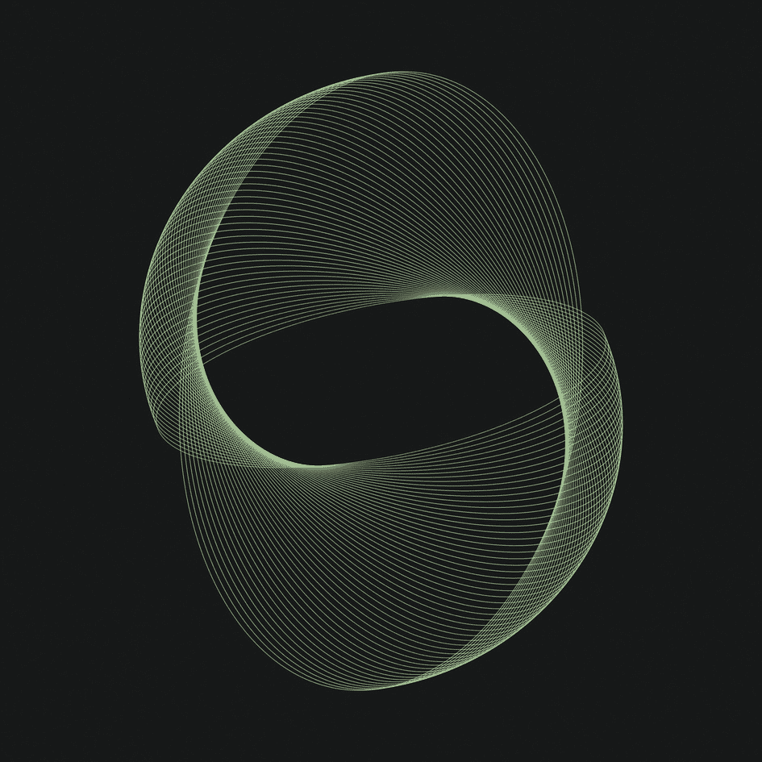

# 运行包管理器并安装 SvJs

此操作将运行 Node 的包管理器 `npm`，而 `init` 命令则用于初始化项目（或称“包”）。`-y` 标志告诉 `npm` 我们接受所有默认设置选项。您会注意到已创建一个名为 `package.json` 的新文件。这是您在 Web 开发中会经常遇到的文件，但目前无需担心其内容。只需知道它的作用是管理我们的依赖项，其中最主要的依赖项就是 SvJs 库。

要安装 SvJs，请运行以下命令：

```bash
npm install svjs
```

这会在 `package.json` 文件中新增一行，引用了您刚刚安装的 SvJs 版本。同时还会创建一个 `package-lock.json` 文件（一个您永远无需查看的文件）和一个 `node_modules` 文件夹，SvJs 及其所有依赖项都存储在此文件夹中（它没有任何依赖项，因此您不会在这里看到其他文件夹）。

## 搭建草图框架

在开始处理 JavaScript 之前，我们的第一个草图需要一些 HTML 和 CSS。我们会尽量精简这些标记和样式，并在全书范围内保持基本一致，因为真正的重点将放在 JavaScript 上。

现在，在项目根文件夹内创建一个名为 `sketches` 的新文件夹，然后在 `sketches` 文件夹内创建一个名为 `00-template` 的新文件夹。我们对文件夹进行编号，以便于排序。`00-template` 文件夹将包含我们从一个草图复制到另一个草图的极简基础内容。在 `00-template` 文件夹内创建两个文件：`index.html` 和 `sketch.js`。完成这些操作后，您应该会得到如下所示的文件夹结构：

```
generative-svg
|-- node_modules
|-- sketches
|-- 00-template
|-- index.html
|-- sketch.js
|-- package-lock.json
|-- package.json
```

打开 `index.html` 文件。值得注意的是，如果您键入 `!` 并按 `tab` 键，VS Code 可以为您生成一些样板标记，但我会在此处完整提供我们的样板代码，以便您复制粘贴。一般来说，我建议您自己动手编写示例代码，并尽可能限制“复制粘贴”操作，因为这种方式学习效果较差。不过，在这里这样做是可以的，因为 HTML 和 CSS 并非我们的重点。

```html
<!DOCTYPE html>
<html lang="en">
<head>
  <meta charset="UTF-8">
  <meta name="viewport" content="width=device-width, initial-scale=1.0">
  <title>SvJs 模板</title>
  <style>
    body {
      margin: 0;
      background-color: #202020;
    }
    #container {
      display: flex;
      justify-content: center;
      align-items: center;
      height: 100vh;
    }
  </style>
</head>
<body>
  <div id="container"></div>
  <script type="module" src="sketch.js"></script>
</body>
</html>
```

关于上述代码，有几点值得指出：我们的 `<div id="container">` 将是生成艺术实际发生的地方。可以这么说，它将成为我们的画布。我将其放置在屏幕中央，移除了所有默认边距，并为模板赋予了整体的“深色模式”感觉（这是我个人的偏好）。在 `<div>` 下方，您会看到一个 `<script>` 标签。这是我们引入所有代码的地方，因此后续无需再对 HTML 进行任何修改（可能除了更新每个草图的 `<title>` 标签之外，但我会把这个留给您决定）。脚本设置为 `type="module"`。这使我们能够处理作为模块打包（或导出）的其他文件和库的导入。这是一个值得养成的好习惯，也是我们导入 SvJs 库的方式。

打开 `sketch.js` 文件，并添加以下内容作为前两行代码：

```javascript
// 导入 SvJs 库。
import { SvJs } from '../../node_modules/svjs/src/index.js';
```

现在我们的模板已经完成，可以复制用于后续的草图了。干得好！

## 提供草图服务

如果此时导航到 `00-template` 文件夹并双击 `index.html` 在 Web 浏览器中打开它，您会在开发者控制台（在大多数浏览器上按 `F12` 键可访问）中看到一些错误。这是因为我们需要使用 `http://` 协议而不是 `file://` 协议来提供我们的 HTML 文件（如果您查看地址栏中的完整 URL，就会看到协议前缀）。

要解决这个问题，我们需要安装一个 http 服务器。理想情况下，需要一款能检测文件更改并立即重新加载页面的服务器，这样我们就不必每次都手动刷新浏览器（时间长了会变得很烦人）。有一个简洁的小包叫做 `live-server`，它可以为我们处理这些。要安装它，请在终端中运行以下命令：

```bash
npm install live-server -g
```

`-g` 标志告诉 `npm` 将此包全局安装到我们的机器上，而不是本地安装到当前项目中。因为它更像是一个通用工具，而不是项目特定的依赖项，这正是我们想要的。要运行 `live-server`，您只需在终端中输入 `live-server` 即可。然后它会自动打开一个新的浏览器窗口，您将在其中看到您的项目文件（假设您仍在 VS Code 的项目根文件夹中）。导航到 `sketches` ➤ `00-template`，您应该会看到页面加载成功，并且控制台没有任何错误。不过，页面上也没有任何内容，所以让我们写一些代码来解决这个问题。

## 我们的第一个生成式草图

正如我之前提到的，我们的第一个草图将作为解释我们在第 2 章中要介绍的基本编程概念的基础，因此，出于这个原因，接下来的内容（除了代码本身的一些注释外）解释会比较简略。

复制 `00-template` 文件夹，并将其命名为 `01-our-first-generative-sketch`，确保复制到相同位置（即父文件夹为 `sketches`）。

然后，在您的 `sketch.js` 文件中，在 `import` 语句下方，编写（推荐）或复制以下代码。在输入过程中请阅读注释（以 `//` 开头的行），我有意让注释较为详尽，以便您更好地理解正在发生的事情。

```javascript
// 导入 SvJs 库。
import { SvJs } from '../../node_modules/svjs/src/index.js';

// 创建一些全局变量。
const svgSize = window.innerWidth > window.innerHeight ? window.innerHeight : window.innerWidth;
const bgColor = '#181818';

// 创建一个对象来存储一些随机化参数。
const randomised = {
  hue: random(0, 360),
  rotation: random(-180, 180),
  iterations: random(10, 100)
}

// 创建我们的父级 SVG，并将其附加到 id 为 'container' 的元素上。
const svg = new SvJs();
svg.addTo(document.getElementById('container'));

// 设置 viewBox 的宽度和高度以及 SVG 的显示尺寸。
svg.set({ viewBox: '0 0 1000 1000', width: svgSize, height: svgSize });

// 创建一个背景层——一个覆盖 viewBox 全尺寸的矩形。
const rect = svg.create('rect');
rect.set({ x: 0, y: 0, width: 1000, height: 1000, fill: bgColor });

// 运行一个随机次数的循环来创建我们的椭圆。
for (let i = 0; i < randomised.iterations; i += 1) {
  // 设置椭圆的中心点、x 轴和 y 轴半径以及旋转角度。
  let center = 500;
  let radiusX = 100 + (i * 3);
  let radiusY = 300 + (i * 2);
  let rotation = randomised.rotation + (i * 2);

  // 如果随机色相小于 180，则递增它。否则递减它。
  let hue;
  if (randomised.hue < 180) {
    hue = randomised.hue + (i * 3);
  } else {
    hue = randomised.hue - (i * 3);
  }

  // 创建我们的椭圆。
  let ellipse = svg.create('ellipse');
  ellipse.set({
    cx: center,
    cy: center,
    rx: radiusX,
    ry: radiusY,
    fill: 'none',
    stroke: `hsl(${hue} 80% 80% / 0.6)`,
    transform: `rotate(${rotation} ${center} ${center})`
  });
}

/**
* 获取介于最小值和最大值之间的随机数。
*/
function random(min, max, integer = true) {
  let random = Math.random() * (max - min) + min;
  let number = integer ? Math.floor(random) : random;
  return number;
}
```

好的，代码量相当大！这无疑会让任何编程新手感到不知所措，所以如果您属于这一类并且发现对上述内容感到畏惧，请耐心等待；所有内容将在后续章节中解释。这个第一个生成式草图的目的就是让您快速上手，并向您展示一些快速成果。


当你保存上述代码后，应该会看到类似图 1-3 所示的效果。每次刷新浏览器都会生成一个独特的版本，因此你看到的内容无疑会在某些方面有所不同。但亲爱的读者，这正是生成艺术的魅力所在。



一幅抽象画，在深色背景下呈现出一个由椭圆簇构成的旋转图案，形成方形结构。

**图 1-3** 我们的第一个生成式草图（众多变体之一）

## 总结

回顾一下，我们在第一章中涵盖了以下内容：

- 为何使用 JavaScript 和 SvJs，而非 Processing 或 `p5.js`
- SVG 与 PNG 和 JPG 等光栅格式的区别
- 脚本化 SVG 与直接在标记语言中编写有何不同
- SvJs 如何让 SVG 脚本编写更直观、更简洁
- 安装与导入 SvJs 库，并设置基础模板
- 如何在本地开发服务器上预览我们的草图

下一章：编程入门。

