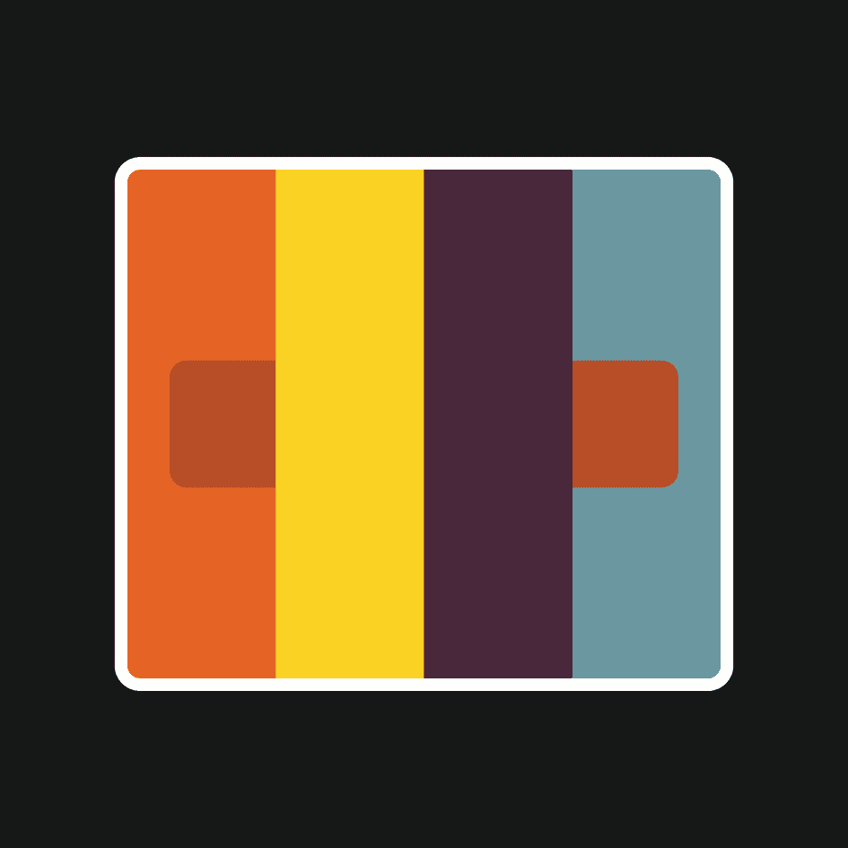
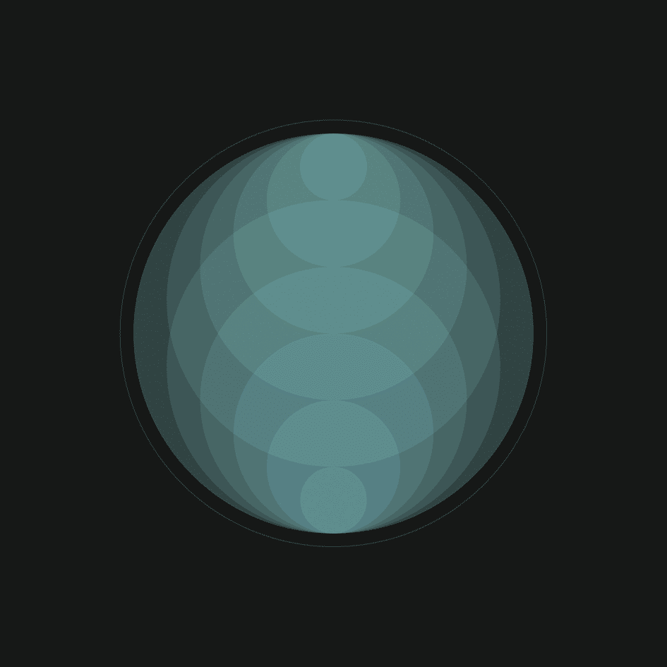
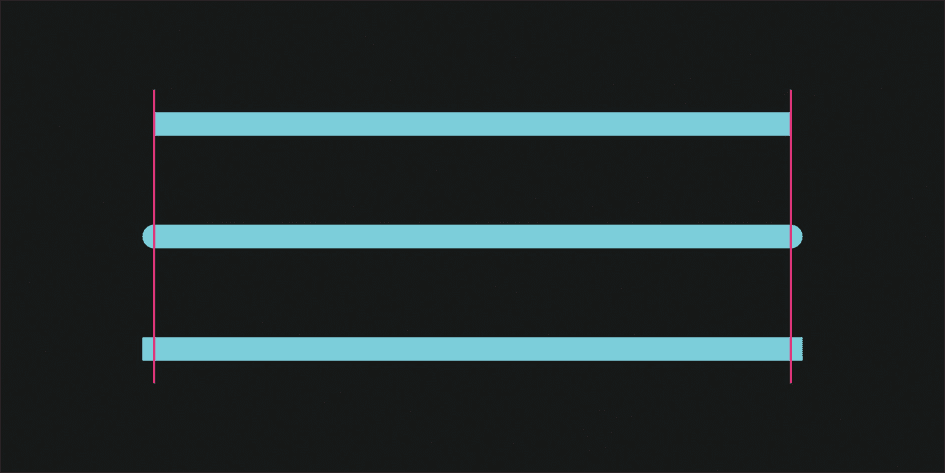
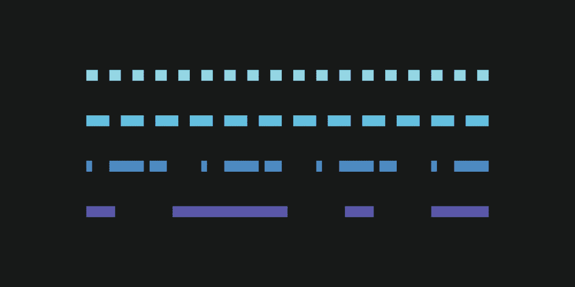
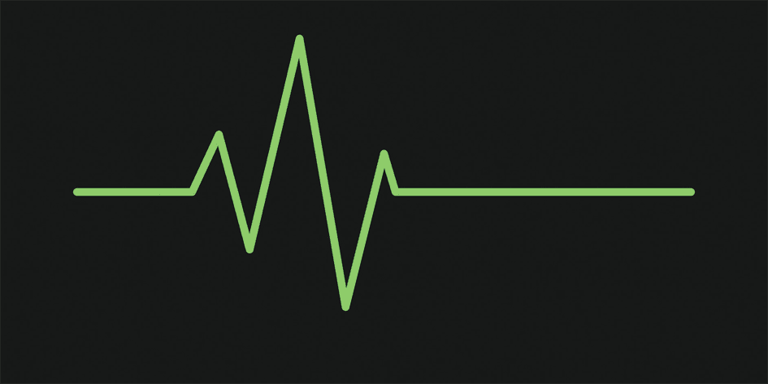
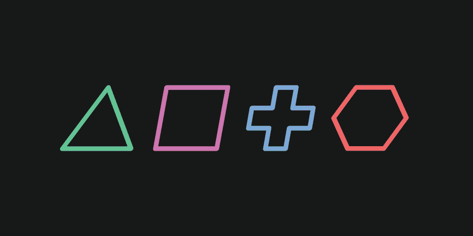
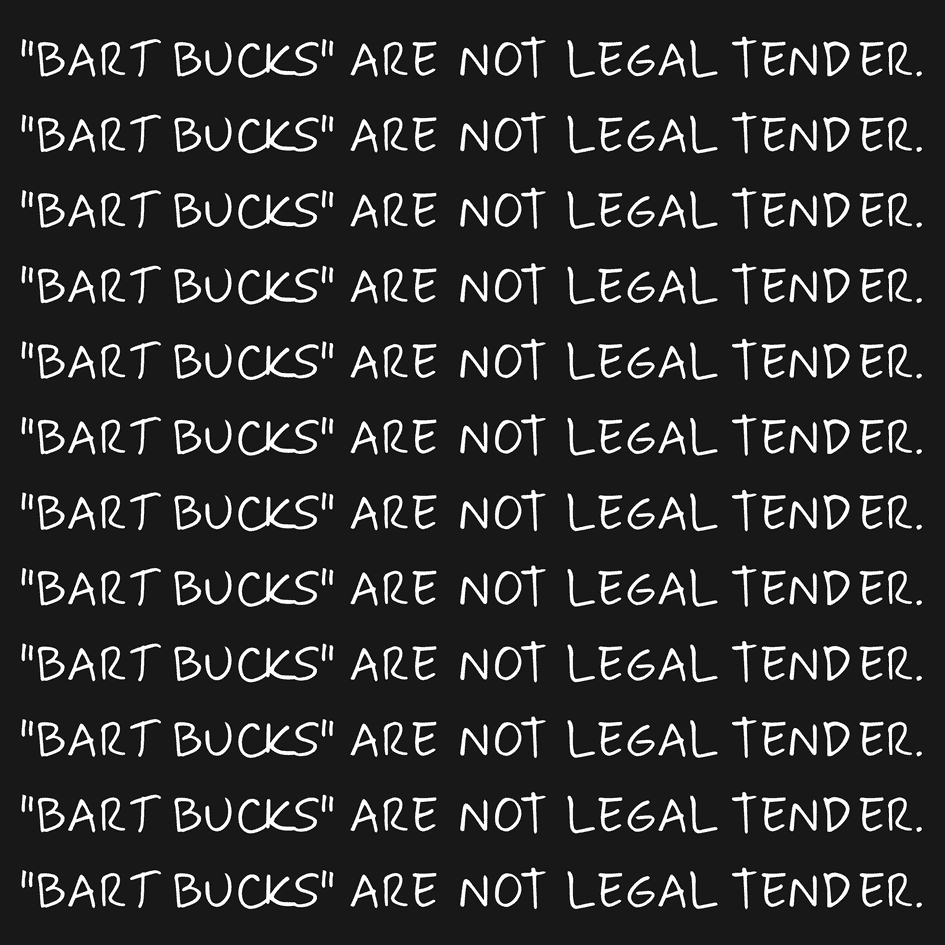
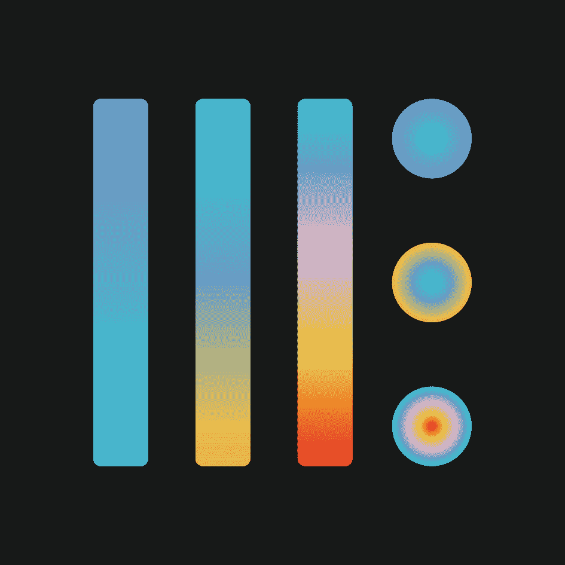
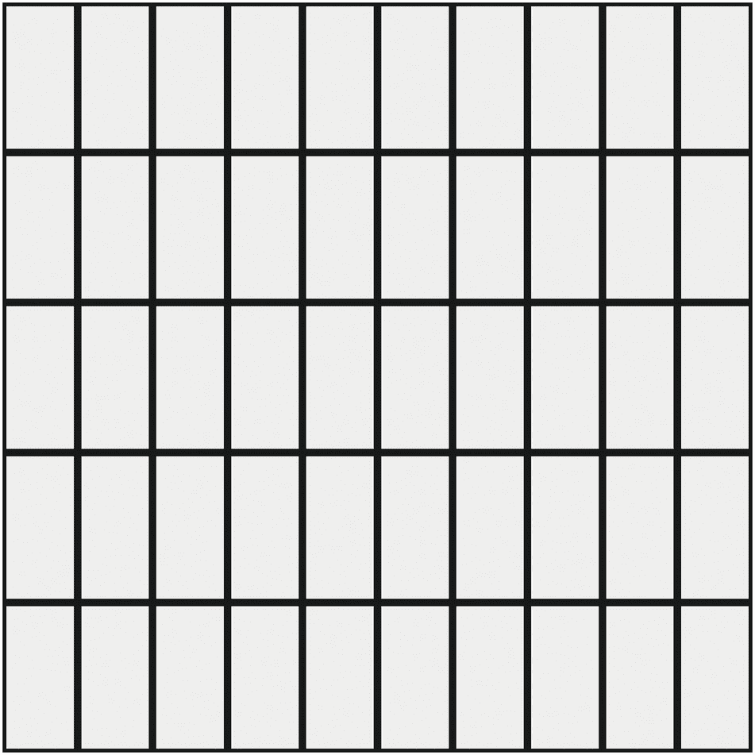
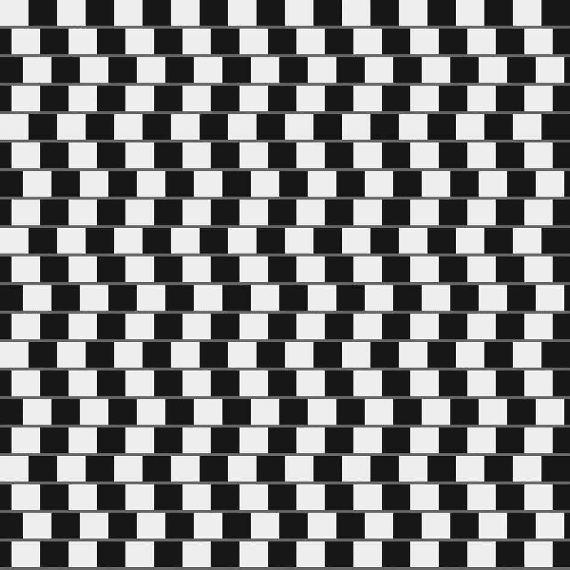

# 3. 关于 SVG 的一切

掌握了 JavaScript 的基础知识，你已经准备好使用`SvJs`了，你可以把它想象成你的生成式画笔和调色板。

在本章中，我们将涵盖：设置我们的 SVG 画布；如何处理线条和颜色；如何创建一系列简单形状；如何添加文本和标题；如何定义和重用元素；如何使用组、渐变和图案；以及 SVG 的`viewBox`和视口是如何工作的；在这个过程中，我们将学习`SvJs`库的核心函数，以及它与 SVG 规范的关系。

## 父级 SVG 元素

在我们创建任何视觉内容之前，我们需要加载我们的库并设置父级 SVG 元素。父级 SVG，也称为 SVG 文档片段，是指其父元素（如果有的话）不在 SVG 命名空间中的那个 SVG 元素。一个例子是附加到 HTML DOM 节点上的 SVG。

这值得一提，仅仅是因为 SVG 可以包含其他 SVG；在这种情况下，只有一个可以被视为父级 SVG 元素。你可能也会看到它被称为**根元素**。

让我们重新打开我们在第一章中设置的 JavaScript 模板文件（它应该位于`sketches/00-template/sketch.js`路径下），并向其中添加以下代码行：

```javascript
// 父级 SVG。
const svg = new SvJs();
```

`new SvJs()`构造函数，如果调用时不带任何参数，会创建一个 SVG 元素。它也可以用于通过传入元素名称作为字符串来创建任何其他 SVG 元素。

```javascript
// 使用 SvJs 构造函数创建一个圆形元素。
const circle = new SvJs('circle');
```

要将父级 SVG 元素添加到我们的网页中，我们使用`SvJs`的`addTo()`方法。在这种情况下，我们将传入我们在 HTML 中之前设置的、`id`为`container`的`<div>`（参见第一章）。将以下内容添加到模板草图中：

```javascript
const container = document.getElementById('container');
svg.addTo(container);
```

`SvJs`中的大多数函数都是可链式调用的，这意味着你可以使用点号表示法将它们链接在一起，就像这样：

```javascript
methodOne().methodTwo();
```

`new SvJs()`构造函数方法也不例外，因此我们新的父级`SVG`元素一旦实例化，就可以通过追加`addTo()`方法立即附加到`DOM`元素上。

这创建了一个方法链（将点视为链接）。如果我们传递`getElementById()`这个`DOM`方法作为参数，而不是将其赋值给一个变量，我们就可以将代码压缩成一行：

```javascript
// 父级 SVG。
const svg = new SvJs().addTo(document.getElementById('container'));
```

然而，简洁并不总是优于清晰，所以如果这行代码对你来说有点过于压缩，请保持你的模板代码不变，无需替换成上述代码。

## 视口（Viewport）与视图框（ViewBox）

`viewport`指的是我们`SVG`元素的可见部分。它是通过使用`width`和`height`属性隐式定义的。

`SVG`格式一个有趣的地方在于其工作区的灵活性，即它可以包含内容的区域。一个`SVG`可能包含的内容远多于任何时刻通过`viewport`可见的部分。这为处理精灵图、画板和其他屏幕外资源提供了可能性。

因为我们要使用一个正方形的`SVG` `viewport`，我们的`width`和`height`将相同，所以我们可以用一个变量来存储这个值。我们称之为`svgSize`。

我们事先不知道屏幕尺寸或方向，因此硬编码一个值并不明智。相反，我们可以通过查询`window.innerWidth`和`window.innerHeight`来检查浏览器窗口的尺寸，并将`svgSize`设置为这两个值中较小的一个。这将确保正方形（或 1:1）的宽高比。我们在前一章讨论的三元运算符对于这类检查特别有用。按照以下方式将其包含在模板中，以初始化`svgSize`变量：

```javascript
// 视口大小（1:1 宽高比）。
const svgSize = window.innerWidth > window.innerHeight ? window.innerHeight : window.innerWidth;
```

`viewBox`是另一个重要的顶级`SVG`属性。它与`viewport`相关，但拥有更强大（也更复杂）的功能。`viewBox`允许我们在用户空间中定义`viewport`的位置和尺寸。

这到底意味着什么？你可以将用户空间视为无单位或与单位无关的空间。值`100`可能指的是像素、毫米、米或任何其他单位。它默认为像素，但`viewBox`的重点在于它可以让我们摆脱绝对单位的思维。我们可以使用自己的内部坐标系，而无需担心渲染`SVG`的设备的实际尺寸。

就个人而言，我喜欢使用`1000`的宽度和高度，因为我觉得这样划分画布很直观。这`1000`个单位之后可以被压缩到一个`500px`宽的正方形中，或者铺满一个公交车大小的广告牌上。

`viewBox`的前两个值定义了它的起始坐标（称为`min-x`和`min-y`），后两个值定义了`width`和`height`。我们保持简单，将`viewBox`定义为`0 0 1000 1000`。

如果`viewport`和`viewBox`的宽高比（即宽度与高度的比例）不同，可以使用`preserveAspectRatio`属性来指定浏览器应如何显示`SVG`。这很快就会变得相当复杂，这就是为什么我已经确保我们的`viewport`和`viewBox`共享相同的 1:1（即正方形）宽高比。现在，仅需知道存在`preserveAspectRatio`这个属性即可，以备将来你想要实现更复杂的布局。

有时，要最好地理解某些东西是如何工作的，你需要与它进行视觉交互。基于此，我构建了一个小的`CodePen`草图（或他们称之为“笔”）来演示调整主要`viewBox`值的效果，这样你就可以看到它们如何协同工作来缩放和裁剪`SVG` `viewport`内可见的内容。你可以在[`davidmatthew.ie/generative-art-javascript-svg#viewBox`](https://davidmatthew.ie/generative-art-javascript-svg#viewBox)找到这支笔。

至此，我们获得了`viewBox`和`viewport`所需的值，但还未学习如何使用它们。

## 设置与获取值

每个`SvJs`实例，无论是父级`SVG`还是其子元素，都有一个`set()`方法。此方法允许我们设置元素属性的值。

我们如何知道一个元素有哪些属性？好吧，我们会查阅（即搜索）一些官方文档。我推荐的来源是 Mozilla 开发者网络的`SVG`元素参考，地址是[`developer.mozilla.org/en-US/docs/Web/SVG/Element`](https://developer.mozilla.org/en-US/docs/Web/SVG/Element)。用它来提醒自己，或者在你进行独立探索时使用。顺便说一句，`SvJs`库的完整文档可以在[`npmjs.com/package/svjs`](https://npmjs.com/package/svjs)（或相关的`GitHub`仓库）找到；如果你愿意，可以将其放在手边，以便获取每个方法更结构化的定义。

回到设置值，`set()`方法接受一个对象作为其参数，并采用以下格式：

```javascript
svg.set({ attribute1: value1, attribute2: value2, attributeN: valueN });
```

如果你一次设置大量属性，为了可读性，你可以考虑调整格式。

```javascript
svg.set({
  attribute1: value1,
  attribute2: value2,
  ...
  attributeN: valueN
});
```

不过这取决于你；两种方式都行。

对于我们的父级`SVG`来说，值得注意的属性是`width`和`height`（它们构成了`viewport`）以及`viewBox`。我们现在可以将以下代码添加到我们的模板中来设置这些属性：

```javascript
svg.set({ width: svgSize, height: svgSize, viewBox: '0 0 1000 1000' });
```

运行`live-server`命令并导航到我们的模板文件夹后，此时您只会看到一个空白页面。这是因为我们的 SVG 画布中没有任何内容能使其与背景区分开来。我们将很快通过创建一个用作背景层/画布的矩形来解决这个问题。

正如我们可以使用`set()`来设置值一样，我们也可以使用`get()`来获取值。虽然您可能不会经常用到这个功能，但了解其存在是件好事。例如，以下代码会将我们的`viewBox`值输出到控制台：

```javascript
console.log(svg.get('viewBox'));
```

通过`get()`方法获取属性值在处理事件监听器或其他值动态更新的场景中会非常有用。

## 更快捷的元素创建

如果我们每次创建新的 SVG 元素时都要调用`new SvJs`构造函数和`addTo`方法，久而久之可能会有些繁琐。这时，`SvJs`库的`create()`方法就派上了用场，它将这两个步骤合二为一。要创建一个元素并自动将其追加到父级 SVG 中，我们只需这样写：

```
svg.create('elementName');
```

在创建元素时，除非你确信之后不会再引用它，否则最好将其赋值给一个变量。因此，你可能会将上述代码写成：

```
const variableName = svg.create('elementName');
```

`create()`方法支持链式调用，并且也可以被子元素调用。

## 线条与形状

SVG 规范定义了六种基本形状类型：

*   圆形
*   椭圆
*   线条
*   多边形
*   折线
*   矩形

由于我们需要设置一个背景，让我们先从矩形开始。

### 矩形和正方形

在 SVG 规范中，矩形是`rect`。要创建一个矩形，我们这样写：

```
svg.create('rect');
```

接下来，我们将链式调用`set()`方法，重点关注`rect`元素的以下五个属性：`x`和`y`用来设置其左上角的位置；`width`和`height`用来定义其大小；以及`fill`用来定义其颜色。因为我们想要一个正方形（从技术上讲，正方形只是一种特殊的矩形），只需将`width`和`height`设置为相同的值即可。请将以下代码添加到我们的模板中：

```
// 背景。
svg.create('rect').set({
  x: 0, y: 0, width: 1000, height: 1000, fill: '#181818'
});
```

请注意，我们定义背景的位置和尺寸时，是相对于`viewBox`，而不是`viewport`。这能让我们的值保持一致，因为我们事先并不知道`viewport`的大小。现在运行`live-server`，你应该会看到一个比周围背景颜色稍暗的正方形画布。

这足以满足我们的模板需求。如果你之前遗漏了什么，或者只是想确保代码顺序正确，以下是完整的模板`sketch.js`文件：

```
import { SvJs } from '../../node_modules/svjs/src/index.js';

// 父级 SVG。
const svg = new SvJs().addTo(document.getElementById('container'));

// 视口和 viewBox（1:1 宽高比）。
const svgSize = window.innerWidth > window.innerHeight ? window.innerHeight : window.innerWidth;
svg.set({ width: svgSize, height: svgSize, viewBox: '0 0 1000 1000' });

// 背景。
svg.create('rect').set({
  x: 0, y: 0, width: 1000, height: 1000, fill: '#181818'
});
```

我们之后编写的任何代码都将特定于正在处理的草图。在复制`00-template`文件夹及其内容并将其重命名为`02-basic-shapes`之前，请确保已保存更改。

## 初次描边

有两个重要的属性几乎可以用于所有图形化的 SVG 元素（即，那些意图显示在屏幕上的元素）。它们是元素的`fill`和`stroke`。正如我们已经看到的，`fill`定义了元素的内部颜色（或背景）。而`stroke`则定义了元素轮廓（或边框）的颜色。

如果你没有定义`stroke`，就不会显示描边。如果你定义了描边，它默认的`stroke-width`为`1`。

`stroke-width`属性之所以重要还有另一个原因：它是一个带连字符的属性的例子。在 JavaScript 中设置属性时我们不能使用连字符，因为它们会被解释为减法运算符。

我们有两种方法处理这个问题：可以将它们转换为字符串，即写成`'stroke-width'`而不是`stroke-width`；或者用下划线替换连字符，即`stroke-width`变成`stroke_width`。

SvJs 支持后一种方法，这也是我更喜欢的方式；它速度更快，并且相比在属性对象中混合使用字符串化和非字符串化的属性，看起来也更协调。

理论就讲到这里——让我们来创建一些东西吧！下面的草图是受约瑟夫·阿尔伯斯（Josef Albers）启发的色彩错觉图，它展示了仅使用普通矩形就能创作出相当有趣的构图（如图 3-1 所示）。



一幅抽象画，展示了一个由不同颜色的普通矩形构成的方形结构，背景为深色。

**图 3-1** 受约瑟夫·阿尔伯斯启发的色彩错觉

```
import { SvJs } from '../../node_modules/svjs/src/index.js';

// 视口大小（1:1 宽高比）。
const svgSize = window.innerWidth > window.innerHeight ? window.innerHeight : window.innerWidth;

// 父级 SVG。
const svg = new SvJs().addTo(document.getElementById('container'));
svg.set({ width: svgSize, height: svgSize, viewBox: '0 0 1000 1000' });

// 背景。
svg.create('rect').set({
  x: 0, y: 0, width: 1000, height: 1000, fill: '#181818'
});

// 主橙色正方形。
svg.create('rect').set({
  x: 150, y: 200, width: 700, height: 600, rx: 15, fill: '#e56411',
  stroke: '#fff', stroke_width: 30, paint_order: 'stroke'
});

// 蓝色矩形。
svg.create('rect').set({
  x: 650, y: 200, width: 200, height: 600, rx: 15, fill: '#69969f'
});

// 较小的橙色矩形。
svg.create('rect').set({
  x: 200, y: 425, width: 600, height: 150, rx: 20, fill: '#b84b08'
});

// 黄色矩形。
svg.create('rect').set({
  x: 325, y: 200, width: 175, height: 600, fill: '#fed322'
});

// 紫色矩形。
svg.create('rect').set({
  x: 500, y: 200, width: 175, height: 600, fill: '#49283c'
});
```

左右两侧较小的矩形看起来是相同的橙色吗？假设这种错觉成功了，你可能很难给出一个确切的答案。但通过浏览代码，你可以轻松验证它们不仅是相同的颜色，而且形状也相同！

使矩形具有圆角的是`rx`属性，它表示矩形在 x 轴上的圆角半径。如果没有定义相应的`ry`属性，则假定你想要相同的值（从而产生均匀的圆角）。

你可能还在前面的代码中发现了另一个带连字符的属性，即`paint-order`。这个属性决定了给定元素的`fill`和`stroke`的渲染顺序。

默认顺序是`fill`先渲染（即填充在下方，因此会被`stroke`部分覆盖），但有时让`stroke`先渲染也很有用，因为只有这样我们才能看到完整的`fill`区域被绘制出来（从代码中删除`paint_order: 'stroke'`，你就会明白我的意思）。

### 圆形和椭圆

圆形是所有形状中最简单（也可以说是最完美）的。我们通过`cx`和`cy`属性定义其中心位置，并通过`r`属性定义其半径。

```
// 一个简单的圆形示例。
svg.create('circle').set({ cx: 50, cy: 50, r: 25 });
```

在下一个草图中，我们用一个`for`循环来提升一下难度。我们将尝试将不同大小的半透明圆形层层叠加的效果（如图 3-2 所示）。再次复制模板文件夹，并将其重命名为`03-circle-overlay-loop`或类似名称（只要保持基本的组织性，文件夹名称其实并不重要）。

在定义背景的代码下方，添加以下代码：

## 圆形叠加循环

```javascript
// 圆形叠加循环。
for (let i = 1; i <= 6; i += 1) {
  // 变化半径和两个垂直中心点。
  let r = 50 * i;
  let cx = 500;
  let cy1 = 800 - r;
  let cy2 = 200 + r;
  // 创建偏蓝色的圆形集合。
  svg.create('circle').set({
    cx: cx, cy: cy1, r: r, fill: '#99eeff', fill_opacity: 0.1
  });
  // 创建偏绿色的圆形集合。
  svg.create('circle').set({
    cx: cx, cy: cy2, r: r, fill: '#aaffee', fill_opacity: 0.1
  });
}
// 创建一个微弱的轮廓。
svg.create('circle').set({
  cx: 500, cy: 500, r: 320, fill: 'none',
  stroke: '#aaffee', stroke_width: 2, stroke_opacity: 0.1
});
```



一幅抽象图，在深色背景上展示了一个巨大的圆形，上面叠加了若干层半透明圆形。

**图 3-2**

圆形叠加循环的结果

我们在这里所做的是，每次循环运行时，改变两组圆形的`cy`属性（垂直位置）并增加半径`r`。这两组圆形通过颜色（略有不同）和初始位置来区分。循环外的一个最终圆形为这两组圆形提供了一个微弱的轮廓框架。

椭圆与圆形类似，但它有两个半径属性——`rx`和`ry`——而不是单一的`r`。在第 1 章的第一个生成式草图中，我们看到了椭圆的应用。以下是相关的代码片段：

```javascript
// 创建我们的椭圆。
let ellipse = svg.create('ellipse');
ellipse.set({
  cx: center,
  cy: center,
  rx: radiusX,
  ry: radiusY,
  ...
});
```

## 线条、折线与多边形

如果你需要绘制一条从一个点到另一个点的简单直线，可以使用`line`元素。它需要两组坐标：`x1`和`y1`定义起点位置，`x2`和`y2`定义终点位置。同时还需要定义`stroke`（描边）（因为它毕竟是一条线）。

```javascript
// 朴素的线条。
svg.create('line').set({
  x1: 10, y1: 10, x2: 90, y2: 90, stroke: '#333'
});
```

这是一个很好的机会来展示一些其他可以改变线条外观的与描边相关的属性。第一个是`stroke-linecap`。这个属性定义了线条端点的行为方式。默认值`butt`将线条长度限制在其端点。值`round`会在两端用半圆形封闭线条，而值`square`则会用——你猜对了——方形来封闭线条。图 3-3 展示了不同的值，两侧的竖线标明了这些值生效的边界。



一幅抽象图，在深色背景上展示了三条高亮的水平条，两侧各有一条竖线连接。中间的条带有圆角。最后两条条的尺寸略大于第一条，而第一条恰好完全位于两条竖线之间。

**图 3-3**

`butt`、`round`和`square`的值（从上到下）

我想强调的另一个属性是`stroke-dasharray`。如果你想要的是虚线而非实线，就可以使用这个属性。更具体地说，`stroke-dasharray`设置了绘制描边时使用的虚线及其间隔的图案。如果我们设置一个单一值，例如`20`，则该值将同时用于虚线的长度和间隔的长度。如果我们设置两个值，第一个用于虚线的长度，第二个用于间隔的长度。然而，如果我们设置三个值，第一个用于第一条虚线的长度，第二个用于间隔，第三个用于下一条虚线的长度。然后这些值会循环使用，从而形成一个重复的图案。

你提供的值数量没有严格的上限，因此这里有很大的发挥创意的空间。

```javascript
// 设置一个不规则的 stroke-dasharray。
svg.create('line').set({
  ...
  stroke_dasharray: 10 30 60
});
```

在图 3-4 中，从上到下，我们可以看到以下的`stroke-dasharray`值（所有值均相对于宽度为`1000`的`viewBox`）：



一幅抽象图，在深色背景上展示了四条不同图案的水平虚线。

**图 3-4**

各种 `stroke-dasharray` 的值

*   `20`

*   `40 20`

*   `10 30 60`

*   `50 100 200 100`

如果你想把一条直线连接到另一条直线上，可以使用`polyline`元素。它接受一个由空格分隔（或逗号分隔）的值组成的`points`数组，用于定义每个`x`和`y`坐标。在将`points`数组设置为属性值之前，需要将其转换为字符串。在下面的示例中，我将演示如何使用`join()`数组方法来实现这一点。结果如图 3-5 所示。



一幅抽象图，在深色背景上展示了一条带有不同振幅峰值和谷值的平直线条。

**图 3-5**

`polyline`元素的实际效果

```javascript
// 一个点的数组。
let pointsArray = [
  100, 250, 250, 250, 285, 175, 325, 325, 390, 50, 450, 400, 500, 200, 515, 250, 900, 250
];
// 一个模拟心跳的折线元素。
svg.create('polyline').set({
  points: pointsArray.join(' '),
  stroke: '#6df876',
  fill: 'none',
  stroke_width: 10,
  stroke_linecap: 'round',
  stroke_linejoin: 'round'
});
```

在前面的示例中，我还使用了`stroke-linejoin`属性；它定义了每条线段连接处所使用的形状。

`polygon`元素类似于`polyline`元素，但用于闭合形状，即起点和终点相连接的形状。在图 3-6 中，我们看到了一系列多边形，特定平台的游戏玩家可能会觉得这些形状很熟悉。



一幅抽象图，在深色背景上依次排列了三角形、平行四边形、加号和六边形。

**图 3-6**

为玩家准备的多边形

使用`polygon`或`polyline`元素手动创建形状不是我们目前要重点关注的，因为这可能相当繁琐。我们将在后面的章节中介绍更好的生成形状的方法。

## 文本与标题

由于 SVG 是一种纯文本格式，因此它支持文本元素也就不足为奇了。要创建一些文本，我们使用常用的`svg.create()`方法。至少，我们需要定义希望文本出现位置的`x`和`y`坐标（相对于文本边界框的左下角）、文本的颜色以及文本的内容。

```javascript
// 创建文本。
let text = svg.create('text').set({
  x: 20, y: 30, fill: 'white'
});
```

那么，如果内容本身不是一个属性，我们该如何定义文本内容呢？它也不是一个子节点，因此创建字符串并追加是不行的。相反，我们需要使用 SvJs 的 `content()` 方法。

```javascript
// 使用 content() 方法插入文本。
text.content('我对 SVG 有着一种不健康的痴迷。');
```

### 排版后的文本

如果我们想让文本更加精致，并为其添加一些网络字体，该怎么做呢？有几种方法可以实现，但我将采用最简单的方式，通过 HTML 引入一些谷歌字体。让我们以此为蓝本快速绘制一幅草图；复制我们的 `00-template` 文件夹，并将其命名为 `04-chalkboard-gag`。如果你看过*辛普森一家*，就会知道大多数剧集的开场都有一个黑板擦笑话，巴特被罚在黑板上胡乱涂写，以此作为对他调皮行为的惩罚。下面这幅草图中就包含了我最喜欢的一个笑话。

我们首先需要在 HTML 中加入以下 `<link>` 标签，因此切换到 `index.html` 文件，并在 `<head>` 部分添加以下代码行。这将调用一个名为 `Mynerve` 的谷歌字体，该字体具有我们想要的手写风格。

```html
<link href="https://fonts.googleapis.com/css2?family=Mynerve&display=swap" rel="stylesheet">
```

如果巴特可以选择运行一个 `for` 循环来减少惩罚的重复性，我相信他会选择这样做。让我们替他执行这个操作（顺便让斯金纳扫兴）。

在我们声明背景的代码下方添加以下代码。需要注意几点：我们调用了 `toUpperCase()` 字符串方法将内容转换为大写；这是一个很有用的方法，相关的方法还有 `toLowerCase()`。使用 `52` 的 `font_size` 来最佳地填满 `viewBox` 的宽度，并且每次迭代将 `y` 位置递增 `80`，这样就能将文字行向下推，填满我们的黑板。我们有足够的空间这样做 `12` 次，这就是为什么我们将增量限制在 `960` 以下（`960 ÷ 80 = 12`）。再多一次迭代就会溢出视口。

输出结果如图 3-7 所示。



输出页面的截图。上面有一组文字，内容是“Bart bucks are not legal tender.”。

**图 3-7** “巴特币”黑板擦笑话

```
// 用于笑话的文本行。
let line = '"Bart Bucks" are not legal tender.';
line = line.toUpperCase();
// 运行一个循环，创建 12 (960 / 80) 行文本。
for (let i = 0; i < 960; i += 80) {
let text = svg.create('text');
text.content(line);
text.set({
x: 20,
y: 80 + i,
fill: '#fff',
font_size: 52,
font_family: 'Mynerve'
});
}
```

标题是另一种我们可以使用的文本。与 `text` 元素不同，`title` 元素不需要定位；它旨在作为描述嵌套在元素内部。它的工作方式与 HTML 的 `title` 属性类似；它有助于提升无障碍访问性，并在鼠标悬停时作为工具提示显示。它可以用于为父级 SVG 元素或其任何子元素添加标题。

```
// 为一个圆形元素创建标题。
let circle = svg.create('circle');
let circleTitle = circle.create('title');
circleTitle.content('我到处闲逛，到处闲逛。');
```

`title` 元素适合较短的描述；对于更长的描述，推荐使用 `desc` 元素。该元素不会渲染，纯粹是为了无障碍访问目的，其创建方式与 `title` 元素完全相同。如果你想添加关于 SVG 文件本身的额外信息，可以使用 `metadata` 元素。例如，嵌入 RDF（资源描述框架）数据或应用程序特定数据。你经常会看到像 Inkscape 或 Illustrator 这样的软件用这种方式嵌入它们自身的元数据。

## 定义（defs）

如果我们想在 SVG 中定义一个图形或其他容器元素，但又不希望该元素本身显示（或者希望它仅在被引用时才显示），我们可以将其嵌套在 `defs` 元素中，`defs` 代表定义。`defs` 元素可以提升 SVG 的整体无障碍访问性，也有助于更好地组织其内容。

在接下来的关于渐变、图案和其他可复用元素的章节中，我们将依赖 `defs` 元素提供的功能。

```
// 定义一个 defs 元素。
let defs = svg.create('defs');
```

## 渐变（Gradients）

渐变是从一种颜色状态逐渐过渡到另一种颜色状态。在 SVG 中，渐变可以支持多种不同的颜色状态（或者称为“色标”）。最常见的是双色标渐变，但偶尔也会遇到包含彩虹般多种不同颜色的渐变。说到彩虹，天空本身就是渐变灵感（渐变的灵感？）的绝佳来源。想象一下黄昏时暗淡的光线，柔和的黄色过渡到浅蓝色，或者日落时炽热的光芒，紫色、红色和橙色交织在一起。

渐变有两种类型：线性渐变（颜色从一个区域沿直线过渡到另一个区域）和径向渐变（颜色从焦点向四周所有方向辐射）。

那么，在 SvJs 中如何创建这样的渐变呢？事实证明，仅仅使用 `create()` 方法会是一个非常冗长的过程，原因如下：

*   渐变被定义为 `defs` 部分中的独立元素，而不是被视为纯粹的外观属性元素。这样做的好处是单个渐变可以在多个元素之间共享，但缺点是开始时我们需要多执行几个步骤。

*   对于渐变的每种颜色，必须在渐变元素内定义并嵌套一个 `stop` 元素，以定义颜色及其偏移量（或位置）。这又增加了一系列步骤。

为了解决上述问题，SvJs 提供了一个专门的 `createGradient()` 方法，可以显著加快构建渐变的过程。其语法如下：

```
createGradient(id, type, colours, rotation)
```

第一个参数，我们为渐变分配一个 `id`，以便后续可以被元素引用或调用。第二个参数，我们指定渐变类型，即线性或径向。第三个参数，我们传入一个颜色值数组。最后一个参数，我们指定旋转角度，默认为 45°（意味着它从左上角“照射”到右下角）。最后一个参数是可选的，仅适用于线性渐变。

`createGradient()` 方法只能由父级 SVG 调用，因为在后台它会检查 SVG 中是否已经定义了 `defs` 元素，如果没有，它会创建一个并将渐变附加到其中。

下面是我们如何创建一个简单的三色标线性渐变并将其应用于 `rect` 元素。

```
// 创建一个 id 为 'grad' 的渐变。
svg.createGradient('grad', 'linear', ['red', 'orange', 'yellow'], 90);
// 通过 url 引用将渐变应用于矩形的填充。
svg.create('rect').set({
x: 0, y: 0, width: 400, height: 400, fill: 'url(#grad)'
});
```

如你所见，我们希望应用渐变的形状通过内部 `url` 引用渐变的 `id`。在前面的示例中，我们将其应用于 `fill` 属性，但它也可以应用于 `stroke`。

在图 3-8 中，我们看到了三个线性渐变及其对应的径向渐变的示例。第一个渐变有两个色标，第二个有三个，第三个有四个。正如你所见，线性渐变更容易看起来更平滑；对于径向渐变，微妙总是更好，因为与线性渐变相比，其过渡看起来可能相对突兀（或出现色带）。



一幅抽象图展示了三根竖条和三个圆形，颜色呈现渐变效果，背景为深色。

**图 3-8** 线性渐变及其对应的径向渐变

还有更多自定义渐变的方法，我们在此不再赘述，但如果你感兴趣，可以查阅 MDN 文档，了解更多关于渐变 `spreadMethod` 以及改变径向渐变焦点的内容。

## 图案

与渐变类似，图案位于 `defs` 元素中，供后续引用，而非直接渲染。它们有自己的 `viewport`（即宽度和高度）和可选的 `viewBox`，这乍看可能有些复杂，但确实提供了更高的灵活性。你可以将 `pattern` 元素视为一个微型画布，它会在更大的图形元素上重复平铺，理解了这一点，这些设置的含义就清晰了。

要创建一个图案，我们可以使用 `createPattern()` 快捷方法。与渐变方法类似，它会自动将自身追加到 `defs` 元素中，并在该元素不存在时自动创建。它还在底层以其他方式简化了图案的创建过程，你无需为此操心。该方法需要三个参数：图案的 `id`、`width` 和 `height`。

为了演示图案的工作原理，我们将快速创建一个草图——又是一个视错觉图，但这次的重点不在颜色上。请复制我们的 `00-template` 文件夹，并将其重命名为 `05-optical-illusion`。

在我们 `sketch.js` 文件的背景代码下方，创建一个 `id` 为 'illusion'、宽度为 `100`、高度为 `200` 的图案。

```
// 创建我们的图案。
const pattern = svg.createPattern('illusion', 100, 200);
```

这仅仅初始化了我们的图案；我们还没有在其中放置任何内容，也没有创建要应用图案的形状。我们只有一个垂直矩形形状的图案。

在这个草图的第一版迭代中，我将向你展示一个简单的图案是如何应用到形状上的。之后，我们会让图案内容变得更复杂。将以下代码添加到我们的草图中：

```
// 在图案中创建一个白色矩形。
pattern.create('rect').set({
x: 10, y: 10, width: 80, height: 180, fill: '#eee'
});
```

现在我们已经创建了简单的图案（由一个白色矩形组成），是时候将它应用到一个形状上了。为简单起见，我们将其应用到另一个与 SVG `viewBox` 大小相同的 `rect` 上，如下所示：

```
// 将我们的图案应用到一个与 viewBox 大小相同的矩形上。
svg.create('rect').set({
x: 0, y: 0, width: 1000, height: 1000, fill: 'url(#illusion)'
});
```

你现在应该能看到类似于图 3-9 的效果。虽然不算特别有趣，但足以展示基本原理。



一个具有 10 列 5 行的网格状图案。

**图 3-9** 一个基础图案

在接下来的几个步骤中，我们将创建自己的视错觉图。首先，注释掉创建白色矩形图案的代码（但保留应用该图案的形状）。

```
// 创建我们的图案。
const pattern = svg.createPattern('illusion', 100, 200);
// 在图案中创建一个白色矩形。
// pattern.create('rect').set({
//  x: 5, y: 5, width: 90, height: 190, fill: '#eee'
// });
// 我们将在这里放置新代码。
// 将我们的图案应用到一个与 viewBox 大小相同的矩形上。
svg.create('rect').set({
x: 0, y: 0, width: 1000, height: 1000, fill: 'url(#illusion)'
});
```

为了创建我们视错觉图的基础，总共需要八个矩形。其中四个是按特定顺序排列的白色正方形，另外四个是作为分隔线的细长灰色矩形。我们将使用几个`for`循环来创建它们。

首先，创建白色正方形：

```
// 在图案中创建 4 个白色正方形。
for (let i = 0; i < 4; i += 1) {
pattern.create('rect').set({
x: (i === 3) ? 20: i * 20,
y: i * 50,
width: 50,
height: 50,
fill: '#eee'
});
}
```

其中的`width`、`height`和`fill`在每次迭代中只是重复自身；我们唯一变化的是`x`和`y`坐标。为此，我们利用了迭代器`i`不断变化的值。`y`坐标在每次循环中增加`50`，这很简单。定义`x`位置的表达式则稍微复杂一些。这里的意思是，我们希望`x`在每次迭代中增加`20`，*除了*最后一次（当`i === 3`时）。对于最后一次，我们希望将其设置为`20`。

如果此时查看图案，应该会看到一个起伏的正方形阵列。这还不是一个视错觉图；它看起来更像是初级的像素艺术。为了完成错觉效果，我们需要分隔线。

```
// 创建 4 个细长的灰色矩形来分隔正方形。
for (let i = 0; i < 4; i += 1) {
pattern.create('rect').set({
x: 0,
y: 45 + (i * 50),
width: 100,
height: 5,
fill: '#666'
});
}
```

现在，当你保存文件时，应该能看到类似于图 3-10 的效果。



一个抽象图形，呈现了多个矩形以棋盘格图案排列，并呈锯齿状分布。

**图 3-10** 一个产生视错觉效果的重复图案

如果错觉效果成立，灰色线条看起来应该会略微倾斜，尤其是那些你视线没有直接聚焦的线条。希望这能让你感受到图案的强大之处！我们已经涉及了主要要点，但如果需要，它们还可以通过更多参数进行广泛的自定义。

## 分组与复用元素

可以使用`g`元素对元素进行分组。这有多种用途。其一，像 Inkscape 这样的应用程序采用`g`元素来支持图层功能。其二，是为了进行变换（即同时移动、旋转或倾斜多个元素）而对元素进行分组。其三，仅仅是为了更好地组织 SVG 而将项目分组在一起。

```
// 创建一个圆形并将其添加到一个组中。
const circle = svg.create('circle');
const group = svg.create('g');
circle.addTo(group);
```

如果希望将元素分组以备将来复用（即仅在引用时才显示），则应使用`symbol`元素。与图案类似，符号可以拥有自己的`viewport`和`viewBox`。但它们是通`use`元素调用的，而不是应用到`fill`或`stroke`上。

```
// 创建一个包含圆形和正方形的符号。
const symbol = svg.create('symbol');
symbol.set({ id: 'mySymbol', width: 100, height: 100 });
symbol.create('circle').set({ ... });
symbol.create('rect').set({ ... });
// 使用该符号三次，但改变其坐标。
svg.create('use').set({ href: '#mySymbol', x: 0, y: 0 });
svg.create('use').set({ href: '#mySymbol', x: 200, y: 200 });
svg.create('use').set({ href: '#mySymbol', x: 400, y: 400 });
```

在声明式上下文之外，符号并没有那么大的吸引力，因此在我们基于命令式的创作中不会依赖它们。但如果你想在 MDN 上进一步探索，那里还有很多内容可以挖掘。

## 总结

回顾一下，我们在本章中涵盖了以下内容：

- SvJs 库提供的核心函数

- SVG `viewBox` 和 `viewport` 如何工作

- 创建基础形状，如矩形、圆形、椭圆、折线以及多边形

- 自定义`stroke`行为和外观

- 处理文本和标题

- 创建渐变和图案

- 定义、分组和符号如何让我们复用元素并更好地构建 SVG 结构

在下一章中，我们将探索如何将规律性与随机性结合，以创建真正具有生成性的构图。