# 4. 随机性与规律性

## 随机性：生成艺术的基石

到目前为止，我们所有的草图（第一个除外）都缺少一种通常被认为是生成艺术流派基础的要素：即随机性。当我们放弃对草图结果的完全控制，并将某些元素交给机会决定时，这允许了变化、探索和发现。

在本章中，我们将学习如何随机化颜色、尺寸和坐标等参数；如何从预定义的数值范围和数组中随机选择；以及如何处理不同的概率分布。我们还将介绍一种流行的生成技术，该技术涉及构建规则网格并随机化其内容。然后，我们将学习如何将随机性应用于网格本身的构建，从而改变作品的基础结构。

### 模拟与数字的随机性

将随机性融入艺术的技术早在数字时代之前就开始了。早在十五世纪，列奥纳多·达·芬奇就建议艺术家从充满随机和暗示性细节的来源中汲取灵感，例如在染色石头和肮脏墙壁表面发现的任意形状。像马克斯·恩斯特这样的艺术家非常认真地对待这样的提示；他的摩擦法技术源于将纸张随机放在充满划痕和刮痕的地板上，并从纹理上制作炭笔拓印。

恩斯特的同时代人，二十世纪初的超现实主义者，也在玩弄随机性。他们发展出一种称为自动主义的技术，旨在消除对作品执行过程的有意识控制，让机会和无意识成为主要的驱动力。

然而，这些例子都利用了模拟世界中发现的随机性。在数字这个更确定的世界里，1 和 0 占据主导地位，真正的随机性更难找到。它必须被模拟。

好消息是，这更多是一个学术观点而非实际障碍。模拟随机性（或在计算机科学领域被称为伪随机性）对于我们的需求来说已经足够了。而且，这也很容易证明，这要感谢 JavaScript 内置的 `Math.random()` 函数。在你的浏览器控制台中输入该函数并回车，应该足以让你确信它返回的 17 位浮点数不太可能在短期内重复。够随机了，对吧？

```
Math.random();
-> 0.32846662956382255
```

这个函数的局限性在于它只返回 0 到 1 之间的数字。诚然，我们可以轻松地将输出乘以任何我们想要的因子，但如果我们需要一个特定范围内的数字呢？或者想从数组中随机选择一个元素？

## SvJs 的 `Gen.random()` 函数

幸运的是，SvJs 库附带了一些额外功能：具体来说，是一个名为 `Gen` 的可选模块，其中包含许多对生成艺术家有用的函数。其中之一就是 `Gen.random()` 函数。

要加载 `Gen` 模块，我们需要将其添加到草图顶部的导入语句中。修改模板草图，将其作为第一行（替换之前的导入语句）：

```
import { SvJs, Gen } from '../../node_modules/svjs/src/index.js';
```

现在我们可以调用 `Gen.random()` 和任何其他 `Gen` 方法（我们将在后面介绍更多）。当不带任何参数调用时，`Gen.random()` 的行为就像 `Math.random()`；它返回一个介于 `0` 和 `1` 之间的浮点数。

```
Gen.random();
-> 0.5682831319665758
```

然而，如果我们提供一些参数，它会突然变得更有用。以下是一些示例：

```
// 返回 50 到 100 之间的整数。
Gen.random(50, 100);
-> 87
// 返回 10 到 20 之间的浮点数。
Gen.random(10, 20, true);
-> 17.98188644344106
// 从数组中随机返回一个元素。
let rainbow = ['red', 'yellow', 'pink', 'green', 'purple', 'orange', 'blue'];
Gen.random(rainbow);
-> 'purple'
```

如你所见，如果我们提供两个数字，`Gen.random()` 函数会将它们视为一个范围的下限和上限，并返回该范围内的一个数字。默认返回一个整数，但如果将第三个参数设置为 `true`，它将返回一个浮点数。如果我们完全不提供参数（如第一个示例），或者第一个和第二个参数之间的差值小于或等于 1，它也会返回一个浮点数。

如果我们传入一个数组作为唯一参数，则从该数组中随机选择一个元素。我特意在示例中使用了颜色（如果“Sing a Rainbow”这首歌在你脑海中挥之不去，我深表歉意），因为这个功能在从预定义调色板中选择颜色时特别有用。

### 无处不在的元素

让我们创建一个草图，让 `Gen.random()` 发挥作用。像往常一样复制 `00-template` 文件，并将其重命名为类似 `06-elements-everywhere` 的名字。

在我们的背景代码下方，初始化一个变量来存储随机迭代次数，这将决定我们的 `for` 循环（我们稍后将设置）将运行多少次。

```
let iterations = Gen.random(500, 1000);
```

我们的 `iterations` 将是一个介于 `500` 和 `1000` 之间的整数。有了这个，让我们编写循环。我们最初将保持简单，只用它来创建小圆圈。每个圆圈都会在 `viewBox` 的尺寸（`0` 到 `1000`）内获得一个随机位置，其半径将在 `1` 到 `10` 之间。这应该会产生一个与油漆泼溅不太相似的效果（如图 4-1 所示）。

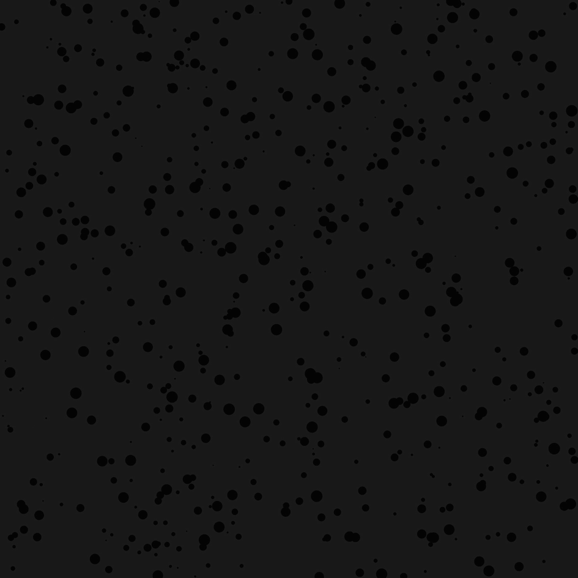

一幅抽象画呈现出一个黑色方块，里面有呈随机图案的深色圆圈簇。

**图 4-1**

圆圈随机泼溅效果

```
for (let i = 0; i < iterations; i += 1) {
  svg.create('circle').set({
    cx: Gen.random(0, 1000),
    cy: Gen.random(0, 1000),
    r: Gen.random(1, 10)
  });
}
```

### 变化的颜色和不透明度

此时，我们有无色的溅点随机地点缀在画布上。让我们通过改变 `fill` 的色相和不透明度来改变这一点。我们将使用 `hsl()` 函数来实现，这个函数我们以后会经常用到。它的语法如下：

```
hsl(hue saturation lightness / alpha)
```

色相可以是 `0` 到 `360` 之间的任何数字。饱和度和明度是百分比值，而 alpha 分量（决定不透明度）可以是百分比，也可以是 `0` 到 `1` 之间的数字。

在我们的循环中，在半径下方添加以下行（确保用逗号分隔这些行）：

```
fill: `hsl(${Gen.random(0, 360)} 80% 80% / ${Gen.random(5, 40)}%)`
```

现在，我们的溅点变得生动了一些（见图 4-2）。但是为什么要局限于圆圈呢？为什么不向组合中添加一些其他元素，让它看起来不那么像一个宇宙球池呢？在下一个版本的草图中，我们将精确地做到这一点。复杂度将显着增加，所以我们会慢慢地逐步讲解。

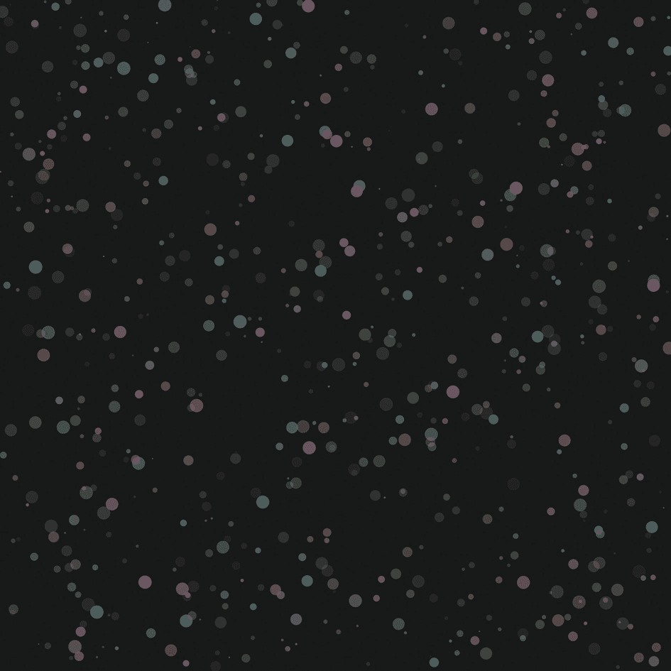

一幅抽象画呈现出一个黑色方块，其中散布着具有渐变色和不同尺寸的点。

**图 4-2**

色彩更丰富的溅点

### 变化的元素选择

在我们的 `iterations` 变量下面，创建一个名为 `elements` 的数组，并用 `circle`、`line` 和 `rect` 填充它：

```
let elements = ['circle', 'line', 'rect'];
```

接下来，删除 `for` 循环中所有现有的代码，并将其替换为以下行，该行将从先前定义的 `elements` 数组中随机选择一个元素。

```
// 随机选择一个元素。
let element = Gen.random(elements);
```

在下一步中，我们将使用随机值初始化一些变量，这些变量稍后可以应用于我们随机选择的元素。除了 `x`、`y` 和 `fill` 之外，我们还将改变 `stroke` 和 `stroke-width`。

```
// 设置可在任意元素上使用的变量。
let x = Gen.random(200, 800);
let y = Gen.random(200, 800);
let fill = `hsl(${Gen.random(120, 240)} 80% 80% / ${Gen.random(5, 40)}%)`;
let stroke = `hsl(${Gen.random(0, 120)} 80% 80% / ${Gen.random(5, 40)}%)`;
let strokeWidth = `${Gen.random(1, 3)}`;
```

这里你会发现，我将 `x` 和 `y` 变量限制在 `200` 到 `800` 的范围内，这确保了我们的形状保持在该区域内，而不会覆盖整个画布。这样做是为了让最终结果更像一幅精心构图的作品，而非一团散乱的元素。

接下来，我们将设置一个 `props` 变量（`properties` 的常用缩写）。思路是根据所选元素来设置其属性。由于每个元素在某些属性上有各自独特的语法（例如，`rect` 有 `x` 和 `y`，而圆形则有 `cx` 和 `cy`），我们需要一种方法来按条件填充 `props`。有几个方法可以解决这个问题，但 `switch` 语句特别适合这种情况。它允许我们逐个情况（字面意思，你马上就会看到）地填充 `props` 变量。

```
// 初始化属性变量。
let props;
// 根据所选元素填充属性。
switch(element) {
  case 'circle':
    props = {
      cx: x, cy: y, r: Gen.random(1, 10),
      fill: fill, stroke: stroke, stroke_width: strokeWidth
    };
    break;
  case 'line':
    props = {
      x1: x, y1: y, x2: x + (Gen.random(-20, 20)),
      y2: y + (Gen.random(-20, 20)), stroke: stroke
    };
    break;
  case 'rect':
    props = {
      x: x, y: y, width: Gen.random(5, 25), height: Gen.random(5, 25),
      fill: fill, stroke: stroke, stroke_width: strokeWidth,
      transform: `rotate(${Gen.random(0, 360)} 500 500)`
    };
}
```

这里可能稍微需要解释的一行是 `rect` 属性中包含的 `transform` 属性。这个属性可以接受 `translate`、`rotate`、`scale` 或 `skew` 命令作为参数，并附带一个变换值以及另外两个代表变换原点的值。原点是一组 `x` 和 `y` 坐标，定义了变换所依据的参考点。例如，对于 `rotate` 命令，我们就是相对于 `500 500`（即 `viewBox` 的中心）随机旋转 `rect`。

在我们的 `switch` 语句之后，循环中还剩一行代码要添加。这行代码就是实际创建 `element` 并将 `props` 应用于它的代码。

```
// 创建元素并设置其属性。
svg.create(element).set(props);
```

现在运行草图时，你应该（希望）能看到类似图 4-3 所示的结果。也许我们并没有成功地让它看起来不那么爆炸性（在我看来，它像是一场五彩纸屑的爆发），但不同的形状以及描边值的加入，无疑在多样性和视觉趣味性上增色不少。

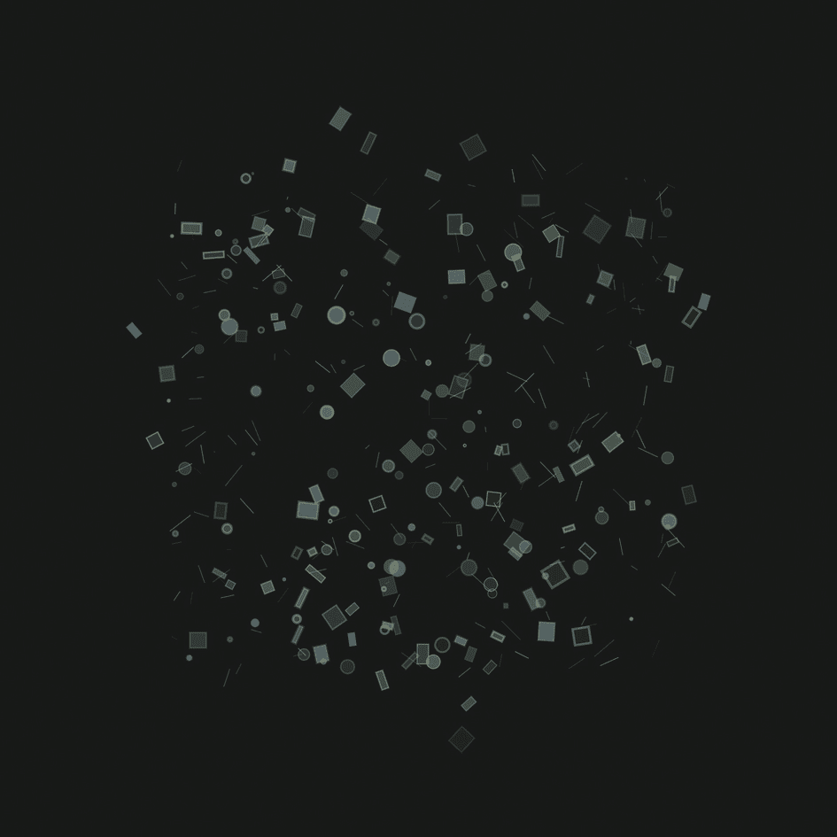

一幅抽象图，显示了一个褪色的圆形，其中聚集了一簇颜色渐变、随机分布的元素，背景为深色。这些元素包括正方形、长方形、圆形和线条。

**图 4-3** 随机元素像五彩纸屑般散落

## 规则网格

不受约束的随机性只能让我们走到这一步；我们需要一些技巧来驯服和约束它。在生成艺术领域，一个特别突出的技巧是使用网格，它允许我们结构化地组织随机性。

### 嵌套 For 循环

嵌套 `for` 循环由一个在另一个循环内部运行的循环组成。由于网格由列（沿 x 轴）和行（沿 y 轴）组成，因此嵌套 `for` 循环在其构建中非常有用。通常的做法是，我们沿 y 轴开始创建行，然后对于每一行，我们沿 x 轴从左向右移动，填充该列中的每个单元格。这种移动方式模拟了计算机历史上将像素数据绘制到显示器的方式：从左上角开始，横向移动，然后向下工作。

因此，外循环将是我们的 y 轴，向下移动。对于 y 轴的每次迭代，内（嵌套）循环将横向移动，填充 x 轴。

```
// 嵌套循环结构示例。
for (let y = 0; y < height; y += 1) {
  for (let x = 0; x < width; x += 1) {
    // 代码写在这里。
  }
}
```

让我们创建一个草图来更好地说明这一点。复制并重命名模板文件夹，将其命名为 `07-regular-grids`。在背景下方，我们将设置一个组元素来充当我们的网格容器。

```
// 创建我们的网格容器组。
let grid = svg.create('g');
```

现在运行我们的 `for` 循环，每次迭代向 `grid` 添加一个 `rect` 元素。

```
// 用于可视化网格的嵌套循环。
for (let y = 0; y < 700; y += 50) {
  for (let x = 0; x < 700; x += 50) {
    grid.create('rect').set({
      x: x, y: y, width: 40, height: 40, fill: 'none', stroke: '#eee'
    });
  }
}
```

我们在这里使用的值并非特别有意义；我们可以选择不同的增量值、迭代次数、正方形的宽度和高度等。我们稍后可以整理这些值。如果你运行 `live-server`，你会注意到网格偏离中心，位于左上方（因为我们的 `x` 和 `y` 值初始化为 `0`）。我们可以调整 `x` 和 `y` 值，直到网格与 `viewBox` 的中心对齐，但这会涉及一些繁琐的试错，并且每次更改网格时都需要调整。相反，让我们使用 SvJs 内置的 `moveTo()` 方法。`moveTo()` 方法将给定元素按其中心点移动到新位置。新位置以 `(x, y)` 坐标对的形式传入。此方法对组元素特别有用（因为其中心点不容易计算），但也可以用作 `transform: translate(x y)` 语法更直观的替代方案。SvJs 还提供了一个相关的 `getCentre()` 方法（`moveTo()` 方法内部也使用了该方法），用于获取元素的中心坐标，返回一个包含 `x` 和 `y` 属性的 `object`。当你想将一个元素放置在另一个元素内部时，这非常有用。

循环之后，按如下方式调用 `moveTo()` 方法：

```
// 将网格居中于 viewBox 内。
grid.moveTo(500, 500);
```

现在网格应该与我们 `viewBox` 的中心完美对齐，如图 4-4 所示。

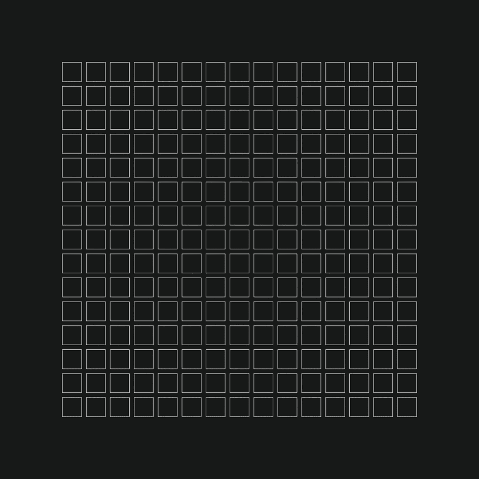

一幅抽象图，展示了一个由 225 个正方形组成的网格状图案，背景为深色。

**图 4-4** 一个居中且规则的网格

### 更灵活的网格

到目前为止，我们已经硬编码了网格的值。我的意思是，我们直接使用值来控制网格的划分、单元格间距、大小等，而不是使用包含值的变量。后一种方法提供了更大的灵活性。

在我们的 `for` 循环之前，设置并初始化以下变量。我们将使用的值将反映我们已经创建的网格；稍后我们会更改它们。

```
// 设置一些与网格相关的变量。
let gridSize = 700;
let rows = 15;
let spacing = 5;
```

接下来我们需要的是控制循环增量值和每个单元格大小的变量。然而，这些值应该从我们之前设置的那些值中*推导*出来，而不是每次想要更改网格时都重新计算。通过一点基本的数学运算，以下是实现方法：

```javascript
let increment = gridSize / rows;
let cellSize = Math.abs(increment - spacing);
```

`Math.abs()` 函数可确保 `cellSize` 始终为正值，从而避免在调整 `rows` 和 `spacing` 值时出现错误。接下来，我们需要将这些值整合到循环中，按如下方式调整：

```javascript
for (let y = 0; y < gridSize; y += increment) {
  for (let x = 0; x < gridSize; x += increment) {
    grid.create('rect').set({
      x: x, y: y, width: cellSize, height: cellSize,
      fill: 'none', stroke: '#eee',
    });
  }
}
```

现在，我们可以自由调整网格变量，循环也会相应地做出响应。我们甚至可以将其随机化，每次刷新时获得不同的网格（如图 4-5 所示）。

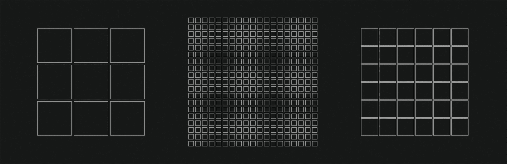

一幅抽象图展示了三种不同的网格状图案。左侧是一个三行三列的网格。中间是一个由方形簇构成的网格。右侧是一个六行六列的网格。

**图 4-5** 规则网格的变体

```markdown
```javascript
let gridSize = Gen.random(400, 800);
let rows = Gen.random(2, 20);
let spacing = Gen.random(5, 10);
```

## 裁剪路径与调色板

现在我们已经有了规则网格，接下来需要为其注入活力。这一改动足够大，值得为草图创建一个新迭代。如果你希望将当前工作保存为模板，请保存并复制现有草图文件夹，将其重命名为类似 `08-colourful-grids` 的名字，这样你就能清楚接下来的工作内容。

### 颜色数组

在之前的“元素无处不在”草图中，我们使用 `Gen.random()` 来即时生成颜色。但如果我们希望使用特定的调色板，或者一组调色板，以便随机选择呢？

一种常见的方法是将预先选定的调色板存储为颜色值数组，如下所示：

```javascript
// 创建一个调色板。
let palette = ['#5465FF', '#788BFF', '#9BB1FF', '#BFD7FF', '#E2FDFF'];
```

网络上有很多网站（不胜枚举）可以为你提供调色板灵感。事实上，你可能会发现很难只选定一个调色板。在这种情况下，更合理的方式是保存多个调色板，并将它们作为数组存储在另一个数组中。这样，它们就变成了嵌套数组，即包含在其他数组中的数组。你也可以称它们为二维或多维数组。

让我们创建一个包含三个调色板的二维数组（如图 4-6 所示）。在定义初始网格组的下方，包含以下代码（如果你愿意，也可以替换成自己的调色板）：

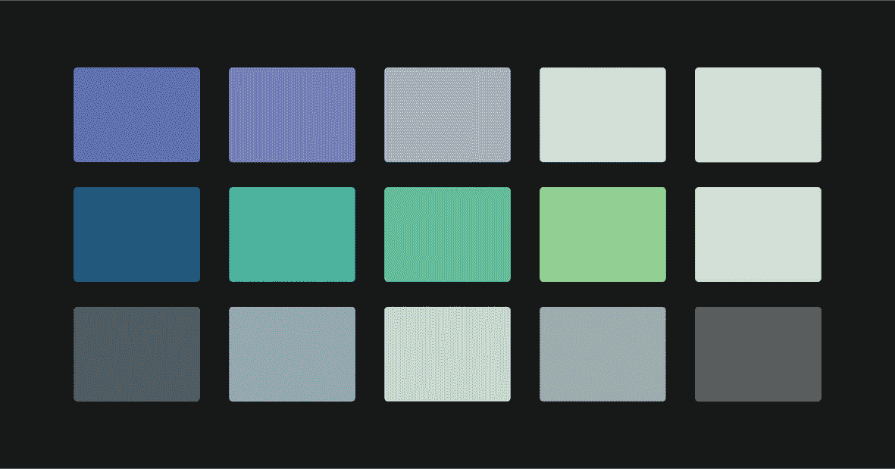

一幅抽象图展示了三行，每行有五个矩形，分别使用三种不同的调色板，背景为深色。

`图 4-6` 我们的三个调色板

```javascript
// 创建我们的调色板。
let palettes = [
  ['#5465FF', '#788BFF', '#9BB1FF', '#BFD7FF', '#E2FDFF'],
  ['#22577A', '#38A3A5', '#57CC99', '#80ED99', '#C7f9CC'],
  ['#4C5760', '#93A8AC', '#D7CEB2', '#A59E8C', '#66635B']
];
```

接下来，我们将随机选择一个调色板，并将其存储在一个变量中，以便稍后调用。

```javascript
// 随机选择一个调色板。
let pickedPalette = Gen.random(palettes);
```

现在来看网格变量。你可以保留上一次草图时的设置，但这次我不会将 `gridSize` 或 `spacing` 随机化，因为我希望将重点放在草图中其他随机化元素上。

```javascript
let gridSize = 600;
let rows = Gen.random(3, 10);
let spacing = 10;
let increment = gridSize / rows;
let cellSize = Math.abs(increment - spacing);
```

### 裁剪内容

开发基于网格的组合的下一步将涉及一个名为 `clipPath` 的概念。本质上，`clipPath` 的作用是定义它所应用到的形状的可见区域，就像剪刀定义纸板剪影一样。

我们不会使用方形来定义网格单元格，而是使用一个方形的 `clipPath`。这样，我们就可以容纳单元格的内容，而不会让它们溢出到相邻单元格中。让我们暂时退一步来说明这一点。在图 4-7 中，我们有一个方形的 `rect` 定义了 `clipPath`，而 `circle` 是被裁剪的元素。在右侧，你可以看到将 `clipPath` 应用于 `circle` 的效果。

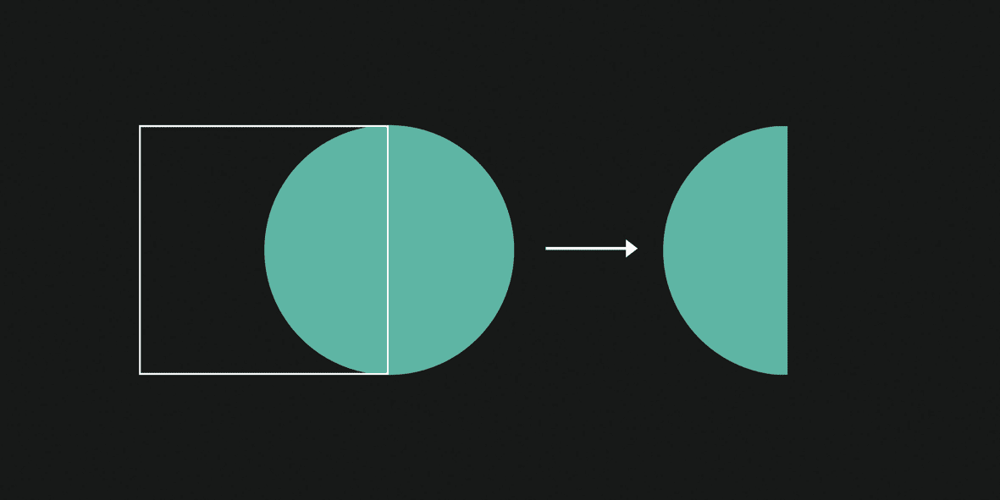

一幅抽象图左侧显示一个方形与一个阴影圆形重叠，该圆形被转换为半圆形，背景为深色。

`图 4-7` `clipPath` 的工作原理

一个 `clipPath` 需要一个 `id` 以便稍后引用。嵌套在 `clipPath` 元素内部的是实际执行“裁剪”的形状或路径。以下是如何创建图 4-7 中半圆形的示例方法。

```javascript
// 使用 id 初始化 clipPath。
let clip = svg.create('clipPath').set({ id: 'clip1' });
// 创建 clipPath 的形状。
clip.create('rect').set({
  x: 0, y: 0, width: 100, height: 100, stroke: '#fff'
});
// 通过调用其 id 将其应用于圆形。
svg.create('circle').set({
  cx: 100, cy: 50, r: 50, fill: '#80ffe6', clip_path: 'url(#clip1)'
});
```

如你所见，`clipPath` 通过其 `id` 被调用，被视为内部 `url` 引用，这与渐变和图案非常相似。现在让我们回到草图，在循环内应用相同的逻辑。首先，像之前一样创建嵌套循环：

```javascript
for (let y = 0; y < gridSize; y += increment) {
  for (let x = 0; x < gridSize; x += increment) {
  }
}
```

接下来，创建 `clipPath`。我们需要为每个实例创建一个唯一的 `id`，因此我们不能像之前那样传入静态字符串——否则 `id` 会在每次循环迭代时重复。相反，我们可以使用 `x` 和 `y` 迭代变量，利用模板字面量语法生成动态字符串，如下所示：

```javascript
// 使用唯一 id 创建裁剪路径。
let clip = svg.create('clipPath').set({ id: `${x}${y}` });
```

现在我们可以创建 `clipPath` 的实际形状。为了保持简单，我们将其设为方形，即一个宽度和高度等于 `cellSize` 的 `rect`。

```javascript
// 创建裁剪路径形状。
clip.create('rect').set({
  x: x, y: y, width: cellSize, height: cellSize
});
```

有了 `clipPath` 之后，我们需要决定里面放什么内容。这里是我们发挥创意的空间！每个单元格有四个角，所以我们要做的是随机将一组圆形以这四个位置中的任何一个为中心。这些位置的坐标由当前的 `x` 和 `y` 值以及 `cellSize` 决定。以下是我们如何计算这些位置并随机选择其中一个的方法：

```javascript
// 定义可能的位置。
let positions = [
  [x, y],                     // 左上角
  [x + cellSize, y],          // 右上角
  [x + cellSize, y + cellSize], // 右下角
  [x, y + cellSize]           // 左下角
];
// 随机选择一个位置。
let pickedPosition = Gen.random(positions);
```

现在，创建 `circle` 组。这将涉及第三个循环（即循环中的循环中的循环——如果你愿意，可以称之为无限套娃循环），我们将创建五个从随机选择的中心点向外辐射的圆形。别忘了我们之前选取的调色板；每个圆形的填充颜色将相应地着色。

```javascript
// 为我们的圆创建一个组。
let circles = grid.create('g');
// 创建圆，应用选定的位置和调色板。
for (let i = 0; i < 5; i += 1) {
  circles.create('circle').set({
    cx: pickedPosition[0],
    cy: pickedPosition[1],
    r: cellSize - (i * (cellSize / 5)), // 这里稍微调整了一下
    fill: pickedPalette[i]
  });
}
```

我们还有几个步骤要走。实际上我们还没有将 `clipPath` *应用*到任何东西上，所以如果我们现在运行草图，只会看到一堆相当杂乱的圆重叠在一起。我们将通过将 `clipPath` 应用于圆组（而不是圆本身）来解决这个问题。作为循环内的最后一步，我们将创建一个方形边框来框住每个单元格，只是为了给图形增加一点轮廓感。

```javascript
// 将裁剪路径应用于圆组。
circles.set({
  clip_path: `url(#${clip.get('id')})`
});
// 创建一个方形来框住单元格。
grid.create('rect').set({
  x: x, y: y, width: cellSize, height: cellSize,
  fill: 'none', stroke: '#eee',
});
```

});

```

现在，在循环之外，像我们之前所做的那样将网格居中。

```javascript
// 将网格在 viewBox 内居中。
grid.moveTo(500, 500);
```

瞧！你现在应该会看到一些类似于图 4-8 中的变体。（顺便说一句，如果你发现网格没有始终正确居中，那是因为网格的边界框包含了不可见的裁剪内容，而这些内容并不总是围绕网格对称排列。）

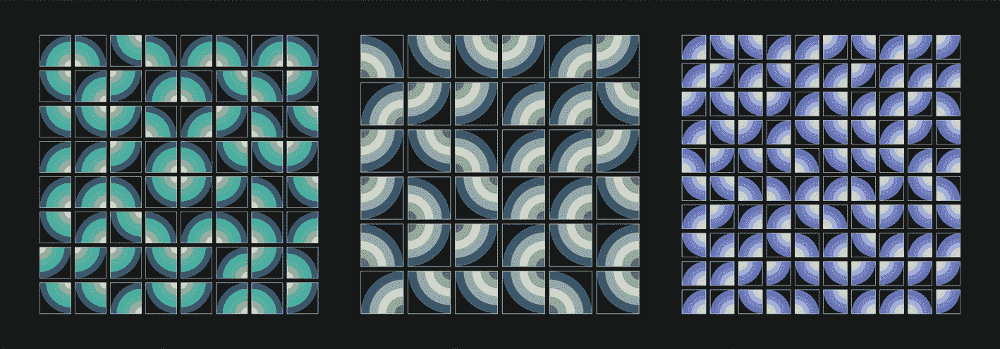

一幅抽象图展示了三个网格状图案。每个网格有一簇方块，其中包含在不同位置的裁剪后的同心圆，背景为深色。

**图 4-8** 色彩丰富的裁剪路径网格图案

## 选择与机会

如果我们在选择是否填充网格中的某个单元格时引入一个机会元素，会怎么样呢？这可以产生一种看起来不那么死板的构图——这不一定是更好的，但它可以在多样性方面提供更多可能。

### SvJs 的 `Gen.chance()` 函数

当我们谈论概率时，通常试图确定的是某事发生的可能性或几率。这件事要么发生要么不发生，所以我们想要的是一个二元响应——或布尔值——来告诉我们“是”或“否”，“赢”或“输”。今天你的马“维克托·矢量”会在比赛中让你赢钱吗？鉴于赔率是 7 比 2，获胜的几率是 22%（2 / (7 + 2) × 100 = 22.22）。

我们如何将这种逻辑应用到构图中呢？使用纯 JavaScript 和 `Math.random()` 其实相当简单，但 SvJs 通过其 `Gen.chance()` 函数提供了一种更直观、更简洁的替代方案。

默认情况下（即，不带任何参数），`Gen.chance()` 基于 50/50 或 50% 的概率返回 `true` 或 `false`。如果我们提供一个参数，它将被解释为一个百分比。

```javascript
// 以下代码有 60% 的概率返回 true。
Gen.chance(60);
```

如果提供两个数字，则参数被解释为赔率。如果你更倾向于像在博彩公司下注那样思考概率，而不是计算精确的百分比值（这在底层实际上已为你计算好），这会很有用。

```javascript
// 有 7 比 2 的概率返回 true。
Gen.chance(7, 2);
```

### 实际应用中的机会

让我们创建一个新草图，使用 `Gen.chance()` 来决定网格内的单元格是否被填充内容。复制 `08-colourful-grids` 文件夹并将其重命名为 `09-chance`，然后删除内层循环中的所有内容（留给你一个空的嵌套 `for` 循环）。接下来，将 `palettes` 数组和 `pickedPalette` 变量替换为一个随机生成的 `hue`（色相）。

```javascript
// 选择一个随机色相。
let hue = Gen.random(0, 360);
```

你可以保持与网格相关的变量不变，或者根据自己的喜好调整它们。接下来，*在* `x` 和 `y` 循环*之间*（即在第一个循环内，但在第二个循环之前），像这样增加 `hue`：

```javascript
// 一个创建网格的嵌套循环。
for (let y = 0; y < gridSize; y += increment) {
    // 更新色相，使其不会超出 [0, 360] 的范围。
    hue = (hue >= 360) ? (hue - 360) + (120 / rows) : hue + (120 / rows);
    for (let x = 0; x < gridSize; x += increment) {
    ...
```

这看起来可能是一种过于复杂的增加 `hue` 值的方法，但实际上它只做了两件事：首先，确保 `hue` 值不会超出边界（即超过 `360`）；其次，根据行数相对增加 `hue` 值。这样做的目的是，行数较少的草图变体具有较高的增量值，而行数较多的变体具有较低的增量值，从而使整体色彩更加一致。

在 `x` 循环内部，我们将实际使用 `Gen.chance()`。将其用作 `if` 语句中的一个条件，我们可以根据它返回的结果有条件地触发第三个循环。这个循环会在每个单元格内创建随机的 `line` 元素，但仅当该单元格被 `Gen.chance()` 函数激活时才创建。我们将实际概率设置为 60%。

```javascript
// 基于概率运行循环。
if (Gen.chance(60)) {
    for (let i = 0; i < cellSize; i += 1) {
        grid.create('line').set({
            x1: Gen.random(x, x + cellSize),
            y1: Gen.random(y, y + cellSize),
            x2: Gen.random(x, x + cellSize),
            y2: Gen.random(y, y + cellSize),
            stroke: `hsl(${hue} 80% 80% / 0.33)`
        });
    }
}
```

这应该会产生渐变的俄罗斯方块式排列，类似于图 4-9。

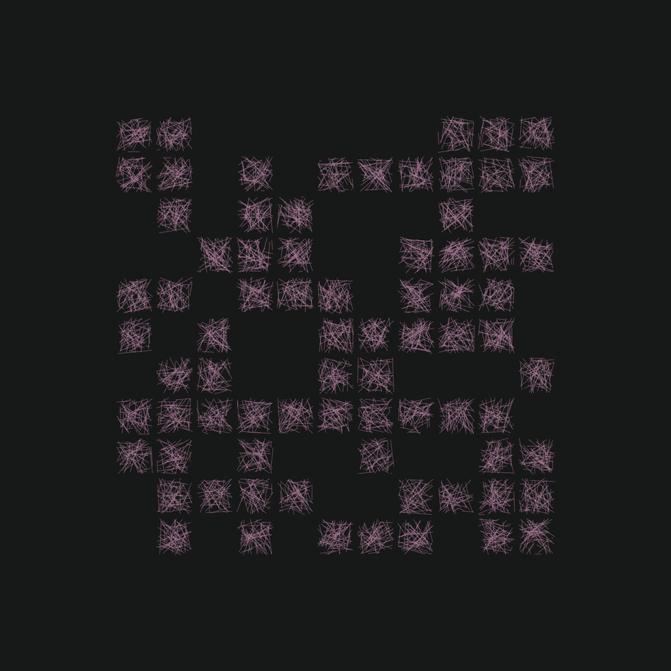

一幅抽象图展示了渐变的俄罗斯方块式排列，背景为深色。

**图 4-9** 实际应用中的 `Gen.chance()`

## 概率分布

概率分布描述了数字在给定范围内如何分布（或散布）。除非你以某种形式学习过统计学，否则你可能对这个术语不太熟悉。如果仅仅提到统计就让你冷汗直流，别担心——我们不会深入探讨底层数学。实际上我们已经在使用一种特定的概率分布，只是没有给它命名而已。

### 均匀分布

`Gen.random()` 函数是*均匀*分布的一个例子，其中范围内的每个数字被选中的机会均等。换句话说，`Gen.random()` 函数（或者其基础的 `Math.random()`）中不存在任何隐藏的偏差或趋势，会使范围内的某个特定数字子集更有可能被选中。

在图 4-10 中，我们可以看到均匀分布表现为 1000 条垂直线的 `x` 坐标变化。这些线分散在各处，出现在 x 轴上任何位置的机会均等。

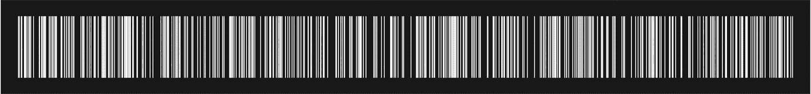

一幅抽象图展示了一个矩形结构，其中有多条不同尺寸的明亮线条呈线性排列，背景为深色。

**图 4-10** 垂直线的均匀分布

### 高斯分布

在现实生活的测量中（即那些在二进制 0 和 1 世界之外的测量），均匀分布实际上并不常见。更常见的是所谓的*高斯*分布，其中大多数值聚集在一个中点附近，并在该点两侧逐渐减少。它也被称为正态分布，当绘制成图表时，会形成一条钟形曲线。可视化为一系列垂直线时，它看起来像图 4-11。

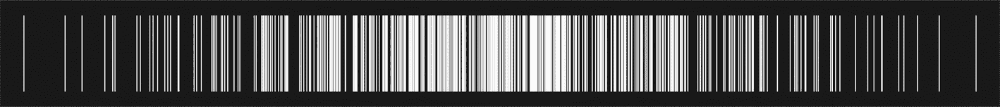

一幅抽象图展示了一个矩形结构，其中有多条不同粗细的高亮线条呈线性排列，背景为深色。

**图 4-11** 垂直线的正态分布

大多数值聚集的中点被称为均值，而它们偏离该均值的程度被称为西格玛（sigma）或标准差。

`SvJs` 带有一个名为 `Gen.gaussian()` 的函数，该函数返回一个符合高斯分布的随机数。在没有参数的情况下，它将返回大约介于 -3 和 +3 之间的值，均值为 0，标准差为 1。这在实际应用中意味着：

- 68% 的值将落在 -1 和 1 之间（标准差范围内）
- 95% 的值将落在 -2 和 2 之间
- 99% 的值将落在 -3 和 3 之间

通过向 `Gen.gaussian()` 提供参数，我们可以修改均值和标准差。

```javascript
// 将均值和标准差分别调整为 10 和 2。
Gen.gaussian(10, 2);
```

在前面的例子中，将均值调整为 10，标准差调整为 2，这意味着 68% 的值将落在均值两侧的 -2 到 +2 范围内（即 8 到 12 之间），95% 的值落在 6 到 14 之间，超过 99% 的值落在 4 到 16 之间。严格来说，高斯分布的值是无界的，因此偶尔可能会出现极端异常值。例如，如果您希望将结果限制在标准差三倍范围内，则可以使用 `Gen.constrain()` 函数来约束结果，如下所示：

```javascript
// 将 Gen.gaussian() 的结果限制在 -3 到 +3 之间。
let gaussian = Gen.gaussian(0, 1);
let constrainedGaussian = Gen.constrain(gaussian, -3, 3);
```

接下来，让我们快速创建一个草图，演示如何使用 `Gen.gaussian()` 返回的结果将 `x` 和 `y` 坐标映射到我们的 `viewBox` 上。复制我们的模板并将其命名为 `10-gaussian-dist`。像往常一样，在背景下方，初始化一个循环，该循环将运行 10,000 次（是的，很多！），并在其内部生成一对高斯坐标。

```markdown
这些坐标围绕`viewBox`的中心（即 500）分布，标准差为 150。接下来，仍然在循环内，创建我们的线条，将它们基于高斯坐标，并为其端点添加一些随机化。

```javascript
// 基于高斯坐标创建线条。
svg.create('line').set({
    x1: gaussianX,
    y1: gaussianY,
    x2: gaussianX + Gen.random(-10, 10),
    y2: gaussianY + Gen.random(-10, 10),
    stroke: `hsl(${Gen.random(150, 270)} 80% 80% / 0.8)`
});
```

您可以在此处停止，观察生成的圆形图案，但我添加了另一个小循环（在第一个循环之后，而不是在其内部），通过一系列渐隐的圆形描边来微妙地强调分布的形状。

```javascript
// 创建一系列圆形来框定分布。
for (let i = 0; i < 10; i += 1) {
    svg.create('circle').set({
        cx: 500, cy: 500, r: 25 + (i * 25), fill: 'none',
        stroke: `hsl(0 0% 0% / ${0.25 - (i / 50)})`, stroke_width: 15
    });
}
```

之后，您应该会得到类似于图 4-12 的结果。

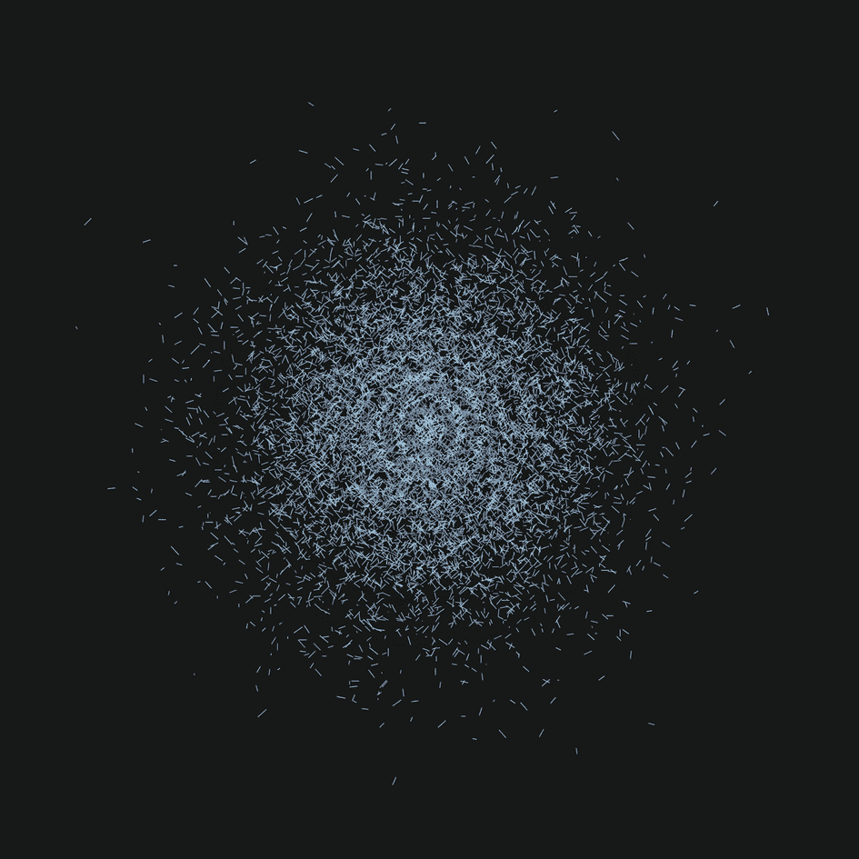

**图 4-12**

使用`Gen.gaussian`定位 10,000 条线条

就生成的标记而言，与我们之前所做的任何事情相比，这是一个相当沉重的部分（10,000 个元素会做到这一点）。这可能会对渲染性能产生负面影响，并且如果您从 HTML 中复制它，也会意味着一个更大的 SVG 文件。一个简单的减小尺寸的方法是，在每次调用`Gen.gaussian()`函数时将第三个参数设置为`false`。与`Gen.random()`一样，`Gen.gaussian()`接受第三个参数，该参数决定它是返回浮点数（更精确但有很多位）还是整数（整数）。在这种情况下，使用整数处理可以将生成的标记量减少大约一半。

### 帕累托分布

帕累托分布，也称为帕累托原则或 80-20 规则（如图 4-13 所示），是我们将介绍的最后一个概率模式。它以一位意大利经济学家的名字命名，他有一个著名的观察：社会 20% 的人口控制着 80% 的财富。这发生在 19 世纪 90 年代，所以如果帕累托在今天做出同样的观察，我们可能正在讨论 99-1 规则！尽管如此，其基本思想保持不变：少数拥有多数，多数拥有少数。

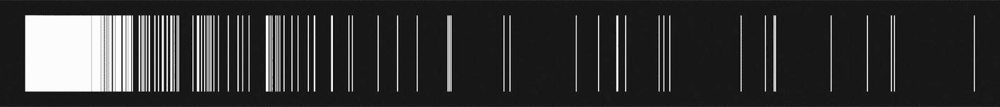

**图 4-13**

垂直线的帕累托分布

这在生成艺术中可用于实现不同大小元素之间的平衡。我们将在下一个草图中使用它来创建一个名为“波尔图·帕累托”的伪城市天际线，其中城市建筑的大小将使用 SvJs 的`Gen.pareto()`函数进行变化。此函数接受两个参数；第一个参数定义要返回的范围内的最小值，第二个参数定义此数字是浮点数还是整数。

```javascript
// 返回一个帕累托分布的整数，不小于 20。
Gen.pareto(20, false);
// -> 32
```

复制模板文件夹并将其命名为`11-porto-pareto`，然后在背景下方创建一个包含我们城市天际线的组。

```javascript
// 为我们的生成城市创建一个组。
let portoPareto = svg.create('g');
```

城市天际线将包含三个主要元素：天空、河流（或港口）和建筑物。天空和河流都将是带有渐变的简单`rect`元素；我们将首先创建它们。

```javascript
// 创建天空渐变。
svg.createGradient('sky', 'linear', ['#f58b10', '#d21263', '#940c5e', '#25226c'], 90);
// 创建天空并应用渐变。
portoPareto.create('rect').set({
    x: 150, y: 150, width: 700, height: 400, fill: 'url(#sky)'
});
// 创建河流渐变。
svg.createGradient('river', 'linear', ['#80e5ff10', '#70b566'], 90);
// 创建河流并应用渐变。
portoPareto.create('rect').set({
    x: 150, y: 555, width: 700, height: 295, fill: 'url(#river)'
});
```

希望上述内容不会让您感到意外。接下来，我们将进行一些帕累托分布并创建我们的建筑物。在下面的循环中，有一行代码我特别想解释一下，就是使用`Gen.constrain()`函数设置高度的部分。没有它，我们的帕累托分布将生成一些高得令人眩晕的建筑物，远远超出画布的限制。然而，单独使用带有固定上限的`Gen.constrain()`会导致最高建筑物出现截断效果，因此为了平衡这一点，我添加了一个`Gen.random()`函数来变化上限。

```javascript
// 我们生成城市天际线的循环。
for (let i = 0; i < 60; i += 1) {
    // 获取最小高度为 20 的帕累托分布。
    let pareto = Gen.pareto(20);
    // 约束高度，并稍微随机化上限。
    let height = Gen.constrain(pareto, 20, Gen.random(150, 200));
    // 创建我们的建筑物。
    portoPareto.create('line').set({
        x1: 150 + (i * 12), y1: 550,
        x2: 150 + (i * 12), y2: 550 - height,
        stroke: '#181818', stroke_width: 8
    });
}
```

我们现在已经有了城市天际线，但尚未完成。它看起来相当扁平，我希望它能被框在一个圆形内，并且颜色看起来像是向外散发。为了实现这一点，我将使用一种叫做`mask`的东西。

## 遮罩你的内容

`mask`（遮罩）与`clipPath`（裁剪路径）非常相似，区别在于它允许不同程度的透明度。`clipPath`是一种全有或全无的方式：你要么位于定义其形状的边界内部，要么在外部。而使用`mask`，你可以根据形状的亮度或明度来淡入或淡出内容。因此，在创建遮罩时，最直接的方式是使用黑白两色。白色（`#ffffff`）对应完全透明的区域，而黑色（`#000000`）则对应完全不透明的区域。

在图 4-14 中，三角形是`mask`的形状，将其应用于`rect`后的结果显示在右侧。

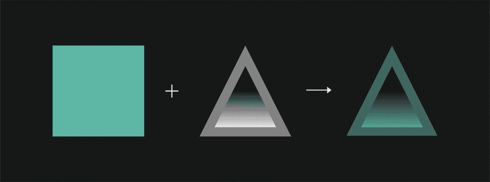

一张示意图展示了一个带有阴影的方形，它被添加到一个单色三角形上，最终生成一个具有与方形阴影相似的渐变色的三角形，背景为深色。

**图 4-14**

遮罩的工作原理

与`clipPath`类似，`mask`元素需要一个`id`，并通过指向此`id`的 URL 引用将其应用于另一个元素。我们要做的是创建一个带有`circle`形状的遮罩，这个`circle`的填充将包含一个径向渐变。然后，我们将它应用于之前创建的`portoPareto`组。

```javascript
// 创建一个径向渐变。
svg.createGradient('radialGrad', 'radial', ['#ffffff', '#ffffff60']);
// 创建一个遮罩，并在其内部创建一个带有径向渐变的圆形。
let mask = svg.create('mask').set({ id: 'mask' });
mask.create('circle').set({
    cx: 500, cy: 500, r: 325, fill: 'url(#radialGrad)',
});
// 将遮罩应用于该组。
portoPareto.set({ mask: 'url(#mask)' });
```

现在你应该能看到城市景观被裁切成了这个圆形的形状，并且边缘略微淡出。作为最后一步，我添加了一个带渐变的圆形描边，以便更清晰地勾勒出内容。
```

```javascript
// 为我们的圆形边框创建一个线性渐变。
svg.createGradient('strokeGrad', 'linear', ['#eeeeee', '#eeeeee15']);
// 创建边框并应用渐变。
svg.create('circle').set({
cx: 500, cy: 500, r: 345, fill: 'none',
stroke: 'url(#strokeGrad)', stroke_width: 2.5
});
```

结果的一个变体显示在图 4-15 中。

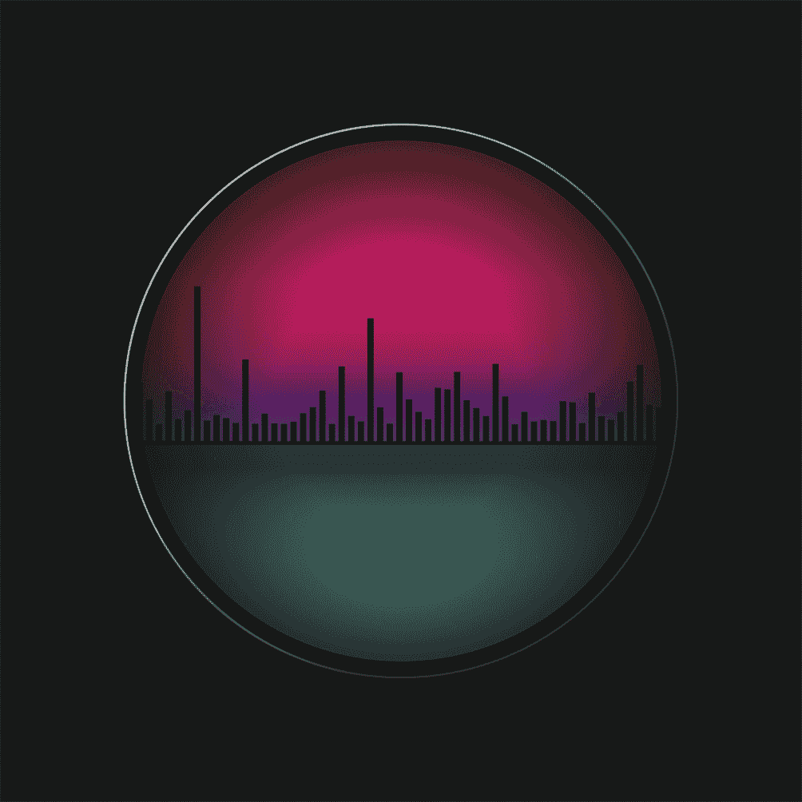

一张示意图展示了一个高亮的圆形，内部有若干垂直条，周围环绕着渐变色，背景为深色。

**图 4-15** 我们的波尔图帕累托城市景观

## 本章小结

在本章中，我们涵盖了以下内容：

-   坐标、颜色、元素尺寸等的随机化
-   如何从一维和二维数组中随机选取项目
-   使用嵌套`for`循环构建规则网格
-   如何使用`clipPaths`和遮罩
-   利用偶然性作为触发元素创建的方法
-   如何使用高斯和帕累托概率分布

在下一章中，我们将学习如何使用噪声（noise）为我们的构图增加一种更有机的随机性。