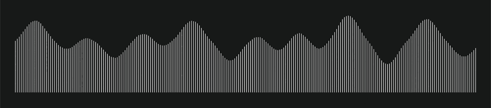
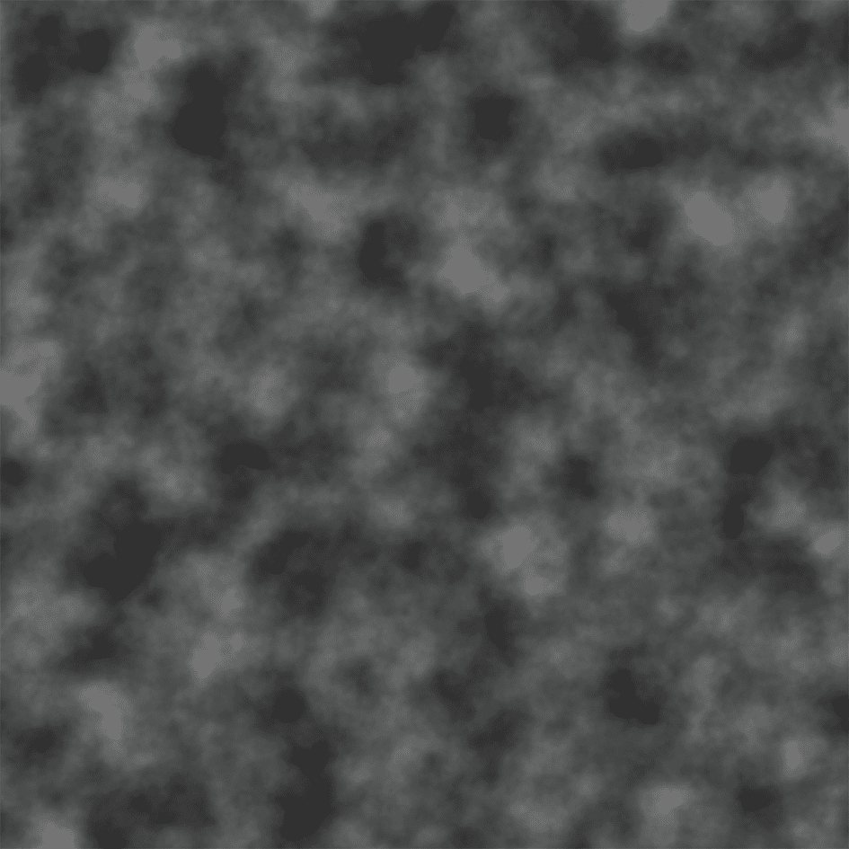
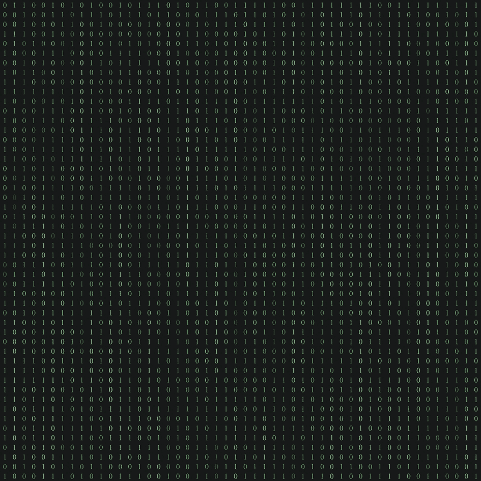
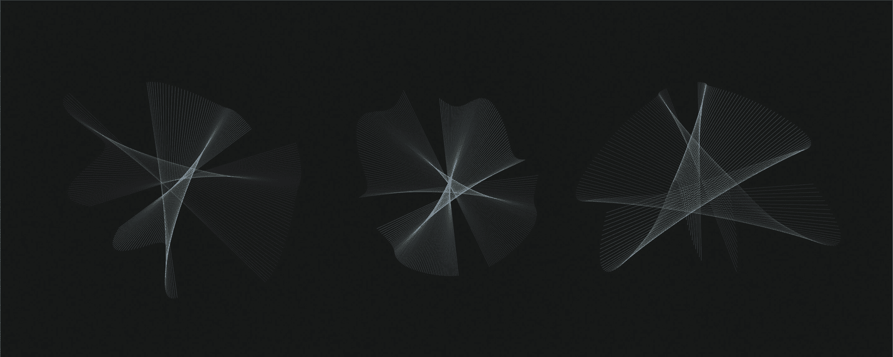

# 5. 对噪声的需求

在本章中，我们将讨论到目前为止所使用的随机函数的局限性，以及如何通过使用 SvJs 的`Noise`模块来克服这些局限性。我们将探讨什么是噪声及其用途，在本章结束时，我们将在生成式创作的武库中增添一项重要的技术。

## 随机函数的局限

有时，随机性就是过于……嗯，随机。即使我们使用概率分布来塑造随机化值，并将它们约束在结构化模式中，连续值之间的差异也总是带有那种标志性的“断奏”感。换句话说，当并排比较时，这些值总会有一些跳跃和抖动。你不会看到一个值到另一个值的平滑过渡。

别误会我的意思——这通常正是我们想要的，也是随机函数的设计初衷。但是，仅靠随机性很难创造出任何具有有机质感的作品。为此，我们需要噪声。

## 制造噪点

1997 年，肯·佩林荣获奥斯卡奖。这一奖项之所以史无前例，是因为佩林既非演员、导演，也非配乐师，而是一名程序员。为 1982 年上映的电影《创》开发能够让 3D 物体看起来更自然的程序化纹理（即有机质感）时，佩林设计出的算法被命名为`佩林噪声`，此后该算法在计算机图形学领域变得无处不在。

你可以在 GIMP、Photoshop 等图像编辑器，Inkscape、Illustrator 等矢量编辑器，Blender 等 3D 图形软件包，以及历年来无数视频游戏中找到其实现。Minecraft 就是绝佳范例：那些玩家开采资源的无限块状地形，正是利用佩林噪声生成的高度图来决定其起伏变化的。

因此，佩林噪声在图形领域无处不在。但它究竟是什么？

## 噪声解析

从技术上讲，噪声函数确实会产生随机数，但其生成方式具有平滑有序的特点——这正是关键所在。在图 5-1 中，白线的高度通过佩林噪声变量随机化处理。这是一维噪声的示例，即仅沿单轴操作的噪声值。



抽象图中呈现出一个矩形结构，其内部排列着不同尺寸的明亮线条簇，在深色背景上形成波浪图案。

**图 5-1.** 佩林噪声值的一维表示

噪声本质上是多维的；佩林最初为其三维空间设计，如今也存在四维实现。但由于 SVG 是二维媒介，我将坚持使用`x`和`y`轴。佩林开发的特定算法通过在给定区域以渐变方式混合随机化值来实现效果。这个区域或空间更多是概念性的而非实体；噪声值并非存在于实际平面或独立画布上，而是存在于一个我们可以从中检索值的抽象（且无限）空间中。

例如，在概念坐标`(15, 20)`处获取噪声值会得到介于`-1`和`1`之间的某个值。当我们缓慢遍历此噪声空间到达相邻坐标如`(16, 21)`时，会获得一系列可供使用的平滑变化值。正是我们能利用这些值做什么，使得噪声在审美层面变得有趣。

在图 5-2 中，我们可以看到噪声使用整个画布区域以二维形式呈现。此示例实际上基于像素而非矢量，选择它或许是因为这是直观理解噪声空间概念的最佳方式。在此图中，每个像素的 alpha 分量根据相应的噪声值变化，形成云朵状结构。你立刻就能明白它为何对创建纹理如此有用。



抽象图中呈现出一个方形结构，带有云朵状形态，背景为深色。

**图 5-2.** 佩林噪声值的二维表示

## SvJs 噪声模块

SvJs 库自带噪声实现，设计目标为使用简便且占用空间尽可能小。它位于独立模块中，因此与`Gen`模块类似，使用前需要先导入。

```javascript
import { Noise } from '../../node_modules/svjs/src/index.js';
```

与作为函数集合的`Gen`不同，`Noise`模块基于类实现，因此我们需要先实例化它。

```javascript
// 创建 Noise 类的实例。
let noise = new Noise();
```

该类包含一个名为`get()`的方法，该方法接受`x`坐标和可选的`y`坐标作为参数，并返回噪声空间中该点的值。

```javascript
let noiseValue = noise.get(noiseX, noiseY);
```

静态的`noiseValue`对我们用处不大；我们需要通过遍历噪声空间来逐渐修改它。我们通过递增`noiseX`和/或`noiseY`坐标来实现。以下是在循环中的实现方式：

```javascript
// 首先初始化噪声实例和噪声坐标。
let noise = new Noise();
let noiseX = 15, noiseY = 20;

// 运行循环，缓慢递增坐标以修改值。
for (let i = 0; i < 1000; i += 1) {
  let noiseValue = noise.get(noiseX, noiseY);
  // ... 对 noiseValue 进行处理
  noiseX += 0.003;
  noiseY += 0.003;
}
```

如你所见，我们在循环外定义了初始的`noiseX`和`noiseY`坐标，在循环内使用它们获取`noiseValue`，然后在下次循环运行前以极小的增量递增坐标。这个增量我们可以称之为噪声速度或变化率。在处理噪声时，保持变化率极小非常重要；相对较大的跳跃（例如整数值）不会产生可用结果。

## 进入噪声矩阵

让我们复制模板并创建一个名为`12-noise-matrix`的新草图文件夹，以展示噪声如何用于改变网格内的颜色值。在`sketch.js`文件顶部，将`Noise`模块添加到导入语句中：

```javascript
import { SvJs, Gen, Noise } from '../../node_modules/svjs/src/index.js';
```

接下来，我们将缩短计算`svgSize`（以及`viewport`尺寸）的表达式。实际上，我们可以使用`Math.min()`函数替代三元运算符，该函数返回两个或多个值中的最小值。如果你还记得，我们只想将`svgSize`设置为窗口`innerWidth`或`innerHeight`中的最小值，而`Math.min()`以最简洁的方式实现了这一点。这无疑是个小调整，但暗示了 JavaScript 内置`Math`模块的多种用途。

```javascript
const svgSize = Math.min(window.innerWidth, window.innerHeight);
```

我建议也将此调整应用到我们的基础模板中。

### 充满噪声的网格

对于这个构图，我们将采用熟悉的技术：建立网格，该网格将充当我们的矩阵（毕竟矩阵只是值的网格）。此草图中创建的矩阵将模仿同名电影中的矩阵。我们将在网格中填充 1 和 0，这些数字的颜色将由噪声调制，以实现那种层叠、去饱和的效果。

创建噪声类的实例，然后初始化另外三个变量。其中两个将处理噪声的`x`和`y`坐标，第三个将存储决定噪声坐标递增速率的噪声速度。

```javascript
// 创建噪声对象、噪声 x、y 坐标以及噪声速度。
let noise = new Noise();
let nX = 0, nY = 0;
let noiseSpeed = 0.5;
```

下一段代码应该看起来似曾相识。我们正在设置一些与网格相关的变量，这次我们将省略之前草图中使用的`spacing`和`cellSize`变量，并将`gridSize`设置为覆盖整个`viewBox`。

```javascript
// 设置一些网格相关变量。
let noiseGrid = svg.create('g');
let gridSize = 1000;
let rows = 80;
let increment = gridSize / rows;
```

接下来是我们的循环。我们将从`x`坐标开始外循环，而不是`y`坐标。这样做的效果是从上到下、从左到右构建网格。换言之，我们将先填充列而非行，这将使我们的噪声值以向下流动的方式传播。

在循环内部，我们将使用`noise.get()`方法获取噪声值，并传入我们之前初始化的`nX`和`nY`值。

```javascript
// 创建噪声矩阵。
for (let x = 0; x < gridSize; x += increment) {
  for (let y = 0; y < gridSize; y += increment) {
    // 获取噪声值。
    let noiseValue = noise.get(nX, nY);
  }
}
```

接下来，我们创建实际的文本内容。我们需要一系列 0 和 1 来填充网格，每个数字被选中的概率均为 50%。正如上一章所学，结合三元运算符使用 `Gen.chance()` 函数是最简单的方法。

```javascript
// 创建显示 0 或 1 的文本（各 50% 概率）。
let text = noiseGrid.create('text');
text.content(Gen.chance() ? '1' : '0');
```

现在，我们需要根据 `x` 和 `y` 循环迭代器的值设置数字的位置，并使用 `noiseValue` 变量设置填充颜色的强度（即 `hsl()` 函数中的亮度分量）。同时，我们还应设置字体大小和字体系列。

```
text.set({
x: x, y: y,
font_size: 16,
font_family: 'serif',
fill: `hsl(120 20% ${noiseValue}%)`
});
```

在结束循环之前，我们需要用 `noiseSpeed` 变量递增 `nX` 和 `nY` 的值。

```
nX += noiseSpeed;
nY += noiseSpeed;
```

为了完成草图，在循环外部调用 `moveTo()` 函数，将网格移至画布中心。

```
// 将网格置于 viewBox 中心。
noiseGrid.moveTo(500, 500);
```

现在，当你运行草图时，应该会看到一个由 0 和 1 组成的网格。但……它们全都是黑色的。即使我们使用了 `noiseValue` 来修改颜色亮度，它并没有发生可见的变化。这是怎么回事呢？

如果你在浏览器控制台中检查一些 `text` 元素，会看到类似如下内容：

```

```

这里需要注意的是，当我们调用 `noise.get()` 方法时，返回的值是一个介于 -1 到 1 之间的浮点数（偶尔会有异常值）。然而，`hsl()` 函数中的亮度分量取值范围应为 0 到 100%，因此未经处理的状态下，噪点值在此处并不实用。我们该如何解决这个问题？难道不能直接将其乘以 100 吗？可以这么做，但这样会得到同等数量的负数值。如果我们尝试用 `Math.abs()` 将负数强制转为正数，就会破坏噪点的核心特性——其平滑过渡的值。那么，解决方案是什么呢？

## 映射噪点值

这实际上是生成式艺术中常见的挑战——将一系列值从一个范围映射到另一个范围。幸运的是，`Gen` 模块配备了一个专门实现此功能的函数：`Gen.map()`。

该函数需要五个参数，并可选择第六个参数：第一个参数是要映射到新范围的值，第二和第三个参数定义现有范围的下限和上限，第四和第五个参数定义目标范围的下限和上限。第六个参数指定是否返回浮点数。与其他 `Gen` 函数（如 `gaussian` 和 `pareto`）一样，此参数默认为 `true`，将其设为 `false` 会将结果四舍五入为最接近的整数。示例如下：

```
// 将数字 (5) 从一个范围 (0, 10) 映射到另一个范围 (0, 100)。
let num = 5;
num = Gen.map(num, 0, 10, 0, 100);
console.log(num);
-> 50
```

如果我们对 `noiseValue` 变量应用 `Gen.map()` 函数，就能得到更可用的值。我们可以将这个映射后的新值赋给一个新变量，或者如前面的示例所示，直接重新赋值给原变量。

```
// 获取噪点值。
let noiseValue = noise.get(nX, nY);
// 将噪点值映射到可用范围。
noiseValue = Gen.map(noiseValue, -1, 1, 0, 100, false);
```

完成此操作后，你应该会看到矩阵中出现了颜色（如图 5-3 所示）。希望这足以让 Neo 赞许地点头。



一幅抽象图，展示了一个由一系列 1 和 0 组成的方形结构，背景为深色。

**图 5-3** 那块尝起来像鸡肉的矩阵片段

值得注意的是，当使用像 `serif` 这样的通用 `font-family` 时，你实际上是在让操作系统决定使用哪个默认字体来渲染。因此，你看到的内容可能与图 5-3 略有差异。

## 用样式优化

我们可以就此打住，不对草图做进一步修改，但有一个小问题让我无法释怀。在这张草图中，总共有 2,500 个 `text` 元素，而每个元素的 `font-size` 和 `font-family` 属性始终不变。这似乎相当浪费。

```

```

我们可以先移除循环中设置的字体属性，使 `text.set()` 方法看起来像下面这样：

```
text.set({
x: x, y: y, fill: `hsl(120 20% ${noiseValue}%)`
});
```

然后，我们可以创建一个 `style` 元素，在其中一次性定位所有 `text` 元素。在草图的顶部，父 SVG 声明之后，加入以下代码：

```
// 设置一些文本样式。
svg.create('style').content(`
text {
font-size: 16px;
font-family: serif;
}
`);
```

注意这里使用了反引号，这允许我们像编写普通 CSS 那样缩进代码。这段 CSS 的作用是将 `font-size` 和 `font-family` 应用到每个 `text` 元素，避免了重复的内联属性。这不仅是一种更优雅的处理静态样式的方式，还能为我们节省不少字节。在这张特定草图中，采用这种措施后，渲染的标记大小减少了 40%——还不错！

## 旋转噪点

在下一张草图中，为了巩固已涵盖的一些概念，我们将围绕中心点旋转一些 `line` 元素，并用噪点改变它们的线条长度和颜色。这次我们只使用单个循环和单个噪点维度。

复制上一张草图的文件夹，并将其命名为类似 `13-spinning-noise` 的名称。移除 `style` 元素以及背景之后的所有内容，这样我们就剩下以下样板代码：

```
import { SvJs, Gen, Noise } from '../../node_modules/svjs/src/index.js';
// 父 SVG。
const svg = new SvJs().addTo(document.getElementById('container'));
// 视口和 viewBox（1:1 宽高比）。
const svgSize = Math.min(window.innerWidth, window.innerHeight);
svg.set({ width: svgSize, height: svgSize, viewBox: '0 0 1000 1000' });
// 背景。
svg.create('rect').set({
x: 0, y: 0, width: 1000, height: 1000, fill: '#181818'
});
```

然后，我们将设置与噪点相关的变量，以及两个随机值，这两个值将决定我们的初始色相和循环运行的次数。

```
// 噪点相关和随机变量。
let noise = new Noise();
let nX = 0;
let noiseSpeed = 0.025;
let lines = svg.create('g');
let hue = Gen.random(0, 360);
let iterations = Gen.random(60, 100);
```

### 映射与约束

现在我们可以运行循环了。我们将迭代起始点偏移 `10`；对于这张特定草图，这个值比从通常的 `0` 开始效果更好。在循环内部，我们获取 `noiseValue`，然后通过将该值分别映射到不同范围，从中提取出两个变量。一个用于控制色相的偏移量，另一个用于控制每条线的长度。

```
// 开始舞动。
for (let i = 10; i < iterations; i += 1) {
let noiseValue = noise.get(nX);
let hueShift = Gen.map(noiseValue, -1, 1, -180, 180, false);
let lineLength = Gen.map(noiseValue, -1, 1, 0, 1000, false);
}
```

在 `lineLength` 变量之后（仍在循环内部），设置第一条线。我们将在 `(0, 0)`（`viewBox` 的左上角）处从一条垂直直线开始，稍后再处理居中问题。由于这是一条垂直线，第二个 `x` 坐标不会改变——只有第二个 `y` 坐标会改变。

接下来是 `stroke` 值。我们将把这个值包裹在 `Gen.constrain()` 函数中，以确保其值保持在 `0` 到 `360` 之间，并且在这个函数内部，`hue` 将按 `hueShift` 的值递增。然后，我们将 `opacity`（在 `hsl()` 函数内部）和 `stroke-width` 都设置为 `0.5`，这将使线条保持优美和精细。

```
let l1 = lines.create('line').set({
x1: 0, y1: 0, x2: 0, y2: lineLength,
stroke: `hsl(${Gen.constrain(hue + hueShift, 0, 360)} 80% 80% / 0.5)`,
stroke_width: 0.5
});
```

对于第二条线，我们的操作大致相同，区别在于这次我们将 `lineLength` 拉长一点，将 `hue` 向相反方向移动，并降低其 `opacity`。

```
let l2 = lines.create('line').set({
x1: 0, y1: 0, x2: 0, y2: lineLength * 1.1,
stroke: `hsl(${Gen.constrain(hue - hueShift, 0, 360)} 80% 80% / 0.25)`,
stroke_width: 0.5
});
```

### 旋转和平移

最后一步将涉及一些变换以及噪声坐标的常规递增。我们将顺时针正向旋转第一条线，逆时针负向旋转第二条线。为此，我们将使用 SvJs 提供的 `rotate()` 方法，这比设置 `transform: rotate()` 属性（我们在之前的一些草图中所做的那样）更简单。它还具有一些额外的好处：

- 默认情况下，它相对于元素自身的中心进行旋转，而不是画布的左上角。
- 它会保留任何现有的变换，而不是像 `transform` 属性那样覆盖它们。

考虑到这一点，让我们继续绘制草图并完成这个循环。

```
l1.rotate(i);
l2.rotate(-i);
nX += noiseSpeed;
```

最后，在循环外部，将线条移动到画布中心，并随机旋转一个在 `0` 到 `360` 之间的角度。

```
lines.moveTo(500, 500);
lines.rotate(Gen.random(0, 360));
```

如图 5-4 所示，我们最终得到了一系列略微不对称的线条，至少对我来说，它们有点像深海生物在跳舞。



一幅抽象图展示了一个矩形结构，其中有三个不同的旋转线条，颜色呈渐变效果，背景为深色。

**图 5-4**

## 总结

虽然关于噪声还有很多值得探索的地方，但我们在这里已经涵盖了基础知识，并且我们将在接下来的章节中再次使用噪声。如果你想更深入地研究噪声的细节，我建议你查看一些第三方库，比如流行的 `SimplexJS`，它超越了二维空间，允许更自由地配置（不过代价是文件体积更大）。

在我们继续之前，让我们快速回顾一下本章涵盖的内容：

- 在创建更具有机形态时随机性的局限性，以及噪声如何解决这个问题
- 抽象噪声空间背后的理论
- 如何通过 SvJs 的 `Noise` 模块将其付诸实践
- 如何在循环中遍历噪声空间
- 如何使用噪声值修改元素的坐标和颜色
- 将噪声值映射并约束到更有用的范围
- 使用 CSS 优化重复的元素属性
- 非破坏性的元素旋转

在下一章中，我们将介绍 SVG 规范中的一个基础部分：功能强大的路径元素。