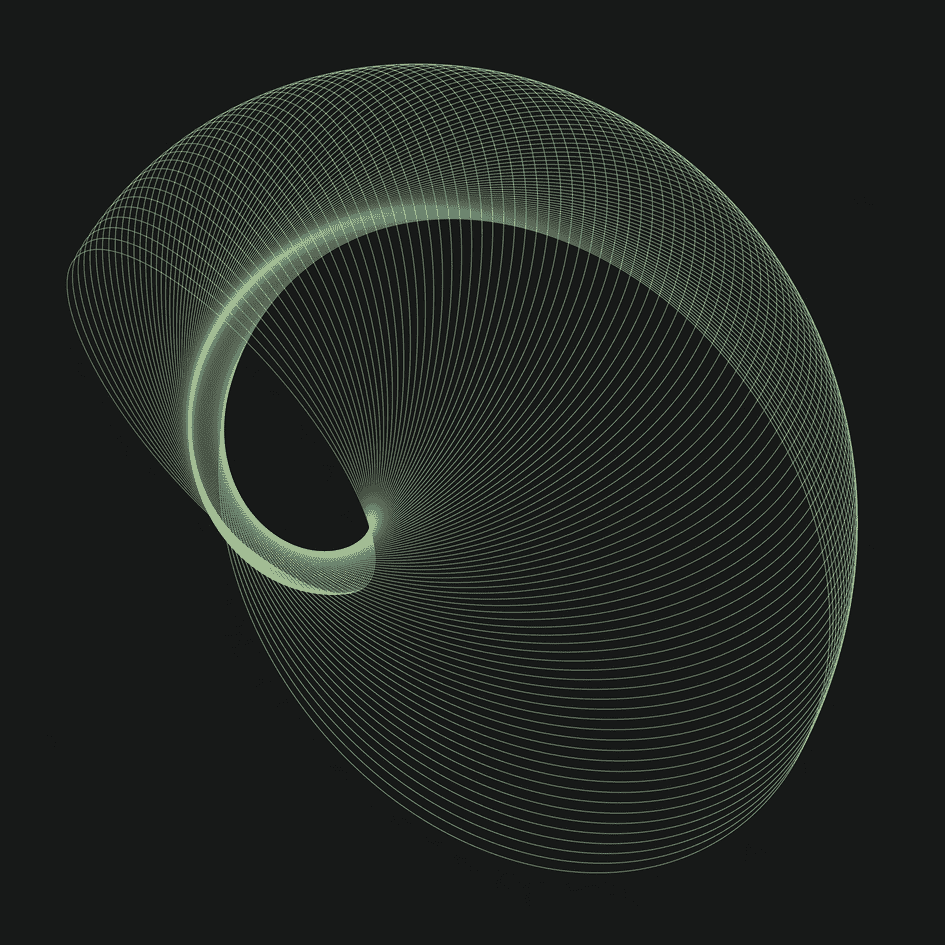
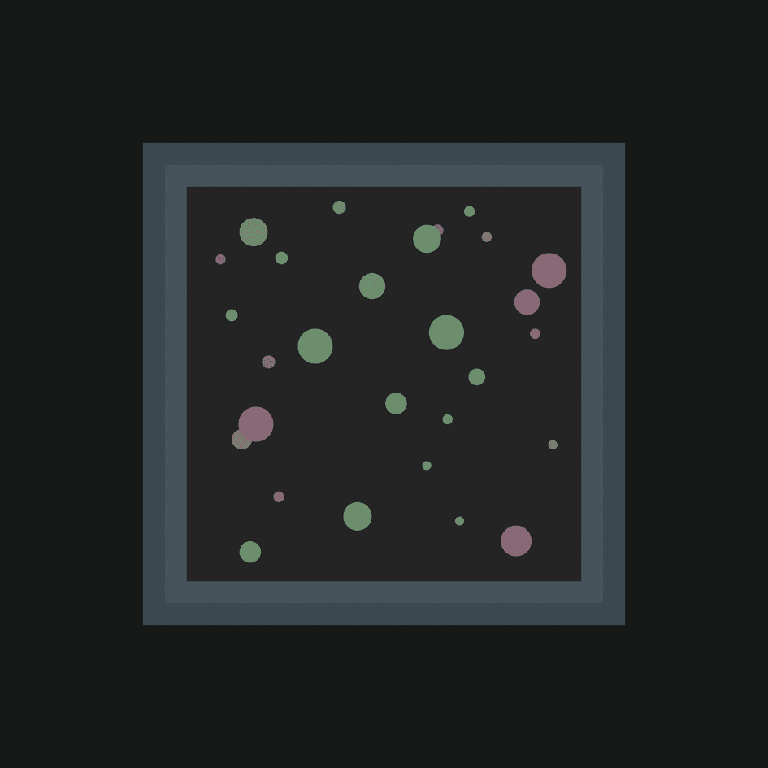
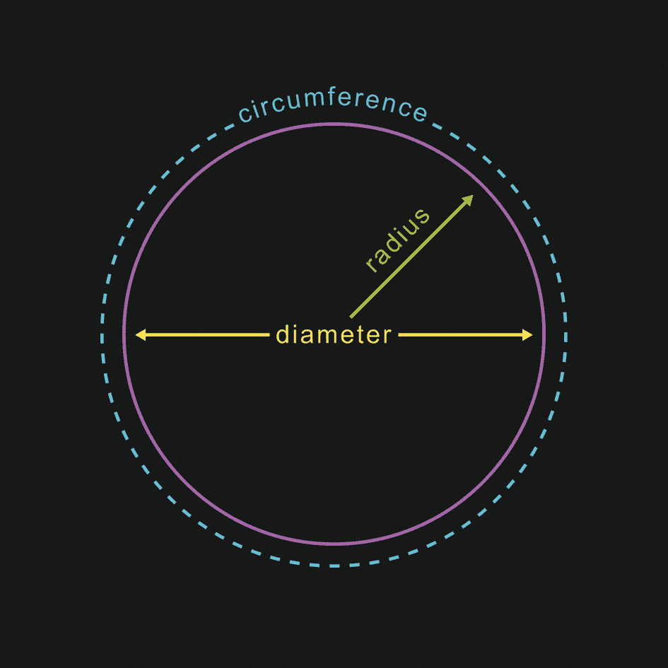
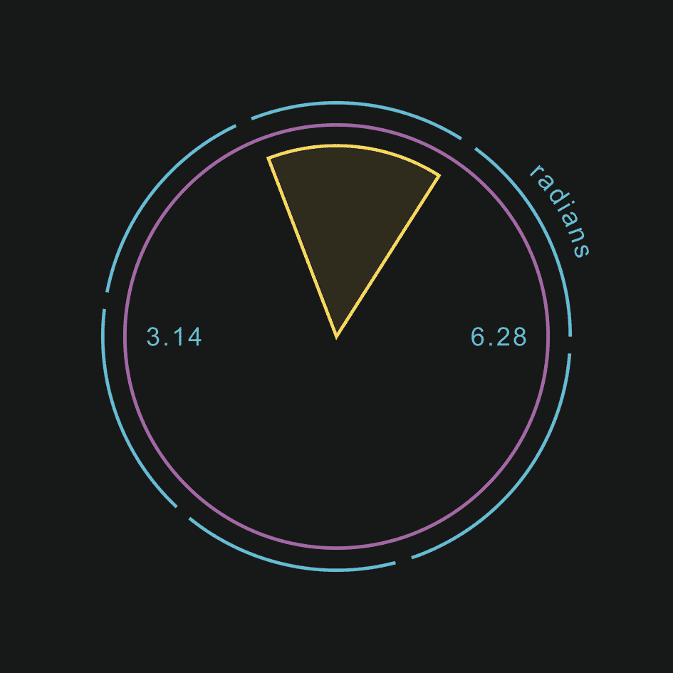
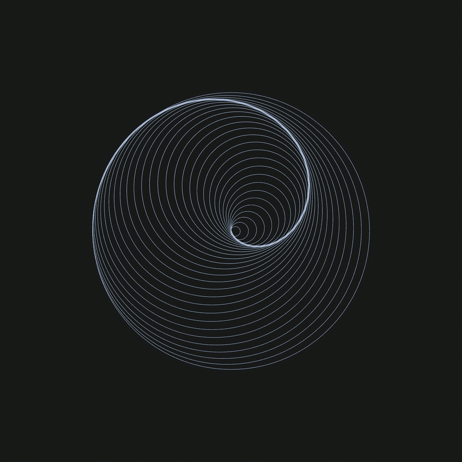

# 7. 运动与交互性

## 交互式生成艺术的核心技术

生成艺术区别于其他艺术形式的一个特点，是其能够融入交互性，并因此吸引观众主动参与。观众——无论是笔记本电脑前的单个用户，还是艺术装置前的一小群人——都可以影响甚至决定最终结果。本质上，这种艺术是`动态`的；它移动、响应、流动，而非固定和最终的。

在本章中，我们将探索交互式艺术的一些底层技术，包括事件监听器、回调函数、光标追踪、碰撞检测，以及如何利用这些技术实时修改我们的 SVG 元素和属性。我们还将深入研究可用于动画化 SVG 的不同方法，在决定本章剩余部分将采用的方法之前，讨论它们的优缺点。

### 事件监听器

鼠标点击是一个事件，按下键盘上的某个键或点击平板电脑的触摸屏也是如此。当此类事件在网页浏览器上下文中发生时，作为 JavaScript 程序员，我们可以竖起虚拟的耳朵去监听它们。一旦检测到事件，我们就可以捕获它。捕获事件后做什么由我们决定。我们可以用它来触发任何事情——一条自定义消息、颜色变化、简单的动画、复杂的变换；可能性是无穷无尽的。但首先，我们需要知道如何“监听”。

幸运的是，这很简单：我们可以使用一个名为`addEventListener()`的浏览器原生函数。此函数需要三样东西：一，要附加到的元素（即负责监听的元素）；二，要监听的事件类型（例如，鼠标点击）；三，监听到事件时要执行的操作（即回调函数执行的动作）。其形式如下：

```javascript
// 为 HTML 或 SVG 元素添加事件监听器。
element.addEventListener('eventType', doSomething);
```

这里我们假设回调函数`doSomething()`在代码的其他地方已定义。请注意，在这种情况下，它仅通过名称提供，不带括号。这是为了防止函数被过早触发。而对于匿名函数或箭头函数，情况则不同，它们可以在定义时直接使用，而不会有立即被调用的风险。

```javascript
// 使用箭头语法定义回调函数。
element.addEventListener('eventType', () => {
  // 在此处执行某些操作...
});
```

### 事件类型

我们可以选择监听的事件类型有很多，但我们将重点关注对生成艺术有用的一小部分：键盘事件、表单事件和指针事件类型。

像`keydown`和`keyup`这样的键盘事件类型会捕获打字时敲击按键的不同阶段。像`change`和`input`这样的表单事件类型可以捕获用于输入数据的界面元素（例如滑块、文本字段和下拉菜单）的更新。而指针事件类型，或许对生成艺术而言是最重要的一类，是鼠标和触摸屏事件类型的更现代替代方案，旨在与硬件无关。指针事件类型包括`pointerdown`、`pointermove`、`pointerover`和`pointerup`。出于我们的目的，我们也可以将`click`事件类型——技术上属于鼠标事件——归入此类，因为它也能捕获简单的触摸事件，例如手指轻点。

```javascript
// 捕获鼠标、手写笔或手指在元素上的移动。
element.addEventListener('pointermove', () => {
  // 在此处执行某些操作...
});
```

### 事件参数

当事件监听器附加到元素并捕获到一个事件时，该事件可以作为参数传递给回调函数。例如，如果我们向 HTML 的`document.body`添加一个事件监听器来检测`click`事件，那么`click`事件的属性也将被捕获，并可供回调函数使用。

以下是实际工作方式的示例。在下面的代码中，每次你点击 HTML 页面`body`内的任意位置时，鼠标或指针设备的位置都会被记录到控制台。

```javascript
// 在点击时记录用户的指针坐标。
document.body.addEventListener('click', (event) => {
  let x = event.clientX;
  let y = event.clientY;
  console.log(`x: ${x}, y: ${y}`);
});
```

`clientX`和`clientY`属性只是`click`事件内置的众多属性中的两个。完整的列表可以在 MDN（[`developer.mozilla.org/docs/Web/API/Element/click_event`](http://developer.mozilla.org/docs/Web/API/Element/click_event)）上找到，那里还提供了涵盖所有 DOM 事件的全面文档。

## 触发 SvJs 的保存方法

假设我们有了一个满意的草图，并且想要保存由我们的 JavaScript 生成的实际 SVG 标记——我们该怎么做？也许最快的方法是打开浏览器的开发者工具，选择“元素”选项卡，检查 DOM 树直到找到根 SVG 元素。然后右键点击它，选择“复制”，再选择嵌套的“复制 outerHTML”选项。这给了我们想要的 SVG 文件数据，但不是文件本身。因此，作为最后一步，我们需要打开一个文本或代码编辑器，将剪贴板内容粘贴进去，*然后*将其保存为 SVG 文件。这并不方便。

如果能简单地按下键盘上的某个键，让整个过程自动完成，那就容易多了。SvJs 确实有一个可用于此目的的`save()`方法，但它首先需要被“连接”到一个事件监听器才能触发。我们现在就来完成这项工作。

打开我们之前的任意一个草图，在草图的底部，编写一个函数，以便在我们按下“s”键时调用此方法。事件类型将是`keydown`，它在按下任意键时触发，所以我们需要确保将`event`作为参数传递给我们的回调函数，以便我们能够查询它的`key`属性；正是这个属性告诉我们实际按下的是哪个键。只有当`key`等于“s”时，我们才会触发`save()`方法，并且不区分大小写（这样也能捕获到大写的“S”）。

```javascript
// 将根 svg 保存为可下载的文件。
document.addEventListener('keydown', (event) => {
  let key = event.key.toLowerCase();
  if (key === 's') svg.save();
});
```

对于以后的任何草图，都可以随意使用上述方法。另外，`save()`方法可以在任何 SVG 元素上调用，这意味着如果你愿意，你可以只保存 SVG 的一部分——尽管这种用例比较少见。

### 创意光标追踪

在我们展示事件监听器实际应用的第一个示例中，我们演示了如何实现鼠标光标的追踪。我们只需查询鼠标事件的`clientX`和`clientY`坐标即可。这是有意简化了的，因为相对于 SVG 的`viewport`（它使用自己的坐标空间）来精确追踪鼠标的位置会稍微复杂一些。

### SvJs 的 trackCursor() 方法

为了解决这个问题，SvJs 内置了一个`trackCursor()`方法，可以在根 SVG 元素上调用。它会自动处理附加相关事件监听器（`pointermove`和`pointerleave`）、将光标位置转换到`viewBox`坐标空间，并确保在触摸屏设备上也能出现预期行为。要激活它，只需在主 SVG 元素上按如下方式调用即可：

```javascript
svg.trackCursor();
```

一旦激活，它会更新父 SVG 的两个属性：`cursorX`和`cursorY`，这两个属性告诉我们当前光标位于`viewBox`（而非网页浏览器窗口）中的位置。它还允许我们传入自己的自定义回调函数，以便在光标位置更新时触发。

```javascript
// 传入自定义回调。
svg.trackCursor(() => {
  // ...执行操作
});
```

### 交互式椭圆

让我们创建一个新的草图，展示如何将`trackCursor()`进行创造性运用。复制我们的模板文件夹，并将其命名为类似`17-cursor-tracking`的名称。我们将重新创建第 1 章中第一个草图的一个变体，但这次我们将使其具有交互性。

在背景下方，初始化以下变量。`ellipses`数组是一个新增项；我们将用它来存储创建的椭圆，以便之后遍历它们。

```javascript
// 随机化一些变量。
let hue = Gen.random(0, 360);
let rotation = Gen.random(0, 360);
let iterations = Gen.random(50, 100);
// 该数组将允许我们稍后遍历椭圆。
let ellipses = [];
```

接下来是创建椭圆的循环。这里的代码比第一章中展示的更紧凑，因为我们之后介绍了实现某些结果（如递增`hue`）的更简洁方法。另一个值得注意的区别是添加了`ellipses.push()`方法；这是我们将每个椭圆添加到前述数组的地方。

```
// 循环随机次数以创建椭圆。
for (let i = 0; i < iterations; i += 1) {
  // 创建椭圆。
  let ellipse = svg.create('ellipse');
  ellipse.set({
    cx: 500,
    cy: 500,
    rx: 100 + (i * 3),
    ry: 300 + (i * 2),
    fill: 'none',
    stroke: `hsl(${hue} 80% 80% / 0.6)`,
    transform: `rotate(${rotation + (i * 2)} 500 500)`
  });
  // 将椭圆添加到数组。
  ellipses.push(ellipse);
  // 递增色调。
  hue = (hue % 360) + 2;
}
```

你现在应该能看到一组静态椭圆。下一步是让它们动起来。我们要做的是在主 SVG 上激活 `trackCursor()` 方法，并传入一个箭头函数作为回调。在这个箭头函数内部，我们将使用 `forEach()` 循环遍历 `ellipses` 数组中的每一项，并根据光标位置调整每个椭圆的 `cx` 和 `cy` 坐标。

```
// 根据光标调整每个椭圆的中心点。
svg.trackCursor(() => {
  ellipses.forEach((ellipse) => {
    ellipse.set({
      cx: svg.cursorX,
      cy: svg.cursorY
    });
  });
});
```

如此一来，我们便实现了运动——当我们创建出一个真正动态的、由光标引导的构图时，我们的椭圆优雅地滑入了生命！图 7-1 展示了光标位于中心点偏南时的一种可能变化。一个按键映射的保存功能在这里特别有用（我自己就用它保存了图 7-1），因为它允许我们捕获 SVG 而不会因无意的光标移动（比如如果我们必须点击按钮时可能发生的情况）而干扰构图。



> 一幅抽象画，呈现出一个方形结构，其中包含以旋转模式排列的椭圆阵列，背景为深色。

**图 7-1** – 经过光标变换的椭圆阵列

既然我们已经知道如何通过交互实现运动，现在是时候学习如何让物体脱离我们的输入而独立运动了。

## 编程式运动

如前所述，我们有几种不同的方法可以用来制作 SVG 动画。第一个是 CSS 关键帧，这对大多数 Web 开发者来说都是熟悉的领域。第二个是 SVG 格式自身原生的方法——SMIL。第三个是 Web 动画 API（或称 WAAPI），这是一个现代 JavaScript 驱动的 API。最后一种方法是生成式艺术家（至少是 JavaScript 领域的）中流行的一种技术：递归的 `requestAnimationFrame` 方法。了解每种技术及其各自的优势和弱点，无论我们最终采用哪一种，都会对您大有裨益。我们将创建一个简单的草图，以非常基础的方式展示全部四种选项。准备好后，请创建模板草图的一个新实例，并将其命名为类似 `18-making-things-move` 的名称。

我们要做的是创建一个菱形形状，由四个不同尺寸的重叠正方形组成（如图 7-2 所示），并使用不同的技术为每个正方形制作动画。以下代码进行了设置，除了 `transform_origin` 属性（该属性通过设置默认旋转点，确保在各种方法之间实现更一致的动画行为）之外，这里没有什么真正的新内容，因此可以随意直接复制粘贴：


> 一幅抽象画，呈现出一个方形结构，其中包含四个菱形排列的明亮重叠正方形，背景为深色。

**图 7-2** – 我们将使其运动的四个形状

```
import { SvJs } from '../../node_modules/svjs/src/index.js';

// 父级 SVG。
const svg = new SvJs().addTo(document.getElementById('container'));

// 视口和 viewBox（1:1 宽高比）。
const svgSize = Math.min(window.innerWidth, window.innerHeight);
svg.set({ width: svgSize, height: svgSize, viewBox: '0 0 1000 1000' });

// 背景。
svg.create('rect').set({
  x: 0, y: 0, width: 1000, height: 1000, fill: '#181818'
});

// 用于容纳形状及其颜色的数组。
let palette = ['#34d399', '#6ee7b7', '#a7f3d0', '#d1fae5'];
let shapes = [];

// 初始化四个形状。
for (let i = 0; i < 4; i += 1) {
  let size = 500 - (i * 125);
  let position = 250 + (i * 62.5);
  let shape = svg.create('rect').set({
    x: position,
    y: position,
    width: size,
    height: size,
    fill: palette[i],
    transform_origin: '50% 50%',
    transform: 'rotate(45)'
  });
  shapes.push(shape);
}
```

### CSS 关键帧

可以使用 CSS 中的 `@keyframes` 规则创建动画序列。与动画、动态图形和视频编辑软件中使用的传统关键帧非常相似，CSS `@keyframes` 定义了某些属性在特定时间点（或序列中的步骤）的状态。例如，在时间 `t`，我们的对象可能位于位置 `[x1, y1]`，而在时间 `t + 5`，对象可能已经移动到了 `[x2, y2]`。关键帧定义了这些时间点，而从一个状态到另一个状态的过渡就构成了动画。我们称这个过程为“补间”（意为“中间帧”），因为动画就发生在这两个中间状态之间。

CSS `@keyframes` 的语法非常直观。你可以使用 `from` 和 `to` 指令设置简单动画的起始和结束关键帧，或者如果你有更复杂的需求，也可以使用百分比来指定某些过渡应该触发的时间点。一旦 `@keyframes` 规则定义完毕，它就需要被一个元素使用 `animation-name` 属性调用，同时我们还需要指定动画应持续多长时间（`animation-duration`）。我们还可以定义其他可选属性，例如 `animation-timing-function`（也称缓动函数），它描述了*如何*从一个属性值过渡到另一个属性值，以及 `animation-iteration-count`，它指定了动画应该播放的次数。

在下面的代码中，我们调用数组中的第一个形状，并为其分配一个 id `cssShape`。这将使我们能够稍后轻松定位该元素。然后，我们设置一个名为 `scaleRotate` 的 `@keyframes` 规则，该规则将目标旋转整整 360 度，同时沿其 x 轴缩小、沿其 y 轴放大（产生拉伸效果），然后再将其恢复为原始尺寸。最后，我们将动画分配给 `cssShape` 元素，指定了持续时间、迭代次数和缓动函数。

```javascript
// 为第一个形状设置 ID。
shapes[0].set({ id: 'cssShape' });
// 使用 CSS 为这个形状添加动画。
svg.create('style').content(`
@keyframes scaleRotate {
0% { transform: rotate(0) scale(1, 1) }
50% { transform: rotate(180deg) scale(0.5, 1.5) }
100% { transform: rotate(360deg) scale(1, 1) }
}
#cssShape {
animation-name: scaleRotate;
animation-duration: 5s;
animation-iteration-count: infinite;
animation-timing-function: linear;
}
`);
```

现在你应该能看到，外侧的正方形在缓慢旋转和拉伸，而其他正方形保持静止。此外，也可以使用简写的 `animation` 属性，通过一次性声明所有动画值来实现更简洁的代码。不过，只有在熟悉完整写法后才使用简写形式，因为值的顺序 `–` 虽然不算特别严格 `–` 但如果你不熟悉所有可能接受的取值，也可能会导致意外行为。

```markdown
# SVG 动画技术

## SMIL 方式

现在让我们尝试用 SMIL 实现相同的效果。SMIL，全称为同步多媒体集成语言，是 SVG 自带的动画方法，无需 CSS 或 JavaScript。然而，由于我们使用的是 SvJs，我们将通过 JavaScript 来与 SMIL 交互。在此之前，这里先快速看一下它原始形式下的样子。

如你所见，动画本身是一个实际的 SVG 元素，嵌套在被动画化的元素内部（本例中为 `<circle>`）。`<animate>` 元素负责处理大多数 SVG 属性的动画，但在元素变换的情况下（即平移、旋转、缩放或倾斜），必须改用 `<animateTransform>` 元素。还有一个名为 `<animateMotion>` 的动画元素，专用于让元素沿路径运动。由于我们要旋转和缩放图形，我们将使用 `<animateTransform>` 元素。

每个变换都需要自己的元素，这使得语法略显冗长。对于第一个变换，即旋转，我们指定了要动画化的 `attributeName` 及其类型 `rotate`。我们只有两个需要过渡的状态 `–` 0 度和 360 度 `–` 因此可以使用 `from` 和 `to` 指令来覆盖它们。然后设置持续时间（`dur`）和迭代次数（`repeatCount`），这样第一个变换就完成了。

```javascript
// 使用 SMIL 旋转第二个形状。
shapes[1].create('animateTransform').set({
attributeName: 'transform',
type: 'rotate',
from: '0',
to: '360',
dur: '5s',
repeatCount: 'indefinite'
});
```

第二个变换稍微复杂一些。它有两个以上的状态，因此我们不使用 `from` 和 `to` 属性，而是使用一个可以存储多个状态的 `values` 属性。在本例中，我们提供了一个由分号分隔的变换值列表。我们还需要添加一个额外的 `additive` 属性，其值为 `sum`，以便 `scale` 变换能够叠加到（而不是覆盖）之前的 `rotate` 变换上。

```javascript
// 使用 SMIL 缩放第二个形状。
shapes[1].create('animateTransform').set({
attributeName: 'transform',
type: 'scale',
values: '1 1; 0.5 1.5; 1 1',
dur: '5s', additive: 'sum',
repeatCount: 'indefinite'
});
```

现在，第二个形状应该正在缓慢旋转和拉伸，并且其运动应该与我们的 CSS 关键帧示例完全同步。

## Web 动画 API

Web 动画 API，即 WAAPI，是我们即将介绍的方法中最现代的一种。W3C（万维网联盟）正在积极推动它的发展，旨在为 Web 动画提供未来方向。除了关键帧和时间选项，它还支持一些高级特性，比如控制播放速率、灵活的缓动功能、与滚动关联的时间线，以及为同一元素应用连续动画（或序列）的能力。

元素可以通过一个命名直观的 `animate()` 方法实现动画，该方法接受两个参数。第一个参数定义关键帧，第二个参数定义时间选项。

```javascript
element.animate(keyframes, options);
```

关键帧可以以对象数组的形式提供，也可以是包含数组的对象。时间选项可以以单个值的形式提供 `–` 具体来说，是一个定义动画时长的毫秒整数 `–` 或是一个包含一个或多个时间相关属性的对象。假设我们要对一个圆的半径 `r` 值进行动画。以下是使用两种语法格式实现此操作的方式：

```javascript
// 关键帧的第一种格式。
let keyframes = [
{ r: 25 },
{ r: 40 },
{ r: 25 }
];
// 关键帧的第二种格式。
let keyframes = {
r: [25, 40, 25]
};
// 时间选项的第一种格式。
let options = 2000; // 2 秒。
// 时间选项的第二种格式。
let options = {
duration: 2000,
iterations: Infinity,
// ... 等等
};
```

在大多数情况下，我更喜欢第二种关键帧格式，因为它更简洁。在实现旋转和缩放示例之前，还有一点需要指出：关键帧之间的间距（或偏移）方式。使用 CSS 关键帧时，我们需要通过百分比值或 `from` 和 `to` 指令来明确声明关键帧何时触发。使用 Web 动画 API 时，如果没有明确声明，动画的偏移量是*推断*出来的。如果我们有三个关键帧，它们将自动按 0、0.5 和 1 的顺序间隔分布（相当于 CSS 中的 0%、50% 和 100%）。但如果需要，我们可以自定义偏移量。在以下示例中，第二个关键帧将在 0.75 处触发，而不是默认的 0.5。

```javascript
// 明确指定偏移量。
let keyframes = {
r: [25, 40, 25],
offset: [0, 0.75, 1]
};
```

现在让我们回到示例中，使用 WAAPI 方法实现第三个形状的旋转和缩放。在 SMIL 实现下方，按如下方式设置动画。

```javascript
let keyframes = {
transform: [
'rotate(0deg) scale(1, 1)',
'rotate(180deg) scale(0.5, 1.5)',
'rotate(360deg) scale(1, 1)'
]
};
let options = {
duration: 5000,
iterations: Infinity
};
shapes[2].animate(keyframes, options);
```

现在，除了一个形状外，其他所有形状应该都在运动。注意 WAAPI 的关键帧语法与我们的 CSS 关键帧示例是多么相似；这并非偶然。Web 动画 API 本质上是对现有 Web 动画标准的进一步发展和扩展，因此熟悉 CSS 动画的 Web 开发者应该会觉得其语法直观且（大部分）与已有知识兼容。拥有一个原生的、高级的 JavaScript API 来在浏览器中创建动画，开启了过去只能通过使用第三方库才能实现的可能性，但这并不是原生 JavaScript 动画技术领域的唯一选择。

## `requestAnimationFrame()` 方法

介绍 `requestAnimationFrame()` 方法，这是一种低层级的递归技术，允许我们接入浏览器的屏幕重绘过程。这与我们之前介绍的方法截然不同；它既非常简单，又非常复杂。通过反复调用一个方法（这就是递归的部分），我们获得了对整个动画过程的完全、精细的控制 `–` 但这同时也意味着所有事情都必须我们自己来做。像关键帧和时间选项这样的概念，在这个层级并不适用。

`requestAnimationFrame()` 方法必须在我们自己定义的、包含每帧要运行的代码的自定义函数内部调用。然后我们将这个自定义函数作为参数传递给 `requestAnimationFrame`，这样它就会在每次屏幕重绘时递归调用。以下是一个关于其工作原理的基本示例。

```javascript
// Define the function.
function customFunction() {
// do stuff here...
// Make the recursive call to requestAnimationFrame().
requestAnimationFrame(customFunction);
}
// Call the function.
customFunction();
```

此外，`requestAnimationFrame()` 可以向我们的自定义函数传递一个时间戳，这样我们就能根据实时值来同步动画，而不是依赖可能因设备而异的屏幕刷新率。该时间戳包含自动画开始以来经过的毫秒数。现在，让我们继续处理草图，设置一个 `animate()` 函数，并将时间戳传递给它，以便用它来增加旋转角度。之所以可行，是因为旋转值可以无限递增超过 360° 而仍然保持有效。

```javascript
// Animate the last shape using requestAnimationFrame.
function animate(time) {
// Rotate the angle.
let angle = time;
// Apply the rotation.
shapes[3].set({ transform: `rotate(${angle})` });
// The recursive bit.
requestAnimationFrame(animate);
}
animate();
```
```

好了，这段代码让我们的最后一个形状动了起来，但我们遇到了几个问题。第一，我们的形状旋转速度快得惊人，与其他形状完全不同步。第二，如果你检查控制台，会看到一个错误，大意是我们在旋转变换中提供了一个`undefined`变量。这个错误只出现一次，这说明当我们的函数首次运行时，`angle`（以及`time`）是`undefined`。这很容易修正；我们只需在`time`为`undefined`时将其重新赋值为`0`即可。在声明`angle`之前添加以下代码，应该能让控制台安静下来：

```javascript
// Prevent errors when the time is undefined on first frame.
if (time === undefined) time = 0;
```

现在来解决旋转速度问题。我们可以尝试用任意数值除以`time`，直到它减速到与其它形状同步（或接近同步），但这并不令人满意。相反，让我们用已知的信息来推算：

-   我们的形状应旋转 360°。

-   这次旋转应耗时五秒（即五千毫秒）。

-   `time` 以毫秒为单位提供。

基于上述信息，我们可以推导出一个计算式，得出旋转形状的精确速度：每秒 0.072°（360° 除以 5,000 毫秒）。用以下代码更新之前`angle`直接等于`time`的语句：

```javascript
// Rotate 360° in 5000ms: 360/5000 = 0.072.
let angle = time * 0.072;
```

这应该能让我们的形状与其他形状同步旋转。然而，让它同步缩放则更具挑战性。为此，我们首先需要在动画循环之外初始化一些变量，这些变量可以帮助我们跟踪某些状态。为什么？因为如果我们试图在循环内部创建这些状态，它们会在每次迭代时被覆盖。缩放增量值需要在上下限之间来回摆动，实现这一目标最直接的方法是跟踪当前缩放值及其极性（即它是向一个方向摆动还是向另一个方向摆动）。为此，我们需要一个布尔值，可以像开关一样来回切换。我们还需要一种方法，使缩放值随时间同步递增，但不直接使用时间戳值，因为那样只会让它无限递增。

考虑到以上几点，让我们在`animate()`函数之前初始化以下变量：

```javascript
let isPositive = true;
let scale = 0, tick = 0, prevTime = 0;
```

按如下方式更新动画循环。注释承担了主要的解释工作，因此为了更好地理解每一步，请务必仔细阅读注释。这里的主要收获是，与其他方法相比，使用`requestAnimationFrame()`需要我们做更多的工作。

```javascript
// Animate the final shape using requestAnimationFrame.
function animate(time) {
// Prevent errors when the time is undefined on first frame.
if (time === undefined) time = 0;
// Rotate 360° in 5000ms: 360/5000 = 0.072.
let angle = time * 0.072;
// We need a constant tick value that doesn't increment indefinitely.
tick = time - prevTime;
// Scale by 0.5 in 2500ms: 0.5/2500 = 0.0002.
scale = isPositive ? scale + (tick * 0.0002) : scale - (tick * 0.0002);
// Apply the rotation and scale values.
shapes[3].set({
transform: `rotate(${angle}) scale(${1 - scale}, ${1 + scale})`
});
// Flip the polarity if the scale value falls outside these bounds.
if (scale < 0) isPositive = !isPositive;
if (scale > 0.5) isPositive = !isPositive;
// Capture the time before it increments.
prevTime = time;
// The recursive bit.
requestAnimationFrame(animate);
}
animate();
```

现在我们应该能让最后一个形状与其他形状同步旋转和缩放了（或多或少有些偏差）。在某些情况下，你可能会注意到旋转有轻微偏移，或者缩放速度比预期的稍快一些。像这样的差异，更多是与浏览器自动调度和处理其他动画方法的优化有关，而不是`requestAnimationFrame()`本身的性能问题。这些动画方法本意并非像我们在本练习中那样组合使用；通常你会根据要实现的目标，选择一种方法并坚持使用。

## 方法总结

那么，对于生成艺术来说，应该选择哪种方法呢？这个问题没有确定的答案，但以下是我的建议（需要说明的是，这并不是对每种方法优缺点的全面分析，而是从我不可避免的带有偏见的视角进行的大致比较）。CSS 关键帧更适用于较短的序列，例如动画加载指示器（本身就是一门艺术）、用户体验增强，以及可访问性或浏览器兼容性重要的动画。对于更复杂的序列，它们会很快变得复杂且难以编辑。特别是对于 SVG 动画，使用 CSS 时许多属性是无法访问的，例如蒙版、裁剪路径和渐变。

使用 SMIL，你拥有一个原生支持 SVG、设计精良的动画格式，并且可以访问所有支持动画的属性。与其他方法不同，当 SVG 作为图片嵌入时（类似于 gif），它还能保留动画。缺点呢？它可能会变得相当冗长，而且未来前景相当不明朗（早在 2015 年，Chrome 就停止了对 SMIL 的支持，但这一决定很快被撤销了）。

Web Animations API（WAAPI）是最现代的动画方法，比 CSS 或 SMIL 拥有更高级的能力，通常也更灵活、更简洁。对于生成艺术，我会推荐它胜过 CSS 或 SMIL，但它确实有其局限性。它不适用于开放式、探索性的动画（即我们对最终结果不确定的情况）。与 CSS 和 SMIL 一样，所有内容都需要精心编排且有明确意图。要走向“完全生成式”，我们需要像`requestAnimationFrame()`这样更底层的工具。

是的，`requestAnimationFrame()`可能会让我们在一条相当艰难的道路上跋涉，以取得相对微薄的成果，但反过来，更复杂的结果在很多情况下可以通过比其他方法更简单、更优雅的方式实现（我将在下一个关于碰撞检测的例子中演示这一点）。我们只需要在最初克服困难后坚持下去。

另外值得注意的是，市面上有许多可靠的第三方库可以帮助您使用 SVG 制作动画；特别值得一提的是 GreenSock 动画平台 (GSAP)，它功能非常丰富，并提供强大的性能和令人印象深刻的向后兼容性。不过它并非开源，并且其部分插件仅对付费订阅者开放。`Anime.js` 是一个不错的开源替代品。

## 碰撞检测

我们与生成式作品互动以影响其输出是一回事，但当它开始与*自身*互动时，则完全是另一回事。这本质上就是碰撞检测的核心内容。我们将以一个使用矩形边界作为基本碰撞屏障的示例进行探索，并在大家对此记忆犹新时，运用`requestAnimationFrame()`方法。

### 设定边界

那么按照常规流程——从模板创建一个新文件夹，将其重命名为`19-collision-detection`，并在背景色下方开始编码。我们要做的第一件事是创建一个样式类似画框的`rect`。这种效果是通过在半透明填充上叠加描边实现的；描边的一半画在框架外部，一半画在内部（稍后我们在计算碰撞检测时需要考虑到这一点）。这个画框的大小将是随机生成的，因此我们设置一个`frameSize`变量来捕获这个值，并利用它来保持其他元素（如`stroke-width`）的比例协调。

```javascript
// 创建一个画框作为边界。
let frameSize = Gen.random(350, 700);
let frame = svg.create('rect').set({
  x: (1000 - frameSize) / 2,
  y: (1000 - frameSize) / 2,
  width: frameSize,
  height: frameSize,
  fill: '#252525',
  stroke: `hsl(${Gen.random(0, 360)} 80% 80% / 0.25)`,
  stroke_width: frameSize / 10,
});
```

### 初始化并扩展形状

画框已就位，现在让我们用一些大小不等的圆形来填充它。目标是让这些圆形从中心向四周爆发散开，有的迅速疾冲，有的缓慢漫步，当它们碰到画框边界时，全部都会反弹回来。接下来，我们将先初始化圆形并填充一个数组，就像我们在之前的示例中所做的那样。

# 圆形动画与碰撞检测

```
// 随机确定圆形数量并设置一个空数组。
let numCircles = Math.floor(frameSize / 20);
let circles = [];

// 填充这个数组。
for (let i = 0; i < numCircles; i += 1) {
  // 根据画框尺寸随机化半径。
  let radius = Gen.random(frameSize / 100, frameSize / 25);

  // 应用上述变量并随机化色相。
  let circle = svg.create('circle').set({
    cx: 500,
    cy: 500,
    r: radius,
    fill: `hsl(${Gen.random(0, 360)} 80% 80% / 0.5)`
  });

  // 将圆形存储到数组中。
  circles.push(circle);
}
```

现在我们的圆形都聚集在中心，但它们还没有预备好移动。我们有办法追踪它们的位置（通过`cx`和`cy`属性），但还没有属性来追踪它们的速度或方向，而如果我们要实现碰撞检测，这些是必需的。

幸好 SvJs 元素很容易扩展。如果我们想给元素添加一个新属性，只需在`set()`方法中包含它即可。如果它不是有效的 SVG 属性，不会对渲染出的 SVG 产生任何影响，但这没关系——我们只是希望将它存储起来，以便稍后用于碰撞检测计算。

我们至少需要两个新属性：一个用于追踪 x 轴上的速度，另一个用于追踪 y 轴上的速度。要确定方向，我们可以使用相同的属性并通过反转正负号来改变方向。例如，x 轴上的正数表示从左到右的运动，负数则表示从右到左的运动。在 y 轴上，正数表示向下运动，负数表示向上运动。

设置这些新属性将分为两步。我们首先设置变量`velocityX`和`velocityY`来捕获随机化的速度。然后我们要设置的属性将简单地命名为`vx`和`vy`，并使用`Gen.chance()`来随机化它们的正负号（因此它们有 50% 的概率为正或负）。将相关代码更新如下：

```
// 创建变量控制 x 轴和 y 轴的速度。
let velocityX = Gen.random(0.1, 5, true);
let velocityY = Gen.random(0.1, 5, true);

// 应用上述变量并随机化色相。
let circle = svg.create('circle').set({
  cx: 500,
  cy: 500,
  r: radius,
  vx: Gen.chance() ? velocityX : -velocityX,
  vy: Gen.chance() ? velocityY : -velocityY,
  fill: `hsl(${Gen.random(0, 360)} 80% 80% / 0.5)`
});
```

### 逐帧计算

判断我们的某个圆形是否与边界（即画框边缘）发生碰撞，需要持续检查每个圆形的位置。因此，`requestAnimationFrame()`实际上是模拟碰撞检测唯一可行的方法，因为这些检查需要逐帧进行。

接下来会有一大段代码，但我会解释其中的重要部分。你会注意到，当我们获取任何属性时，都会用`Number()`方法将它们包裹起来。这是因为我们的属性会以字符串形式返回，而我们要用它们进行可靠的计算时，希望明确地将它们当作数值来处理，而不是依赖 JavaScript 的隐式类型转换（它有时可能正确，但会让你容易遇到 bug）。

以下是我们将要实现的算法概要。首先，我们计算下边界和上边界（即画框边缘）。然后，对于每个圆形：

* 我们检索位置和速度并将其存储为变量。
* 如果 x 变量小于或等于下边界或上边界，我们反转 x 速度变量的正负号。
* 我们对 y 轴重复上一步。
* 然后根据计算出的速度更新 x 和 y 变量。
* 最后，将更新后的变量应用到圆形元素上。

以下是具体的编码版本：

```
// 获取下边界和上边界（画框边缘），以便在循环中使用。
let lowerBound = Number(frame.get('x'));
let upperBound = lowerBound + frameSize;

// 动画循环。
function animate() {
  // 检查每个圆形的碰撞情况。
  circles.forEach((circle) => {
    // 检索位置和速度。
    let cx = Number(circle.get('cx'));
    let cy = Number(circle.get('cy'));
    let vx = Number(circle.get('vx'));
    let vy = Number(circle.get('vy'));

    // 检查碰撞，如果发现则反转正负号。
    if (cx <= lowerBound || cx + (radius * 2) >= upperBound) vx = -vx;
    if (cy <= lowerBound || cy + (radius * 2) >= upperBound) vy = -vy;

    // 更新位置。
    cx += vx;
    cy += vy;

    // 设置新值。
    circle.set({ cx: cx, cy: cy, vx: vx, vy: vy });
  });

  // 递归部分。
  requestAnimationFrame(animate);
}

// 调用动画。
animate();
```

如果你此时观看动画，会发现圆形确实在画框边缘附近反弹，但这并不精确，而且似乎还因圆形大小不同而有所不同。看起来我们在计算中遗漏了一些东西。

要修复这个问题，我们需要考虑到画框边框是内嵌的这一事实；也就是说，`stroke`一半在框架内部，而每个圆形的半径也不同。这意味着`lower bound`和`upper bound`变量必须在动画循环*内部*计算，因为它们会随每个圆形而变化。不过，有几个静态值可以在循环外部捕获并在循环内部使用：画框边缘和画框内嵌量。删除`lower bound`和`upper bound`变量，并将其替换为以下内容：

```
// 获取画框边缘点（x 或 y）和内嵌量。
let frameEdge = Number(frame.get('x'));
let frameInset = Number(frame.get('stroke-width')) / 2;
```

现在，在循环内部，我们可以计算出正确的`lower bound`和`upper bound`值。

```
// 动画循环。
function animate() {
  // 检查每个圆形的碰撞。
  circles.forEach((circle) => {
    // 计算每个圆形的上下边界。
    let radius = Number(circle.get('r'));
    let lowerBound = frameEdge + radius + frameInset;
    let upperBound = frameEdge + frameSize - radius - frameInset;
    // ... 其余代码不变。
  }
```

这样就能实现精确的碰撞检测；图 7-3 展示了这一过程的冻结帧。你可以在此基础上进行多种拓展——例如加入随机因素，尝试追踪光标位置，或随时间改变颜色。无论如何，我们已经迈出了走向完整物理模拟的第一步（这个话题远超本书范围，但我鼓励你独立探索）。



一幅抽象图呈现出一个方形结构，其中有一个带有淡化外层的正方形，以及一团色彩渐变的圆形，背景为深色。

**图 7-3** 多彩碰撞检测

### 循环往复

本章将回归 JavaScript Web Animations API 来画上句号。在此过程中我们会涉及三角函数，但只是浅尝辄止（如果你能领会这个双关语，说明你状态不错！），因为主要目的是为你提供一些灵感，而非用复杂的数学困扰你。

让我们创建一个名为 `20-circular-loop` 的新示例文件夹，并复制模板文件夹。目标是创建一个由许多圆形组成的循环动画，这些圆形本身又排列成一个大圆形；这类动画极具催眠潜力。我们将从背景下的常规位置开始，初始化一些随机变量。

```
// 随机化一些变量。
let numCircles = Gen.random(20, 35);
let baseRadius = Gen.random(5, 25, true);
let hue = Gen.random(0, 360);
```

我们将用 `numCircles` 来控制循环运行的次数，以及分配这些圆形所需的计算。`baseRadius` 和 `hue` 将作为起始值。现在，按如下方式创建循环和圆形，暂时省略 `cx` 和 `cy` 属性（我们将在下一节计算它们）。

```
// 设置循环。
for (let i = 0; i < numCircles; i += 1) {
  // 创建圆形，但先不设置位置或半径。
  let circle = svg.create('circle').set({
    r: baseRadius,
    fill: 'none',
    stroke: `hsl(${hue} 80% 80% / 0.75)`,
    transform_origin: '500 500'
  });
}
```

### π 的切片

这里就是前面提到的三角函数的切入点。要计算每个圆形的分布（即它们的 `cx` 和 `cy` 坐标），我们需要借助一些 JavaScript 内置的 `Math` 方法和属性。首先是 `Math.PI`，这是一个属性，返回 𝝅（3.14）的近似值，𝝅 是一个数学常数，表示圆的周长（沿其边界的长度）与直径（半径的两倍）之比。图 7-4 展示了这些值。



一幅抽象图呈现出一个方形结构，其中有一个圆形，标有周长、半径和直径，背景为深色。

**图 7-4** 圆的周长、直径和半径

你可能习惯用度数表示角度，但在 JavaScript 中，角度默认以弧度为单位测量。一弧度约等于圆周长上的一段等于半径的长度（如图 7-5 所示）。需要略多于六个这样的弧度（约 6.28）才能环绕整个圆周。而 6.28 的一半就是 𝝅，即 3.14。



一幅抽象图呈现出一个方形结构，其中有一个圆形，标有六个弧度。一弧度约等于圆周长上等于半径的长度，数值标有 3.14 和 6.28。

**图 7-5** 弧度与 𝝅 和圆周的关系

关键点是什么？`Math.PI` 弧度相当于 180°，因此 `Math.PI * 2` 表示一个完整的圆（360°）。所以在我们的循环中，我们将相对于 `Math.PI * 2` 递增放置圆形的角度。为了确保圆形在圆周上均匀分布，我们将 `Math.PI * 2` 除以 `numCircles`，每次循环运行时，将其乘以迭代器，从而移动到下一个“切片”。

在循环内，定义好圆形元素后，添加以下代码：

```
// 计算当前角度。
let angle = Math.PI * 2 / numCircles * i;
```

### 正弦与余弦

一旦有了角度，就需要获取对应的正弦和余弦值，你可以将它们视为 x 和 y 坐标。这里我们不深入细节；只需说明，`Math.sin()` 和 `Math.cos()` 方法能完美配合，产生圆周运动。

```
// 获取角度的正弦和余弦值。
let sin = Math.sin(angle);
let cos = Math.cos(angle);
```

值得注意的是，这些方法本身就非常有用，尤其适用于运动，因为它们能产生平滑、振荡的值。然而，在当前场景中，我们将仅限使用这些值来定位圆形，而不是让它们动起来。为了定位，我们需要将正弦和余弦值映射到更可用的范围，因为默认情况下它们返回 -1 到 1 之间的值。

我们将相对于 `viewBox` 的中心（即 x 轴和 y 轴均为 500）来定位圆形，并将其重新映射到 700 的范围内。这样得到 150 和 850，即中心两侧各 -350 和 +350。

```
// 将正弦和余弦映射到所需范围。
let cx = Gen.map(sin, -1, 1, 200, 800, false);
let cy = Gen.map(cos, -1, 1, 200, 800, false);
```

### 让圆形动起来

现在我们可以尝试一个基础动画。先从简单的开始，让圆形从中心向外移动到我们刚才定义的 `cx` 和 `cy` 坐标。

```
// 从 (500, 500) 移动到 (cx, cy)。
circle.animate({
  cx: [500, cx, 500],
  cy: [500, cy, 500],
}, {
  duration: 10000,
  iterations: Infinity,
  easing: ['ease-in-out']
});
```

这能让圆形动起来，但这个序列并不特别有趣。让我们增加更多变化：设置初始和目标半径，利用迭代器值让每个圆形的半径都不同，同时让整个动画旋转起来。在结束循环之前，根据圆形的数量递增 `hue` 值，以获得漂亮的色彩分布。

```
// 设置初始和目标半径。
let r1 = baseRadius * 2 + (i * 10);
let r2 = baseRadius / (i + 10);
// 从 (500, 500) 移动到 (cx, cy)，缩小半径，旋转。
circle.animate({
  cx: [500, cx, 500],
  cy: [500, cy, 500],
  r: [r1, r2, r1],
  transform: ['rotate(0deg)', 'rotate(360deg)']
}, {
  duration: 10000,
  iterations: Infinity,
  easing: ['ease-in-out']
});
// 递增色相值。
hue = (hue % 360) + (180 / numCircles);
```

好了……这样就大大逼近了我们想要实现的催眠吸引力。请参见图 7-6，这是动画进行到约 15% 时的快照。



一幅抽象图呈现出一个方形结构，其中有一团圆形呈旋转模式，背景为深色。

**图 7-6** 使用 Web Animations API 实现圆形循环

## 总结

就概念和内容而言，这或许是迄今为止最密集的一章，但我希望你在跟随学习的过程中也获得了一些乐趣。快速回顾一下，我们涵盖了以下内容：

* 事件监听器、事件类型和事件参数

* 如何保存我们的 SVG 标记

## 如何使用光标追踪制作交互式草图

*   如何使用光标追踪制作交互式草图

*   使用 CSS 关键帧进行动画

*   使用 SMIL 进行动画

*   Web 动画 API

*   使用 `requestAnimationFrame()` 方法进行动画

*   基本碰撞检测

*   非常基础的三角学

在下一章也是最后一章中，我们将重点介绍 SVG 滤镜。
