# 6. 全功能路径

路径也许是 SVG 规范中最重要、最强大的部分。大多数 SVG 文件，无论是简单的图标还是复杂的艺术作品，主要由路径数据构成。例如，如果在 Inkscape 或 Illustrator 等矢量图形程序中绘制任何比基本图形更复杂的图形，你实际上就是在处理路径。而且，要在 JavaScript 和 SvJs 中手动编写路径代码，你不需要是数学天才。

本章将涵盖路径元素及其相关命令，这些命令数量众多，需要有自己的小节。路径可能会很快变得复杂，因此我们还会介绍一些 SvJs 方法来简化我们的工作。

## 路径元素

设置路径很简单；我们只需像创建大多数其他元素一样调用 SvJs 的 `create()` 方法：

```
let path = svg.create('path');
```

路径接受其他图形元素通常使用的 `fill` 和 `stroke` 属性，但与其他图形元素（如 `rect` 和 `circle`）不同，路径本身没有内在的形状或形式。这完全取决于我们来定义，我们通过 `d` 属性来完成。

### D 代表数据

`d` 属性允许我们向路径填充数据。这些数据由一系列路径命令和相应的数值组成，这些数值定义了路径的形状。整个数据作为一个字符串传入。

SVG 规范的创建者知道 SVG 文件中会大量使用路径，因此创建简洁的路径命令是控制总体文件大小（以千字节计）的关键部分。因此，命令是单个字符长度，就像它们传递给的 `d` 属性一样，并且伴随命令的值也可以灵活格式化以节省空间。

```
// 路径数据字符串的示例。
path.set({
d: 'M 20,20 L 30,20 L 30,30 L 20,30 Z'
});
// 一个使用更简洁字符串的相同路径。
path.set({
d: 'M20 20L30 20L30 30L20 30Z'
});
```

我们将在后面的章节中详细介绍类似的示例是如何工作的；现在，只需注意，完全相同的路径数据可以用逗号分隔值，也可以用空格分隔命令，或者两者都不用。

### 路径命令

你可以将路径命令视为绘图指令。每个命令由一个字母表示，该字母可以是大写或小写。大写版本表示其后的数值将使用绝对坐标（因此命令 `M 50,50` 意味着移动到 `viewBox` 中 `50,50` 的确切位置），而小写版本表示将使用相对坐标（因此命令 `m 50,50` 意味着相对于上一个已知位置在 x 和 y 轴上都移动 `+50`）。

总共有十个命令；如果算上两种大小写版本，那就是二十个。如果你认为这很多，那你是对的！确实是很多。但是，考虑到这些命令可以组合起来创建任何可能的二维形状，这些命令的效率之高令人惊叹。有些命令比其他命令更常见，有些更复杂，有些我们只会演示一次，之后不会再使用。

### 路径的起点和终点

所有路径都有一个起点。对于 SVG 而言，所有路径都始于我们移动虚拟笔的那个点。我们为此使用 `M`（或 `m`）命令，它代表“移动到”。我们后面要跟上一个 x 和 y 坐标对来定义路径的起点。`M` 命令本身不绘制任何东西——它仅仅是将我们移动到想要开始绘制的点。可以这么说，我们的笔还没有落在纸上。

```
// M/m 命令的语法。
'M [x, y] ...'
'm [dx, dy] ...'
// M/m 命令的示例。
'M 50 100 ...'
'm 50 100 ...'
```


我们可以在路径的末尾添加一个可选的 `Z` 命令来闭合路径。没有闭合 `Z` 命令的路径保持开放状态（即起点和终点不连接）。除非终点是曲线，否则 `Z` 会绘制一条直线连接这两点；如果终点是曲线，则会遵循最后一个控制点的曲率（这一点稍后会更容易理解）。

```
// 闭合路径。
'M 50 100 ... 50 150 Z'
```

与其他路径命令不同，小写的 `z` 和大写的 `Z` 执行相同的操作，因为它们后面不跟任何数值。这意味着你可以互换使用它们。

## 直线

为了让我们轻松入门路径创建，我们从直线开始。实际上有几个不同的命令可以绘制直线，但我们先从最显而易见的开始。

### 简单的 L

`L` 命令允许我们绘制由一对 x 和 y 坐标定义的直线。小写的 `l` 执行相同操作，但使用相对于路径上一个输入点的坐标。

```
// L/l 命令的语法。
'L [x, y] ...'
'l [dx, dy] ...'
```

让我们看看这在实践中是什么样子。在下面的示例中，两条线被用来创建两个字母 L 的实例。第一个使用绝对坐标；第二个使用相对坐标。

```
// 第一个 L。
svg.create('path').set({
d: 'M 300 200 L 300 800 L 600 800'
});
// 第二个 L。
svg.create('path').set({
d: 'M 675 825 l 0 -600 l -300 0'
});
```

我们可以在图 6-1 中看到上述代码的渲染结果。我在此省略了与示例无关的所有元素和属性，只关注路径数据。如你所见，你可以使用任一 `L` 命令来获得相似的结果。

以这种方式手动创建路径时，一些读者可能会觉得使用绝对坐标更直观，而另一些则可能觉得相对坐标更容易使用。例如，如果你想移动路径的位置而不改变其形状，相对坐标特别有用；使用绝对坐标，我们得更改所有后续数字，而使用相对坐标，我们只需更改初始的 `M` 点。


一张抽象图，在一个深色背景上展示了一个包含字母 L 和反向 L 的正方形。

**图 6-1** 由两个 L 命令绘制的两个 L 形

### 水平与垂直变体

如果我们要绘制的线是水平或垂直的，我们可以使用 `H` 或 `V` 命令作为快捷方式，因为它们只需要一个参数；对于 `H` 或 `h`，是 x 坐标；对于 `V` 或 `v`，是 y 坐标。

```
// H/h 命令的语法。
'H [x] ...'
'h [dx] ...'
// V/v 命令的语法。
'V [y] ...'
'v [dy] ...'
```

我觉得这些命令对生成式艺术并非特别有用，但了解一下它们的存在，以备你需要使用，也是值得的。让我们再次创建图 6-1 中的相同 L 形状，但这次使用 `H` 和 `V` 命令，包括它们的小写版本。

```
// 第一个 L。
svg.create('path').set({
d: 'M 300 200 V 800 H 600'
});
// 第二个 L。
svg.create('path').set({
d: 'M 675 825 v -600 h -300'
});
```

### 更进一步的简化

在我们进入曲线部分之前，值得指出的是，如果我们连续使用相同类型的路径命令，可以省略重复的命令本身。SVG 渲染器足够智能，能够识别出如果路径命令被省略，则使用上一个已知的命令。让我们展示一个快速示例（其输出如图 6-2 所示）。


一张抽象图，在一个深色背景上展示了一个带有三角波形的矩形结构。

**图 6-2** 省略重复命令

```
// 第一个路径，重复使用 L 命令。
svg.create('path').set({
d: 'M 10 10 L 20 20 L 30 10 L 40 20 L 50 10 L 60 20 L 70 10'
});
// 第二个（相同的）路径，省略了重复的 L 命令。
svg.create('path').set({
d: 'M 10 10 L 20 20 30 10 40 20 50 10 60 20 70 10'
});
```

## 二次贝塞尔曲线

我们要介绍的第一种曲线是二次贝塞尔曲线。别担心——这个令人生畏的名字并不代表它的复杂性。就曲线而言，它相对简单。需要两组坐标：第一组定义控制点（我们稍后会解释），第二组定义目标点。

```
// Q/q 命令的语法。
'Q [cpx cpy x y] ...'
'q [dcpx dcpy dx dy] ...'
```

### 控制点

如果你将控制点想象为一种吸引力或拉力，曲线会向着它弯曲，那么你的理解就正确了。控制点本身不会被渲染，但如果你看一下图 6-3 中的点和虚线，可以看到控制点对其曲线（在本例中为二次贝塞尔曲线）施加的力的可视化。在此示例中，该点代表控制点坐标 `[150, 350]`，给定以下路径：

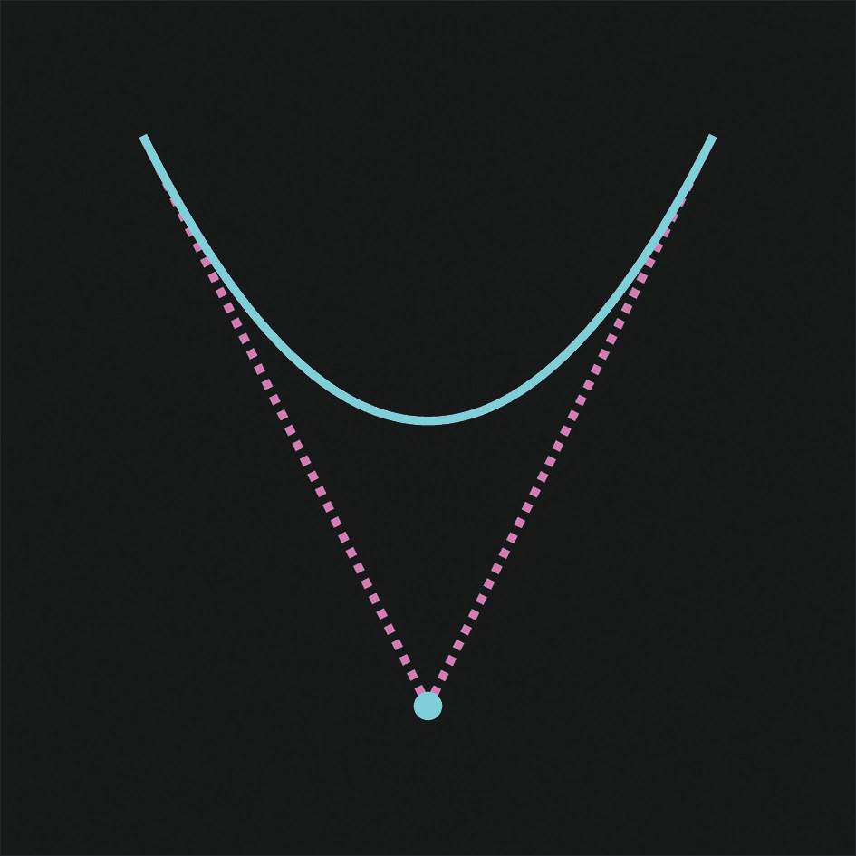

一张抽象图，在一个深色背景上展示了一个带有向上抛物线和 V 型链条图案的正方形结构。

**图 6-3** 二次贝塞尔曲线的控制点

```
'M 50 150 Q 150 350 250 150'
```

二次贝塞尔曲线只有一个控制点，而三次贝塞尔曲线（将在后面的章节中探讨）有两个。

### 平滑的快捷方式

假设我们想要扩展图 6-3 中的路径，并绘制一组以固定间隔重复的平滑波浪。手动进行此操作的难点在于控制点的计算；如果它与前一个控制点不完全对称，我们的曲线中就会出现一个“折点”（见图 6-4）。现在，在这种特定情况下，计算一个可以纠正此问题的控制点并非十分艰巨的任务，但在更复杂的情况下，这可能会成为一个挑战。

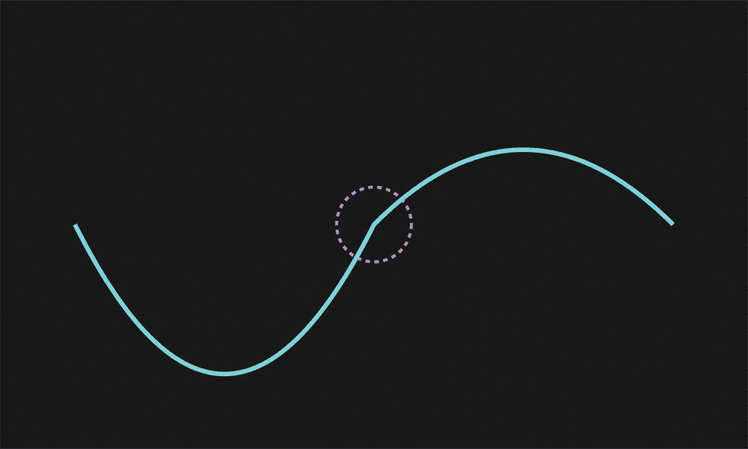

一张抽象图，在一个深色背景上展示了一个矩形结构，其中心有一个带失真的正弦波。

**图 6-4** 曲线中的折点

这时，`T` 命令就可以派上用场了。它基于前一条曲线的控制点来扩展二次贝塞尔曲线，本质上是“镜像”或反射它。结果是一条具有对称控制点的平滑曲线，并且它只需要一组坐标。

```
// T/t 命令的语法。
'T [x y]'
't [dx dy]'
```

让我们扩展图 6-4 中的曲线，增加几个额外的起伏。在下面的示例代码中，为了便于阅读，我在坐标中加了一些逗号，但请记住，实际上并不需要它们。同时，我还利用了连续多次使用 `T` 命令时无需重复的事实。这就是为什么在接下来的四个坐标中，你只会看到它被使用一次。

```
// 使用平滑的 T 命令扩展二次曲线。
svg.create('path').set({
d: 'M 50,150 Q 150,350 250,150 T 450,150 650,150 850,150 1050,150'
});
```

图 6-5 是结果，添加了一些圆形高亮来区分初始的 `M` 点（黄色）和完整的 `Q` 曲线（紫色的第二个点）以及四个额外的 `T` 点（红色）。

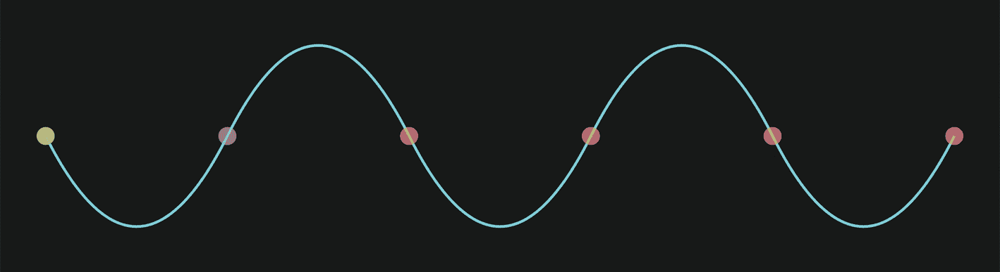

一张抽象图，在一个深色背景上展示了一个连续的、带有周期起点和终点标记点的正弦波矩形结构。

**图 6-5** 一条平滑的二次曲线


## 二次贝塞尔弹簧

让我们在一个简单的绘图中使用二次贝塞尔曲线，创建一组类似弹簧（Slinky）的路径。如果你不知道什么是弹簧（Slinky），它是一种流行的弹簧玩具，只要从顶部轻轻一推，它就能自己“走”下一段台阶（我相信它还能表演许多其他神奇的把戏，但这正是它最广为人知的一种）。

复制模板文件夹，并将其重命名为 `14-quadratic-slinky`。在父级 SVG 下方，设置一些样式，用于定位 `path` 元素，稍后我们将把这些元素设置为一个组的子元素，并为该组赋予一个 `id` 为 `slinky`。

```
// 设置弹簧样式。
svg.create('style').content(`
#slinky path {
fill: none;
stroke-width: 0.75;
stroke-linecap: round;
}`
);
```

接下来，设置通常的背景，初始化一个随机色相，并创建前面提到的 `slinky` 组。

```
// 背景。
svg.create('rect').set({
  x: 0, y: 0, width: 1000, height: 1000, fill: '#181818'
});
// 选择一个随机的起始色相。
let hue = Gen.random(0, 360);
// 设置弹簧路径组。
let slinky = svg.create('g').set({ id: 'slinky' });
```

在下一步中，我们将启动循环，并创建几个用于塑造二次曲线的控制点。

```
// 开始循环。
for (let i = 0; i < 500; i += 5) {
  // 创建控制点。
  let cpx = Gen.random(200, 400);
  let cpy = i - 400;
}
```

我们曲线的宽度将为 600 个单位（相对于 `viewBox`），因此我们的中点将是 300。在 x 轴上，`cpx` 变量在中点左右各 100 个单位范围内选取一个随机整数值，以使我们的弹簧产生一些“摆动”。`cpy` 变量则更为直接；它在每次迭代中沿着屏幕向下移动，并带有 400 个单位的偏移量，这将使曲线向上“拉伸”。

接下来，让我们创建实际的曲线（保持在循环内部）。

```
// 创建二次曲线。
slinky.create('path').set({
  stroke: `hsl(${hue} 90% 80% / 0.85)`,
  d: `M 0 ${i} q ${cpx} ${cpy} 600 0`
});
```

在这里，我们像之前多次做的那样设置 `hue`，而对于 `path`，我们使用 `M` 命令开始绘制一条简单的曲线。对于曲线坐标，我们利用小写 `q` 命令计算的相对坐标，这使我们能够使这些值与曲线的起点保持同步。

在结束循环之前，我们将递增 `hue`，但我们将使用一种新技术来实现。我在第 2 章（涉及运算符的章节）中提到了取模运算符（`%`），它用于计算一个数除以另一个数后的余数。这对于在预定义范围内循环非常有用，例如颜色的 `hue` 的 0 到 360 约束。在循环结束前添加以下内容作为最后一行：

```
// 递增色相。
hue = (hue % 360) + 1.5;
```

快速解释一下它的工作原理：假设我们的随机 `hue` 初始化为 350。表达式 `hue % 360` 将返回 350，因为 `350 / 360` 等于 0，余数为 350。这对于我们范围内的每个数字都适用，*除了* 360，当 360 除以自身时结果为 1，余数为 0。这就是它如何循环回范围起点的方式。

现在循环已完成，我们可以在循环外再添加一行代码，以确保内容居中。结果应类似于图 6-6。

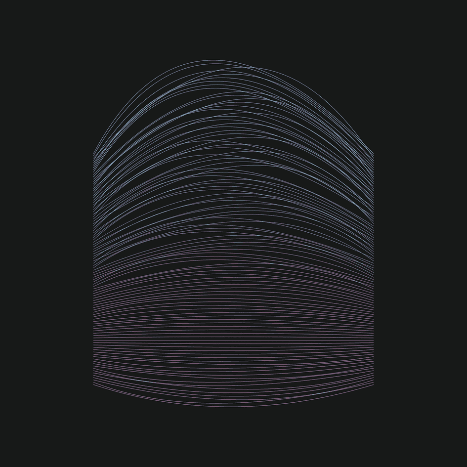

一幅抽象画，描绘了一个方形结构，其中包含一组褪色的二次曲线，背景为深色。

**图 6-6** 弹簧形态的二次曲线

```
slinky.moveTo(500, 500);
```

## 椭圆弧

是时候进入弧线部分了！椭圆弧曲线（图 6-7）是一个复杂的家伙，如果没有一些视觉示例，其语法很难理解。`A`（或 `a`）命令用于初始化它，其后跟不少于七个参数。

```
// A/a 命令的语法。
'A [rx ry rotation large-arc-flag sweep-flag x y] ...'
'a [rx ry rotation large-arc-flag sweep-flag dx dy] ...'
```

前两个参数和最后两个参数我们之前都已经遇到过：`rx` 和 `ry` 指的是 x 轴和 y 轴的半径，最后的 `x` 和 `y` 参数定义了曲线的终点。`rotation` 定义了沿 x 轴的旋转角度，而 `large-arc-flag` 和 `sweep-flag` 都是数字形式的布尔值，`0` 表示 `false`，`1` 表示 `true`。至于它们的作用，则需要稍作解释。

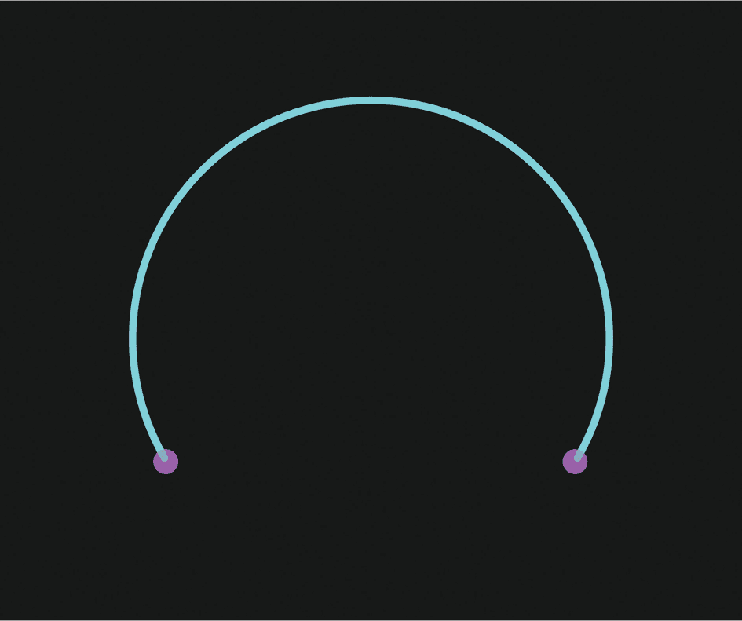

一幅抽象画，描绘了一个方形结构，其中包含一个带有两个端点的半圆，背景为深色。

**图 6-7** 一条椭圆弧曲线

### 设置标志

当我们绘制一条椭圆弧曲线时，实际发生的情况是，在幕后使用两个相互锁定的椭圆作为引导，以确定实际绘制众多可能路径中的哪一条。当 `large-arc-flag` 设置为 `1` 时，将会选择大弧。当 `sweep-flag` 设置为 `1` 时，弧线将按顺时针方向绘制。让我们看看图 6-8，其中展示了这些标志的四种可能排列组合。

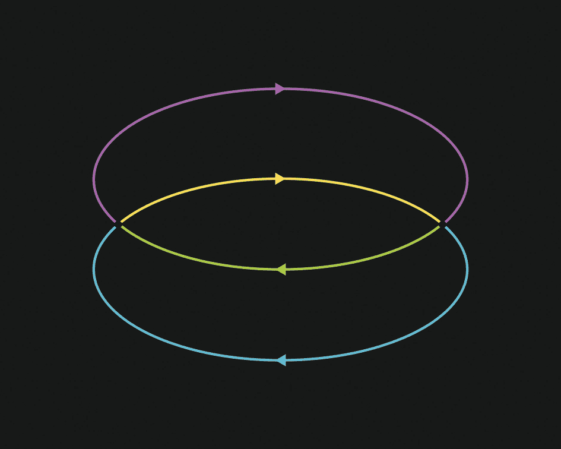

一幅抽象画，描绘了一个方形结构，其中有上下两个圆，按顺时针方向旋转，背景为深色。

**图 6-8** 四种可能的弧线

-   在最上面的路径中，`large-arc-flag` 和 `sweep-flag` 都设置为 `1`。
-   在第二条路径中，`large-arc-flag` 设置为 `0`，`sweep-flag` 设置为 `1`。
-   在第三条路径中，`large-arc-flag` 和 `sweep-flag` 都设置为 `0`。
-   在最下面的路径中，`large-arc-flag` 设置为 `1`，`sweep-flag` 设置为 `0`。

实际上，你在屏幕上一次只能看到这些弧线中的一条。然而，当我们同时看到所有可能的曲线时，这有助于我们理解椭圆弧的底层结构。

### 不规则半径

关于椭圆弧曲线的另一个可能令人困惑之处在于，`rx` 和 `ry` 这两个半径值的工作方式与我们预期的略有不同。通常情况下，半径会直接决定椭圆形状的大小。对于椭圆弧曲线，大小实际上是由多个协同工作的因素决定的，而 `rx` 和 `ry` 值只是等式的一部分。

例如，你有时会发现，构成可能曲线基础的相互锁定的椭圆是重合的；也就是说，它们彼此重叠。如果你发现将 `large-arc-flag` 设置为 `0` 或 `1` 对最终结果没有影响，你就知道是这种情况了。当两个半径值与曲线起点和终点之间的距离成特定比例时，就会发生这种情况。

因此，将 `rx` 和 `ry` 值视为影响弧线形状的比率，而不是直接决定弧线大小的值，可能会更容易理解（当使用较小的半径值时尤其如此）。如果这听起来不太好理解，也不必担心——起初这相当违反直觉，只有通过实验才会变得更清晰。

为了帮助进行这种实验，并希望让椭圆弧曲线更易于理解，我创建了一个交互式笔，展示了改变半径和标志值的效果。你可以在 [`davidmatthew.ie/generative-art-javascript-svg#arc-curve`](https://davidmatthew.ie/generative-art-javascript-svg#arc-curve) 找到这个笔。


## 生成式弧线

让我们暂且放下椭圆弧线曲线理论细节的纠缠，转而将它们用于一些实际、富有创意的用途。使用我们常用的复制方法，创建一个新的草图文件夹，并将其命名为类似 `15-generative-arcs` 的名称。此草图的目标是创建两组弧线曲线：一组顺时针绘制，另一组镜像对称，逆时针绘制。我们将对多个关键变量进行随机化处理，以保持输出的独特性和难预测性。

准备好后，在背景下方创建一个将包含我们弧线曲线的组。之后，我们将设置一些随机化变量，这些变量将在接下来的循环中使用。

```
// 为我们的弧线曲线创建一个容器组。
let arcs = svg.create('g');
// 随机化一些变量。
let rx = Gen.random(5, 350);
let ry = Gen.random(5, 350);
let hue = Gen.random(0, 360);
```

接下来，我们将启动循环，该循环将运行 360 次。在循环内部，我们将随机化更多变量：弧线的 `rotation`（旋转角），这会使曲线向特定方向伸展；以及 `large-arc-flag`（大弧标记），借助我们的 `Gen.chance()` 函数，它会有 50% 的概率为 `0` 或 `1`。

```
for (let i = 0; i < 360; i += 1) {
// 随机化旋转角和大弧标记。
let rotation = Gen.random(0, 180);
let largeArc = Gen.chance() ? 1 : 0;
}
```

接下来（仍在循环内）创建第一组顺时针弧线曲线。请记住，决定它们顺时针或逆时针绘制的是 `sweep-flag`（扫描标记），它是 `A` 命令的第五个参数。在这里，在我们的 `largeArc` 变量之后，我们将 `sweep-flag` 设置为 `1`，表示顺时针。

```
// 创建第一组顺时针弧线曲线 (sweep = 1)。
arcs.create('path').set({
fill: 'none',
stroke: `hsl(${hue} 75% 75% / 0.05)`,
d: `M 275 500 A ${rx} ${ry} ${rotation} ${largeArc} 1 725 500`
});
```

第二组弧线曲线将完全相同，但有两个小改动。我们将 `sweep-flag` 设置为 `0`，使这组曲线逆时针绘制，并将 `hue` 偏移 `60`，只为颜色增加一点对比度。在关闭循环之前，我们将使用前面提到的取模运算符递增 `hue`。

```
// 创建第二组逆时针弧线曲线 (sweep = 0)。
arcs.create('path').set({
fill: 'none',
stroke: `hsl(${hue + 60} 75% 75% / 0.05)`,
d: `M 275 500 A ${rx} ${ry} ${rotation} ${largeArc} 0 725 500`
});
// 递增色相值。
hue = (hue % 360) + 0.5;
```

如果你此时运行草图，你会看到一些变化丰富的生成式弧线（示例输出见图 6-9）。如果你想注入更多活力，可以在循环之后添加以下代码行：

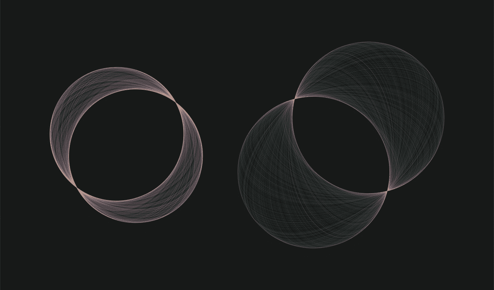

一张抽象图，展示了一个矩形结构，其中有两个椭圆弧线，包含一组重叠的图层，背景为深色。

**图 6-9** 我们生成式弧线的两次渲染

```
// 应用随机旋转。
arcs.rotate(Gen.random(0, 360));
```

## 三次贝塞尔曲线

我们将介绍的最终曲线是三次贝塞尔曲线，由 `C` 命令调用。这是所有可用矢量曲线中用途最广的，也是大多数矢量绘图和插图软件包中使用的主要曲线（通常化名为钢笔工具）。它有两组控制点，因此语法比二次贝塞尔曲线稍复杂些，但比椭圆弧线曲线更容易掌握。

```
// C/c 命令的语法。
'C [cpx1 cpy1 cpx2 cpy2 x y] ...'
'c [dcpx1 dcpy1 dcpx2 dcpy2 dx dy] ...'
```

### 三次控制点

第一组控制点坐标 `cpx1` 和 `cpy1` 从起始点一侧塑造曲线的形状。该起始点在 `C` 命令之前声明——例如，它可能是一组 `M` 坐标，或者是前一条曲线的终点。第二组控制点坐标 `cpx2` 和 `cpy2` 塑造目标点处的曲线形状，该点由最后两个坐标 `x` 和 `y` 定义。示例如下：

```
// 创建一条单次三次贝塞尔曲线。
svg.create('path').set({
d: 'M 75,75 C 140,330 360,330 425,75'
});
```

上述路径在图 6-10 中进行了说明，你可以看到初始的 `M` 点以黄色显示，而构成三次贝塞尔曲线本身的三个点以红色显示。彩色点和虚线仅用于说明目的；它们在最终的 SVG 中不会被渲染。

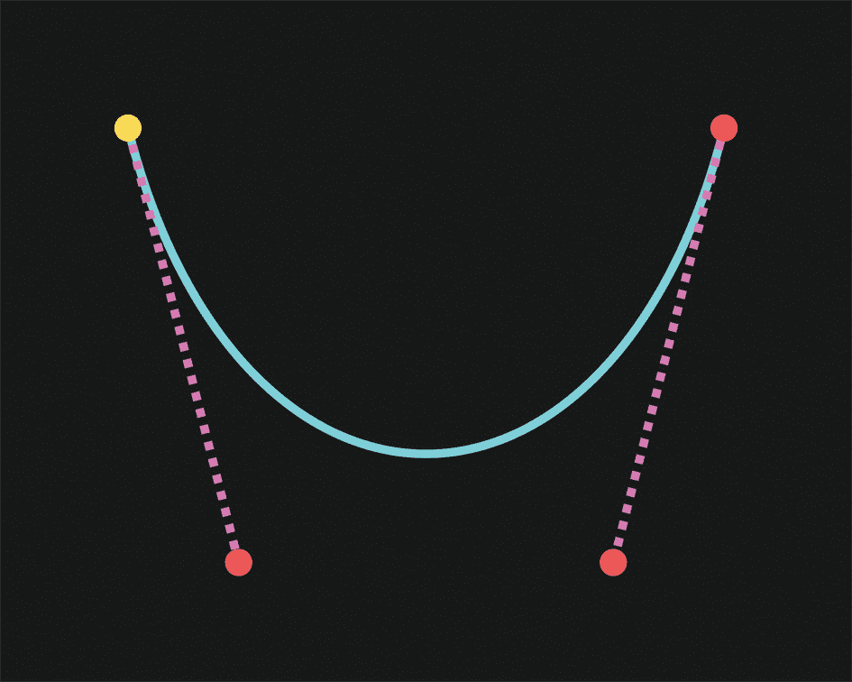

一张抽象图，展示了一个方形结构，其中有一条向上的抛物线状曲线，其两个端点与带有两个端点的倾斜虚线相连。

**图 6-10** 可视化控制点的三次贝塞尔曲线

当连接在一起时，连续的三次贝塞尔曲线可以组合创建出任何可以想象到的 2D 形状。它们是矢量绘图程序中的基本元素，以至于有效运用它们本身已成为一门手艺。审慎地使用这些曲线及其“手柄”（图 6-10 中可视化为虚线），可以区分出流畅优美的线条艺术与笨拙生硬的剪贴画。

### S 命令实现对称

与二次贝塞尔曲线类似，如果你想用另一条与其平滑连接的曲线来扩展当前曲线，可以调用三次贝塞尔曲线的一个相关命令。用于此目的的命令是 `S`（相对值用 `s`）。`S` 命令会自动生成一个对称控制点，该点镜像前一条曲线的控制点，因此允许我们省略第一组控制点坐标。

```
// 使用 S 命令扩展三次贝塞尔曲线。
svg.create('path').set({
d: 'M 50,150 C 100,250 200,50 250,150 S 400,50 450,150'
});
```

在图 6-11 中，颜色最浅的虚线指示了 `S` 命令自动生成对称控制点的位置。

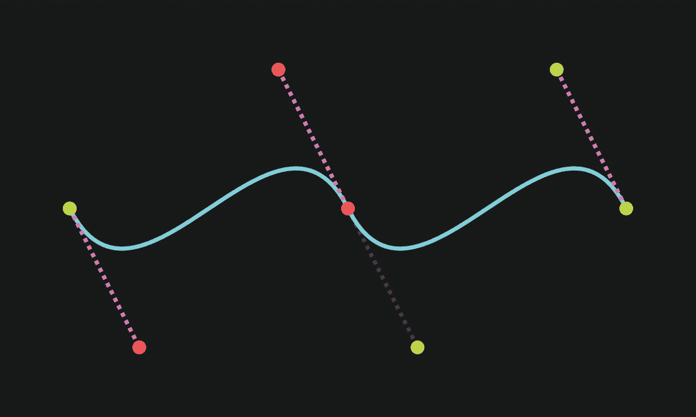

一张抽象图，展示了一个矩形结构，其中包含三次贝塞尔曲线，虚线指示了具有对称控制点的 `S` 命令。

**图 6-11** 一条平滑扩展的三次贝塞尔曲线

## 有机曲线

让我们将前述知识运用到一个构图中，目标是创建一系列平滑的、看起来有机的曲线。为此，我们的老朋友 `Noise` 将为我们指引正确的方向。首先，像往常一样复制模板文件夹，将其命名为类似 `16-organic-curves` 的名称。确保顶部有以下导入语句：

```
import { SvJs, Gen, Noise } from '../../node_modules/svjs/src/index.js';
```

然后是父级 SVG 和背景，之后我们将创建一些与噪声相关的变量。我在这里引入了一个名为 `amplifier` 的新变量；当我们把噪声值映射到一个新范围（可以说是增加其音量）时，将会用到它。

```
// 噪声相关变量。
let noise = new Noise();
let n = Gen.random(0, 1000);
let speed = 0.05;
let amplifier = Gen.random(200, 500);
```

接下来，我们将设置与颜色和曲线本身相关的变量，并将它们包含在一个组内。

```
// 曲线和颜色相关变量。
let curves = svg.create('g');
let numCurves = Gen.random(75, 125);
let hue = Gen.random(0, 360);
```


## 变量分组与生成有机曲线

按照这种方式将变量进行有意义的分组并添加注释来提升清晰度，通常是一种良好的实践。否则，当你之后重新审视代码时，可能很难回忆起最初的设计意图。你还可以更进一步，通过对象来分组（第 2 章概述的技巧），但这里我不打算这样做。

接下来我们将进入循环，首先检索噪声值，然后将其重新映射到更合适的范围（使用前面提到的`amplifier`变量）。请注意，这个范围将跨越正负值，因此我们无法预先知道其极性。就我们的曲线而言，这将有助于模拟更有机的运动，因为数值不会总是与原始起点保持一致的偏移，而是更自然地围绕它们变化。在循环外部，包含`moveTo()`方法来使我们的曲线组居中。

```
for (let i = 0; i < numCurves; i += 1) {
// 检索并映射我们的噪声值。
let noiseValue = noise.get(n);
noiseValue = Gen.map(noiseValue, -1, 1, -amplifier, amplifier, false);
}
curves.moveTo(500, 500);
```

接下来是曲线坐标。为了清晰起见，我们将为每个调用的命令设置变量，使路径数据（或`d`字符串）的构建不那么笨重。继续编写以下代码，并将其保持在循环内。我们目标曲线的形状与图 6-10 中所示的曲线相差不大。除此之外，提供的值相当随意，因此可以随意调整它们。

```
// M 命令坐标。
let mx = 0;
let my = 0 + (i * 5);
// C 命令坐标。
let cpx1 = 0 + noiseValue;
let cpy1 = -100;
let cpx2 = 250 + noiseValue;
let cpy2 = -100;
let x2 = 300;
let y2 = 0;
// S 命令坐标。
let spx = 350 + noiseValue;
let spy = 100;
let x3 = 300;
let y3 = -50;
```

除了初始的`M`命令坐标外，我们将使用相对坐标来构建曲线（即，我们将前述曲线变量提供给`c`和`s`命令，而不是它们的大写弟兄）。这些在循环设置中效果更好，因为它们始终与最新的坐标值保持同步。唯一需要注意的另一点是，我们非常有选择性地仅让`noiseValue`变量调制了部分值，本例中是十个可能值中的三个。有时微妙的效果最好，但同样，可以随意在此处进行实验。

变量就绪后，是时候创建曲线本身了。这里我将介绍一种关于模板字面量语法的新技巧。在之前的草图中，我们为每个变量都打开和关闭了`${}`大括号。但是，当这些变量一个接一个出现时，我们实际上可以将它们作为一个数组一次性嵌入。

```
// 创建有机曲线。
curves.create('path').set({
fill: 'none',
stroke: `hsl(${hue} 80% 80% / 0.8)`,
d: `M ${[mx, my]}
c ${[cpx1, cpy1, cpx2, cpy2, x2, y2]}
s ${[spx, spy, x3, y3]}`
});
```

如果此时运行草图，你会看到一系列曲线，但它们的形状和颜色将始终保持一致。我们还没有递增噪声坐标值——这是一个至关重要的步骤，但非常容易忘记（我自己就多次遗漏了这行代码，导致经常抓耳挠腮）。我们接下来将处理此步骤，同时增加色调值，并通过`noiseValue`变量对其进行微调。作为最后的点缀，我们将添加一些随机的“气泡”（参见图 6-12）。别问我为什么。

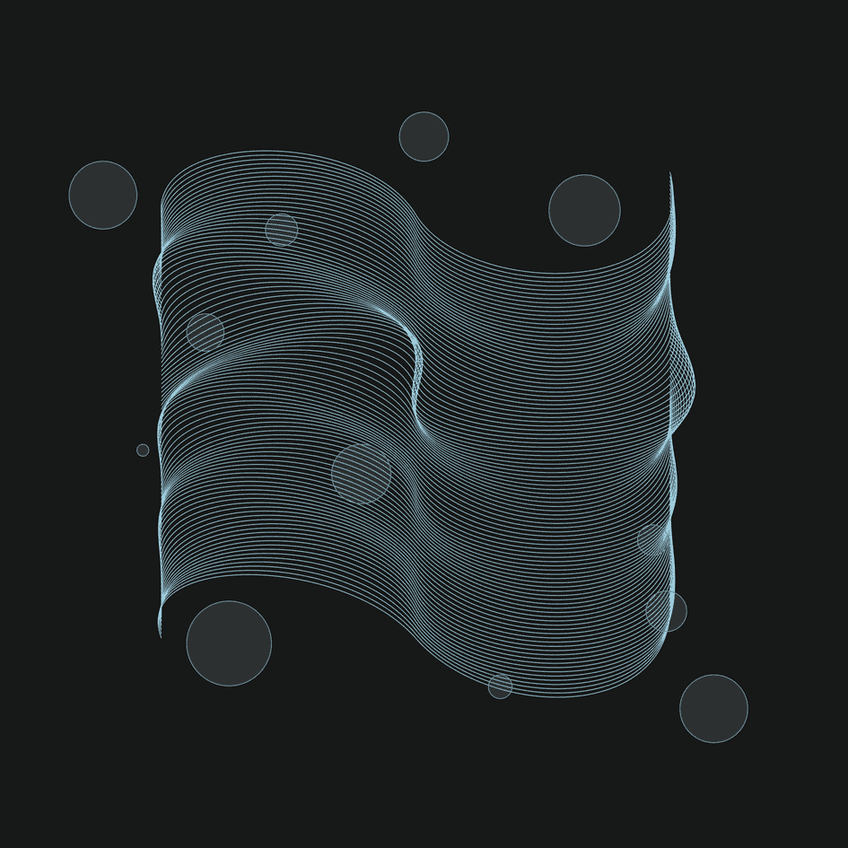

一张抽象图展示了一个正方形结构，上面有一系列重叠的、带有随机气泡的立方贝塞尔曲线，背景为深色。

**图 6-12** 噪声调制的有机曲线

```
// 递增噪声和色调。
n += speed;
hue = (hue % 360) + (noiseValue / 25);
// 10% 的概率生成一个“气泡”。
if (Gen.chance(10)) {
svg.create('circle').set({
r: Gen.random(5, 50),
cx: Gen.random(150, 850),
cy: Gen.random(150, 850),
fill: `hsl(0 0% 100% / 0.1)`,
stroke: '#888'
});
}
```

### 一个更简单的选项

为每个曲线段处理六个坐标（或者在使用`S`命令时为四个），有时会让人感到有点棘手。能够只用一条平滑曲线连接一系列单个点，而无需担心所有那些额外的控制点，岂不是很棒？

问得好！SvJs 配备了一个名为`createCurve()`的方法，正好可以做到这一点。在底层，它利用了三次贝塞尔曲线的能力，但抽象掉了控制点，使得构建曲线不再那么令人生畏。这确实牺牲了很大程度的控制权，但在某些情况下，我们可能不需要手动曲线命令所提供的微调级别。使用`createCurve()`方法，我们只需要关心点。

```
// createCurve() 方法的语法。
createCurve(pointsArray, [curveFactor]);
```

粗略地说，我们可以将其视为一种“连点”方法，主要区别在于我们需要提供点，而不是进行连接。第一个参数`pointsArray`，顾名思义，是一个`[x, y]`坐标对数组。它可以作为标准的一维数组或二维数组（即数组的数组）提供。

```
// 一维点数组。
let points1D = [25, 30, 45, 20, 80, 10, 90, 40];
// 相同点的二维数组。
let points2D = [
[25, 30], [45, 20], [80, 10], [90, 40]
];
```

`curveFactor`参数允许我们修改点之间的张力。值为`0`时，点通过直线连接。值为`1`（默认值）时，张力较松，曲线更平滑。通常，最可用的结果在`0`到`2`的范围内；偏离太远，底层的控制点将重叠并产生一些真正混乱的波形。但在某些情况下，这可能是你想要的。

在图 6-13 中，我们可以看到上述`curveFactor`值的作用。最上面的曲线设置为`0`，中间的曲线设置为`1`，底部的曲线设置为`5`。浅色的点表示我们的`pointsArray`坐标的位置，仅用于说明目的；正常情况下你不会看到这些被渲染出来。

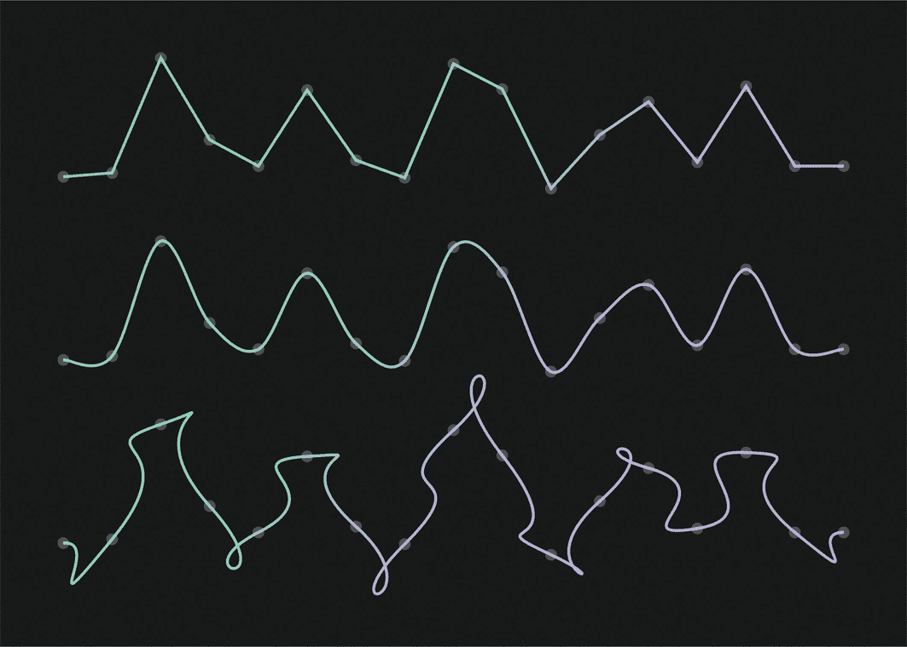

一张抽象图展示了一个矩形结构，上面有三条不同的曲线，具有多个波峰和波谷，背景为深色。

**图 6-13** 使用值 0、1 和 5 改变曲线因子

## 总结

路径现在已成为你生成式工具库的一部分，为你开启了更多可能性。回顾一下，我们涵盖了以下内容：

*   路径数据（`d`）字符串格式及其提供的灵活性和经济性。
*   绝对路径命令和相对路径命令之间的区别
*   `L`、`V`和`H`直线命令
*   `Q`和`T`二次贝塞尔曲线命令。
*   什么是控制点以及如何利用它们
*   椭圆弧曲线命令`A`及其复杂的参数数组
*   `C`和`S`三次贝塞尔曲线命令
*   使用噪声和随机性来塑造曲线
*   SvJs 的`createCurve()`方法

在下一章中，我们将探索运动、动画以及如何使我们的草图具有交互性。

