# 8. 滤镜效果

除了 SVG 提供的所有矢量功能（正如你从名为“可缩放矢量图形”的格式中所期望的那样），SVG 还以 `<filter>` 元素的形式提供了一些非常强大的基于像素的效果。在 GIMP 或 Photoshop 等编辑器中常见的许多图像处理操作，例如模糊、投影和扭曲，实际上也可以在 SVG 中实现。在本章中，我们将学习如何实现这些效果。

我们不会以任何全面的方式涵盖 SVG 滤镜的功能；那至少需要一本专门的书籍。这是一个庞大的主题，其创作潜力——至少在美学上——常常被忽视。制作出外观糟糕的 SVG 滤镜非常容易。我将努力避免这个陷阱，并更多地是从生成艺术家的角度，而不是图像编辑器的角度，来呈现一部分滤镜。

### 滤镜基础

在我们深入探讨具体的滤镜效果之前，我们需要了解它们的结构。一个滤镜由一个 `<filter>` 元素和一个或多个滤镜图元组成。这些图元本身也是元素，它们嵌套在主滤镜元素内部，并且都以字母 `fe`（代表滤镜效果）开头，后跟一个描述性名称。每个图元执行其自身的操作，并且可以通过一系列输入和输出以节点方式连接到其他图元。

让我们看一个仅使用单个图元的原始标记形式的基本示例。

正如你所见，`<filter>` 元素必须嵌套在 `<defs>` 元素内部；与渐变和图案一样，它只有在通过 `url` 链接到其 `id` 时才会被渲染。在前面的例子中，一个黄色圆圈通过其自身的 `filter` 属性调用滤镜，结果（如图 8-1 所示）是一个柔和的模糊效果，由一个名为 `feGaussianBlur` 的图元控制。

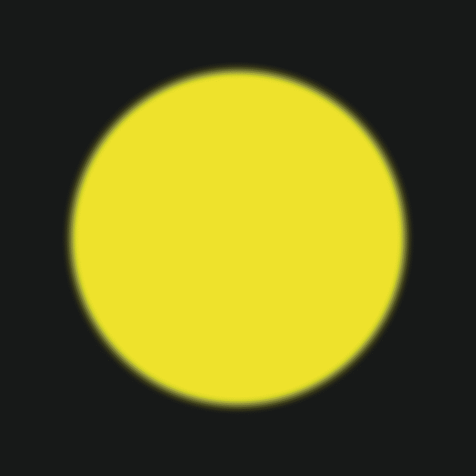

一幅抽象画，呈现一个明亮的圆形，背景为深色。

`图 8-1`

一个模糊的圆形

### 输入与输出

让我们检查一个稍微复杂一些的例子，这次说明滤镜图元如何连接在一起。结果将是一个应用到圆形描边的投影，如图 8-2 所示。

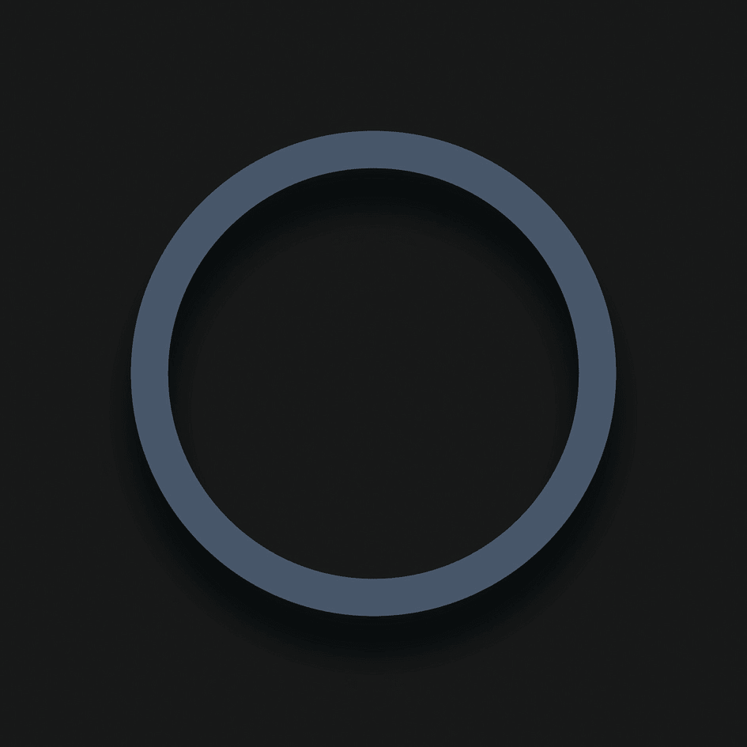

一幅抽象画，呈现一个带有渐隐外层的圆形，背景为深色。

`图 8-2`

一个投影滤镜效果

与之前的例子一样，我们从一个 `feGaussianBlur` 图元开始，但你会注意到添加了几个属性：`in` 和 `result`。这些属性也出现在它后面的图元 `feOffset` 中。在最后一个滤镜图元 `feComposite` 中，`in` 也存在，还有 `in2`。这些意味着什么？

*   `in` 指的是滤镜图元的输入源。

*   `in2` 指的是第二个输入源（如果滤镜图元支持此功能）。

*   `result` 是我们用来标记滤镜图元输出的内容，然后可以将其用作另一个图元的输入。

如果一个滤镜图元是其链中的第一个（如上面的 `feGaussianBlur`），`in` 将默认为 `SourceGraphic`；否则，它将默认为前一个图元的 `result`。`SourceGraphic` 仅指应用滤镜的图形元素。`SourceAlpha` 也指同一个图形元素，但仅限于其 Alpha 通道（即其不透明度值）。

所以这是第二个例子中发生的事情：

1.  `feGaussianBlur` 图元将圆形的 `SourceAlpha` 作为其输入，并对其应用高斯模糊效果。结果（或输出）被命名为 `blur`。

2.  `feOffset` 图元将 `blur` 结果作为其输入，并沿着 Y 轴对其进行偏移，此结果被标记为 `offset`。

3.  `feComposite` 图元将我们原始的 `SourceGraphic` 作为第一个输入 `in`，并将 `offset` 的结果作为其第二个输入 `in2`，将它们重新组合在一起。

我们稍后将更详细地讨论其中一些图元，但接下来我们将看看如何从标记转移到使用 `SvJs` 编写滤镜脚本。

### `SvJs` 的 `createFilter()` 方法

也许并不奇怪，`SvJs` 有自己的 `createFilter()` 方法来加速滤镜创建过程。它只需要一个参数：一个 `id`，这个 `id` 在将滤镜应用于目标元素时使用。与 `createGradient()` 和 `createPattern()` 方法一样，合理的默认值会被初始化，并且检查 `defs` 元素是否已存在的工作会在后台处理。

以下是我们之前第一个例子的 `SvJs` 等效代码，将一个柔和的模糊应用于一个黄色圆形（图 8-1）。

```javascript
// 初始化滤镜。
let filter = svg.createFilter('blur');
// 创建模糊效果。
filter.create('feGaussianBlur').set({ stdDeviation: 10 });
// 应用滤镜。
svg.create('circle').set({
    r: 350, cx: 500, cy: 500, fill: 'yellow', filter: 'url(#blur)'
});
```

### 滤镜区域

当一个滤镜被应用于一个元素时，其活动区域会超出该元素的范围。这允许效果有一定的空间“渗出”（借用印刷术语）。这个空间被称为滤镜区域，一旦滤镜效果超出此区域，就会发生裁剪（见图 8-3）。

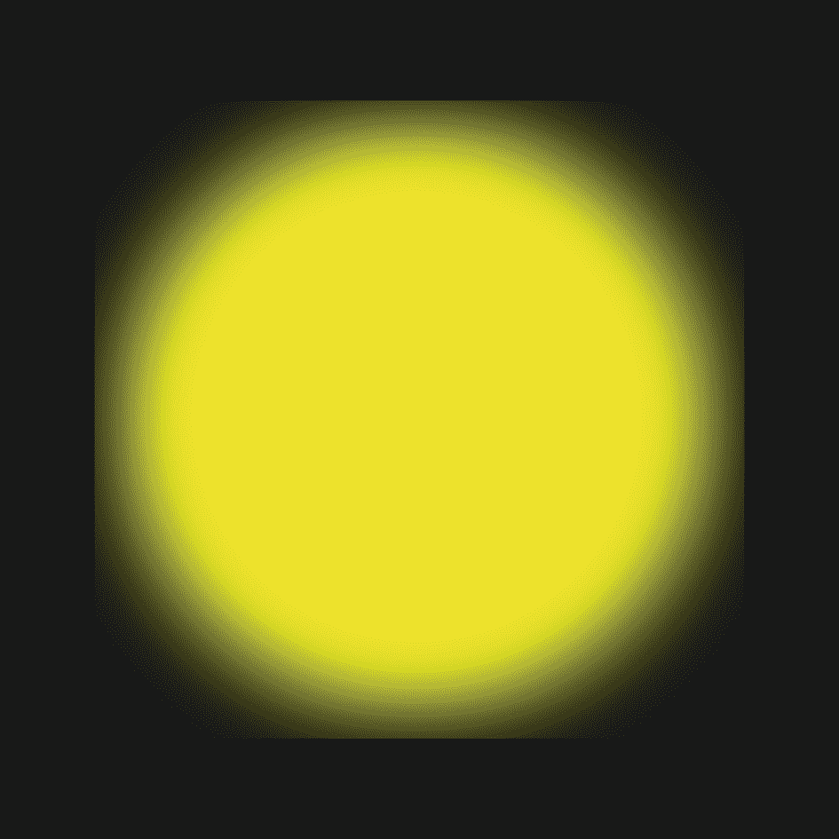

一幅抽象画，呈现一个模糊的明亮圆形，背景为深色。

`图 8-3`

一个被裁剪的滤镜区域

在生成艺术中，我们有时会超出滤镜效果参数预期的值范围，因此如果你的滤镜效果意外被裁剪，了解这个区域很重要。滤镜区域的定义方式与 `rect` 元素相同：通过 `x`、`y`、`width` 和 `height` 属性。默认情况下，这些值如下：

```
x: '-10%'
y: '-10%'
width: '120%'
height: '120%'
```

百分比值是相对于应用滤镜的形状而言的，所以在上述情况下，这相当于在滤镜元素周围有 `10%` 的内边距。`SvJs` 将此滤镜区域扩大到 `25%`，留出更多尝试空间。如果你需要进一步调整，可以轻松地使用 `set()` 方法进行：

```javascript
filter.set({ x: '-15%', y: '-15%', width: '130%', height: '130%' });
```

## 滤镜效果 101

让我们继续看一些简单的自定义滤镜效果。我们已经看到 `feGaussianBlur` 图元在运行，所以我不会在这里单独为它设立一个小节，但值得在继续之前提一下，它的主要属性 `stdDeviation` 实际上也可以接受两个值，而不仅仅是一个。如果你提供两个值，第一个数字将控制 X 轴上的模糊，第二个数字控制 Y 轴上的模糊。

```javascript
// 创建一个“运动”模糊效果。
filter.create('feGaussianBlur').set({ stdDeviation: '20 0' });
```

### 阴影

我们之前使用三个连接的滤镜图元实现了一个投影，但实际上有一个更简单的方法。在 SVG 规范较新的修订版中，引入了 `feDropShadow` 图元，它可以接受最多五个属性：`dx`，定义阴影在 X 轴上的偏移；`dy`，对 Y 轴进行同样的操作；`stdDeviation`，控制阴影的模糊程度；以及另外两个可选属性 `flood-colour` 和 `flood-opacity`，可以修改阴影的颜色和透明度。

下面展示了如何使用 `SvJs` 和 `feDropShadow` 图元重写图 8-2 的代码。

```javascript
// 初始化滤镜
let filter = svg.createFilter('shadow');
// 创建投影
filter.create('feDropShadow').set({ dx: 0, dy: 50, stdDeviation: 25 });
// 应用滤镜
svg.create('circle').set({
    // ... 其他属性
    filter: 'url(#shadow)'
});
```

### 着色

我们之前提到过一些名为 `flood-colour` 和 `flood-opacity` 的属性，它们可以与 `feDropShadow` 图元一起使用。还有一个图元也可以应用这些属性，并且这些属性最初就属于它：`feFlood`。`feFlood` 图元非常基础；它不需要输入，仅用特定颜色和不透明度填充滤镜区域。它本身并不特别有趣，但与其他图元结合时会很有用。

还有其他功能更强的颜色相关图元，名为 `feColorMatrix` 和 `feComponentTransfer`。后者过于高级，超出了本书的范围，因此我们将限定于 `feColorMatrix` 和 `feFlood`。让我们搭建一个草图来使用它们。

不必复制我们的模板文件夹，而是复制第一个网格示例，我将其标记为 `07-regular-grids`（参见第 4 章）。将此文件夹复制并重命名为类似 `21-colour-filter` 的名称。保持其余代码不变，将嵌套 `for` 循环的主体替换为以下代码：

if (Gen.chance(55)) {

grid.create('rect').set({

x: x, y: y, width: cellSize, height: cellSize,

fill: `rgb(

${[Gen.random(0, 255), Gen.random(0, 255), Gen.random(0, 255)]}

)`

});

}

```

每次刷新时，这应该会为我们生成一个随机排列的彩色瓷砖网格。到目前为止，我们在颜色使用上一直比较克制，主要控制 `hsl()` 函数的色相分量。这次我们将释放完整的 `rgb` 色彩光谱，因此结果可能从戏剧性、动态到花哨刺耳不等（参见图 8-4 的示例输出）。我喜欢这些结果中的某些效果；然而，着色有时可能会变得有些不协调。因此，让我们使用一些滤镜来约束颜色，同时保留动态范围。

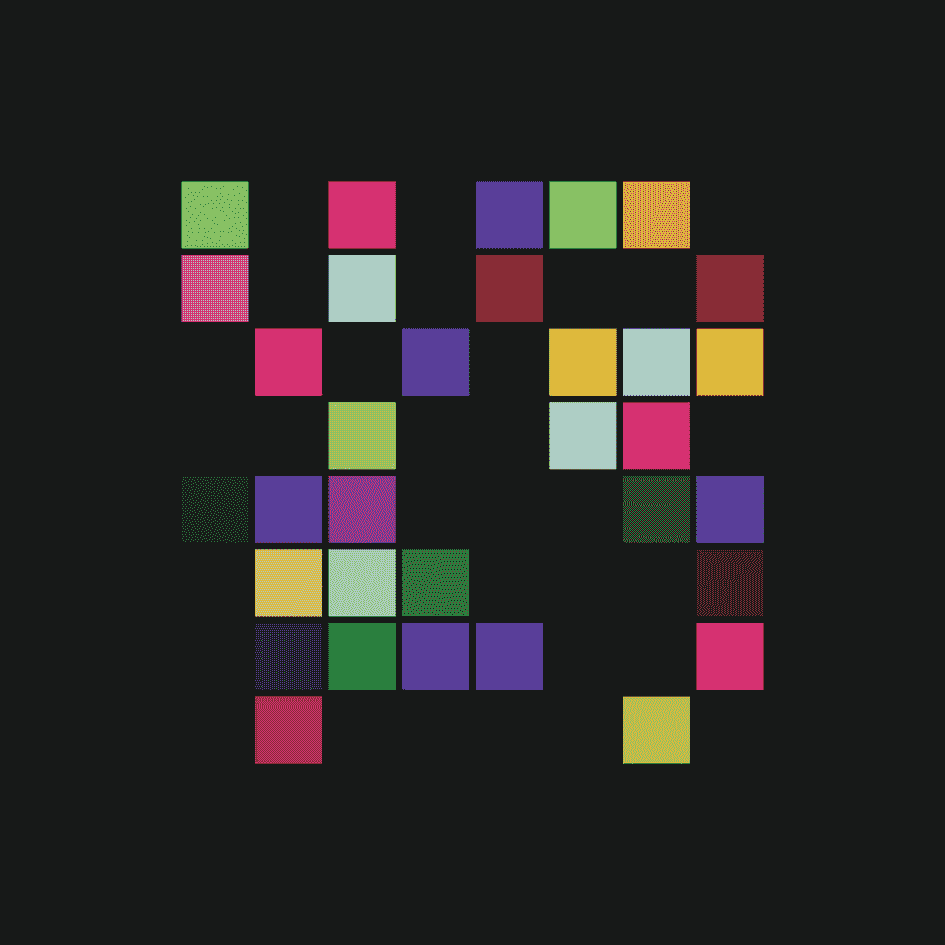

一幅抽象图，呈现出一组彩色渐变的方块，背景为深色。

`图 8-4` 全光谱 RGB 瓷砖

第一步是降低颜色的饱和度。为此，我们可以使用 `feColorMatrix` 图元，它接受两个参数：`type` 和 `values`。可接受的 `values` 取决于 `type`，可以如下所示：

- `saturate`：决定输入的色彩饱和度。它接受介于 `0`（无饱和度）和 `1`（完全饱和度）之间的 `values`，但浏览器可能接受更高的值以实现过饱和。
- `hueRotate`：按指定角度旋转色相值，该角度在 `values` 中设置。例如，将 `values` 设置为 `180` 会反转输入来源的所有色相值。
- `luminanceToAlpha`：将输入的亮度转换为 alpha 值，不需要 `values`。
- `matrix`：这是 `feColorMatrix` 类型中最复杂、最强大的一种。它接受一个 5x5 的颜色变换矩阵作为 `values`，该矩阵与输入来源的像素分量值进行矩阵乘法。它有点过于高级，不适合在本章深入探讨。

在上述类型中，`saturate` 正是我们需要的。要从输入中抽去颜色，我们需要将 `values` 设置为 `0`。现在让我们设置一个滤镜来实现这一点。在草图的底部，按如下方式初始化一个新的 `filter`：

```

// 初始化滤镜

let filter = svg.createFilter('colourise');

// 降低输入饱和度

filter.create('feColorMatrix').set({

type: 'saturate',

values: 0,

result: 'desaturate'

});

// 应用滤镜

grid.set({ filter: 'url(#colourise)' });

```

这应该会产生一个灰度网格。接下来，我们要选择一种颜色与其混合，为此我们将使用 `feFlood` 图元。在 `feColorMatrix` 图元和最后一行应用滤镜的代码之间，添加以下代码：

```

// 设置泛色

filter.create('feFlood').set({

flood_color: '#7F462C',

result: 'flood'

});

```

这应该会在合成中添加一种棕褐色。问题在于？它简单地淹没了画布，覆盖了所有其他内容。我们需要一种方法将其与 `feColorMatrix` 去饱和的 `result` 混合。

### 混合

大多数矢量图像编辑应用程序都内置了混合功能，形式为图层混合模式。SVG 在滤镜层面通过 `feBlend` 图元支持此功能。混合模式定义了元素重叠时颜色如何相互作用（无论元素是单个形状还是整个图层）。例如，如果混合模式设置为 `multiply`，最终颜色是顶部颜色乘以底部颜色的结果，这会产生类似透明胶片重叠的效果。如果设置为 `screen`，顶部和底部颜色会被反转、相乘、再反色，从而产生类似两张图像投射到投影屏幕上的效果。

SVG 规范支持多种混合模式，逐一描述超出了本章的范围，但如需全面了解（包括交互式示例），请查看 `developer.mozilla.org/docs/Web/CSS/blend-mode` 上的 MDN 条目。

实际上，有几种混合模式在我们的案例中效果很好，所以我打算将这些模式存储在一个数组中，以便稍后选择。在初始化滤镜之前包含以下代码：

```

// 设置混合模式数组

let blendModes = ['screen', 'overlay', 'lighten', 'color-dodge', 'soft-light', 'color'];

```

接下来，在我们定义了 `feFlood` 图元之后，设置 `feBlend` 图元。我们将随机化其 `mode` 属性，并将第一个输入设置为泛色，第二个输入设置为去饱和的网格。

```

// 随机化混合模式

filter.create('feBlend').set({

mode: Gen.random(blendModes),

in: 'flood',

in2: 'desaturate',

result: 'blend'

});

```

第一个输入 `in` 作为我们的顶部颜色，第二个输入 `in2` 作为我们的背景颜色。此时，我们的网格应该以着色形式重新出现，但前景中仍然有泛色。我们需要一种方法将其剥离，这就引出了下一节。

### 合成

如果你看过一些最爱的电影幕后花絮，很可能见过绿幕技术：攀爬摩天大楼的动作英雄，实际上挂在一根绳子上，背景是绿色织物。这种技术可以更容易地将背景从前景中剥离，之后与单独拍摄的素材结合。合成就是将这两个不同的元素融合在一起的过程；两个来源合并为一体。它在许多方面与混合相似，但结果更为明显和可编程。它更多地与元素如何相交有关，而非颜色如何融合，可供使用的各种合成操作可以产生非常不同的结果。相比之下，混合在其输出上往往更为统一。

`feComposite` 图元允许我们在 SVG 中执行合成操作。它接受两个输入 `in` 和 `in2`，其 `operator` 属性有七个可能的值：`over`、`in`、`atop`、`xor`、`out`、`lighter` 和 `arithmetic`。在图 8-5 中，我展示了其中六种；`arithmetic` 运算符没有固定的输出（它是完全可自定义的），并且过于复杂，无法在本章中恰当覆盖。

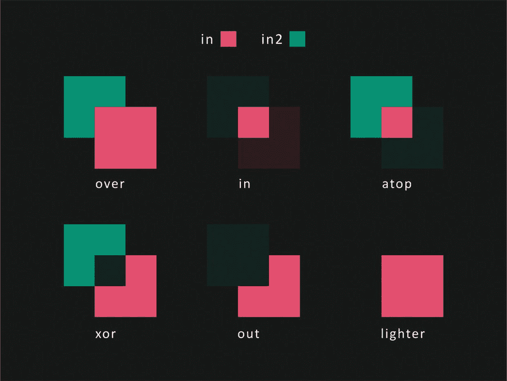
```

一张图示展示了 `in` 和 `in2` 两种操作的六种效果，包括重叠的正方形、两个淡化的重叠正方形中有一个高亮的小正方形、一个大正方形包含一个小正方形、两个重叠正方形中有一个深色小正方形、一个 L 形亮色正方形，以及一个更亮的正方形。

`图 8-5`

SVG 七种合成操作中的六种

由于 `feComposite` 图元非常有用，并且在进一步探索 SVG 滤镜时您很可能会依赖它，因此值得详细描述每个预设操作符。在图 8-5 中，我们可以将 `in` 视为前景，将 `in2` 视为绿幕背景。

*   `over`：这是默认操作符，前景简单地放置在背景之上。

*   `in`：前景与背景重叠的部分成为新的输出。

*   `atop`：保留前景与背景重叠的部分；其余的前景部分被裁剪掉。

*   `xor`：保留前景和背景中不重叠的部分；其余部分被移除。这本质上是 `in` 操作符的逆操作。

*   `out`：显示前景中位于背景外部的部分。

*   `lighter`：前景和背景的重叠区域被相加（产生增亮效果）。

*   `arithmetic`：如果选择此操作符，必须定义四个额外的数值属性：`k1`、`k2`、`k3` 和 `k4`。输出结果由以下公式定义：`(k1 * i1 * i2) + (k2 * i1) + (k3 * i2) + k4`，其中 `i1` 和 `i2` 分别代表 `in` 和 `in2`。是的，这确实很复杂！但使用此操作符可以获得最微妙且可定制的结果，因此非常值得独立探索。

如果我们将 `feFlood` 图元的 `result` 作为第一个输入（前景），将 `SourceGraphic` 作为第二个输入，那么能够实现我们预期效果的操作符是 `atop`。回顾一下，使用此操作符，前景（`feFlood`）与背景（`SourceGraphic`）重叠的部分将被保留；`feFlood` 的其余部分则被裁剪掉。

现在让我们进行设置。在 `feBlend` 图元之后、滤镜应用于网格之前，包含以下代码。

```
// Composite the blend 'atop' the original.
filter.create('feComposite').set({
in: 'blend',
in2: 'SourceGraphic',
operator: 'atop'
});
```

对我来说，这产生了您在图 8-6 中看到的输出。我不知道您怎么看，但我看到了一只好斗的小狗举起爪子，颇有 Scrappy-Doo 的风范（尽管这很可能是我幻想性视错觉在作祟）。每次刷新页面，您都会看到截然不同的效果，虽然色调会变化，但由于我们只使用了一种 `feFlood` 颜色，所以可以观察到共同的颜色基调。不使用滤镜很难实现这种效果。

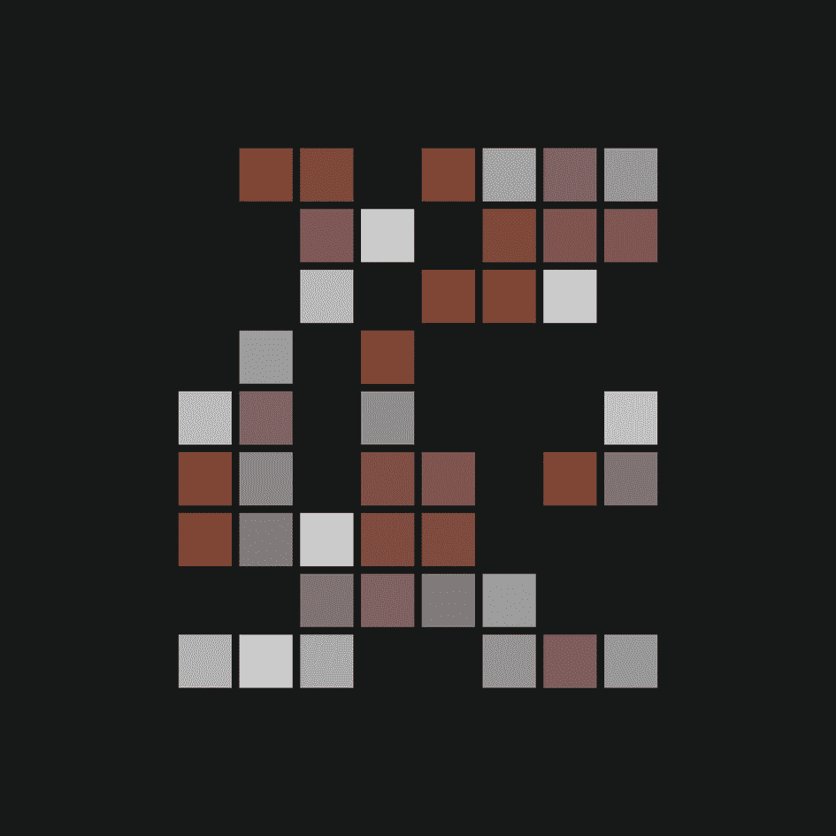

一幅抽象画展示了在深色背景上，一团由各种颜色渐变的正方形组成的图案，类似马赛克图案。

`图 8-6` 合成操作的结果

## 噪点与扭曲

在本节中，我们将介绍一种新的噪点，它实际上是 SVG 规范内置的。我们还将探索如何在滤镜管线中添加一些扭曲效果。有了这两个要素，再加上前面介绍的基础知识，一个全新的特效世界将向我们敞开。

### 湍流（Turbulence）

在第 5 章中，我们介绍了 SvJs 的 `Noise` 模块，它允许我们在草图中使用 Perlin 噪点。SVG 也在其 `feTurbulence` 滤镜图元中实现了 Perlin 噪点，那么区别是什么呢？

区别在于，使用 `Noise` 模块，我们可以提取并操作噪点*数据*，利用其值来塑造我们的矢量形状。而使用 `feTurbulence`，我们拥有的是一个直接以*像素*形式渲染噪点数据的滤镜图元。这虽然不让我们访问底层噪点数据，但我们可以通过调整其属性轻松地改变视觉输出，并将其输入到其他滤镜图元中。`feTurbulence` 的属性如下：

*   `baseFrequency`：这是唯一必需的属性，我们可以将其理解为定义噪点的“缩放级别”。通常最低值从 0.0001 开始（当然也可以更低），值越高，显示的噪点地形就越多。如果提供两个数值（而非一个），第一个将定义 X 轴方向的频率，第二个定义 Y 轴方向的频率。以这种方式解耦两个值，可以在水平或垂直方向上拉伸或压缩生成的纹理。

*   `numOctaves`：此属性指的是噪点信号中存在的八度音阶数量，决定了我们所能辨别的细节水平。值越高，渲染结果越自然，但对处理器的要求也越高。最实用的结果范围在 1 到 5 之间。

*   `seed`：这允许我们改变采样噪点的“位置”。如果 `baseFrequency` 是缩放级别，那么 `seed` 就是我们的位置坐标。有效的 `seed` 值应为 0 到 1000 万之间的正整数。

*   `stitchTiles`：此属性接受 `stitch` 或 `noStitch`，指的是噪点地形相邻区域如何混合。设置为 `noStitch`（默认值）时，某些噪点配置会导致“平铺”效应，即噪点区域之间的边界非常明显。设置为 `stitch` 可以柔化这种效应。

*   `type`：可以设置为 `fractalNoise` 或 `turbulence`（默认值）。前者在红色、绿色、蓝色和 Alpha 通道上产生相同类型的噪点模式，后者则在 Alpha 通道上产生不同的模式。`fractalNoise` 类型看起来更柔和，非常适合生成像云这样的气态纹理。而 `turbulence` 类型的外观则更偏向流体形态。

在图 8-7 中，我们可以看到左侧有两个 `turbulence` 实例，右侧有两个 `fractalNoise` 实例。实例之间的值只有细微变化，这应该能让您感受到此滤镜图元可能提供的巨大变化。

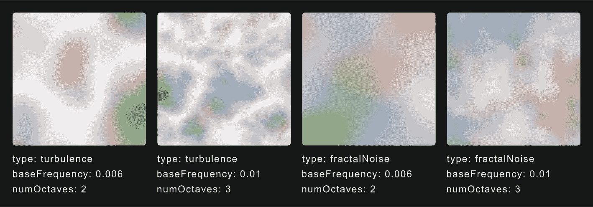

一张截图显示了四个不同的正方形。左侧是两个具有不同频率和八度音阶的湍流模式正方形，颜色渐变。右侧是两个具有不同频率和八度音阶的分形噪点正方形，颜色渐变。

`图 8-7` 两种噪点类型的不同基础频率和八度音阶

要感受 `feTurbulence` 的工作原理，最好的方法是调整交互式示例，因此我专门为此创建了一个在线代码笔：`davidmatthew.ie/generative-art-javascript-svg#turbulence`。我倾向于使用非常低的 `baseFrequency` 值，并通过修改 `seed` 来随机选择一种模式；这可以产生大量有趣的纹理。然而，如果您想模拟更颗粒化的效果，例如经典的胶片颗粒效果或砂纸纹理，非常高的 `baseFrequency` 值会很有用。

### 位移

一个能与 `feTurbulence` 配合得特别好的滤镜图元是 `feDisplacementMap`。这个图元允许我们利用第二个输入 `in2` 的值来扭曲第一个输入 `in`。第二个输入充当了映射，我们可以从中推导出位移值，也就是决定沿 x 轴和 y 轴施加多少扭曲程度的值。这意味着，我们可以使用 `feTurbulence` 的输出，通过将两者放入 `feDisplacementMap` 来扭曲我们的 `SourceGraphic`。

除了前面提到的 `in` 和 `in2` 之外，`feDisplacementMap` 图元还有另外三个属性：第一个是 `scale`，它决定了要施加的扭曲程度（即 `in` 被 `in2` 扭曲的程度）。另外两个属性 `xChannelSelector` 和 `yChannelSelector` 允许我们指定哪个通道负责水平位移和垂直位移。它们接受 `R`、`G`、`B` 或 `A` 作为值，分别代表三个颜色通道以及 alpha 通道。以单个颜色通道 `R` 为例，其值范围可以从 0 到 255。低于 127 的值会产生负向位移（沿 x 轴向左移动，或沿 y 轴向上移动），而高于 127 的值则会产生正向位移（沿 x 轴向右移动，或沿 y 轴向下移动）。

在图 8-8 中，一个 `feTurbulence` 图元（中间）的输出被用作映射，以位移源图形（左侧），产生了一些柔和的波浪状扭曲（右侧）。

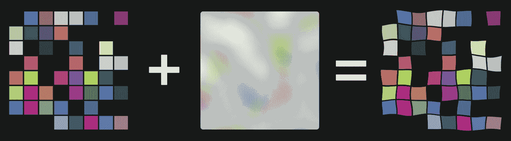

一幅插图展示了一簇带阴影的正方形，并添加了一个处于湍流图案中的正方形，从而产生了一簇呈波浪状排列的正方形。

`图 8-8` 使用湍流作为位移映射源

## 创建宇宙气泡

下一个示例将把我们已经介绍过的几个滤镜图元组合在一起，并将其应用于最简单的源图形：圆形。我们的目标是通过合成一些湍流、模糊和扭曲效果，创造出一点“宇宙”感。

首先，复制我们的模板文件夹，并将其重命名为 `22-hubble-bubble`（或你选择的其他名称）。在背景下方通常的位置，让我们将源图形设置在 `viewBox` 的中心，并对其半径进行一些随机化处理。

```
// 创建源图形。
svg.create('circle').set({
cx: 500,
cy: 500,
r: Gen.random(250, 350),
fill: '#000',
filter: 'url(#cosmic)'
});
```

你会注意到我们已经引用了滤镜，但尚未创建它。通常我们创建元素的顺序很重要；如果我们先创建一个圆形，再创建另一个，后者会像图层一样被渲染到前者“上方”。但由于滤镜是在 `defs` 元素内创建的，因此可以在应用滤镜的元素之后定义它们。回顾一下，`defs` 元素内的任何内容都不会被直接渲染，而必须被引用。

下一步，我们将创建这个滤镜（确保 `id` 与对 `#cosmic` 的引用匹配），并在滤镜链中添加第一个图元：`feTurbulence`。我们将随机化种子，将 `baseFrequency` 调低，并将 `numOctaves` 增加到 `4`，以突出一些纹理细节。

```
// 初始化滤镜。
let filter = svg.createFilter('cosmic');
// 创建随机的湍流量。
filter.create('feTurbulence').set({
type: 'fractalNoise',
baseFrequency: Gen.random(0.002, 0.006, true),
seed: Gen.random(0, 10000),
numOctaves: 4,
stitchTiles: 'stitch',
result: 'turbulence'
});
```

与 `feFlood` 一样，`feTurbulence` 是一个生成器图元，它不需要任何输入；它直接生成自己的输出。结果是，一旦我们将 `feTurbulence` 图元初始化为滤镜链中最新的（或唯一的）环节，它就会用其输出完全充斥整个滤镜区域（如果你此时运行代码，就会看到这个效果）。稍后我们将使用 `feComposite` 来解决这个问题。

下一步，我们将创建一个要位移（即施加扭曲）的目标区域。为了创建这个目标区域，我们要做的是使用 `feGaussianBlur` 来柔化源图形（圆形）的边缘；这会在圆形的周边引入一些透明度。这个透明度递减的区域（模糊的另一种描述方式）将是我们用来对湍流施加扭曲的部分。图 8-8 展示了使用湍流作为位移映射源的结果；而这次我们将反过来，使用湍流作为位移映射的目标。我们圆形上的模糊区域将取而代之成为位移映射源。以下是设置方法（混合了一些随机性）。

## 光照与纹理

尽管 SVG 从定义上讲是一种用于二维矢量图形的格式，但在其滤镜图元中，你会发现两种光照效果：`feDiffuseLighting` 和 `feSpecularLighting`。通常属于三维图形领域的光照，需要 z 轴分量才能运作，以便空间中凸出的表面或其他物体（即具有深度的物体）能够捕捉到光源投射的光线。SVG 的坐标空间没有任何这样的第三维度或 z 轴，那么光照在这样的环境中究竟是如何运作的呢？答案是 z 轴是通过使用“凹凸”映射来模拟的。具体来说，`feDiffuseLighting` 和 `feSpecularLighting` 都将它们连接输入的 alpha 通道解释为凹凸映射源。凹凸映射正如其名，是一张凹凸的映射图，指的是表面上任何凸起的区域，比如斜坡、峰顶、褶皱和纹理。

### 光照图元的挑战

使用这些光照图元的挑战在于，要知道如何为它们提供带有良好渐变效果的凹凸贴图；任何具有非常尖锐过渡或大面积纯色区域的贴图，往往会出现令人不悦的像素化，或者完全不受影响。在图 8-11 中，我们可以看到，一个带有径向渐变（左侧）的圆形与一个同样大小但填充纯色（右侧）的圆形，在受到远距离光源照射时，产生的效果差异相当明显。

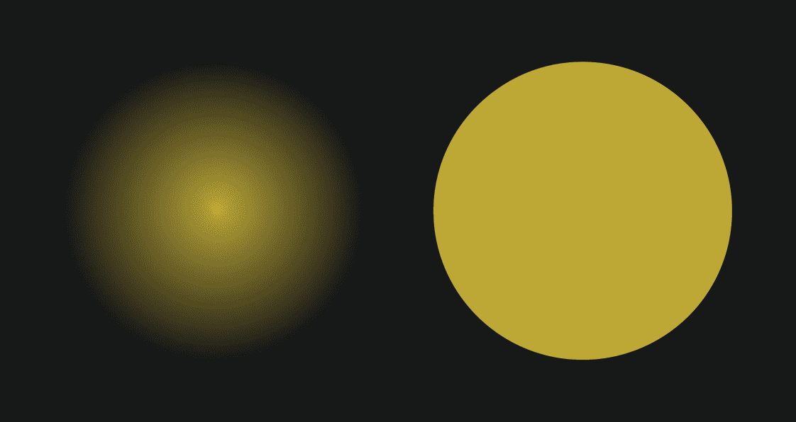

一张抽象图左侧展示了一个模糊的圆形，中心有一个亮点。右侧是一个明亮的阴影圆形。

**图 8-11** *投射在径向渐变与纯色填充上的光照效果*

光照是 SVG 中非常容易出问题的环节之一。一旦出了问题，结果往往显得廉价、生硬且参差不齐，这可能会让你彻底放弃尝试光照效果。我们需要记住，使用滤镜时，我们已经从矢量领域进入了像素领域，分辨率在此处至关重要。一个渐变更加精细的 Alpha 通道，会转化为分辨率更高的凹凸贴图。

幸运的是，`feTurbulence` 是生成渐变 Alpha 通道数据的绝佳源头。在下一个示例中，我们将使用 `feTurbulence` 配合 `feDiffuseLighting` 和 `feDisplacementMap` 来模拟一种粗糙、撕裂的纸张效果。但首先，我们需要更深入地探究上述两个光照图元的一些细节。

### 漫反射与镜面高光光照

`feDiffuseLighting` 图元模拟的是漫反射。这意味着，照射到漫反射光照物体表面的光线会向各个方向散射，这是粗糙表面纹理（如亚麻布）的特征。而 `feSpecularLighting` 图元则模拟镜面高光反射，这是更光滑表面（如保龄球）的特征。在镜面高光反射中，照射到表面的光线会以一个确定的角度反射出去。图 8-12 展示了由 `feDiffuseLighting`（左侧）发出的点光源与由 `feSpecularLighting`（右侧）发出的相同点光源之间的区别。

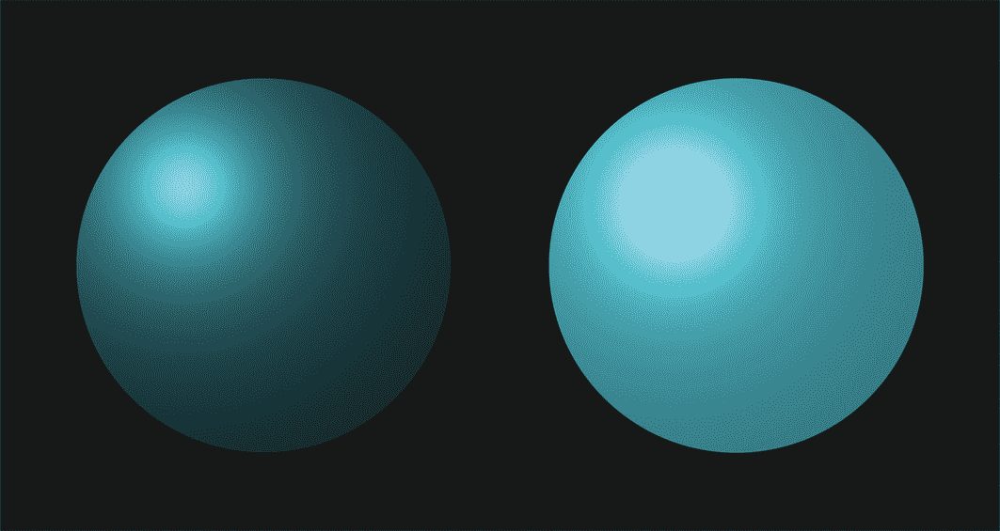

一幅抽象图，左侧在深色背景上显示了一个暗色调的圆形，右侧则是一个亮色调的圆形。

**图 8-12** *漫反射光照与镜面高光光照的对比*

两个光照图元都接受一个单一的输入 `in` 作为它们的凹凸贴图源，以及一个 `surfaceScale` 属性，该属性定义了凹凸贴图的相对高度。光线的颜色也可以使用 `lighting-color` 属性进行自定义，该属性默认为白色。这两个图元还共享一个用于定义常量的属性：`feDiffuseLighting` 的 `diffuseConstant` 和 `feSpecularLighting` 的 `specularConstant`。这个常量决定了光源投射光线的强度。`feSpecularLighting` 图元还有一个额外的属性 `specularExponent`，用于控制焦点强度（在图 8-12 中，这将决定点光源反射光斑的大小）。

### 光源

我之前多次提到远距离光源和点光源，但并未解释它们。这指的是由 `feDiffuseLighting` 或 `feSpecularLighting` 图元发出的光源类型。单独这些图元本身并不会发出任何光线；它们需要一个额外的嵌套节点来定义光源。换句话说，在 SVG 中设置光照涉及定义两个元素：一是外部节点，它定义了光照的目标表面是漫反射还是镜面高光；二是内部节点，它定义了要使用的光源类型。下面是一个在原始 SVG 中的示例：

共有三种光源节点：`feDistantLight`，一种环境光，均匀地向各个方向发射光线（例如太阳）；`fePointLight`，一种更近的光源，具有明确的焦点；以及 `feSpotLight`，一种方向光，通过一个可自定义尺寸的锥形形状发射光线。阐述所有三种光源超出了本章的范围，因此我们将只关注前两种：`feDistantLight` 和 `fePointLight`。

`feDistantLight` 光源有两个属性：`azimuth`，指定光线的方向角度，以及 `elevation`，指定光源的高度。两者都以度数为单位表示。用太阳来做类比，黎明时分，太阳从东方升起（`azimuth` 和 `elevation` 均为 `0`），到了赤道地区的正午，它会上升到 `elevation` 为 `90` 度，即头顶正上方。

`fePointLight` 光源没有 `azimuth` 或 `elevation` 属性；它完全由 `x`、`y` 和 `z` 属性定义。`z` 属性对应于光源的高度或海拔，而 `x` 和 `y` 属性则指代当前坐标空间中的标准二维位置。

### 模拟纹理

让我们开始一个新的项目，并深入实践之前提到的部分理论。复制我们的模板文件夹，并将其重命名为 `23-rough-paper`，然后在背景下方的常规位置，创建一个羊皮纸颜色的渐变，我们将把它应用到我们的纸张上。纸张本身将是一个由两个形状组成的复合路径（将其撕成两半的结果）。如你所见，可以通过简单地添加一个新的 `M` 命令（相当于抬起笔，在别处开始新的一行）来扩展路径，使其超出结束 `Z` 命令的范围。设置好撕裂的纸张后，我们将其居中。

```javascript
// 创建一个羊皮纸颜色的渐变。
svg.createGradient('parchment', 'linear', ['#fffbeb', '#fde68a'], 90);
// 为撕裂的纸张创建路径。
let paper = svg.create('path').set({
  fill: 'url(#parchment)',
  stroke: '#4444',
  d: 'M 0,0 h 175 l 175,550 h -350 Z M 210,0 h 340 v 550 h -165 Z',
  filter: 'url(#rough-paper)'
});
// 将其居中。
paper.moveTo(500, 500);
```

我们有意让构图保持简单，以便能将更多注意力放在滤镜效果上。接下来，我们将初始化滤镜，并将第一个图元添加到链中：`feTurbulence`。这将构成纸张颗粒纹理的基础。

```markdown
画布现在应该充满了`feTurbulence`。接下来我们要做的是为其添加光照效果，具体来说，是使用一个带有嵌套`feDistantLight`节点作为光照类型的`feDiffuseLighting`图元。这个第二个节点我们可以在漫反射光照图元之后直接创建，使用SvJs的方法链。

```javascript
// 在湍流上添加漫反射光照。
filter.create('feDiffuseLighting').set({
  surfaceScale: 1,
  diffuseConstant: 1.3,
  in: 'turbulence',
  result: 'lighting'
}).create('feDistantLight').set({
  azimuth: 180,
  elevation: 45,
});
```

现在画布上应该已经出现了类似纸张的纹理。接下来，我们将一些湍流数据接入`feDisplacementMap`图元，以粗糙处理源图形的边缘。

```javascript
// 使用湍流扭曲纸张源图形。
filter.create('feDisplacementMap').set({
  in: 'SourceGraphic',
  in2: 'turbulence',
  scale: 25,
  result: 'distortion'
});
```

这为我们提供了一个具有磨损边缘的旧纸张轮廓，但还没有纹理。为了重新引入光照效果的结果，我们需要进行一些合成。将光照输出作为前景，粗糙边缘的纸张作为背景，使用`in`运算符将能实现我们想要的效果。

```javascript
// 将光照与粗糙边缘的纸张融合。
filter.create('feComposite').set({
  in: 'lighting',
  in2: 'distortion',
  operator: 'in',
  result: 'composite'
});
```

现在形状已经就位，纹理也显露出来，我们得到了一个逼真的粗糙撕裂纸张纹理。但是，我们还缺少最后一种要素：颜色。为了解决这个问题，我们将把`feComposite`的输出与`feDisplacementMap`的输出混合，并使用`multiply`（正片叠底）的`mode`（混合模式）。这样应该能还原我们最初的羊皮纸渐变。

```javascript
// 重新引入羊皮纸渐变。
filter.create('feBlend').set({
  in: 'composite',
  in2: 'distortion',
  mode: 'multiply'
});
```

图 8-13 展示了结果。还不错！虽然单独来看还不够令人印象深刻（至少在我看来是这样），但通过这个效果的各种变体，你就有办法为其他生成式构图增添额外的视觉趣味。

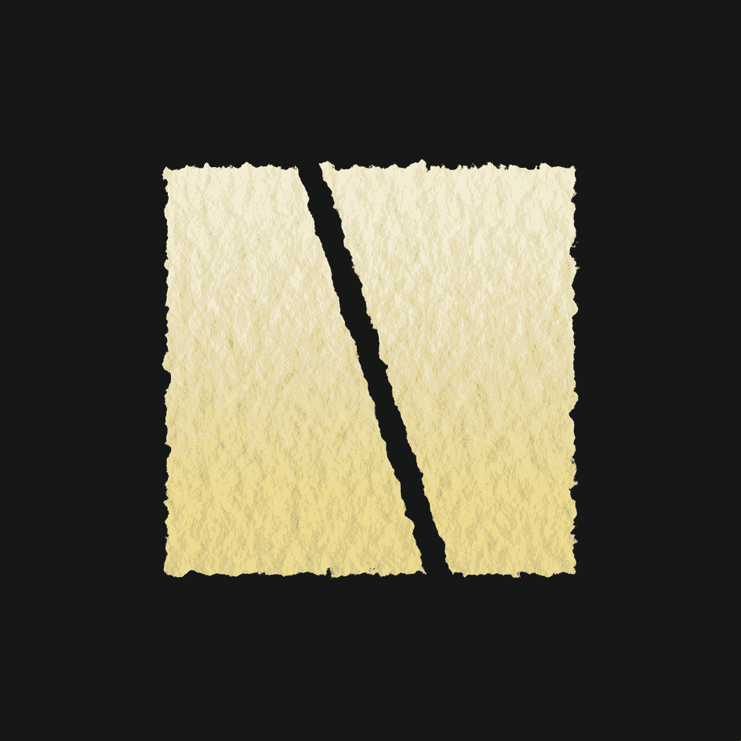

`图 8-13` 我们粗糙现成的纸张纹理

### 生成式纹理

前面的例子为我们接下来的尝试打下了基础。模拟纹理固然不错，但在下一个示例中，我们将完全采用生成式方法，也就是放弃部分控制权，享受结果的随机性。在此过程中，我们还将演示点光源镜面光照的用法，以便您了解它与漫射、远距离光照的区别。

复制模板文件夹并将其命名为`24-rocky-randomness`。在背景下方，我们将设置源图形，它将是一个简单的圆形。我们将为这个圆形应用渐变和滤镜。

```javascript
// 创建源图形。
svg.create('circle').set({
  r: 300,
  cx: 500,
  cy: 500,
  fill: 'url(#random-gradient)',
  filter: 'url(#rocky-randomness)'
});
```

下一步是设置一个线性渐变。为此，我们将使用一个包含三种随机颜色的数组，并且也会随机化渐变的旋转角度。

```javascript
// 随机颜色数组。
let colours = [
  `hsl(${Gen.random(0, 360)} 80% 80% / 0.75)`,
  `hsl(${Gen.random(0, 360)} 80% 80% / 0.75)`,
  `hsl(${Gen.random(0, 360)} 80% 80% / 0.75)`
];
// 一个具有随机旋转角度和颜色数组的渐变。
svg.createGradient('random-gradient', 'linear', colours, Gen.random(0, 360));
```

现在来看滤镜。与其他示例一样，我们的第一个节点将是`feTurbulence`图元，它将作为我们的主要纹理来源。`numOctaves`将在`2`到`7`之间变化，这允许细节水平有相当大的变化。`baseFrequency`和`seed`我们也将随机化。

```javascript
// 初始化滤镜。
let filter = svg.createFilter('rocky-randomness');
// 创建主要湍流。
filter.create('feTurbulence').set({
  type: 'turbulence',
  numOctaves: Gen.random(2, 7),
  baseFrequency: Gen.random(0.003, 0.01, true),
  seed: Gen.random(0, 1000),
  result: 'turbulence'
});
```

现在画布上覆盖了原始的湍流，虽然每次刷新都会变化，但仍感觉有些过于均匀。我们如何创造出更有机、更少网格感的东西呢？好吧，我们可以用……更多的湍流来扭曲它！

为此，我们将设置另一个`feTurbulence`图元，这次使用`fractalNoise`（分形噪声）。`baseFrequency`我们会稍微提高，但`numOctaves`和`seed`保持在相似范围内。然后，我们将两者都接入`feDisplacementMap`，随机化`scale`（缩放）值（这决定了扭曲的强度），并将`R`和`G`分别设置为x和y通道选择器（纯粹是因为这次我不太喜欢默认的alpha输出）。

```javascript
// 设置另一个湍流实例。
filter.create('feTurbulence').set({
  type: 'fractalNoise',
  numOctaves: Gen.random(3, 7),
  baseFrequency: Gen.random(0.01, 0.07, true),
  seed: Gen.random(0, 1000),
  result: 'noise'
});
// 用第二个湍流实例扭曲第一个。
filter.create('feDisplacementMap').set({
  in: 'turbulence',
  in2: 'noise',
  scale: Gen.random(25, 40),
  xChannelSelector: 'R',
  yChannelSelector: 'G',
  result: 'distortion'
});
```

现在我们有了看起来更自然的噪点，让我们来启动一些镜面光照，看看这些噪点在光照下是什么样子。我们将在大多数属性上使用`Gen.random()`，包括点光源的坐标。

```javascript
// 对扭曲后的输出应用镜面点光源。
filter.create('feSpecularLighting').set({
  in: 'distortion',
  surfaceScale: Gen.random(5, 30),
  specularConstant: Gen.random(2, 6),
  specularExponent: Gen.random(10, 25),
  result: 'lighting'
}).create('fePointLight').set({
  x: Gen.random([-50, 500, 1050]),
  y: Gen.random([-50, 1050]),
  z: Gen.random(50, 250)
});
```

对于`x`和`y`坐标，你会注意到我们使用`Gen.random()`从一个数组中选取值，而不是从一个范围；如果你检查这些值，你会发现这些组合将光照保持在画布的边缘。这主要是为了防止任何直接照射（想想照片中不受欢迎的相机闪光灯）。如果此时加载草图，你应该会看到一些有趣的生成地形出现。不过我们还没完成。
```

在我们将地形和源图形重新组合之前，我们先用一些`feGaussianBlur`（高斯模糊）来柔化后者的边缘。然后，我们将像之前草图中那样，使用`feComposite`配合`in`运算，之后再使用另一个`feComposite`图元恢复原始渐变，这次使用`atop`（在顶部）运算。

```javascript
// 模糊源图形。
filter.create('feGaussianBlur').set({
in: 'SourceGraphic',
stdDeviation: Gen.random(25, 50),
result: 'blur'
});
// 通过模糊后的源图形引入光照纹理。
filter.create('feComposite').set({
in: 'lighting',
in2: 'blur',
operator: 'in',
result: 'comp1'
});
// 恢复原始渐变。
filter.create('feComposite').set({
in: 'blur',
in2: 'comp1',
operator: 'atop'
});
```

现在我们可以看结果了！图 8-14 显示了一个我特别喜欢的渲染结果，但这个草图的变体非常多，所以最好多尝试，直到找到你喜欢的效果。

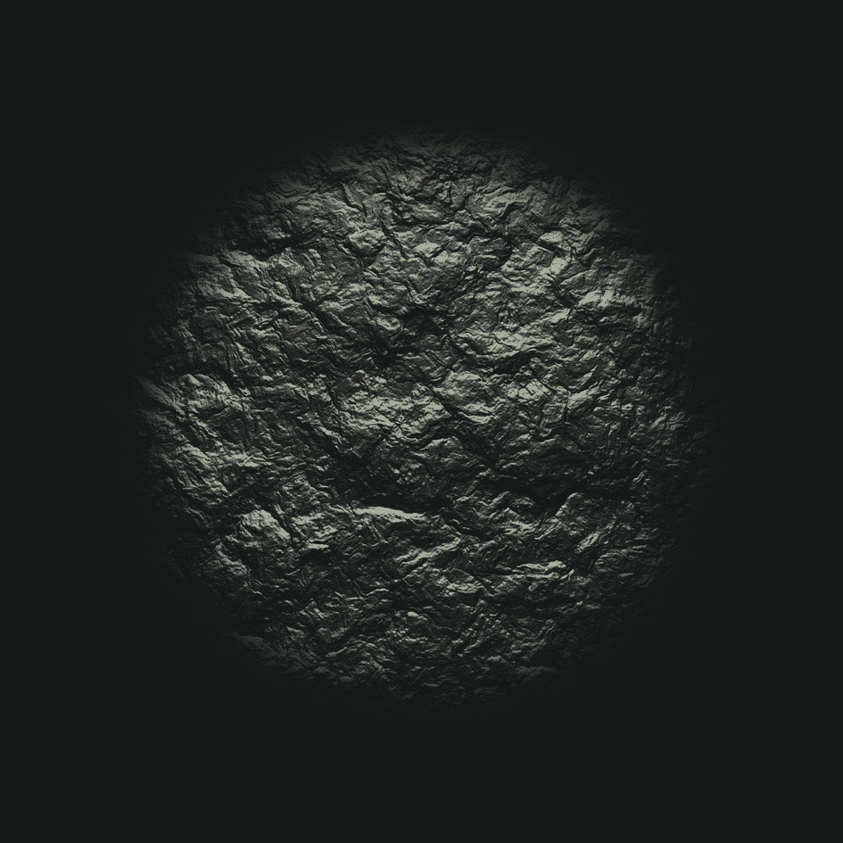

**图 8-14** 镜面随机岩石感

至此，我们对滤镜的初步探索就结束了。正如我之前提到的，在滤镜领域还有更多值得探索的地方，而且有很多图元我由于篇幅限制未能涉及。这绝对值得（并且会有回报）进一步独立探索。

## 总结

让我们快速回顾一下这本倒数第二章所涵盖的内容：

- 滤镜的构建方式
- 滤镜区域和 SvJs 的 `createFilter()` 方法
- 基本图元，如 `feGaussianBlur`、`feFlood` 和 `feDropShadow`
- 更复杂的图元，如将其他图元联系在一起的 `feComposite` 和 `feBlend`
- `feTurbulence` 图元的力量及其创造性的可能性
- 使用 `feDisplacementMap` 扭曲其他图元
- 光照以及如何使用凹凸贴图模拟三维效果
- 漫射光和镜面光以及各种光源类型
- 如何将湍流、位移和光照结合起来模拟和生成纹理

在下一章中，我们将进行总结，并涉及一些有助于将你的生成艺术提升到新水平的话题。
