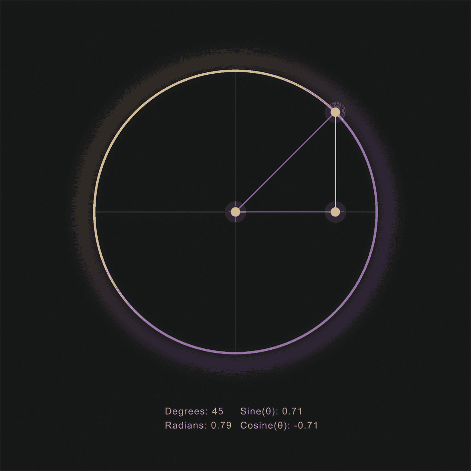
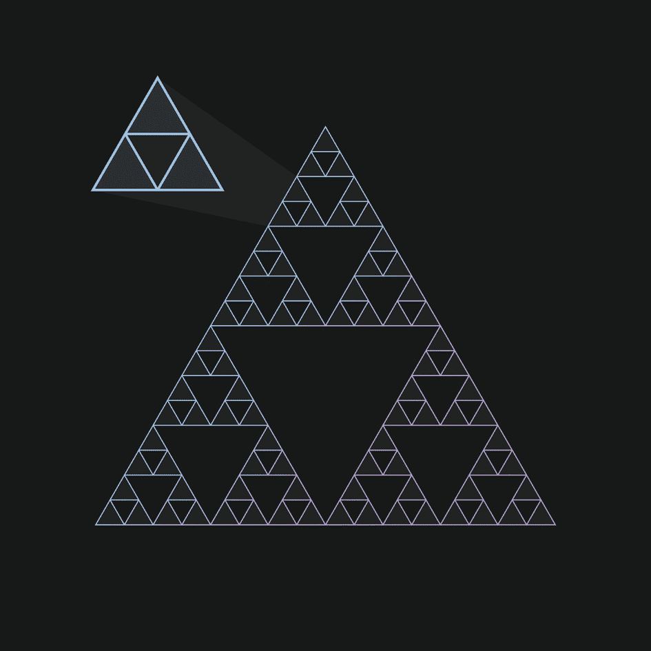
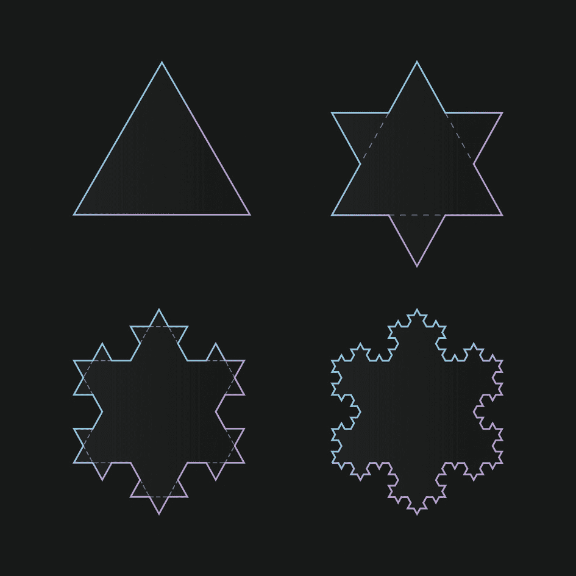
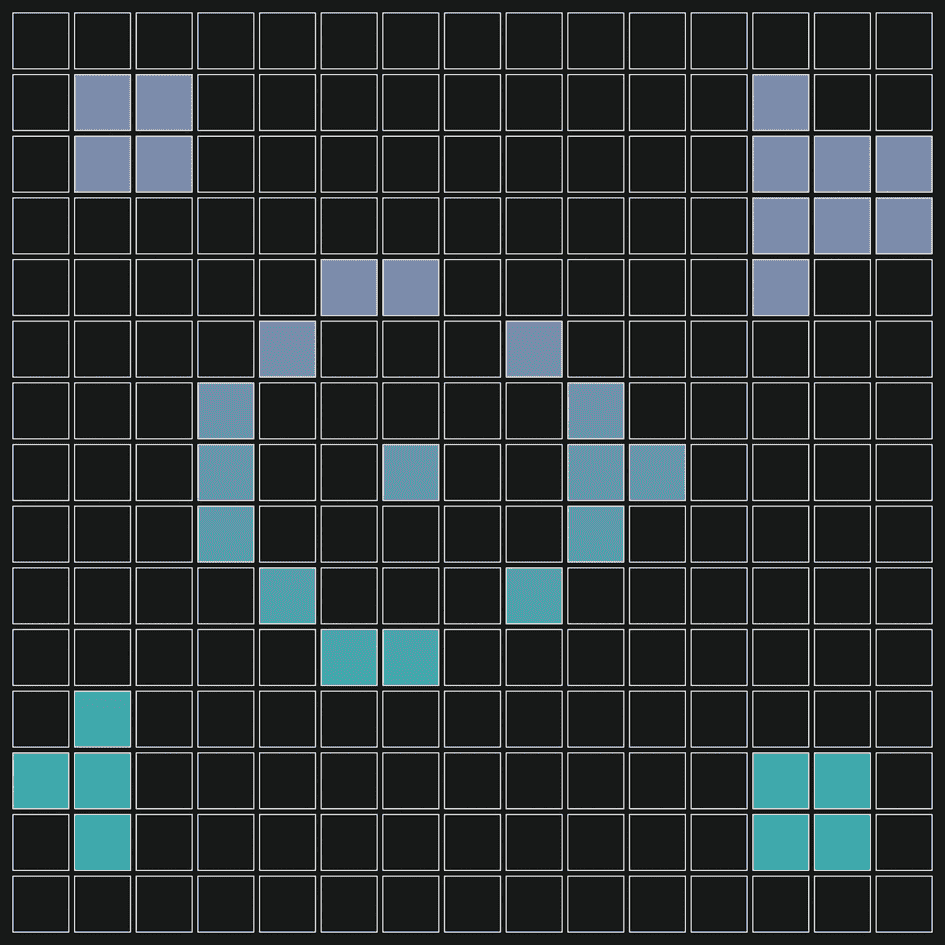

# 恭喜你走到这一步！我们已经涵盖了很多内容，所以是时候回顾总结、舒展一下你的思维肌肉，并确保我们不会以“受伤”结束这本书。我们将通过逐一回顾各章节的要点来放缓节奏，最后还将预览你在生成式之旅中可能继续探索的一些方向。

### 一路走来的旅程

我们从 SVG 的介绍开始，并探讨了它与 PNG、JPG 等光栅格式的不同之处。接着，我们转向 SvJs 库，学习了如何搭建一个本地前端开发环境。第一章以一段代码转储作为结尾，旨在提供一些视觉灵感，但解释稍显简略，因此接下来的两章填补了这一空缺。

对于那些刚接触 JavaScript 和/或编程的读者，第 2 章提供了一个入门教程，而第 3 章则深入探讨了 SvJs 库的核心功能。我们探索了如何创建基本形状，如何处理文本、组、渐变和图案，并在此过程中创作了一些色彩丰富的构图和视错觉作品。

随着第 4 章引入随机性，我们终于能够完全进入生成式模式，创建出结果不事先僵化固定的草图。我们学习了如何在一个范围内随机生成数字，如何从数组中随机选择元素，以及如何使用生成式艺术的支柱——嵌套 for 循环——来构建规则网格。我们通过蒙版和剪切路径扩展了 SVG 的知识，并尝试了高斯分布和帕累托概率分布。

第 5 章引入了噪声，作为在草图中注入更有机变化的一种方式，并介绍了其他有用的生成函数，以帮助我们约束和将这些噪声值映射到更有用的范围。在第 6 章中，我们挖掘了路径元素及其命令库的强大功能，学习了如何创建二次、三次贝塞尔曲线以及椭圆弧类型的直线和曲线。

第 7 章全部关于让东西动起来。我们探索了事件监听器和用户交互，并回顾了至少四种不同的 SVG 动画方法。我们介绍了基本的碰撞检测和圆周运动，然后继续在第 8 章中学习了滤镜。在那里，我们重点讨论了生成式艺术家最常用的一组滤镜原语，并学习了如何将这些原语连接起来以实现各种不同的效果。

### 未来的航向

那么，你接下来该何去何从？我们是否已完全探索了生成式艺术的领域，绘制了所有版图？完全没有！我们实际上只是触及了众所周知的冰山一角，暗示了其下方庞大的结构。所以，如果你确实想自己更深入一些，我会试探性地建议一些进一步的主题（前提是到目前为止我们涵盖的材料可以被无限扩展）。

#### 三角学

在第 7 章中，我只能对三角学进行非常粗略的介绍，所以如果你这是第一次遇到诸如 `Math.PI` 和 `Math.sin()` 之类的东西，不要指望这些概念能立刻扎根（“平方”根或其他……抱歉，蹩脚的双关语）。三角学是一个值得深入探讨的主题，就像本书中的许多材料一样，你接触和练习得越多——或者更好的是，你玩得越多——你就会越得心应手。

话虽如此，我确实发现交互式可视化是激发理解的好方法。为此，我建立了一个草图，展示了圆周运动与直角三角形（三角学的基础）之间的关系，其定格画面如图 9-1 所示。

一幅抽象图呈现了一个方形结构，其中有一个高亮显示的圆，第一象限内有一个直角三角形，并附有度数、正弦 theta、弧度和余弦 theta 的值。

**图 9-1** 交互式三角学可视化

与本章中的其他示例一样，此示例旨在说明而非指导，因此此处未包含代码。不过，你可以在本书的专用网页上体验这个特定示例，如果感兴趣，也可以在那里检查代码。我还提供了进一步的阅读材料和资源，应该能帮助你深入探索这个主题，包括我多年来一直依赖的那些资料。这些可以在 `davidmatthew.ie/generative-art-javascript-svg/#trigonometry` 找到。如果你认为自己不太具备数学思维，请不要因此打消探索这个迷人主题的念头。你只需要熟悉其中相对较小的一部分，就能挖掘其创作可能性，而这并不涉及复杂的方程。

#### 分形

另一个不需要复杂方程或令人费解的数学能力（即“弯曲思维”）的主题是分形。是的，分形是一种数学对象，有些极其复杂，但分形通常基于递归和自相似性的简单原理。

递归本质上意味着自引用。递归函数是一个不断调用自身的函数，我们在第 7 章中遇到的 `requestAnimationFrame()` 就是一个例子。关于分形，自相似性意味着一个部分将类似于整体，反之亦然。如图 9-2 所示，该图展示了一个著名的分形——谢尔宾斯基三角形。正如你所见，每一个构建块都是整个结构的缩影。

一幅抽象图呈现了一个方形结构，其中有一个等边三角形，内部包含更小的等边三角形，背景为深色。

**图 9-2** 谢尔宾斯基三角形中的自相似性

递归从何而来？嗯，它存在于包括谢尔宾斯基三角形在内的每一个分形中，但为了真正说明这个想法，让我们来看另一个著名的标本——冯·科赫雪花。用于构建此分形的算法可以归结为以下（尽管是简化的）步骤：

1.  构造一个等边三角形。
2.  将每条边分成三等份。
3.  移除中间的线段。
4.  重复步骤 1。

第四步使该算法具有递归性。图 9-3 展示了仅经过三次迭代后此过程的样子。理论上，这些步骤可以无限期地继续下去，产生一个越来越复杂、可以无限放大的周长，这就是为什么分形有时被视为“通往无限的窗口”。在实践中，迭代次数通常受限于屏幕分辨率或以其他方式设定上限，以防止浏览器崩溃和处理器处理无法承受的数字。

一幅抽象图呈现了一个方形结构，其中有一个等边三角形，等边三角形的每条边被分成三等份，并移除中间的线段。

**图 9-3** 递归构建冯·科赫雪花

分形为生成式艺术家打开了一个探索和灵感的完整宇宙，远非我在这里所能暗示的。如果你此时兴趣被激发，我在 [`davidmatthew.ie/generative-art-javascript-svg/#fractals`](https://davidmatthew.ie/generative-art-javascript-svg/#fractals) 汇总了更多资源，我鼓励你去探索。

好的，作为一名高级文档工程师和翻译员，我将严格按照您的注意事项和示例格式，将给定的英文文本翻译成中文。

#### 系统模拟

简单的规则，往往会衍生出意想不到的复杂性；这不仅适用于分形，也适用于许多自然系统。模拟这类系统通常是严肃科学的工作，但在生成式艺术的更高级领域，你会看到对基础物理学（如重力、质量、密度等）、粒子系统（如雾、火、烟）以及有机行为（从单细胞相互作用到鸟类的群集模式）的模拟。

现在，`SVG` 并非系统模拟的首选媒介——例如，粒子系统在基于像素的环境（如 HTML 的 canvas）中性能更好——但撇开性能问题不谈，如果你希望为自己的作品增添一个额外的层次，在艺术之上撒上一点科学的佐料，那么模拟自然系统绝对值得你投入精力。一个简单的草图就可能成为源源不断创意的输出基础，既是艺术品，也是应用。

`John Conway's Game of Life` 是有机模拟的一个很好的例子；它是一款基于网格、零玩家的游戏，模拟了生长、衰落和演化的模式。网格中的每个细胞可以处于两种状态之一：“存活”或“死亡”。存活的细胞有填充颜色；死亡的细胞则没有。

支撑这款游戏的规则出奇地简单，但复杂性却可以以意想不到的模式和争夺生存权的细胞团块的形式涌现出来。这些规则如下：

1.  任何邻居数量为一个或零个的存活细胞会死亡。
2.  任何邻居数量为两个或三个的存活细胞会存活到下一“代”（或迭代）。
3.  任何邻居数量为四个或更多的存活细胞会死亡。
4.  任何恰好有三个邻居的空（即死亡）细胞会诞生为新细胞。

图 9-4 展示了游戏进行几代后的一个快照。一些细胞团（如左上角和右下角的方形细胞群）处于停滞状态，这意味着它们存活但不会扩散和繁衍。其他细胞则在活跃地蔓延、探索、消失和重生。观察起来会很有趣！

一张抽象图呈现了一个方形结构，其内部有网格状图案，包含多个正方形。中心、左上角、右上角、左下角和右下角的一些正方形被高亮显示。

**图 9-4**  
一个正在运行的生命游戏的快照

我将链接更多示例供你尝试，请访问 [`davidmatthew.ie/generative-art-javascript-svg/#systems-simulations`](http://davidmatthew.ie/generative-art-javascript-svg/%2523systems-simulations%25ef%25bb%25bf)，其中包括其他类型的模拟。

### 结语

至此，我总结得已经够多了，所以我想留给你一些（颇为主观的）告别建议，以支持你的生成式艺术创作之旅：

-   安于永不知足。对于任何类型的编程，总有太多东西需要去了解。这没关系。
-   尽量腾出零碎时间玩代码；你不必非得通宵达旦。养成小习惯式的步骤比偶尔的冲刺跑更可持续。
-   拥抱简单；生成式艺术不必复杂也能优秀。
-   从其他艺术家那里汲取灵感；逆向工程那些激励你的示例。
-   不要只是抄袭；理解你所实现的东西，并且总是加上你自己的风格。这将有助于你发展自己的风格。
-   回馈。参与社区。贡献代码、建设性的批评，或者只是在他人的作品下留下积极的评论，让他们知道你欣赏他们的努力。
-   最后，无论结果如何，都要欣赏自己的努力。产出不是一切，你的生成式艺术之旅是属于你自己的。

