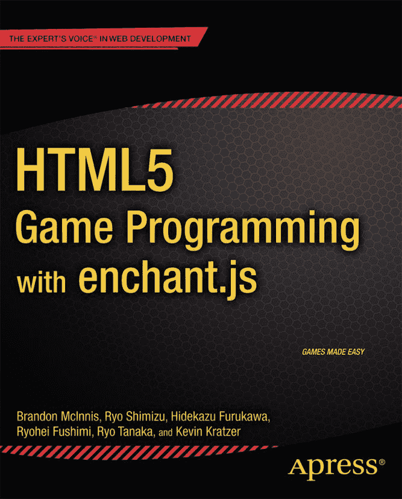

# 使用 enchant.js 进行 HTML5 游戏编程

布兰登·麦金尼斯、凉湫、古川秀和、伏见良平、田中凉、凯文·克拉策，合著《使用 enchant.js 进行 HTML5 游戏编程》，编号 10.1007/978-1-4302-4744-9 © Apress 出版社，2013 年

ISBN 978-1-4302-4743-2
电子书 ISBN 978-1-4302-4744-9
© Apress 出版社，2013 年

总裁兼出版人：保罗·曼宁
首席编辑：本·雷诺-克拉克
发展编辑：芭芭拉·麦圭尔
技术审校：福阿德·科斯穆德
编辑委员会：史蒂夫·安格林、马克·贝克纳、埃文·白金汉、加里·康奈尔、路易丝·科里根、摩根·埃特尔、乔纳森·根尼克、乔纳森·哈塞尔、罗伯特·哈钦森、米歇尔·洛曼、詹姆斯·马克姆、马修·穆迪、杰夫·奥尔森、杰弗里·佩珀、道格拉斯·庞迪克、本·雷诺-克拉克、多米尼克·谢克沙夫特、格温南·斯皮林、马特·韦德、汤姆·韦尔什
协调编辑：阿纳米卡·潘乔
文字编辑：洛里·卡瓦诺
排版：SPI Global
索引编制：SPI Global
插图制作：SPI Global
封面设计：安娜·伊先科

本书通过 Springer Science+Business Media New York（地址：233 Spring Street, 6th Floor, New York, NY 10013）在全球范围内发行。电话：1-800-SPRINGER，传真：(201) 348-4505，电子邮件：`orders-ny@springer-sbm.com`，或访问 [www.springeronline.com](http://www.springeronline.com)。Apress Media, LLC 是加利福尼亚州的一家有限责任公司，其唯一成员（所有者）为 Springer Science + Business Media Finance Inc（SSBM Finance Inc）。SSBM Finance Inc 是一家特拉华州公司。如需翻译相关信息，请发送电子邮件至 `rights@apress.com`，或访问 [www.apress.com](http://www.apress.com)。

Apress 和 friends of ED 的图书可批量购买用于学术、企业或促销用途。大多数图书也提供电子版和许可。如需更多信息，请参考我们的“特殊批量销售——电子书许可”网页：[www.apress.com/bulk-sales](http://www.apress.com/bulk-sales)。

作者在本书中引用的任何源代码或其他补充材料，读者可在 [www.apress.com](http://www.apress.com) 获取。详细查找图书源代码的方法，请访问 [www.apress.com/source-code/](http://www.apress.com/source-code/)。

本作品受版权保护。出版社保留所有权利，包括对全部或部分内容的翻译、重印、插图再利用、朗诵、广播、缩微复制或以任何其他物理形式复制，以及通过电子改编、计算机软件或现在已知或未来开发的类似或不同方法进行信息存储和检索。但不包括与评论、学术分析或专为输入并运行于计算机系统、供购买者独家使用而提供的简短摘录。复制本出版物或其部分内容，仅在出版社所在地现行版权法规定下允许，且必须事先获得 Springer 的许可。许可可通过版权清算中心的 RightsLink 获取。违反相关版权法的行为将受到法律追究。

本书中可能出现商标名称、标识和图像。我们并非在每次出现商标名称、标识或图像时都使用商标符号，而是仅以编辑方式使用这些名称、标识和图像，以利于商标所有者，且无意侵犯商标权。本出版物中使用的商品名、商标、服务标志及类似术语，即便未明确标识，也不应被视为对其是否受所有权保护的表达意见。

尽管本书中的建议和信息在出版时被认为是真实准确的，但作者、编辑和出版商均不对可能存在的任何错误或疏漏承担法律责任。出版商对本材料内容不作任何明示或暗示的保证。

*献给德里克、爸爸和帕蒂。“只要一直游下去就行。”——电影《海底总动员》*

## 关于作者

布兰登·麦金尼斯是东京尤比奎特斯娱乐公司秋叶原研究中心`enchant.js`技术推广专员，拥有网页开发背景。他有着非同寻常的过往，曾参与歌剧演唱，并为最终幻想系列游戏原作曲者植松伸夫担任口译。在不进行网页开发或向用户推广`enchant.js`时，他喜欢花时间创作和录制音乐，并在东京各地探险。

伏见龙平从电子通信大学辍学，并于 2005 年被日本政府认定为天才程序员/超级创作者。他于 2008 年至 2010 年在九州大学任教，自 2003 年起担任尤比奎特斯娱乐公司总裁兼首席执行官。他居住在秋叶原，爱好包括品酒。

古川秀和是尤比奎特斯娱乐公司的技术文档工程师，在日本出版过多本关于移动开发和游戏的畅销书籍。

伏见良平目前在东京大学工学部学习。他是尤比奎特斯娱乐公司`enchant.js`开发团队负责人，虽然来自冈山，但目前居住在东京。

田中凉是东京大学理学部信息科学专业的学生。她开发了`enchant.js`的核心部分。

凯文·克拉策在德国长大，目前正在慕尼黑工业大学攻读信息学硕士学位。他曾以开发者和软件架构师的身份参与多个软件项目，其中包括`enchant.js`。他目前居住在慕尼黑，为尤比奎特斯娱乐公司从事移动端和网页端开发工作。

## 关于技术审校

福阿德·霍斯穆德是加州州立理工大学福布斯计算机工程教授，教授交互式娱乐工程等课程。他拥有加州大学圣克鲁兹分校计算机科学博士学位。福阿德是非营利组织全球游戏创作节公司的官员，并自 2009 年全球游戏创作节起担任首席技术专家。

福阿德的研究兴趣包括人工智能、自然语言处理、机器学习以及交互式娱乐与系统。

## 引言

如果你正在读这本书，毫无疑问你对为网页制作游戏有一定兴趣。作为在该领域有些经验的人，我有资格告诉你：你来对地方了。

在过去的十年里，网页游戏发生了巨大变化。虽然网页游戏的核心概念往往随时间缓慢演变，但我们用于创建游戏工具的更新换代则快得多。在当今的网页上，即使在浏览器中完成简单的游戏相关任务，也需要编写大量代码。

开源游戏引擎`enchant.js`解决了这个问题，它大幅减少了编写游戏所需的代码量，并包含多个后备和兼容性函数，这些函数在后台运行，无需你做任何特殊处理，就能确保游戏在多种浏览器上流畅运行。该引擎在其原产国日本已成为非常流行的工具，并且在西方程序员中的使用也日益增多。

如果你是个网页编程新手，别担心！我们将一步步引导你了解`enchant.js`的工作原理、JavaScript（网页通用脚本语言——为`enchant.js`所使用）以及`enchant.js`游戏的基本元素。接着，我们会深入到更高级的主题。我们会涵盖游戏的所有必要元素，包括场景、精灵、交互性等等。此外，我们为每个概念都提供了教程。在本书的第二部分，我们将向你展示如何创建数款游戏，包括一个打地鼠游戏（2D 和 3D 版）以及一款经典的街机风格太空射击游戏。

虽然书中的某些代码示例链接到免费编程环境`code.9leap.net`上可运行的版本，但本书中的所有代码示例都可以在 Apress 网站（[`www.apress.com`](http://www.apress.com)）上通过搜索本书标题并进入页面源代码区域找到。

# 布兰登·麦金尼斯

学习游戏编程是一段充满乐趣和刺激的冒险，能带来愉快的回报。如果你对库有任何疑问，请随时通过我们的官方`enchant.js`子版块（[`reddit.com/r/enchantjs`](http://reddit.com/r/enchantjs)）、[`enchantjs.com`](http://enchantjs.com)或我们的 Facebook 页面（搜索“enchant.js”）联系我们。我们的用户社区每天都在壮大，既有全新的游戏程序员，也有经验丰富的老手。

祝你在游戏编程之旅中好运！

布兰登·麦金尼斯

`enchant.js`技术推广专员

## 致谢

我首先要感谢安娜米卡·潘丘，她是世界上最耐心的协调编辑。在我撰写本书期间，她提供了专业的指导和支持。没有她的指引，这一切绝无可能实现。她的邮件总是充满激励和鼓舞，尤其在我为了赶章节截止日期而熬夜到凌晨的许多个夜晚。安娜，你的鼓励让整个过程变得更容易接受。谢谢你。

同时，我要感谢芭芭拉·麦圭尔在本书的组织结构和编写方法改进方面做出的巨大贡献。她丰富的技术写作知识对我撰写（和重写）大部分手稿的方式产生了不可估量的影响，也是本书采用循序渐进式指导结构组织的唯一原因。芭芭拉，正是因为你，整本书才变得更容易理解。

还要非常感谢加州州立理工大学的福阿德·霍斯穆德博士，他为某些章节提供了非常建设性的建议和指导。你对学术界的熟悉以及教科书编写方面的经验十分宝贵且有效，帮助我将手稿中的许多部分打磨得更加简洁、相关和准确。

虽然在作者列表中未列名，但埃里克·麦克弗做了大量的翻译工作，将本书的原始日文版翻译过来。我不仅非常感激他大大减少了我在整理本书出版资料时所需的翻译工作量，更因为他介绍我加入尤比奎特斯娱乐公司，我才得以在东京生活和工作。言语无法表达我的感激之情，埃里克。毫无疑问，你改变了我的人生。致所有读者：埃里克目前在新加坡攻读电影导演硕士学位，我坚信我们终有一天会在银幕上看到他的杰作，这些作品将为日本文化提供令人耳目一新的全新视角。去[`ericmcever.com`](http://ericmcever.com)看看他的电影吧！

致我远在美国的家人和朋友们，非常感谢你们的支持。搬到地球的另一端一直并将继续是一段奇妙的经历，但也伴随着其特有的艰难时刻。德里克、爸爸、帕蒂妈妈、凯蒂、迈克尔、麦迪和乔纳森：我感谢你们每一位发来的信息和 Skype 通话。真的，这些都帮助我渡过了在这“亚洲纽约”撰写本书时的困难时期。乔纳森，谢谢你的头像照片！你那蓬勃发展的摄影业务（[`mcinnisphotography.com`](http://mcinnisphotography.com)）和肖像摄影天赋总让我赞叹不已。

布兰登·麦金尼斯

## 目录

[第 1 章：开始 enchant.js 开发](http://dx.doi.org/978-1-4302-4744-9_1) 1

- [访问 enchant.js 网站](http://dx.doi.org/978-1-4302-4744-9_1#Sec1) 1
- [enchantjs.com](http://dx.doi.org/978-1-4302-4744-9_1#Sec2) 2
- [code.9leap.net](http://dx.doi.org/978-1-4302-4744-9_1#Sec3) 3
- [9leap.net](http://dx.doi.org/978-1-4302-4744-9_1#Sec4) 3
- [兼容性与版本](http://dx.doi.org/978-1-4302-4744-9_1#Sec5) 4
- [enchant.js 的特性](http://dx.doi.org/978-1-4302-4744-9_1#Sec6) 5
- [面向对象编程](http://dx.doi.org/978-1-4302-4744-9_1#Sec7) 5
- [异步处理](http://dx.doi.org/978-1-4302-4744-9_1#Sec8) 6
- [插件扩展性](http://dx.doi.org/978-1-4302-4744-9_1#Sec9) 6
- [图像与声音](http://dx.doi.org/978-1-4302-4744-9_1#Sec10) 7
- [JavaScript、HTML5 与 CSS](http://dx.doi.org/978-1-4302-4744-9_1#Sec11) 7
- [JavaScript](http://dx.doi.org/978-1-4302-4744-9_1#Sec12) 7
- [HTML 与 HTML5](http://dx.doi.org/978-1-4302-4744-9_1#Sec13) 7
- [CSS](http://dx.doi.org/978-1-4302-4744-9_1#Sec14) 9
- [让“Hello World！”显示在屏幕上](http://dx.doi.org/978-1-4302-4744-9_1#Sec15) 9
- [创建一只滑冰的熊](http://dx.doi.org/978-1-4302-4744-9_1#Sec16) 10
- [开始你的应用创作](http://dx.doi.org/978-1-4302-4744-9_1#Sec17) 10
- [导入 enchant.js 库](http://dx.doi.org/978-1-4302-4744-9_1#Sec18) 15
- [编辑源代码](http://dx.doi.org/978-1-4302-4744-9_1#Sec19) 16
- [预览结果](http://dx.doi.org/978-1-4302-4744-9_1#Sec20) 20
- [完成源代码编辑](http://dx.doi.org/978-1-4302-4744-9_1#Sec21) 22
- [在设备上执行并上传至 9leap.net](http://dx.doi.org/978-1-4302-4744-9_1#Sec22) 22
- [源代码查看屏幕](http://dx.doi.org/978-1-4302-4744-9_1#Sec23) 22
- [在设备上执行](http://dx.doi.org/978-1-4302-4744-9_1#Sec24) 23
- [嵌入博客](http://dx.doi.org/978-1-4302-4744-9_1#Sec25) 25
- [提交至 9leap.net](http://dx.doi.org/978-1-4302-4744-9_1#Sec26) 25
- [结论](http://dx.doi.org/978-1-4302-4744-9_1#Sec27) 30

[第 2 章：JavaScript 基础](http://dx.doi.org/978-1-4302-4744-9_2) 31

- [概要列表](http://dx.doi.org/978-1-4302-4744-9_2#Sec1) 31
- [声明变量](http://dx.doi.org/978-1-4302-4744-9_2#Sec2) 32
- [变量命名](http://dx.doi.org/978-1-4302-4744-9_2#Sec3) 32
- [给变量赋值](http://dx.doi.org/978-1-4302-4744-9_2#Sec4) 33
- [变量相加](http://dx.doi.org/978-1-4302-4744-9_2#Sec5) 34
- [基本算术运算符](http://dx.doi.org/978-1-4302-4744-9_2#Sec6) 34
- [检查变量的值](http://dx.doi.org/978-1-4302-4744-9_2#Sec7) 34
- [数据类型](http://dx.doi.org/978-1-4302-4744-9_2#Sec8) 35
- [用变量自身操作变量](http://dx.doi.org/978-1-4302-4744-9_2#Sec9) 36
- [复合赋值运算符](http://dx.doi.org/978-1-4302-4744-9_2#Sec10) 36
- [通过递增操作变量](http://dx.doi.org/978-1-4302-4744-9_2#Sec11) 37
- [比较变量](http://dx.doi.org/978-1-4302-4744-9_2#Sec12) 38
- [了解两个值的相似程度](http://dx.doi.org/978-1-4302-4744-9_2#Sec13) 38
- [操作比较](http://dx.doi.org/978-1-4302-4744-9_2#Sec14) 39
- [使用 If 语句实现逻辑](http://dx.doi.org/978-1-4302-4744-9_2#Sec15) 39
- [创建对象](http://dx.doi.org/978-1-4302-4744-9_2#Sec16) 40

## 第 2 章：JavaScript 基础

- ### [使用 While 和 For 循环语句更高效地工作](http://dx.doi.org/978-1-4302-4744-9_2#Sec17) 43
- ### [使用 Break 中断循环](http://dx.doi.org/978-1-4302-4744-9_2#Sec18) 44
- ### [使用 Continue 跳过循环迭代](http://dx.doi.org/978-1-4302-4744-9_2#Sec19) 45
- ### [生成随机数](http://dx.doi.org/978-1-4302-4744-9_2#Sec20) 45
- ### [使用 Switch 定义场景](http://dx.doi.org/978-1-4302-4744-9_2#Sec21) 46
- ### [在数组中存储编号数据](http://dx.doi.org/978-1-4302-4744-9_2#Sec22) 47
- ### [数组对象的方法](http://dx.doi.org/978-1-4302-4744-9_2#Sec23) 48
- ### [在关联数组中存储非编号数据](http://dx.doi.org/978-1-4302-4744-9_2#Sec24) 48
- ### [使用函数节省时间](http://dx.doi.org/978-1-4302-4744-9_2#Sec25) 49
- ### [了解变量的作用域](http://dx.doi.org/978-1-4302-4744-9_2#Sec26) 49
- ### [使用原型制作对象蓝图](http://dx.doi.org/978-1-4302-4744-9_2#Sec27) 50
- ### [结论](http://dx.doi.org/978-1-4302-4744-9_2#Sec28) 51

## 第 3 章：enchant.js 的基本特性

- ### [概要列表](http://dx.doi.org/978-1-4302-4744-9_3#Sec1) 53
- ### [继承](http://dx.doi.org/978-1-4302-4744-9_3#Sec2) 53
- ### [了解游戏的元素](http://dx.doi.org/978-1-4302-4744-9_3#Sec3) 54
- ### [创建标签](http://dx.doi.org/978-1-4302-4744-9_3#Sec4) 55
- ### [设置游戏](http://dx.doi.org/978-1-4302-4744-9_3#Sec5) 55
- ### [创建核心对象并启动游戏](http://dx.doi.org/978-1-4302-4744-9_3#Sec6) 55
- ### [创建标签](http://dx.doi.org/978-1-4302-4744-9_3#Sec7) 56
- ### [将标签添加到 `rootScene`](http://dx.doi.org/978-1-4302-4744-9_3#Sec8) 56
- ### [更改标签的属性](http://dx.doi.org/978-1-4302-4744-9_3#Sec9) 57
- ### [创建一个为我们生成标签的函数](http://dx.doi.org/978-1-4302-4744-9_3#Sec13) 58
- ### [创建随机数函数](http://dx.doi.org/978-1-4302-4744-9_3#Sec14) 59
- ### [使用 `ENTER_FRAME` 事件监听器和周期处理自动化标签创建](http://dx.doi.org/978-1-4302-4744-9_3#Sec15) 60
- ### [使用帧和模运算减慢处理速度](http://dx.doi.org/978-1-4302-4744-9_3#Sec16) 61
- ### [在指定时间后移除标签](http://dx.doi.org/978-1-4302-4744-9_3#Sec17) 62
- ### [让标签移动](http://dx.doi.org/978-1-4302-4744-9_3#Sec18) 62
- ### [创建精灵](http://dx.doi.org/978-1-4302-4744-9_3#Sec19) 63
- ### [为精灵设置游戏](http://dx.doi.org/978-1-4302-4744-9_3#Sec20) 63
- ### [创建精灵](http://dx.doi.org/978-1-4302-4744-9_3#Sec21) 64
- ### [指定精灵的帧](http://dx.doi.org/978-1-4302-4744-9_3#Sec22) 64
- ### [动画化精灵](http://dx.doi.org/978-1-4302-4744-9_3#Sec23) 65
- ### [移动精灵](http://dx.doi.org/978-1-4302-4744-9_3#Sec24) 66
- ### [将精灵朝向与其移动方向对齐](http://dx.doi.org/978-1-4302-4744-9_3#Sec25) 67
- ### [使用 `Surface` 绘制地图](http://dx.doi.org/978-1-4302-4744-9_3#Sec26) 67
- ### [设置游戏](http://dx.doi.org/978-1-4302-4744-9_3#Sec27) 68
- ### [为地图创建容器](http://dx.doi.org/978-1-4302-4744-9_3#Sec28) 68
- ### [用图块填充地图](http://dx.doi.org/978-1-4302-4744-9_3#Sec29) 69
- ### [将地图分配给背景并显示](http://dx.doi.org/978-1-4302-4744-9_3#Sec30) 70
- ### [使用触摸进行交互](http://dx.doi.org/978-1-4302-4744-9_3#Sec31) 70
- ### [创建角色](http://dx.doi.org/978-1-4302-4744-9_3#Sec32) 70
- ### [处理触摸产生的移动](http://dx.doi.org/978-1-4302-4744-9_3#Sec33) 72
- ### [使用方向键进行交互](http://dx.doi.org/978-1-4302-4744-9_3#Sec34) 74
- ### [创建方向键](http://dx.doi.org/978-1-4302-4744-9_3#Sec35) 74
- ### [使用方向键处理移动](http://dx.doi.org/978-1-4302-4744-9_3#Sec36) 76
- ### [结论](http://dx.doi.org/978-1-4302-4744-9_3#Sec37) 77

## 第 4 章：enchant.js 的高级特性

- ### [概要列表](http://dx.doi.org/978-1-4302-4744-9_4#Sec1) 79
- ### [场景切换](http://dx.doi.org/978-1-4302-4744-9_4#Sec2) 79
- ### [场景的结构](http://dx.doi.org/978-1-4302-4744-9_4#Sec3) 80
- ### [执行场景切换](http://dx.doi.org/978-1-4302-4744-9_4#Sec7) 81
- ### [创建包含屏幕、时间限制和分数的游戏](http://dx.doi.org/978-1-4302-4744-9_4#Sec8) 84
- ### [设置示例游戏](http://dx.doi.org/978-1-4302-4744-9_4#Sec9) 85
- ### [添加所需插件](http://dx.doi.org/978-1-4302-4744-9_4#Sec10) 87
- ### [创建分数共享屏幕](http://dx.doi.org/978-1-4302-4744-9_4#Sec11) 88
- ### [使用碰撞检测](http://dx.doi.org/978-1-4302-4744-9_4#Sec12) 88
- ### [碰撞检测的方法](http://dx.doi.org/978-1-4302-4744-9_4#Sec13) 88
- ### [使用 `within` 方法检测碰撞](http://dx.doi.org/978-1-4302-4744-9_4#Sec14) 89
- ### [使用 `intersect` 方法检测碰撞](http://dx.doi.org/978-1-4302-4744-9_4#Sec15) 89
- ### [创建交互式地图](http://dx.doi.org/978-1-4302-4744-9_4#Sec16) 89
- ### [创建地图对象](http://dx.doi.org/978-1-4302-4744-9_4#Sec17) 90
- ### [填充图块并设置碰撞](http://dx.doi.org/978-1-4302-4744-9_4#Sec18) 92

# 第 4 章：游戏开发

## 使用碰撞检测控制移动
94

## 滚动地图
95

## 使用碰撞检测判断目标
96

## 实现声音
97

## 下载声音
98

## 设置游戏
98

## 加载声音
100

## 播放声音
100

## 结论
101

# 第 5 章：游戏设计

## 迷你游戏开发的铁律
103

## 不要试图制作史诗游戏
103

## 不要试图制作完全原创的游戏
104

## 玩家应在十秒内掌握游戏玩法
104

## 不要过分沉迷于编程
104

## 遇到困难时，尝试“时间挑战”
104

## 不要纠结于缺失的内容
104

## 制作能让别人感到有趣的游戏
105

## 游戏开发流程
105

## 设计游戏规则
106

## 选择一个主题
106

## 编写游戏代码
108

## 结论
126

# 第 6 章：创建一个街机射击游戏

## 概要列表
127

## 构建街机射击游戏
127

## 探索游戏并进行设置
128

## 奠定游戏基础
128

## 创建玩家飞船
129

## 创建射击类
131

## 创建玩家射击类并使飞船开火
134

## 创建敌人
135

## 创建敌人射击类并使敌人开火
138

## 让敌人沿弧线移动
139

## 增强游戏体验
140

## 爆炸效果
141

## 添加滚动背景
144

## 添加生命值条
147

## 结论
150

# 第 7 章：创建一个独立的 3D 游戏

## 独立游戏
151

## 同源策略
151

## 本地 Web 服务器
152

## 3D 游戏
153

## 创建 3D 打机器人游戏
154

## 结论
171

# 附录 A：类附录

## 核心类
174

### `Core`
174

### `Entity`
175

### `Event`
176

### `Extends`
176

## 常见事件
176

### `Game`
177

### `Group`
178

### `Label`
178

### `Map`
179

### `Node`
180

### `Scene`
181

### `Sprite`
181

## `gl.enchant.js`
182

### `AmbientLight`
182

### `Camera3D`
183

### `DirectionalLight`
184

### `Light3D`
184

## 内容速览

- `Scene3D` 185
- `Sprite3D` 186
- `ui.enchant.js` 187
- `APad` 187
- `Button` 187
- `LifeLabel` 188
- `MutableText` 188
- `Pad` 189
- `ScoreLabel` 189
- 索引 191

## 章节列表

- 第 1 章：开始 `enchant.js` 开发 1
- 第 2 章：JavaScript 基础 31
- 第 3 章：`enchant.js` 的基本特性 53
- 第 4 章：`enchant.js` 的高级特性 79
- 第 5 章：游戏设计 103
- 第 6 章：创建一个街机射击游戏 127
- 第 7 章：创建一个独立的 3D 游戏 151
- 附录 A：类附录 173
- 索引 191