# 1. 开始使用 enchant.js 开发

## 摘要

`enchant.js` 框架由东京的 Ubiquitous Entertainment Inc. (UEI) 秋叶原研究中心开发，最初于 2011 年 4 月发布。自那时起，它就在日本广受欢迎，并拥有越来越多来自其他国家的粉丝。`enchant.js` 框架是一个基于 HTML5 和 JavaScript 的游戏引擎及独立代码库，使您能够开发可在 PC、Mac、iPhone、iPad 和 Android 设备上运行的应用程序。虽然使用该引擎创建的游戏应用可以在多种不同类型的设备上运行，但大多数应用都是针对智能手机使用而创建和优化的。

近年来，Adobe Flash 作为交互式平台的衰落，促使现代网络游戏开发者转向其他基于浏览器的普适平台，例如 HTML5 和 JavaScript，以便为其用户创建基于浏览器的体验。然而，虽然 JavaScript 最初被设计为一种非专业开发人员也能使用的语言，但如今用于在浏览器中创作游戏的 JavaScript 的复杂性，通常需要投入大量时间才能有效学习和使用。作为一个开源游戏库，`enchant.js` 通过为开发者提供游戏创作功能来降低这种复杂性，这显著缩短了您编写基于浏览器的游戏的学习曲线，并提高了您的游戏开发速度。

通过本书，您可以快速轻松地开始创建和发布游戏。如果您是编程新手，也不必担心。我们将引导您了解所有基础知识，让您能够快速上手并运行。如果您处于中级水平，我们也为您提供高级内容。我们描述了 `enchant.js` 框架的不同部分，并创建了几个游戏，包括诸如《打地鼠》和街机射击游戏等经典游戏，在此过程中让您熟悉 `enchant.js` 库所提供的全部功能。

## 访问 enchant.js 网站

为了快速入门 `enchant.js`，请查看三个主要的 `enchant.js` 网站。每个网站都有特定的功能，可以帮助您更快速、更轻松地创建和分享游戏。

*   [`http://enchantjs.com`](http://enchantjs.com)：下载 `enchant.js` 代码库、查找资源并阅读编程技巧
*   [`http://code.9leap.net`](http://code.9leap.net)：在基于云的在线环境中开发、编辑和测试游戏
*   [`http://9leap.net`](http://9leap.net)：上传、游玩和分享游戏

主要的 `enchant.js` 网站是您可以了解该库并下载源代码以开发自己游戏的地方。您也可以在 [`code.9leap.net`](http://code.9leap.net) 的在线环境中开发游戏，以获得更流畅的体验。开发完游戏后，您可以将其发布到 [`9leap.net`](http://9leap.net)。图 1-1 展示了这些网站的基本关系。

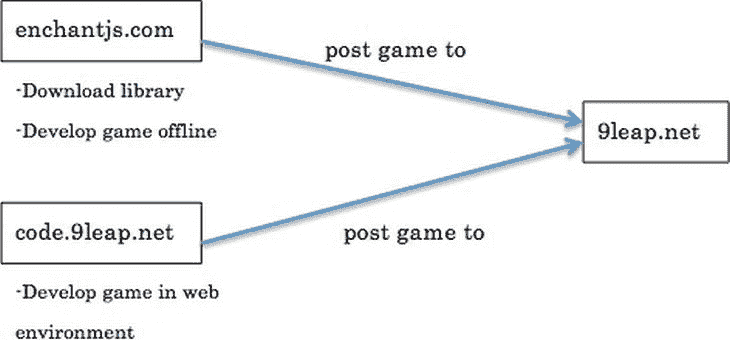

图 1-1. 网站之间的关系

### enchantjs.com

`enchant.js` 的官方网站 [`http://enchantjs.com`](http://enchantjs.com/) 提供了关于该库的参考信息、教程、技巧和资源。该网站会定期更新，发布来自 `enchant.js` 开发者关于新版本和功能的文章，并且完全支持日文和英文双语。网站的默认语言是英文。如果日文版出现而您希望显示英文版，请使用屏幕右侧的国旗图标将语言切换回英文。图 1-2 展示了 `enchant.js` 的主页。

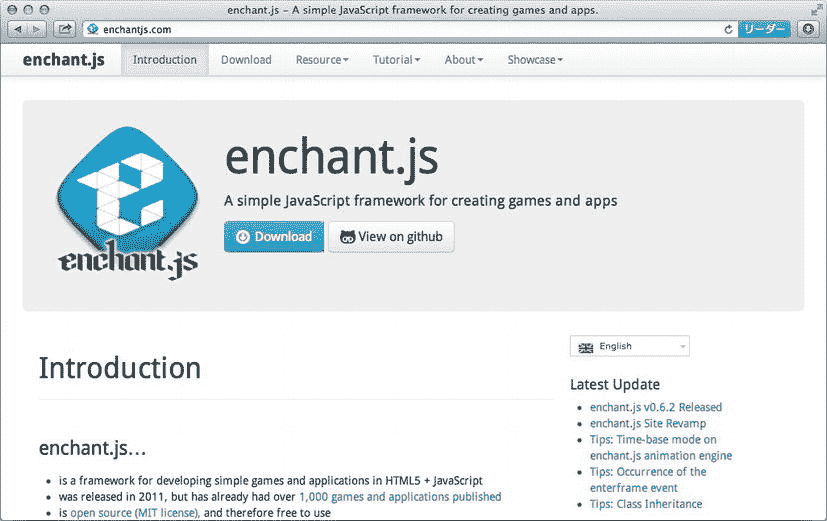

图 1-2. [enchantjs.com](http://enchantjs.com) 主页

### code.9leap.net

在 [`http://code.9leap.net`](http://code.9leap.net/) 网站上，您可以直接在网络浏览器中进行 HTML/JavaScript 的编辑、测试和分享。[`code.9leap.net`](http://code.9leap.net) 网站支持导入 `enchant.js`，并且可以轻松上传到 [`9leap.net`](http://9leap.net)，从而使得从编程到发布的整个游戏开发周期都能在浏览器中完成。它可以在 PC、Mac 或 iPad 等设备上使用。

图 1-3 展示了 [`code.9leap.net`](http://code.9leap.net) 的登录页面。在本书出版时，该网站仍处于测试开发阶段。

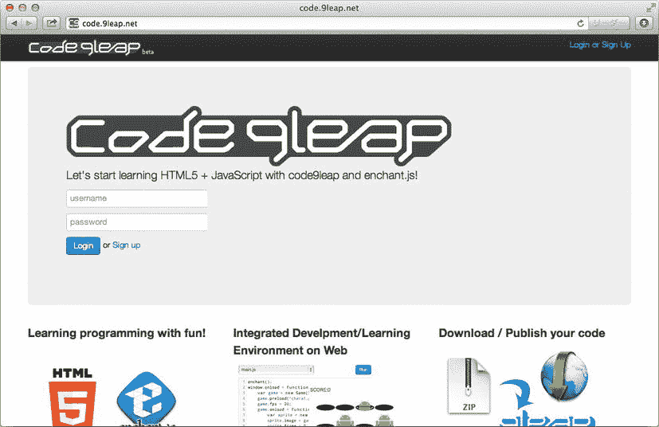

图 1-3. [`code.9leap.net`](http://code.9leap.net) 登录页面

### 9leap.net

位于 [`http://global.9leap.net`](http://global.9leap.net/) 的 9leap 网站由 UEI 和 D2 Communications ([`www.d2c.co.jp/en`](http://www.d2c.co.jp/en)) 托管，其创建目的是发现和推广年轻开发者。该网站允许您上传、游玩和分享游戏。9leap 网站包含大量由像您这样的开发者使用 `enchant.js` 创建的游戏。在开始创建您自己的游戏之前，不妨先试试网站上的部分游戏，以感受一下 `enchant.js`。图 1-4 展示了 9leap 的主页。

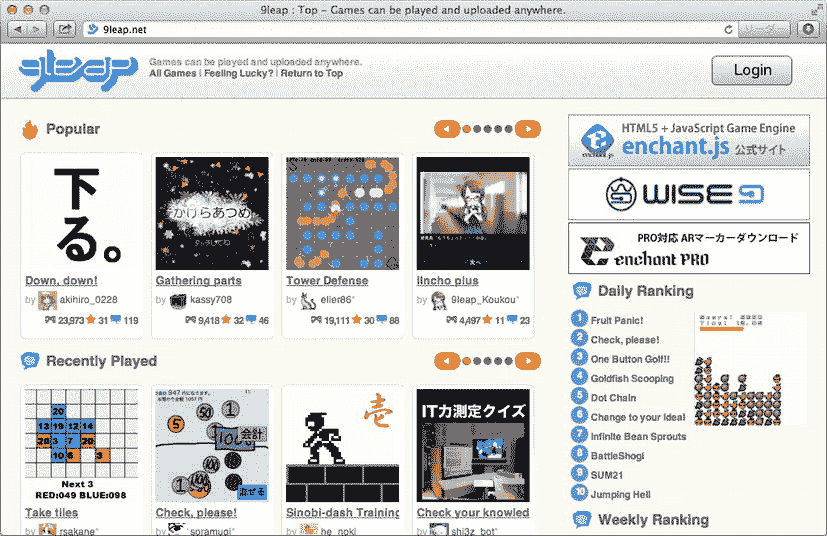

图 1-4. [`9leap.net`](http://9leap.net) 主页

您还可以在该网站上参加游戏开发比赛。比赛的决赛入围者将赢得诸如最新 PC 和 Mac 电脑、书店礼品卡等奖励。此外，作为 9leap 项目的一部分，UEI 定期在日本举办 9leap 游戏编程训练营，并开始在美国也举办此类训练营。通常，这些训练营以游戏编程研讨会开始，并提供指导，帮助参与者创建自己的简单游戏。更多信息，请参阅 [enchantjs.com](http://enchantjs.com) 网站。

## 兼容性与版本

以下浏览器和设备支持 `enchant.js`：

*   Internet Explorer (IE) 9.0 及更高版本
*   适用于 Mac OS X、Windows 和 Linux 的 Chrome 10 及更高版本
*   适用于 Mac OS X 和 Windows 的 Safari 5 及更高版本
*   适用于 Mac OS X 和 Windows 的 Firefox 3.6 及更高版本
*   适用于 iPhone 和 iPad 的 iOS 4 及更高版本
*   Android 2.1 及更高版本

表 1-1 展示了 `enchant.js` 的主要版本。在本书出版时，`enchant.js` 的最新版本是 0.6.2 版。

表 1-1. `enchant.js` 的近期版本及新增功能

| 版本 | 新增功能 |
| --- | --- |
| 0.6.2 (当前) | • 提升在 Android 上的性能 • 改进的键绑定 |
| 0.6.1 | • 改进的 WebAudio • 改进的时间线 |
| 0.6.0 | • WebAudio API • DOM/Canvas 渲染 • 动画引擎 • 核心类 |
| 0.5.2 | • 基于时间的动画 (`tl.enchant.js`) |
| 0.5.1 | • 错误修复 |
| 0.5.0 | • iPhone 上的声音支持 • 支持旋转和缩放属性 • Canvas 支持 • ElapsedTime 支持 |

**注意**：从 0.6.1 版本开始，`enchant.js` 采用 MIT 许可证授权。关于使用 `enchant.js` 创建的代码的企业用途，请联系 Ubiquitous Entertainment ([`http://global.uei.co.jp/`](http://global.uei.co.jp/)) 进行咨询。

## enchant.js 的特性

`enchant.js` 旨在简化游戏编程，并具备多项特性，让无论是专家还是新手开发者都能更轻松地创建游戏。该库的主要特性包括面向对象的方法论、处理游戏代码的特定方式、通过插件实现的扩展性，以及其内容库。

### 面向对象编程

面向对象编程（OOP）是一种强调被操作对象而非操作过程的方法论。为了说明这个概念，`enchant.js` 中每个能在屏幕上显示的图形都是一个对象。屏幕上实际可见的部分是另一个对象（称为显示对象树）的组成部分。通过向显示对象树发出加入图形对象的命令，该图形对象就会在屏幕上变为可见。

清单 1-1 展示了创建一个玩家对象和一个敌人角色对象，并通过在显示对象树中注册来将其显示在屏幕上的过程。现在，你无需担心这段代码的具体工作原理。我们在此提供一个代码示例，只是为了让你快速了解 OOP 的实际应用。稍后我们会详细讲解代码示例。

**清单 1-1.** 使用面向对象编程创建两个对象并将其添加到屏幕

```
// 玩家对象创建
var player = new Sprite(32, 32);
player.image = game.assets['player.png'];

// 敌人角色对象创建
var enemy = new Sprite(32, 32);
enemy.image = game.assets['enemy.png'];

// 在显示对象树中注册
var scene = game.currentScene;
scene.addChild(player);
scene.addChild(enemy);
```

### 异步处理

异步处理是一种独立于主代码集运行的处理方式。可以把它想象成多任务处理。如果计算机正在接收要逐条运行的命令，然后在第一组命令仍在运行时，又开始接收运行其他命令的指令，这就是异步处理的一个例子。

由用户或其他程序发起的操作或事件由 `enchant.js` 异步处理。当用户未发出任何命令时，程序会静待而不做任何事，而不是在后台持续运行代码。此外，当用户被迫等待程序完成处理时，这种异步特性使得可以同时发出其他命令。

清单 1-2 展示了指定在特定事件发生时运行的代码段。这被称为事件处理。在此代码示例中，我们在每一帧中处理玩家对象，并处理触摸事件。具体来说，每绘制一帧，我们都希望运行（或如开发者有时所说的“执行”）某些代码。当玩游戏的用户点击或“触摸”角色时，我们希望执行不同的代码。我们在第 3 章中详细介绍了这个过程。

**清单 1-2.** 创建、设置和处理角色的异步处理

```
// 玩家（角色）对象创建
var player = new Sprite(32, 32);

// 每一帧中对角色的处理
player.addEventListener(Event.ENTER_FRAME, function() {
        ...
});

// 处理触摸事件
player.addEventListener(Event.TOUCH_START, function(e) {
        var x = e.localX;
        var y = e.localY;
        ...
});
```

### 插件扩展性

你可以通过各种插件扩展 `enchant.js` 的功能，以增加更多功能。例如，有些插件允许你开发支持 D-pad 和模拟摇杆等设备的游戏，或创建看起来像漫画书的互动游戏。我们将在本书的后续章节中向你展示如何使用其中几个插件。

我们在此不提供所有 `enchant.js` 插件的详尽列表，因为你可以在 [enchantjs.com](http://enchantjs.com) 网站上找到该列表以及每个插件的详细信息。你可以从该网站下载这些插件（参见 `enchant.js` 下载包）。

### 图像和声音

如果你是一名独立游戏开发者，为角色、怪物、场景等寻找图像可能是一项挑战。由于 `enchant.js` 附带了一系列免版税（适用于非商业游戏）的原创游戏图像，以及来自 UEI 先前游戏发布的素材，你可以使用图像库省去为自己的游戏创建图像的工作。图像包含在主要的 `enchant.js` 包中。图 1-5 展示了可用角色图像中的几个示例。

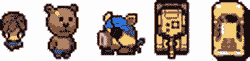

**图 1-5.** `enchant.js` 包中的角色图像示例

你也可以从 [enchantjs.com](http://enchantjs.com) 的下载页面下载一个单独于主库之外的 zip 文件中的声音。例如，你可以包含背景音乐、爆炸声、激光射击声、枪声，以及当角色拾取物品时可能用到的哔哔声等。

## JavaScript、HTML5 和 CSS

现代网站通常由三种类型的代码组合构建：`JavaScript`、`HTML5` 和层叠样式表（`CSS`）。通常，`HTML` 提供核心内容，`CSS` 用于样式化和格式化内容，而 `JavaScript` 用于与页面元素交互并提供动画效果。我们在本章中简要介绍了 `HTML5` 和 `CSS`，但本书总体上主要关注 `JavaScript`，因为 `enchant.js` 游戏正是用这种语言编写的。

### JavaScript

`JavaScript` 是一种面向对象的解释型编程语言，最初是为了向网页添加交互性和动态效果而开发的。清单 1-3 展示了一个 `JavaScript` 示例。你可能听说过一种叫做 Java 的编程语言，但它与 `JavaScript` 完全不同。`JavaScript` 保证可以在所有主流网络浏览器上运行，而无需安装任何额外软件。如果你以前从未见过 `JavaScript`，请不要担心！我们将在第 2 章中详细讲解。

**清单 1-3.** 在屏幕上显示“Hello， World!”的 `JavaScript` 示例

```
document.write('<p>Hello, World!</p>');
```

### HTML 与 HTML5

`HTML` 是超文本标记语言的缩写，是一种用于描述网络上文本的标记语言。在 `enchant.js` 中，`HTML` 用于加载 `JavaScript` 并控制智能手机上的某些浏览器操作（例如缩放）。示例如清单 1-4 所示。如果你打开一个普通的文本文件，在其中输入清单 1-4 的代码，并将其保存为 `"index.html"`，那么该文件就可以被浏览器打开。浏览器将显示 "Hello World! This is the content part of an HTML page." 这段文字。

清单 1-4. 在浏览器中显示内容的 `HTML` 示例

```
<!DOCTYPE html>
<html>
        <head>
                <meta charset="utf-8">
                <meta name="viewport" content="width=device-width, user-scalable=no">
                <meta name="apple-mobile-web-app-capable" content="yes">
                <meta name="apple-mobile-web-app-status-bar-style" content="black-translucent">
                <title>HelloWorld</title>
                <style type="text/css">
                        body {
                                margin: 0;
                        }
                </style>
        </head>
        <body>
<p>Hello World! This is the content part of an HTML page.</p>
        </body>
</html>
```

`HTML5` 是 `HTML` 多项新特性的统称。表 1-2 展示了主要特性的示例。

表 1-2. `HTML5` 新特性

| 新 `HTML` 特性 | 描述 |
| --- | --- |
| `<canvas>` 元素 | 支持绘制二维图形 |
| `<audio>` 元素 | 允许播放音频 |
| `<video>` 元素 | 支持视频播放 |
| 应用缓存 | 允许离线执行应用程序 |
| 跨域消息传递 | 允许在域之间传输信息 |
| `XMLHttpRequest` 第二版 | |
| Web 存储 | 使用客户端保存数据 |
| SQL 数据库 | |
| 索引数据库 | |
| Web Workers | 支持后台处理以改善用户体验 |
| 服务器发送事件 | 允许与服务器进行双向通信 |
| Web Sockets | |
| 文件 API | 允许访问本地文件 |

在 `enchant.js` 中，`HTML5` 功能并非直接使用，而是通过 `enchant.js` 库来调用。本书不详细讨论 `HTML` 和 `HTML5`。

### CSS

`CSS` 代表层叠样式表，它与 `HTML` 一起用于定义网页的外观，例如颜色、文本和大小。`HTML` 也可以用于指定网页的外观，但其正确的用途是指定内容，并使用 `CSS` 来定义该内容的外观。使用 `CSS` 尤其能简化动态网页的编辑。清单 1-5 展示了如何将网页 `body` 元素的背景更改为灰色并指定字体。

清单 1-5. 更改网页背景并指定字体

```
body { background-color: #DDDDDD; font: 30px sans-serif; }
```

在 `enchant.js` 中，`CSS` 功能并非直接使用，而是通过 `enchant.js` 库来调用。本书不详细讨论 `CSS`。

## 在屏幕上显示 "Hello World!"

作为我们的第一个 `enchant.js` 应用，我们将展示如何编写一个非常简单的程序，创建一个显示 "Hello World!" 的标签。此练习的目的是以一种简单的方式向你展示 `enchant.js` 游戏的各要素是如何组合在一起的。稍后我们将创建更复杂的游戏。

访问 `enchantjs.com` 并点击下载按钮，下载最新的 `enchant.js` 包（非开发版）。解压文件后，打开一个文本编辑器，复制并粘贴清单 1-6 中所示的代码，并将文件保存为 `"index.html"`，存放在 `enchant.js` 包解压到的文件夹内。

清单 1-6. Index.html：加载 enchant.js 和主游戏代码

```
<!DOCTYPE html>
<html>
        <head>
                <meta charset="utf-8">
                <title>HelloWorld</title>
                <script type="text/javascript" src="enchant.js"></script>
                <script type="text/javascript" src="main.js"></script>
        </head>
        <body>
        </body>
</html>
```

该代码将文件指定为 `HTML` 文件，告知浏览器我们使用的字符编码是 `UTF-8`（`enchant.js` 即采用此编码编写），为其设置标题为 `"HelloWorld"`，然后指示它从名为 `"main.js"` 的文件中加载我们的游戏代码，我们接下来将创建这个文件。

在文本编辑器中创建一个新文件，复制并粘贴清单 1-7 中所示的代码，并将文件保存为 `"main.js"`，存放在同一个文件夹内。

清单 1-7. 简单的 enchant.js 应用，在屏幕上显示 "Hello World!"

```
enchant();

var game;

window.onload = function(){
             game = new Core(320, 320);
             game.onload = function(){
                             sign = new Label();
                             sign.text = "Hello World!";
                             game.rootScene.addChild(sign);
             };
             game.start();
};
```

清单 1-7 中的代码指示 `enchant.js` 通过 `enchant();` 命令启动，创建游戏并指定游戏屏幕的尺寸。页面完全加载后，我们指定指令，创建一个名为 `sign` 的新标签，将文本设置为 `"Hello World!"`，然后将其添加到游戏屏幕中。最后，通过 `game.start()` 执行这些指令。

现在，如果你在浏览器中打开 `index.html`，应该会在屏幕上看到 "Hello World!" 字样。在此示例中，使用的文件只有 `enchant.js`、`index.html` 和 `main.js`。

这是一个非常基础的示例，但从中你可以看到，`enchant.js` 由 `index.html` 加载，而 `index.html` 也加载了我们在 `main.js` 中编写的游戏代码。下一个示例将更具图形化特性，并将向你介绍在线编程环境 `code.9leap.net`。

## 创建一只滑冰的熊

作为我们的第二个 `enchant.js` 应用，我们将制作一只熊从屏幕左侧滑到右侧，并针对在智能手机上的显示进行优化。你可以在 `http://code.9leap.net/codes/show/19822` 找到我们创建的代码示例。

正如我们之前提到的，`code.9leap.net` 准备了使用 `enchant.js` 编写游戏代码所需的所有必要元素。对于这个应用，我们将使用 `code.9leap.net`，并带你完成所有必要的步骤。请注意，`code.9leap.net` 仍处于测试阶段，可能与本节中显示的截图略有不同。

以下步骤概述了在 `code.9leap.net` 上创建 `enchant.js` 应用的整个开发流程。我们将在接下来的小节中详细说明每个步骤。

- 开始创建你的应用

- 导入 `enchant.js` 库

- 编辑源代码

- 预览你的结果

- 完成源代码编辑

## 应用程序入门指南

在 [`code.9leap.net`](http://code.9leap.net) 上开发游戏的第一步是创建一个账户。以下步骤将向你展示如何创建账户。如果你已拥有账户，可以跳过此步，直接登录并进入项目创建环节。

我们强烈建议你在使用 `enchant.js` 编程时，选用 `Google Chrome` 作为浏览器。虽然 Safari 和 Firefox 也能获得良好体验，但我们无法保证 Internet Explorer 在与 `enchant.js` 库或其相关网站交互时的稳定性。

在你常用的浏览器中打开 [`http://code.9leap.net`](http://code.9leap.net)，然后点击位于用户名和密码输入框下方的"注册"链接，见图 1-6。（若显示日语界面，请向下滚动并点击"切换至英语"）。

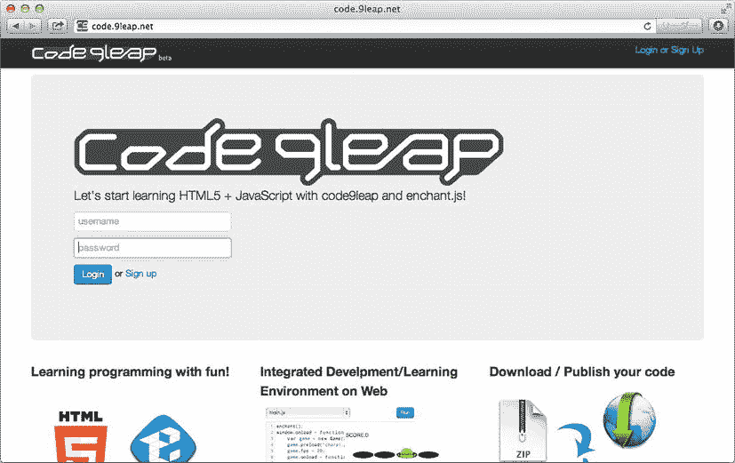

图 1-6.

[`code.9leap.net`](http://code.9leap.net) 登录界面

选择一个用户名和密码，并填入相应的字段。阅读服务条款后，勾选"我同意服务条款"。填写完毕后，点击输入表单下方的"注册"按钮。

你将被重定向至新账户的控制面板。该界面的说明将在下一步中给出。下次访问该网站时，你只需输入登录信息即可登录。

创建账户或登录后，你将被重定向至控制面板，如图 1-7 所示。控制面板提供了你账户的所有必要信息。右侧是你创建的所有项目列表（当然，新建账户后此列表最初为空）。左侧则是包含各类别的示例项目列表。

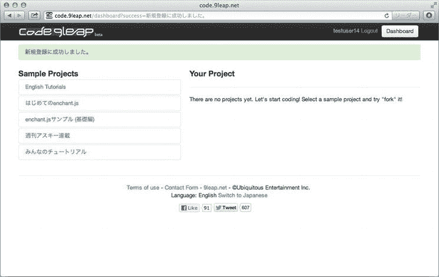

图 1-7.

[`code.9leap.net`](http://code.9leap.net) 控制面板

要创建 `enchant.js` 应用程序，首先需要创建一个项目。项目是一个包含管理应用程序所需所有文件的包。开发一个应用程序，就需要一个项目。

点击示例项目列表中的"英语教程"类别，如图 1-8 所示。

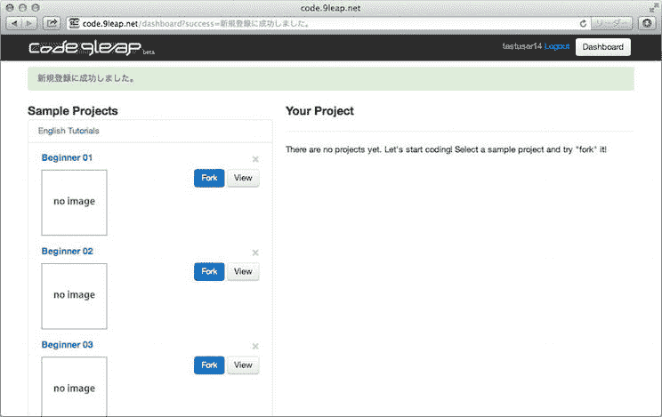

图 1-8.

英语教程

点击一个类别后，它将展开，显示该类别中的所有项目。你会看到一个入门项目列表，你可以选择"派生"或"查看"。派生项目会在你的项目列表中创建一个副本。查看项目则允许你查看代码，同时显示代码执行结果的屏幕。点击"入门 01"项目旁边的"派生"。在弹出的窗口中，再次点击"派生"确认操作，如图 1-9 所示。

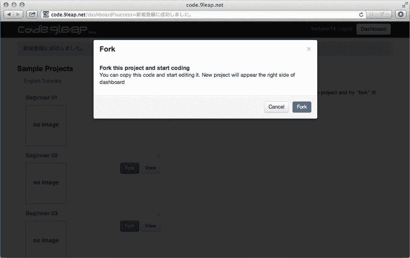

图 1-9.

"派生"弹窗

第二次点击"派生"后，会显示一个源代码编辑界面，其中已预填了代码。如代码清单 1-8 所示，这段代码使用 `enchant.js` 显示字符串"Hello,Bear"，类似于我们在前一小节创建"Hello World!"程序的方式。

代码清单 1-8. 在屏幕上显示"Hello,Bear"

```
enchant(); //启动 enchant.js 的神奇命令

window.onload = function() {

game = new Game();

game.onload = function() {                    // 准备游戏

hello = new Label("Hello,Bear");     // 创建一个带有文本"Hello,Bear"的新标签

hello.x = 10;                                     // 将标签向右放置 10 像素（0 始终表示左边界）

hello.y = 150;                                    // 将标签向下放置 150 像素（0 始终表示上边界）

game.rootScene.addChild(hello); // 在活动屏幕上显示标签

}

game.start(); // 开始游戏

}
```

就像我们之前的例子一样，这段代码在屏幕上创建了一个标签。在这里，我们将标签放置得更靠近屏幕中央，并将文本指定为"Hello,Bear!"而非"Hello World!"。这次我们将不使用源代码，而是重写它来创建我们自己的 `enchant.js` 程序。图 1-10 与表 1-3 共同展示了代码编辑界面的各个区域。

表 1-3. 源代码编辑界面元素

| 标题编辑区域 | 应用程序的标题。 |
| --- | --- |
| 账户区域 | 退出登录及控制面板访问。 |
| 代码预览区域 | 显示应用程序预览的代码区域。 |
| 提示区域 | 教程提示或说明将在此处显示。 |
| 资源选择 | 下拉菜单，用于在 JavaScript (`main.js`)、HTML (`index.html`)、层叠样式表 (`style.css`) 和提示 (`tips.json`) 之间切换。默认设置为 `main.js`。该下拉菜单位于代码预览区域正上方。 |
| 运行按钮 | 在预览区域执行源代码。 |
| 格式化按钮 | 格式化源代码编辑区中的源代码。 |
| 添加资源按钮 | 用于添加项目所需的资源（图片、声音等）。 |
| 完成按钮 | 结束源代码编辑并返回控制面板。 |
| 源代码编辑区域 | 用于编辑 JavaScript 源代码、HTML 文件和提示。也用于导入库文件。 |
| 图片区域 | 显示项目中的所有本地图片。 |

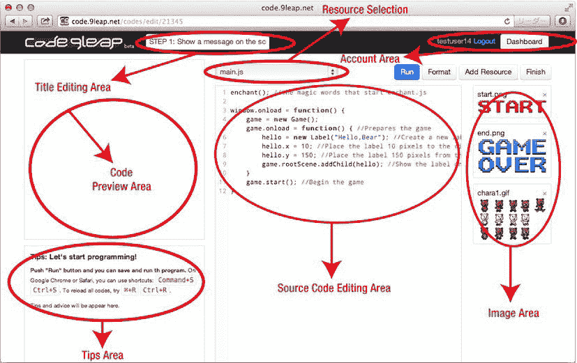

图 1-10. 源代码编辑界面

接下来，你需要编辑标题（应用程序名称）。

在源代码编辑界面上的标题编辑区域（位于右上角 `code.9leap` 标志右侧）更改标题。此处输入"HelloEnchant"。

更改 HTML 文件的标题。在资源选择中选择 `index.html`，即应用程序的 HTML 文件。该文件将显示在源代码编辑区域，并已预填了一些代码。你可以在其中找到 HTML 文件的标题。当前它被设置为 `<title>untitled</title>`。如图 1-11 所示，将其更改为 `<title>HelloEnchant</title>`，作为我们当前应用程序的标题。

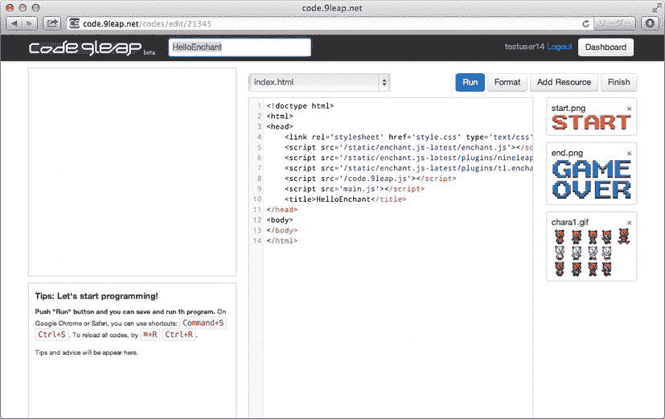

图 1-11. 编辑标题

### 导入 `enchant.js` 库

库是一个文件或一组文件，它能让其他程序使用特定的功能。为了构建我们的应用程序，我们使用了 `enchant.js` 库。库通过 HTML 文件中的 `script` 标签加载到项目中。有时库需要将图片添加到项目中，但我们目前还不需要这么做。

请记住，`enchant.js` 中的插件也是库，因此它们也需要自己的 `script` 标签来加载。这就是为什么你会在下面的代码清单中看到诸如 `tl.enchant.js` 等文件的引用行。

要添加 `enchant.js` 库，请执行以下操作：

移除包含 `nineleap.enchant.js` 和 `tl.enchant.js` 的代码行。在完成前面的步骤后，你应该已经位于 `index.html` 中。这些代码行将位于 `script` 标签（由 `<script>` 标记的代码段）内。这些标签告诉浏览器，`<script>` 和 `</script>` 之间的所有内容都应被视为代码行。当 `src=` 包含在 script 标签中时，它会告诉浏览器从 `index.html` 之外的文件加载代码行。移除这两行代码后，你的 `<script>` 标签应与清单 1-9 一致。

**清单 1-9.** 加载 `enchant.js`、插件和游戏代码的脚本标签

```
<script src='/static/enchant.js-latest/enchant.js'></script>
<script src='/code.9leap.js'></script>
<script src='main.js'></script>
```

> **注意**
>
> `main.js` 脚本标签导入了应用程序代码，因此这个标签是必不可少的。切勿更改或删除它。

你可以在 [`code.9leap.net`](http://code.9leap.net) 开发 `enchant.js` 应用程序时，使用 `code.9leap.js` 库添加任何所需功能。但对于我们当前的应用程序，请不要修改该库。`/static/enchant.js-latest/enchant.js` 标签导入了 `enchant.js` 库。当你在 [`code.9leap.net`](http://code.9leap.net) 开发应用程序时，可以使用 `/static/enchant.js-latest/` 路径引用 `enchant.js` 的最新版本。`enchant.js` 的插件 `nineleap.enchant.js` 和 `tl.enchant.js` 也是如此。

### 编辑源代码

要编辑源代码，请从资源下拉列表中选择 `main.js`。此时屏幕应如图 1-12 所示。

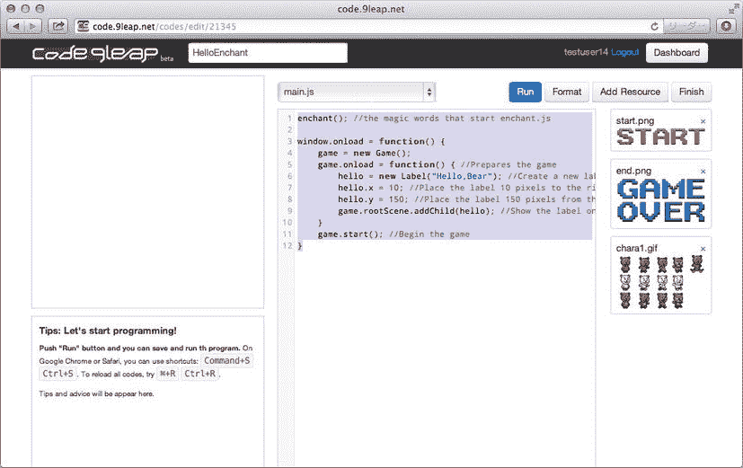

**图 1-12.** 编辑源代码

删除源代码编辑区域中显示的所有内容，因为你需要在此处复制并粘贴一些代码。JavaScript 区分大小写，因此在复制代码时要小心。接下来，执行以下步骤。

初始化 `enchant.js` 库。这允许你使用库中包含的所有类和方法。清单 1-10 展示了如何初始化 `enchant.js` 库。单词 "`enchant`" 后面的括号表示前面的单词是一个方法，它会运行一组预定义的代码，而末尾的分号 (`;`) 表示单条代码语句的结束。

**清单 1-10.** 初始化 `enchant.js` 库

```
enchant();
```

在 `enchant()` 方法下方的新行中，指定在页面完全加载后要运行的代码，如清单 1-11 所示。将代码分配给名为 `window` 的对象的 `onload` 函数（正如你所猜测的，它表示浏览器中的窗口），以指定在加载后要运行的代码。

**清单 1-11.** 指定在加载完成后运行的代码

```
window.onload = function() {
    // 要执行的代码
};
```

通过将 `// 要执行的代码` 替换为清单 1-12 所示的代码来创建核心对象。以两个斜杠开头的行表示该行是注释，不会作为代码处理。要创建游戏，`enchant.js` 需要一个核心对象来添加游戏元素。输入 `Core(320,320)` 将创建一个宽度为 320 像素、高度为 320 像素的游戏画面。`new Core(320,320)` 这种格式称为构造函数，我们使用构造函数来创建新对象。

**清单 1-12.** 创建核心对象

```
var game = new Core(320, 320);
```

预加载所需的滑冰熊图片，如清单 1-13 所示。要在 `enchant.js` 中使用图片，必须首先预加载它们。我们为此应用程序加载的图片如图 1-13 所示。通常，必须将此图片上传到 `code.9leap` 项目中，或将其放在与 `index.html` 文件相同的文件夹中，但由于我们派生（fork）了该项目，因此此图片已存在于项目中。

**清单 1-13.** 预加载滑冰熊图片

```
game.preload('chara1.gif');
```

指定游戏完全加载后要运行的函数，如清单 1-14 所示。我们创建该函数的方式与创建 `window.onload` 的方式大致相同，这样做是因为我们创建的任何游戏对象只有在核心对象完全加载后才能成功创建。
```

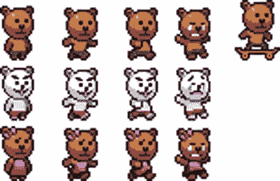

**图 1-13.** 熊的图片：`chara1.gif`

**清单 1-14.** 创建 `game.onload` 函数

```
game.onload = function() {
};
```

创建熊的精灵，如清单 1-15 所示。我们必须首先创建一个新的变量作为一个新的 `Sprite` 对象，其尺寸为 32 像素宽和 32 像素高，指定我们预加载的图片用作熊的图像，然后指定我们要使用图片的哪个部分。我们要使用滑冰熊的图像，它是从左上角开始数的第五张图。帧编号从 0 开始，因此滑冰熊是该图片中的第 4 帧。请注意，这些代码必须输入到 `game.onload` 函数的花括号内。

**清单 1-15.** 创建熊的精灵

```
var bear = new Sprite(32, 32);
bear.image = game.assets['chara1.gif'];
bear.frame=4;
```

好的，作为一名高级文档工程师和翻译员，我会严格遵循您提供的注意事项和示例格式，将给定的英文文本翻译成中文。

创建一个事件监听器，让小熊每帧向右移动三个像素，如清单 1-16 所示。我们稍后会详细讨论事件监听器，但现在只需知道这段代码是告诉程序每帧都要移动小熊。将这段代码添加到你在清单 1-16 中输入的代码之后，仍然放在 `game.onload` 的花括号内。

**清单 1-16.** 创建事件监听器来移动小熊

```
bear.addEventListener(Event.ENTER_FRAME, function() {
    this.x += 3; //向右移动 3 个像素
});
```

将小熊添加到游戏的根场景中，如清单 1-17 所示。我们已经创建了小熊，但除非我们将其添加到游戏的根场景或称主场景中，否则它仍然不会显示在屏幕上。将这段代码输入到你已在清单 1-16 中输入代码的后面，仍然放在 `game.onload` 的花括号内。

**清单 1-17.** 将小熊添加到游戏的根场景中

```
game.rootScene.addChild(bear);
```

在 `game.onload` 的花括号下方，但仍在 `window.onload` 的花括号内，启动游戏。参见清单 1-18。

**清单 1-18.** 启动游戏

```
game.start();
```

检查你的代码。你的代码应与清单 1-19 所示相符。你可以忽略注释（以双斜杠开头的行）。如果全部匹配，点击右上角的“运行”按钮，你就能看到小熊在屏幕上滑行！

**清单 1-19.** 让小熊滑过屏幕

```
//初始化 enchant.js
enchant();

//此处的代码将在 HTML 文件完全加载后执行
window.onload = function() {
    //创建游戏对象
    var game = new Core(320, 320);
    
    //加载图片
    game.preload('chara1.gif');
    
    //图片完全加载后执行
    game.onload = function() {
        //创建精灵
        var bear = new Sprite(32, 32);
        bear.image = game.assets['chara1.gif'];
        bear.frame=4;
        
        //帧循环，每帧移动小熊
        bear.addEventListener(Event.ENTER_FRAME, function() {
            this.x += 3; //向右移动 3 个像素
        });
        
        //将小熊添加到显示对象树
        game.rootScene.addChild(bear);
    };
    
    game.start();
};
```

现在我们添加一些信息来优化玩家在智能手机上的体验。

11. 从资源下拉菜单中选择 `index.html` 文件。调整你文件的内容，使其与清单 1-20 所示的内容一致。

**清单 1-20.** 为智能手机调整 HTML

```
<!doctype html>
<html>
<head>
<meta charset="utf-8">
<meta name="viewport" content="width=device-width, user-scalable=no">
<meta name="apple-mobile-web-app-capable" content="yes">
<meta name="apple-mobile-web-app-status-bar-style" content="black-translucent">
<style type="text/css">
body {
    margin: 0;
}
</style>
<link rel='stylesheet' href='style.css' type='text/css'>
<script src='/static/enchant.js-latest/enchant.js'></script>
<script src='/code.9leap.js'></script>
<script src='main.js'></script>
<title>HelloEnchant</title>
</head>
<body>
</body>
</html>
```

让我们看看我们添加的新 HTML 标签。以下代码将字符编码设置为 UTF-8 (unicode)，这是一种与几乎所有现代语言中使用的字符都兼容的字符编码。

*   `<meta charset="utf-8">`

以下代码禁用用户缩放（缩放）以确保游戏始终看起来正确。

*   `<meta name="viewport" content="width=device-width, user-scalable=no">`

以下代码将显示设置为全屏。

*   `<meta name="apple-mobile-web-app-capable" content="yes">`

以下代码更改状态栏的显示方式。

*   `<meta name="apple-mobile-web-app-status-bar-style" content="black-translucent">`

以下代码将 HTML 正文边距设置为 0，以保持在不同浏览器中的显示效果一致。

*   `<style type="text/css"> body { margin: 0; } </style>`

我们将在本书的所有应用程序中使用此 HTML 文件。除了更改我们导入哪些库之外，我们唯一更改的是标题。

### 预览你的结果

如图 1-14 所示，当你完成源代码编辑后，通过点击屏幕右上角的“运行”按钮来保存进度。如果你正确输入了源代码，小熊应该从左向右滑行。

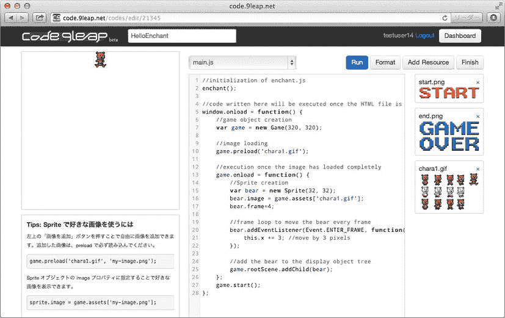

**图 1-14.** 显示预览

如果预览看起来很奇怪，请检查你的源代码以确保其匹配。特别是要注意是否缺少分号（`;`）、标点符号位置错误以及名称拼写错误。

我们可以通过使用所谓的日志输出，将字符串打印到控制台（一个专为开发者设计的特殊输出屏幕）。它可以用来检查变量的值和程序的执行方式。要在日志屏幕上打印名为 `sum` 的变量的值，请使用清单 1-21 中的表示法。

**清单 1-21.** 在控制台中显示变量名称

```
console.log("Total = " + sum);
console.log("sum = " + sum);
```

如果你使用 Google Chrome 作为浏览器，可以按照以下步骤查看日志输出。

右键点击游戏运行窗口的任意位置，选择“检查”，打开控制台，如图 1-15 所示。

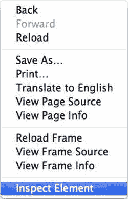

**图 1-15.** 从下拉菜单中选择“检查”

将打开“开发者工具”窗口。点击“控制台”按钮显示控制台。如果你的应用程序因 JavaScript 语法错误而无法运行，错误类型和行号将显示在控制台中。

### 完成源代码编辑

要完成源代码编辑，请点击源代码编辑屏幕上的“完成”按钮。你将重定向回你的仪表板。

## 在设备上执行并上传到 `9leap.net`

正如我们在本章开头所述，迄今为止，用 `enchant.js` 编写的许多游戏都是为在移动浏览器中运行而设计的。完成游戏编码后，我们建议你检查源代码，在移动设备上测试你的游戏，如果你愿意，还可以在 `9leap.net` 上分享你的游戏。

### 源代码查看屏幕

通过从仪表板点击项目名称，打开你自己项目或示例项目的“源代码视图”，如图 1-16 所示。在这里，你可以查看和执行源代码，获取用于在其他设备上运行代码的 URL，创建用于嵌入博客的标签，并在 `9leap.net` 上发布游戏。在你的仪表板上，点击 HelloEnchant 打开你刚刚创建的项目的源代码视图。在屏幕的上部，你会找到各种按钮，其功能在表 1-4 中说明。

表 1-4. 源代码查看屏幕上的按钮

| 编辑按钮 | 返回源代码编辑屏幕进行编辑。 |
| :--- | :--- |
| 分支按钮 | 使用此源代码启动一个新项目。 |
| 下载按钮 | 将项目使用的源代码和资源下载到本地硬盘。 |
| 发布到 `9leap.net` | 在 `9leap.net` 上分享你的应用程序（测试版）。 |
| 嵌入按钮 | 创建用于将应用程序嵌入博客、网站等的标签。 |
| 删除按钮 | 删除此项目。 |

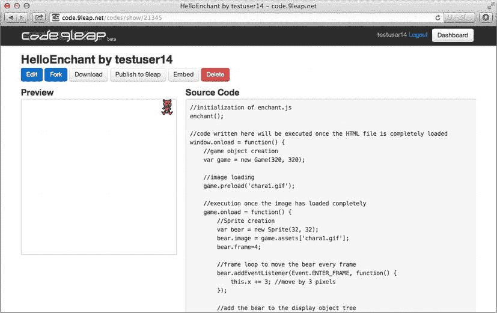

图 1-16. 源代码查看屏幕

在这些按钮下方，你可以在左侧看到应用程序的预览，当你打开该屏幕时，它会自动执行。源代码显示在右侧。

### 在设备上运行

要通过 `code.9leap.net` 在 iPhone、Android 或其他设备上运行你的 enchant.js 应用，请执行以下步骤。

通过查看项目的 URL 来确认项目 ID，如图 1-17 所示。在此例中，ID 为 21345。

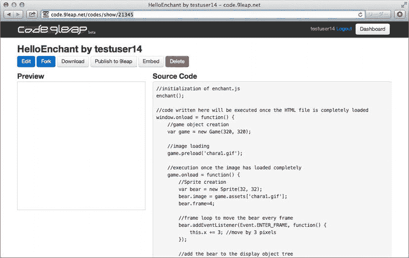

图 1-17. 检查项目 ID

使用此 ID 创建一个可在移动设备上打开的 URL。如果窗口中显示的 URL 是 `http://code.9leap.net/codes/show/21345`，那么移动端 URL 将是 `http://coderun.9leap.net/codes/21345`。此示例见图 1-18。

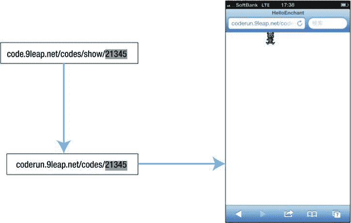

图 1-18. 在设备上运行代码

### 嵌入博客

要创建用于将 enchant.js 应用嵌入博客或网站的标签，请在源代码视图中点击“嵌入”按钮。将出现一个嵌入标签，如图 1-19 所示。复制此标签并粘贴到你网站或博客的 HTML 代码中。如果你有一个简单的网站，可以直接将标签粘贴到网站的 `<div>` 或 `<body>` 标签中；但如果你使用的是像 WordPress 这样的内容管理系统，则可能需要启用 HTML 编辑模式才能成功粘贴此标签。

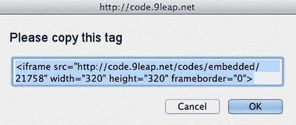

图 1-19. 嵌入弹出窗口

### 提交至 `9leap.net`

当你的 enchant.js 应用完成后，尝试在 `9leap.net` 上分享它！你可以先将其设置为私密模式，以便在公开前自行测试。请按照以下步骤分享你的应用。（在本书撰写时，“发布到 9leap”按钮仍在测试中。）

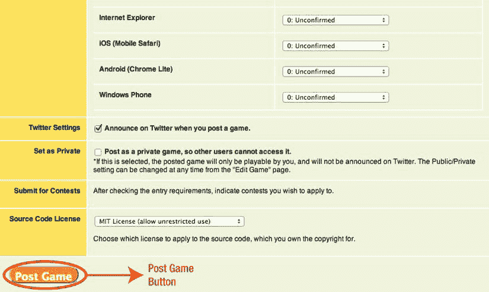

图 1-24. 上传按钮

表 1-5. 游戏信息字段

| 游戏标题 | 输入你的游戏标题，不超过 40 个字符。 |
| :--- | :--- |
| 类型 | 为你的游戏选择一个类型。 |
| 游戏说明 | 用不超过 1000 个字符解释游戏目标及玩法。 |
| 游戏文件 | 包含游戏且大小不超过 10MB 的 zip 文件。 |
| 截图 | 你的游戏截图（小于 1MB - jpg/png/gif 格式）。 |
| 运行环境 | 标明你的游戏兼容哪些浏览器。 |
| Twitter 设置 | 指示是否希望 9leap 在 Twitter 上发布你上传游戏的消息。 |
| 设为私密 | 如果你希望只有自己能查看你的游戏，请选择此选项。 |
| 提交至比赛 | 如果 9leap 当前正在举办你的游戏可能符合条件的比赛，它们将显示在此处。 |
| 源代码许可协议 | 如果你想指定保护你游戏的许可协议，请在此处指定。 |

在源代码查看界面点击“下载”按钮。你的浏览器将以 zip 文件形式下载游戏。

访问如图 1-20 所示的 `9leap.net` 网站，并使用你的 Twitter 账户登录。（如果你没有 Twitter 账户，则需要先注册一个才能使用 `9leap.net`。）由于该网站仍处于测试阶段，按钮可能以英文或日文显示。

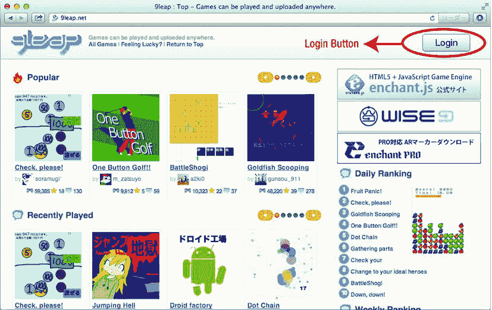

图 1-20. `9leap.net` 上的登录按钮

点击屏幕上方的“游戏上传/编辑”界面，如图 1-21 所示。

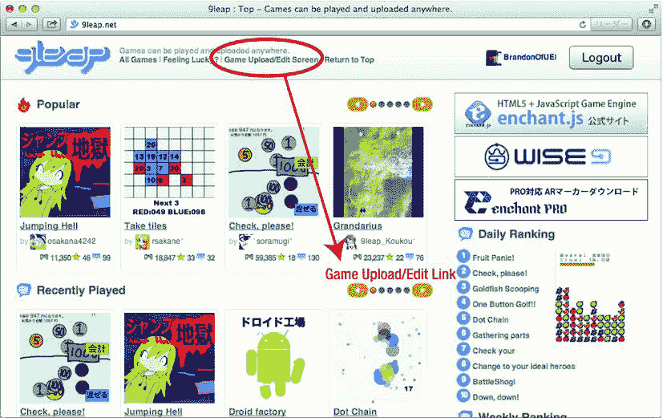

图 1-21. 游戏上传/编辑链接

点击“新增”，如图 1-22 所示。

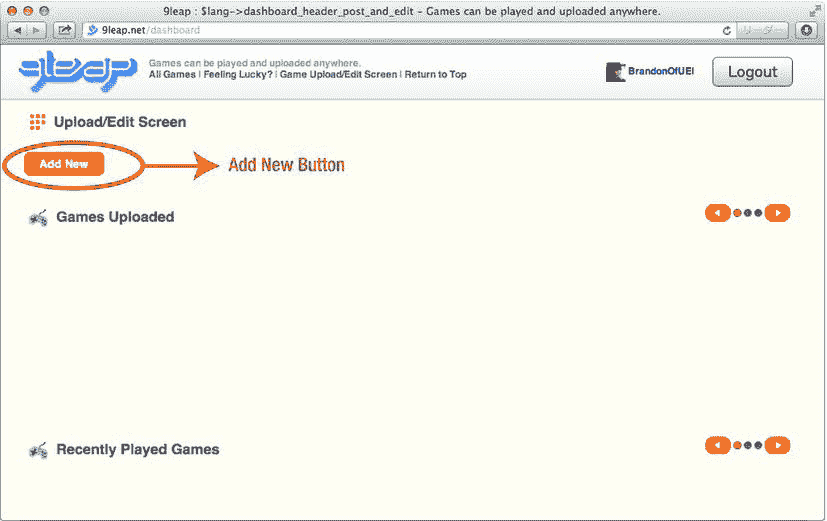

图 1-22. 新增按钮

接受服务条款，填写你的信息，然后点击“发送”，如图 1-23 所示。这些信息用于考虑将游戏提交至网站上的比赛。

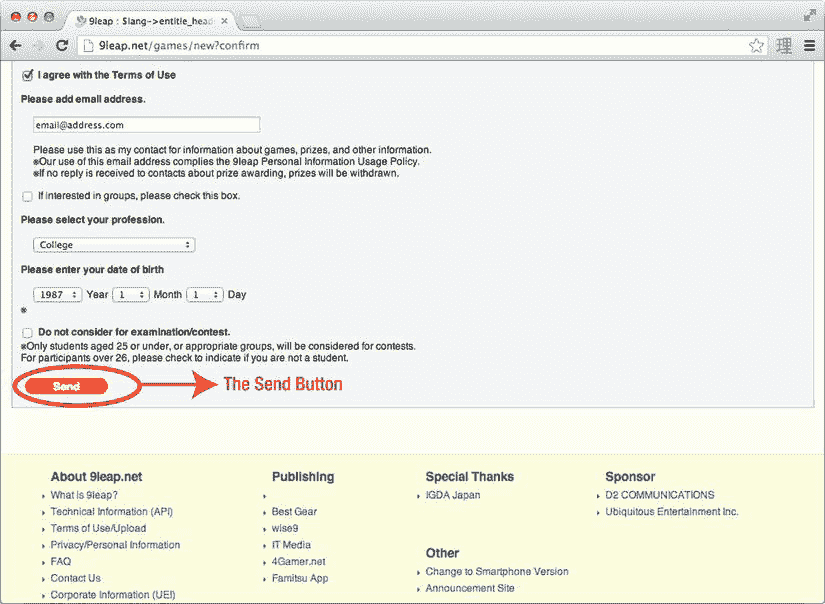

图 1-23. 发送按钮

在空白处填写你的游戏信息。这些字段在表 1-5 中有说明。对于“游戏文件”，请找到从 `code.9leap.net` 保存的游戏 zip 文件。你需要包含一张截图，可以是游戏中的图片文件或屏幕截图。（Mac 的截图信息请参见 `http://bit.ly/11m6e4`，PC 的截图信息请参见 `http://bit.ly/ZFSdT`。）确保指明你想为游戏使用的许可协议。完成后，点击“发布游戏”按钮，如图 1-24 所示。

私密设置可以随时从游戏编辑设置页面更改。

成功上传游戏后，将显示分享完成界面，你可以在“游戏上传/编辑”界面查看你的游戏。见图 1-25。

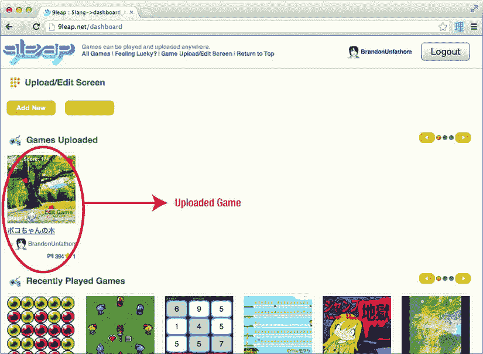

图 1-25. 上传后的游戏出现在游戏上传/编辑界面

## 结论

在本章中，我们介绍了 enchant.js 的基本特性，并展示了 enchant.js 游戏如何融入网页结构。我们简要介绍了 JavaScript、HTML5 和 CSS，以及如何在 `code.9leap.net` 上开始编写游戏代码。最后，我们探讨了如何通过 `global.9leap.net` 与 enchant.js 社区分享你的游戏，以及如何通过体验其他用户创建的游戏来获得自己制作游戏的灵感。

在下一章中，我们将介绍 enchant.js 的底层语言——JavaScript 的基本构建块。学习 JavaScript 将为你使用 enchant.js 创建自己的游戏奠定基础。