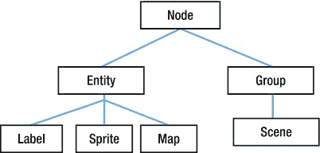
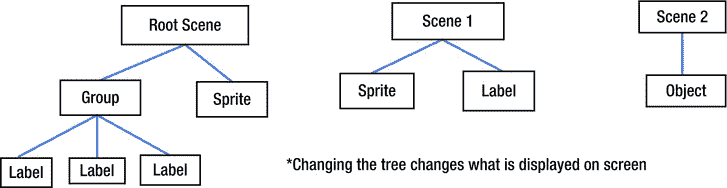
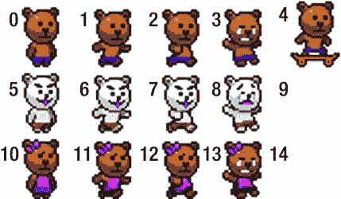
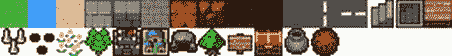
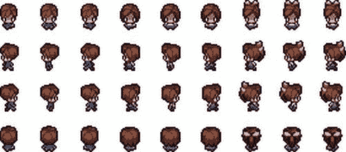

# 3. enchant.js 基础特性

## 摘要

现在你已经掌握了 JavaScript 的基础知识，应该能更好地理解 enchant.js 各个元素是如何交互的，以及它们为何以特定方式编写。本章将首先介绍创建游戏所需的 enchant.js 基本概念，然后通过项目实践来整合这些概念。我们将涵盖继承与显示对象树——这两个元素存在于每一个 enchant.js 游戏中，接着介绍标签、精灵、表面、触摸事件以及基于屏幕的界面元素。我们将在 `code.9leap.net` 上大量进行练习。学完本章，你将掌握游戏主要组件的基础知识及其创建方法。

## 内容速览

继承 — 查看游戏元素 — 创建标签 — 创建精灵 — 使用表面绘制地图 — 通过触摸进行交互 — 使用方向键进行交互

#### 继承

在面向对象编程中，继承是一种关系，它将一个对象归类为更大类别中的一员。为了更好地理解这一点，可以想象一个苹果。苹果是一种水果，借用面向对象编程的术语来说，我们可以说苹果继承了水果的特性。例如，苹果和所有其他水果一样含有种子。这与面向对象编程中的继承是类似的。

一个既能继承又能被继承的对象的例子是节点。游戏中的每一个独立项都被称为节点。图 3-1 展示了不同类型的节点及其分类方式。



*图 3-1. 节点的分类*

图中每一个项目都有其自身的函数和属性。此外，每个项目还拥有其层级结构中上一类别所具有的相同函数和属性。例如，`Node` 类包含一个名为 `moveBy(x, y)` 的函数，该函数可以移动节点，移动量等于 x 轴和 y 轴参数所传入的值。由于这个函数是 `Node` 类的一部分，`Entity`、`Label`、`Sprite`、`Map`、`Group` 或 `Scene` 都可以调用 `moveBy()`。这被称为继承。

## 查看游戏元素

当游戏被创建时，并非所有部分都是立即可见的。如果我们创建一个射击游戏，敌人在屏幕顶部出现，那么并非所有敌人在游戏开始时都是可见的。如果它们都可见，游戏很可能要么太难通关，要么很快就结束了。

相反，我们会在游戏过程中随着时间推移创建敌人并将其注册到场景中，使它们变得可见。游戏中所有可见元素都是称为显示对象树的层级结构的一部分。显示对象树的根对象被称为场景。当游戏被创建时，默认会创建一个场景。这个默认场景被称为 `rootScene`。可以创建多个场景，并且可以将多个对象注册到显示对象树中的各个场景，如图 3-2 所示。



*图 3-2. 显示对象树*

如果 `rootScene` 是活动场景，则只有注册到该场景的对象会在屏幕上可见。注册到场景 1 或场景 2 的对象将不可见。通过向场景添加对象、移除对象以及切换活动场景，我们可以在游戏过程中改变屏幕上显示的内容。我们将通过本章后面提供的代码示例，以更具体动手操作的方式来研究这一点。

### 创建标签

在游戏中，很多时候需要在屏幕上显示文本，例如当玩家分数在游戏过程中发生变化、关卡有时间限制、或者主要角色有特定生命值时。游戏中出现的任何文本，除了风格化的美术字之外，都应当放在标签中。enchant.js 中的标签创建方式使其在字体、颜色和位置上易于操控。

作为本节的一个入门练习，我们将逐步完成创建一个 enchant.js 游戏所需的所有步骤，该游戏会创建位置和颜色随机的标签。

### 设置游戏

当你编写 JavaScript 来创建并运行一个游戏时，必须遵循特定格式来初始化（即激活）enchant.js 库，并指定页面加载后要执行的游戏代码。按照以下步骤操作：

访问 [`http://code.9leap.net/codes/show/27204`](http://code.9leap.net/codes/show/27204) 并复刻（fork）该代码以获得一个可用的空白模板。你可能需要登录或创建一个账户才能执行此操作。

> **注意：** 如果你不使用 `code.9leap.net`，则需要将 enchant.js 库导入到你的项目中，这在第 1 章中有介绍。

输入清单 3-1 所示的代码。

**清单 3-1. 初始化 enchant.js 库**

```
enchant();
```

该命令告诉 enchant.js 初始化创建和运行游戏所需的全部代码。

在其下方，输入清单 3-2 所示的代码。

**清单 3-2. 创建 window.onload()**

```
window.onload = function() {

}
```

这指示浏览器仅在所有其他内容加载完毕后才运行花括号 (`{}`) 中的代码。这确保了在游戏实际开始之前，enchant.js 运行所需的一切都已准备就绪。每个 enchant.js 游戏都必须包含这两个组件才能运行。几乎所有游戏代码我们都写在这对花括号内部。


### 创建核心对象并启动游戏

现在我们已经完成了游戏所需的基础工作，可以创建游戏的核心——`Core` 对象。`Core` 对象本身就是游戏，它在创建时定义了游戏的大小。游戏中的所有元素（场景、标签、精灵等）都在这个 `Core` 对象中创建。操作步骤如下：

修改你的 `window.onload` 语句，使其与代码清单 3-3 一致。这将创建 `Core` 对象，并指定游戏尺寸为宽 320 像素（第一个参数）乘以高 320 像素（第二个参数）。假设从此处开始，所有代码指令都应输入到花括号内，位于已输入代码最后一行的下方，除非另有说明。

**代码清单 3-3.** 创建 Core 对象

```
window.onload = function() {
    var game = new Core(320, 320);
}
```

**注意：** 在 0.6 版本之前，`Core` 对象被称为 `Game` 对象。如果你使用早期版本的 enchant.js 创建的游戏，可能会看到使用 `Game` 对象而非 `Core` 对象的写法（例如 `var game = new Game(320,320)`）。之所以做出这一更改，是因为 enchant.js 越来越多地用于非游戏应用。

无论出于何种目的，如果你遇到 `Game` 对象，都可以将其视为 `Core` 对象。

将光标放在 `var game = new Core(320, 320);` 这行代码的末尾，按几次回车键将光标下移几行。输入代码清单 3-4 中的代码。这条命令会告知游戏启动，并且它应始终位于 `window.onload` 语句的末尾。

**代码清单 3-4.** 启动游戏

```
game.start();
```

### 创建标签

下一步是创建一个带有信息的标签。按以下步骤操作：

在 `var game = new Core(320, 320);` 这行代码之后，输入代码清单 3-5 中的代码。这将创建一个标签，其文本内容为我们用引号指定的内容。

**代码清单 3-5.** 创建标签

```
var label = new Label("Hello World!");
```

### 将标签添加到 rootScene

如果此时点击“运行”按钮，什么也不会发生。正如我们之前提到的，游戏中的对象必须添加到活动场景中才能变得可见。按以下步骤添加：

在已输入代码的最后一行下方，输入代码清单 3-6 中的代码。这将把我们创建的标签添加到 `rootScene`。

**代码清单 3-6.** 将标签添加到 rootScene

```
game.rootScene.addChild(label);
```

点击“运行”按钮。“Hello World！” 出现在屏幕左上角，因为现在该标签已成为默认场景 `rootScene` 的一部分。

### 修改标签的属性

我们之前讨论过，enchant.js 中的对象拥有自己的属性，这些属性控制着这些对象在游戏中的特征。要修改标签的特征，请按以下步骤操作：

在 `game.rootScene.addChild(label);` 这行代码上方，输入代码清单 3-7 中的代码。这将对标签的外观进行多处修改。

**代码清单 3-7.** 修改标签的属性

```
label.font = "16px sans-serif";
label.color = "rgb(255,0,0)";
label.x = 50;
label.y = 100;
```

点击“运行”。标签将出现在不同的位置，并使用不同的字体和颜色。

#### 设置字体格式

在代码清单 3-7 中，我们使用 `label.font = "16px sans-serif"` 修改了标签的字体。

指定的第一个属性是字体大小。它由一个数字表示，指定字体以像素为单位的尺寸，后面紧跟字母“px”，两者之间没有空格。

接下来指定字体名称。可以使用预定义的字体名称（字体族名称），例如“MS PGothic”，但某些设备可能不包含这些字体。如果某个没有特定字体的设备尝试渲染该标签，用户可能会遇到错误。错误对用户来说绝非乐事，因此最好使用如下所示的通用字体名称。请注意，衬线是指字母末端的装饰性细线，最常见于印刷品中使用的字母。

*   sans-serif：哥特式字体（无衬线）
*   serif：罗马式字体（有衬线）
*   monospace：等宽字体

#### 设置颜色格式

在代码清单 3-7 中，我们使用 `label.color = "rgb(255,0,0)"` 修改了标签的颜色。

在 enchant.js 中，可以为标签以及任何接受颜色的其他元素设置颜色，使用 CSS（层叠样式表）中任何有效的颜色格式即可。如果你不熟悉 CSS 也不必担心，我们将在下面介绍不同的格式。CSS 中有六种有效的颜色赋值方式，如表 3-1 所示。由于该属性被定义为字符串，请确保将赋值的值用双引号（`""`）括起来。

此外，表 3-1 中的大多数表示法都表达了三种颜色的混合：红色、绿色和蓝色。要指定红色，我们选择红色的最大值（十六进制中的 `ff`）以及绿色和蓝色的最小值（十六进制中的 `00`）。在十六进制中，0-9 与十进制（普通计数）相同，然后 10 = A，11 = B，依此类推，直到 16 = F。在十六进制格式中，字母大小写没有区别。

**表 3-1.** 指定红色的不同方式

| 值（本例中为红色） | 描述 |
| --- | --- |
| `"#ff0000"` | `"#RRGGBB"` 格式。值以十六进制数字定义在 `"00~FF"` 之间。 |
| `"#f00"` | `"#RGB"` 格式。值以十六进制数字定义在 `"0~F"` 之间。此格式生成与 `"#ff0000"` 相同的颜色，只是一种缩写格式。 |
| `"rgb(255, 0, 0)"` | `"rgb(R, G, B)"` 格式。值以十进制数字定义在 `"0~255"` 之间。 |
| `"rgb(100%, 0%, 0%)"` | `"rgb(R, G, B)"` 格式。值以十进制百分比定义在 `"0%~100%"` 之间。 |
| `"rgba(255,0,0,1.0)"` | `"rgba(R, G, B, A)"` 格式。RGB 定义在 `"0~255"` 之间，透明度（alpha 通道）定义在 `"0.0~1.0"` 之间（0 表示完全透明，1 表示完全不透明）。 |
| `"red"` | 颜色由名称定义。 |

#### 定义位置

位置通过为标签的 `x` 和 `y` 属性设置值来定义。在代码清单 3-7 中，我们使用 `label.x = 50;` 将标签的位置设置为距离游戏屏幕左边缘 50 像素，使用 `label.y = 100;` 将其设置为距离游戏屏幕顶部边缘 100 像素。

### 创建用于生成标签的函数

优化是编程中一个常见的概念。它意味着使用尽可能少的代码，或使用代码快捷方式，来创建游戏或其他应用程序。在我们的游戏中，将要创建多个标签，因此创建一个能够为我们创建并配置标签、且可以被无限次调用的函数，要比手动多次创建标签方便得多。按以下步骤了解具体做法：

删除你在代码清单 3-6 和 3-7 中编写的代码，并用代码清单 3-8 中的代码替换。这个函数将接受四个参数，使用 `text` 参数创建一个 `Label`，为 `color` 参数指定的颜色赋值，使用 `x` 和 `y` 参数设置位置，然后将标签添加到 `rootScene`。

**代码清单 3-8.** 创建 addLabel 函数

```
game.addLabel = function(text, color, x, y) {
    var label = new Label(text);
    label.font = "16px sans-serif";
    label.color = color;
    label.x = x;
    label.y = y;
    game.rootScene.addChild(label);
};
```

这段代码本身并不会创建标签。相反，它包含了创建标签的指令。要创建标签，我们必须调用该函数并提供参数。

在上述代码下方，输入代码清单 3-9 中的代码。

**代码清单 3-9.** 调用 addLabel

```
game.addLabel("50 Points", "rgb(255,0,0)", 50, 50);
game.addLabel("100 Points", "rgb(50,0,100)", 50, 200);
```

点击“运行”。屏幕上将出现一个红色标签和一个紫色标签。


## 创建随机数函数

为什么需要随机数？因为我们要为创建的标签分配随机属性，这就需要用到随机数。按照以下步骤创建随机数函数：

将光标移至代码末尾，也就是`window.onload`语句最后一个分号的下方，然后输入清单 3-10 中的代码。

**清单 3-10.** 随机数函数

```
function rand(num){
    return Math.floor(Math.random() * num);
}
```

`floor()`和`random()`都是`Math`对象的方法，`Math`对象是 JavaScript 中预定义的对象。这个`rand()`函数的定义接受一个参数`num`，该参数会与`Math.random()`的结果相乘。`Math.random()`会返回一个介于 0 和 1 之间的小数值。`Math.floor`会将结果向下取整为最接近的整数，然后该数值将作为`rand()`函数的结果返回。

**注意：** `Math.random()`可返回的小数值范围包括 0，但不包括 1。例如，如果将`Math.random()`乘以 100，理论上可能返回的最小值是 0，而最大值是一个非常接近 100 但并非正好 100 的值（换句话说，大约是 99.99999999999）。用`Math.floor()`将其向下取整后，我们就能得到一个介于 0 和 99 之间的随机整数（整数值）。

例如，如果调用`rand(100)`，程序返回的`Math.random()`值为 0.88134，那么它会先乘以我们指定的参数（`100`），变成 88.134。然后通过`Math.floor()`向下取整为 88，并作为结果返回。创建此函数的用途将在下一节中变得清晰。

## 使用 ENTER_FRAME 事件监听器和周期处理自动化标签创建

现在我们已经有了轻松创建标签所需的函数，还需要一些能够按固定间隔调用该函数的机制，这也就是周期处理。我们可以通过事件监听器来实现这一点。事件监听器是代码中持续侦测特定事件的部分，当该事件发生时，事件监听器会触发我们创建的特定代码。按以下步骤了解具体操作：

删除你在清单 3-9 中创建的两条`game.addLabel()`语句，用清单 3-11 中的代码替换它们。这段代码指示程序在每次`ENTER_FRAME`事件发生时执行花括号（`{}`）内的代码。该事件每帧都会发生。

**清单 3-11.** ENTER_FRAME 事件监听器

```
game.rootScene.addEventListener(Event.ENTER_FRAME, function() {
});
```

你可以为任何`Node`对象（不仅仅是`rootScene`）创建事件监听器，并设置它们监听 enchant.js 中的任何事件。表 3-2 列出了 enchant.js 中的主要事件。

在花括号内输入清单 3-12 中的代码，以创建变量并赋值，分别表示：要显示的随机分数；标签 RGB 颜色分量中的红色值、绿色值和蓝色值；以及 x 和 y 位置。

**表 3-2.** 事件

| 事件类型 | 描述 | 事件发起者 |
| --- | --- | --- |
| `Event.A_BUTTON_DOWN` | 当 a 按钮被按下时发生的事件 | core, scene |
| `Event.A_BUTTON_UP` | 当 a 按钮被释放时发生的事件 | core, scene |
| `Event.ADDED` | 当一个节点被添加到组中时发生的事件 | node |
| `Event.ADDED_TO_SCENE` | 当一个节点被添加到场景中时发生的事件 | node |
| `Event.B_BUTTON_DOWN` | 当 b 按钮被按下时发生的事件 | core, scene |
| `Event.B_BUTTON_UP` | 当 b 按钮被释放时发生的事件 | core, scene |
| `Event.DOWN_BUTTON_DOWN` | 当向下按钮被按下时发生的事件 | core, scene |
| `Event.DOWN_BUTTON_UP` | 当向下按钮被释放时发生的事件 | core, scene |
| `Event.ENTER` | 当一个场景开始时发生的事件 | scene |
| `Event.ENTER_FRAME` | 当新一帧正在被处理时发生的事件 | core, scene |
| `Event.EXIT` | 当场景结束时发生的事件 | scene |
| `Event.EXIT_FRAME` | 当帧处理即将结束时发生的事件 | core |
| `Event.INPUT_CHANGE` | 当按钮输入发生变化时发生的事件 | core, scene |
| `Event.INPUT_END` | 当按钮输入结束时发生的事件 | core, scene |
| `Event.INPUT_START` | 当按钮输入开始时发生的事件 | core, scene |
| `Event.LEFT_BUTTON_DOWN` | 当左按钮被按下时发生的事件 | core, scene |
| `Event.LEFT_BUTTON_UP` | 当左按钮被释放时发生的事件 | core, scene |
| `Event.LOAD` | 游戏加载完成时触发的事件 | core |
| `Event.PROGRESS` | 游戏加载期间发生的事件 | core |
| `Event.REMOVED` | 当一个节点从组中移除时发生的事件 | node |
| `Event.REMOVED_FROM_SCENE` | 当一个节点从场景中移除时发生的事件 | node |
| `Event.RENDER` | 当一个实体被渲染时发生的事件 | entity |
| `Event.RIGHT_BUTTON_DOWN` | 当右按钮被按下时发生的事件 | core, scene |
| `Event.RIGHT_BUTTON_UP` | 当右按钮被释放时发生的事件 | core, scene |
| `Event.TOUCH_END` | 当与此节点相关的触摸结束时发生的事件 | node |
| `Event.TOUCH_MOVE` | 当与此节点相关的触摸移动时发生的事件 | node |
| `Event.TOUCH_START` | 当与此节点相关的触摸开始时发生的事件 | node |
| `Event.UP_BUTTON_DOWN` | 当向上按钮被按下时发生的事件 | core, scene |
| `Event.UP_BUTTON_UP` | 当向上按钮被释放时发生的事件 | core, scene |

**清单 3-12.** 创建变量并赋随机值

```
var score = rand(100);
var r = rand(256);
var g = rand(256);
var b = rand(256);
var x = rand(300);
var y = rand(300);
```

在刚输入的代码下方，但仍需在花括号内，调用我们之前创建的`addLabel()`函数，并将随机变量作为参数传入。输入清单 3-13 中的代码。

**清单 3-13.** 调用`addLabel()`函数

```
game.addLabel(score + " Points", "rgb(" + r + "," + g + "," + b + ")", x, y);
```

点击运行。标签会快速在屏幕上生成。

### 使用帧和模运算来减慢处理速度

这一步中，标签创建可能显得有些失控，因为点击运行按钮后不久，整个屏幕就会完全被标签填满。幸运的是，你可以减慢这一速度。按以下步骤了解如何操作：

将你在清单 3-12 和 3-13 中编写的代码放入一个`if`语句中，如清单 3-14 所示。这里，`game.frame`等于游戏中已经过的帧数，模运算符（`%`）会返回帧数除以 3 后的余数。如果该值等于 0，则创建一个标签。这段代码的最终效果是每三帧创建一个标签。

**清单 3-14.** 控制标签创建频率

```
if (game.frame % 3 === 0) {
    var score = rand(100);
    var r = rand(256);
    var g = rand(256);
    var b = rand(256);
    var x = rand(300);
    var y = rand(300);
    game.addLabel(score + " Points", "rgb(" + r + "," + g + "," + b + ")", x, y);
}
```

点击运行。标签的创建速度会慢得多。


### 移除指定时间后的标签

标签的创建速度已经减慢，但短时间内它们仍然会填满屏幕。要在标签创建后清除它，我们需要使用另一个事件监听器。

在 `game.rootScene.addChild(label);`（仍在 `window.onload` 函数的花括号内）下方输入代码清单 3-15 中的代码。这里，我们为创建的标签添加了一个事件监听器，指定如果标签的“年龄”（即标签在文档对象树中存在的帧数）超过 10 帧，则从文档对象树中移除该标签。

**代码清单 3-15. 移除标签**

```
label.addEventListener(Event.ENTER_FRAME, function() {

    if (label.age > 10) game.rootScene.removeChild(label);

});
```

你是否注意到 `if` 语句后面没有花括号？这是因为只有一条语句。如果没有花括号，`if` 语句只会触发后续的单独一行代码。

点击运行。标签会随机创建，并在创建后不久从屏幕上移除。

### 让标签移动

作为标签的最终效果，我们希望它们在创建后向上移动。执行以下操作，以指示它们每帧向上移动一个像素：

在你从代码清单 3-15 输入的 `if` 语句正上方（但仍位于事件监听器的花括号内），输入代码清单 3-16 中的代码。这会将标签的 y 坐标减一。

**代码清单 3-16. 移动标签**

```
label.y --;
```

由于 `ENTER_FRAME` 事件监听器每帧都会执行其代码，标签将以每秒 30 帧的速度在屏幕上向上移动，因为 `Core` 对象的帧率（`fps`）设置默认为 30 fps。

**注意**

你可以通过修改 `Core` 对象的 `fps` 属性来更改帧率设置（例如：`game.fps = 16;`）。

点击运行。标签会显示并向上移动，随后消失。

标签在游戏中用于显示分数等，前面的练习让你初步了解了如何创建它们。在后续内容中我们会更频繁地使用它们。如果遇到任何问题，可以在 [`http://code.9leap.net/codes/show/27211`](http://code.9leap.net/codes/show/27211) 找到完整的可运行代码示例。

### 创建精灵

虽然也存在例外，但大多数游戏都有某种形式的主角、敌人、盟友或角色。这些角色由图像表示，并且通常以某种方式移动。在 `enchant.js` 中，角色由精灵表示。创建精灵时，它会附带许多属性和方法，使其更易于操控。

### 为精灵设置游戏

要为精灵设置游戏，你需要预加载精灵的图像并创建一个 `game.onload` 语句。执行以下操作，了解如何创建一个在屏幕上行走的熊精灵：

从 [`http://code.9leap.net/codes/show/27204`](http://code.9leap.net/codes/show/27204) 复刻空白的 `enchant.js` 模板。输入代码清单 3-17 中的代码，以创建游戏的基本结构。这里，我们使用 `preload` 函数加载一张熊的图像供精灵使用。该图像包含在 `code.9leap.net` 上的项目中，并在上一步复刻时已一并引入。

**代码清单 3-17. 熊游戏的基本结构**

```
enchant();

window.onload = function() {
    var game = new Core(320, 320);

    game.preload('chara1.gif');

    game.onload = function() {
    };

    game.start();
};
```

此代码示例还包含了 `game.onload` 函数。当加载图像或执行比简单添加/移除节点和事件监听器更复杂的操作时，此函数是必需的。该函数类似于 `window.onload`，会在游戏完全加载后执行其代码。

### 创建精灵

要创建精灵，必须先声明一个代表精灵的变量，为其分配图像，然后将其添加到文档对象树中。以下步骤展示了如何完成此过程：

在 `game.onload` 函数内输入代码清单 3-18 中的代码，创建一个代表 32 像素宽、32 像素高的精灵变量。你可以假定，后续所有“将代码放在函数内部”的表述，均指将代码放在该函数末尾的花括号内。

**代码清单 3-18. 创建精灵变量**

```
var bear = new Sprite(32, 32);
```

在下一行输入代码清单 3-19 中的代码，分配你在上一节预加载的图像。

**代码清单 3-19. 为图像属性分配图像**

```
bear.image = game.assets['chara1.gif'];
```

在下一行，输入代码清单 3-20 中的代码，将熊添加到 `rootScene` 使其可见。

**代码清单 3-20. 让熊可见**

```
game.rootScene.addChild(bear);
```

点击运行。熊将出现在屏幕的左上角。

### 指定精灵的帧

如果你在此项目中使用 [`http://code.9leap.net`](http://code.9leap.net)，你会看到 `chara1.gif` 在屏幕右侧以缩略图形式显示。该图像包含多张熊的图片，为什么当前游戏中只出现了一只熊？答案与帧有关。

当你使用 `Sprite(32,32)` 创建精灵时，程序会创建一个尺寸为 32 像素 x 32 像素的精灵。当你为精灵分配图像时，程序会将图像切割成相同大小的帧，并从 0 开始编号。这个概念称为帧索引，图 3-3 展示了其如何应用于 `chara1.gif`。



**图 3-3. 帧索引**

你可以通过将所需的帧编号设置为 `frame` 属性来选择精灵的帧。对我们的熊执行以下操作：

在 `game.rootScene.addChild(bear);` 语句上方插入代码清单 3-21 中的代码，将白色站立熊选为帧。如果在 `addChild` 函数之后插入此代码，可能会先出现棕熊图像，然后才切换为白熊图像。

**代码清单 3-21. 分配白熊帧**

```
bear.frame = 5;
```

点击运行。精灵将显示为一只白熊。

### 动画精灵

拥有图像固然很好，但帧的真正意义在于创造运动的错觉。最终，我们将指示熊在屏幕上左右移动，使其看起来像是在行走。在 `chara1.gif` 图像中，有几张白熊的图片，我们可以快速连续显示它们来实现这一效果。执行以下操作来了解具体方法：

将你刚添加的 `bear.frame` 行替换为代码清单 3-22 中的代码。这种表示法是一个数字数组，作为动画的快捷方式。每一帧都会切换到序列中下一个指定的帧。

**代码清单 3-22. 为熊添加动画**

```
bear.frame = [5, 6, 5, 7];
```

点击运行。熊精灵会快速循环显示这些帧。这达到了目标，但现在的熊看起来有点神经质。让我们让它慢下来。将 `bear.frame` 语句重写为代码清单 3-23 中的代码。这会通过为每帧分配相同的图像两次（而非一次），从而降低帧变化的速度。

**代码清单 3-23. 降低熊的帧切换速度**

```
bear.frame = [5,5,6,6,5,5,7,7];
```

**注意**

除了使用代码清单 3-23，你也可以在游戏启动前编写 `game.fps = 16;` 语句，让游戏以每秒 16 帧（而非默认的 30 帧）的速度运行，从而减慢熊改变帧的速度。请注意，这会降低游戏中所有实体的帧率。

点击运行。熊现在以更正常的步行速度切换帧。


### 移动精灵

现在精灵已经有了合适的行走动画，但还不能移动。请执行以下操作来让熊在屏幕上移动：

在`game.rootScene.addChild(bear);`下方，输入清单 3-24 中的代码，为熊精灵注册一个`ENTER_FRAME`事件监听器。将代码输入在`game.onload`函数的花括号内。

**清单 3-24.** 为熊创建事件监听器

```
bear.addEventListener(Event.ENTER_FRAME, function() {

});
```

在事件监听器中创建周期性处理程序，通过将`x`坐标增加 3 来让熊向右移动，如清单 3-25 所示。

**清单 3-25.** 移动熊

```
bear.x += 3;
```

点击运行。熊会向右跑动并移出屏幕。

创建一个`if`语句，只有当熊的位置小于屏幕边缘时才向右移动，将清单 3-25 修改为清单 3-26 所示。这里使用`320 – 32`是因为虽然 320 是游戏屏幕右侧边缘，但精灵的位置是从左上角测量的。当精灵位于`x = 320`时，熊将不可见。由于 32 是精灵的宽度，将熊的移动上限设为`320 – 32`可确保熊始终停留在屏幕上。

**清单 3-26.** 用`if`语句限制移动

```
if (bear.x < 320 - 32) bear.x += 3;
```

### 让精灵朝向与移动方向一致

让我们让熊精灵在屏幕上左右来回行走，并面朝行走的方向。为此，我们需要使用`scaleX`属性。请按以下步骤操作：

在`game.rootScene.addChild(bear);`语句上方插入清单 3-27 中的代码。`scaleX`属性在精灵创建时默认值为 1，可以通过修改来改变熊的大小（例如，`scaleX = 2;`会将熊放大至 200%）。将`scaleX`设为负值，熊的图像会在 x 轴上翻转，从而使熊面向屏幕左侧。

**清单 3-27.** 在 X 轴上翻转熊

```
bear.scaleX = -1;
```

> **注意：** 通过`精灵.scaleY = -1;`可以沿 y 轴翻转精灵图像。

点击运行。熊会以向后走的方式穿过屏幕。这并非我们想要的最终结果，但可以让你了解`scaleX`属性的工作原理。接下来我们将使用`scaleX`属性来控制熊的移动方式。

删除清单 3-26 中输入的代码。

将熊的事件监听器中的`if`语句（`if (bear.x < 320 - 32) bear.x += 3;`）替换为清单 3-28 中的代码。这段代码指定：如果熊面朝右，则每帧向右移动 3 像素，并在到达屏幕右侧时翻转面朝左；如果熊面朝左，则每帧向左移动 3 像素，并在到达屏幕左侧时翻转面朝右。

**清单 3-28.** 调整熊的朝向

```
if (bear.scaleX === 1) {
    bear.x += 3;
    if (bear.x > 320 - 32) bear.scaleX = -1;
} else {
    bear.x -= 3;
    if (bear.x < 0) bear.scaleX = 1;
}
```

点击运行。熊将按上述方式移动。

到现在，你应该已经熟悉如何使用事件监听器在每一帧执行代码了。这是 enchant.js 中许多游戏的核心机制。如果你在精灵代码方面遇到任何问题，可以在[`http://code.9leap.net/codes/show/27365`](http://code.9leap.net/codes/show/27365)找到完整可用的代码示例。

## 使用 Surface 绘制地图

enchant.js 中的地图由多个称为“瓦片”的小图像组成。想象一下，你正在创建一个游戏，背景是绿色草地瓦片，角色在屏幕上移动。要在 enchant.js 中创建一张布满绿色草地瓦片的地图，你需要先将这些瓦片添加到`Surface`对象中。

`Surface`对象是 enchant.js 中用于绘制的一个对象。“绘制”指的是在对象上创建形状（此处不涉及）或图像的行为。在表面（Surface）上绘制完成后，它会作为图像属性赋值给一个精灵，从而将其加入显示对象树。使用`Surface`对象可以在单个对象上绘制多个图像，这让它成为显示地图的理想选择。在以下代码示例中，我们将创建一张完全由绿色草地瓦片组成的地图。

### 设置游戏

请按以下步骤创建一个使用`Surface`对象的示例游戏：

从[`http://code.9leap.net/codes/show/27204`](http://code.9leap.net/codes/show/27204) fork 空白 enchant.js 模板。

通过输入清单 3-29 中的代码为你的游戏打下基础。预加载的`map0.gif`文件（如图 3-4 所示）包含了我们将用于创建地图的组件瓦片图像。

**清单 3-29.** 设置游戏

```
enchant();

window.onload = function() {
    var game = new Core(320, 320);
    game.fps = 16;
    game.preload('http://enchantjs.com/assets/images/map0.gif');
    game.start();
};
```



**图 3-4.** `map0.gif`

### 为地图创建容器

在填充瓦片之前，地图需要一些容器来配合工作。请按以下步骤创建它们：

在`preload`语句下方输入清单 3-30 中的代码。这里，我们创建一个变量作为精灵来显示地图。我们将预加载的地图图像赋值给变量`maptip`，以便后续引用。最后，我们创建一个新的`Surface`，我们将在此绘制地图瓦片。

**清单 3-30.** 创建容器

```
game.onload = function() {
    var bg = new Sprite(320, 320);
    var maptip = game.assets['http://enchantjs.com/assets/images/map0.gif'];
    var image = new Surface(320, 320);
};
```


### 用瓦片填充地图

在 `Surface` 对象上使用 `draw()` 命令进行绘制。在本节中，我们可以将 `draw()` 命令理解为用于在表面上复制和粘贴图像。由于我们的 16x16 瓦片图像必须一次一个地粘贴到空白表面上，虽然可以编写一长串这样的绘制语句，但使用循环来操作可以节省时间。请按照以下步骤创建循环：

在 `var image = new Surface(320,320);` 这行代码下方，但仍在 `game.onload` 函数内部，输入清单 3-31 中的代码，创建两个 `for` 循环来表示 x 和 y 坐标。

**清单 3-31. 瓦片循环**

```
for (var j = 0; j < 320; j += 16) {
    for (var i = 0; i < 320; i += 16) {
    }
}
```

这可能一开始看起来有些令人困惑，但组合使用两个 `for` 循环是在 `Surface` 上逐步移动的极其有用的工具，这正是我们在地图上以特定间隔放置瓦片所需的功能。

可以将变量 `j` 和 `i` 分别视为空白背景上一个虚拟光标的 y 和 x 坐标。想象一下，这个空白背景被切割成 16 像素乘 16 像素的方块，形成一个大表格。变量 `j` 表示虚拟光标的行位置，变量 `i` 表示虚拟光标的列位置。这个虚拟光标始终指向其中一个 16x16 方块的左上角，因为这是所有使用 `draw()` 函数的操作的起始点。

当进入第一个 `for` 循环时，`j` 的值为 `0`。然后进入第二个 `for` 循环，其中 `i` 的起始值也是 `0`。我们的虚拟光标当前位于 (0,0) 点，即表格的左上角。我们将使用这个位置在 `draw()` 命令中来复制一个瓦片（尚未展示）。在执行 `draw()` 命令后，第二个 `for` 循环重复，此时 `i` 的值为 16。我们的 `draw()` 命令现在将在 (16,0) 点执行。这样重复直到 `i` 值变为 320。此时，第一行瓦片将被绿色瓦片填满。然后，第一个 `for` 循环重复，该过程从第二行重新开始，依此类推。

不过，我们不要操之过急。要使其工作，我们首先需要实际创建 `draw()` 命令。

在第二个 `for` 循环内部，通过将清单 3-32 复制到第二个 `for` 循环（`for (var i = 0; i < 320; i += 16) {}`）中，创建 `draw()` 命令，以便在整个 `for` 循环中实际复制瓦片。

**清单 3-32. 用于复制瓦片的 Draw 命令**

```
image.draw(maptip, 0, 0, 16, 16, i, j, 16, 16);
```

是的，这个命令有很多参数。以下是它们的作用：

*   `maptip`：这是用作源图像的预加载图像资源（地图上要使用的瓦片图像）。
*   `0, 0`：这是一个虚拟矩形的左上角 x 和 y 坐标，该矩形用于从原始图像中捕获一个区域。可以想象为单击并拖动一个选框来复制图像的一部分，这将是点击的起始点。
*   `16, 16`：这是从源图像捕获区域的虚拟矩形的右下角 x 和 y 坐标。如果正在点击并拖动以创建一个选框，这些将是释放鼠标点击时的坐标。
*   `i, j`：这是目标 `Surface` 上的 x 和 y 坐标，表示捕获的图像将被粘贴到的左上角位置。通过 `for` 循环改变这些值，可以在多次调用的 `draw()` 语句中完美地间隔排列瓦片。
*   `16, 16`：最后两个值表示要粘贴的图像的宽度和高度。如果改变这些值使其与捕获区域的大小不同，它将在粘贴之前缩放图像。

### 将地图分配给背景并显示它

现在我们已经将瓦片复制到了目标 `Surface` 上，需要将其添加到 `bg` 精灵中，以便将其添加到显示对象树中。

在 `for` 循环下方，但仍位于 `game.onload` 函数内部，输入清单 3-33 中的代码。

**清单 3-33. 添加地图**

```
bg.image = image;
game.rootScene.addChild(bg);
```

点击运行。地图出现，并填满了绿色草地瓦片。

地图构成了 enchant.js 中许多游戏的背景。尽管创建地图的技术可能学起来比较复杂，但熟悉这些技术对于创建更具沉浸感的游戏来说，其价值不可估量。

## 使用触摸进行交互

在草地景观上创建一个带有移动角色的游戏，下一步是创建一个角色，当玩家点击屏幕时，该角色会移动到屏幕上的那个位置。这是通过触摸事件实现的，当用户点击游戏屏幕时就会发生。

### 创建角色

重要的是要记住，enchant.js 中的游戏主要通过每帧运行的循环来控制。如果我们有一个在屏幕上行走的角色，它必须为每个移动方向都有一组精灵，并进行相应的处理。请按照以下步骤了解如何实现：

在代码的最顶部，在 `enchant()` 命令之前，通过输入清单 3-34 中的代码添加常量（不会改变的值）。这些值用于指定移动精灵。

**清单 3-34. 创建方向常量**

```
var DIR_LEFT    = 0;
var DIR_RIGHT   = 1;
var DIR_UP      = 2;
var DIR_DOWN    = 3;
```



图 3-5.

将 `chara0.gif`（图 3-5）添加到要预加载的图像列表中，方法是修改 `game.preload` 语句，如清单 3-35 所示。

**清单 3-35. 将 `chara0.gif` 添加到要加载的图像中**

```
game.preload('http://enchantjs.com/assets/images/chara0.gif',
    'http://enchantjs.com/assets/images/map0.gif');
```

创建一个变量来表示我们的角色，即来自 `chara0.gif` 的女孩，并通过在 `game.rootScene.addChild(bg);` 正下方输入清单 3-36 中的代码来设置该角色的基本属性。将 x 和 y 坐标设置为 `160 - 16` 会使角色出现在屏幕正中央。`frame` 设置为 7，以首先显示女孩朝下的图像。

**清单 3-36. 创建基本女孩角色**

```
var girl = new Sprite(32, 32);
girl.image = game.assets['http://enchantjs.com/assets/images/chara0.gif'];
girl.x      = 160 - 16;
girl.y      = 160 - 16;
girl.frame  = 7;
```

为女孩创建次要属性，并通过在上述代码正下方输入清单 3-37 中的代码将其添加到文档对象树中。创建 `toX` 和 `toY` 属性用于表示玩家点击屏幕时女孩将要移动到的位置。`girl.anim` 数组表示用于实现女孩在所有四个方向上行走动画的帧编号。

**清单 3-37. 为女孩创建次要属性**

```
girl.toX = girl.x;
girl.toY = girl.y;
girl.dir = DIR_DOWN;
girl.anim = [
    15, 16, 17, 16, //Left
    24, 25, 26, 24, //Right
    33, 34, 35, 34, //Up
    6,   7,   8,   7  //Down
];
game.rootScene.addChild(girl);
```

点击运行。女孩出现在草地上草地瓦片的前方。


### 处理触摸移动

最后一步是设置一个事件监听器，当 `toX` 和 `toY` 与女孩当前的位置存在显著差异时移动女孩，并处理用户发出的触摸事件。通过以下步骤查看具体操作：

在 `game.rootScene.addChild(girl);` 下方输入清单 3-38 中的代码，为女孩角色创建一个处理移动的事件监听器。与所有 `ENTER_FRAME` 事件监听器一样，它将每一帧处理女孩精灵上的事件。

**清单 3-38. 为女孩创建事件监听器**

```
girl.addEventListener(Event.ENTER_FRAME, function() {

};
```

在刚添加的事件监听器内部，输入清单 3-39 中的代码创建一个 `if` 语句，处理女孩的向上移动。这段代码表示：如果女孩当前的 Y 坐标低于（大于）其目的地的 Y 坐标（`toY`），则应将女孩的方向设置为 `DIR_UP`，并且每帧向上移动 3 像素，除非女孩当前的 Y 坐标距目的地不足 3 像素。这是通过检查女孩 Y 坐标减去目的地 Y 坐标的绝对值（`Math.abs()`）是否小于 3 像素来实现的。

**清单 3-39. 处理向上移动**

```
if (girl.y > girl.toY) {
  girl.dir = DIR_UP;
  if (Math.abs(girl.y - girl.toY) < 3) {
    girl.y = girl.toY;
  } else {
    girl.y -= 3;
  }
}
```

在刚添加的代码下方（仍位于女孩的事件监听器内），输入清单 3-40 中的代码，处理其余方向（向下、向左和向右）的移动。这段代码采用与前面完全相同的逻辑，使女孩朝相应方向移动。

**清单 3-40. 处理其他方向的移动**

```
else if (girl.y < girl.toY) {
  girl.dir = DIR_DOWN;
  if (Math.abs(girl.y - girl.toY) < 3) {
    girl.y = girl.toY;
  } else {
    girl.y += 3;
  }
}

if (girl.x > girl.toX) {
  girl.dir = DIR_LEFT;
  if (Math.abs(girl.x - girl.toX) < 3) {
    girl.x = girl.toX;
  } else {
    girl.x -= 3;
  }
}

else if (girl.x < girl.toX) {
  girl.dir = DIR_RIGHT;
  if (Math.abs(girl.x - girl.toX) < 3) {
    girl.x = girl.toX;
  } else {
    girl.x += 3;
  }
}
```

通过添加清单 3-41 的代码（直接放在刚刚输入的最后一段代码下方，仍位于女孩的事件监听器内），指定女孩的动画方式。这段代码表示：如果女孩没有移动，则将其 `age` 设置为 1。每一帧女孩的 `age` 都会增加；但如果她站立不动，`age` 会被重置为 1。这在下一行的帧分配中被使用，以防止女孩在不移动时播放动画。下一行中，帧被赋值为我们之前指定的值数组中的一个数字。这段代码意味着女孩的帧应循环播放她正在行进或朝向的某个方向的四个帧。

**清单 3-41. 为女孩制作动画**

```
if (girl.x == girl.toX && girl.y == girl.toY) girl.age = 1;
girl.frame = girl.anim[girl.dir * 4 + (girl.age % 4)];
```

创建 `TOUCH_START` 和 `TOUCH_MOVE` 事件监听器，用以捕获玩家的点击并将这些值保存到女孩的 `toX` 和 `toY` 属性中。修改代码的最后部分，使其与清单 3-42 一致。这两个事件监听器应添加到 `game.onload` 函数内部，但在女孩的 `ENTER_FRAME` 事件监听器之外。此处，`TOUCH` 事件作为参数（`function(e)`）传入函数，并包含触摸事件发生的 X 和 Y 坐标。将这些坐标（减去 `16` 以使女孩居中）赋值给女孩的 `toX` 和 `toY` 属性，即可将女孩移动到玩家触摸的位置。

**清单 3-42. 包含触摸事件监听器**

```
...if (girl.x == girl.toX && girl.y == girl.toY) girl.age = 1;
girl.frame = girl.anim[girl.dir * 4 + (girl.age % 4)];
});

bg.addEventListener(Event.TOUCH_START, function(e){
  girl.toX = e.x - 16;
  girl.toY = e.y - 16;
});

bg.addEventListener(Event.TOUCH_MOVE, function(e){
  girl.toX = e.x - 16;
  girl.toY = e.y - 16;
});

};

game.start();
};
```

点击运行。女孩现在会跟随屏幕上的鼠标点击，朝点击位置走去。

本节介绍了一些使用触摸事件控制精灵的复杂技巧。为您的精灵启用此功能，将为您打造更流畅、更有趣的游戏体验。

## 使用方向键进行交互

到目前为止，我们看到的玩家与游戏之间的交互仅限于触摸事件。然而，这并不是玩家与游戏交互的唯一方式。为了支持触摸事件之外的交互，enchant.js 附带了一个插件，用于在游戏中添加数字和模拟方向键（d-pad）。数字方向键（图 3-6）仅包含四个方向按钮（上、下、左、右），而模拟手柄是用户用拇指操作的摇杆。PlayStation 2 和 3 控制器上的摇杆就是现实世界中模拟手柄的好例子。模拟手柄会传递摇杆当前位置相对于中心的 X 和 Y 值。本书不介绍模拟手柄，而是专注于数字方向键。


图 3-6. 数字方向键

在本节的代码示例中，我们创建了一个数字方向键，它为您提供了一个横向卷轴游戏的基础，包含一个熊角色和一个地面。按方向键会使熊朝指定方向移动。


### 创建方向键

请按以下步骤创建方向键：

1. 复刻 [`http://code.9leap.net/codes/show/27476`](http://code.9leap.net/codes/show/27476) 上的代码，以此作为游戏基础。如果你没有使用 `code.9leap.net`，请从**代码清单 3-43** 中复制代码到新的代码文件中。

**代码清单 3-43.** 方向键游戏基础代码

```
var STATUS_WAIT = 0;
var STATUS_WALK = 1;
var STATUS_JUMP = 2;
enchant();
window.onload = function() {
    //创建游戏对象
    var game = new Core(320, 320);
    game.fps = 16;
    //加载图片
    game.preload('http://enchantjs.com/assets/images/chara1.gif',
            'http://enchantjs.com/assets/images/map0.gif');
    //加载完成后调用
    game.onload = function() {
        //创建背景
        var bg = new Sprite(320, 320);
        bg.backgroundColor = "rgb(0, 200, 255)";
        var maptip = game.assets['http://enchantjs.com/assets/images/map0.gif'];
        var image = new Surface(320, 320);
        for (var i = 0; i < 320; i += 16) {
            image.draw(maptip, 3 * 16, 0, 16, 16, i, 320 - 16, 16, 16);
        }
        bg.image = image;
        game.rootScene.addChild(bg);
        //方向键应创建在此行下方
        //创建小熊
        var bear = new Sprite(32, 32);
        bear.image    = game.assets['http://enchantjs.com/assets/images/chara1.gif'];
        bear.x        = 160 - 16;
        bear.y        = 320 - 16 - 32;
        bear.status = STATUS_WAIT;
        bear.anim     = [10, 11, 10, 12];
        bear.frame    = 10;
        game.rootScene.addChild(bear);
        //小熊的帧循环
        bear.addEventListener(Event.ENTER_FRAME, function() {
            //帧设置
            if (bear.status == STATUS_WAIT) {
                bear.frame = bear.anim[0];
            } else if (bear.status == STATUS_WALK) {
                bear.frame = bear.anim[bear.age % 4];
            } else if (bear.status == STATUS_JUMP) {
                bear.frame = bear.anim[1];
            }
        });
    };
    //启动游戏
    game.start();
};
```

> **注意：** 方向键需要加载 `ui.enchant.js` 插件。这在 `code.9leap` 示例的 `index.html` 文件中有体现，需要在调用 enchant.js 游戏脚本的 `index.html` 文件头部添加 `<script src='/static/enchant.js-latest/plugins/ui.enchant.js'></script>` 或类似指向该文件的引用。

在注释行 `//方向键应创建在此行下方` 下方输入**代码清单 3-44** 中的代码来创建方向键。这将在坐标 (`0,220`) 处创建方向键。

**代码清单 3-44.** 创建方向键

```
var pad = new Pad();
pad.x     = 0;
pad.y     = 220;
game.rootScene.addChild(pad);
```

点击**运行**。方向键将出现在屏幕左下角。

### 使用方向键处理移动

你已经创建了方向键，但还需要编写程序让它控制小熊移动。请按以下步骤实现：

将**代码清单 3-45** 添加到小熊的 `ENTER_FRAME` 事件监听器内部（紧接在 `bear.addEventListener(Event.ENTER_FRAME, function() { }` 之后），即可将方向键与小熊的移动绑定。这样就能将方向键的输入转化为控制小熊移动的指令。

**代码清单 3-45.** 使用方向键处理移动

```
//向上
if (bear.status != STATUS_JUMP) {
    bear.status = STATUS_WAIT;
    if (game.input.up) {
        bear.status = STATUS_JUMP;
        bear.age = 0;
    }
}
//向左
if (game.input.left) {
    bear.x -= 3;
    bear.scaleX = -1;
    if (bear.status != STATUS_JUMP) bear.status = STATUS_WALK;
}
//向右
else if (game.input.right) {
    bear.x += 3;
    bear.scaleX = 1;
    if (bear.status != STATUS_JUMP) bear.status = STATUS_WALK;
}
//跳跃时
if (bear.status == STATUS_JUMP) {
    if (bear.age < 8) {
        bear.y -= 8;
    } else if (bear.age < 16) {
        bear.y += 8;
    } else {
        bear.status = STATUS_WAIT;
    }
}
```

点击**运行**。方向键现在可以控制小熊的移动了。

方向键和触摸事件一样，可用于移动角色。如果你不希望使用触摸事件进行目标定位，它是一个很有用的元素。尤其当你希望赋予游戏复古感时，方向键会特别实用。

### 总结

至此，关于 enchant.js 基础的章节就结束了。我们通过代码示例创建了标签、精灵、界面、触摸事件和虚拟按键。现在你已经为使用 enchant.js 创建自己的基础游戏打下了坚实的基础。在创建自己的游戏时，你可能不会用到我们讨论的所有元素，但你很有可能至少会用到其中一部分，因为大多数 enchant.js 游戏都会使用标签和精灵。

在下一章中，我们将介绍 enchant.js 的一些更高级功能，例如场景导航、添加开始画面和游戏结束画面、创建高级地图以及实现声音播放。这些工具将使你的游戏达到更高的复杂度和创造力水平。

