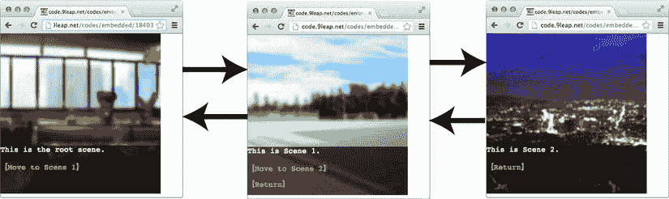
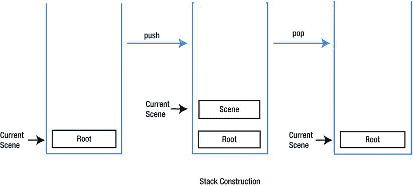
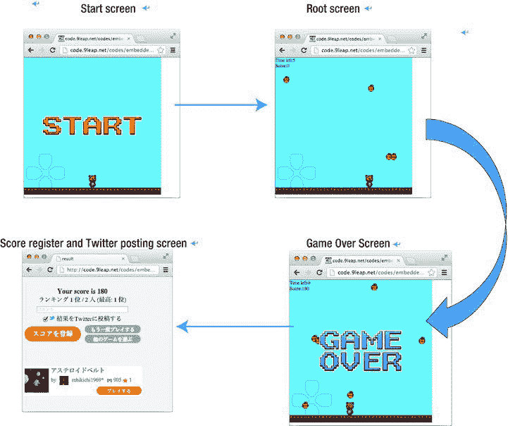
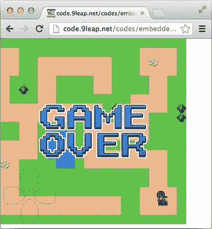
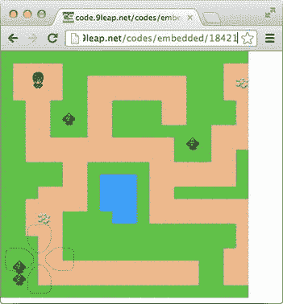
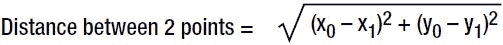
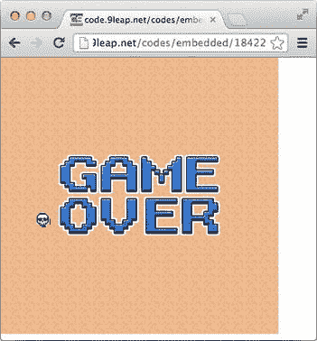
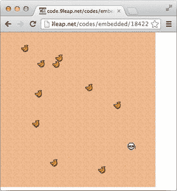

# 4. `enchant.js` 的高级功能

**摘要：** `enchant.js` 的基础功能可以创建简单的游戏。更高级的功能，例如在单个游戏内进行场景导航，则需要使用 `enchant.js` 更复杂的能力。在本章中，我们将演示如何创建场景切换以实现多个关卡或环境、如何创建开始画面和游戏结束画面以提升游戏外观、以及如何使用地图和声音来增加交互性。

## 内容概览

- 场景切换
- 创建开始、结束和分数分享画面
- 使用碰撞检测
- 创建交互式地图

## 场景切换

虽然单个场景对于简单游戏可能已经足够，但任何类型的冒险游戏或基于对话的游戏都需要多个场景来保持符合类型的氛围。

本节的示例代码展示了如何创建一个使用场景切换的简单程序，使玩家能够在三个不同的场景之间切换。图 4-1 展示了玩家如何通过点击橙色导航文本来在三个场景之间导航。



**图 4-1.** 场景切换

### 场景的构成

场景可能具有挑战性，因为它们拥有与 `enchant.js` 中其他实体不同的独立结构。因此，我们将在本节提供一些关于场景工作原理的基础信息，随后提供示例代码，展示如何在实际的 `enchant.js` 游戏中使用场景。


### 场景创建

场景是一个屏幕单元，可以向其中添加显示对象，例如精灵、标签、地图和组。一个游戏可以有多个场景，通过切换场景，可以彻底改变屏幕上的内容。常见的场景类型包括标题画面、游戏画面和游戏结束画面。创建场景时，需要使用 `Scene` 对象构造函数（`var scene1 = new Scene();`）。

### 场景栈

创建场景后，可以向其中添加背景、带有文字的标签以及精灵。完成后，使用 `addChild()` 函数将场景添加到场景栈中。

场景以栈结构进行组织。顾名思义，“栈”意味着多个场景相互堆叠。最顶层的场景是可见场景。你可以使用 `push()` 方法将一个场景添加到栈顶，并使用 `pop()` 方法移除最顶层的场景，如图 4-2 所示。



图 4-2. 栈结构

### 场景属性与方法

在游戏中，你可以使用 `currentScene` 引用当前场景，使用 `rootScene` 引用根场景。使用这两个名称可以轻松跟踪游戏场景栈中发生的事情。

表 4-1 展示了 `Scene` 对象的方法。

表 4-1. 场景对象方法

| 代码（参数） | 描述 |
| --- | --- |
| `pushScene(Scene)` | 切换到新场景，并将其添加到场景栈的顶部。 |
| `popScene()` | 通过从屏幕栈中移除当前场景来结束它。其下的场景（如果有）将成为新的当前场景。 |
| `removeScene(scene)` | 从栈中移除指定的场景。 |
| `replaceScene(scene)` | 用另一个场景替换当前场景。 |

### 执行场景切换

要创建允许玩家在三个场景之间切换的代码，请执行以下操作：

从 [`http://code.9leap.net/codes/show/27650`](http://code.9leap.net/codes/show/27650) 复制代码。如果你无法访问该代码，请从代码清单 4-1 中复制。

代码清单 4-1. 场景设置

```
enchant();

window.onload = function() {
    //Core object creation
    var game = new Core(320, 320);
    game.fps = 16;

    //Image loading
    game.preload('http://enchantjs.com/assets/images/bg/bg01.jpg',
                 'http://enchantjs.com/assets/images/bg/bg02.jpg',
                 'http://enchantjs.com/assets/images/bg/bg03.jpg');

    //Called when pre-loading is complete
    game.onload = function() {
        //Background creation
        var bg = makeBackground(game.assets['http://enchantjs.com/assets/images/bg/bg01.jpg']);
        game.rootScene.addChild(bg);

        //Message creation
        game.rootScene.addChild(makeMessage("This is the root scene."));

        //Choice button creation
        var select = makeSelect("【Move to Scene 1】", 320 - 32 * 2);
        select.addEventListener(Event.TOUCH_START, function(e) {
            game.pushScene(game.makeScene1());
        });
        game.rootScene.addChild(select);
    };

    //Scene 1 creation
    game.makeScene1 = function() {
        var scene = new Scene();
        //Background creation
        var bg = makeBackground(game.assets['http://enchantjs.com/assets/images/bg/bg02.jpg']);
        scene.addChild(bg);

        //Message creation
        scene.addChild(makeMessage("This is Scene 1."));

        //Choice button creation
        var select = makeSelect("【Move to Scene 2】", 320 - 32 * 2);
        select.addEventListener(Event.TOUCH_START, function(e) {
            game.pushScene(game.makeScene2());
        });
        scene.addChild(select);
        scene.addChild(makeReturn(1));
        return scene;
    };

    //Scene 2 creation
    game.makeScene2 = function() {
        var scene = new Scene();
        //Background creation
        var bg = makeBackground(game.assets['http://enchantjs.com/assets/images/bg/bg03.jpg']);
        scene.addChild(bg);

        //Label creation
        scene.addChild(makeMessage("This is Scene 2."));
        scene.addChild(makeReturn(0));
        return scene;
    };

    //Start game
    game.start();
};

//Background creation
function makeBackground(image) {
    var bg = new Sprite(320, 320);
    bg.image = image;
    return bg;
}

//Message creation
function makeMessage(text) {
    var label = new Label(text);
    label.font = "16px monospace";
    label.color = "rgb(255,255,255)";
    label.backgroundColor = "rgba(0,0,0,0.6)";
    label.y = 320 - 32 * 3;
    label.width = 320;
    label.height = 32 * 3;
    return label;
}

//Choice button creation
function makeSelect(text, y) {
    var label = new Label(text);
    label.font = "16px monospace";
    label.color = "rgb(255,200,0)";
    label.y = y;
    label.width = 320;
    return label;
}

//Return button creation
function makeReturn(lineNumber) {
    var game = enchant.Game.instance;
    var returnLabel = makeSelect("【Return】", 320 - 32 * (2 - lineNumber));
    returnLabel.addEventListener(Event.TOUCH_START, function(e) {
        game.popScene();
    });
    return returnLabel;
}
```

在这个程序中，当玩家点击“移动到场景 1”按钮时，游戏会显示场景 1。`pushScene()` 方法应该不难理解，但 `game.pushScene(game.makeScene1())` 是什么意思呢？

在上面的示例代码中，我们为 `Core` 对象类显式定义了 `makeScene1()` 和 `makeScene2()` 方法。当这些方法被调用时，它们会创建并返回一个场景。

该函数所做的仅仅是创建一个 `Scene` 对象，然后创建各种元素并添加到该场景中。首先，代码创建了一个背景并将其添加到场景中。接着，代码创建了一个标签并添加到场景中，具体使用的是我们创建的 `makeMessage()` 函数。然后使用 `addChild()` 将其添加到场景中。之后，代码通过相同的方式创建了另一个标签，用于导航到场景 2。

该方法的最后一行返回了场景。请记住，向场景添加元素并不会使场景真正激活，这就是需要返回语句的原因。这样做可以让我们将其放入 `pushScene()` 函数中，该函数会调用 `makeScene1()`，然后使用它创建的场景，并将其推送到栈顶。

当玩家在场景 1 或场景 2 中点击“返回”按钮时，场景栈顶部的场景会通过 `popScene()` 方法被移除。

场景允许多个环境存在于同一个游戏中。你可以在基于对话的游戏中使用它们来构建关卡或图像。不过，你并非必须将它们包含在游戏中。许多使用 enchant.js 创建的热门游戏并没有特别使用场景。


## 创建包含开始界面、时间限制和计分功能的游戏

开始界面和游戏结束界面是向玩家传达游戏开始与结束状态的有效工具。幸运的是，`enchant.js` 官方插件 `nineleap.enchant.js` 让这些界面的实现变得轻而易举。

在本节的示例代码中，我们将创建一个以开始界面为起点的游戏。当玩家点击开始界面后，画面会过渡到主场景。在主场景中，玩家可以使用方向键控制小熊左右移动，接住从屏幕顶部掉落的苹果。收集苹果可增加玩家的得分。当 10 秒倒计时结束后，游戏将停止并显示游戏结束界面。图 4-3 展示了界面切换的完整流程。

如果你将游戏上传至 `9leap.net`，游戏结束界面之后还会显示一个展示玩家得分的分享界面。



图 4-3. nineleap 示例工程中的界面切换顺序

### 搭建示例游戏

首先我们需要创建一个待实现开始/结束界面的游戏。请按以下步骤操作：

从 [`http://code.9leap.net/codes/show/23342`](http://code.9leap.net/codes/show/23342) 复制代码并 fork 到你在 `code.9leap.net` 上的项目。如果你未使用 `code.9leap.net`，请直接复制粘贴代码清单 4-2 中的内容。该代码实现了一个简单的接苹果游戏。

**代码清单 4-2.** 接苹果游戏

```
enchant();

window.onload = function() {
  //游戏对象创建
  var game = new Core(320, 320);
  game.fps = 16;
  game.score = 0;
  var label;
  var bear;

  //图片加载
  game.preload('chara1.gif',
    'http://enchantjs.com/assets/images/map0.gif',
    'http://enchantjs.com/assets/images/icon0.gif');

  //加载完成时调用
  game.onload = function() {
    //背景创建
    var bg = new Sprite(320, 320);
    bg.backgroundColor = "rgb(0, 200, 255)";
    var maptip = game.assets['http://enchantjs.com/assets/images/map0.gif'];
    var image = new Surface(320, 320);
    for (var i = 0; i < 320; i += 16) {
      image.draw(maptip, 7 * 16, 0, 16, 16, i, 320 - 16, 16, 16);
    }
    bg.image = image;
    game.rootScene.addChild(bg);

    //虚拟手柄创建
    var pad = new Pad();
    pad.x = 0;
    pad.y = 220;
    game.rootScene.addChild(pad);

    //文本标签创建
    label = new Label("");
    game.rootScene.addChild(label);

    //小熊创建
    bear = new Sprite(32, 32);
    bear.image = game.assets['chara1.gif'];
    bear.x = 160 - 16;
    bear.y = 320 - 16 - 32;
    bear.anim = [10, 11, 10, 12];
    bear.frame = bear.anim[0];
    game.rootScene.addChild(bear);

    //小熊精灵的帧循环处理
    bear.addEventListener(Event.ENTER_FRAME, function() {
      //向左移动
      if (game.input.left) {
        bear.x -= 3;
        bear.scaleX = -1;
      }
      //向右移动
      else if (game.input.right) {
        bear.x += 3;
        bear.scaleX = 1;
      }
      //帧动画设置
      if (!game.input.left && !game.input.right) {
        bear.frame = bear.anim[0];
      } else {
        bear.frame = bear.anim[bear.age % bear.anim.length];
      }
    });
  };

  //添加苹果
  game.addApple = function(x, speed) {
    //创建苹果
    var apple = new Sprite(16, 16);
    apple.image = game.assets['http://enchantjs.com/assets/images/icon0.gif'];
    apple.x = x;
    apple.y = -16;
    apple.frame = 15;
    apple.speed = speed;
    game.rootScene.addChild(apple);

    //精灵的帧循环处理
    apple.addEventListener(Event.ENTER_FRAME, function() {
      apple.y += apple.speed;
      //与熊的碰撞检测
      //与地面的碰撞检测
      else if (apple.y > 320 - 32) {
        game.rootScene.removeChild(apple);
      }
    });
  };

  //场景的帧循环处理
  game.framesLeft = 10 * game.fps; // 10 秒
  game.rootScene.addEventListener(Event.ENTER_FRAME, function() {
    game.framesLeft--;
    if (game.framesLeft > 0) {
      //生成苹果
      if ((game.frame % 10) === 0) {
        var x = rand(300);
        var speed = 3 + rand(6);
        game.addApple(x, speed);
      }
      label.text = "剩余时间:" + Math.floor(game.framesLeft / game.fps) +
        "<BR />得分:" + game.score;
    } else {
      //显示游戏结束
      game.end(game.score, "您的得分是 " + game.score);
    }
  });

  //开始游戏
  game.start();
};

//生成随机数
function rand(num) {
  return Math.floor(Math.random() * num);
}
```

运行这段代码后，你可以用方向键控制小熊在屏幕上移动，并看到苹果从屏幕顶部掉落。但此时开始界面和游戏结束界面尚未出现。下一节将介绍如何添加这些界面。

### 添加必需插件

添加 `nineleap.enchant.js` 插件后，开始界面和游戏结束界面将自动生成。请按以下步骤操作：

点击屏幕顶部的下拉菜单，选择 `index.html`。在 `<script src='/static/enchant.js-latest/enchant.js'></script>` 下方输入代码清单 4-3 中的内容。

**代码清单 4-3.** 添加 `nineleap.enchant.js` 插件

```
<script src='/static/enchant.js-latest/plugins/nineleap.enchant.js'></script>
```

点击运行。由于插件的加入，开始界面和游戏结束界面将自动显示。

### 创建积分分享界面

积分分享界面仅在将游戏上传至 `9leap.net` 后才会出现。该界面能让玩家查看最终得分，并支持通过 `9leap.net` 在推特上分享成绩。要启用积分分享功能，请按以下步骤操作：

在代码末尾附近，将 `game.end();` 修改为代码清单 4-4 所示内容。

**代码清单 4-4.** 使用积分分享界面

```
game.end(game.score, "您的得分是 " + game.score);
```

接着，将游戏上传至 `9leap.net`。当你游玩游戏时，游戏结束后会出现一个显示得分及自定义消息（如"您的得分是…"）的界面。

如你所见，开始界面和游戏结束界面的实现非常简单，仅需额外添加一个插件。这个插件不仅能完善你的游戏，还能帮助玩家更清晰地了解游戏的起止节点。

## 使用碰撞检测

如前所述，我们的游戏需要让小熊角色收集从屏幕顶端掉落的苹果。就苹果而言，我们已经知道如何创建它们、如何让它们随时间下落，甚至如何让它们消失（`removeChild()`）。但我们还需要某种方法来判断小熊角色何时与苹果接触。为此，我们需要使用实体对象共有的特定方法。

### 碰撞检测方法

表 4-2 展示了两种碰撞检测方法。这些方法属于`Entity`对象，因此可被场景中的几乎所有元素调用。

**表 4-2.** 碰撞检测方法

| 方法（参数） | 描述 |
| --- | --- |
| `intersect(otherEntity)` | 基于实体的包围盒是否相交进行碰撞检测——即调用`intersect()`的实体与另一个实体的包围盒。另一个实体必须包含`x`、`y`、`width`和`height`属性。 |
| `within(otherEntity, distance)` | 基于两个实体中心点之间的距离进行碰撞检测。 |


#### 使用 `within` 方法检测碰撞

第一种碰撞检测方法是 `within()`。在接苹果游戏中按以下步骤实现它：

在 `//Collision with the bear`（与熊的碰撞）一行下方，输入代码清单 4-4 中的代码。

**代码清单 4-4.** 使用 `within()`

```
if (bear.within(apple, 16)) {
    game.score += 30;
    game.rootScene.removeChild(apple);
}
```

这段代码会逐帧计算苹果的中心点和熊的中心点，然后计算两者之间的距离。如果距离小于或等于 16 像素，游戏得分增加 30，并且苹果会从 `rootScene`（根场景）中移除。

#### 使用 `intersect`（相交）方法检测碰撞

还有一种检测对象间碰撞的方法。按以下步骤了解如何使用该方法：

将代码清单 4-4 中的 `bear.within(apple, 16)` 替换为 `bear.intersect(apple)`。

这会使程序检查熊和苹果所占的总区域。如果这些区域有任何重叠，得分就会增加 30，并且苹果会从 `rootScene` 中移除。

碰撞检测是游戏的重要组成部分。无论是接住苹果、击落飞船，还是任何涉及两个精灵相互接触的情形，都需要用到碰撞检测。如果你在编写本节代码时遇到任何问题，可以在 [`http://code.9leap.net/codes/show/27891`](http://code.9leap.net/codes/show/27891) 找到完整可运行的代码副本。

## 创建交互式地图

我们在第 3 章中看到了一个基础的地图示例——它在屏幕上复制了单个瓦片，但要在 enchant.js 中创建交互式地图，还需要进行进一步设置。不过原理是相同的，仍然是使用 `draw()` 方法在指定表面平铺地图瓦片。

在本节的示例代码中，我们将使用地图创建一个简单的迷宫程序。我们的主角只能穿越浅棕色的道路瓦片，无法穿过绿色的草地瓦片。一旦主角到达宝箱位置，游戏便结束。图 4-4 和图 4-5 展示了这个程序。



**图 4-5.** 地图示例项目的结束画面



**图 4-4.** 地图示例项目的开始画面

### 创建地图对象

创建地图的第一步是创建一个 `Map` 对象。按以下步骤设置游戏并创建一个 `Map` 对象：

从 [`http://code.9leap.net/codes/show/27204`](http://code.9leap.net/codes/show/27204) 复刻空白模板，以获取一个项目来输入代码。

输入代码清单 4-5 中的代码来设置游戏的基本框架。

**代码清单 4-5.** 横版卷轴游戏的基础框架

```
var DIR_LEFT    = 0;
var DIR_RIGHT   = 1;
var DIR_UP      = 2;
var DIR_DOWN    = 3;

enchant();

window.onload = function() {
    var game = new Core(320, 320);
    game.fps = 16;
    game.preload(
        'http://enchantjs.com/assets/images/map0.gif',
        'http://enchantjs.com/assets/images/chara0.gif'
    );
    game.onload = function() {
        var player = new Sprite(32, 32);
        player.image = game.assets['http://enchantjs.com/assets/images/chara0.gif'];
        player.x = 2 * 16;
        player.y = 16;
        player.dir = DIR_DOWN;
        player.anim = [
            9, 10, 11, 10, // Left
            18, 19, 20, 19, // Right
            27, 28, 29, 28, // Up
            0,  1,  2,  1   // Down
        ];
        // Frame setting
        if (!game.input.up && !game.input.down && !game.input.left && !game.input.right) {
            player.age = 1; // Standing Still
        }
        player.frame = player.anim[player.dir * 4 + (player.age % 4)];
    });
    var pad = new Pad();
    pad.y = 220;
    game.rootScene.addChild(pad);
};
    game.start();
};
```

在 `game.onload = function() {` 下方，输入代码清单 4-6 中的代码来创建 `Map` 对象，并将瓦片集图像分配给它。

**代码清单 4-6.** 创建地图对象

```
var map = new Map(16, 16);
map.image = game.assets['http://enchantjs.com/assets/images/map0.gif'];
```


### 填充瓦片与设置碰撞

创建好地图后，你需要用瓦片来填充它。在之前的示例中，我们使用循环用相同的绿色草地瓦片填充了地图中的所有瓦片。而在本张地图中，我们需要按特定排列使用不同的瓦片，因此必须手动输入这些数据。请按以下步骤复制粘贴瓦片数据：

从[`http://code.9leap.net/codes/show/27905`](http://code.9leap.net/codes/show/27905)复制代码，并将其插入到清单 4-6 之后的空白行。如果你没有使用 9leap，请从清单 4-7 中复制代码。

**清单 4-7. 加载瓦片数据**

```
map.loadData([

[0,0,0,0,0,0,0,0,0,0,0,0,0,0,0,0,0,0,0,0,0,0,0],

[0,2,2,2,2,0,0,0,0,0,0,0,0,0,0,0,0,0,2,2,2,2,0],

[0,2,2,2,2,0,0,2,2,2,2,2,2,2,2,0,0,0,2,2,2,2,0],

[0,2,2,2,2,0,0,2,2,2,2,2,2,2,2,0,0,0,2,2,2,2,0],

[0,0,2,2,0,0,0,2,2,0,0,0,0,2,2,0,0,0,0,2,2,0,0],

[0,0,2,2,0,0,0,2,2,0,0,0,0,2,2,0,0,0,0,2,2,0,0],

[0,0,2,2,0,0,0,2,2,0,0,0,0,0,0,0,0,2,2,2,2,0,0],

[0,0,2,2,2,2,2,2,2,2,2,2,2,2,0,0,0,2,2,2,2,0,0],

[0,0,2,2,2,2,2,2,2,2,2,2,2,2,0,0,0,2,2,0,0,0,0],

[0,0,0,0,0,2,2,0,0,0,0,0,2,2,2,2,2,2,2,0,0,0,0],

[0,0,0,0,0,2,2,0,0,0,0,0,2,2,2,2,2,2,2,0,0,0,0],

[0,0,0,2,2,2,2,0,0,0,0,0,2,2,0,0,0,0,0,0,0,0,0],

[0,0,2,2,2,2,2,0,0,0,0,0,2,2,2,2,2,2,2,2,2,0,0],

[0,0,2,2,2,0,0,0,0,0,0,0,2,2,2,2,2,2,2,2,2,0,0],

[0,0,2,2,2,0,0,0,0,0,0,0,0,0,0,0,0,0,0,2,2,0,0],

[0,0,0,2,2,0,0,0,0,0,0,0,0,0,0,0,0,0,0,2,2,0,0],

[0,0,0,2,2,0,0,0,0,0,0,0,0,0,0,0,0,0,2,2,2,2,0],

[0,0,0,2,2,2,2,2,2,2,2,2,2,2,2,2,0,0,2,2,2,2,0],

[0,0,0,2,2,2,2,2,2,2,2,2,2,2,2,2,0,0,2,2,2,2,0],

[0,0,0,0,0,0,0,0,0,0,0,0,0,0,0,0,0,0,0,0,0,0,0]

],[

[-1,-1,-1,-1,-1,-1,-1,-1,-1,-1,-1,-1,-1,-1,-1,-1,-1,-1,-1,-1,-1,-1,-1],

[-1,-1,-1,-1,-1,-1,-1,-1,-1,-1,-1,-1,-1,-1,-1,-1,-1,-1,-1,-1,-1,-1,-1],

[-1,-1,-1,-1,-1,-1,-1,-1,-1,-1,-1,-1,-1,-1,-1,-1,-1,-1,-1,18,-1,-1,-1],

[-1,-1,-1,-1,-1,-1,-1,-1,-1,-1,-1,-1,-1,-1,-1,-1,-1,-1,-1,-1,-1,-1,-1],

[-1,-1,-1,-1,-1,-1,-1,-1,-1,-1,-1,-1,-1,-1,-1,-1,-1,-1,-1,-1,-1,-1,-1],

[-1,-1,-1,-1,-1,23,-1,-1,-1,-1,-1,-1,-1,-1,-1,-1,-1,-1,-1,-1,-1,-1,-1],

[-1,-1,-1,-1,-1,-1,-1,-1,-1,-1,-1,-1,-1,-1,-1,-1,-1,-1,-1,-1,-1,-1,-1],

[-1,-1,-1,-1,-1,-1,-1,-1,-1,-1,-1,-1,-1,-1,-1,23,-1,-1,-1,-1,-1,-1,23],

[-1,-1,-1,-1,-1,-1,-1,-1,-1,-1,-1,-1,-1,-1,-1,-1,-1,-1,-1,-1,-1,-1,23],

[-1,-1,-1,-1,-1,-1,-1,-1,-1,-1,-1,-1,-1,-1,-1,-1,-1,-1,-1,-1,-1,-1,-1],

[-1,-1,-1,-1,-1,-1,-1,-1, 1, 1, 1,-1,-1,-1,-1,-1,-1,-1,-1,-1,-1,-1,-1],

[-1,-1,-1,-1,-1,-1,-1,-1, 1, 1, 1,-1,-1,-1,-1,-1,-1,-1,-1,-1,-1,-1,-1],

[-1,-1,-1,-1,-1,-1,-1,-1, 1, 1, 1,-1,-1,-1,-1,-1,-1,-1,-1,-1,-1,-1,-1],

[-1,-1,-1,18,-1,-1,-1,-1,-1, 1, 1,-1,-1,-1,-1,-1,-1,-1,-1,-1,-1,-1,-1],

[-1,-1,-1,-1,-1,-1,-1,-1,-1,-1,-1,-1,-1,-1,-1,-1,-1,-1,-1,-1,-1,-1,-1],

[-1,-1,-1,-1,-1,-1,-1,-1,-1,-1,-1,-1,-1,-1,-1,-1,-1,-1,-1,-1,-1,-1,-1],

[-1,-1,-1,-1,-1,-1,-1,-1,-1,-1,-1,-1,-1,-1,-1,-1,-1,-1,-1,-1,-1,-1,-1],

[-1,23,-1,-1,-1,-1,-1,-1,-1,-1,-1,-1,-1,-1,-1,-1,-1,-1,-1,-1,25,-1,-1],

[-1,23,-1,-1,-1,-1,-1,-1,-1,-1,-1,-1,-1,-1,-1,-1,-1,-1,-1,-1,-1,-1,-1],

[-1,-1,-1,-1,-1,-1,-1,-1,-1,-1,-1,-1,-1,-1,-1,-1,-1,-1,-1,-1,-1,-1,-1]

]);
```

这段代码展示了如何使用 `loadData()` 函数来填充地图。它由两组数组构成，两组之间用闭合括号、逗号和开放括号“`],[`”分隔。由于这是两个独立的组，我们先来看第一组。

第一个数组组（以 `[0,0,0,0...]` 开头）指定从第 1 个位置（绿色草地瓦片）开始，作为瓦片地图的第一行进行布局。这些瓦片来自瓦片集图像，该图像此前已赋值给 `map.image`。所使用的瓦片尺寸（`16x16`）是在最初使用 `Map` 对象构造函数（`var map = new Map(16, 16);`）创建地图时指定的。

第一行瓦片指定（`...2,2,2,0),`）之后的闭合括号和逗号表示开始新的一行瓦片。这种瓦片填充过程会一直持续，直到我们遇到清单 4-10 中大约一半位置的“`],[`”。

然后我们重新开始这个过程。但这一次，指定的瓦片将覆盖当前位于待填充位置上的任何瓦片。值为 -1 表示不在指定位置放置任何瓦片。这种分层技术允许在地图上放置花、树和宝箱等对象，使其出现在绿色草地或棕色的道路上。

**注意**

手动输入定义地图瓦片序列的二维数组或用于碰撞检测的二维数组是相当费力的。为了自动创建这些数据，`enchant.js` 支持一个地图编辑器，我们建议你在为游戏创建地图时使用该编辑器。你可以在[`http://enchantjs.com/resource/the-map-editor/`](http://enchantjs.com/resource/the-map-editor/)找到地图编辑器及其使用说明。

下一步是在地图上指定碰撞。在地图上，既有绿色草地瓦片也有棕色道路瓦片。主要角色应只能在棕色道路瓦片上行走，因此我们设置碰撞来实现这一点。这通过另一个数组来设置，其中 `0` 表示可通过，`1` 表示不可通过，并指定该瓦片角色是否可以行走。

通过从[`http://code.9leap.net/codes/show/27909`](http://code.9leap.net/codes/show/27909)复制地图的碰撞数据，并将其粘贴到刚才输入的 `loadData` 数组下方。如有需要，你也可以从清单 4-8 中复制。

**清单 4-8. 设置碰撞数据**

```
map.collisionData = [

[1,1,1,1,1,1,1,1,1,1,1,1,1,1,1,1,1,1,1,1,1,1,1],

[1,0,0,0,0,1,1,1,1,1,1,1,1,1,1,1,1,1,0,0,0,0,1],

[1,0,0,0,0,1,1,0,0,0,0,0,0,0,0,1,1,1,0,0,0,0,1],

[1,0,0,0,0,1,1,0,0,0,0,0,0,0,0,1,1,1,0,0,0,0,1],

[1,1,0,0,1,1,1,0,0,1,1,1,1,0,0,1,1,1,1,0,0,1,1],

[1,1,0,0,1,1,1,0,0,1,1,1,1,0,0,1,1,1,1,0,0,1,1],

[1,1,0,0,1,1,1,0,0,1,1,1,1,1,1,1,1,0,0,0,0,1,1],

[1,1,0,0,0,0,0,0,0,0,0,0,0,0,1,1,1,0,0,0,0,1,1],

[1,1,0,0,0,0,0,0,0,0,0,0,0,0,1,1,1,0,0,1,1,1,1],

[1,1,1,1,1,0,0,1,1,1,1,1,0,0,0,0,0,0,0,1,1,1,1],

[1,1,1,1,1,0,0,1,1,1,1,1,0,0,0,0,0,0,0,1,1,1,1],

[1,1,1,0,0,0,0,1,1,1,1,1,0,0,1,1,1,1,1,1,1,1,1],

[1,1,0,0,0,0,0,1,1,1,1,1,0,0,0,0,0,0,0,0,0,1,1],

[1,1,0,0,0,1,1,1,1,1,1,1,0,0,0,0,0,0,0,0,0,1,1],

[1,1,0,0,0,1,1,1,1,1,1,1,1,1,1,1,1,1,1,0,0,1,1],

[1,1,1,0,0,1,1,1,1,1,1,1,1,1,1,1,1,1,1,0,0,1,1],

[1,1,1,0,0,1,1,1,1,1,1,1,1,1,1,1,1,1,0,0,0,0,1],

[1,1,1,0,0,0,0,0,0,0,0,0,0,0,0,0,1,1,0,0,0,0,1],

[1,1,1,0,0,0,0,0,0,0,0,0,0,0,0,0,1,1,0,0,0,0,1],

[1,1,1,1,1,1,1,1,1,1,1,1,1,1,1,1,1,1,1,1,1,1,1]

];
```


### 使用碰撞检测控制移动

现在游戏地图已经存在，但我们需要一种方法，让角色能根据地图数据移动。enchant.js 中的地图支持一种方法，用于判断地图上的特定位置是否可行走。这用于确定角色能否在该图块上移动。请按以下步骤实现：

在 `player.anim = [...];//下` 这行代码下方，输入代码清单 4-9 中的内容。

**代码清单 4-9. 带地图碰撞检测的角色移动**

```
player.addEventListener(Event.ENTER_FRAME, function() {
    //向上移动
    if (game.input.up) {
        player.dir = DIR_UP;
        player.y -= 4;
        if (map.hitTest(player.x + 16, player.y + 32)) player.y += 4;
    }
    //向下移动
    else if (game.input.down) {
        player.dir = DIR_DOWN;
        player.y += 4;
        if (map.hitTest(player.x + 16, player.y + 32)) player.y -= 4;
    }
    //向左移动
    else if (game.input.left) {
        player.dir = DIR_LEFT;
        player.x -= 4;
        if (map.hitTest(player.x + 16, player.y + 32)) player.x += 4;
    }
    //向右移动
    else if (game.input.right) {
        player.dir = DIR_RIGHT;
        player.x += 4;
        if (map.hitTest(player.x + 16, player.y + 32)) player.x -= 4;
    }
    //帧设置
    if (!game.input.up && !game.input.down &&
        !game.input.left && !game.input.right) player.age = 1; //站立不动
    player.frame = player.anim[player.dir * 4 + (player.age % 4)];
});
```

`hitTest()` 方法会使用我们分配给 `collisionData` 的数据数组，来查找地图上给定 XY 坐标处是否存在障碍物。虽然这个方法能告诉我们地图上某个位置是否存在障碍物，但我们必须手动指定如果确实存在障碍物时应该做什么。

这段代码全部位于一个周期性处理的事件监听器内，因此它会在每一帧发生时执行。角色会根据方向键指定的方向移动四个像素。

然而，如果角色的水平中点与包含障碍物的图块相邻，角色就无法再向障碍物方向移动。你是否注意到，代码清单 4-12 中的嵌套 `if` 语句是如何将角色的位置朝当前移动方向相反的方向进行递增的？通过使用相反的运算，角色位置的值不会改变，角色会保持静止（如果 `map.hitTest()` 返回 `true`）。

### 滚动地图

我们用于角色移动的地图比游戏屏幕要大，这意味着地图的一部分会隐藏在屏幕之外。当角色在屏幕上移动时，地图应该在某个时刻滚动，以便角色能够探索整个地图。

要实现这一点，首先需要将角色和地图组合成一个整体，这样两者就可以同时滚动。请按以下步骤操作：

在 `var pad = new Pad();` 上方，输入代码清单 4-10 中的代码，将地图和角色组合成一个 `Group`。

**代码清单 4-10. 将地图和角色组合成组**

```
var stage = new Group();
stage.addChild(map);
stage.addChild(player);
game.rootScene.addChild(stage);
```

在 `game.rootScene.addChild(pad);` 之后，输入代码清单 4-11 中的代码，让地图随着角色滚动。

**代码清单 4-11. 滚动地图**

```
game.rootScene.addEventListener(Event.ENTER_FRAME, function(e) {
    //设置 stage 的 XY 坐标
    var x = Math.min((game.width    - 16) / 2 - player.x, 0);
    var y = Math.min((game.height - 16) / 2 - player.y, 0);
    x = Math.max(game.width,    x + map.width)    - map.width;
    y = Math.max(game.height, y + map.height) - map.height;
    stage.x = x;
    stage.y = y;
});
```

如果我们倒过来看这段代码的写法，可能最容易理解。

首先，我们知道我们正在重新定位上面创建的 `stage` 组，通过为 stage 的 x 和 y 位置赋值。请记住，`stage` 同时包含了地图和角色，并且会同时移动它们。

接着，我们指定了“从两个值中减去地图的宽度，并将结果赋给 x”（`x = Math.max(game.width, x + map.width) - map.width;`）。这里需要注意的主要概念是：如果游戏宽度大于某个其他值（`x + map.width`），那么 `x` 将被赋值为游戏宽度减去地图宽度。如果该组按这个数值（一个负数）移动，地图的右边缘将与游戏屏幕的右侧对齐。

最后，就在事件监听器声明的下方，我们指定了“要么将 `x` 的值设为零，要么设为一个等于游戏宽度的一半减去玩家当前在地图上的 `x` 位置的值。”如果角色在地图上但尚未向右移动至少半个游戏屏幕的距离，那么 `x` 将被赋值为零。

这有点复杂，但最终结果是，地图会随着角色的移动而滚动，并且始终填满游戏屏幕。你可以在 9leap 上的游戏“Heart_Runner”（[`http://9leap.net/games/3004`](http://9leap.net/games/3004)）中看到一个更简单的背景滚动示例，玩家快速点击屏幕，让角色在森林中奔跑，而森林背景则向角色身后左侧滚动。


### 使用碰撞检测实现目标

至此，游戏中的地图和角色应该能正确显示。角色可以用方向键控制，地图也会随之滚动。然而，如果角色走到宝箱上，却不会发生任何事情。要让游戏结束，我们必须以另一种方式使用碰撞检测。

我们已经了解了如何在两个实体之间执行碰撞检测（`intersect()` 或 `within()`），也了解了如何执行基本的碰撞检测，以判断角色能否在某个图块上移动。然而，宝箱一旦被铺到地图上，就没有自己的实体容器，因此无法使用像 `intersect` 或 `within()` 这样的实体方法。

实际上，宝箱在地图上仅作为一组坐标存在。要判断角色是否与宝箱接触，我们需要计算角色位置与宝箱在地图上位置之间的距离。图 4-6 展示了这个公式。



图 4-6.  
距离公式

请执行以下操作，了解如何创建并使用这个公式：

在现有代码的最末尾、`game.onload` 函数之外，输入清单 4-12 中的代码，添加一个计算地图上两点之间距离的函数。

**清单 4-12.** 创建一个计算长度的函数

```
function calcLen(x0, y0, x1, y1) {
    return Math.sqrt((x0 - x1) * (x0 - x1) + (y0 - y1) * (y0 - y1));
}
```

函数 `Math.sqrt()` 用于计算其参数值的平方根，它是 `Math` 对象的一个函数，可以在 JavaScript 中随时调用。

在 `player.frame = player.anim[player.dir * 4 + (player.age % 4)];` 之后输入清单 4-13 中的代码，检查角色是否触碰到宝箱面板。

**清单 4-13.** 检查与宝箱的碰撞

```
if (calcLen(player.x + 16, player.y + 16, 20 * 16 + 8, 17 * 16 + 8) <= 16) {
    game.end(0, "Goal");
}
```

这里，我们测量的是角色精灵与宝箱的 XY 坐标之间的距离。其中的“+16”和“+8”是为了让程序以两个对象的中心点（而非左上角）为基准来测量距离。

宝箱 XY 位置（x1 和 y1）的乘法运算使用单个图块的大小（16 像素）乘以宝箱图块之前的图块数量，从而得出 x 和 y 位置的值。

点击“运行”。当角色接触到宝箱时，游戏结束。

在本节中，我们创建了一个游戏，使角色能够在地图上行走，但仅限于特定图块。我们还实现了地图随角色移动而滚动。最后，我们让角色到达地图上的宝箱后游戏结束。所有这些功能和操作都涉及一个交互式地图。交互式地图非常适合二维游戏，尤其是二维角色扮演游戏。

如果在设置本节地图时遇到任何问题，可以在 [`http://code.9leap.net/codes/show/23344`](http://code.9leap.net/codes/show/23344) 找到一个完整且可运行的代码示例。

## 实现音效

本章最后一个高级功能是音效。在 enchant.js 中，音效可以实现背景音乐和游戏内事件，例如飞船射击、特殊技能激活等，从而让你的游戏更具沉浸感和互动性。

本节练习的目标很简单：在屏幕上放置几个香蕉和一个骷髅头。如果玩家点击香蕉，香蕉会消失并播放音效；如果玩家点击骷髅头，游戏结束。游戏的目标是收集所有香蕉。图 4-7 展示了这个简单游戏的初始状态，图 4-8 展示了游戏结束画面。



图 4-8.  
香蕉游戏结束画面



图 4-7.  
香蕉游戏主画面

### 下载音效

由于音效文件通常较大，它们默认不包含在 enchant.js 包中，但可以从同一页面下载。请按照以下步骤下载：

访问 [`http://enchantjs.com`](http://enchantjs.com/)，点击“下载”。从页面最底部的链接下载包含所有音效的 zip 文件。播放其中一些音效，了解文件中都包含了哪些内容。


### 设置游戏

在本例中，我们将复制一个完整游戏的代码，然后为其添加音效。请按以下步骤设置游戏：

请复刻完整游戏的代码，地址为 [`http://code.9leap.net/codes/show/27917`](http://code.9leap.net/codes/show/27917)。如果你不使用 `9leap.net`，请将代码清单 4-14 中的代码复制并粘贴到一个空白的 `enchant.js` 游戏中。

**代码清单 4-14.** 香蕉游戏

```
enchant();

window.onload = function() {
    //游戏对象创建
    var game = new Core(320, 320);
    game.fps = 16;
    game.score = 0;
    game.bananaNum = 10;
    game.time = 0;
    
    //音效和图像加载
    game.preload(['se1.wav',
                  'http://enchantjs.com/assets/images/icon0.gif',
                  'http://enchantjs.com/assets/images/map0.gif']);
    
    //加载完成时调用
    game.onload = function() {
        //背景创建
        var bg = new Sprite(320, 320);
        var maptip = game.assets['http://enchantjs.com/assets/images/map0.gif'];
        var image = new Surface(320, 320);
        for (var j = 0; j < 320; j += 16) {
            for (var i = 0; i < 320; i += 16) {
                image.draw(maptip, 16 * 2, 0, 16, 16, i, j, 16, 16);
            }
        }
        bg.image = image;
        game.rootScene.addChild(bg);
        
        //添加香蕉
        for (var k = 0; k < 10; k++) game.addBanana();
        //添加骷髅
        game.addDokuro();
        
        //周期性场景处理
        game.rootScene.addEventListener(Event.ENTER_FRAME, function(){
            game.time ++;
        });
    };
    
    //添加骷髅
    game.addDokuro = function(){
        var dokuro = new Sprite(16, 16);
        dokuro.x = rand(260) + 20;
        dokuro.y = rand(260) + 20;
        dokuro.image = game.assets['http://enchantjs.com/assets/images/icon0.gif'];
        dokuro.frame = 11;
        dokuro.addEventListener(Event.TOUCH_START, function(e) {
            game.end(0, "Game Over");
        });
        game.rootScene.addChild(dokuro);
    };
    
    //添加香蕉
    game.addBanana = function(){
        var banana = new Sprite(16, 16);
        banana.x = rand(260) + 20;
        banana.y = rand(260) + 20;
        banana.image = game.assets['http://enchantjs.com/assets/images/icon0.gif'];
        banana.frame = 16;
        
        //触摸香蕉时的事件处理
        banana.addEventListener(Event.TOUCH_START, function(e) {
            game.rootScene.removeChild(this);
            game.bananaNum--;
            if (game.bananaNum === 0){
                game.end(1000000 - game.time,
                        (game.time / game.fps).toFixed(2) + " seconds to Clear!");
            }
        });
        game.rootScene.addChild(banana);
    };
    
    //开始游戏
    game.start();
};

//生成随机数
function rand(num){
    return Math.floor(Math.random() * num);
}
```

### 加载音效

就像处理图像一样，你可以使用 `Core` 对象的 `preload()` 函数将音效加载到内存中。虽然 `Sound` 对象支持直接使用 `load()` 方法加载，但我们推荐使用 `preload()` 方法来加载你的音效元素，因为这样可以防止玩家在网络连接较慢时不得不在游戏中等待元素加载的问题。

一旦元素预加载完成，就可以通过在游戏中使用 `Sound` 对象构造函数将它们创建为音效对象。请按以下步骤操作：

在 `game.onLoad = function() {` 之后，输入代码清单 4-15 中的代码。

**代码清单 4-15.** 创建音效对象

```
game.se = game.assets['se1.wav'];
```

### 播放音效

创建音效对象后，可以使用特定方法播放它：

在 `game.rootScene.removeChild(this);` 之后，输入代码清单 4-16 中的代码。

**代码清单 4-16.** 播放音效

```
game.se.play();
```

点击 **运行**。当你点击香蕉时，会播放音效。点击骷髅则会结束游戏。

在本节中，我们创建了一个游戏，当玩家点击游戏中的香蕉时，会播放音效。音效为你的游戏增加了互动元素，为玩家提供了额外的感官反馈。利用 `enchant.js` 主页上提供的免费音效库，可以轻松地在游戏中加入音效。

## 结论

恭喜你完成了高级部分的学习！你现在应该了解了 `enchant.js` 更高级的功能，包括游戏场景的组织与导航、如何创建开始画面和游戏结束画面、如何实现地图及其滚动，以及如何启用音效播放。这些功能将使你能够为游戏增加更多层次的互动性，使游戏对玩家更具吸引力。

在下一章中，我们将从 `enchant.js` 的具体功能中退一步，来审视游戏设计。制作你自己的原创游戏需要创造力，因此我们将向你介绍一个可用于创建自己游戏的示例工作流程，带你走完设计过程的每一步。

