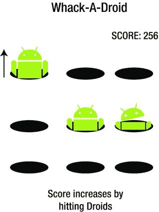
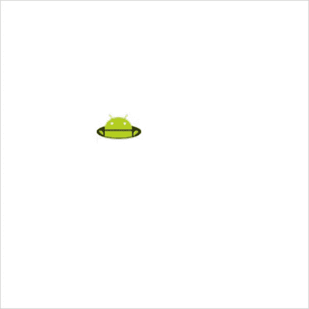
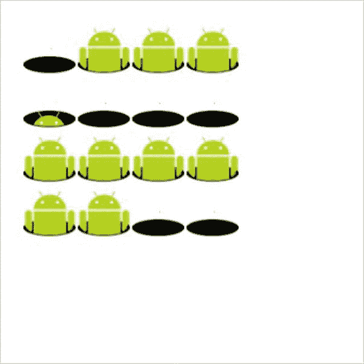
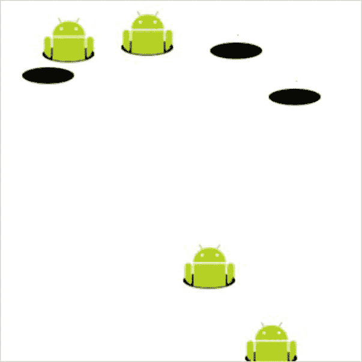

# 5. 游戏设计

**摘要**

到目前为止，我们重点介绍了 JavaScript 和 `enchant.js` 的基础知识，包括利用 `enchant.js` 众多功能编写代码时必须使用的特定格式。这些基础知识包括精灵、标签、场景、地图、如何在 `9leap.net` 上上传和分享你的游戏等等。然而，仅凭这些并不足以造就一名优秀的游戏开发者！

如果你直接深入，尝试从头开始构建自己的游戏，而不参考任何资料，仅仅使用本书之前介绍的内容，你会遇到问题。很多问题。为了让整个过程对你来说更容易，我们在本章中提供了一些关于从头设计和开发游戏的背景知识。

能力越大（或者说功能越强），责任越大。作为游戏开发者，你对你的玩家负有责任。`enchant.js` 引擎是开发游戏的强大工具。但它的最终目的是什么？当然是为了给玩家带来快乐！乐趣是游戏的核心。你的玩家是与游戏互动的人，如果他们不喜欢这种体验，他们就缺乏动力去玩你投入时间开发的游戏。

本章专门讲解了构建原创游戏的创意过程。其中包含大量关于如何简化这一过程的提示。它还会给你一些关于如何设计你的游戏使其对玩家更具吸引力和娱乐性的技巧。我们介绍了游戏应经历的开发生命周期：从构思，到编码，最后到完善已完成的游戏。


## 小游戏开发不可违背的规则

使用 `enchant.js` 制作游戏时，你需要遵循几条“不可违背”的规则。用该库开发的大多数游戏都是小游戏。小游戏是规模较小的游戏，其特点是游戏时间短、关卡之间的进程简单。

通常，这类游戏只需要一到三人进行开发，有时甚至可以在不到一小时内完成。虽然有些游戏的开发会持续几天，但你不应该在一个游戏上花费比这多得多的时间。不断尝试，不要担心失败。你犯的错误越多，从中吸取的教训就越多，你的技能提升也就越快。

### 不要试图制作史诗级游戏

如果你一开始就想制作一款史诗级游戏，那注定会失败。先从制作一个符合你技能水平的、小而简单的游戏开始，然后逐步扩展它的功能。事实上，过往大多数在商业上取得成功的游戏，在起步时并没有以创作一款史诗级游戏为目标。如果你更仔细地审视这些游戏，你会发现它们由极其简单的组件构成，尽管数量众多。

在一个完整而简单的游戏中，存在许多关卡，每个关卡通过一个简单的故事相互连接。那些规则从一开始就很复杂的游戏是很少见的。

### 不要试图制作一款完全原创的游戏

在制定游戏规则时，切忌追求 100% 的原创性。游戏在很久以前就以这样或那样的形式被开发出来了。许多初学者渴望制作出前所未见的东西，但他们冒的风险是，可能实际上做出了一款没人喜欢的游戏。试想一种没人尝过或听说过的食物。再想象一下，吃这种食物，而且是由一个从未下过厨的人准备的。一个可怕的想法，不是吗？

它也许纯粹靠运气能成为一道美味，但好的食物通常不会偏离我们熟悉用来描述它们的形容词太远：甜的、辣的、多汁的、丰盛的，等等。当然，一位大厨会运用这些风味，并以新颖创新的方式将它们融合起来，但你不会看到那些刚开始学习烹饪艺术的人一头扎进烹饪科学实验中。

创新很重要，但如果最终味道糟糕，那就不值得了。想想花生酱和果酱。将两种熟悉的口味组合成新东西，总比试图烹饪出完全没听说过的东西要好。游戏也是如此。不要一开始就瞄准原创。先结合熟悉的主题和规则，然后逐步开始从中创造你自己独特的风格。

### 玩家应在十秒内理解游戏

人们很容易被规则繁多的复杂游戏劝退。在一个完美的游戏中，玩家能本能地理解游戏如何运作，并在开始玩的那一刻就上瘾。你必须让玩家在十秒或更短时间内产生“这真好玩！”的想法。不要指望你的玩家有耐心。他们应该从开始玩的那一刻起，就尽可能多地看到游戏的内容及其吸引力。

如果你的游戏有多个关卡，或者比标准小游戏更复杂，可以考虑在游戏开头增加一个可选的教程关卡。教程关卡是教会玩家如何玩的好方法，同时能保持游戏的实操感。

### 不要过于沉迷编程

编程本身很有趣，有些游戏拥有迷人的结构。话虽如此，但人们很容易过度关注编程，而忽略了游戏的精髓。记住，你的最终目标是创造出一款能让很多人玩的作品。把你的注意力集中在让游戏变得有趣上，而不是编程的复杂性上。

### 遇到困难时，采用“限时挑战”

在大多数游戏中，你只需增加一个时间限制（限时挑战）就能提高赌注和趣味性。例如，在发布到 9leap 的《高速黑白棋》（ [`http://9leap.net/games/4`](http://9leap.net/games/4) ）中，简单的黑白棋（奥赛罗）游戏仅仅因为增加了时间限制就焕发了新生。它让一款慢节奏的策略游戏，显著地提高了风险性和难度。

### 不要纠结于缺少什么

游戏开发者通常都会面临时间和资源短缺的情况，即使是大公司开发的大型游戏也是如此。无限的时间和资源几乎是不可能的。当你开始为缺乏时间或资源而烦恼的那一刻，你的游戏进程就会戛然而止。相反，要专注于利用现有的时间和资源，做出尽可能好的游戏。

### 为他人带来乐趣

创造游戏的全部意义在于为他人创造乐趣。如果你已经费了很大劲做出了一个游戏，就不要纠结于有多少人下载它，或者它有多高端。先努力让你的游戏给朋友和家人带来笑容。


## 游戏开发流程

游戏无疑形式多样，在计划用`enchant.js`制作自己的游戏时，调研一些不同类型的作品以获取灵感总是个好主意，例如 Fruits Panic（一款动作解谜游戏，位于[`9leap.net/games/90`](http://9leap.net/games/90)）或 Golf Solitaire（一款纸牌游戏，位于[`9leap.net/games/2994`](http://9leap.net/games/2994)）。

然而，一旦你确定了感兴趣的游戏大体类型，如果没有路线图指引方向，实际创作过程可能会变得混乱无序。以下列表展示了开发自己游戏的六个步骤。请注意，游戏设计是一个涵盖众多不同观点的大主题。由于用`enchant.js`创建的大多是简单游戏，这里列出的开发流程可能与更复杂的方法论有所不同。

- **设计游戏规则。** 刚开始制作第一款游戏时，完全从零创建规则可能会令人困惑。例如，如果你正在设计一款类似“打砖块”的游戏，就需要决定球碰到砖块与碰到挡板时如何改变方向，还要设计所有强化道具、球的速度、球加速的速率等等。在这种情况下，借鉴他人如何实现游戏规则并模仿其技巧是非常好的做法。在此过程中，你应该选择那些自认为有能力制作的作品作为模型。在纸上草拟你的想法，如果可能的话，甚至可以模拟一些操作。暂时不必担心细节不全，也不要过度设计。
- **选择主题并准备精灵图。** 确定你想制作游戏的总体概念。花点时间想象你的游戏画面：是赛车竞速？还是飞船与外星人战斗？玩家玩过后会记住什么？你已经决定了游戏规则，因此或许可以考虑一个能最大化玩家潜力的主题。同时，你也应评估与主题配套的美术、音效和故事素材。你打算如何创作或获取它们？
- **编写游戏程序。** 你已经选定了主题和规则，现在该根据它们编写代码了。根据你的主题，在此之前可能需要准备基础图形、音效或故事。
- **亲自试玩。** 一旦游戏某个版本编写完成，亲自试玩至关重要。无论你多么精心规划游戏规则，如果不真正测试，就会遗漏规则中的问题。你不仅要测试游戏是否遵循既定规则，还要反复测试平衡性，看游戏是否太难、太简单或难以控制。如果可能，寻求他人帮助。试玩和反馈的人越多，你就越能学到如何让游戏变得更有趣。
- **完善规则并返回第 3 步。** 经过一番测试后，重新审视你的规则，看看如何改进，修改代码来实现改进，然后再次试玩游戏。重复这一公式直到满意为止。游戏的最终趣味程度将极大取决于你在此步骤的认真程度。如果你对自己的成果感到满意，添加更多关卡可能是个好主意。
- **完成游戏。** 这一步是为游戏添加最终润色。例如，制作标题画面、添加高分排行榜、优化游戏外观。

如果你已经对想制作的游戏类型有了想法，可以自由调换第 1 步和第 2 步的顺序。先选定主题，再为其设计规则，也会很有趣。

在实际游戏开发中，这个过程要复杂得多，并且会根据制作流程而变化。不过，得益于`enchant.js`提供的功能，开发周期得以缩短，使你能够比不使用该库时更快地重复这一游戏开发循环。

试着想出一个你想开发的游戏。在接下来的小节中，我们将逐步讲解开发过程，从头到尾制作一个完整的示例游戏。在此过程中，请尝试为你的游戏开发找到利用该流程的方法。

### 设计游戏规则

实际上，你可以通过决定游戏规则或确定游戏主题来开始设计。然而，如果你是游戏开发新手，我们建议你先规划规则，因为实现管理游戏的规则是初学游戏程序员面临的最大障碍。

你可能会想：“如何想出游戏规则呢？”坦率地说，首先要看看已有的东西。挑选一个与你概念相似、且符合你技能水平的作品。在电脑游戏短暂而高产的历史中，你会发现几乎每个游戏规则都已被反复试验、打磨并转化为现有的游戏。就像武术一样，游戏有某些预定义的风格和技巧。现阶段先别担心创新。

考虑从[`9leap.net`](http://9leap.net)下载一个开源游戏并重构其源代码，或者研究源代码，将其作为在自己游戏中实现类似规则的灵感来源。借鉴现有游戏的核心规则并无不妥。即使一开始这样做，通过逐步向游戏添加新元素，你作为游戏设计师的个性和独特性也将开始显现。

打地鼠、射击游戏、基于对话的角色扮演游戏（RPG）和解谜游戏是初学者常模仿的流行类型。如果你打算专门为智能手机制作游戏，我们建议从解谜或打地鼠游戏开始。

在接下来的小节中，我们将以打地鼠为基础来创建一款新游戏。如果你碰巧不熟悉它，打地鼠是一款目标是在地鼠从洞里出现时击打它们的游戏。它简单易懂，适合初学者。

首先，请访问[`http://code.9leap.net/codes/show/23694`](http://code.9leap.net/codes/show/23694)并试玩该游戏。同时快速浏览一下代码以熟悉它，但现阶段无需复制任何内容。


#### 选择主题

一款正宗的打地鼠游戏使用的是地鼠的图片。不过，我们这次改用机器人（安卓）角色的图片。机器人图片采用知识共享许可协议，因此我们可以自由地按需使用它。

因此，本游戏我们将制作一款“打机器人”游戏，而非“打地鼠”游戏。如你所见，在定好规则之后再选择主题完全没有问题。重要的是从简单的东西开始入手。

当然，如果你喜欢绘画，也欢迎你画一只地鼠（或别的什么东西，甚至是某个人）来被敲打。只需改变主题，游戏本身的精髓就可能发生巨大变化。即使游戏逻辑保持不变，仅改变一个小小的视觉元素，整个游戏体验也可能截然不同。

选择好主题后，在纸上画出你游戏的大致模样。草图不必画得很好。在纸上规划出游戏元素，可以帮助你理解创建游戏所需的具体步骤。图 5-1 展示了我们这款“打机器人”游戏的草图。



图 5-1. 游戏草图

草图上是一个 3x3 的洞格，机器人会从这些洞里出现。随着时间的推移，多个机器人会从洞中冒出，玩家点击它们时，它们会做鬼脸，然后缩回洞里。每次成功击中，玩家得分都会增加。在到达指定时间或指定数量的机器人出现后，游戏结束。

在编码阶段，你完全可以偏离这个草图并做出解释，但纸上有了设计雏形就等于有了一个工作起点。之后，如果需要，你就可以接着创建图片了。

为了制作机器人图片文件（图 5-2），我们使用了免费的、开源的图像编辑程序 GIMP（Mac 版），该程序可从 [www.gimp.org](http://www.gimp.org/) 下载。不过，你也可以使用任何图像编辑程序来创建精灵表。


图 5-2. 机器人角色精灵表（mogura.png）

在这个精灵表中，六个尺寸为 48x48 像素的帧从左到右排列（这里每个洞的图像都构成一个帧），之后当我们使用 `Sprite(48,48)` 创建精灵时就会用到它。这与该图像中一帧的尺寸（48x48 像素）是一致的。第一帧时机器人脸部尚未出现，在接下来的四帧动画中它慢慢出现，直到最后一帧显示它被击中时的样子。

如果你正在使用 GIMP，可以按照以下步骤创建一个非常简单的精灵表，例如图 5-2 所示的那种：

-   分别下载或绘制精灵表的各个组件。
-   创建一个尺寸为一帧大小的新图像。
-   将精灵表的各组件粘贴到图像中。
-   将图像另存为 PNG 格式的独立文件，以保留透明背景。
-   编辑图像以创建下一帧，并将其保存为新图像。
-   重复此过程，直到创建完所有需要的帧。
-   使用 GIMP 自带的“融合图层”脚本将所有图像合并。你可以在 [`imagine.kicbak.com/blog/?p=114`](http://imagine.kicbak.com/blog/?p=114) 找到使用该脚本的说明。
-   将图像保存为一个新的 PNG 文件。

各帧之间的差异很重要。如果帧与帧之间的差别过大，动画就会显得生硬甚至不像动画。在我们的机器人游戏中，如果一帧里是空荡荡的洞，下一帧机器人就完全冒出来了，那么游戏运行时在这两帧之间快速切换就不会产生动画效果，机器人会突然出现。然而，如果制作 30 帧，每帧中机器人只向上移动微小的距离，这又不是文件的有效利用方式，编程工作量也会更大。这里并没有一个具体的帧数标准。最佳实践是边做边摸索，找到视觉效果最好同时又不使用过多帧数的平衡点。

### 游戏编程

一旦你确定了游戏的规则和主题，就可以进入编程阶段了。到了这一步，最轻松的入门方式就是先创建游戏最简单的版本。这个版本不一定非得是可运行的版本，也**绝对**不需要包含预期游戏的所有功能。

#### 创建最简单的版本

打地鼠游戏最简单的版本就是一个只显示单个洞的程序。因为最终会有多个洞，所以我们应该先为“洞”创建一个类。请按照以下步骤创建这个类：

-   Fork 位于 [`code.9leap.net/codes/show/28286`](http://code.9leap.net/codes/show/28286) 的空白项目模板。该模板不包含任何游戏代码，但包含你所需要的精灵表图片。
-   初始化 `enchant` 库，并通过在你的项目中输入代码清单 5-1 中的代码来为“洞”定义一个类。这段代码会在每次创建 `Pit` 对象（即洞）时运行其内部的所有代码。

代码清单 5-1. 定义 Pit 类

```
enchant();

Pit = Class.create(Sprite,{
    initialize:function(x,y){
        //调用 Sprite 类（父类）的构造函数
        enchant.Sprite.call(this,48,48);
        this.image = game.assets['mogura.png'];
        this.x = x;
        this.y = y;
    }
});
```

-   在你刚输入的代码下方，添加代码清单 5-2 中的代码以在屏幕上创建一个洞。

代码清单 5-2. 在屏幕上创建一个洞

```
window.onload = function(){
    game = new Game(320, 320);
    //加载机器人图片
    game.preload('mogura.png');
    game.onload = function(){
        var pit = new Pit(100,100);
        game.rootScene.addChild(pit);
    }
    game.start();
}
```


图 5-3. 简单打地鼠程序的运行结果

点击“运行”。如图 5-3 所示，屏幕上会显示一个洞。我们创建的 `Pit` 类扩展了 enchant.js 的 `Sprite` 类，因此它的使用方法与 `Sprite` 相同。如果遇到问题，你可以在 [code.9leap.net](http://code.9leap.net) ([`code.9leap.net/codes/show/23728`](http://code.9leap.net/codes/show/23728)) 上查看此步骤的结果。


#### 让机器人出现

下一步是修改我们的 `Pit` 类，使机器人得以出现。代码中唯一需要修改的部分就是 `Pit` 类，因此我们只展示这一部分。按以下步骤修改该类：

将 `Pit` 类修改为与代码清单 5-3 一致，若当前帧是前四帧之一，则切换到机器人的下一帧。这将使机器人重复循环出现动画，不过这也是后续几个步骤的基础。在本章及后续所有代码清单中，与之前代码的变更部分将用粗体显示。

**代码清单 5-3.** 更新后的 Pit 类

```
Pit = Class.create(Sprite,{
         initialize:function(x,y){
                    //调用 Sprite 类（父类）的构造方法
                    enchant.Sprite.call(this,48,48);
                    this.image = game.assets['mogura.png'];
                    this.x = x;
                    this.y = y;
                    //定义一个每帧执行的事件侦听器
                    this.addEventListener('enterframe',this.tick);
         },
         tick:function(){
                    this.frame++;
                    //动画播放完毕后循环
                    if(this.frame>=4)this.frame=0;
         }
});
```



**图 5-4.** 添加动画后的打地鼠游戏

点击“运行”。机器人会像图 5-4 所示那样反复从洞中冒出。如果遇到问题，可以访问 [`code.9leap.net`](http://code.9leap.net) ( [`http://code.9leap.net/codes/edit/23729`](http://code.9leap.net/codes/edit/23729) ) 查看这一步的结果。

#### 调整动画速度

我们已经为小机器人创建了从洞中快速出现的动画。然而，它移动得太快，以至于无法击中它，所以我们需要让它稍微慢下来。目前，在机器人精灵的第四帧之后，我们立即返回第 0 帧。这种突然回到洞里的感觉很不自然。让我们重写代码，使其在进入第四帧后，再逐步逆回到第 0 帧。按以下步骤进行修改：

给 `Pit` 类添加一个变量 `mode`，用它来定义机器人应该如何执行动画，将 `Pit` 类修改为与代码清单 5-4 一致。

**代码清单 5-4.** 为 Pit 类添加动画

```
Pit = Class.create(Sprite,{
         initialize:function(x,y){
                    //调用 Sprite 类（父类）的构造方法
                    enchant.Sprite.call(this,48,48);
                    this.image = game.assets['mogura.png'];
                    this.x = x;
                    this.y = y;
                    //定义一个每帧执行的事件侦听器
                    this.addEventListener('enterframe',this.tick);
                    //记录机器人的状态
                    this.mode = 0;
         },
         tick:function(){
                    //每隔一帧才改变一次帧
                    //return 语句会终止函数执行
                    if(game.frame%2!=0)return;
                    switch(this.mode){
                             //机器人正在从洞中冒出
                             case 0:
                                        this.frame++;
                                        //完全出现后切换模式
                                        if(this.frame>=4) this.mode=1;
                                        break;
                             //机器人正在躲回洞中
                             case 1:
                                        this.frame--;
                                        //完全隐藏后切换模式
                                        if(this.frame<=0) this.mode=0;
                                        break;
                    }
         }
});
```

如果模式设置为 `0`（表示机器人正在出现但尚未完全现身），机器人将依次显示前四帧，然后将其模式切换为 `1`。模式 `1` 表示机器人正在躲回洞中，并让机器人以与出现时相反的顺序播放帧。最终结果是机器人会反复出现然后消失。

此外，我们的动画也变得更加流畅了。我们修改了代码，通过一个 `if` 语句让帧处理每两帧执行一次，而不是每帧执行，这使得动画既好看又平滑。更进一步，我们添加了一个名为 `mode` 的新属性，包含了模式 `0`（出现中）和模式 `1`（隐藏中），并根据该属性执行了 `switch` 语句来实现相应的处理。如果遇到问题，可以访问 [`code.9leap.net`](http://code.9leap.net) ( [`http://code.9leap.net/codes/show/23730`](http://code.9leap.net/codes/show/23730) ) 查看这一步的结果。


#### 让机器人随机出现

根据我们目前的代码，如果复制了多个地洞，所有机器人都会在同一时间出现。我们需要让机器人的出现时间随机化。目前只有模式 `0`（出现）和模式 `1`（隐藏），因此我们需要添加一个模式，用于在两个阶段之间等待随机时长，具体操作如下：

通过使用清单 5-5 中的代码重新定义 `Pit` 类，对该类进行升级，使其在出现和隐藏之间产生随机的时间间隔。

```
//生成随机数的函数
rand = function(n){
return Math.floor(Math.random()*n);
}
//定义地洞类
Pit = Class.create(Sprite,{
initialize:function(x,y){
//调用 Sprite 类（父类）的构造函数
enchant.Sprite.call(this,48,48);
this.image = game.assets[’mogura.png’];
this.x = x;
this.y = y;
//定义每帧都会执行的事件监听器
this.addEventListener(’enterframe’,this.tick);
//初始时设置机器人模式为 2（等待）
this.mode = 2;
//设置下一个模式为 0（出现）
this.nextMode = 0;
//等待一个随机数量的帧（0-99）
this.waitFor =    game.frame+rand(100);
},
tick:function(){
//只在每隔一帧改变帧数
//return 语句会结束函数
if(game.frame%2!=0)return;
switch(this.mode){
//机器人正从地洞中冒出
case 0:
this.frame++;
if(this.frame>=4) {
//出现后切换到模式 2（等待）
this.mode=2;
//模式 2 之后要进入的模式是模式 1（隐藏）
this.nextMode=1;
//设置 0 到 99 帧的随机等待时间
this.waitFor = game.frame+rand(100);
}
break;
//机器人正要躲入地洞
case 1:
this.frame--;
//如果机器人已隐藏...
if(this.frame<=0){
//切换到模式 2（等待）
this.mode=2;
//下一个模式应为模式 0（出现）
this.nextMode=0;
//设置 0 到 99 帧的随机等待时间
this.waitFor = game.frame+rand(100);
}
break;
//机器人正在等待
case 2:
//如果游戏的当前帧大于设定的等待帧数...
if(game.frame>this.waitFor){
//转换到下一个模式
this.mode = this.nextMode;
}
break;
}
}
});
```

我们添加了一个名为 `rand()` 的函数用于生成随机数，并创建了一个新的模式：模式 `2`（等待）。

从游戏启动以来经过的帧数存储在 `game.frame` 中。当 `waitFor` 中设定的帧数到达后，我们便会切换到下一个模式。通过将这个模式插入到模式 `0`（出现）和模式 `1`（隐藏）之间，就可以随机化机器人出现和隐藏之间的时间。

如果遇到任何问题，请查看 [`http://code.9leap.net/codes/show/23731`](http://code.9leap.net/codes/show/23731) 上的代码。

#### 实现敲击机器人

到目前为止，我们已经设置了机器人朋友随机出现和隐藏的功能。现在让我们来创建他被玩家点击时的处理逻辑。对于所谓的“敲击”事件，我们使用一个 `touchstart` 事件监听器（事件监听器在第 2 章中介绍过）。请执行以下步骤来实现：

通过添加清单 5-6 中加粗部分的代码，修改 `Pit` 类。

```
//定义地洞类
Pit = Class.create(Sprite,{
initialize:function(x,y){
//调用 Sprite 类（父类）的构造函数
enchant.Sprite.call(this,48,48);
this.image = game.assets[’mogura.png’];
this.x = x;
this.y = y;
//定义每帧都会执行的事件监听器
this.addEventListener(’enterframe’,this.tick);
//定义机器人被敲击时的事件监听器
this.addEventListener(’touchstart’,this.hit);
//初始时设置机器人模式为 2（等待）
this.mode = 2;
//设置下一个模式为 0（出现）
this.nextMode = 0;
//等待一个随机数量的帧（0-99）
this.waitFor =    game.frame+rand(100);
},
tick:function(){
//只在每隔一帧改变帧数
//return 语句会结束函数
if(game.frame%2!=0)return;
switch(this.mode){
//机器人正从地洞中冒出
case 0:
this.frame++;
if(this.frame>=4) {
//出现后切换到模式 2（等待）
this.mode=2;
//模式 2 之后要进入的模式是模式 1（隐藏）
this.nextMode=1;
//设置 0 到 99 帧的随机等待时间
this.waitFor = game.frame+rand(100);
}
break;
//机器人正要躲入地洞
case 1:
this.frame--;
//如果机器人已隐藏...
if(this.frame<=0){
//切换到模式 2（等待）
this.mode=2;
//下一个模式应为模式 0（出现）
this.nextMode=0;
//设置 0 到 99 帧的随机等待时间
this.waitFor = game.frame+rand(100);
}
break;
//机器人正在等待
case 2:
//如果游戏的当前帧大于设定的等待帧数...
if(game.frame>this.waitFor){
//转换到下一个模式
this.mode = this.nextMode;
}
break;
}
},
//敲击机器人
hit:function(){
//只有当机器人至少露出半张脸时
if(this.frame>=2){
//被敲击后的机器人
this.frame=5;
//切换到等待模式
this.mode=2;
this.nextMode=1;
//等待帧数固定为 10
this.waitFor = game.frame+10;
}
}
});
```

请注意我们刚刚添加的新函数 `hit`。如果你在机器人至少露出半张脸时点击它，就会播放被敲击的动画。

在被敲击的机器人帧显示了十帧之后，机器人会再次切换到模式 `1`（隐藏）。这种在实现其他功能的同时切换状态的程序被称为状态机。

如果你的代码出现了意外的行为，可以查看该步骤的结果，网址为 [`http://code.9leap.net/codes/show/23739`](http://code.9leap.net/codes/show/23739)。

现在，我们已经创建了一个打地鼠游戏的基本要素——在这个游戏里，你要欺负我们的机器人朋友。不过，我们仍然有一个问题：如果你不断地敲击机器人，它的脸就会卡在被敲击的状态。


#### 防止连续敲击机器人

我们需要确保机器人被敲击后，无法再次击中它，使其保持在被击打状态。为此，我们给 `Pit` 类添加一个新属性来实现，具体操作如下：

更新 `Pit` 类，添加清单 5-7 中的粗体部分。

**清单 5-7.** 防止循环击打动画

```
//Define a class for holes
Pit = Class.create(Sprite,{
  initialize:function(x,y){
    //Call the Sprite class (super class) constructor
    enchant.Sprite.call(this,48,48);
    this.image = game.assets['mogura.png'];
    this.x = x;
    this.y = y;

    //Defines an event listener to run every frame
    this.addEventListener('enterframe',this.tick);

    //Defines an event listener for when the Droid gets whacked
    this.addEventListener('touchstart',this.hit);

    //Set the Droid mode to 2 (waiting) in the beginning.
    this.mode = 2;

    //Set the next mode as 0 (appearing)
    this.nextMode = 0;

    //wait for a random number (0-99) of frames
    this.waitFor =    game.frame+rand(100);

    //stores info on whether or not the Droid
    //has already been whacked
    this.currentlyWhacked = false;
  },

  tick:function(){
    //only change the frame every other frame
    //the return call ends the function
    if(game.frame%2!=0)return;

    switch(this.mode){
      //Droid is appearing from the hole
      case 0:
        this.frame++;
        if(this.frame>=4) {
          //switch to Mode 2 (waiting) after appearing
          this.mode=2;
          //the mode to go to after Mode 2 is Mode 1 (hide)
          this.nextMode=1;
          //Set a random waiting time for 0 ∼ 99 frames
          this.waitFor = game.frame+rand(100);
        }
        break;

      //Droid is going to hide in the hole
      case 1:
        this.frame--;
        //if Droid is hidden...
        if(this.frame<=0){
          //Switch to Mode 2 (waiting)
          this.mode=2;
          //The next mode should be Mode 0 (appear)
          this.nextMode=0;
          //Set a random waiting time for 0 ∼ 99 frames
          this.waitFor = game.frame+rand(100);
          //reset flag as the whacked Droid disappears
          this.currentlyWhacked = false;
        }
        break;

      //Droid is waiting
      case 2:
        //if the game's current frame is greater than
        //the set frame to wait for...
        if(game.frame>this.waitFor){
          //Make a transition to the next mode
          this.mode = this.nextMode;
        }
        break;
    }
  },

  //Whack Droid
  hit:function(){
    //Do nothing if the Droid has already been whacked
    if(this.currentlyWhacked)return;

    //only when Droid has appeared at least half-way
    if(this.frame>=2){
      //Set the flag so we know he's been whacked
      this.currentlyWhacked = true;
      //Droid after being whacked
      this.frame=5;
      //Switch to waiting mode
      this.mode=2;
      this.nextMode=1;
      //Number of frames to wait is fixed at 10
      this.waitFor = game.frame+10;
    }
  }
});
```

这里，我们添加了 `currentlyWhacked` 属性，这是一个标志，用于指示机器人是否已被敲击。当机器人被创建时，该属性设置为 `false`。每当机器人被敲击时，该属性被设置为 `true`，并开始隐藏动画序列。机器人消失后，该标志被重置为 `false`，因为新的机器人将从洞中钻出。这样，我们就避免了机器人被连续敲击的情况。

如果你在编写与示例匹配的代码时遇到问题，可以查看 [`code.9leap.net/codes/show/23740`](http://code.9leap.net/codes/show/23740) 上的代码。

#### 复制洞穴

我们已经几乎完成了只有一个洞穴的敲击机器人游戏的基础构建。你可能会想：“我们费这么大劲就只做了一个洞？”通过像这样创建一个类，我们眨眼间就能完成整个游戏。请执行以下操作来复制洞穴：

修改 `game.onload` 函数，使其与清单 5-8 一致。

**清单 5-8.** 复制机器人洞穴

```
game.onload = function(){
    //Line up holes in a 4x4 matrix
    for(var y=0;y<4;y++){
         for(var x=0;x<4;x++){
            var pit = new Pit(x*48+20,y*48+20);
            game.rootScene.addChild(pit);
         }
    }
}
```

  
**图 5-5.** 创建 `Pit` 类的多个实例

点击运行。一行机器人出现了，如图 5-5 所示。

就这样，我们有了一个敲击鼹鼠游戏！如你所见，使用类可以大量节省时间。

由于我们将在下一步中进一步优化游戏，请确保到目前为止你所完成的一切都成功运行。到此为止的代码可以在 [`code.9leap.net/codes/show/23741`](http://code.9leap.net/codes/show/23741) 上查看和分支。

#### 随机排列洞穴

在开发游戏时，尝试不同的方法会很有帮助。例如，为了研究它对游戏的影响，你可能想让敲击机器人游戏中的洞穴随机出现在屏幕上，而不是整齐排列成 4x4 网格。清单 5-9 和图 5-6 展示了实现这一效果的修改。

**清单 5-9.** 随机放置洞穴

```
game.onload = function(){
   for(var i=0;i<7;i++){
      //Place pits randomly
      var pit = new Pit(rand(300),rand(300));
      game.rootScene.addChild(pit);
   }
}
```

  
**图 5-6.** 随机放置洞穴

由于洞穴的位置是随机的，每次重新加载游戏时它们都会变化。无论洞穴最终出现在何处，它们的工作方式完全相同，因为它们都由 `Pit` 类定义。

现在是时候进入有趣的部分了。取决于洞穴最终的位置，游戏的本质会发生变化。发挥你的创造力，尝试创建你自己独创的洞穴排列。现在你已经完成了你的第一个游戏原型！

#### 游玩、重复、完成

一旦你有了一个可运行的原型，下一步就是运行原型，并记录游戏中需要改进或添加的部分。

如果你将完成的敲击机器人游戏玩上几次，你会注意到缺少两个重要的东西：分数和机器人出现次数的限制。

如果你尝试过让游戏中的洞穴随机出现，请先将你的 `game.onload` 函数重置回清单 5-8 中显示的内容，再继续下面的示例。


#### 显示分数

让我们从显示一个分数开始：

在 `window.onload` 开头的代码行上方添加清单 5-10 所示的代码，以创建 `ScoreLabel` 类。

**清单 5-10.** `ScoreLabel` 类

```
//ScoreLabel 类定义，继承自 Label 类
ScoreLabel = Class.create(Label,{
        initialize:function(x,y){
            //调用 Label 类的构造函数
            enchant.Label.call(this,"SCORE:0");
            this.x=x;
            this.y=y;
            this.score = 0;
        },
        //向分数中添加点数
        add:function(pts){
            this.score+=pts;
            //更改显示的分数
            this.text="SCORE:"+this.score;
        }
});
```

添加 `ScoreLabel` 类的一个新实例，如清单 5-11 所示。

**清单 5-11.** 创建 `ScoreLabel` 实例

```
game.onload = function(){
        //显示 ScoreLabel
        scoreLabel=new ScoreLabel(5,5);
        game.rootScene.addChild(scoreLabel);
        //以 4x4 矩阵排列洞
        for(var y=0;y<4;y++){
            for(var x=0;x<4;x++){
                var pit = new Pit(x*48+20,y*48+20);
                game.rootScene.addChild(pit);
            }
        }
}
```

将清单 5-12 中的粗体部分添加到 `hit` 函数中，以便每当 `Droid` 被击中时增加分数。

**清单 5-12.** 在击中时增加分数

```
//Whack Droid
hit:function(){
        //如果 Droid 已被击中，则不执行任何操作
        if(this.currentlyWhacked)return;
        //仅在 Droid 至少已出现一半时
        if(this.frame>=2){
            //设置标志以标记它已被击中
            this.currentlyWhacked = true;
            //被击中后的 Droid
            this.frame=5;
            //切换到等待模式
            this.mode=2;
            this.nextMode=1;
            //等待帧数固定为 10
            this.waitFor = game.frame+10;
            //增加分数
            scoreLabel.add(1);
        }
}
```

点击**运行**。屏幕左上角会出现一个分数，每当玩家击中一个 `Droid` 时，该分数会增加 1。

如果在添加此代码时遇到问题，请检查示例代码 [`http://code.9leap.net/codes/show/23777`](http://code.9leap.net/codes/show/23777)。


### 限制机器人出现次数

添加计分功能后，游戏看起来已接近完成。然而，我们的机器人出现得过于频繁，以至于只需快速点击同一位置就能获得高分。机器人源源不断地出现，剥夺了玩家具有挑战性的游戏体验。

让我们修改游戏，让机器人只出现 30 次。这样修改会迫使玩家在机器人 30 次出现中尽可能多地击中它。请按以下步骤操作：

创建一个变量来记录机器人的总数和机器人最大出现次数，然后通过复制清单 5-13 中的粗体部分来实现它们。

**清单 5-13 限制机器人出现次数**

```javascript
enchant();

//生成随机数的函数
rand = function(n){
    return Math.floor(Math.random()*n);
}

//机器人出现次数
maxDroid = 30;

//机器人总数
totalDroid = 16;

//定义洞穴类
Pit = Class.create(Sprite,{
    initialize:function(x,y){
        //调用精灵类（超类）构造函数
        enchant.Sprite.call(this,48,48);
        this.image = game.assets['mogura.png'];
        this.x = x;
        this.y = y;
        //定义每帧运行的事件监听器
        this.addEventListener('enterframe',this.tick);
        //定义机器人被击中时的事件监听器
        this.addEventListener('touchstart',this.hit);
        //初始设置机器人模式为 2（等待）
        this.mode = 2;
        //设置下一个模式为 0（出现）
        this.nextMode = 0;
        //等待随机帧数（0-99）
        this.waitFor =    game.frame+rand(100);
        //存储机器人是否已被击中的信息
        this.currentlyWhacked = false;
    },
    tick:function(){
        //每两帧改变一次状态
        //return 会终止函数
        if(game.frame%2!=0)return;
        switch(this.mode){
            //机器人正在从洞穴中出现
            case 0:
                this.frame++;
                if(this.frame>=4) {
                    //出现后切换到模式 2（等待）
                    this.mode=2;
                    //模式 2 之后的下一个模式是模式 1（隐藏）
                    this.nextMode=1;
                    //设置随机等待时间（0 ~ 99 帧）
                    this.waitFor = game.frame+rand(100);
                }
                break;
            //机器人即将躲进洞穴
            case 1:
                this.frame--;
                //如果机器人已隐藏...
                if(this.frame<=0){
                    //切换到模式 2（等待）
                    this.mode=2;
                    //下一个模式应为模式 0（出现）
                    this.nextMode=0;
                    //设置随机等待时间（0 ~ 99 帧）
                    this.waitFor = game.frame+rand(100);
                    //重置标志，因为被击中的机器人消失了
                    this.currentlyWhacked = false;
                    //减少机器人最大出现次数
                    maxDroid--;
                    //如果超出次数，机器人不应再出现
                    if(maxDroid<=0) {
                        this.mode=3;
                        if(maxDroid <= -1*totalDroid + 1) {
                            game.end(scoreLabel.score, scoreLabel.text);
                        }
                    }
                }
                break;
            //机器人正在等待
            case 2:
                //如果游戏当前帧大于设置的等待帧...
                if(game.frame>this.waitFor){
                    //转换到下一个模式
                    this.mode = this.nextMode;
                }
                break;
        }
    },
    //击中机器人
    hit:function(){
        //如果机器人已被击中则不执行任何操作
        if(this.currentlyWhacked)return;
        //仅在机器人至少出现一半时
        if(this.frame>=2){
            //设置标志，表示机器人已被击中
            this.currentlyWhacked = true;
            //被击中后的机器人
            this.frame=5;
            //切换到等待模式
            this.mode=2;
            this.nextMode=1;
            //等待帧数固定为 10
            this.waitFor = game.frame+10;
            //增加分数
            scoreLabel.add(1);
        }
    }
});

//计分类定义，继承 Label 类
ScoreLabel = Class.create(Label,{
    initialize:function(x,y){
        //调用 Label 类构造函数
        enchant.Label.call(this,"SCORE:0");
        this.x=x;
        this.y=y;
        this.score = 0;
    },
    //增加分数
    add:function(pts){
        this.score+=pts;
        //更新显示的分数
        this.text="SCORE:"+this.score;
    }
});

//初始化
window.onload = function(){
    game = new Game(320, 320);
    //加载机器人图像
    game.preload('mogura.png');
    game.onload = function(){
        //显示计分
        scoreLabel=new ScoreLabel(5,5);
        game.rootScene.addChild(scoreLabel);
        //以 4x4 矩阵排列洞穴
        for(var y=0;y<4;y++){
            for(var x=0;x<4;x++){
                var pit = new Pit(x*48+20,y*48+20);
                game.rootScene.addChild(pit);
            }
        }
    }
    game.start();
};
```

你可以在[`code.9leap.net`](http://code.9leap.net)（[`http://code.9leap.net/codes/show/23778`](http://code.9leap.net/codes/show/23778)）找到此次修改的源代码。

目前，我们的打机器人游戏已经完成。不过，还有很多其他方式来制作打地鼠类型的游戏。你可以打移动的地鼠，或者添加地鼠速度变化和洞穴位置变化的关卡，当然你也可以对抗机器人以外的其他东西，或者让它们从洞穴以外的其它地方出现（比如传送门）。通过改变规则和主题，可以创造出无限多的变化。

现在轮到你了。发挥你的创造力，尝试创作出属于你的独特杰作。游戏完成后，尝试将其上传到[`http://9leap.net`](http://9leap.net/)。如果遇到问题，请参阅第 1 章了解上传游戏的相关信息。


## 结论

在本章中，我们聚焦于使用 `enchant.js` 设计游戏的过程。我们审视了游戏设计不可打破的规则，回顾了游戏开发流程，甚至设计了一个可完整运行的大头锤（打地鼠）游戏。在下一章中，我们将深入研究游戏领域最经典的原型之一：街机射击游戏，并逐步讲解如何使用 `enchant.js` 创建此类游戏。

