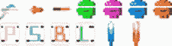
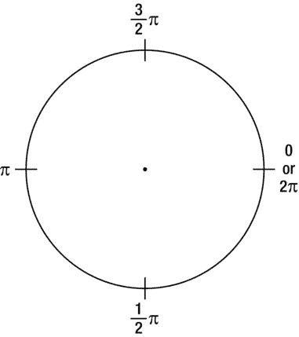
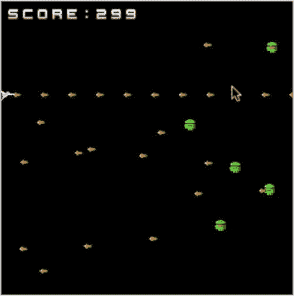
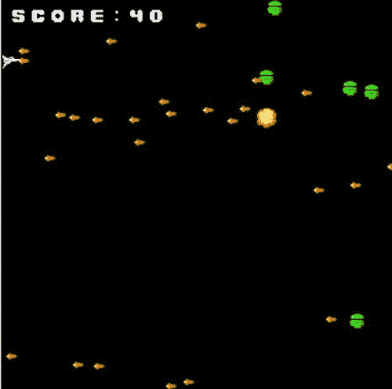
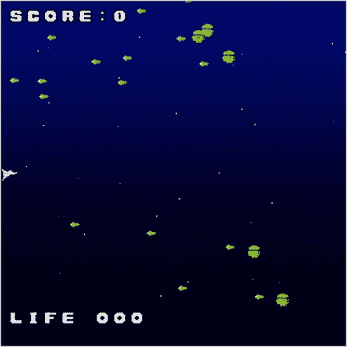

# 6. 创建街机射击游戏

## 摘要

在第 5 章中，我们探讨了游戏设计，并创建了我们自己的打地鼠（或者我应该说打安卓机器人？）游戏。在本章中，我们将研究另一种游戏：街机射击游戏，它比打地鼠游戏更为复杂。

在这款街机射击游戏中，我们包含了多个有助于提升游戏趣味性的特性：背景音乐、非玩家角色（如好人和坏人）、爆炸效果、滚动背景等等。整合所有这些元素需要在游戏设计方面进行周密的规划，因为我们创建的所有类都必须彼此交互。例如，从玩家飞船射出的一发子弹应该导致敌人消失。除了介绍街机射击游戏是如何设计和编码的之外，我们还引入了几个新主题，包括指示器、等级和旋转。

## 步骤摘要

探索游戏并进行设置 — 搭建游戏基础 — 创建玩家飞船 — 创建射击类 — 创建玩家射击类并使飞船开火 — 创建敌人 — 创建敌人射击类并使敌人开火 — 让敌人沿弧形移动 — 爆炸效果 — 添加滚动背景 — 添加生命指示器

## 构建街机射击游戏

让我们从能制作的最简单的街机射击游戏版本开始，然后逐步增加复杂性。我们在本节中编写的游戏是一个简单的射击游戏。当玩家触摸屏幕时，飞船会移动到触摸位置，并在玩家持续触摸屏幕时不断射出子弹。敌机出现在屏幕的另一侧并向玩家飞船射击。如果玩家飞船被击中，游戏结束。每当玩家消灭一艘敌机，其得分就会增加。游戏的目标是在被击中前获得尽可能高的分数。

在第 5 章中，我们的方法是先编写一段简短精炼的代码，然后在持续开发的过程中对其进行改进，并在每次迭代时试玩游戏。这里我们也采用同样的方法，但由于街机射击游戏比打地鼠游戏更复杂，所以步骤要多得多。

### 探索游戏并进行设置

如果在开始编码前先试玩一下我们将要编写的游戏，你会对其运作方式有更清晰的认识。请执行以下操作来熟悉游戏并设置好编码环境：

-   在 [`http://9leap.net/games/1034`](http://9leap.net/games/1034) 上多次试玩该游戏，以熟悉我们将要制作的游戏。特别注意观察敌人是如何随机出现的，以及当屏幕上有大量敌方子弹时游戏会变得多么困难。由于具有可重玩性，该游戏在 [`9leap.net`](http://9leap.net) 上非常受欢迎。由于敌人是随机生成的，每次的游戏体验都不同。

-   在 [`http://code.9leap.net/codes/show/29839`](http://code.9leap.net/codes/show/29839) 上 Fork 这个模板。该模板包含了你所需的必要图像文件。

### 搭建游戏基础

和往常一样，最好先从最简单的游戏元素开始，然后再添加更复杂的元素。在这里，我们设置 `Core` 对象，设置背景，并创建一个分数。请执行以下操作进行设置：

1.  初始化 `enchant.js` 库，并将代码清单 6-1 中的代码复制到空白模板中来创建 `Core` 实体。鉴于本节内容的复杂性，我们使用注释对代码段进行标记，以便在后续章节中引用它们。

**代码清单 6-1.** 街机射击游戏的基础框架

```
enchant();

//Class Definitions

window.onload = function() {
        game = new Core(320, 320);
        //Game Properties
        game.fps = 24;
        game.onload = function() {
        };
        game.start();
};
```

2.  在 `game.onload` 函数中输入代码清单 6-2 中的代码，创建黑色背景。这会将 `rootScene` 的 `backgroundColor` 属性设置为黑色。

**代码清单 6-2.** 创建黑色背景

```
//In-Game Variables and Properties
game.rootScene.backgroundColor = 'black';
```

`rootScene` 的 `backgroundColor` 属性可以接受所有标准颜色的名称和颜色的十六进制值（例如，红色的 `#FF0000`）。

3.  点击运行。屏幕应该会变成黑色。

4.  在“//Game Properties”部分添加代码清单 6-3 中的代码，为玩家得分创建游戏变量。稍后，当敌机被玩家飞船的子弹击中时，我们将让这个变量的值增加。

**代码清单 6-3.** 创建分数变量

```
game.score = 0;
```

5.  在“//In-game Variables and Properties”部分添加代码清单 6-4 中的代码，创建 `ScoreLabel` 并将其添加到 `rootScene`。`(8,8)` 指定了标签的左上角位置，即位于游戏画面左上角向右 8 像素、向下 8 像素处。稍后，我们将在每一帧用 `game.score` 的值更新 `ScoreLabel` 的值。

**代码清单 6-4.** 创建分数标签并添加到 rootScene

```
scoreLabel = new ScoreLabel(8, 8);
game.rootScene.addChild(scoreLabel);
```

`ScoreLabel` 类是一个名为 `ui.enchant.js` 的插件的一部分，该插件包含在 [`enchantjs.com`](http://enchantjs.com/) 的下载包中。如果你之前从 `code.9leap.net` Fork 了该项目，它也已经包含在内。如果没有，则需要确保在继续之前，已将 `<script src='/static/enchant.js-latest/plugins/ui.enchant.js'></script>` 这行代码添加到你的 `index.html` 文件中。

6.  点击运行。`ScoreLabel` 应该会出现在屏幕顶部，显示“`SCORE:`”字样。

如果在代码中遇到任何问题，你可以在 [`http://code.9leap.net/codes/show/29841`](http://code.9leap.net/codes/show/29841) 找到一个完整运行的示例。

### 创建玩家飞船

下一步是创建玩家飞船，我们将以类的形式实现。请按以下步骤操作：

在 `//Class Definitions` 部分输入代码清单 6-5，为玩家创建类定义。简要说明一下，`enchant.Sprite` 声明表示新类是 `Sprite` 类的扩展，这意味着 `Sprite` 类的所有属性和方法也适用于 `Player` 类。所有写在 `initialize` 函数中的内容都将在 `Player` 对象创建时执行。

**代码清单 6-5. Player 类**

```
// Player class
var Player = enchant.Class.create(enchant.Sprite, {
        initialize: function(x, y){
        }
});
```

在 `//Game Properties` 部分添加代码清单 6-6，预加载游戏所需的所有图片 `graphic.png`。图 6-1 展示了该图片。

**代码清单 6-6. 预加载图片**

```
game.preload('graphic.png');
```

在 `Player` 类的 `initialize` 函数中输入代码清单 6-7，将其定义为 16x16 像素的 `Sprite` 类实例，并指定 `graphic.png` 作为其图像。



**图 6-1. Graphic.png**

**代码清单 6-7. 指定尺寸与图像**

```
enchant.Sprite.call(this, 16, 16);
this.image = game.assets['graphic.png'];
```

在刚添加的代码下方直接输入代码清单 6-8，将 `Player` 的位置设为创建时指定的坐标，并设置 `frame`。

**代码清单 6-8. 设置位置与帧**

```
this.x = x;
this.y = y;
this.frame = 0;
```

在 `//Game Properties` 部分添加代码清单 6-9，创建一个变量用于追踪屏幕是否被触摸。该变量将在后续创建的触摸事件监听器中使用，并用于判断是否应该从飞船发射子弹。

**代码清单 6-9. 追踪触摸状态**

```
game.touched = false;
```

回到 `initialize` 函数，输入代码清单 6-10，添加事件监听器，当 `touchstart` 事件发生时将 `Player` 移动到触摸事件的 Y 坐标位置。同时将 `game.touched` 变量设为 `true`。注意 `player.y = e.y;` 和 `game.touched = true;` 之间不需要换行，分号即可区分命令。

**代码清单 6-10. 添加触摸开始事件监听器**

```
game.rootScene.addEventListener('touchstart',
                function(e){ player.y = e.y; game.touched = true; });
```

在其下方，添加 `touchend` 和 `touchmove` 事件监听器，以处理玩家所有可能的交互操作，输入代码清单 6-11。

**代码清单 6-11. 附加事件监听器**

```
game.rootScene.addEventListener('touchend',
                function(e){ player.y = e.y; game.touched = false; });
game.rootScene.addEventListener('touchmove',
                function(e){ player.y = e.y; });
```

在刚添加的代码下方（仍在 `initialize` 函数内）输入代码清单 6-12，创建 `Player` 类的实例并添加到 `rootScene`。

**代码清单 6-12. 将 `Player` 添加到 `rootScene`**

```
game.rootScene.addChild(this);
```

在 `//In-game Variables and Properties` 部分添加代码清单 6-13，创建 `Player` 实例。由于上一步的设置，该实例会自动添加到 `rootScene`。

**代码清单 6-13. 创建 `Player` 实例**

```
player = new Player(0, 152);
```

点击运行。飞船将出现在屏幕上。点击并按住鼠标，飞船会跟随光标在屏幕上上下移动。

如果本节遇到问题，可在此处查看可运行的代码示例：[`http://code.9leap.net/codes/show/29845`](http://code.9leap.net/codes/show/29845)。

### 创建射击类

本游戏将有两种弹药类型：玩家飞船发射的弹药和敌方发射的弹药。两种类型使用相同的图像，因此我们先创建一个通用的 `Shoot` 类。请按以下步骤操作：

在 `//Player Class` 定义下方输入代码清单 6-14，创建基础的 `Shoot` 类。该类应包含两个函数：`initialize` 和 `remove`，并扩展 `Sprite` 类。创建 `Shoot` 类的实例时，需要传入三个参数：X 坐标、Y 坐标和方向。

**代码清单 6-14. 创建射击类**

```
// Shoot class
var Shoot = enchant.Class.create(enchant.Sprite, {
        initialize: function(x, y, direction){
        },
        remove: function(){
        }
});
```

在 `Shoot` 类的 `initialize` 函数中输入代码清单 6-15，将其定义为 16x16 像素的 `Sprite` 类实例，并创建和赋值所需的变量。接下来将使用 `moveSpeed` 变量控制移动速度，以便后续轻松调整弹药速度。

**代码清单 6-15. 射击类的实例变量**

```
enchant.Sprite.call(this, 16, 16);
this.image = game.assets['graphic.png'];
this.x = x;
this.y = y;
this.frame = 1;
this.direction = direction;
this.moveSpeed = 10;
```

在 `this.movespeed = 10;` 下方直接输入代码清单 6-16，创建 `enterframe` 事件监听器以控制移动。此处添加的代码将在每个帧周期被 `Shoot` 实例执行。

**代码清单 6-16. 创建 `enterframe` 事件监听器**

```
this.addEventListener('enterframe', function(){
                });
```

我们将在下一节为这个事件监听器添加具体代码。

### 使用 `Cos` 和 `Sin` 控制方向

我们创建了 `Shoot` 类来接收方向参数，但目前还不知道传入的值代表什么方向。同时我们也添加了一个事件监听器来处理移动，但还不清楚如何根据方向进行移动。那么该如何实现呢？答案就是调用 `cosine` 和 `sine` 函数（通常简写为 `cos` 和 `sin`）。

要理解这些函数，首先需要了解基于**单位圆**的方向表示方法，如图 6-2 所示。



**图 6-2.** 单位圆

单位圆使用弧度来表示方向。一弧度等于圆的半径长度，并沿圆周排列。圆中的 `pi` 符号是一个数学常数，等于圆的周长除以直径（约等于 3.14）。这有什么用呢？因为 `cos` 和 `sin` 函数只接收弧度值，而左右两个主要方向分别对应 `pi` 和 `0`（或 `2 * pi`）。

假设你想从圆心画一条长度为 1 的线段。给定一个用 `pi` 表示的方向后，`cos` 和 `sin` 会分别返回该线段终点的 x 和 y 坐标。例如，如果我们想从该点向右移动 1 个单位，就需要将 `pi` 传递给 `cos`，以确定沿 x 轴需要移动多少距离才能到达目标位置（-1）。同时也要将 `pi` 传递给 `sin`，以确定沿 y 轴需要移动多少距离（0）。

这就是通过代码处理移动的原理。我们基于 `pi` 选择一个方向，然后使用 `cos` 和 `sin` 计算出每一帧精灵需要移动的距离。

在你刚刚创建的事件监听器中，输入清单 6-17 中的代码，指定 `Shoot` 类的实例如何根据 `cos` 和 `sin` 进行移动。将计算结果乘以 `moveSpeed` 可以对弹药速度进行后续调整（如有需要）。

**清单 6-17.** 使用 `Cos` 和 `Sin` 控制移动

```
this.x += this.moveSpeed * Math.cos(this.direction);
this.y += this.moveSpeed * Math.sin(this.direction);
```

在 `enterframe` 事件监听器中，于刚刚添加的代码下方输入清单 6-18 中的代码，指定当 `Shoot` 类的实例超出游戏屏幕边界较远时，调用 `remove` 函数进行移除。我们可以将调用 `remove` 函数前允许的 X 和 Y 最小值设为 0，但使用 `–this.width` 和 `–this.height` 可以确保弹药不会以不自然的方式消失在屏幕边缘。暂时无需担心 `remove` 函数的具体定义。

**清单 6-18.** 调用 `remove` 函数

```
if(this.y > 320 || this.x > 320 || this.x < -this.width || this.y < -this.height){
    this.remove();
}
```

在 `initialize` 函数定义之后，输入清单 6-19 中的代码，定义 `remove` 函数的内部逻辑，指定调用该函数时应执行的操作。`delete` 命令用于从内存中删除 `Shoot` 类的指定实例。在长时间运行的游戏里，若不进行此操作，可能会导致系统运行缓慢。

**清单 6-19.** `remove` 函数

```
game.rootScene.removeChild(this);
delete this;
```

在创建 `Shoot` 类的实例时，将其添加到 `rootScene` 中。为此，请在 `initialize` 函数的事件监听器之后添加清单 6-20 中的代码。

**清单 6-20.** 将 `Shoot` 添加到 `rootScene`

```
game.rootScene.addChild(this);
```

### 创建 `PlayerShoot` 类并让飞船开火

我们已经创建了通用的 `Shoot` 类，但现在需要为玩家飞船发射的弹药单独创建一个类，并在飞船开火时创建其实例。执行以下步骤来创建这个类：

在 `//Class Definitions` 部分，输入清单 6-21 中的代码，创建 `PlayerShoot` 类及其 `initialize` 函数。

**清单 6-21.** 创建 `PlayerShoot` 类

```
// PlayerShoot class
var PlayerShoot = enchant.Class.create(Shoot, { // 继承子弹类
    initialize: function(x, y){
    }
});
```

# 创建敌人

现在，我们的飞船可以发射子弹了，但我们需要创建一些飞船可以射击的目标。请执行以下操作，为敌人创建一个类并将其添加到游戏中：

通过将代码清单 6-26 中的代码添加到 `//类定义` 部分（位于 `Player` 类定义下方），来创建基本的 `Enemy` 类定义，其中包含 `initialize` 和 `remove` 函数。

**代码清单 6-26.** 基本的 `Enemy` 类

```
//Enemy class
var Enemy = enchant.Class.create(enchant.Sprite, {
    initialize: function(x, y){
    },
    remove: function(){
    }
});
```

通过将代码清单 6-27 输入到 `initialize` 函数中，使 `Enemy` 类成为 `Sprite` 类的一个 `16x16` 实例，并为其分配 `frame`、`x` 和 `y` 变量。

**代码清单 6-27.** 创建 `Sprite` 的实例并分配变量

```
enchant.Sprite.call(this, 16, 16);
this.image = game.assets['graphic.png'];
this.x = x;
this.y = y;
this.frame = 3;
```

指定敌人移动方向为以单位圆表示的左侧（`Math.PI`），并通过在刚才输入的代码下方输入代码清单 6-28 中的代码来创建一个移动速度变量。

**代码清单 6-28.** 创建方向和移动变量

```
this.direction = 0;
this.moveSpeed = 3;
```

在刚才输入的下方，通过输入代码清单 6-29 中的代码，创建一个事件监听器，使用刚创建的变量来移动敌人。

**代码清单 6-29.** 移动敌人

```
// Define enemy movement
this.addEventListener('enterframe', function(){
    this.x -= this.moveSpeed * Math.cos(this.direction);
    this.y += this.moveSpeed * Math.sin(this.direction);
});
```

在 `this.y += this.moveSpeed * Math.sin(this.direction);` 这行代码的正下方，输入代码清单 6-30 中的代码，使得如果敌人位于屏幕尺寸之外，则调用其 `remove` 函数（我们稍后将定义这个函数）。

**代码清单 6-30.** 如果敌人超出屏幕则移除

```
// Disappear when outside of screen
if(this.y > 320 || this.x > 320 || this.x < -this.width || this.y < -this.height){
    this.remove();
}
```

最后，通过在 `initialize` 函数中、刚添加的事件监听器下方输入代码清单 6-31 中的代码，让敌人在被创建时将自己添加到 `rootScene`。

**代码清单 6-31.** 将敌人添加到 `rootScene`

```
game.rootScene.addChild(this);
```

通过在 `remove` 函数中输入代码清单 6-32 来定义该函数。这将把敌人从 `rootScene` 移除，并从内存中删除它。同时，它还会将敌人从一个我们将要创建、用于追踪敌人的数组中移除。（这就是 `delete enemies[this.key];` 的作用，稍后会解释。）

**代码清单 6-32.** `remove` 函数

```
game.rootScene.removeChild(this);
delete enemies[this.key];
delete this;
```

在 `//游戏内变量与属性` 部分，通过输入代码清单 6-33 中的代码来创建一个用于追踪敌人的数组。

**代码清单 6-33.** 创建一个敌人数组

```
enemies = [];
```

在新数组下方，通过输入代码清单 6-34 中的代码，为游戏创建一个 `enterframe` 事件监听器，以随机生成敌人。我们在 `Enemy` 内部创建一个名为 `enemy.key` 的变量，并将游戏的当前帧分配给它，因为这给了我们一个追踪敌人的依据。如果我们不这样做，以后就无法引用特定的敌人，而当敌人偏离屏幕或被飞船弹药击中时，这个引用是必要的。由于 `if(Math.random()*100 < 10)` 的存在，敌人被创建的概率约为十分之一，并且如果被创建，它们会被随机放置在 Y 轴上。

**代码清单 6-34.** 在游戏中创建敌人

```
game.rootScene.addEventListener('enterframe', function(){
    if(Math.random()*100 < 10){
        var y = Math.random() * 320;
        var enemy = new Enemy(320, y);
        enemy.key = game.frame;
        enemies[game.frame] = enemy;
    }
});
```

通过在 `if` 语句下方（但仍在该事件监听器内部）输入代码清单 6-35 中的代码，每一帧都更新游戏的 `scoreLabel`。

**代码清单 6-35.** 每帧更新游戏得分

```
scoreLabel.score = game.score;
```

点击运行。敌人被创建并在屏幕上飞行。然而，当飞船的子弹击中它们时，什么也不会发生。

通过在 `PlayerShoot` 类定义中、`Shoot.call(this, x, y, 0);` 下方输入代码清单 6-36 中的代码，使飞船弹药能够通过事件监听器摧毁敌人。这个 `for` 循环的构建方式使得程序遍历敌人数组中的每个成员，检查给定的子弹是否与它接触。如果是，则同时移除子弹和数组中的敌人，并将玩家得分增加 100。

**代码清单 6-36.** 使 `PlayerShoot` 能摧毁敌人

```
this.addEventListener('enterframe', function(){
    // Judges whether or not player's bullets have hit enemy
    for(var i in enemies){
        if(enemies[i].intersect(this)){
            // Eliminates enemy if hit
            this.remove();
            enemies[i].remove();
            //Adds to score
            game.score += 100;
        }
    }
});
```

点击运行。你现在可以通过射击来消灭敌人了。如果你在本节遇到问题，可以在 [`http://code.9leap.net/codes/show/29929`](http://code.9leap.net/codes/show/29929) 找到可运行的代码示例。

## 创建 `enemyShoot` 类并使敌人能够射击

到目前为止，游戏还没有失败的可能，这不太有挑战性。让我们创建一个用于敌人弹药的类，并使敌人能够向飞船开火以提高游戏难度。请执行以下操作：

通过在 `//类定义` 部分添加代码清单 6-37 中的代码，创建 `enemyShoot` 类。将其创建为 `Shoot` 类的一个实例，方向设置为 `Math.PI`，即面向单位圆的左侧。

**代码清单 6-37.** `enemyShoot` 类

```
// Class for enemy bullets
var EnemyShoot = enchant.Class.create(Shoot, { // Succeeds bullet class
    initialize: function(x, y){
        Shoot.call(this, x, y, Math.PI);
    }
});
```

在 `initialize` 函数内部，在以 `Shoot.call` 开头的那行代码下方添加一个 `enterframe` 事件监听器（代码清单 6-38）。这个事件监听器应包含一个 `if` 语句，规定如果 `player` 的中心与任何一颗敌人子弹的中心在任何时刻相距 8 像素或更少，则游戏结束。

**代码清单 6-38.** 指定 `playerShoot` 与 `player` 之间的碰撞

```
this.addEventListener('enterframe', function(){
    if(player.within(this, 8)){
        game.end(game.score, "SCORE: " + game.score);
    }
});
```

通过修改 `Enemy` 的 `enterframe` 事件监听器内部的 `if` 语句，使其与代码清单 6-39 所示内容匹配，从而使 `Enemy` 类每 10 帧创建一个 `enemyShoot` 类的实例。`age` 变量可以在任何 `Entity` 上调用，它返回该 `Entity` 已存在的帧数。

**代码清单 6-39.** 使敌人射击

```
// Disappear when outside of screen
if(this.y > 320 || this.x > 320 || this.x < -this.width || this.y < -this.height){
    this.remove();
}else if(this.age % 10 === 0){ // Fire every 10 frames
    var s = new EnemyShoot(this.x, this.y);
}
```

点击运行。敌人现在也会开火了。

如果你在本节遇到问题，可以在 [`http://code.9leap.net/codes/show/30105`](http://code.9leap.net/codes/show/30105) 找到可运行的代码示例。

### 让敌人沿弧线移动

目前敌人都是直线移动，这让游戏虽然容易上手，但略显简单。为了让游戏更有趣，我们让敌人沿弧线移动。具体做法是：根据敌人创建位置，创建一个指定方向应向上或向下变化的变量（`theta`），然后在每一帧中轻微改变方向。请按以下步骤操作：

每个敌人都需要一个用于改变方向的变量。通过将`initialize`函数的起始行修改为代码清单 6-40 所示的内容，创建一个作为`Enemy`创建时传入参数的变量（`theta`）。

**代码清单 6-40 添加`theta`变量**

```
initialize: function(x, y, theta){
```

尽管方向是以单位圆的方式指定的，但对于除`0`或`Math.PI`以外的具体角度值，使用度数处理会更方便。我们将向`theta`传入一个角度值，因此需要在`this.direction = 0;`这一行之前，输入代码清单 6-41 中的代码将其转换为弧度。

**代码清单 6-41 将`theta`转换为弧度**

```
this.theta = theta * Math.PI / 180;
```

在`Enemy`类的`enterframe`事件监听器中，在`this.addEventListener('enterframe', function(){`这一行下方直接输入代码清单 6-42 中的代码，让`theta`在每一帧改变`Enemy`的方向。

**代码清单 6-42 递增`Enemy`方向**

```
this.direction += this.theta;
```

现在敌人可以接受`theta`值，并在每一帧改变方向，但我们还需要指定敌人的创建方式来真正利用这个功能。为此，将游戏`rootScene`的`enterframe`事件监听器中的`if`语句修改为代码清单 6-43 所示的内容。如果敌人在屏幕上半部分创建，它将向上弧线移动（方向角每帧增加 1）；如果在屏幕下半部分创建，则向下弧线移动（方向角每帧减少 1）。

**代码清单 6-43 创建沿弧线移动的敌人**

```
if(rand(100) < 10){
    // 随机创建敌人
    var y = rand(320);
    if (y < 160) {
        theta = 1;
    } else {
        theta = -1;
    }
    var enemy = new Enemy(320, y, theta);
    enemy.key = game.frame;
    enemies[game.frame] = enemy;
}
```



**图 6-3 简易射击游戏**

点击运行。敌人将沿弧线移动，让游戏更引人入胜。你的游戏应如图 6-3 所示。

如果在操作过程中遇到问题，可以在[`code.9leap.net/codes/show/30564`](http://code.9leap.net/codes/show/30564)找到可运行的代码示例。

## 增强游戏功能

目前，我们的游戏已经是一个可运行的作品。我们本可以就此打住，转而开发另一个游戏，但让我们探讨几种通过添加功能让游戏更具吸引力的方法。

我们将在原始游戏的基础上进行多项增强，接下来的章节将逐一说明实现方式。

### 爆炸效果

首先，我们来添加爆炸效果。目前，敌机被击毁后只是直接消失。让我们通过添加爆炸效果来增加一些视觉冲击。

从[`enchantjs.com/assets/images/effect0.gif`](http://enchantjs.com/assets/images/effect0.gif)下载爆炸效果精灵图（图 6-4），并将其添加到项目中。我们将使用这张精灵图来实现爆炸效果。


**图 6-4 爆炸效果图片**

创建一个名为`Blast`的基本类，作为`Sprite`类的扩展，在`//类定义`部分添加代码清单 6-44 中的代码。该类应包含`initialize`和`remove`函数。

**代码清单 6-44 Blast 类**

```
// 爆炸效果类
var Blast = enchant.Class.create(enchant.Sprite, {
    initialize: function(x, y){
    },
    remove: function(){
    }
});
```

在`initialize`函数内部，通过传入代码清单 6-45 中的代码，将`Blast`类创建为 16x16 像素的`Sprite`实例，并将`x`和`y`参数赋值给局部变量`x`和`y`。
```

## 代码清单 6-45 在 Blast 中赋值变量

```
enchant.Sprite.call(this,16,16);
this.x = x;
this.y = y;
```

跳转到`window.onload`函数，在`game.preload('graphic.png');`下方添加一个预加载语句，通过输入代码清单 6-46 中的代码加载爆炸精灵图。

## 代码清单 6-46 预加载爆炸图片

```
game.preload('effect0.gif');
```

回到`Blast`类的`initialize`定义中，在`this.y = y;`下方添加一条语句，通过输入代码清单 6-47 中的代码将`effect0.gif`设置为爆炸图像。

## 代码清单 6-47 指定`effect0.gif`作为`Blast`图像

```
this.image = game.assets['effect0.gif'];
```

指定起始`frame`为 0，并通过输入代码清单 6-48 在下一行设置持续 20 帧的持续时间。我们稍后将使用这个持续时间来控制动画在特定时间内的播放。

## 代码清单 6-48 指定起始帧和持续时间

```
this.frame = 0;
this.duration = 20;
```

在此下方，通过输入代码清单 6-49 中的代码创建一个`enterframe`事件监听器。我们将使用这个监听器来控制爆炸的`frame`。

## 代码清单 6-49 `Blast`的事件监听器

```
this.addEventListener('enterframe', function(){
```

在事件监听器内部，通过输入代码清单 6-50 中的代码创建一个语句，将爆炸的`frame`设置为在 20 帧内从 0 变化到 4。这是通过一个算法实现的。该算法首先用爆炸已存在的当前帧数（`this.age`）除以动画的期望持续时间（`this.duration`），得到一个表示爆炸在动画序列中进度的分数。然后乘以 5，因为精灵图显示的总序列长度为 5 帧。此时结果很可能带有小数（如 4.42），因此用`Math.floor`向下取整，将结果赋值给爆炸的当前帧。这样爆炸就能在 20 帧内平滑播放，并且只需将`duration`的值从 20 改为其他数字即可调整播放速度。

## 代码清单 6-50 为`frame`赋值

```
// 爆炸动画
this.frame = Math.floor(this.age/this.duration * 5);
```

在此下方（仍在事件监听器内），输入代码清单 6-51 中的代码创建一个`if`语句，当爆炸达到预设持续时间时调用`remove`函数。注意，如果`if`语句后只有一条语句，则不需要大括号（`{}`）。

## 代码清单 6-51 调用`remove`函数

```
if(this.age == this.duration) this.remove();
```

在`if`语句中、事件监听器外部，但仍在`initialize`函数内部，通过输入清单 6-52 中的代码，将爆炸对象添加到`rootScene`。

## 清单 6-52 将爆炸对象添加到 `rootScene`

```
game.rootScene.addChild(this);
```

通过将清单 6-53 中的代码输入到`remove`函数的定义中，使`remove`函数从`rootScene`中移除爆炸对象。

## 清单 6-53 从 `rootScene` 移除爆炸对象

```
game.rootScene.removeChild(this);
```

通过重写`playerShoot`的定义，使其与清单 6-54 中的代码匹配，让`playerShoot`在击中敌人时创建`Blast`类的实例。需要添加的行以粗体显示。

## 清单 6-54 让 `playerShoot` 创建 `Blast` 实例

```
// PlayerShoot class

var PlayerShoot = enchant.Class.create(Shoot, { // Succeeds bullet class

  initialize: function(x, y){

    Shoot.call(this, x, y, 0);

    this.addEventListener('enterframe', function(){

      // 判断玩家子弹是否击中敌人

      for(var i in enemies){

        if(enemies[i].intersect(this)){

          // 开始爆炸

          var blast = new Blast(enemies[i].x,enemies[i].y);

          // 如果击中则消除敌人

          this.remove();

          enemies[i].remove();

          // 增加得分

          game.score += 100;

        }

      }

    });

  }

});
```



### 图 6-5 启用爆炸效果的街机射击游戏

点击“运行”。试着运行游戏，看看当敌方被玩家飞船的子弹击中时，爆炸效果是如何出现的。如果你操作正确，游戏应该显示为图 6-5 中的效果。

如果在操作过程中遇到问题，可以在[`http://code.9leap.net/codes/show/30633`](http://code.9leap.net/codes/show/30633)找到完整的可用代码示例。

## 添加滚动背景

现在我们已经在游戏中加入了爆炸效果，情况看起来好多了，但我们还有很长的路要走。为了增加一种半真实感的元素，让我们为游戏创建一个滚动背景。

首先，我们需要一张宽度正好是屏幕两倍的背景图片。图片的左右两侧应该完全相同，且最左侧和最右侧不应出现星星。稍后我们将解释其原因。

我们将这张背景图片逐像素向左滚动，当滚动到最右端时，循环回到起点，并在整个游戏过程中不断重复此过程。这就是为什么我们要求背景图片的左右两侧相同。如果玩家注意到背景的突然变化，看起来会很不自然。我们将使用图 6-6 中所示的图片。


### 图 6-6 `bg.png`

通过创建`Background`类并加入这种循环运动，我们可以营造出无限滚动背景的错觉。请按以下步骤创建`Background`类并实现它：

在`//类定义`部分，通过输入清单 6-55 中的代码，创建一个作为`Sprite`类扩展的背景类。唯一需要的方法是`initialize`方法，因为我们永远不会将其从`rootScene`中移除。

### 清单 6-55 `Background` 类

```
// Background class

var Background = enchant.Class.create(enchant.Sprite, {

  initialize: function(){

  }

});
```

在`initialize`函数内部，通过输入清单 6-56 中的代码，创建一个 640x320 的`Sprite`作为`Background`。这个尺寸与游戏屏幕高度相同，宽度是其两倍。

### 清单 6-56 创建为 Sprite 的实例

```
enchant.Sprite.call(this,640,320);
```

前往[`http://enchantjs.com/?p=731`](http://enchantjs.com/?p=731)下载用作背景的图片文件`bg.png`。将该文件上传到你在[`code.9leap.net`](http://code.9leap.net)的项目中。在`window.onload`函数内的`//游戏属性`部分下方，添加清单 6-57 以预加载`bg.png`。

### 清单 6-57 预加载背景图片

```
game.preload('bg.png');
```

回到`Background`类的`initialize`函数内部，在变量声明中添加清单 6-58 以定位背景，并指定`bg.png`作为背景图片。

### 清单 6-58 定位和图像变量

```
this.x = 0;
this.y = 0;
this.image = game.assets['bg.png'];
```

在该代码下方，但仍位于`initialize`函数内部，通过输入清单 6-59 中的代码，添加一个`enterframe`事件监听器，使背景每帧向左移动一像素。

### 清单 6-59 每帧移动背景

### 添加生命条

目前，玩家只要被击中一次就会死亡。如果至少被击中三次才倒下，似乎会更公平。考虑到这一点，让我们添加一些功能，让玩家拥有多条生命，并在死亡前能承受几次攻击。请执行以下操作来实现：

在 `game.onload` 函数中，位于 `//游戏内变量与属性` 部分下方，添加一个变量作为 `Core` 对象（`game`）的一部分，用于追踪玩家的生命值。输入代码清单 6-63 中的代码。

**代码清单 6-63. 创建生命变量**

```
game.life = 3;
```

我们现在初始化了一个变量，表示玩家剩余的命数。因为我们是在 `game.onload` 内部使用 `game.life` 作为变量名（使用 `game.` 前缀使其成为此处名为 `game` 的 `Core` 对象的一部分），所以可以从游戏内的任何位置引用它。

重写 `EnemyShoot` 类，使其在玩家被敌人子弹击中时，将生命值减少 1。请将类修改为与代码清单 6-64 中的代码一致。你应该删除 `game.end(game.score, "SCORE: " + game.score);` 这一行，并将其替换为粗体部分的代码。

**代码清单 6-64. 被击中时减少生命**

```
// 敌人子弹类
var EnemyShoot = enchant.Class.create(Shoot, { // 继承子弹类
initialize: function(x, y){
Shoot.call(this, x, y, Math.PI);
this.addEventListener('enterframe', function(){
if(player.within(this, 8)){         // 子弹击中玩家
game.life--;
}
});
}
});
```

在 `game.life--;` 下方，但仍位于 `if` 语句内部，编写另一个 `if` 语句，以便当玩家生命值小于或等于 0 时结束游戏。输入代码清单 6-65 中的代码。

**代码清单 6-65. 生命值为 0 时结束游戏**

```
if(game.life<=0)
game.end(game.score, "SCORE: " + game.score);
```

我们已经重写了游戏逻辑，使得玩家被击中时生命值减少 1，当生命值降为 0 时游戏结束。我们可以创建一个类来显示生命值，但屏幕上需要添加的东西并不多，因此在这种情况下，更高效的做法是直接在 `game.onload` 中创建指示器。

我们将使用 `ui.enchant.js` 插件提供的 `MutableText` 类来制作生命指示器。`MutableText` 类与 `Label` 类非常相似，但它不是使用计算机上已安装的字体在屏幕上创建文本，而是像 `Sprite` 一样，使用精灵表中的文字图像来生成文本。

注意

`ScoreLabel` 类是 `MutableText` 类的扩展，行为方式类似。

如果我们在这里使用常规的 `Label` 类，由于会使用系统字体，显示效果会相当简陋。通过使用 `MutableText`，你可以使用更好看的字体，并且由于使用图像而非系统字体，可以确保文字在各种浏览器或操作系统上运行时看起来都一致。

在 `game.onload` 函数内，位于 `player = new Player(0, 152);` 这一行下方，通过输入代码清单 6-66 中的代码，创建一个 `MutableText` 的新实例。第一个参数（`8`）指定新实例左上角的 X 位置，第二个参数（`320 – 32`）指定 Y 位置，第三个参数（`game.width`）指定标签的宽度，第四个参数指定要显示的文本。

**代码清单 6-66. 创建 `lifeLabel`**

```
game.onload = function() {
//游戏内变量与属性
background = new Background();
game.life = 3;
scoreLabel = new ScoreLabel(8, 8);
game.rootScene.addChild(scoreLabel);
player = new Player(0, 152);
enemies = [];
// 显示生命
lifeLabel = new MutableText(8, 320 - 32, game.width, "");
```

在 `lifeLabel = new MutableText(8, 320 – 32, game.width, "");` 这一行下方，但仍位于 `game.onload` 函数内部，创建一个事件监听器，用于更新 `lifeLabel` 的文本，使其显示与玩家剩余生命数量相等的“O”。输入代码清单 6-67 中的代码。

**代码清单 6-67. 显示命数**

```
lifeLabel.addEventListener('enterframe', function(){
this.text = "LIFE " + "OOOOOOOOO".substring(0, game.life);
});
```

因为我们在 `enterframe` 事件监听器中定义了 `lifeLabel` 的文本，所以生命条会在每一帧都更新。

让我们来看看 `"OOOOOOOOO".substring(0, game.life);` 这部分。这里的“O”代表游戏中的一条命。`"OOOOOOOOO"` 是一个 JavaScript 字符串对象，因此我们可以直接调用应用于该字符串的方法。通过使用 `substring()` 方法，我们可以从字符串的开头提取文本到指定的位置。

需要注意的是，`substring()` 方法的第二个参数表示子字符串应提取字符的结束位置（但不包含此位置）。请记住，字符串和数组中的位置引用是从 0 开始的。这意味着如果 `game.life` 等于 3，并且使用 `"OOOOOOOOO".substring(0, game.life);` 处理子字符串，那么子字符串将返回位置 0、位置 1 和位置 2 的字符，但在到达位置 3 之前会停止。

这就是为什么游戏开始时有三条命，在游戏中显示为三个“O”（`"LIFE 000"`）。随着生命值减少，它会显示 `"LIFE OO"`，然后变成 `"LIFE O"`。

如你所见，enchant.js 允许你轻松创建游戏指示器，而无需创建一个全新的类。

最后，在事件监听器下方，通过输入代码清单 6-68 中的代码，将 `lifeLabel` 添加到 `rootScene`。

**代码清单 6-68. 将 `lifeLabel` 添加到 `rootScene`**

```
game.rootScene.addChild(lifeLabel);
```



图 6-8. 带有生命条的街机射击游戏

点击运行。生命条将如图 6-8 所示显示。

如果你在本节遇到问题，可以在 [`http://code.9leap.net/codes/show/30801`](http://code.9leap.net/codes/show/30801) 找到完整的可工作代码示例。

### 总结

希望你能看到，最终射击程序的整体流程与我们本章前面看到的简单原型并没有太大的不同。实际上，`Background` 类和其他许多类与我们在本章开始时检查的原型完全一样。

正如我们在第 5 章的“打地鼠”示例中看到的，通过逐步重写和改进原型，可以开发出一个功能完整且复杂的游戏。

在本章中，我们探索了一个射击游戏的开发过程，了解了如何为子弹、敌人和玩家创建类，以及如何处理子弹与敌人或玩家飞船之间的碰撞检测。然后，我们研究了更高级的概念，这些概念可用于改进基础游戏，包括爆炸效果、生命条等。

在下一章中，我们将讨论如何在 [`code.9leap.net`](http://code.9leap.net) 之外创建独立游戏，并探讨如何使用 `gl.enchant.js` 插件进行 3D 游戏开发。