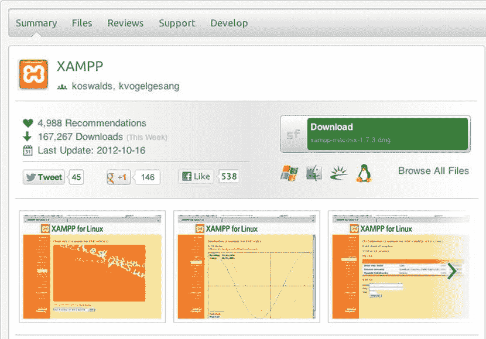
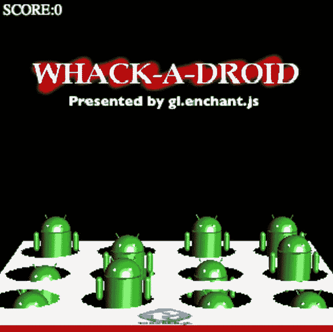
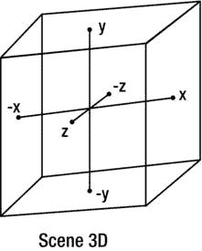
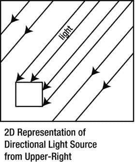
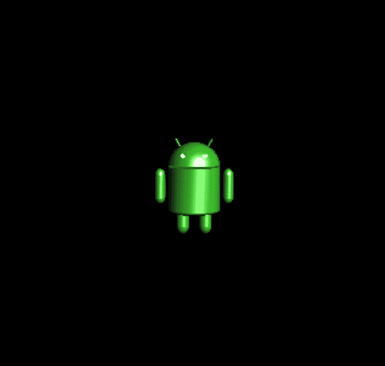
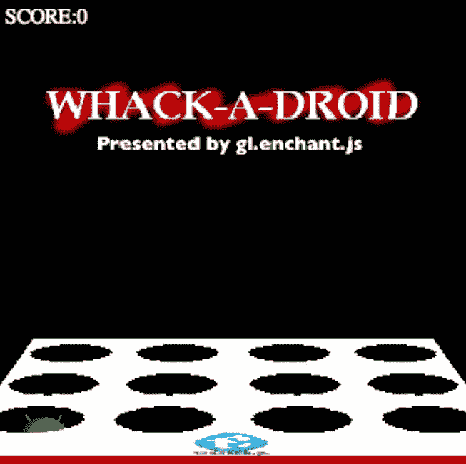
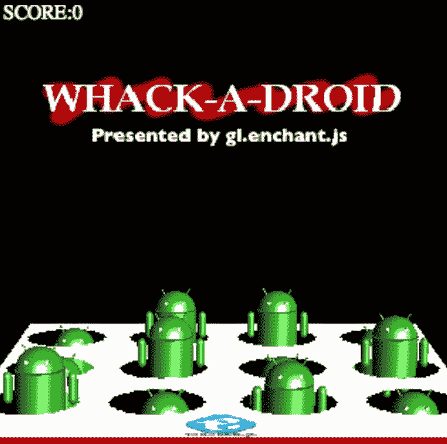
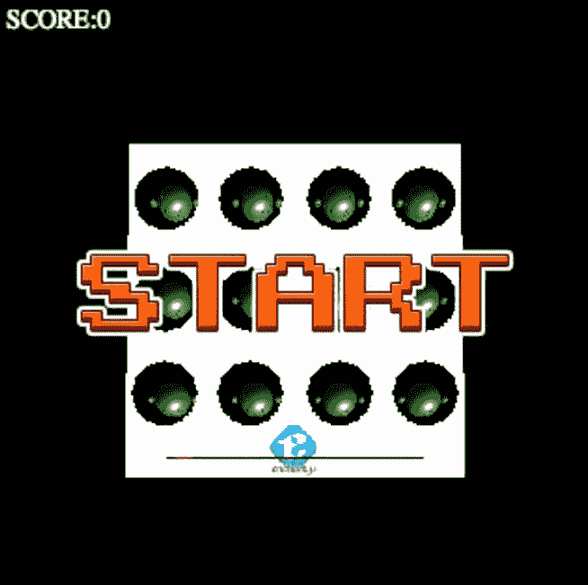

# 7. 制作一款独立的 3D 游戏

## 摘要

我们在第 6 章中制作的街机射击游戏是一个二维游戏的例子。`Sprites`（精灵）、标签，甚至标准 `enchant.js` 游戏中的场景都存在于一个平面上，这体现在游戏中只有 `x` 和 `y` 轴。虽然我们可以将实体堆叠在一起，但这仅仅是为了控制可见性。并不存在可控制的“深度”。

`Enchant.js` 自带一个名为 `gl.enchant.js` 的插件，它使得创建三维游戏成为可能。在本章中，我们将探讨如何使用 `gl.enchant.js` 来创建我们之前制作的“打地鼠”游戏的 3D 版本。在此过程中，我们将涵盖 `gl.enchant.js` 的核心主题，即 3D 场景、3D 摄像机以及 3D 精灵。

然而，在开始 3D 游戏之前，让我们再次审视如何在你自己的环境中创建 `enchant.js` 游戏，而不依赖于 [`code.9leap.net`](http://code.9leap.net)，并简要探讨从头开始搭建一个 `enchant.js` 游戏需要哪些步骤。在编写本书时，[`code.9leap.net`](http://code.9leap.net) 支持 `enchant.js` 插件的绝大部分功能，但并非全部。我们需要在 3D 版“打地鼠”中使用其中一项功能。

## 独立游戏

到目前为止，为了简化操作，我们几乎所有的代码示例和说明都推荐使用 [`code.9leap.net`](http://code.9leap.net)。这是一个跟踪代码并快速开发的便捷方式。尽管如此，要将你的游戏开发提升到一个新水平，了解如何在需要时从头开始搭建一个 `enchant.js` 游戏是至关重要的。

你可能需要或想要创建独立游戏的原因有很多。首先，由于 [`code.9leap.net`](http://code.9leap.net) 仍处于测试阶段，某些文件格式不支持上传到项目中。目前，3D 模型文件无法上传到 [`code.9leap.net`](http://code.9leap.net) 项目中。这就是为什么你在编写 3D 游戏时无法在 [`code.9leap.net`](http://code.9leap.net) 内部完成的原因。创建独立游戏而非托管在 [`code.9leap.net`](http://code.9leap.net) 上的另一个原因是为了将其托管在你自己的网站上。

从头开始创建游戏需要你在本地计算机上准备游戏所需的所有文件。虽然游戏编写和测试可以在标准本地文件（例如，双击 `index.html` 文件在浏览器中打开）上进行，但某些功能，比如从文件加载 3D 数据，则需要浏览器有证据表明该文件是从 Web 服务器访问的。这是由于一项被称为“同源策略”的安全限制。

### 同源策略

同源策略是一种安全措施，用于限制脚本加载某些文件的能力。在 `enchant.js` 游戏中，通常受此策略影响的文件是包含声音或 3D 数据的文件。不过，最好将除图像之外的所有文件都视为受此策略限制。根据浏览器的不同，可以通过使用特定的命令或设置来覆盖同源策略。

#### Chrome

在 Chrome 中，你可以通过在启动 Chrome 时附加一个特定参数来覆盖同源策略。打开终端（Mac）或命令提示符（Windows），然后输入以下命令：

- Mac：`open /applications/Google\ Chrome.app --args --allow-file-access-from-files`
- Windows：`C:\Program Files\Chrome\Chrome.exe --allow-file-access-from-files`

#### Firefox

在 Firefox 中，你可以通过设置来覆盖同源策略：

在地址栏输入 `about:config`。如果 Firefox 提醒你更改这些设置可能会影响浏览器性能，请点击接受警告信息。在地址栏下方出现的搜索框中，输入 `origin`。双击 `security.fileuri.strict_origin_policy`，将其值设置为 `false`。

#### Safari

Safari 也支持禁用同源策略：

进入 Safari 偏好设置（Mac：Safari ➤ 偏好设置，Windows：文件 ➤ 偏好设置），点击“高级”选项卡，勾选“在菜单栏中显示‘开发’菜单”复选框。关闭设置窗口，点击“开发”菜单，然后选择“禁用本地文件限制”。

#### Internet Explorer

我们强烈建议不要在 Internet Explorer 中开发游戏，因为其不支持 HTML5 的若干特性。

虽然禁用同源策略是一个快速解决方案，但对于较大的开发项目，我们建议安装一个 Web 服务器。这将有助于更轻松地过渡到最终发布版本。

### 本地 Web 服务器

本地 Web 服务器允许组成网站的文件的访问方式类似于从互联网上的标准服务器访问文件。网上有多种免费的服务端模拟器可供使用。模拟器是硬件的虚拟版本。你无需拥有一台运行网站的物理服务器，而是可以通过模拟软件下载并运行一个虚拟服务器。这使得网站开发工作更加便捷，因为你无需将文件上传到互联网上的服务器进行测试。对于 Windows、Mac 或 Linux 系统，我们推荐使用 XAMPP，下载地址为 [`http://sourceforge.net/projects/xampp/`](http://sourceforge.net/projects/xampp/)；对于仅限 Mac 的系统，推荐使用 MAMP，下载地址为 [`http://www.mamp.info/`](http://www.mamp.info/)。这些模拟器都是免费的，并且易于获取。

在本练习中，我们将使用 XAMPP，但如果您熟悉其他 Web 服务器，也欢迎使用。

#### 设置

首先，从其 SourceForge 项目页面下载并安装 XAMPP，如图 7-1 所示。



图 7-1. XAMPP 官方 SourceForge 项目页面 ([`http://sourceforge.net/projects/xampp/`](http://sourceforge.net/projects/xampp/))

如果您在安装过程中遇到任何问题，或者想了解有关 XAMPP 的更多技术细节，可以在 [`http://www.apachefriends.org/en/xampp-macosx.html`](http://www.apachefriends.org/en/xampp-macosx.html)（Mac 版）或 [`http://www.apachefriends.org/en/xampp-windows.html`](http://www.apachefriends.org/en/xampp-windows.html)（Windows 版）找到官方文档和安装说明。安装后打开 XAMPP，并确保 Apache 旁边的指示灯为绿色，或者 Apache 服务已启动，然后再继续。

安装好 XAMPP（或其他 Web 服务器软件包）并确保其正在运行后，导航到 Web 服务器的根文件夹。如果您在 Mac 上使用 XAMPP，可以在此路径访问：`/Applications/XAMPP/htdocs/`（Mac）或 `C:\xampp\htdocs`（Windows）。这是您存放所有游戏文件的位置。例如，如果您将一个名为 `index.html` 的文件放入这个 `htdocs` 文件夹，就可以通过访问 [`http://localhost/index.html`](http://localhost/index.html) 在浏览器中查看它。


## 三维游戏

二维游戏基于在平面空间移动的实体，而三维游戏则建立在纵深基础上。对玩家而言，这意味着有更多可观察的内容以及更多观察角度。游戏空间存在于三个维度：长、宽、高（`x`、`y`、`z`）。这种环境支持从任意角度观察其中的物体。然而，这也意味着游戏创作过程对程序员来说更为复杂。

尽管三维游戏的优势包括能够创造更沉浸的环境（换句话说，让玩家通过一个可在游戏世界中移动和环顾的虚拟角色的视角来观察），但三维技术也可用于制作通过视觉升级增强的简单游戏。具体来说，通过在游戏过程中改变摄像机位置，你可以创造出与大多数使用 `enchant.js` 制作的游戏相比视觉效果更令人印象深刻的纵深感。

创建三维游戏时，你需要考虑的变量数量远多于二维游戏。三维游戏中发生的许多事件无法使用与二维游戏中触发相同事件的相同函数来实现。因此，存在一套完全独立的插件，使得用 `enchant.js` 创建三维游戏成为可能。

### 创建三维版打地鼠机器人游戏

在本章的游戏创作练习中，我们将制作之前打地鼠机器人游戏的三维版本。为此，我们将使用 `gl.enchant.js`，并学习如何实现 `gl.enchant.js` 三维游戏的各个元素，包括三维场景、三维摄像机和三维精灵。图 7-2 展示了游戏完成后的效果。



图 7-2.
打地鼠机器人 3D 版

我们将逐步讲解这个游戏的创建过程。让我们开始吧！

访问 [`http://enchantjs.com/?p=731`](http://enchantjs.com/?p=731 "https://enchantjs.com/?p=731") 下载 第 7 章 的 `WhackADroid3D-initial` 压缩包，并将其解压到本地 Web 服务器所使用的目录中。在该页面 `WhackADroid3D-initial` 压缩包下方还有一个 `WhackADroid3D-Steps` 文件，其中包含本章每个主要步骤之后展示的完整源代码。与命名文件夹相对应的步骤（即步骤 1 -> `/Step1/`）已在本文的代码清单中标注。用文本编辑器打开 `index.html`，确保代码与清单 7-1 中的代码一致。

**清单 7-1.** 包含插件引用的 `index.html`

```html
<html>
<head>
<title>Whack-A-Mole 3D</title>
<meta http-equiv="cache-control" content="no-cache">
<meta http-equiv="content-type" content="text/html; charset=UTF-8">
<script type="text/javascript" src="lib/glMatrix-1.3.7.min.js"></script>
<script type="text/javascript" src="lib/enchant.js"></script>
<script type="text/javascript" src="lib/nineleap.enchant.js"></script>
<script type="text/javascript" src="lib/gl.enchant.js"></script>
<script type="text/javascript" src="lib/collada.gl.enchant.js"></script>
<script type="text/javascript" src="lib/primitive.gl.enchant.js"></script>
<script type="text/javascript" src="main.js"></script>
<style type="text/css">
        body {
                margin: 0;
        }
</style>
</head>
<body>
</body>
</html>
```

以下列表展示了已加载的不同插件及其说明：

*   `glMatrix-1.3.7.min.js`：一个开源 JavaScript 库，包含使用 `gl.enchant.js` 执行各种运算所需的数学计算。
*   `nineleap.enchant.js`：`enchant.js` 的 9leap 插件。我们在此用于游戏开始和结束画面。
*   `gl.enchant.js`：`enchant.js` 的核心 WebGL 启用插件。
*   `collada.gl.enchant.js`：允许将 Collada（`.dae`）格式的三维模型加载到 `enchant.js` 游戏中。
*   `primitive.gl.enchant.js`：包含多个可用于三维游戏的预制三维对象。

*WebGL 是一种 JavaScript API（或接口），允许网页中的元素（特别是画布元素——HTML5 网页中用于绘制图形的部分）与计算机的显卡通信，以通过硬件加速渲染这些图形。`enchant.js` 插件 `gl.enchant.js` 允许在 `enchant.js` 游戏中使用 WebGL，它随 `enchant.js` 包一起提供，主要用于使用 `enchant.js` 制作三维游戏。

如果这些插件中缺少任何一个，游戏运行时都会出现问题，因此请确保在继续之前，代码中已包含所有这些插件。


#### 创建 Scene3D 与光照

与常规的 `enchant.js` 游戏一样，3D `enchant.js` 游戏也需要一个场景来容纳所有元素。不过，这些场景在代码中被归类为 `Scene3D`，以表明其 3D 特性。当你创建一个新的 `Scene3D` 时，你是在告诉 `enchant.js` 初始化并创建一个三维空间，以便支持向其添加对象。

打开应为空白的 `main.js`，输入清单 7-2 中的代码，搭建游戏的基本框架。请注意，目前这里还没有引入任何新内容。

**清单 7-2.** 3D 游戏的框架

```
enchant();

var game;

window.onload = function(){
    game = new Core(320, 320);
    game.fps = 60;
    game.onload = function(){
    };
    game.start();
};
```

在 `game.onload` 函数内部，输入清单 7-3 中的代码来创建一个新的 `Scene3D`。

**清单 7-3.** 创建 Scene3D

```
scene = new Scene3D();
```

`Scene3D` 创建了一个三维空间，如图 7-3 所示。



**图 7-3.** Scene3D

3D 空间中的点由一组括号中的 x、y、z 坐标（x, y, z）来指定。如果你从 x = 0、y = 0、z = 10 的位置观察 3D 空间的原点（x = 0, y = 0, z = 0），那么 x 轴将从左（-x）向右（+x）延伸，y 轴将从下（-y）向上（+y）延伸，而 z 轴则将从屏幕内侧（-z）向屏幕外侧（指向你，+z）延伸。

这被称为右手坐标系。如果你伸出拇指、食指和中指，使每根手指都与另外两根成 90 度角，并想象你的拇指代表 x 轴，食指代表 y 轴，那么你的中指就形成了 z 轴。每根手指代表相应轴的正方向。在左手坐标系中，z 轴的正方向则指向远离你的方向。

需要注意的是，这个坐标系与标准 `enchant.js` 2D 游戏中的位置确定方式不同。在普通的 2D 环境中，屏幕左上角被指定为 (0,0)，数值向右和向下递增。而在 3D 系统中，原点，即 (0,0,0)，被视为环境的中心，如图 7-3 所示。因此，正负数值都很常见。

在创建新的 `Scene3D` 代码之后，但仍在 `game.onload` 函数内部，输入清单 7-4 中的代码来创建一个新的方向光。

**清单 7-4.** 创建方向光

```
scene.setDirectionalLight(new DirectionalLight());
```

方向光会创建一束光波，这些光波会在场景中的物体表面发生反射。其中一部分反射光波可以被其他对象（如摄像机）捕捉到，从而让玩家能够看到这些物体。在编写本书时，无参数创建的方向光会默认定位在 (0.5, 0.5, 1) 这个点。从这个默认点画一条线到场景的原点 (0, 0, 0)。虚拟光波沿着这条线的方向产生，并平行于该线穿过整个场景，如图 7-4 所示。



**图 7-4.** 来自右上方的方向光源的二维示意图

我们也可以通过编写 `(var light = new DirectionalLight(); scene.setDirectionalLight(light);)` 来创建方向光，而不是使用 `(scene.setDirectionalLight(new DirectionalLight());)`。如果采用这种使用 `var` 变量的方式，你可以通过 `directionX`、`directionY` 和 `directionZ` 属性，将光源的原点从默认的 (0.5, 0.5, 1) 更改为其他位置。

#### 创建 Camera3D

虽然我们现在有了场景和方向光，但还需要一个视角来观察这个场景。如果我们在 3D 空间中有物体，该物体看起来的样子将取决于我们从哪个角度观察它。这些视角在 `gl.enchant.js` 中被指定为 `Camera3D` 对象。它们负责捕捉由方向光照射并在场景物体上发生反射的虚拟光波。

输入清单 7-5 中的代码来创建一个 `Camera3D`，将其放在创建 `DirectionalLight` 的代码之后，但仍需位于 `game.onload` 函数内部。

**清单 7-5.** 创建新的 Camera3D

```
camera = new Camera3D();
camera.y = 1.1;
camera.z = -1.65;
camera.centerZ = -10;
camera.upVectorZ = 10;
camera.upVectorY = 100;
```

摄像机在创建时默认位置为 (0, 0, 10)，因此根据我们在图 7-5 中的设置，摄像机位于 (0, 1.1, -1.65)。摄像机对象还具有 `centerX`、`centerY` 和 `centerZ` 属性。这些值指定了摄像机应该“注视”或指向的一个点。

如果一个摄像机位于某个点并指向另一个点，那么摄像机可以朝任何方向旋转，但仍指向指定的坐标。可以这样理解：如果我倒立着看你，我依然在看你。这就是存在“upVector”属性的原因。这些属性指定了一个点，摄像机将把这个点视为它的“上方”。通过改变 upVector，摄像机（以及摄像机的视角）可以绕轴进行旋转。

你基本上可以随意地在 3D 空间中放置物体和摄像机。创建多个摄像机完全没有问题。只要摄像机指向你在 3D 场景中创建的实体，你就能看到它们。你或许需要调整摄像机以获得更理想的物体视图，但实现这一目标的最佳方法就是多加练习。

虽然我们现在已经创建了摄像机，指定了它应该存在的位置、应该注视的目标以及哪个方向是“上方”，但我们仍然需要告诉 `Scene3D` 使用这个摄像机。

输入清单 7-6 中的代码，让场景使用我们的新摄像机作为玩家的视角。这段代码应放在 `camera.upVectorY = 100;` 之后，但仍需位于 `game.onload` 函数内部。

**清单 7-6.** 指定场景的摄像机

```
scene.setCamera(camera);
```

如果 `Scene3D` 中存在多个 `Camera3D` 对象，可以随时调用此函数（`setCamera`）在这些摄像机之间进行切换。


#### 创建 Sprite3D

在 `gl.enchant.js` 中，精灵也以 `Sprite3D` 对象的形式存在，并包含许多相似的属性和函数。在我们的游戏中，会创建多个机器人角色，每个角色都将是一个 `Sprite3D` 实例。为了避免每次需要新机器人时都手动创建 `Sprite3D` 实例，我们不妨创建一个包含所有必要变量的 `Droid` 类，然后在需要时调用它。请按以下步骤操作：

在 `window.onload` 函数中，于 `game.fps=60;` 下方添加一行代码来预加载 `droid.dae`，即输入清单 7-7 中的代码。该文件已包含在之前的下载包中，是机器人的 3D 模型。

**清单 7-7.** 预加载 `droid.dae`

```
game.preload('images/droid.dae');
```

以 `.dae` 结尾的文件采用一种名为 Collada 的格式。Collada 是一种用于保存 3D 数据的文件格式，受到大多数主流 3D 建模软件的支持，甚至可以通过 Adobe Photoshop 打开。

在 `window.onload` 函数上方，通过输入清单 7-8 中的代码，创建一个扩展了 `Sprite3D` 类的 `Droid` 类。`initialize` 函数应包含参数 `x`、`y` 和 `z`，它们分别代表机器人在 x、y、z 轴上的位置。

**清单 7-8.** 创建 `Droid` 类

```
var Droid = Class.create(Sprite3D, {
        initialize: function(x, y, z) {
        }
});
```

在 `initialize` 函数内部，通过输入清单 7-9 中的代码，使 `Droid` 成为 `Sprite3D` 类的实例，并将其模型设置为使用 Collada 文件。请注意，在使用 `Sprite3D` 时，图像不是通过 `image` 属性设置，而是通过 `set` 函数设置的。

**清单 7-9.** 调用 `Sprite3D` 并设置 Collada 文件

```
Sprite3D.call(this);
this.set(game.assets["images/droid.dae"]);
```

当前 `droid.dae` 文件的尺寸过大，因此在下一行输入清单 7-10 中的代码，将其缩放至 30%。

**清单 7-10.** 缩放机器人

```
this.scaleX = 0.3;
this.scaleY = 0.3;
this.scaleZ = 0.3;
```

通过输入清单 7-11 中的代码，将参数 `x`、`y`、`z` 分配给 `Sprite3D` 对应的属性。

**清单 7-11.** 分配 `x`、`y`、`z`

```
this.x = x;
this.y = y;
this.z = z;
```

在 `game.onload` 函数中，于 `scene.setCamera(camera);` 下方，通过输入清单 7-12 中的代码，向 `Scene3D` 添加一个新的机器人。

**清单 7-12.** 向 `Scene3D` 添加新机器人

```
scene.addChild(new Droid(0, 0, -8));
```



**图 7-5.** 在屏幕上显示机器人

保存你正在编辑的文件（`main.js`），但不要关闭它。如果你使用的是虚拟网络服务器，请打开除 Internet Explorer 之外的网络浏览器，并进入 `index.html` 所在的路径（通常是 `http://localhost/index.html`）。你的屏幕应该会显示如图 7-5 所示的内容。

如果在处理本节代码时遇到任何问题，你可以在本章之前提到的压缩包的 `Step2` 文件夹中找到可用的代码示例。

至此，我们有了一个有效的、可见的 3D 精灵，但为了让它更接近真正的游戏，我们需要增加某种交互功能。

#### 机器人交互功能

我们需要某种交互功能，使其成为真正的游戏。请按以下步骤将游戏推进到下一阶段：

在代码靠近顶部的位置，在 `var game;` 下方，输入清单 7-13 中的代码，创建一个生成随机数的函数以及一些变量，用于跟踪机器人的总数。

**清单 7-13.** 创建随机数函数和变量

```
function rand(n) {
        return Math.floor(Math.random() * n);
}
//变量用于跟踪机器人数量
var maxDroid = 100;
var hitDroid = 0;
var combo = 1;
```

在其下方，通过输入清单 7-14 中的代码创建一个 `ScoreLabel`。这个 `ScoreLabel` 包含一个 `add` 函数，便于添加和更新分数。

**清单 7-14.** 创建 `ScoreLabel`

```
//定义 ScoreLabel
var ScoreLabel = Class.create(Label, { //扩展 Label 类
        initialize: function(x, y) {
                enchant.Label.call(this, "SCORE:0"); //调用 Label 类构造函数
                this.x = x;
                this.y = y;
                this.score = 0;
                this.color = "#ffffff";
        },
        add: function(pts) { //增加分数
                this.score += pts;
                this.text = "SCORE:" + this.score; //更新显示
        }
});
```

在 `game.onload` 函数的最末尾，通过输入清单 7-15 中的代码，创建一个 `ScoreLabel` 的新实例并将其添加到 `rootScene`。

**清单 7-15.** 创建并添加 `ScoreLabel`

```
//显示分数标签
scoreLabel = new ScoreLabel(5, 5);
game.rootScene.addChild(scoreLabel);
```

编辑 `Droid` 类的内容，使其与清单 7-16 一致。新代码以粗体显示。这将为下一节的交互功能升级做好准备，届时将使用代码示例中所示的 `a` 和 `mode` 变量。`tick` 函数会在每一帧被调用，而 `hit` 函数则在玩家点击机器人时被调用。

**清单 7-16.** 重构后的 `Droid` 类

```
//定义 Droid 类
var Droid = Class.create(Sprite3D, { //扩展 Sprite3D 类
        initialize: function(x, y, z) {
                Sprite3D.call(this); //调用 Sprite3D 构造函数
                this.set(game.assets["images/droid.dae"]);
                this.scaleX = 0.3;
                this.scaleY = 0.3;
                this.scaleZ = 0.3;
                this.x = x;
                this.y = y;
                this.z = z;
                this.a = 0.01;
                this.addEventListener('enterframe', this.tick); //定义事件监听器
                this.addEventListener('touchstart', this.hit); //定义点击事件监听器
                this.mode = 2; //设置初始机器人模式为等待，然后出现
                this.nextMode = 0;
                this.waitFor = game.rootScene.age + rand(100) + 75;
        },
        tick: function() { //根据模式迭代机器人动画
        },
        hit: function() { //点击机器人
        }
});
```


##### Droid 出现行为

在“打地鼠”游戏中，地鼠必须按照特定方式行动。首先，它们会在洞内生成，直到游戏开始。接着，经过一段随机时间后，它们会从洞中冒出来。（现阶段先不用过多关注洞，而是专注于地鼠的移动。）它们会再等待一段随机时间，然后躲进它们最初出现的那个洞里。在我们的游戏中，当地鼠在洞外并被击中时，它们会向上飞，飞出屏幕，然后一个新的地鼠会出现在它的位置。

根据这个描述，我们可以推断出地鼠在任何时刻都处于五种状态之一。表格 7-1 列出了这些状态以及驱动相应行为的逻辑。表格中显示的模式编号，是我们为了追踪地鼠状态而在地鼠处于该状态时分配的数字。

**表 7-1.** 地鼠的状态

| 状态 (模式编号) | 描述 |
| --- | --- |
| 出现 (1) | 每帧增加地鼠的 y 坐标，直到达到某个点。切换到等待模式，并打算在经过一段随机时间后进入隐藏模式。 |
| 隐藏 (2) | 每帧减少地鼠的 y 坐标，直到达到某个点。切换到等待模式，并打算在经过一段随机时间后进入出现模式。 |
| 等待 (3) | 一旦预定的时间过去，就进入下一个模式。 |
| 停用 (4) | 不做任何事。这个洞不会再出现地鼠。 |
| 飞走 (5) | 每帧增加地鼠的 y 坐标（在某个时刻，地鼠会飞出屏幕）。经过一段随机时间后，将地鼠的位置重置到洞下方，并设置为出现模式。 |

这些状态将与我们接下来在 `Droid` 类声明中创建的 `switch` 语句相匹配。

在 `Droid` 类定义中，已经存在一个事件监听器，它会调用 `tick` 函数。在 `tick` 函数中输入代码清单 7-17 中的代码，以创建一个用于移动地鼠的系统。

**代码清单 7-17.** `tick` 函数

```
if (game.rootScene.age === 0) {
        this.waitFor++;
}

switch (this.mode) {
        case 0: //从洞中出现
                this.a *= 0.98;
                this.y += this.a;
                if (this.y >= -1.2) {
                        this.mode = 2;         //完全出现后进入等待模式
                        this.nextMode = 1; //等待模式结束后，进入模式 1 (隐藏)
                        this.waitFor = game.rootScene.age + rand(100) + 10;
                }
                break;
        case 1: //躲进洞里
                this.y -= this.a;
                this.a *= 0.98;
                if (this.y <= -1.5) {
                        this.mode = 2;        //完全隐藏后进入等待模式
                        this.nextMode = 0; //等待结束后，进入模式 0 (出现)
                        this.waitFor = game.rootScene.age + rand(100);
                        //减少最大地鼠数量（以控制游戏时长）
                        maxDroid--;
                        //如果已达到最大地鼠数量，并且该地鼠被指示隐藏，则封锁此洞
                        if (maxDroid <= 0) this.mode = 3;
                }
                break;
        case 2: //等待
                if (this.y < -1.5) this.y += 0.05;
                if (game.rootScene.age > this.waitFor) {
                        this.mode = this.nextMode;
                        this.a = 0.05;
                }
                break;
        case 3: //停用（此洞不再出现地鼠）
                break;
        case 4: //飞走
                this.y += this.a;
                this.a *= 1.1;
                if (game.rootScene.age > this.waitFor) {
                        this.nextMode = 0;
                        this.waitFor = game.rootScene.age+rand(50) + 30;
                        this.mode = 2;
                        this.y = -3;
                        this.a = 0.05;
                }
                break;
}
```

首先，我们告诉帧要等待一帧，然后再继续递增，以防地鼠恰好在 `rootScene` 的第 0 帧被创建。这种情况很可能不会发生，但我们希望能覆盖所有可能情况。

代码中的 `a` 变量用于动态移动。在每一帧中，`a` 的值会根据地鼠所处的模式而变化。例如，如果地鼠正在飞走，`a` 的值会每帧增加 10%（`this.a *= 1.1;`），并且由于地鼠的 y 坐标每帧都会增加 `a` 的值（`this.y += this.a;`），地鼠会随着时间流逝越飞越快。这一切发生得非常迅速，但会增加一种不错的物理模拟效果，使其看起来更真实。

注意，在情况 4（`飞走`）中，当游戏的 `waitFor` 值到达后（换句话说，地鼠飞出屏幕后），地鼠会被重新定位到（`y = -3;`），重新开始整个过程，并表现得像一个“新”地鼠。

通过在 `Droid` 类定义的 `hit` 函数中输入代码清单 7-18，来定义 `hit` 函数。每当玩家点击一个地鼠时，就会调用此函数。

**代码清单 7-18.** `hit` 函数

```
if (this.y >= -1.4) { //如果地鼠已经露出洞一半以上
        this.mode = 4;    //进入飞走模式
        this.a = 0.02;
        this.waitFor = game.rootScene.age + 30; //等待 30 帧 (0.5 秒)
        scoreLabel.add(combo); //添加连击分数
        combo++;
        hitDroid++;
} else {
        //如果地鼠在完全出现之前被击中，重置连击
        combo = 1;
}
```

如果游戏过程中没有玩家击中地鼠，地鼠将只是在“出现”、“等待”和“隐藏”模式之间循环。然而，这个 `hit` 函数，当它在 Droid 类定义中较早的 `touchstart` 事件监听器中被调用时，会逐行引发以下事件：

*   如果地鼠已经露出洞一半以上：
    *   进入 `飞走` 模式。
    *   设置修正量（`a`），使其在飞走模式下，初始时 y 值增加 0.02。
    *   告诉地鼠在 30 帧内不要改变模式。
    *   将用户当前的连击数（起始为 1）添加到总分中。
    *   将当前连击数增加 1。
    *   将 `hitDroid` 的值增加 1。
    *   经过 30 帧后，将模式改为 2（等待），并将地鼠重新定位到（`y = -3`），这与 Droid 定义中情况 4 的处理一致。
*   否则（换句话说，如果玩家试图击打一个尚未露出洞一半以上的地鼠）：
    *   将玩家当前的连击数重置为 1。

最后，我们将添加到 `Scene3D` 中的地鼠位置更改为 (0, -1.5, -9.2)。这并非完全必要，但我们这样做是为了感受地鼠在屏幕中出现和消失时的视觉效果。

最后，通过在 `game.onload` 函数中将 `scene.addChild(new Droid(0, 0, -8));` 这一行替换为代码清单 7-19 所示的行，来重新定位创建并添加到 `rootScene` 中的地鼠。

**代码清单 7-19.** 添加一个不同位置的地鼠

```
scene.addChild(new Droid(0, -1.5, -9.2));
```

我们在这里更改地鼠的位置，是因为既然它现在会移动，如果不改位置，它最初将不会显示在摄像机的视野内。

保存代码并在浏览器中查看游戏。地鼠应该会随时间上下弹跳，并在其处于“向上”状态时可以被点击。当地鼠被点击时，它应该会飞向屏幕直到消失，然后另一个地鼠会出现在它的位置。

如果你在本节中遇到问题，可以在下载包的 `Step3` 文件夹中找到可用的代码示例。


### 平面：`gl.enchant.js` 中的标牌及其他

`enchant.js` 包包含了 `primitive.gl.enchant.js` 插件。该插件预定义了最常见的 3D 形状对象，可供你在游戏中使用。本节我们将使用平面对象，它本质上是一个平面，可以加载图像或颜色。由于所有这些对象都基于 `Sprite3D`，因此任何 `Sprite3D` 的方法或属性也可以供平面使用。请执行以下步骤，在游戏中实现平面：

在 `window.onload` 函数中，将 `game.preload('images/droid.dae');` 这一行改为代码清单 7-20 所示的内容。这只是加载图片，供接下来的平面使用。

**代码清单 7-20.** 预加载图片

```
game.preload('images/pit.png', 'images/sign.png', 'images/droid.dae');
```

在 `game.onload` 函数中的 `scene.setCamera(camera);` 这行代码之后，输入代码清单 7-21 中的代码，创建一个表示地洞（即机器人爬出的洞口）的 `Plane` 对象。

**代码清单 7-21.** 创建地洞

```
var pit = new PlaneXZ();

pit.scaleX = 3.0;

pit.scaleY = 3.0;

pit.scaleZ = 3.0;

var texture = new Texture(game.assets['images/pit.png'], { flipY: false });

texture.ambient = [1.0, 1.0, 1.0, 1.0];

pit.mesh.texture = texture;

pit.y = -1;

pit.z = -10;

scene.addChild(pit);
```

首先，我们将 `pit` 变量创建为一个新的 `PlaneXZ` 对象。这是 `primitive.gl.enchant.js` 中预定义的 3D 对象之一。由于平面是 2D 对象，它只存在于 3D 坐标轴中的两个轴上，因此我们将其创建为 `PlaneXZ`。这种指定方式告诉 `enchant.js`，平面应创建在 X 轴和 Z 轴构成的二维空间中。

接下来，我们通过 `scaleX`、`scaleY` 和 `scaleZ` 将地洞放大 3 倍。平面创建时，其每个角（即顶点）的坐标都是 -0.5 或 0.5（例如 `(-0.5, 0, -0.5)`、`(0.5, 0, -0.5)` 等）。通过在三个轴上均缩放 3 倍，平面的最终坐标每个值将变成 -1.5 或 1.5（例如 `(-1.5, 0, -1.5)`、`(1.5, 0, -1.5)` 等）。当你创建自己的游戏时，可能需要尝试不同的缩放设置，以找到在场景摄像机角度下最佳的效果。

下一步是创建一个纹理，最终可以应用到刚创建的平面上。这里我们加载 `pit.png` 作为图像，并传入一个参数（`flipY: false`）。为什么要这样做呢？当将纹理应用到平面时，`enchant.js` 会尽力以正确方向显示纹理。然而，有时 `enchant.js` 也会出错。

在 WebGL 中，任何存储像素的对象都包含 `UNPACK_FLIP_Y_WEBGL` 属性，该属性可以沿垂直轴翻转图像，并在 `gl.enchant.js` 中赋值给 `flipY` 属性。`flipY` 属性的默认值是 `true`，因此将其设置为 `false` 会沿 Y 轴反转图像。虽然从技术角度讲，XZ 平面上没有 Y 轴，但纹理是二维的，因此 `flipY` 的指定会按预期工作，因为纹理没有 Z 轴。（如果你想要挑战，可以搜索 OpenGL 中的纹理坐标相关信息，了解更多关于 WebGL 如何处理纹理的内容。WebGL 基于 OpenGL 构建。）

接下来看 `texture.ambient` 这一行，我们设置了一个值 `[1.0, 1.0, 1.0, 1.0]`。前三个值分别对应红色、绿色和蓝色，最后一个值对应光线的可见度或透明度。值为 1.0 表示 100%，因此这代表一种完全可见的白色光。可见度值仅用于一些非常特定的场合，此处不做介绍。

最后，我们将新创建的纹理应用到地洞的 `mesh.texture` 属性上，并调整地洞的位置，使其出现在屏幕上的合适位置。最后一步是将其添加到 `Scene3D` 中，地洞就会显示在屏幕上。

在 `scene.addChild(pit);` 这行代码的正下方，输入代码清单 7-22 中的代码为地洞创建一个红色底座。这会给最终产品增添一个不错的效果。

**代码清单 7-22.** 创建底座

```
var base = new PlaneXY();

base.z = -8.6;

base.y = -2.5;

base.scaleX = 3.0;

base.scaleY = 3.0;

base.scaleZ = 3.0;

base.mesh.setBaseColor('#ff0000');

scene.addChild(base);
```

这段代码非常直接。我们只需将 `base` 创建为一个新的 `PlaneXY`，对其定位、缩放，然后设置一个基础颜色。请注意，`setBaseColor()` 方法接受颜色值的十六进制表示。任何对 CSS 颜色属性有效的值都可以在这里使用，但我们喜欢用十六进制值来保持简单。

`#ff0000` 这个值表示红色，因为前两位对应红色，中间两位对应绿色，最后两位对应蓝色。由于这些值是十六进制，因此它基于 16 进制。`ff` 这个值对应 256。因为只有红色位有值，且值为 256，所以底座 `PlaneXY` 的颜色将是红色。

最后，我们将 `base` 添加到 `Scene3D` 中，使其显示在屏幕上。

紧接着，输入代码清单 7-23 中的代码，创建一个标牌，让我们的游戏更加炫酷。

**代码清单 7-23.** 创建标牌

```
var sign = new PlaneXY();

sign.scaleX = 2.0;

sign.scaleY = 2.0;

sign.scaleZ = 2.0;

var signTexture = new Texture(game.assets['images/sign.png']);

signTexture.ambient = [1.0, 1.0, 1.0, 1.0];

sign.mesh.texture = signTexture;

sign.y = 0.5;

sign.z = -8.6;

scene.addChild(sign);
```

这里没有新内容。和地洞一样，我们创建一个新的 `Plane`，这次是 `PlaneXY`，进行缩放，创建一个新纹理（这次没有使用 `flipY: false` 参数，因为 `enchant.js` 已经按照我们的需求正确放置了图像），为纹理设置环境光，并将其分配给标牌。在通过 `y` 和 `z` 属性定位标牌后，将其添加到场景中。



**图 7-6.** 带有平面的 3D 打地鼠游戏

保存代码并通过网页浏览器运行。画面应该会如图 7-6 所示。

如果遇到问题，你可以在本章开头提到的下载包的 `Step4` 文件夹中找到可用的代码示例。


### 复制机器人并完成游戏

我们现在已经非常接近完成一款游戏了，但屏幕上仍然只有一个`Droid`。让我们复制该`Droid`以构建一个完整的集合，填满我们的坑洞图像。

在你的代码中，通过将`game.onload`函数中的`scene.addChild(new Droid(-1.1, -1.5, -9.2));`替换为清单 7-24 所示的代码，在每个坑洞显示的洞中创建一个`Droid`。

```
//创建所有机器人
for (var j = 0; j < 3; j++) {
    for (var i = 0; i < 4; i++) {
        scene.addChild(new Droid(i * 0.75 - 1.1, -1.5, -9.2 - j * 0.9));
    }
}
```

我们将`Droid`创建为一个可调用的类，并指定了该类所有实例的行为，因此复制`Droid`只需使用一个`for`循环遍历所有想要创建的对象即可。

由变量`j`控制的`for`循环代表每一行，而由变量`i`控制的`for`循环则代表给定行中的每一列。请注意，我们在新的`Droid`声明中将 x 坐标乘以 0.75，以便将新创建的`Droid`的位置向右移动。类似地，我们将`j`的值乘以 0.9，然后从-9.2 中减去该值，以便将新`Droid`的位置向后移动一行或两行。这是在你的 enchant.js 游戏中高效创建多个实例的好方法。

在这段代码正下方，输入清单 7-25 中的代码，创建一个事件监听器，当`Droid`的最大数量减少到零或更低时结束游戏。

```
game.rootScene.addEventListener('enterframe', function() {
    if (maxDroid <= 0) {
        game.end(scoreLabel.score, "你击打了" + hitDroid + "个机器人，得分为" + scoreLabel.score + "分！");
    }
});
```

因为每次击打`Droid`或让其缩回洞中都会导致变量`maxDroid`减 1，所以我们还添加了一个`enterframe`事件监听器，当`maxDroid`达到 0 或更低时结束游戏，并显示击打的机器人数量和玩家的得分。

> **注意：** 请记住，由于`game.end`函数仅由`nineleap.enchant.js`插件完全支持，因此显示玩家得分和击倒`Droid`数量的最终消息仅当游戏上传到[9leap.net](http://9leap.net)时才会出现。

保存代码并在网络浏览器中运行它。你应该会得到一个可以运行的游戏，显示效果如同图 7-7 所示。



如果在这一部分遇到问题，你可以在本章前面提到的下载包中的`Step5`文件夹中找到完整的可运行代码示例。

### 摄像机平移效果

虽然我们现在有了一个可运行的游戏，但让我们添加最后的润色：在游戏开始时添加一个摄像机平移效果。当游戏开始时，玩家会有一个坑洞的鸟瞰视图，然后摄像机将向下平移到我们到目前为止所看到的视图。这能让你看到刚刚创建的游戏的 3D 特性。

请执行以下步骤来创建摄像机平移效果：

在`game.onload`函数内部，将读取`camera.y = 1.1;`和`camera.z = -1.65;`的行替换为清单 7-26 中的代码，以更改初始摄像机位置。

```
camera.y = 14;
camera.z = -8.1;
```

这个摄像机位置离坑洞更远，但仍然朝向它。这使得平移效果更加明显和引人注目。

在读取`if (maxDroid <= 0) {game.end(scoreLabel.score, "你击打了" + hitDroid + "个机器人，得分为" + scoreLabel.score + "分！");}`这行代码之后，但仍在事件监听器内部，输入清单 7-27 中的代码，使摄像机在游戏开始时向下平移。

```
//在开始时向下平移摄像机
if (game.rootScene.age < 130) {
    camera.z += 0.05;
    camera.y -= 0.1;
}
```

实际的平移效果在这里发生。在游戏的前 130 帧中，摄像机会越来越靠近坑洞，停在完美的视角。这是通过每帧对 z 轴和 y 轴位置进行微小调整来实现的，以便在 130 帧后达到特定点。在开发此类效果时，有助于计算你希望摄像机从哪里开始，在哪里结束，然后计算出摄像机每帧需要移动多少才能实现这一点。



保存代码并通过网络浏览器运行游戏。游戏应从图 7-8 所示的视角开始，并迅速向下平移到前述代码示例中展示的视图。

如果在这一部分遇到问题，你可以在本章前面提到的压缩文件中的`Step6`文件夹中找到可运行的代码示例。

## 结论

在最后一章中，我们探讨了如何开发一个独立的 3D enchant.js 游戏。我们简要介绍了 WebGL 以及 enchant.js 的各种支持 WebGL 的插件：`gl.enchant.js`、`primitive.gl.enchant.js`和`collada.gl.enchant.js`。

我们创建了《打机器人》游戏的 3D 版本，并了解了如何使用`Scene3D`、`Camera3D`和`Sprite3D`的实例来构建一个 3D 环境，并让玩家与之交互。通过创建平面实例和我们自定义的`Droid`类，我们成功组装了一个可运行的《打机器人》3D 版本，甚至最后还添加了一个俯冲摄像机效果来展示游戏的 3D 特性。

我们希望本章能激励你通过 enchant.js 自行尝试 3D 开发，并最终尝试创作自己的 3D 游戏。由于[9leap.net](http://9leap.net)支持任何使用 enchant.js 创建的游戏，我们鼓励你将游戏发布到 9leap 上，与世界分享！

保持联系：

*   官方网站：[enchantjs.com](http://enchantjs.com)
*   Reddit：[reddit.com/r/enchantjs](http://reddit.com/r/enchantjs) – 在这里提问！
*   Facebook 页面：[facebook.com/enchantjs](http://facebook.com/enchantjs)
*   Twitter: @enchantjs_en
*   GitHub：[github.com/wise9/enchant.js](http://github.com/wise9/enchant.js)

祝你的游戏创作之旅好运！

enchant.js 团队


