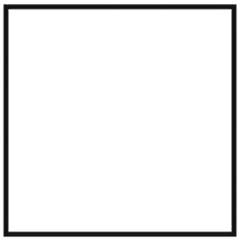
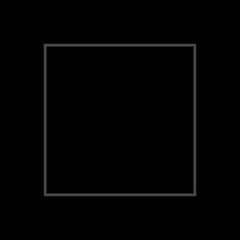
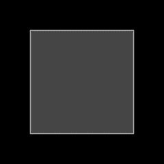
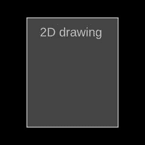
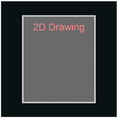
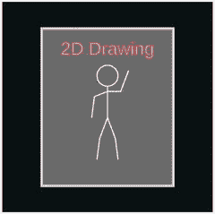
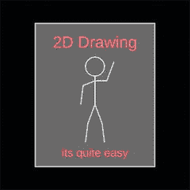

# 1. HTML5 与 Canvas 元素

本章介绍 HTML、CSS 和 JavaScript 的一些基础知识。这些是核心的 Web 技术，在本书中我们将使用它们来开发游戏。为了能够跟着操作，你需要一个文本编辑器来生成文本文件，以及一个网络浏览器来查看结果。你不需要学习这些技术涉及的所有内容。我们只专注于足够在 HTML `<canvas>` 元素上绘制一些内容的知识。因为整本书都会用到 HTML `<canvas>` 元素，所以请密切关注。

## HTML 入门

HTML（超文本标记语言）文档用于描述网络上的内容。当你访问一个网页时，通常是在下载并查看一个 HTML 文档。HTML 是一种组织多媒体内容（文本、图像、视频等）并赋予其语义含义，以及在信息“网络”中链接文档的方式。HTML5 是当前 HTML 标准的版本。该标准最初开发于 20 世纪 90 年代初，此后经历了一些演变。现代标准使得万维网拥有了极其丰富的体验。

我们将使用 HTML `<canvas>` 元素，所以让我们创建第一个 HTML 文档并向其中添加一个 `<canvas>` 元素。创建一个名为 `exercise1.html` 的文件，并输入如列表 1-1 所示的基本 HTML 模板。

```
<!doctype html>
<html>
  <head>
    <title>这是一个 HTML 画布</title>
  </head>
  <body>
    <h1>这是一个 HTML 画布</h1>
    <canvas id="asteroids" width="400" height="400"></canvas>
  </body>
</html>
```

*列表 1-1* 一个基本 HTML 模板

列表 1-1 以 `<!doctype html>` 声明开头。文档类型声明始终是 HTML 文档中的第一个内容。它告诉网页浏览器当前页面所基于的 HTML 版本。过去，使用文档类型声明很复杂，因为有许多 HTML 版本可供选择。对于 HTML5，该声明简化为仅指定我们正在使用 HTML。

文档类型声明之后，主 `<html>` 元素被打开。请注意，它在文件末尾使用 `</html>` 闭合标签来关闭。开始和结束 `<html>` 标签之间的所有内容都被认为是在 `<html>` 元素内部。一个 HTML 文件中除了文档类型声明和包含内容的 `<html>` 元素之外，不应再有其他内容。

在 `<html>` 元素内部，有两个嵌套元素：`<head>` 和 `<body>`。`<head>` 元素用于描述文档的详细信息，例如将在浏览器标签页中显示的 `<title>`。它通常还包含指向样式表或 JavaScript 文件的链接，这些文件规定了内容的渲染方式以及它们的行为。

`<body>` 元素包含文档的内容，在这个例子中，它包括一个一级标题 `<h1>` 和一个 `<canvas>` 元素。`<canvas>` 元素提供了一个用于绘制简单形状和线条的 JavaScript API（应用程序编程接口）。我们将使用这个 API 来渲染我们的游戏。

## 在画布上绘制

`<script>` 元素包含由浏览器执行的 JavaScript 代码。将列表 1-2 中所示的 `<script>` 添加到文档的 `<body>` 中，放在 `<canvas>` 元素之后。

```
<script>
  var canvas = document.getElementById("asteroids");
  var context = canvas.getContext("2d");
  context.strokeStyle = 'dimgrey';
  context.lineWidth = 5;
  context.rect(75, 75, 250, 250);
  context.stroke();
  // 这是一个注释，它没有任何效果！！！
</script>
```

*列表 1-2* 一个简单的脚本

你需要重新加载页面才能让脚本运行。页面加载后，脚本会逐行执行。第一行调用全局 `document` 对象上的 `getElementById` 方法。`document` 对象是自动定义的，它提供了对整个 HTML 文档的可编程接口。文档被加载到内存中，形成一种树形结构，通常被称为 DOM（文档对象模型）。在本例中，我们使用 `getElementById` 通过我们在 HTML 中指定的 `id` 值来获取对 DOM 中 `<canvas>` 元素的引用。

脚本中的第二行生成一个对画布上下文的引用。画布上下文提供了用于绘制的 API。在这里，我们访问的是 `"2d"` 画布上下文。它提供了多种在画布上绘制线条和形状以及变换画布的方法。还有其他画布上下文可用，但超出了本书的范围。

脚本的第三行和第四行设置了上下文的一些属性。设置 `context.strokeStyle` 会影响线条的颜色，这里我们将其设置为内置颜色 `'dimgrey'`。设置 `context.lineWidth` 会影响线条的粗细，这里我们将其设置为五个像素宽。当我们设置画布上下文的属性时，这些属性会一直有效，直到我们再次更改它们。在我们另行通知画布上下文之前，我们之后绘制的所有线条都将是五个像素宽且为 `'dimgrey'` 颜色。

第五行使用 `context.rect` 方法指定了一个矩形。矩形原点的像素坐标 `(x, y)` 在前两个参数（`75` 和 `75`）中指定。矩形的像素宽度和高度在后两个参数（`250` 和 `250`）中指定。大多数涉及长度的画布操作都以像素为单位（角度以弧度为单位）。请注意，这一行仅指定了矩形，但并未绘制它。矩形定义被作为一个称为路径的结构存储在内存中。我们稍后会详细讨论路径。

最后一行有效代码告诉上下文使用上下文属性（`lineWidth` 和 `strokeStyle`）的当前值来绘制存储的路径。在浏览器中打开该文件，你会看到矩形已绘制在画布上，如图 1-1 所示。



*图 1-1* 一个矩形（实际上是正方形）

脚本的最后一行实际上是一个注释。注释以双斜杠（`//`）开头，浏览器在运行代码时会忽略它们。注释对于注解代码很有用，也可以用于快速移除代码行，同时保留以后通过删除斜杠来取消注释的能力。

## 为页面设置样式以突出画布

目前进展顺利，但由于页面和画布都是白色，我们无法在页面上看到画布的边缘。将代码清单 1-3 中的 `<style>` 元素插入到 `<header>` 元素中 `<title>` 元素之后，然后重新加载页面。

```
<style media="screen">
  body {
    text-align: center;
    font-family: sans-serif;
  }
  canvas {
    background-color: black;
  }
</style>
```

`代码清单 1-3 为画布设置样式`

样式允许我们控制文档内容在浏览器渲染时的外观。在此例中，我们指定希望 `<body>` 元素居中对齐，并使用无衬线字体（这适用于 body 元素的所有子元素，因为 `font-family` 默认会被继承）。我们还指定了 `<canvas>` 元素应使用黑色背景绘制。重新加载页面后，你应该会看到与图 1-2 类似的内容。



`图 1-2` 一个 400×400 画布中的 250×250“矩形”。其左上角位于点(75, 75)。这让我们能看清画布的边界，并理解矩形是按照指定位置放置在画布中的。本书不会过多介绍样式，但它们是一项非常强大的技术，能对 HTML 内容的渲染方式进行精细控制。

## 尝试 `fillStyle`

设置 `context.fillStyle` 决定了填充绘制形状（包括字体）时使用的颜色。尝试将填充样式设置为浅灰色（例如，`context.fillStyle = 'lightgrey'`）。重新加载页面不会有任何变化。这是因为我们还没有要求上下文填充路径。要填充路径，必须调用 `context.fill` 方法。继续在脚本末尾添加对该方法的调用，就像调用 `context.stroke` 一样。同时，调换 `fillStyle` 和 `strokeStyle` 的值，创建一个深色方块并搭配浅色边框，以增强对比度。你的页面应该看起来像图 1-3 所示。



`图 1-3` 带浅色边框的深色方块

现在，让我们改变矩形的形状，以便制作一张激励海报。将矩形坐标替换为代码清单 1-4 中显示的值。注意，我们可以访问 `canvas.width` 和 `canvas.height` 属性，并用它们来计算矩形的大小。

## 渲染文本

画布将文本视为一系列形状。轮廓可以通过 `context.strokeText` 方法绘制，文本则可以通过 `context.fillText` 方法填充。这两个方法都必须传入一个文本字符串以及渲染文本的 (x, y) 坐标（以像素为单位）。在渲染文本之前，使用 `context.font` 更改默认字体是很有用的。将代码清单 1-5 中的两行代码添加到你的脚本中。

```
context.font = "34px Arial";
context.fillText("2D Drawing", 110, 100);
```

代码清单 1-5 写入一些文本

看起来好像什么都没发生，但实际上文本已经被绘制了。问题在于 `fillStyle` 仍然设置为与填充矩形相同的颜色。文本颜色和背景颜色相同，因此视觉上没有变化。编辑你的脚本，添加第二次对 `context.fillStyle` 的调用。将其设置为对比色（浅色）（例如 `'lightgrey'`）。确保新行位于先前调用 `context.fill` 的代码之后，以及调用 `context.fillText` 的代码之前。刷新页面，欣赏你辛勤工作的成果——你应该会得到与图 1-4 类似的效果。



图 1-4 使用 `fillText` 渲染文本

尝试改用 `context.strokeText` —— 它的 API 与 `context.fillText` 完全相同（按相同顺序接受相同参数）。请注意，文本会被渲染为轮廓，但线宽仍设置为 5 像素。再添加一次对 `context.lineWidth` 的调用，并选择合适的粗细。注意，你可以使用非整数值，例如 `0.5`。更新你的代码，使其与代码清单 1-6 一致。

```
<script>
  var canvas = document.getElementById("asteroids");
  var context = canvas.getContext("2d");
  context.strokeStyle = 'lightgrey';
  context.fillStyle = 'dimgrey';
  context.lineWidth = 5;
  context.rect(75, 50, canvas.width - 150, canvas.height - 100);
  context.stroke();
  context.fill();
  context.font = "34px Arial";
  context.strokeStyle = '#FF2222';
  context.fillStyle = '#FFAAAA';
  context.lineWidth = 0.75;
  context.textAlign="center";
  let msg = "2D Drawing"
  context.fillText(msg, canvas.width / 2, 100);
  context.strokeText(msg, canvas.width / 2, 100);
</script>
```

代码清单 1-6 一些炫酷的文本

所有更改都在脚本的后半部分。我们将熟悉的 `context` 属性设置成了合理的值（注意使用了十六进制颜色代码）。然后，我们将新属性 `context.textAlign` 设置为 `"center"`。这告诉上下文使用文本的中心点作为“锚点”。因此，当我们实际渲染文本时，文本的中心点会定位在我们提供的 x 坐标处，而不是默认的最左侧点。最后几行代码设置了一个消息变量并绘制了文本。我们先填充文本，然后绘制轮廓（可以尝试调换这两个方法调用的顺序）。这与之前相同，只是这次我们计算了 x 坐标，而不是指定字面值（例如之前的 `110`）。在这个例子中，我们在水平轴上居中文本，因此将宽度除以 2。见图 1-5。



图 1-5 居中显示的炫酷文本

## 更多图形与线条

在画布上绘制图形相当简单。难点在于决定绘制什么以及如何设计。清单 1-7 包含了一段用于绘制简单火柴人的代码。请将其粘贴到脚本的末尾。

```
context.strokeStyle = '#FFFFFF';
context.lineWidth = 2;
context.beginPath();
context.arc(200, 140, 20, 0, Math.PI * 2);
context.moveTo(200, 160);
context.lineTo(200, 220);
context.moveTo(180, 300);
context.lineTo(185, 260);
context.lineTo(200, 220);
context.lineTo(215, 260);
context.lineTo(220, 300);
context.moveTo(240, 130);
context.lineTo(225, 170);
context.lineTo(200, 170);
context.lineTo(175, 180);
context.lineTo(170, 220);
context.stroke();
```

清单 1-7 一个火柴人

脚本首先将描边颜色设置为白色，线宽设置为 2 像素。接着，我们遇到了 `context` 对象的两个新方法。`context.beginPath()` 方法用于开始一条新路径或重置当前路径。我们需要调用它，因为之前绘制矩形时留下的路径仍然处于激活状态。如果不调用它（可以尝试将其注释掉），那么我们会继续之前的路径，一条线将从矩形连接到我们绘制的第一个圆形。你将在第 2 章中了解更多关于路径的内容。

圆形是使用 `context.arc()` 方法绘制的。该方法可用于绘制任意圆形或圆弧。它接受五个参数，如下所示：第一对参数是圆心的 `(x, y)` 坐标（以像素为单位）。第三个参数是圆的半径，第四个和第五个参数是圆弧的起始角度和结束角度（以弧度为单位）。要绘制一个完整的圆，这些角度应为 `0` 和 `2π`。我们通过 `Math.PI` 属性访问 `π` 的值。在后续章节中，我们将大量使用 JavaScript 内置的 `Math` 对象。

其余的方法调用要么是 `context.moveTo()`，要么是 `context.lineTo()`，直到最后调用 `context.stroke()` 来绘制路径。`context.moveTo()` 和 `context.lineTo()` 方法都接受两个参数，且这些参数都是指定画布上某个位置的 `(x, y)` 坐标（以像素为单位）。它们各自的作用正如你所料。要将“笔”移动到某个位置而不画线，请调用 `context.moveTo()`。要从当前位置画一条线到指定位置，请调用 `context.lineTo()`。逐行阅读代码，看看每一行代码对于绘制图 1-6 中所示的火柴人是如何必要的。尝试删除或编辑某些行，看看会发生什么。不断尝试，直到你能预测修改的效果。



图 1-6 圆形和线条

最后，通过在脚本中对 `context.lineWidth` 和 `context.strokeStyle` 进行最近更改之前的位置，添加清单 1-8 中的代码，来完成励志海报。

```
let msg2 = "its quite easy";
context.font = "24px Arial";
context.fillText(msg2, canvas.width / 2, 330);
context.strokeText(msg2, canvas.width / 2, 330);
```

清单 1-8 一条励志信息

最终图像应如图 1-7 所示。注意，在代码中插入新行的位置会产生影响。如果你将新代码放在上下文更改之后，文本轮廓将使用更粗的白色线条绘制。



图 1-7 完成的海报

## 总结

## 本章小结

在本章中，我们快速浏览了将用于创建游戏的基本技术。我们创建了第一个 HTML 文档并在浏览器中查看了它，对文档进行了样式设置，并编写了代码来操作画布元素。我们看到 HTML `<canvas>` 元素具有可编程接口，并且我们使用了带有 JavaScript 代码的 HTML `<script>` 元素来在画布上绘制。我们了解了画布上下文中可用的一些方法，并使用它们将一张励志海报渲染到画布上。我们还看到，该接口为我们提供了绘制线条和填充形状的工具，并且我们可以控制线条的粗细以及线条和形状的颜色。我们学习了一些关于坐标系以及路径如何构建的知识。在第 2 章中，我们将对此进行扩展，并尝试更深入地理解如何在 HTML 画布上掌握绘制我们想要的内容的艺术。

© Graeme Stuart 2017
Graeme Stuart
`《JavaScript 游戏开发入门》`
`doi.org/10.1007/978-1-4842-3252-1_2`