# 2. 理解路径

Graeme Stuart¹

(1) 英国莱斯特郡马基特哈伯勒

第 1 章介绍了在画布上绘制的一些基本方法。本章提供一个后续练习，更深入地探讨画布坐标系，并探索如何构建路径。这些概念对于理解画布和设计你自己的绘图代码至关重要。我们还将开始为代码增添更多结构。复杂的代码可能难以理解——增加结构是控制复杂性的主要方法。将代码结构化为函数，可以开发出使用这些函数的更简洁的代码。本章介绍函数，并讲解重构过程，这是管理任何复杂程度代码所必需的关键技能。

## 组织你的文件

首先，我们将以更传统的方式组织 HTML 文档。在第 1 章中，我们只是将样式信息包含在`<style>`元素中。为了去除杂乱并使样式可重用，我们将把样式移动到一个单独的文件中。创建一个名为`exercise2.html`的文件，并从清单 2-1 所示的基本模板开始。

```
<!doctype html>
<html>
  <head>
    <title>在画布上绘制更多图形</title>
    <link rel="stylesheet" href="styles.css">
  </head>
  <body>
    <h1>在画布上绘制更多图形</h1>
    <canvas id="asteroids" width="400" height="400"></canvas>
    <script>
      var canvas = document.getElementById("asteroids");
      var context = canvas.getContext("2d");
      // 网格绘制代码写在这里
    </script>
  </body>
</html>
```

*清单 2-1 一个基本模板*

我们添加了一个指向名为`styles.css`的外部样式表的`<link>`元素。创建`styles.css`文件，并添加清单 2-2 中的规则。两个文件应保存在同一文件夹中。通常，最好有一个专门存放这两个文件的文件夹。

```
body {
  text-align: center;
  font-family: sans-serif;
}
canvas {
  background-color: black;
}
```

*清单 2-2 一个标准样式表*

在浏览器中加载`exercise2.html`。我们有一个空白画布，所以让我们在上面画点东西。

## 画布网格系统


我们在第 1 章中看到，`canvas` 拥有一个坐标系。原点 `(0, 0)` 位于左上角。`canvas` 的宽度为 `canvas.width` 像素，高度为 `canvas.height` 像素。让我们通过绘制一个网格来让这些坐标可视化。首先，设置描边颜色和线宽。在 `<script>` 标签中，注释 `"Grid drawing code goes here"` 之后添加以下代码行：  
`context.strokeStyle = "#00FF00";`  
`context.lineWidth = 0.25;`

现在，我们使用 `for` 循环以 10 像素为步长，将 `x` 坐标从 0 递增到画布宽度，并在每次迭代中绘制垂直网格线。在循环中，我们将当前路径位置移动到画布顶部（对应 x 坐标处），并画一条直线直达画布底部。保持 `x` 坐标在 `context.moveTo` 和 `context.lineTo` 调用之间不变，确保每次都能得到一条垂直线：

```
for(var x = 0; x < canvas.width; x += 10) {
  context.moveTo(x, 0);
  context.lineTo(x, canvas.height);
}
```

如果你刷新页面，什么也不会绘制。因为我们仍然只是在构建路径，还没有要求将其绘制出来。对水平网格线重复相同的模式：

```
for(var y = 0; y < canvas.height; y += 10) {
  context.moveTo(0, y);
  context.lineTo(canvas.width, y);
}
```

同样，我们依次从画布左侧（`x = 0`）到右侧（`x = canvas.width`）绘制每条水平线。`y` 坐标从 0 开始，每次迭代增加 10 像素，直到达到 `canvas.height`。实际上，直到我们调用 `context.stroke()` 时，才会在画布上绘制任何内容：

```
context.stroke();
```

然后，这将把路径绘制到画布上，如图 2-1 所示。

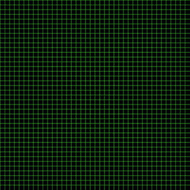
**图 2-1** 基本网格图案

我们希望有一个主/辅网格系统，以便轻松定位坐标。为此，需要每第五条线更粗一些。但按照当前的做法，我们无法控制线宽。我们在代码末尾调用的 `context.stroke` 方法会将当前的描边样式和线宽应用于整个当前路径。这意味着所有线条都将具有相同的宽度。如果我们希望给它们不同的宽度，就需要将绘制分成多个路径，每个路径对应一条线。为此，我们需要在循环内同时调用 `context.beginPath` 和 `context.stroke`。注意不要删除任何初始模板代码，将网格绘制代码（注释 `"Grid drawing code goes here"` 之后的所有内容）替换为清单 2-3 中的代码。

```
context.strokeStyle = "#00FF00";
for(var x = 0; x < canvas.width; x += 10) {
  context.beginPath();
  context.moveTo(x, 0);
  context.lineTo(x, canvas.height);
  context.lineWidth = (x % 50 == 0) ? 0.5 : 0.25;
  context.stroke();
}
for(var y = 0; y < canvas.height; y += 10) {
  context.beginPath();
  context.moveTo(0, y);
  context.lineTo(canvas.width, y);
  context.lineWidth = (y % 50 == 0) ? 0.5 : 0.25;
  context.stroke();
}
```
**清单 2-3** 改变线宽

现在，在每个循环中，我们都调用 `context.beginPath` 来启动一个新路径并丢弃所有之前的路径数据。我们像之前一样绘制线条，然后使用三元运算符设置线宽。三元运算符是一种紧凑的单行 `if` 语句，形式为 `result = boolean ? value_if_true : value_if_false`。这里我们设置线宽，所以如果当前的 `x` 或 `y` 坐标能被 50 整除（通过取模运算符 `x % 50 == 0` 确定），我们就使线条更粗一些。最后，我们在循环内调用 `context.stroke`，依次绘制每条线。生成的网格如图 2-2 所示。

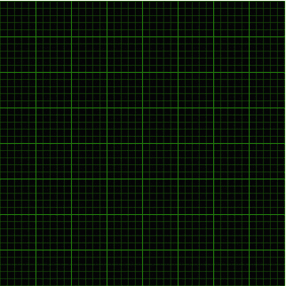
**图 2-2** 主/辅网格线

为了完成我们的画布坐标纸，还需要一些轴线。因为我们不能在画布外绘制，所以要在边缘处挤一些标签。首先，需要设置填充颜色，以便使用 `canvas.fillText`。在脚本中，循环上方添加以下代码行：

`context.fillStyle = "#009900";`

现在，在每个循环中，我们将在主（较粗）网格线旁边绘制一个标签。在 `x` 坐标循环的末尾添加这一行：

`if(x % 50 == 0 ) {context.fillText(x, x, 10);}`

类似地，在 `y` 坐标循环的末尾添加等效的代码行：

`if(y % 50 == 0 ) {context.fillText(y, 0, y + 10);}`

结果如图 2-3 所示。

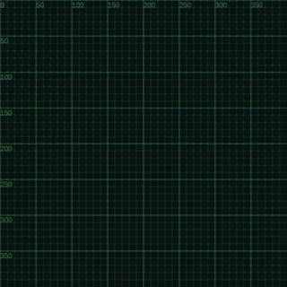
**图 2-3** 主网格标签

现在，坐标系的工作原理应该非常清晰了。每条较粗的线旁边都绘制了一个坐标值。原点明显位于左上角，我们已准备好在这个网格之上进行绘制。

## 及早重构，频繁重构


现在我们有了一个潜在有用的功能模块（一个显示坐标的网格），就应该立即考虑如何使其可复用。与其将原始代码复制到每个脚本中，不如将代码重构为一个函数，并将其放入代码库（一个独立的 JavaScript 文件）中。一旦将函数放入库中，我们只需在 HTML 文档中引入该库，然后调用该函数即可。任何可以简化为可复用函数的代码，都是放入库中的候选对象。一个好的经验法则是：加载一个库除了定义函数之外，不应产生任何副作用。通常情况下，库中包含相关的功能集合。

在这个例子中，让我们创建一个名为 `drawing.js` 的空文件，并在 HTML 的 `<head>` 元素中添加对该文件的链接。你的 `<head>` 元素现在看起来应该是这样的：

```html
<head>
  <title>更多 Canvas 绘图</title>
  <link rel="stylesheet" href="styles.css">
  <script src="drawing.js"></script>
</head>
```

现在，让我们将网格代码转换成一个便捷的函数，并将其放入 `drawing.js` 库中，如清单 2-4 所示。

```javascript
function draw_grid(ctx, minor, major, stroke, fill) {
  minor = minor || 10;
  major = major || minor * 5;
  stroke = stroke || "#00FF00";
  fill = fill || "#009900";
  ctx.save();
  ctx.strokeStyle = stroke;
  ctx.fillStyle = fill;
  let width = ctx.canvas.width, height = ctx.canvas.height
  for(var x = 0; x < width; x += minor) {
    ctx.beginPath();
    ctx.moveTo(x, 0);
    ctx.lineTo(x, height);
    ctx.lineWidth = (x % major == 0) ? 0.5 : 0.25;
    ctx.stroke();
    if(x % major == 0 ) {ctx.fillText(x, x, 10);}
  }
  for(var y = 0; y < height; y += minor) {
    ctx.beginPath();
    ctx.moveTo(0, y);
    ctx.lineTo(width, y);
    ctx.lineWidth = (y % major == 0) ? 0.5 : 0.25;
    ctx.stroke();
    if(y % major == 0 ) {ctx.fillText(y, 0, y + 10);}
  }
  ctx.restore();
}
```

**清单 2-4** `draw_grid` 函数

我们在这里并没有做太多改动，但结果却是一个健壮的库函数。我们的函数名为 `draw_grid`，它接受五个参数。第一个参数 `ctx` 是 Canvas 上下文，这允许我们使用该函数，在合适的上下文中绘制到任何 Canvas 上。为了获取 Canvas 的高度和宽度，我们将 Canvas 对象作为 `ctx` 参数的一个属性来访问。为了提高效率，我们将宽度和高度存储为变量。第二和第三个参数分别是次要距离和主要距离。第四和第五个参数分别是描边颜色和填充颜色。

我们还在绘图代码的开头添加了对 `context.save()` 的调用，并在结尾添加了对 `context.restore()` 的调用。它们会保存和恢复 Canvas 的状态，例如 `context.lineWidth`、`context.strokeStyle` 和 `context.fillStyle`。以这种方式使用它们，可以确保函数执行完毕后，Canvas 恢复到其原始状态。在编写绘图代码时，这是一个好习惯。它可以避免副作用，并允许调用代码保持对 Canvas 上下文的控制。

请注意，我们已尽力使该函数尽可能通用。除了希望使用提供的上下文绘制网格之外，它对客户端代码没有任何假设。我们可以使用这个函数在许多不同的 Canvas 上绘制许多不同的网格。函数的哪些方面应该是可配置的，取决于具体情况。提供灵活性（多个参数）必须与简化接口（减少参数）的好处相平衡。默认参数是一种很好的折衷方案。

在这个例子中，我们通过将 `minor` 默认设置为 10，将 `major` 设置为 `minor` 值的 5 倍来提供默认值。我们还为颜色设置了默认值。这些默认值仅在未提供值时使用，这是通过或运算符 (`||`) 实现的。`minor` 的值被设置为其自身或默认值，这仅在 `minor` 的值计算结果为 `false` 时适用（`undefined` 值就会如此）。值得注意的是，这种语法有其缺陷。例如，如果调用代码试图将默认参数设置为 `0` 或其他计算结果为 `false` 的值，则该值将被忽略，并使用默认值。

将这个新的 `draw_grid` 函数移入我们的 `drawing.js` 库中，会使我们的主脚本缩短很多。我们可以从 HTML 文档中移除所有网格绘制代码，并用一行代码替换：

```javascript
draw_grid(context);
```

我们现在可以轻松地创建自定义网格。尝试试验这些参数：

```javascript
// 试试这个进行对比
draw_grid(context, 15, 45, 'red', 'yellow');
// 或者试试这个
draw_grid(context, 5, 30, 'white', 'red');
```

## 使用路径进行绘图


在 Canvas 上绘图需要理解路径的概念。正如我们之前所见，可以通过依次调用多个绘制方法来构建路径。一旦路径被指定，我们可以调用 `context.fill`，使用当前的 `context.fillStyle` 填充封闭区域；或者调用 `context.stroke`，使用当前的 `context.strokeStyle` 和 `context.lineWidth` 以线条形式绘制路径。

我们还了解到，路径不必是连续的；可以通过调用 `context.moveTo` 来中断路径。当从一个路径切换到另一个路径时，需要调用 `context.beginPath` 以丢弃旧的路径数据并开始一个新的路径。

让我们在我们新的网格上绘制一些线条，以确认我们理解了坐标系统。在调用 `draw_grid` 之后，添加清单 2-5 中的内容。

```
context.beginPath();
context.strokeStyle = "#FFFFFF";
context.fillStyle = "#00FF00";
context.lineWidth = 2;
context.moveTo(50, 50);
context.lineTo(150, 250);
context.lineTo(250, 170);
context.stroke();
context.fillText("(50, 50)", 30, 40);
context.fillText("(150, 250)", 130, 260);
context.fillText("(250, 170)", 255, 175);
```

**清单 2-5 一些线条**

代码绘制了两条白线。当绘制第一条线时，我们指定从点 `(50, 50)` 开始，并画一条线到 `(150, 250)`。我们绘制第二条线时未指定起始位置，这条线是作为路径的延续而绘制的。然后我们绘制了点的坐标，以便清晰地看到当前情况。图 2-4 展示了结果。请注意，坐标可以从网格标签中读取。

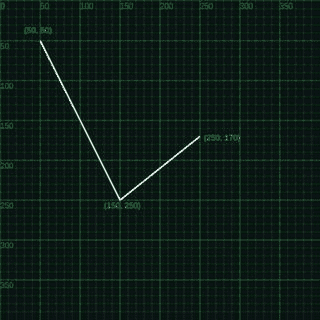

**图 2-4 线条默认是连接的**

现在，我们知道刚刚定义的路径（由两条直线组成）仍然存在于内存中。如果我们添加对 `context.fill` 的调用，应该能够填充该形状。但当形状没有完全封闭时会发生什么呢？在你的脚本末尾添加以下代码行来找出答案：

```
context.fill();
```

图 2-5 展示了结果。

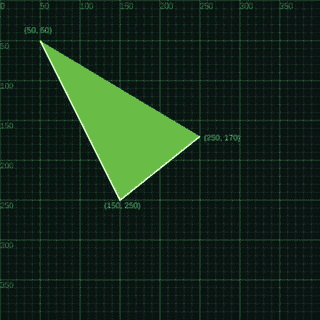

**图 2-5 填充路径时，如有必要，会添加一条直线**

路径会以从路径起点到终点的最短可能路径进行填充。如果我们向脚本中添加一个新的 `context.lineTo`，我们将填充一个不同的形状。我们甚至可以填充线条交叉的形状。在适当的位置（在描边线条之前）添加以下代码行：

```
context.lineTo(320, 280);
```

图 2-6 展示了结果。

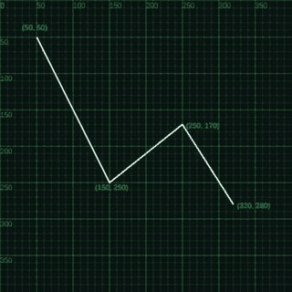

**图 2-6 向路径添加一条线**

在不填充的情况下，路径会扩展出一个新的点。图 2-7 显示，如果我们添加 `context.fill` 命令，该形状将再次以一条直线进行填充。

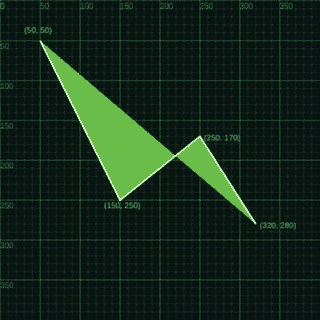

**图 2-7 在线条交叉时进行填充**

我们也可以使用 `context.closePath` 以编程方式闭合路径。这将在当前路径位置到最近的开放端点之间添加一条直线。移除对 `context.fill` 的调用，并在最后一次调用 `context.stroke` 之前添加对 `context.closePath` 的调用。图 2-8 展示了结果。

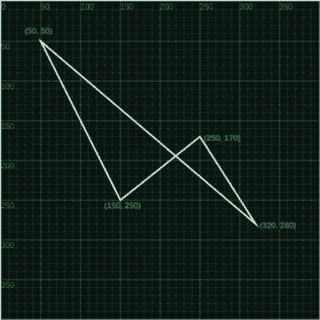

**图 2-8 闭合路径**

我们看到，在最初绘制网格线时，路径可以被中断。通过调用 `context.moveTo`，我们可以有效地“拾起”“笔”并将其移动到另一个位置。通过结合使用 `context.closePath`，我们可以快速且轻松地一起绘制多个闭合形状。在你的脚本末尾添加清单 2-6 中的代码。

```
context.beginPath()
context.moveTo(50, 250);
context.lineTo(50, 350);
context.lineTo(150, 350);
context.closePath();
context.moveTo(230, 360);
context.lineTo(270, 360);
context.lineTo(270, 310);
context.closePath();
context.moveTo(250, 50);
context.lineTo(370, 50);
context.lineTo(370, 100);
context.closePath();
context.strokeStyle = "#FFFF00";
context.fillStyle = "#000000";
context.fill();
context.stroke();
```

**清单 2-6 闭合形状**

研究这段代码，看看会发生什么。图 2-9 展示了结果。每次我们调用 `context.moveTo` 时，都是在设置路径的当前原点。这是 `context.closePath` 将返回的位置。这允许我们只调用一次 `context.fill` 和 `context.stroke` 来绘制多个填充的、闭合的形状。另请注意，我们在定义路径之后才设置了绘制样式。它们可以在调用 `context.fill` 和 `context.stroke` 之前的任何时间设置。

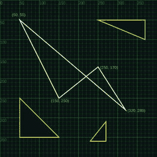

**图 2-9 填充、闭合、中断的路径**


## 为路径添加曲线

除了使用 `context.lineTo`，还有多种方式可以为路径添加内容。想要绘制曲线而非直线，一个简单的方法是使用替代方法 `context.quadraticCurveTo`。它与 `context.lineTo` 非常相似，但除了终点坐标外，还需要一个控制点的坐标。线条会向控制点方向弯曲。请用清单 2-7 中的代码替换上一段路径的构建代码。

```
context.beginPath()
context.moveTo(50, 250);
context.quadraticCurveTo(25, 300, 50, 350);
context.quadraticCurveTo(100, 375, 150, 350);
context.closePath();
context.moveTo(230, 360);
context.quadraticCurveTo(255, 340, 270, 360);
context.quadraticCurveTo(255, 340, 270, 310);
context.closePath();
context.moveTo(250, 50);
context.quadraticCurveTo(310, 60, 370, 50);
context.quadraticCurveTo(400, 75, 370, 100);
context.closePath();
context.strokeStyle = "#FFFF00";
context.fillStyle = "#000000";
context.fill();
context.stroke();
```

**清单 2-7** 添加曲线

现在，填充的形状由曲线构成，如图 2-10 所示。

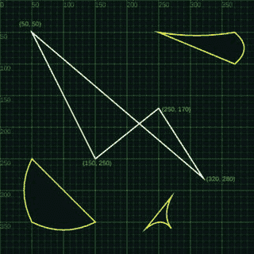

**图 2-10** 二次曲线

为了获得更多控制，我们可以使用贝塞尔曲线进行绘制。将网格绘制代码后的前三次 `context.lineTo` 调用替换为 `context.bezierCurveTo`，即可用贝塞尔曲线重新绘制白色路径，如清单 2-8 所示。

```
<script>
  var canvas = document.getElementById("asteroids");
  var context = canvas.getContext("2d");
  draw_grid(context)
  context.beginPath();
  context.strokeStyle = "#FFFFFF";
  context.fillStyle = "#00FF00";
  context.lineWidth = 2;
  context.moveTo(50, 50);
  context.bezierCurveTo(0, 0, 80, 250, 150, 250);
  context.bezierCurveTo(250, 250, 250, 250, 250, 170);
  context.bezierCurveTo(250, 50, 400, 350, 320, 280);
  context.closePath();
  // context.fill();
  context.stroke();
  context.fillText("(50, 50)", 30, 40);
  context.fillText("(150, 250)", 130, 260);
  context.fillText("(250, 170)", 255, 175);
  context.beginPath()
  context.moveTo(50, 250);
  context.quadraticCurveTo(25, 300, 50, 350);
  context.quadraticCurveTo(100, 375, 150, 350);
  context.closePath();
  context.moveTo(230, 360);
  context.quadraticCurveTo(255, 340, 270, 360);
  context.quadraticCurveTo(255, 340, 270, 310);
  context.closePath();
  context.moveTo(250, 50);
  context.quadraticCurveTo(310, 160, 370, 50);
  context.quadraticCurveTo(400, 75, 370, 100);
  context.closePath();
  context.strokeStyle = "#FFFF00";
  context.fillStyle = "#000000";
  context.fill();
  context.stroke();
</script>
```

**清单 2-8** 贝塞尔曲线

贝塞尔曲线需要两个控制点坐标和终点坐标。生成的路径是一条经过每个指定终点的曲线。图 2-11 展示了最终结果。贝塞尔曲线能用相对简单的路径实现平滑的弯曲和转向。

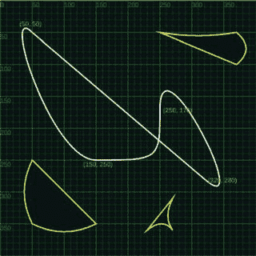

**图 2-11** 贝塞尔曲线

## 本章小结

在本章中，我们更深入地了解了 Canvas 接口的运作方式。我们学习了坐标系的工作原理，并详细探讨了路径的创建和修改方法。我们研究了在点之间绘制线条的各种方式。这些都是在 Canvas 上绘图时手头的基本工具。我还介绍了 JavaScript 函数，并提出了“尽早重构，频繁重构”的代码组织方法。本章继续教授了一些基础知识，并演示了这一切是如何运作的。第 3 章将应用你学到的知识来创建一幅更有目的性的画作，并再次探讨函数。

© Graeme Stuart 2017  
Graeme Stuart, 《JavaScript 游戏开发入门》  
`doi.org/10.1007/978-1-4842-3252-1_3`

