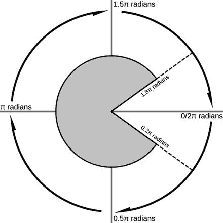
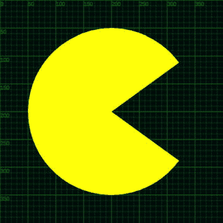
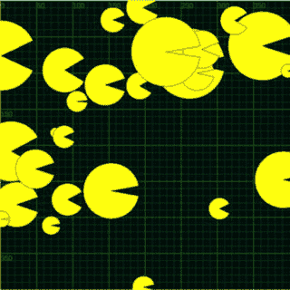

# 3. 按设计绘图

Graeme Stuart¹  
(1) 英国莱斯特郡马基特哈伯勒

在第 2 章中，我们在画布上随意涂鸦，弄得有些凌乱。这次，我们将尝试渲染一个熟悉的设计。本章将要学习的技能是前几章所学内容的延伸，不过在本章中，我们将在每一步操作中展示更明确的意图。如果本章有一个核心信息，那就是：勤加练习，对每一步都充满信心，同时慢慢增加复杂性。到目前为止，我们学到的内容虽然相当简单，但都是基础技能。重复练习并逐步增加一点复杂性，是巩固和拓展所学知识的有效方法。让我们从头开始整个过程，但把上一章的工具库代码带过来。请尝试按照以下说明操作，在需要之前不要向前查看代码示例：

1.  创建一个名为 `exercise3` 的新文件夹，并将第 2 章的 `drawing.js` 文件复制到该文件夹中。
2.  创建一个名为 `exercise3.html` 的新文件，并设置一个标准的 HTML 模板。
3.  在 `<head>` 元素中添加对 `drawing.js` 工具库的引用。
4.  在 `<body>` 元素中添加一个 `<canvas>` 元素用于显示场景。
5.  添加一个包含必要 JavaScript 代码的 `<script>` 元素，以创建对 Canvas 上下文的引用，并通过调用 `draw_grid` 函数在画布上绘制一个空白网格，该函数应通过引用工具库代码而可用。


## 吃豆人

大家对 1980 年南梦宫经典游戏《吃豆人》应该都不陌生。这位同名主角画起来相当简单——就是一个被切掉一块楔形的黄色实心圆。我们可以通过绘制一条弧线、再画一条连接到弧线圆心的直线，然后填充路径（路径会自动闭合）来画出它。

唯一的难点在于选择起始角和终止角。想象一支从圆心出发、指向右侧的箭头。这就是零角度（零弧度）。增大角度会让我们箭头顺时针方向旋转。`π`弧度的角度是半圆，指向左侧。`2π`弧度的角度是完整的一圈，箭头重新指向右侧。如图 3-1 所示。



图 3-1 一个圆内有 `2π` 弧度（顺时针方向）

要让我们的吃豆人面向右侧，需要让弧线从超过 0（零）的某个弧度数开始，并在距离 `2π` 同样角度处结束。张开嘴的总角度大概略小于四分之一圈（小于 `0.5π` 弧度），所以我们选择从 `0.2π` 弧度（稍微指向右下方）开始，到 `1.8π` 弧度（稍微指向右上方）结束。请按清单 3-1 所示更新你的代码。

```html
<!doctype html>
<html>
  <head>
    <title>Pacmania</title>
    <link rel="stylesheet" href="styles.css">
    <script src="drawing.js"></script>
  </head>
  <body>
    <h1>Pac-man</h1>
    <canvas id="pacmania" width="400" height="400"></canvas>
    <script>
      var context = document.getElementById("pacmania").getContext("2d");
      draw_grid(context);
      context.beginPath();
      context.arc(200, 200, 150, 0.2 * Math.PI, 1.8 * Math.PI);
      context.lineTo(200, 200);
      context.fillStyle = "yellow";
      context.fill();
    </script>
  </body>
</html>
```

清单 3-1 一个简单的吃豆人

这段代码除了几行新内容外应该都很熟悉。我们使用了 `context.arc` 方法来绘制一条半径为 150 像素的弧线，圆心位于点 `(200, 200)`，从 `0.2π` 弧度开始，沿顺时针方向一直延伸到 `1.8π` 弧度。为了切出楔形部分，我们画了一条线连接到圆心。然后我们将填充样式设为黄色并填充路径——结果如图 3-2 所示。`context.arc` 方法还可以接受一个可选的最终布尔参数，用于指定逆时针方向绘制。这在较复杂的路径中使用弧线时会很方便。



图 3-2 吃豆人就是一个被切掉一块楔形的圆

## 创建函数

但是吃豆人要吃小圆点，为此它需要在移动的过程中张开和闭合嘴巴，所以我们需要能够画出带有不同大小楔形切口的吃豆人。将你的代码重构为一个绘制吃豆人的函数，并将你的 `draw_pacman` 函数移到 `drawing.js` 库中。

你的函数需要接受四个参数。前两个参数是 `x` 和 `y` 坐标。第三个参数是半径。第四个参数是一个介于 0 和 1 之间的值，表示嘴巴从完全闭合（0）到完全张开（1）的“张开”程度。另外，为了让你的吃豆人能画在较浅色的背景上，请在你的函数中调用 `context.closePath` 和 `context.stroke` 来为吃豆人绘制黑色轮廓。这是一个创建你自己函数的机会。

## 随机化

调用 `Math` 对象的 `random` 方法（即调用 `Math.random()`）会生成一个介于 0 和 1 之间的随机数。一旦你有了自己的函数，就用一行代码替换掉旧的吃豆人绘制代码，通过你的函数来绘制一个随机化的吃豆人，如下所示：

```
draw_pacman(context, 200, 200, 150, Math.random());
```

刷新页面几次，看看随机化的嘴巴角度。我们使用 `Math.random` 来生成一个 0 到 1 之间的随机数。当我们定义函数时，我们指定嘴巴角度可以作为这个范围内的一个参数传入。因此，只要函数正确绘制了吃豆人，我们就应该能绘制出一个嘴巴角度随机化的吃豆人。

在另一种实现中，我们可以让随机数乘以 `0.2π`，以创建在零（0）两侧用于绘制嘴巴的角度。这样每次浏览器重新加载时，都会生成一个新的随机数，并以新的嘴巴角度调用绘图函数。请慢慢来，在继续之前确保你理解了正在做的事情。一旦掌握了窍门，这些东西就很简单了。

现在我们有了一个函数，可以用它在画布上到处绘制吃豆人。尝试一个简单的循环来绘制一些随机的东西。这里我们使用一个 `do while` 循环来绘制随机的吃豆人，直到生成的随机数大于 `0.9`。`do while` 循环至少会执行一次，所以我们总能至少看到一个吃豆人。当随机数大于 `0.9` 时，循环结束。参见清单 3-2。

```javascript
var min_radius = 5;
var max_radius = 50;
do {
  let x = context.canvas.width * Math.random();
  let y = context.canvas.height * Math.random();
  let radius = min_radius + (max_radius - min_radius) * Math.random();
  draw_pacman(context, x, y, radius, Math.random());
} while(Math.random() < 0.9);
```

清单 3-2 在循环中随机化

很明显，我们对坐标、半径以及嘴巴角度都进行了随机化。请注意，为了提高可读性，我们定义了一些变量（`min_radius`、`max_radius`、`x`、`y` 和 `radius`）。这些语句本可以直接作为参数传入函数，就像我们对嘴巴参数所做的那样。将代码拆分成简单的语句可以提高清晰度，并使得代码能够适应屏幕显示。

图 3-3 显示了你应该看到的结果。最终的画布就是吃豆人狂热。请注意我们添加到图形上的黑色轮廓是如何帮助我们区分重叠的吃豆人的。



图 3-3 多个随机位置的吃豆人

## 总结

在本章中，我们通过一个简单但熟悉的例子回顾了路径和函数。请注意，我们最终在脚本中只用了很少的代码，但由于我们使用函数抽象掉了实际单个绘图任务的细节，它却完成了相当复杂的绘图。我还介绍了随机化和循环——这些是重要的概念，我们将在以后大量使用。

尝试对我们所做的内容进行实验。选取另一个你熟悉的形状来绘制。创建一个函数并决定应该提供哪些参数。在循环中将输入随机化，以创建你自己的复杂场景。

© Graeme Stuart 2017

Graeme Stuart, 介绍 JavaScript 游戏开发, [`doi.org/10.1007/978-1-4842-3252-1_4`](https://doi.org/10.1007/978-1-4842-3252-1_4)

