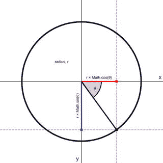
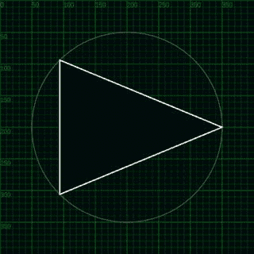
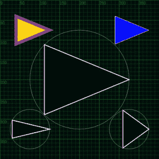
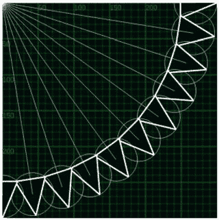
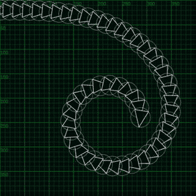
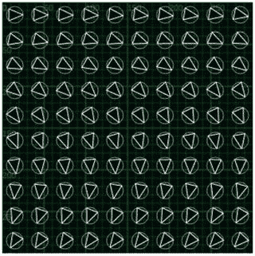
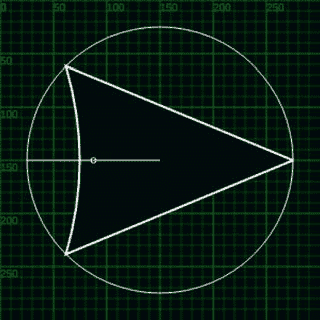
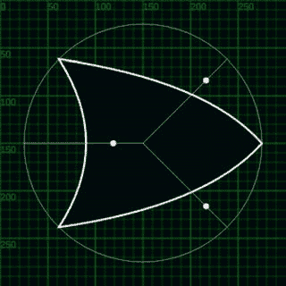
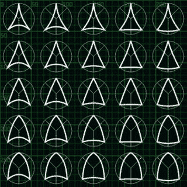

# 4. 绘制宇宙飞船

Graeme Stuart¹

(1) 英国莱斯特郡马基特哈伯勒

好的，让我们更认真一点，开始着手处理我们的游戏元素。经典和现代版《爆破彗星》游戏中的宇宙飞船都是基于一个简单的等腰三角形。在本章中，我们将绘制宇宙飞船，并使用二次曲线来定制我们的飞船设计。

我们希望我们的飞船能近似于一个具有给定半径的圆，因为稍后我们将使用“圆对圆”碰撞检测。因此，我们需要定位圆边缘上的点。使用角度和距离（极坐标）是指定我们想要点的明显方法，但要绘制到画布上，我们需要使用 `x` 和 `y` 值（笛卡尔坐标）。我们需要解决这个问题。


## 基础三角学

三角学将在本书中出现多次，因此现在理清概念是个好主意。我们将使用一个非常简单的子集，它使我们能够根据角度和距离计算 x 和 y 坐标。图 4-1 展示了基本原理。直角三角形最长的边是圆心与圆周上一点之间的直线。如果我们改变角度，这将以可预测的方式影响 x 和 y 坐标。 图 4-1 角度 θ 的正弦和余弦

基本上，你现在只需要知道，正弦和余弦函数可以根据距离（半径）和方向（角度）计算出 (x, y) 坐标。在 JavaScript 中，`Math` 对象有两个对应的方法：`Math.sin(θ)` 和 `Math.cos(θ)`。利用它们，我们可以计算任意给定角度 θ 相对于圆心的 x 和 y 坐标。要将角度和距离转换为 x 和 y 坐标，只需将这些值乘以所需的距离（圆的半径）。在我们的图中，蓝色虚线表示 y 坐标的值，计算公式为 `r × Math.sin(θ)`。红色虚线表示 x 坐标的值，计算公式为 `r × Math.cos(θ)`。

## 基础飞船

让我们实践一下。我们将使用一个函数，在画布上以特定位置和特定半径绘制一艘飞船。请记住，我们希望飞船尽可能完美地填充一个圆形。首先，创建一个名为 `exercise4` 的新文件夹，复制样式表（`styles.css`）和 `drawing.js` 库，并添加一个新文件 `exercise4.html`，其中包含代码清单 4-1 中的代码。

```
<!doctype html>
<html>
  <head>
    <title>绘制一艘太空飞船</title>
    <link rel="stylesheet" href="styles.css">
    <script src="drawing.js"></script>
  </head>
  <body>
    <h1>绘制一艘太空飞船</h1>
    <canvas id="asteroids" width="400" height="400"></canvas>
    <script>
      var context = document.getElementById("asteroids").getContext("2d");
      draw_grid(context);
      draw_ship(context, 200, 200, 150, {guide: true});
    </script>
  </body>
</html>
```

代码清单 4-1 绘制飞船的模板

该模板加载了样式表和库，并包含一个简单的三行脚本。脚本创建了对上下文的引用，绘制了网格，然后通过调用新的 `draw_ship` 函数并传入一些参数来绘制我们的飞船。第一个参数是上下文，第二个和第三个是 x 和 y 坐标，第四个是包含飞船的圆的半径。最后一个参数略有不同——它包含一个对象，我们稍后会讨论它。

我们的第一个版本的 `draw_ship` 函数如代码清单 4-2 所示。将其添加到 `drawing.js` 库中。

```
function draw_ship(ctx, x, y, radius, options) {
  options = options || {};
  ctx.save();
  // 可选地绘制一个显示碰撞半径的引导线
  if(options.guide) {
    ctx.strokeStyle = "white";
    ctx.fillStyle = "rgba(0, 0, 0, 0.25)";
    ctx.lineWidth = 0.5;
    ctx.beginPath();
    ctx.arc(x, y, radius, 0, 2 * Math.PI);
    ctx.stroke();
    ctx.fill();
  }
  // 设置一些默认值
  ctx.lineWidth = options.lineWidth || 2;
  ctx.strokeStyle = options.stroke || "white";
  ctx.fillStyle = options.fill || "black";
  let angle = (options.angle || 0.5 * Math.PI) / 2;
  // 用三条线绘制飞船
  ctx.beginPath();
  ctx.moveTo(x + radius, y);
  ctx.lineTo(
    x + Math.cos(Math.PI - angle) * radius,
    y + Math.sin(Math.PI - angle) * radius
  );
  ctx.lineTo(
    x + Math.cos(Math.PI + angle) * radius,
    y + Math.sin(Math.PI + angle) * radius
  );
  ctx.closePath();
  ctx.fill();
  ctx.stroke();
  ctx.restore();
}
```

代码清单 4-2 绘制基础飞船

结果是一艘基础飞船。在浏览器中加载该模板，你应该会看到类似图 4-2 的内容。 图 4-2 一个简单的三角形飞船

该函数的核心使用 `context.moveTo` 和 `context.lineTo` 绘制三条线构成一个三角形。它设置了上下文的一些参数，然后填充形状并描边轮廓。但除此之外，它还做了很多事情。这里有一些新东西需要解释。

## 使用对象字面量

注意，我们定义了一个第五个参数：`options`。这是一个可选参数；我们可以看出这一点，因为如果它未定义，则会被设置为一个空对象（`{}`）。`options` 参数允许设置飞船的多个可选属性。这些选项使用点号表示法引用，例如 `options.stroke` 或 `options.fill`。如果它们未定义，则会提供默认值。

> **注意** 对象非常有用，将在后面的章节中广泛使用。这里我介绍对象字面量 `{}`，它用作简单的键：值存储。对象字面量被指定为包含多个键：值对的花括号，用逗号分隔。键可以是任何能转换为有效 JavaScript 字符串的内容。值可以是任何内容。空对象被指定为一对花括号（`{}`）。

更新你的 `exercise4.html` 文件，使用设置了不同选项的 `draw_ship` 函数，如代码清单 4-3 所示。

```
<script>
  var context = document.getElementById("asteroids").getContext("2d");
  draw_grid(context);
  draw_ship(context, 200, 200, 125, {guide: true});
  draw_ship(context, 75, 75, 50, {stroke: 'gold', fill: 'purple'});
  draw_ship(context, 325, 325, 50, {angle: 0.8 * Math.PI, guide: true});
  draw_ship(context, 75, 325, 50, {angle: 0.3 * Math.PI, guide: true});
  draw_ship(context, 325, 75, 50, {lineWidth: 8, fill: 'blue'});
</script>
```

代码清单 4-3 设置飞船选项

结果如图 4-3 所示。注意，我们可以创建一个具有简单接口的函数，并且通过允许默认值，也可以实现更详细的接口。 图 4-3 许多飞船

飞船的三个角位于圆的半径上。飞船的前部位于 `(x + radius, y)`，即圆的右侧。飞船的后角由飞船机头的角度决定。角度变量由这行代码设置：`let angle = (options.angle || 0.5 * Math.PI) / 2;` 它默认为 `0.5π / 2`。一个完整的圆有 `2π` 弧度，因此 `0.25π` 弧度是 45 度（一个圆的八分之一）。

飞船的后角由以下代码绘制：

```
ctx.lineTo(
  x + Math.cos(Math.PI - angle) * radius,
  y + Math.sin(Math.PI - angle) * radius
);
ctx.lineTo(
  x + Math.cos(Math.PI + angle) * radius,
  y + Math.sin(Math.PI + angle) * radius
);
```

将每个坐标乘以 `radius` 确保我们始终在圆上（距离中心固定距离）。因此，我们正在找到圆上对应于角度 `Math.PI - angle` 和 `Math.PI + angle` 的点。一个角位于 `Math.PI` 之前 45 度的圆上，另一个位于 `Math.PI` 之后 45 度。因为 `Math.PI` 是半个圆，它指向飞船的后部，两个角分别位于其两侧。

看一下图 4-3 并仔细思考，直到你明白发生了什么。请记住，引导圆显示了检测碰撞的位置。小行星周围也会有类似的圆，当这些圆接触时，就会检测到碰撞。对于我们的飞船，正面碰撞将是准确的，后角碰撞也是如此，但飞船和圆之间的大片区域会过早地检测到碰撞。这是我们稍后将尝试改进的地方。

## 变换画布上下文


注意我们已经将飞船绘制成朝右的形状。这是因为 `0` 弧度角指向正右方。那么如何旋转飞船呢？我们需要围绕飞船自身的中心进行旋转，并在游戏中以所有角度绘制它。手动计算所有坐标将变得冗长乏味。一种便捷的方法是转换画布上下文，而不是转换图形本身。旋转上下文始终围绕当前上下文的原点进行。

尝试绘制一些旋转后的飞船——将你的 `exercise4.html` 脚本替换为清单 4-4 所示的内容。

```javascript
var context = document.getElementById("asteroids").getContext("2d");
context.lineWidth = 0.5;
context.strokeStyle = "white";
let x = context.canvas.width * 0.9;
let y = 0;
let radius = context.canvas.width * 0.1;
draw_grid(context);
for(let r = 0; r <= 0.5 * Math.PI; r += 0.05 * Math.PI) {
  context.save()
  context.rotate(r);
  draw_ship(context, x, y, radius, {guide: true});
  context.beginPath();
  context.moveTo(0, 0);
  context.lineTo(x, 0);
  context.stroke();
  context.restore()
}
```

清单 4-4 旋转画布上下文

旋转上下文正如其字面含义：想象你手持一支笔放在纸上，然后实际上是在旋转纸张，绘制我们的飞船（使其朝右），最后将纸放回原位。这使得我们能够将飞船绘制成任意朝向。重要的是，旋转是围绕画布原点进行的，根据我们的网格坐标，原点位于左上角。现在想象一下，固定纸张的左上角，并围绕该角旋转纸张。

在每次迭代中，我们保存上下文、旋转它、绘制飞船和一条线，然后恢复上下文到初始状态。这意味着旋转总是应用于未旋转的上下文，因为每次以不同角度绘制飞船时，我们都会旋转一个更大的角度。由于我们是绕原点旋转，飞船始终与左上角保持相同的距离。在每次迭代中，我们还从原点绘制一条线到飞船中心。这条线也会被旋转，但原点始终保持在左上角。图 4-4 展示了结果。



图 4-4 绕原点旋转

在我们的游戏中，我们需要围绕飞船的中心点旋转，而不是画布的左上角。为此，我们需要在旋转之前移动上下文原点。关键在于，当我们旋转画布时，它是围绕原点旋转的，因此如果我们移动原点，就可以控制旋转。在我们的游戏中，我们将存储飞船的位置和角度。在绘制飞船之前，我们会平移和旋转上下文。这意味着我们将始终在新的原点进行绘制，因此需要调整飞船绘制函数，移除坐标参数，并始终在 `(0, 0)` 处绘制。将所有对 `x` 和 `y` 的引用替换为 `0`（零），如清单 4-5 所示。

```javascript
function draw_ship(ctx, radius, options) {
  options = options || {};
  ctx.save();
  if(options.guide) {
    ctx.strokeStyle = "white";
    ctx.fillStyle = "rgba(0, 0, 0, 0.25)";
    ctx.lineWidth = 0.5;
    ctx.beginPath();
    ctx.arc(0, 0, radius, 0, 2 * Math.PI);
    ctx.stroke();
    ctx.fill();
  }
  ctx.lineWidth = options.lineWidth || 2;
  ctx.strokeStyle = options.stroke || "white";
  ctx.fillStyle = options.fill || "black";
  let angle = (options.angle || 0.5 * Math.PI) / 2;
  ctx.beginPath();
  ctx.moveTo(radius, 0);
  ctx.lineTo(
    Math.cos(Math.PI - angle) * radius,
    Math.sin(Math.PI - angle) * radius
  );
  ctx.lineTo(
    Math.cos(Math.PI + angle) * radius,
    Math.sin(Math.PI + angle) * radius
  );
  ctx.closePath();
  ctx.fill();
  ctx.stroke();
  ctx.restore();
}
```

清单 4-5 在当前原点绘制

现在，通过在绘制飞船于 `(0, 0)` 点之前，平移画布（调用 `context.translate`）并旋转画布（调用 `context.rotate`），我们可以在任意位置绘制飞船。当这样变换画布时，我们必须小心地保存和恢复画布状态——否则我们会丢失跟踪。在清单 4-6 中，我们旋转和平移了画布但没有恢复它，导致旋转和平移累积，产生了一个漂亮但非预期的螺旋图案，如图 4-5 所示。

```javascript
let t = context.canvas.width / 20;
let r = Math.PI / 500;
context.translate(0, t);
for(let i = 0; i <= 50; i ++) {
  context.rotate(i * r);
  draw_ship(context, t, {guide: true, lineWidth: 1});
  context.translate(t, 0);
}
```

清单 4-6 组合旋转与平移



图 4-5 丢失画布状态跟踪

更好的方法是维护变量（即 `x`、`y` 和 `angle`）来确定飞船的位置和角度。这样，我们可以保存未变换的上下文、应用变换、绘制飞船，最后恢复上下文。这使我们能够将飞船绘制在任意位置并指向任意方向。清单 4-7 在一个嵌套循环中遍历 `x` 和 `y` 位置，并在每个位置绘制一艘小飞船。每艘飞船都以一个稍大的角度绘制。注意，在 `save()` 和 `restore()` 调用之间的代码非常通用。实际起作用的是控制我们变量的代码。图 4-6 展示了飞船整齐排列的结果。

```javascript
let x, y, angle = 0;
let w = context.canvas.width, h = context.canvas.height
for(y = h/20; y < h; y += h/10) {
  for(x = w/20; x < w; x += w/10) {
    context.save();
    context.translate(x, y);
    context.rotate(angle);
    draw_ship(context, w/30, {guide: true, lineWidth: 1});
    context.restore();
    angle = (angle + 0.0075 * Math.PI);
  }
}
```

清单 4-7 控制变量



图 4-6 使用画布变换进行受控的飞船绘制


飞船的外观看起来不错，但略显方正。下一步是掌控曲线。幸运的是，这非常简单。首先要做的是找出一条我们想将其变为曲线的直线。飞船的后部显然是首选。对于二次曲线，我们需要一个控制点来“拉”动直线，使其变成曲线。在本例中，该点将位于飞船后部的中轴线上，其 `y` 坐标为 0。确定这一点后，我们就可以将一条 `context.lineTo` 调用转换为 `context.quadraticCurveTo` 调用。请按清单 4-8 所示，更新你的 `draw_ship` 函数。

```javascript
function draw_ship(ctx, radius, options) {
  options = options || {};
  let angle = (options.angle || 0.5 * Math.PI) / 2;
  // this is new
  let curve = options.curve || 0.5;
  ctx.save();
  if(options.guide) {
    ctx.strokeStyle = "white";
    ctx.fillStyle = "rgba(0, 0, 0, 0.25)";
    ctx.lineWidth = 0.5;
    ctx.beginPath();
    ctx.arc(0, 0, radius, 0, 2 * Math.PI);
    ctx.stroke();
    ctx.fill();
  }
  ctx.lineWidth = options.lineWidth || 2;
  ctx.strokeStyle = options.stroke || "white";
  ctx.fillStyle = options.fill || "black";
  ctx.beginPath();
  ctx.moveTo(radius, 0);
  ctx.lineTo(
    Math.cos(Math.PI - angle) * radius,
    Math.sin(Math.PI - angle) * radius
  );
  // here we have added a control point based on the curve variable
  ctx.quadraticCurveTo(radius * curve - radius, 0,
    Math.cos(Math.PI + angle) * radius,
    Math.sin(Math.PI + angle) * radius
  );
  ctx.closePath();
  ctx.fill();
  ctx.stroke();
  // a new guide line and circle show the control point
  if(options.guide) {
    ctx.strokeStyle = "white";
    ctx.lineWidth = 0.5;
    ctx.beginPath();
    ctx.moveTo(-radius, 0);
    ctx.lineTo(0, 0);
    ctx.stroke();
    ctx.beginPath();
    ctx.arc(radius * curve - radius, 0, radius/50, 0, 2 * Math.PI);
    ctx.stroke();
  }
  ctx.restore();
}
```

**清单 4-8** 使用二次曲线

我们添加了一个名为 `curve` 的可选变量，其默认值为 0.5。在绘制飞船后部两个角之间的线条时，我们现在使用二次曲线而非直线。该曲线的控制点位于飞船的中轴线上。如果 `curve` 的值为 0，则控制点位于圆的半径上；如果 `curve` 的值设为 1，则控制点位于圆的中心。

现在，为了测试该函数，我们将随机化这个新参数，并在画布中心绘制一艘大型飞船。每次刷新页面（例如，按 `Ctrl+R`），都会选择一个新值，并且画布会更新：

```javascript
context.translate(200, 200);
draw_ship(context, 150, {curve: Math.random(), guide: true});
```

我们还添加了一段新的辅助线代码，用于在飞船顶部绘制控制点。我们在控制点的位置绘制一个实心圆点，以帮助展示曲线是如何构建的。此外，我们还绘制了一条线，以显示控制点的潜在范围（介于 0 和 1 之间）。请注意，曲线不一定穿过该点，而是朝向它绘制。

你应该能看到类似图 4-7 的效果。



**图 4-7** 添加曲线

尝试手动设置 `curve` 的值。低于 0 和高于 1 的值在一定范围内也是有效的。请确保你理解这里发生了什么。如前所述，飞船应尽可能靠近圆的边缘绘制，以便碰撞检测更准确。尽管我们对形状要求不严格，但其位置和大小应尽可能与圆匹配。

我们将为飞船设计添加的最终修饰是将其侧边绘制成二次曲线。实现方法有多种，这里我们将在飞船两侧与后部相对的位置各放置一个控制点。我们将以参数的形式指定其在圆中的位置。该位置（从 0 到 1，对应圆心到半径）决定了控制点将放置的地方。数值越大，侧边越向外拉，从而填充圆内更多的空间；数值越小，侧边越向内收。

清单 4-9 展示了最终代码。

```javascript
function draw_ship(ctx, radius, options) {
  options = options || {};
  let angle = (options.angle || 0.5 * Math.PI) / 2;
  // Now we have two curve arguments
  let curve1 = options.curve1 || 0.25;
  let curve2 = options.curve2 || 0.75;
  ctx.save();
  if(options.guide) {
    ctx.strokeStyle = "white";
    ctx.fillStyle = "rgba(0, 0, 0, 0.25)";
    ctx.lineWidth = 0.5;
    ctx.beginPath();
    ctx.arc(0, 0, radius, 0, 2 * Math.PI);
    ctx.stroke();
    ctx.fill();
  }
  ctx.lineWidth = options.lineWidth || 2;
  ctx.strokeStyle = options.stroke || "white";
  ctx.fillStyle = options.fill || "black";
  ctx.beginPath();
  ctx.moveTo(radius, 0);
  // here we have the three curves
  ctx.quadraticCurveTo(
    Math.cos(angle) * radius * curve2,
    Math.sin(angle) * radius * curve2,
    Math.cos(Math.PI - angle) * radius,
    Math.sin(Math.PI - angle) * radius
  );
  ctx.quadraticCurveTo(-radius * curve1, 0,
    Math.cos(Math.PI + angle) * radius,
    Math.sin(Math.PI + angle) * radius
  );
  ctx.quadraticCurveTo(
    Math.cos(-angle) * radius * curve2,
    Math.sin(-angle) * radius * curve2,
    radius, 0
  );
  ctx.fill();
  ctx.stroke();
  // the guide drawing code is getting complicated
  if(options.guide) {
    ctx.strokeStyle = "white";
    ctx.fillStyle = "white";
    ctx.lineWidth = 0.5;
    ctx.beginPath();
    ctx.moveTo(
      Math.cos(-angle) * radius,
      Math.sin(-angle) * radius
    );
    ctx.lineTo(0, 0);
    ctx.lineTo(
      Math.cos(angle) * radius,
      Math.sin(angle) * radius
    );
    ctx.moveTo(-radius, 0);
    ctx.lineTo(0, 0);
    ctx.stroke();
    ctx.beginPath();
    ctx.arc(
      Math.cos(angle) * radius * curve2,
      Math.sin(angle) * radius * curve2,
      radius/40, 0, 2 * Math.PI
    );
    ctx.fill();
    ctx.beginPath();
    ctx.arc(
      Math.cos(-angle) * radius * curve2,
      Math.sin(-angle) * radius * curve2,
      radius/40, 0, 2 * Math.PI
    );
    ctx.fill();
    ctx.beginPath();
    ctx.arc(radius * curve1 - radius, 0, radius/50, 0, 2 * Math.PI);
    ctx.fill();
  }
  ctx.restore();
}
```

**清单 4-9** 曲线飞船

改动实际上非常小——我们只是添加了一些控制点，并使用前面描述的简单三角函数进行计算。大部分新增代码实际上都用于绘制控制点！请专注于主代码中的改动。我们将 `options.curve` 值改成了 `options.curve1` 和 `options.curve2`。剩下的两次 `context.lineTo` 调用已被转换为 `context.quadraticCurveTo` 调用，并指定了控制点。

同样，调用它非常简单：

```javascript
context.translate(200, 200);
draw_ship(context, 150, {
  curve1: Math.random(),
  curve2: Math.random(),
  guide: true
});
```

尝试一下，你应该能得到类似图 4-8 的效果。刷新页面（`Ctrl+R`），每次都应该能看到不同的随机变体。



**图 4-8** 全曲线飞船

尝试清单 4-10 中的代码，看看我们能用新方法绘制出哪些替代飞船。最终你应该会得到类似图 4-9 的效果。

```javascript
var context = document.getElementById("asteroids").getContext("2d");
draw_grid(context);
let c1 = 0, c2 = 0;
for(c1=0.1; c1<1; c1+=0.2) {
  for(c2=0.1; c2<1; c2+=0.2) {
    context.save();
    context.translate(context.canvas.width * c1, context.canvas.height * c2)
    context.rotate(-Math.PI/2);
    draw_ship(context, context.canvas.width / 12, {curve1: c1, curve2: c2, guide : true});
    context.restore();
  }
}
```

**清单 4-10** 绘制多种变体



**图 4-9** 一系列备选飞船

现在我们拥有一个完整、完全可配置的飞船绘制函数，只需导入我们的 `drawing.js` 库即可在游戏中使用。通过定义自己的函数来增加结构，可以使复杂代码更易于理解。


## 总结

本章对第 [3](https://example.org/A455241_1_En_3_Chapter.xhtml) 章中的思路进行了重要延伸。我们绘制了更复杂的形状，并将设计从简单的三角形发展为曲线优美的图形。我们学习了如何平移和旋转画布。这些概念将在后续内容中非常重要，因此你一定要确保已充分理解它们。它们让我们能够以极其灵活的方式调用绘图函数。一个关键发现是：随着绘图函数变得越来越复杂，我们调用该函数的代码却几乎没有任何变化。这正是一般情况下我们管理复杂性的方式——将诸如“绘制一艘飞船”这样的想法抽象成函数，并在需要“绘制飞船”时随时调用该函数。尝试自行开发 `draw_ship` 函数。保留辅助圆代码，并尽可能贴近边缘进行绘制。如果超出边缘一点，会有影响吗？© Graeme Stuart 2017 Graeme Stuart《Introducing JavaScript Game Development》[`doi.org/10.1007/978-1-4842-3252-1_5`](https://doi.org/10.1007/978-1-4842-3252-1_5)

