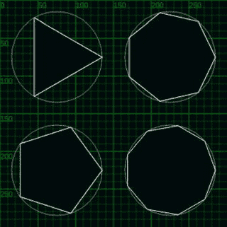
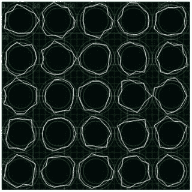
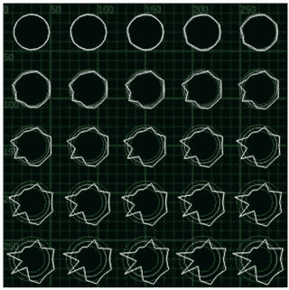

# 5. 绘制小行星

Graeme Stuart^(1 ) (1) 英国莱斯特郡马基特哈伯勒 与飞船类似，为了碰撞检测，小行星也可近似为一个圆形。然而，小行星应该是不规则形状，且每个都应独一无二。为此，我们将广泛使用 `Math.random` 方法来定义小行星的形状。

## 绘制基本形状


好的，作为高级文档工程师和翻译员，我将根据您提供的注意事项和示例，将给定的英文文本翻译成中文。


作为第一次尝试，我们将把小行星划分为多个线段，并从每个线段到下一个线段绘制一条直线。为此，我们可以逐步旋转画布，并在关闭路径之前在每个步骤绘制一条直线。我们希望点到原点的距离有一些随机性。我们可以在循环中管理旋转。我们可以在每一步旋转相同的量：即`2π`弧度除以线段数量。然后，我们在圆周附近（原点正右侧）选取一个随机点。旋转的原点将是小行星的中心，因此尽管我们将笔保持在圆的右侧，但我们的绘图会在笔下方旋转。通过这种方式，我们一次绘制一个线段，最终应能关闭路径。

将清单 5-1 中的函数添加到`drawing.js`中。

```
function draw_asteroid(ctx, radius, segments, options) {
  options = options || {};
  ctx.strokeStyle = options.stroke || "white";
  ctx.fillStyle = options.fill || "black";
  ctx.save();
  ctx.beginPath();
  for(let i = 0; i < segments; i++) {
    ctx.rotate(2 * Math.PI / segments);
    ctx.lineTo(radius, 0);
  }
  ctx.closePath();
  ctx.fill();
  ctx.stroke();
  if(options.guide) {
    ctx.lineWidth = 0.5;
    ctx.beginPath();
    ctx.arc(0, 0, radius, 0, 2 * Math.PI);
    ctx.stroke();
  }
  ctx.restore();
}
```

*清单 5-1 绘制基本形状*

该函数接受四个参数：用于绘制的上下文、小行星的半径、线段数量以及一组可选的选项。它开始一条路径，然后一次旋转画布一个线段，为每个线段添加一条直线到路径中。随后路径被关闭，完成绘制。如果请求了辅助圆，则将其绘制为一个简单的圆形。请注意，在调用`context.beginPath`方法后，路径的起点位置尚未确定。在这种情况下，添加到路径中的第一条直线不会被绘制，而是被视为移动。因此，当绘制完最后一个线段时，会缺少一条直线，需要关闭路径。

创建一个新文件`exercise5.html`，并像之前一样进行设置，但使用新的标题和标题。像之前的练习一样绘制一个网格，并添加清单 5-2 中的代码。

```
let context = document.getElementById("asteroids").getContext("2d");
draw_grid(context);
let segments = 1
for(let x=0.25; x<1; x+= 0.5) {
  for(let y=0.25; y<1; y+= 0.5) {
    segments += 2;
    context.save();
    context.translate(context.canvas.width * x, context.canvas.height * y);
    draw_asteroid(context, 60, segments, {guide: true});
    context.restore();
  }
}
```

*清单 5-2 一些规则形状*

这将在画布上绘制四个小行星，如图 5-1 所示。请注意，小行星的角点位于辅助圆上。



*图 5-1 无随机化的规则小行星*

添加随机化相当简单。我们只需更改`context.lineTo`命令的`x`坐标，在每个线段中为半径添加一点随机噪声。我们如何做到这一点，决定了我们能将小行星形状保持在辅助圆附近的程度。一种简单的方法是将半径乘以一个随机数——这会在线段位置（从小行星中心即`0`到整个半径即`radius`）之间引入巨大变化。清单 5-3 展示了在编写这些示例时尝试过的三种添加随机性的方法。

```
// 一种过于简单的方法 - 我们不需要完全随机
ctx.lineTo(radius * Math.random(), 0);

// 好多了，只有一点随机
ctx.lineTo(radius * 0.8 + radius * 0.4 * Math.random(), 0);

// 这种方法简洁、可配置，并使半径保持在合理范围内
ctx.lineTo(radius + radius * options.noise * (Math.random() - 0.5), 0);
```

*清单 5-3 添加随机性*

这些示例揭示了一些要求。在第一个示例中，随机小行星可能包含原点处的点；这不是我们想要的。为了避免这种情况，我们指定一部分始终保留的半径（例如 80%），并且只对剩余部分进行随机化。在第二个示例中，随机小行星的点始终位于碰撞圆内，而绝不会超出它。我们希望随机化“跨越”指定的半径，而不是总是侵蚀它，使小行星变小。为此，我们生成一个介于`-0.5`和`+0.5`之间的数字，并使用它来随机化绘图。此外，第二个示例不可配置，因此我们引入了一个配置参数，可以在`options`参数中指定。最后一个示例通过指定一个介于`0`（无随机化）和`1`（大量随机化）之间的`noise`参数来展示这种方法。该值乘以一个介于`-0.5`和`0.5`之间的随机数，以限制随机化的效果。例如，`noise`值为`0.2`可以导致任何介于原始半径的 90% 和 110% 之间的半径。指定`noise`因子为`0.1`将允许半径在给定值的 95% 到 105% 之间变化。

更新您的函数以接受一个`noise`参数。然后使用清单 5-4 中的代码绘制 25 个小行星。

```
var segments = 15, noise = 0.4;
for(let x=0.1; x<1; x+= 0.2) {
  for(let y=0.1; y<1; y+= 0.2) {
    context.save();
    context.translate(context.canvas.width * x, context.canvas.height * y);
    draw_asteroid(context, context.canvas.width / 12, segments, {noise: noise, guide: true});
    context.restore();
  }
}
```

*清单 5-4 绘制一些不同的小行星*

在这里，我们像以前一样遍历`x`和`y`坐标，并在每个位置绘制一个小行星。结果如图 5-2 所示。尝试通过更改所提供变量的初始值来试验线段数量和噪声级别。您还可以通过递增或随机化它们来更改每个循环中的值。对于具有大量线段的小行星，您注意到了什么？



*图 5-2 25 个小行星（segments = 15，noise = 0.2）*

这些小行星看起来非常不错！请注意，在图 5-2 中，我们还添加了两个新的辅助圆，以显示配置的噪声的内外范围。这留作练习。请在您的函数中实现这一点，使用比主辅助圆更细的线宽。


## 存储形状数据

在我们的游戏中，需要让每个小行星持续存在，直到被击毁或游戏结束。按目前情况来看，函数无法实现这一点——它每次被调用时都会随机生成小行星的形状。绘制单个小行星时，需要存储并使用形状数据（一组随机数）。每个小行星都需要有自己的形状数据。实现这一目标的第一步是在函数外部生成随机形状数据，并将其作为函数参数传入。让我们来尝试一下。

```
function draw_asteroid(ctx, radius, shape, options) {
    options = options || {};
    ctx.strokeStyle = options.stroke || "white";
    ctx.fillStyle = options.fill || "black";
    ctx.save();
    ctx.beginPath();
    for(let i = 0; i < shape.length; i++) {
        ctx.rotate(2 * Math.PI / shape.length);
        ctx.lineTo(radius + radius * options.noise * shape[i], 0);
    }
    ctx.closePath();
    ctx.fill();
    ctx.stroke();
    if(options.guide) {
        ctx.lineWidth = 0.5;
        ctx.beginPath();
        ctx.arc(0, 0, radius, 0, 2 * Math.PI);
        ctx.stroke();
        ctx.beginPath();
        ctx.lineWidth = 0.2;
        ctx.arc(0, 0, radius + radius * options.noise, 0, 2 * Math.PI);
        ctx.stroke();
        ctx.beginPath();
        ctx.arc(0, 0, radius - radius * options.noise, 0, 2 * Math.PI);
        ctx.stroke();
    }
    ctx.restore();
}
```

清单 5-5 传入形状数据

实际上我们只做了很少的改动。主要区别在于，现在我们接受的是 `shape` 参数，而不是 `segments` 参数。`shape` 可以是任意数字数组，但假设这些数字的取值范围在 -0.5 到 +0.5 之间。之前引用 `segments` 变量的地方，现在我们改用 `shape.length`。之前生成随机数的地方，现在我们使用 `shape` 数组中对应元素的值（`shape[i]`）。我们还添加了额外的辅助圆，用于指示 `noise` 参数的值。

要使用这个新函数，我们必须先生成形状数据，然后只需将其传入函数以替换 `segments` 参数即可。请尝试清单 5-6 中的代码。

```
var segments = 15, noise = 0;
var shape = [];
for(var i = 0; i < segments; i++) {
    shape.push(2 * (Math.random() - 0.5));
}
for(let y=0.1; y<1; y+= 0.2) {
    for(let x=0.1; x<1; x+= 0.2) {
        context.save();
        context.translate(context.canvas.width * x, context.canvas.height * y);
        draw_asteroid(context, context.canvas.width / 16, shape, {noise: noise, guide: true});
        context.restore();
        noise += 0.025;
    }
}
```

清单 5-6 对不同噪点使用相同形状

在本例中，我们生成形状数据，然后绘制一组 25 个小行星，它们形状相同，但 `noise` 参数值逐渐增大（见图 5-3）。`noise` 从 0 开始，以 0.125 的步长递增至 0.6。尝试用代码做些实验。



图 5-3 对增加的噪点使用相同形状

现在我们有了一个函数，可以根据可配置的噪点级别绘制小行星。使用该函数的客户端代码负责生成小行星形状、设置大小以及选择合适的噪点级别。函数非常适合处理繁琐的细节，并将重要决策权交给更高级别的代码。

## 本章小结

在本章中，我们重复了设计游戏中所需对象的过程。同时还引入了一个新概念。如果我们想要绘制一个在场景中旋转的小行星，就需要存储其形状数据。使用与单个对象关联的数据是一个重要的概念。理解编写代码是一个创造性的问题解决过程同样重要。本书中的代码示例只是用来演示概念的范例。这些代码并非一气呵成，而是经过数周的打磨和完善才形成的。清单 5-3 展示了代码如何随时间演变——简而言之，就是从尽可能简单的版本开始，如果设计不适用于当前需求，则进行调整。当你自己编写代码时，明智的做法是预料到这将是一个困难但回报丰厚的过程。熟能生巧。目前，练习的一个好方法是对提供的示例进行扩展。尝试使用不同的方法绘制小行星。添加一个可作为可选参数传入的新参数。以一种有趣的方式展示你的小行星。

