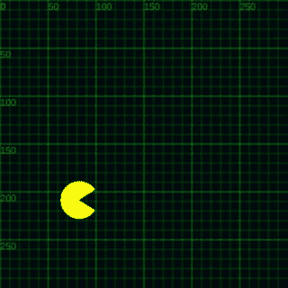

# 第 6 章 基本动画

Graeme Stuart (1) (1) 英国莱斯特郡马基特哈伯勒

在前几章中，我们学习了在画布上绘图的基本原理。现在我们有了一些经验，可以把注意力转向如何让场景动起来。动画相当简单——只需每秒多次绘制一个变化的场景。在本章中，我们将以一种非常简单的方式学习如何实现这一点，以理解其基础原理。当绘制飞船和小行星时，我们需要关于它们位置、大小、形状等数据。这些数据将用于平移和旋转上下文，使所有元素出现在正确的位置。为了制作场景动画，我们每帧更新数据，并随着数据的变化反复重绘场景。

## 从简单开始

我们先从一个非常简单的场景入手：一个移动的圆形。这个圆形在画布上有一个位置（`x` 和 `y` 坐标），我们将移动这个位置。按常规方式新建一个文件夹：复制 `drawing.js` 库和样式表。新建一个文件 `exercise6.html`，其中的代码如代码清单 6-1 所示。

```html
<!doctype html>
<html>
  <head>
    <title>动画</title>
    <link rel="stylesheet" href="styles.css">
    <script src="drawing.js"></script>
  </head>
  <body>
    <h1>动画</h1>
    <canvas id="asteroids" width="300" height="300"></canvas>
    <script>
      var context = document.getElementById("asteroids").getContext("2d");
      context.strokeStyle = "white";
      context.lineWidth = 1.5;
      var x = 0, y = context.canvas.height / 2;
      function frame() {
        context.clearRect(0, 0, context.canvas.width, context.canvas.height);
        draw(context);
        update();
      }
      function update() {
        x += 1;
      }
      function draw(ctx) {
        draw_grid(ctx);
        ctx.beginPath();
        ctx.arc(x, y, 40, 0, 2 * Math.PI);
        ctx.fill();
        ctx.stroke();
      }
      setInterval(frame, 1000.0/60.0); // 60 帧每秒
    </script>
  </body>
</html>
```

`代码清单 6-1` 一个移动的圆形

这段代码的大部分内容我们都很熟悉，但有几个新地方值得注意。首先，我们将 `x` 和 `y` 坐标存储为全局变量。我们还把代码重构为一系列函数：`frame`、`update` 和 `draw`。`frame` 函数做了三件不同的事：它使用 `context.clearRect` 方法清除画布，然后调用 `draw` 函数（该函数在位置 `x`、`y` 处绘制一个圆形），接着调用 `update` 函数（该函数将 `x` 坐标向右移动一个像素）。最后一个新内容是调用 `setInterval`，它会安排 `frame` 函数每秒被调用 60 次。

结果就是，每次调用 `frame` 函数时，它都会清除画布、绘制网格、在当前位置绘制圆形，并将位置向右移动。`setInterval` 调用中传入要调用的函数（`frame`）以及调用之间的时间间隔（以毫秒为单位，即 `1000.0 / 60.0`）。因此，`frame` 函数每隔六十分之一秒被调用一次，圆形以每秒 60 像素的速度向右移动。

一旦圆形移动到画布边界之外，它就不可见了，但 `x` 的值仍在不断递增。尝试修改 `update` 函数来改变圆形的行为。这里有几个简单的想法：

- 将 `x` 坐标增加一个不同的值（例如 `5`）
- 同时也增加 `y` 坐标
- 递减坐标值
- 将 `y` 坐标设为随机数（介于 `0` 和画布高度之间）

## 一个更复杂的例子

我们把重点放在 `update` 函数上，为圆形增加一些更复杂的行为。例如，可以添加一个重力效果，让圆形向下加速。在 `x` 和 `y` 定义之后添加一行，定义我们需要的变量：

```js
var yspeed = 0, gravity = 0.1;
```

像这样更新你的 `update` 函数：

```js
function update() {
  x += 1;
  y += yspeed;
  yspeed += gravity;
}
```

这里我们根据 `yspeed` 移动 `y` 坐标，并将 `yspeed` 增加 `gravity` 的值。圆形很快就会加速冲出画布底部。我们来让圆形在碰到屏幕底部时弹起来。弹跳其实就是改变运动方向，就像这样：

```js
function update() {
  x += 1;
  y += yspeed;
  yspeed += gravity;
  if(y >= context.canvas.height) { // 如果碰到了底部
    yspeed *= -1;                  // 改为向上运动
  }
}
```

如果希望每次弹跳都损失一点能量，则乘以一个小于 `-1` 的数（例如 `-0.8`）。

**注意** 这里需要小心。考虑一下，如果 `yspeed` 为 `+10`（像素/帧），而 `y` 坐标刚好比画布高度少 `1` 像素，会发生什么情况：

1. `y` 坐标增加到超出画布高度 `9` 像素，`yspeed` 更新为 `-8`。
2. `y` 坐标减少到超出画布高度 `1` 像素，`yspeed` 被设置为 `+6.4`。

由于 `yspeed` 在每一帧中都会更新（反转并缩小），位置永远不会低于画布高度。要解决此问题，请确保在每次反转 `yspeed` 时，将圆移动到画布高度。现在，我们希望看到圆在画布上水平“环绕”。将以下行添加到你的 `update` 函数中：

```js
if(x <= 0 || x >= context.canvas.width) {
  x = (x + context.canvas.width) % context.canvas.width;
}
```

现在我们可以更进一步，添加更多变量，并选择绘制一个吃豆人（Pac-Man）而不是一个球。这展示了将更新和绘制代码分离，并拥有便捷绘图函数的好处。更新你的代码以反映列表 6-2。

# 动画

我们在这里大展拳脚，通过追踪另一个变量来控制嘴巴的角度。`mouth` 角度现在与 `x` 坐标绑定，并遵循正弦波，吃豆人每次穿过画布时，嘴巴会开合六次。嘴巴的位置与 `x` 坐标的位置紧密相关。这只是为了好玩。你可以随意按自己喜欢的方式更新 `mouth` 变量。

请注意，其他主要变化涉及添加 `xspeed` 变量和 `radius`，以及调整让物体从画布底部弹起的代码。我们不再让物体陷入画布一半的位置。`draw_pacman` 函数需要更新，以便在上下文原点进行绘制，如列表 6-3 所示。

```html
<!doctype html>
<html>
  <head>
    <title>Animation</title>
    <link rel="stylesheet" href="styles.css">
    <script src="drawing.js"></script>
  </head>
  <body>
    <h1>Animation</h1>
    <canvas id="asteroids" width="300" height="300"></canvas>
    <script>
      var context = document.getElementById("asteroids").getContext("2d");
      context.strokeStyle = "white";
      context.lineWidth = 1.5;
      let x = 0, y = context.canvas.height / 5, radius = 20;
      let xspeed = 1.5, yspeed = 0, gravity = 0.1;
      let mouth = 0;
      function frame() {
        context.clearRect(0, 0, context.canvas.width, context.canvas.height);
        draw(context);
        update();
      }
      function update() {
        x += xspeed;
        y += yspeed;
        yspeed += gravity;
        if(y >= context.canvas.height - radius) {
          y = context.canvas.height - radius; // add an extra radius
          yspeed *= -0.6;                          // reverse and slow down
          xspeed *= 0.95;                          // just slow down a bit
        }
        if(x <= 0 || x >= context.canvas.width) {
          x = (x + context.canvas.width) % context.canvas.width;
        }
        mouth = Math.abs(Math.sin(6 * Math.PI * x / (context.canvas.width)));
      }
      function draw(ctx) {
        draw_grid(ctx);
        // draw a simple circle
        ctx.beginPath();
        ctx.arc(x, y, radius, 0, 2 * Math.PI);
        ctx.fill();
        ctx.stroke();
        // or try this instead
        // ctx.save();
        // ctx.translate(x, y);
        // draw_pacman(ctx, radius, mouth);
        // ctx.restore();
      }
      setInterval(frame, 1000.0/60.0); // 60 fps
    </script>
  </body>
</html>
```

### 列表 6-2 弹跳球/吃豆人

```javascript
function draw_pacman(ctx, radius, mouth) {
  angle = 0.2 * Math.PI * mouth;
  ctx.save();
  ctx.fillStyle = "yellow";
  ctx.strokeStyle = "black";
  ctx.lineWidth = 0.5;
  ctx.beginPath();
  ctx.arc(0, 0, radius, angle, -angle);
  ctx.lineTo(0, 0);
  ctx.closePath()
  ctx.fill();
  ctx.stroke();
  ctx.restore();
}
```

### 列表 6-3 在原点绘制吃豆人

为了明确这里发生了什么，我们可以反向跟踪代码。对 `setInterval` 的调用导致 `frame` 每秒被调用 60 次。对 `frame` 的重复调用会清除画布、调用 `update`，然后调用 `draw`。`update` 函数更新变量 `x`、`y`、`yspeed`、`xspeed` 和 `mouth`。`draw` 函数使用这些变量渲染圆形（或吃豆人），以确定其位置和嘴巴角度。最终结果是圆形/吃豆人在画布上弹跳。你应该会看到类似于图 6-1 的效果。试着移除对 `context.clearRect` 的调用，看看为什么需要保留它。



**图 6-1** 吃豆人在画布上大快朵颐

## 小结

在本章中，我们了解了动画的基本原理：我们逐帧渲染场景，并控制与游戏元素相关的数据。将绘制场景和更新数据这两个基本任务分离成两个不同的函数，是保持结构化方法的第一步。我们如何管理这些数据，是游戏在开发过程中能否增加复杂性的关键方面。需要说明的是，基于 `setInterval` 进行动画制作并非最佳实践。现代浏览器实现了一种专门用于在 Web 上进行动画制作的机制。我们应该迅速转向使用 `window.requestAnimationFrame` 方法来控制我们的游戏循环。那么，让我们开始吧。

© Graeme Stuart 2017

Graeme Stuart, *Introducing JavaScript Game Development*

`doi.org/10.1007/978-1-4842-3252-1_7`