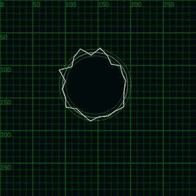
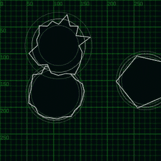

# 7. 让小行星动起来

Graeme Stuart<sup>1</sup>

(1) 英国莱斯特郡马基特哈伯勒

在本章中，我们将为代码引入一些关键结构。前几章介绍了需要存储与游戏元素相关的数据。本章将介绍如何使用对象来解决由此带来的复杂性爆炸问题。对象是一个很好的解决方案，因为它们能使数据和代码紧密相连。既然我们现在可以实现动画，就可以开始构建游戏的主要部分了。我们将首先让一些小行星出现在屏幕上，并漂浮移动。小行星在太空中漂浮，它们会一直运动，直到被击中或游戏结束。它们的速度和旋转是随机初始化的，并且永远不会改变。

## 稳固的游戏循环

`window.requestAnimationFrame` API 允许开发者专门请求浏览器绘制动画的下一帧。它受益于许多优化，例如按系统刷新率工作，并确保渲染与浏览器自身的重绘周期同步。它还能在页面最小化或选择了其他浏览器标签页时避免渲染帧，从而节省处理能力和电池续航。在本练习中，我们将实现一个稳健的游戏循环来控制一颗动画化的小行星。

创建一个新文件夹，并复制`drawing.js`库和样式表。复制上一个示例中的模板，将文件另存为`exercise7.html`。重命名页面标题和页眉，并用清单 7-1 中的代码替换脚本。

```javascript
var context = document.getElementById("asteroids").getContext("2d");
// asteroid shape
var segments = 24;
var shape = [];
for(var i = 0; i < segments; i++) {
  shape.push(Math.random() - 0.5);
}
var radius = 50;
var noise = 0.2;
// asteroid state
var x = context.canvas.width * Math.random();
var y = context.canvas.height * Math.random();
var angle = 0;
// asteroid movement
var x_speed = context.canvas.width * (Math.random() - 0.5);
var y_speed = context.canvas.height * (Math.random() - 0.5);
var rotation_speed = 2 * Math.PI * (Math.random() - 0.5);
```

**清单 7-1** 设置一颗小行星

这段代码定义了我们在此动画中使用的全局变量。`context` 的访问方式与往常一样。我们定义了用于存储小行星段数的变量，并设置了小行星的形状数据。我们还将半径存储为变量，并定义了小行星的噪声值。从之前绘制小行星的示例来看，这些内容应该都相当不言自明。小行星被赋予了随机的位置，其角度初始化为 0（因为其形状本身是随机的）。它还获得了决定其速度的 `x_speed` 和 `y_speed`。`rotation_speed` 变量也是随机化的，指示小行星旋转的速度和方向。这些移动变量都通过 `Math.random() – 0.5` 随机化为正值或负值。

现在，添加清单 7-2 中的 `draw` 函数来渲染场景。

```javascript
function draw(ctx, guide) {
  if(guide) {
    draw_grid(ctx);
  }
  ctx.save();
  ctx.translate(x, y);
  ctx.rotate(angle);
  draw_asteroid(ctx, radius, shape, {
    guide: guide,
    noise: noise
  });
  ctx.restore();
}
```

**清单 7-2** 绘制场景的函数

我们引入了一个新的 `guide` 参数，因为我们希望能够为整个场景切换网格、引导线以及其他辅助元素的显示。首先，我们绘制网格，但仅当 `guide` 参数设置为 `true` 时才绘制。然后，在 `save` 和 `restore` 调用之间，我们准备上下文，并使用存储的参数调用 `draw_asteroid`。小行星的选项被构建为一个新的对象字面量，直接传递给 `draw_asteroid` 函数。小行星的状态由全局变量决定，这些变量在 `update` 函数中持续变化，从而决定了小行星的行为。

添加清单 7-3 中的 `update` 函数。

```javascript
function update(elapsed) {
  if(x - radius + elapsed * x_speed > context.canvas.width) {x = -radius;}
  if(x + radius + elapsed * x_speed < 0) {x = context.canvas.width + radius;}
  if(y - radius + elapsed * y_speed > context.canvas.height) {y = -radius;}
  if(y + radius + elapsed * y_speed < 0) {y = context.canvas.height + radius;}
  x += elapsed * x_speed;
  y += elapsed * y_speed;
  angle = (angle + elapsed * rotation_speed) % (2 * Math.PI);
}
```

**清单 7-3** 更新小行星变量的函数

我们在这里看到的第一个不同点是，`update` 函数接收一个参数。这表示自上一帧渲染以来经过的时间（以秒为单位）。它允许我们即使在性能和刷新率下降时也能保持一致的游戏速度。我们的 `x_speed` 和 `y_speed` 变量以像素/秒为单位定义。我们可以通过将这些值乘以经过的时间，来计算每帧移动小行星的精确像素数。`update` 函数中的大部分代码确保小行星在画布上正确地环绕。当它完全移出某一边缘时，它会无缝地移动到对侧边缘之外。画布的每个边缘都用 `if` 语句进行检查。如果小行星即将越过边缘，其位置就会被翻转到对侧边缘。最后一行增加 `angle` 变量。

至此，我们终于可以实现实际的游戏循环了。将清单 7-4 中的代码添加到你的脚本中。

```javascript
var previous, elapsed;
function frame(timestamp) {
  context.clearRect(0, 0, context.canvas.width, context.canvas.height);
  if (!previous) previous = timestamp;
  elapsed = timestamp - previous;
  update(elapsed / 1000);
  draw(context, true);
  previous = timestamp;
  window.requestAnimationFrame(frame);
}
window.requestAnimationFrame(frame);
```

**清单 7-4** 游戏循环

这里我们引入了更多的全局变量，定义了 `frame` 函数，并调用了一次 `window.requestAnimationFrame`。脚本中的最后一行触发了第一帧，并开始了无限循环。`frame` 函数是回调函数，它被传递给 `window.requestAnimationFrame`。其主要任务与上一个练习中一样：调用 `update` 和 `draw` 函数。`requestAnimationFrame` API 规定，回调函数将接收一个参数，其中包含精确到至少 1 毫秒的时间戳。我们利用这个时间戳来计算当前帧与上一帧之间的经过时间。为此，我们存储了一个全局变量来保存上一次 `timestamp` 参数的值。在第一次调用时，上一次的时间戳尚未设置，因此我们将其初始化为当前时间戳，经过时间则为 0（零）。在后续帧中，上一次的时间戳是已知的，`elapsed` 时间就是从上一帧被计算和绘制以来实际经过的时间。`frame` 函数中的最后一行是调用 `window.requestAnimationFrame`，并将 `frame` 函数本身作为参数传递。这个调用是向浏览器发出的请求：“当您准备好时，请运行此函数。”它只是将该函数添加到一个将在页面刷新期间被调用的函数列表中。因此，虽然它看起来像递归，但实际上并不是。`frame` 函数并没有直接调用自己。这个调用确保一旦一帧完成，下一帧就会被排队等待渲染。浏览器通常会尝试达到每秒 60 帧，只要对 `update` 和 `draw` 的调用不会花费太长时间，这通常是可以实现的。

请仔细研究 `frame` 函数，确保你理解每一行代码。从现在开始，我们将在每个练习以及最终的游戏中都使用该函数的一个版本。你应该会看到类似图 7-1 所示的效果。



**图 7-1** 漂浮在太空中的动画小行星

这个练习让一颗小行星动了起来。如果我们想在游戏中包含两颗小行星该怎么办？那又该如何做？如果是五颗或十颗小行星呢？

## 重构为简单对象

在前面的代码中，我们将与小行星相关的所有数据都保存在全局作用域中。小行星的形状、位置和速度在脚本顶部被声明为简单变量。这种做法可扩展性很差——想象一下要为十颗小行星管理这些数据。我们需要某种结构。我们可以使用对象来表示游戏元素。对象可以存储与特定游戏对象相关的数据集合。将`segments`和`rotation_speed`之间的变量声明替换为清单 7-5 中的代码。

```javascript
var asteroid = {
    segments: 24,
    shape: [],
    radius: 50,
    noise: 0.5,
    x: context.canvas.width * Math.random(),
    y: context.canvas.height * Math.random(),
    angle: 0,
    x_speed: context.canvas.width * (Math.random() - 0.5),
    y_speed: context.canvas.height * (Math.random() - 0.5),
    rotation_speed: 2 * Math.PI * (Math.random() - 0.5)
};
```

清单 7-5 对象字面量

这里我们定义了一个名为`asteroid`的单一对象，并将变量存储在其中。JavaScript 对象允许将相关变量存储在一起。语法很直观。我们在花括号之间指定逗号分隔的 `key: value` 对。对象属性可以通过点语法（`asteroid.radius`）或带字符串索引的方括号（`asteroid["radius"]`）来访问。我们可以像往常一样将数据赋给对象参数。用清单 7-6 中的代码随机化`asteroid.shape`数组。

```javascript
for(var i = 0; i < asteroid.segments; i++) {
    asteroid.shape.push(Math.random() - 0.5);
}
```

清单 7-6 生成形状

现在我们需要升级`draw`函数，使其使用新对象中的数据。将`draw`函数替换为清单 7-7 中的代码。

```javascript
function draw(ctx, guide) {
    if(guide) {
        draw_grid(ctx);
    }
    ctx.save();
    ctx.translate(asteroid.x, asteroid.y);
    ctx.rotate(asteroid.angle);
    draw_asteroid(ctx, asteroid.radius, asteroid.shape, {
        noise: asteroid.noise,
        guide: guide
    });
    ctx.restore();
}
```

清单 7-7 使用对象数据

对`update`函数执行相同操作。只要变量已被移入`asteroid`对象，就添加前缀来访问数据。刷新页面，动画应该像之前一样正常工作。如果没有任何反应，请检查控制台中的错误消息——这些消息应该足够清晰，便于调试代码。如果你遗漏了某个变量，它会提示“未捕获的引用错误”，并指出是哪个变量以及代码中哪一行出了问题。

**注意** 大多数浏览器都内置了开发者工具。通常可以通过按`F12`键访问，但具体细节请查阅浏览器文档。JavaScript 控制台是一个非常有用的工具——它显示错误消息，并允许你直接与程序交互。

现在在浏览器控制台中输入`asteroid`并按回车键。你应该会看到命令被执行时的所有小行星参数。所有小行星数据都保存在一个对象中。这很好。但对于我们的目的来说，对象字面量语法还是相当笨拙。如果有更简洁的方法来创建小行星，我们就可以大大简化代码。

## 使用对象构造函数

对象构造函数是创建多个相似对象的好方法，而且容易创建。只需定义一个函数，并在函数内部将数据赋给特殊的`this`关键字。清单 7-8 是一个方便的对象构造函数，用于创建与前例类似的小行星。将其放入新的库文件`objects.js`中，并在页面的`<head>`元素中添加一个新的`<script>`元素。

```javascript
function Asteroid(segments, radius, noise) {
    this.x = context.canvas.width * Math.random();
    this.y = context.canvas.height * Math.random();
    this.angle = 0;
    this.x_speed = context.canvas.width * (Math.random() - 0.5);
    this.y_speed = context.canvas.height * (Math.random() - 0.5);
    this.rotation_speed = 2 * Math.PI * (Math.random() - 0.5);
    this.radius = radius;
    this.noise = noise;
    this.shape = [];
    for(let i = 0; i < segments; i++) {
        this.shape.push(Math.random() - 0.5);
    }
}
```

清单 7-8 一个对象构造函数

为了在代码中识别构造函数，通常建议（但非强制）将其首字母大写。这里我们将构造函数命名为`Asteroid`。我们在函数内将所有变量赋给了`this`关键字的属性。注意我们接受了三个参数：`segments`（分段数）、`radius`（半径）和`noise`（噪声）。其他变量要么是随机定义的，要么有默认值，要么由提供的参数推导得出。我们甚至没有将`segments`参数存储为属性，它仅用于在`shape`属性中分配正确数量的元素。要使用构造函数创建对象实例，必须使用`new`关键字，如下所示：

```javascript
var asteroid = new Asteroid(24, 50, 0.2);
```

用上述单行代码替换对象字面量，更新你的代码。确保在页面中包含了构造函数函数的链接。看着你的小行星在深邃太空中不可阻挡地继续它的旅程。满意地发现，你的代码现在组织得比以前好多了。但然后呢？我们为什么要费心这样组织代码？

## 扩展小行星原型

JavaScript 是一个基于原型的系统。所有通过构造函数创建的对象都将共享同一个原型。JavaScript 中对象的一个巨大优势在于，我们在该原型上定义的任何属性或方法都将对我们对象类型的所有实例可用。这就是我们能够轻松绘制和更新多个小行星的途径。假设我们创建了一个包含许多小行星的数组。如果在 `Asteroid.prototype` 上定义了 `update` 和 `draw` 函数，我们就能通过一次方法调用来更新或绘制任意一颗小行星。遍历我们的 `Asteroid` 对象并调用相应的方法将变得非常简单，而关于小行星行为的所有智能逻辑都将集中放置在 `Asteroid.prototype` 上的一处位置。

清单 7-9 展示了 `Asteroid.prototype` 上的一个 `update` 函数。将此函数添加到 `objects.js` 中，确保在构造函数定义之后添加。

## 原型方法

```javascript
Asteroid.prototype.update = function(elapsed) {
  if(this.x - this.radius + elapsed * this.x_speed > context.canvas.width) {
    this.x = -this.radius;
  }
  if(this.x + this.radius + elapsed * this.x_speed < 0) {
    this.x = context.canvas.width + this.radius;
  }
  if(this.y - this.radius + elapsed * this.y_speed > context.canvas.height) {
    this.y = -this.radius;
  }
  if(this.y + this.radius + elapsed * this.y_speed < 0) {
    this.y = context.canvas.height + this.radius;
  }
  this.x += elapsed * this.x_speed;
  this.y += elapsed * this.y_speed;
  this.angle = (this.angle + this.rotation_speed * elapsed) % (2 * Math.PI);
}
```

`清单 7-9` 一个原型方法

这与我们最初的 `update` 函数几乎相同，只是现在引用了对象的实例属性。现在，我们可以用清单 7-10 中简单的一行代码来替换全局的 `update` 函数。

```javascript
function update(elapsed) {
  asteroid.update(elapsed);
}
```

`清单 7-10` 简化的 `update` 函数

刷新页面应该会看到小行星仍在运行。除了代码质量之外，一切都没有改变。现在，以同样的方式将清单 7-11 中的 `draw` 函数添加到 `Asteroid.prototype` 上。

```javascript
Asteroid.prototype.draw = function(ctx, guide) {
  ctx.save();
  ctx.translate(this.x, this.y);
  ctx.rotate(this.angle);
  draw_asteroid(ctx, this.radius, this.shape, {
    guide: guide,
    noise: this.noise
  });
  ctx.restore();
}
```

`清单 7-11` 另一个原型方法

同样，我们只是将现有代码转移到函数中，并指定了实例变量。我们还指定了两个参数：上下文 `ctx` 和可选的 `guide`。我们的全局 `draw` 函数现在如清单 7-12 所示。

```javascript
function draw(ctx, guide) {
  if(guide) {
    draw_grid(ctx);
  }
  asteroid.draw(ctx, guide);
}
```

`清单 7-12` 简化的 `draw` 函数

变化不大。我们只是将所有绘制小行星的代码替换为对前面函数的单一调用。`guide` 的绘制仍然保留，因为这是一个全局关注点，与单个小行星无关。

## 处理多个小行星

现在，基本的小行星“类”已经完成，我们可以尝试处理多个小行星实例了。根据清单 7-13 更新你的代码。

```javascript
var asteroids = [
  new Asteroid(24, 50, 0.2),
  new Asteroid(24, 50, 0.5),
  new Asteroid(5, 50, 0.2)
];

function draw(ctx, guide) {
  if(guide) {
    draw_grid(ctx);
  }
  asteroids.forEach(function(asteroid) {
    asteroid.draw(context, guide);
  });
}

function update(elapsed) {
  asteroids.forEach(function(asteroid) {
    asteroid.update(elapsed);
  });
}
```

`清单 7-13` 三个小行星

我们将 `asteroid` 变量替换成了一个 `Asteroid` 对象数组。在我们的 `draw` 函数中，我们将对 `asteroid.draw` 函数的调用替换为一个循环，该循环会对 `asteroids` 数组中的每个项调用 `draw` 方法。最后，我们以类似的方式替换了对 `asteroid.update` 函数的调用。

图 7-2 显示了结果。刷新页面，看看你创造出来的这三个截然不同的小行星吧！



`图 7-2` 三个漂浮的小行星

## 总结

在本章中，我们重构了代码结构。现在，我们将小行星数据的存储与更新，以及小行星在画布上的渲染都整合到一个新的对象类型中。我们在代码中运用的逻辑与之前几乎相同。我们没有改变小行星的绘制或更新方式；我们只是为代码增加了结构。这种额外的结构使我们能够通过简单地调用构造函数来创建小行星。然后，我们可以非常方便地在小行星对象上调用方法。

在清单 7-13 中，一些小的改动使我们能够并行地向场景中添加任意数量的小行星。如果没有这次重构，管理起来将会困难得多。

© Graeme Stuart 2017

Graeme Stuart, 《JavaScript 游戏开发入门》

[`doi.org/10.1007/978-1-4842-3252-1_8`](https://doi.org/10.1007/978-1-4842-3252-1_8)