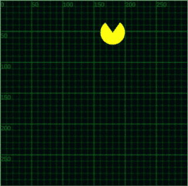
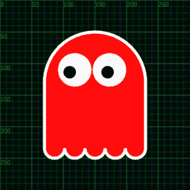
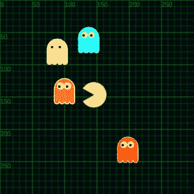

# 8. 实践对象

Graeme Stuart¹

(1) 英国莱斯特郡马基特哈伯勒

面向对象方法的好处现在应该很清楚了。我们可以通过简单直观的 API 来设计我们的对象（`Asteroid`、`Ship` 等）。我们的对象会跟踪自己的状态，并在我们要求时（在其 `update` 函数中）更新自身。通过简单的函数调用（它们的 `draw` 函数），它们也能轻松地绘制到画布的正确位置。游戏循环本身可以依次更新所有对象，然后绘制它们。我们应该能够毫不费力地阅读高级代码。所有繁杂的细节都委托给了对象本身。在本章中，我们将通过一个熟悉的示例来实践这种使用对象的方式。

## 为什么使用对象？

现代开发实践中一个重要的点是，实现的效率与我们生成代码的清晰度之间通常需要权衡。对于像这样一个简单的游戏，低端机器的计算能力已经绰绰有余，我们应该将注意力集中在使代码易于理解上。虽然实现的效率非常重要，并且我们应该始终默认追求高效，但我们不应让这一点影响代码的整体设计。事实上，我们有时可能会主动选择牺牲效率来换取清晰度。通过将底层代码推入对象（并将这些代码移入库模块），我们将底层的实现细节隐藏起来。这样，我们的顶层作用域（当前我们在全局作用域中编码）就变得易于理解，并且可以专注于更高级别的游戏逻辑。我们可以在无需思考小行星行为如何实现或小行星如何绘制的情况下处理这些代码，从而保持关注点分离，并使我们能够专注于手头的任务。


## 被鬼魂追逐的吃豆人

在接下来的几章中，我们将深入编写小行星游戏的代码。不过在此之前，我们先花点时间回顾一下游戏设计，看看上一章应用的原理如何应用到另一个涉及吃豆人的伪游戏中。我们将为吃豆人定义行为，并创建一个新对象来表示追逐吃豆人的鬼魂。吃豆人可以在画布上水平和垂直移动，并且会像之前的吃豆人和小行星示例一样环绕画布边界。偶尔，他会随机决定向左或向右转（顺时针或逆时针方向）。他将被鬼魂追逐。鬼魂的优势在于能够向任意方向移动，并且会被编程为径直朝吃豆人逼近。我们将通过让吃豆人速度更快来确保鬼魂难以得手。

创建一个名为 `exercise8` 的新文件夹，将常见的库和样式表复制到新文件夹中。添加一个名为 `exercise8.html` 的新模板，并像之前一样包含指向 `drawing.js` 和 `objects.js` 的链接。从列表 8-1 中的代码开始。这段代码实例化了一个 `PacMan` 对象，在各自的函数中更新和绘制它，并通过主游戏循环函数 `frame` 控制一切。

```html
<!doctype html>
<html>
  <head>
    <title>动画</title>
    <link rel="stylesheet" href="styles.css">
    <script src="drawing.js"></script>
    <script src="objects.js"></script>
  </head>
  <body>
    <h1>动画</h1>
    <canvas id="pacman" width="300" height="300"></canvas>
    <script>
      var context = document.getElementById("pacman").getContext("2d");
      pacman = new PacMan(150, 150, 20, 120);
      function draw(ctx, guide) {
        pacman.draw(ctx);
      }
      function update(elapsed) {
        pacman.update(elapsed, 300, 300);
      }
      var previous, elapsed;
      function frame(timestamp) {
        context.clearRect(0, 0, context.canvas.width, context.canvas.height);
        if (!previous) previous = timestamp;
        elapsed = timestamp - previous;
        update(elapsed / 1000);
        draw(context, true);
        previous = timestamp;
        window.requestAnimationFrame(frame);
      }
      window.requestAnimationFrame(frame);
    </script>
  </body>
</html>
```

**列表 8-1** 一个简单模板

## `PacMan` 对象

现在我们需要在 `objects.js` 中定义 `PacMan` 构造函数。吃豆人很简单：我们通过参数设置其半径和速度。我们将其初始位置设为画布中心。在内部，吃豆人拥有 `x_speed` 和 `y_speed`（初始时向右移动）。他还拥有一个用于确定朝向的 `angle` 属性，以及一个记录嘴巴在咀嚼周期中位置的 `mouth_angle` 属性。将列表 8-2 添加到你的 `objects.js` 库中。注意没有提供默认值。

```javascript
function PacMan(x, y, radius, speed) {
  this.x = x;
  this.y = y;
  this.radius = radius;
  this.speed = speed;
  this.angle = 0;
  this.x_speed = speed;
  this.y_speed = 0;
  this.time = 0;
  this.mouth = 0;
}
```

**列表 8-2** `PacMan` 构造函数

`PacMan.prototype.draw` 方法应该看起来很熟悉。它与 `Asteroid` 的相同。将列表 8-3 添加到构造函数之后。

```javascript
PacMan.prototype.draw = function(ctx) {
  ctx.save();
  ctx.translate(this.x, this.y);
  ctx.rotate(this.angle);
  draw_pacman(ctx, this.radius, this.mouth);
  ctx.restore();
}
```

**列表 8-3** `PacMan.prototype.draw` 方法

现在，在我们编写 `PacMan.prototype.update` 函数中吃豆人的行为之前，我们需要几个辅助函数。我们需要的主要辅助函数是一个能让吃豆人向左或向右旋转 90 度的函数。列表 8-4 展示了这个新函数；将其添加到你的库中。

```javascript
PacMan.prototype.turn = function(direction) {
  if(this.y_speed) {
    // 如果我们在垂直移动
    // 设置水平速度并应用方向
    this.x_speed = -direction * this.y_speed;
    // 清除垂直速度并旋转
    this.y_speed = 0;
    this.angle = this.x_speed > 0 ? 0 : Math.PI;
  } else {
    // 如果我们在水平移动
    // 设置垂直速度并应用方向
    this.y_speed = direction * this.x_speed;
    // 清除水平速度并旋转
    this.x_speed = 0;
    this.angle = this.y_speed > 0 ? 0.5 * Math.PI : 1.5 * Math.PI;
  }
}
```

**列表 8-4** `PacMan.prototype.turn` 方法

此函数依赖于一个限制条件：我们的吃豆人只能在水平和垂直方向上移动。也就是说，我们依赖于 `x_speed` 或 `y_speed` 其中一个始终为 0 的事实。函数首先测试我们是垂直移动还是水平移动。然后相应地改变移动方向，并调整角度，使吃豆人始终面朝正确的方向。该函数接受一个参数，用于选择是左转还是右转。为了使 API 更清晰，我们可以添加几个中间方法，如列表 8-5 所示。

```javascript
PacMan.prototype.turn_left = function() {
  this.turn(-1);
}

PacMan.prototype.turn_right = function() {
  this.turn(1);
}
```

**列表 8-5** 辅助方法使 API 更友好

有了这些方法，我们无需记住辅助函数的 API 规则，只需调用相应的函数即可让吃豆人左转或右转。现在，我们可以在 `PacMan.prototype.update` 函数中以非常清晰的方式使用这些函数，保持代码简洁明了。添加列表 8-6 中的代码。

```javascript
PacMan.prototype.update = function(elapsed, width, height) {
  // 平均每 100 帧执行一次
  if(Math.random() <= 0.01) {
    if(Math.random() < 0.5) {
      this.turn_left();
    } else {
      this.turn_right();
    }
  }
  if(this.x - this.radius + elapsed * this.x_speed > width) {
    this.x = -this.radius;
  }
  if(this.x + this.radius + elapsed * this.x_speed < 0) {
    this.x = width + this.radius;
  }
  if(this.y - this.radius + elapsed * this.y_speed > height) {
    this.y = -this.radius;
  }
  if(this.y + this.radius + elapsed * this.y_speed < 0) {
    this.y = height + this.radius;
  }
  this.x += this.x_speed * elapsed;
  this.y += this.y_speed * elapsed;
  this.time += elapsed;
  this.mouth = Math.abs(Math.sin(2 * Math.PI * this.time));
}
```

**列表 8-6** `PacMan.prototype.update` 方法

第一个代码块平均每 100 帧才运行一次。它随机选择调用 `turn_left` 或 `turn_right` 函数。这会控制 `x_speed` 和 `y_speed` 属性以及 `angle` 属性。接下来的四个代码块应该与前面提到的 `Asteroid.prototype.update` 函数类似。在每个块中，我们检查是否即将穿过画布的某条边。如果确实穿过了边界，我们就将吃豆人定位到画布的对侧。完成移动后，我们像往常一样更新 `x` 和 `y` 坐标。注意我们已经去除了对全局上下文的任何依赖。我们接受 `width` 和 `height` 参数，并用它们来确定 `x` 和 `y` 属性在何处环绕。最后，我们有两行代码更新 `mouth` 值，该值决定了嘴巴张开的程度。第一行通过已流逝的时间累加 `time`。第二行将 `mouth` 更新为 `time` 值的正弦绝对值。这会使 `mouth` 以正弦波形式变化，让嘴巴每秒张开和闭合两次。

创建一个全局的 `PacMan` 对象，并更新你的全局 `draw` 和 `update` 函数来绘制和更新它。当你用浏览器打开文件时，应该能看到吃豆人在咀嚼并随机转弯。图 8-1 展示了结果。



**图 8-1** 吃豆人咀嚼和转弯

## 鬼魂对象


幽灵会沿着直线直接向 Pac-Man 移动。它们会有不同的颜色和不同的速度。它们不需要环绕画布，因为它们总是向 Pac-Man 移动。由于 Pac-Man 会环绕画布，它们会转身跟随他。绘制 Pac-Man 幽灵相当棘手。这里有一个基本方法。将代码清单 8-7 复制到`drawing.js`中。

```javascript
function draw_ghost(ctx, radius, options) {  
  options = options || {}  
  var feet = options.feet || 4;  
  var head_radius = radius * 0.8;  
  var foot_radius = head_radius / feet;  
  ctx.save();  
  ctx.strokeStyle = options.stroke || "white";  
  ctx.fillStyle = options.fill || "red";  
  ctx.lineWidth = options.lineWidth || radius * 0.05;  
  ctx.beginPath();  
  for(foot = 0; foot < feet; foot++) {  
    ctx.arc(  
      (2 * foot_radius * (feet - foot)) - head_radius - foot_radius,  
      radius - foot_radius,  
      foot_radius, 0, Math.PI  
     );  
  }  
  ctx.lineTo(-head_radius, radius - foot_radius);  
  ctx.arc(0, head_radius - radius, head_radius, Math.PI, 2 * Math.PI);  
  ctx.closePath();  
  ctx.fill();  
  ctx.stroke();  
  ctx.restore();  
}
```

**代码清单 8-7 绘制幽灵**

我们绘制一系列倒置的半圆作为“脚”，然后绘制一条线连接到头部，再绘制另一个半圆作为头部。然后闭合路径完成绘制。计算所有这些元素的位置很棘手，但一旦完成，一切就能正常工作，你可以忘记它。图 8-2 显示了一个带有眼睛的幽灵。



**图 8-2 一个带有五个“脚”的大红色幽灵**

尝试为你的幽灵添加眼睛。可以使用填充的黑色圆形，但用白色圆形内嵌黑色圆形会更有特色。对于`Ghost`构造函数，我们指定半径、速度和颜色作为参数。将代码清单 8-8 复制到你的`objects.js`文件中。

```javascript
function Ghost(x, y, radius, speed, colour) {  
  this.x = x;  
  this.y = y;  
  this.radius = radius;  
  this.speed = speed;  
  this.colour = colour;  
}
```

**代码清单 8-8 Ghost 构造函数**

我们简单地将给定的参数存储为属性——不提供默认值。代码清单 8-9 中的`Ghost.prototype.draw`方法也很熟悉。我们将上下文变换到正确的位置，并调用`draw_ghost`函数，根据需要传入颜色属性。将其复制到构造函数之后的`objects.js`文件中。

```javascript
Ghost.prototype.draw = function(ctx) {  
  ctx.save();  
  ctx.translate(this.x, this.y);  
  draw_ghost(ctx, this.radius, {  
    fill: this.colour  
  });  
  ctx.restore();  
}
```

**代码清单 8-9 `Ghost.prototype.draw`方法**

代码清单 8-10 中的`Ghost.prototype.update`方法定义了幽灵的行为。我们引入一个名为`target`的额外参数。该方法计算幽灵与目标之间的角度，然后设置`x_speed`和`y_speed`属性，使幽灵以给定速度向目标移动。然后更新幽灵坐标以反映速度。

```javascript
Ghost.prototype.update = function(target, elapsed) {  
  var angle = Math.atan2(target.y - this.y, target.x - this.x);  
  var x_speed = Math.cos(angle) * this.speed;  
  var y_speed = Math.sin(angle) * this.speed;  
  this.x += x_speed * elapsed;  
  this.y += y_speed * elapsed;  
}
```

**代码清单 8-10 `Ghost.prototype.update`方法**

在全局作用域中实例化一个包含四个`Ghost`对象的数组。将它们的位置初始化为画布上的随机位置。在`draw`和`update`函数中遍历每个幽灵，并调用相应的幽灵方法。你应该会看到幽灵在画布上追逐 Pac-Man，如图 8-3 所示。



**图 8-3 幽灵追逐 Pac-Man**

最终你应该得到类似代码清单 8-11 所示的代码。

```html
<!doctype html>  
<html>  
  <head>  
    <title>Animation</title>  
    <link rel="stylesheet" href="styles.css">  
    <script src="drawing.js"></script>  
    <script src="objects.js"></script>  
  </head>  
  <body>  
    <h1>Animation</h1>  
    <canvas id="pacman" width="300" height="300"></canvas>  
    <script>  
      let context = document.getElementById("pacman").getContext("2d");  
      let pacman = new PacMan(150, 150, 20, 120);  
      let ghosts = [  
        new Ghost(Math.random() * 300, Math.random() * 300, 20, 70, 'red'),  
        new Ghost(Math.random() * 300, Math.random() * 300, 20, 60, 'pink'),  
        new Ghost(Math.random() * 300, Math.random() * 300, 20, 50, 'cyan'),  
        new Ghost(Math.random() * 300, Math.random() * 300, 20, 40, 'orange')  
      ]  
      function draw(ctx, guide) {  
        pacman.draw(ctx);  
        ghosts.forEach(function(ghost) {  
          ghost.draw(context, guide);  
        });  
      }  
      function update(elapsed) {  
        pacman.update(elapsed, 300, 300);  
        ghosts.forEach(function(ghost) {  
          ghost.update(pacman, elapsed);  
        });  
      }  
      var previous, elapsed;  
      function frame(timestamp) {  
        context.clearRect(0, 0, context.canvas.width, context.canvas.height);  
        if (!previous) previous = timestamp;  
        elapsed = timestamp - previous;  
        update(elapsed / 1000);  
        draw(context, true);  
        previous = timestamp;  
        window.requestAnimationFrame(frame);  
      }  
      window.requestAnimationFrame(frame);  
    </script>  
  </body>  
</html>
```

**代码清单 8-11 控制 Pac-Man 和幽灵**

## 总结

希望本章在一定程度上建立了清晰的模式。屏幕上需要的“东西”必须在每一帧中进行更新和绘制。我们可以通过定义带有构造函数的对象，并在对象原型上定义用于绘制和更新的方法，以非常有组织的方式做到这一点。这使得我们的全局`draw`和`update`函数非常简单——它们只需依次绘制和更新每个对象。练习够了！让我们继续开发我们的游戏。在下一章中，我们将继续为构建坚实的对象基础设施迈出几步。© Graeme Stuart 2017 Graeme Stuart《Introducing JavaScript Game Development》`doi.org/10.1007/978-1-4842-3252-1_9`

