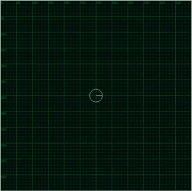
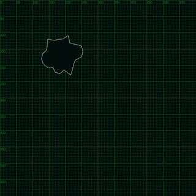
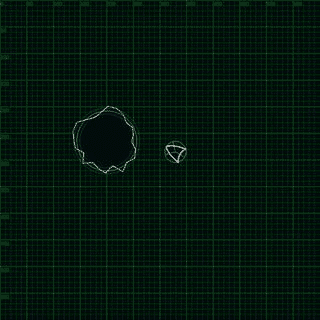

# 9. 继承

Graeme Stuart^（1） （1）英国莱斯特郡 Market Harborough

在本章中，我们将开始构建 Asteroids 游戏的最终版本。我们需要对象来描述小行星和我们的飞船，最终还需要对象来描述我们的炮弹，飞船将使用这些炮弹来摧毁小行星。在这种情况下，这些对象将共享一些共同特性，这使得它们成为继承的良好候选。继承是面向对象软件工程中的一个重要概念，因为它允许将潜在的复杂逻辑表达一次，并在多个对象类型中复用。我们将以惯用的方式——通过实践来学习。


## 设置模板

首先，创建一个名为 `exercise9` 的新文件夹，将库文件和样式表复制到该文件夹中，并将清单 9-1 中的模板保存为 `exercise9.html`。和往常一样，我们将复用 `drawing.js` 和 `objects.js` 这两个库，分别用于存放绘图代码和对象定义。

```html
<!doctype html>
<html>
  <head>
    <title>继承</title>
    <link rel="stylesheet" href="styles.css">
    <script src="drawing.js"></script>
    <script src="objects.js"></script>
  </head>
  <body>
    <h1>继承</h1>
    <canvas id="asteroids" width="600" height="600"></canvas>
    <script>
      'use strict';
      var context = document.getElementById("asteroids").getContext("2d");
      function draw(ctx) {
        draw_grid(context);
      }
      function update(elapsed) {
      }
      var previous;
      function frame(timestamp) {
        if (!previous) previous = timestamp;
        var elapsed = timestamp - previous;
        context.clearRect(0, 0, context.canvas.width, context.canvas.height);
        update(elapsed/1000);
        draw(context);
        previous = timestamp;
        window.requestAnimationFrame(frame);
      }
      window.requestAnimationFrame(frame);
    </script>
  </body>
</html>
```

清单 9-1 `exercise9.html` 结果应该是一个空白网格。我们增加了网格的尺寸以适配游戏。请注意，动画每秒绘制 60 帧，只是每一帧的内容都相同。

## 牛顿运动定律

任何试图构建太空中漂浮物体模型的尝试，都应符合经典力学的三条基本定律：

1. 除非受到外力作用，否则空间中物体的速度将保持不变。
2. 物体所受的力等于其质量乘以由此产生的加速度。
3. 当一个物体推动另一个物体时，它也会受到大小相等、方向相反的反作用力。

在创建 `Asteroid` 对象时，我们按照牛顿第一定律对其行为进行了编码。`Asteroid` 实例存储了它们的速度，并简单地以该速度持续运动。由于没有外力作用，这正是小行星的行为方式。在我们的游戏中，玩家操控的是一艘漂浮在太空中的飞船。飞船的编码也需要遵循牛顿第一定律。事实上，游戏中的所有元素（除非你实现了某种激光，欢迎尝试）都应符合经典力学的这三条基本定律。

## 通用质量类


## 将经典力学编码到 `Mass` 类中

在本练习中，我们将把经典力学定律编码到一个通用 `Mass` 类中，并扩展该 `Mass` 类，以创建我们的 `Asteroid`（小行星）和 `Ship`（飞船）类。

基础 `Mass` 类存储位置（`x` 和 `y` 坐标）以及速度（`x_speed` 和 `y_speed`）。它还包含一个角度（`angle`）和一个旋转速度（`rotation_speed`）。将清单 9-2 所示的构造函数添加到你的 `objects.js` 文件中。

```
function Mass(x, y, mass, radius, angle, x_speed, y_speed, rotation_speed) {
  this.x = x;
  this.y = y;
  this.mass = mass || 1;
  this.radius = radius || 50;
  this.angle = angle || 0;
  this.x_speed = x_speed || 0;
  this.y_speed = y_speed || 0;
  this.rotation_speed = rotation_speed || 0;
}
```

参数列表很长，因为我们不希望有复杂的默认行为。一个质量体需要所有这些参数才能正常运行。虽然为大多数参数提供了默认值，但在典型使用中，这些默认值不太可能被依赖。在大多数情况下，它们具有合理的默认值 0，因此质量体默认是静止的。默认质量值为 1，半径为 50。`(x, y)` 坐标是必需的参数，否则 `Mass` 对象将位于画布原点，这会造成混淆。

清单 9-3 中的 `update` 方法负责执行牛顿第一定律。我们还用它来在质量体移动出画布边缘时将其回绕到画布中。将此方法复制到你的构造函数下方。

```
Mass.prototype.update = function(elapsed, ctx) {
  this.x += this.x_speed * elapsed;
  this.y += this.y_speed * elapsed;
  this.angle += this.rotation_speed * elapsed;
  this.angle %= (2 * Math.PI);
  if(this.x - this.radius > ctx.canvas.width) {
    this.x = -this.radius;
  }
  if(this.x + this.radius < 0) {
    this.x = ctx.canvas.width + this.radius;
  }
  if(this.y - this.radius > ctx.canvas.height) {
    this.y = -this.radius;
  }
  if(this.y + this.radius < 0) {
    this.y = ctx.canvas.height + this.radius;
  }
}
```

这应该是一种熟悉的模式，因为它与原始小行星的 `update` 函数非常相似。一个区别是，这次我们将上下文（context）作为参数，因为这段代码现在位于 `objects.js` 库中，并且（或者应该）不了解我们主作用域中的画布或上下文。

我们通过清单 9-4 中简单的 `Mass.prototype.push` 方法来实现牛顿第二定律。用角度、力和经过的时间调用此方法，会将力应用于质量体，产生与质量成反比的加速度。将其添加到你的库中。

```
Mass.prototype.push = function(angle, force, elapsed) {
  this.x_speed += elapsed * (Math.cos(angle) * force) / this.mass;
  this.y_speed += elapsed * (Math.sin(angle) * force) / this.mass;
}
```

清单 9-5 中非常相似的 `Mass.prototype.twist` 方法对角度执行相同的操作。正力使质量体顺时针旋转，负力使质量体逆时针旋转。同样，将其添加到你不断增长的代码库中。

```
Mass.prototype.twist = function(force, elapsed) {
  this.rotation_speed += elapsed * force / this.mass;
}
```

我们还将添加清单 9-6 中所示的一对方法。这些方法计算 `Mass` 的速度和运动角度，之后会很有用。

```
Mass.prototype.speed = function() {
  return Math.sqrt(Math.pow(this.x_speed, 2) + Math.pow(this.y_speed, 2));
}

Mass.prototype.movement_angle = function() {
  return Math.atan2(this.y_speed, this.x_speed);
}
```

为了测试我们的父类 `Mass`，我们需要一个 `draw` 方法。该方法会在任何子类中被重写。添加清单 9-7 中的方法。

```
Mass.prototype.draw = function(c) {
  c.save();
  c.translate(this.x, this.y);
  c.rotate(this.angle);
  c.beginPath();
  c.arc(0, 0, this.radius, 0, 2 * Math.PI);
  c.lineTo(0, 0);
  c.strokeStyle = "#FFFFFF";
  c.stroke();
  c.restore();
}
```

我们简单地绘制一个圆和一条指向圆心的线，以指示 `Mass` 的位置、半径和角度。要测试这一点，实例化一个 `Mass` 对象，并定义全局的 `update` 和 `draw` 函数来驱动你的质量体。遵循清单 9-8 中的代码。

```
var mass = new Mass(context.canvas.width/2, context.canvas.height/2, 10, 20);

function draw() {
  context.clearRect(0, 0, context.canvas.width, context.canvas.height);
  draw_grid(context);
  mass.draw(context);
}

function update(elapsed) {
  mass.update(elapsed, context);
}
```

刷新浏览器会显示我们的 `Mass` 对象静静地停留在画布中央，如图 9-1 所示。它的 `x_speed`、`y_speed` 和 `rotation_speed` 均为 0（零），因此不会移动。当我们在全局的 `update` 和 `draw` 方法中调用对象函数时，我们就将这些对象链接到了游戏循环中。我们有时会将这种将对象链接到游戏的工作称为管道代码或挂接对象。



打开浏览器的开发者工具（在 Google Chrome 中按 F12），然后导航至 JavaScript 控制台，这使你可以与网页进行交互。在本例中，因为我们在全局作用域中定义变量，所以可以直接访问它们并调用方法。在控制台中输入 `mass`，你应该会看到打印出的 `mass` 变量。试着输入 `mass.twist(Math.PI, 10)`。这会施加一个扭转力，我们会看到质量体旋转。再次调用该方法会加速旋转。调用 `mass.push(0.75 * Math.PI, 10, 10)` 也是如此。质量体因推力而加速。在命令行上对此进行一些实验。思考一下，你可以定义任何你喜欢的方法，并对自己画布游戏拥有终极控制权。

## 一种简单的继承方法

为了让我们的 `Asteroid` 类继承 `Mass` 的行为，我们需要操作对象原型。将清单 9-9 所示的函数放置在 `objects.js` 的顶部，位于 `Mass` 构造函数之前。

```
function extend(ChildClass, ParentClass) {
  var parent = new ParentClass();
  ChildClass.prototype = parent;
  ChildClass.prototype.super = parent.constructor;
  ChildClass.prototype.constructor = ChildClass;
}
```

该函数模拟类并实现了一种简单的继承机制。要使用父类的属性和方法扩展子类，只需用两个类对象调用此函数即可。函数的第一行创建了父类的一个实例。子类的原型被替换为该实例。第三行提供了一种从子类构造函数内调用父类构造函数的方法。最后，子类原型的构造函数（即父类实例）被设置回子类。这种原型操作允许子类构造函数通过 `super` 方法将参数传递给父类构造函数。它不处理任何添加到原型上的额外方法。如果这些方法需要调用父类实现，则需要手动进行，我们稍后会看到这一点。


## 小行星

清单 9-10 展示了我们如何创建 `Asteroid` 类作为 `Mass` 类的扩展。用清单 9-10 替换 `object.js` 库中现有的 `Asteroid` 定义。

```
function Asteroid(mass, x, y, x_speed, y_speed, rotation_speed) {
  var density = 1; // kg per square pixel
  var radius = Math.sqrt((mass / density) / Math.PI);
  this.super(mass, radius, x, y, 0, x_speed, y_speed, rotation_speed);
  this.circumference = 2 * Math.PI * this.radius;
  this.segments = Math.ceil(this.circumference / 15);
  this.segments = Math.min(25, Math.max(5, this.segments));
  this.noise = 0.2;
  this.shape = [];
  for(var i = 0; i < this.segments; i++) {
    this.shape.push(2 * (Math.random() - 0.5));
  }
}
extend(Asteroid, Mass);

Asteroid.prototype.draw = function(ctx, guide) {
  ctx.save();
  ctx.translate(this.x, this.y);
  ctx.rotate(this.angle);
  draw_asteroid(ctx, this.radius, this.shape, {
    noise: this.noise,
    guide: guide
  });
  ctx.restore();
}
```

清单 9-10 Asteroid 类

`Asteroid` 构造器与我们之前的示例大致相同，但做了一些微小的改进。它接受六个参数，其中最重要的是质量（mass）和坐标 `(x, y)`。我们还允许设置速度和旋转速度，稍后拆分小行星时会用到这些参数。

在内部，小行星根据给定的质量，基于固定的密度值计算出半径值。如果你想要更大或更小的小行星，调整密度值即可实现。然后我们调用 `this.super`，从 `extend` 函数可以看出，它是对父类构造器 `Mass` 的引用。通过调用它，我们设置了对象的 mass、radius、x、y、angle、x_speed、y_speed 和 rotation_speed 属性。

最后一步是设置小行星的形状。为此，我们首先计算周长，并用它来设置段数，以便较大的小行星拥有更多细节。我们确保段数至少为 5，最多不超过 25。我们将噪声（noise）设置为 0.2，并像之前一样设置随机形状。

定义完构造器后，我们调用 `extend` 函数，并传入子类 `Asteroid` 和父类 `Mass`。这就是将 `Asteroid.super` 设置为 `Mass` 构造器的过程——关键在于，它还将 `Asteroid.prototype` 设置为 `Mass` 的一个实例。

`Asteroid.prototype.draw` 方法并无新奇之处。它与我们之前的小行星示例相比没有变化。请注意，我们不需要定义 `Asteroid.prototype.update` 方法，因为从 `Mass` 继承来的方法已经满足所有需求。

在画布中心创建一个质量随机的 `Asteroid` 实例，如清单 9-11 所示。

```
var asteroid = new Asteroid(
  10000,
  Math.random() * context.canvas.width,
  Math.random() * context.canvas.height
);
```

清单 9-11 实例化一个小行星

连接 update 和 draw 函数并刷新浏览器。现在在浏览器控制台中再次使用我们的 `asteroid.push` 和 `asteroid.twist` API 进行实验。注意，更大、更重的小行星需要更大的力才能获得相同的加速度。图 9-2 展示了一颗小行星。



图 9-2 一颗类似的小行星，但这次继承了质量属性

尝试创建一个小行星列表（记得将 update 和 draw 函数连接到小行星对象上）。使用浏览器控制台依次推动和旋转每个小行星。

## 飞船

现在我们可以对飞船进行同样的操作。飞船就像小行星一样，是漂浮在太空中的一个质量体。将清单 9-12 中的代码添加到你的库中。

```
function Ship(x, y) {
  this.super(x, y, 10, 20, 1.5 * Math.PI);
}
extend(Ship, Mass);

Ship.prototype.draw = function(c, guide) {
  c.save();
  c.translate(this.x, this.y);
  c.rotate(this.angle);
  c.strokeStyle = "white";
  c.lineWidth = 2;
  c.fillStyle = "black";
  draw_ship(c, this.radius, {
    guide: guide
  });
  c.restore();
}
```

清单 9-12 Ship 类

在你的 `exercise9.html` 文件中，添加一些代码来正确设置你的小行星和飞船。尝试自动推动和旋转小行星，让它们漂浮到太空中。在画布正中央实例化一艘飞船。清单 9-13 展示了一种方法。

```
var asteroids = [];
for (let i=0; i<4; i++) {
  let asteroid = new Asteroid(
    Math.random() * context.canvas.width,
    Math.random() * context.canvas.height,
    2000 + Math.random() * 8000
  );
  asteroid.push(Math.random() * 2 * Math.PI, 2000, 60);
  asteroid.twist((Math.random()-0.5) * 500, 60);
  asteroids.push(asteroid);
}

var ship = new Ship(context.canvas.width / 2, context.canvas.height / 2);
```

清单 9-13 设置一个简单场景

我们现在有了一组小行星，每一颗都已被施加了推动和旋转以使其启动。我们还在画布中央有一艘飞船。将所有游戏元素连接到 update 和 draw 函数以激活它们。尝试在浏览器控制台中推动和旋转飞船。图 9-3 展示了你应该能够生成的场景。



图 9-3 飞船和小行星都继承了质量属性

现在让我们摆弄一下飞船。将全局 update 函数修改为清单 9-14 所示，然后刷新浏览器。

```
function update(elapsed) {
  // 如果几乎停止，就转向
  if(Math.abs(ship.speed()) < 15) {
    ship.angle += Math.PI * 2 * 0.01;
  }
  // 如果速度较快，就转向以减速
  if(Math.abs(ship.speed()) > 100) {
    ship.angle = ship.movement_angle() + Math.PI;
  }
  // 朝其指向的方向推动（推进器？）
  ship.push(ship.angle, 1000, elapsed)

  asteroids.forEach(function(asteroid) {
    asteroid.update(elapsed, context);
  })

  ship.update(elapsed, context);
}
```

清单 9-14 摆弄飞船

这里我们实现了一套简单的指令来控制飞船。我们让飞船一直向前加速（仿佛飞船的推进器一直开启）。如果飞船速度超过每秒 100 像素，我们就调头面向相反方向。当速度较慢时，我们增加飞船的角度。这开始看起来像一款游戏了。

## 总结

在本章中，你学习了如何定义通用功能并在多个游戏元素之间共享。我们在父类 `Mass` 上实现了方法，任何需要根据基本运动定律漂浮的具有质量的对象都可以继承这些方法。我们还尝试了开发一个场景。我们开发对象的这种结构化方式使得一切变得简单。它让我们能够编写非常简单的代码来初始化游戏元素，决定它们的初始行为，并将它们“接入”游戏循环以放置在画布上。这是一种强大的方法。

将对象的实现细节推送到其定义中，意味着我们在编写代码时可以轻松切换上下文，并专注于开发更复杂的功能，而不会被细节所拖累。在清单 9-14 中对飞船的操作展示了我们如何尝试在全局更新循环中控制游戏元素。但对于对象更本质的行为，我们应该将代码放置在对象定义中。在更仔细地研究飞船行为之前，我们需要探讨如何通过键盘获取用户输入来控制我们的游戏。


