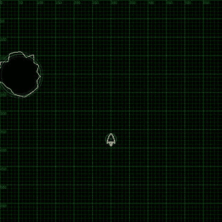
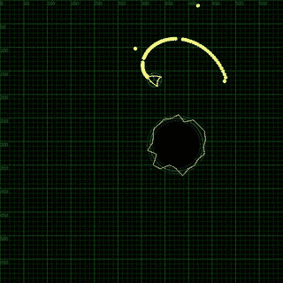
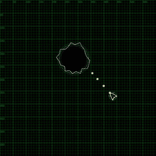

# 11. 控制飞船

格雷姆·斯图尔特 (1) 英国莱斯特郡马基特哈伯勒

在本章中，我们最终将实现对飞船的用户控制。这正是我们之前所有建立对象工作的回报开始显现的时刻。本章结束时，你将能够优雅地在画布上驾驶飞船，甚至从飞船的头部发射弹丸。与吃豆人示例类似，我们需要为`Ship`类添加一些属性，以便通过键盘事件控制飞船。飞船依然是在太空中漂浮的质量体，因此我们只想使用`Mass.prototype.push`和`Mass.prototype.twist`方法来执行实际的移动操作。将`exercise9.html`及其所有相关文件（`styles.css`以及库文件`drawing.js`和`objects.js`）复制到一个新文件夹中，并将 HTML 文件重命名为`exercise11.html`。从全局`update`函数中移除所有控制飞船的代码。

## 推进器控制

从简单入手，飞船需要一个推进器。当推进器开启时，飞船将被向前推动。当推进器关闭时，飞船行为将恢复正常。用代码清单 11-1 中的代码更新`Ship`构造函数。

```
function Ship(x, y, power) {
  this.super(x, y, 10, 20, 1.5 * Math.PI);
  this.thruster_power = power;
  this.thruster_on = false;
}
```

*代码清单 11-1：飞船推进器属性*

我们为飞船添加了两个属性。`thruster_power`属性决定了推进器开启时施加在飞船上的力的大小。`thruster_on`属性则决定推进器是否开启。推进器初始化为关闭状态（即`thrusters_on`被设为`false`）。我们还使飞船的质量和大小变得可配置。更新`exercise11.html`中的飞船实例化代码，使其与代码清单 11-2 一致。

```
var ship = new Ship(context.canvas.width / 2, context.canvas.height / 2, 1000);
```

*代码清单 11-2：创建一艘漂亮的飞船*

现在我们需要添加一个`Ship.prototype.update`方法，因为标准的`Mass.prototype.update`方法已不再适用。我们希望在`this.thruster_on`为`true`时，用正确的推力沿飞船指向的方向推动飞船。因此，我们调用`this.push`方法，传入角度（`this.angle`）以及布尔值`this.thruster_on`乘以`this.thruster_power`的结果，如代码清单 11-3 所示。布尔值会自动转换为 1 或 0，因此计算结果正是我们计算力并在经过时间内施加该力所需的值。

```
Ship.prototype.update = function(elapsed) {
  this.push(this.angle, this.thruster_on * this.thruster_power, elapsed);
  Mass.prototype.update.apply(this, arguments);
}
```

*代码清单 11-3：Ship.prototype.update 方法*

然后我们调用`Mass.prototype.update`方法。我们不能直接在`this`关键字上调用它，因为我们已经覆盖了`Ship.prototype`上的该方法。因此，我们需要使用`function.apply`来调用`Mass.prototype.update`方法，传入我们的`this`关键字以引用飞船实例，并传入函数接收到的`arguments`参数列表。这是一种在子类重写了父类方法后，调用父类方法的通用方式。

现在我们已经调整了飞船的行为，应该能够刷新浏览器并通过控制台开启推进器了。在控制台中输入`ship.thruster_on = true`，并检查飞船是否响应正确。

我们可以通过更新`draw_ship`函数来添加一些关于推进器状态的视觉反馈。首先，我们应该将`ship.thruster_on`属性传入对`draw_ship`的调用中，如代码清单 11-4 所示。

```
Ship.prototype.draw = function(c, guide) {
  c.save();
  c.translate(this.x, this.y);
  c.rotate(this.angle);
  draw_ship(c, this.radius, {
    guide: guide,
    thruster: this.thruster_on
  });
  c.restore();
}
```

*代码清单 11-4：Ship.prototype.draw 方法*

现在将代码清单 11-5 中的代码片段添加到`draw_ship`函数中，位置在绘制飞船之前。我们绘制一个简单的红色填充曲线，带有黄色轮廓，并将此代码放在绘制飞船之前，这样飞船会遮挡住重叠部分，使其看起来更整洁。

```
if(options.thruster) {
  ctx.save();
  ctx.strokeStyle = "yellow";
  ctx.fillStyle = "red";
  ctx.lineWidth = 3;
  ctx.beginPath();
  ctx.moveTo(
    Math.cos(Math.PI + angle * 0.8) * radius / 2,
    Math.sin(Math.PI + angle * 0.8) * radius / 2
  )
  ctx.quadraticCurveTo(-radius * 2, 0,
    Math.cos(Math.PI - angle * 0.8) * radius / 2,
    Math.sin(Math.PI - angle * 0.8) * radius / 2
  );
  ctx.fill();
  ctx.stroke();
  ctx.restore();
}
```

*代码清单 11-5：对 draw_ship 函数的补充*

现在，将`ship.thruster_on`属性设为`true`将使飞船移动，并会在飞船尾部绘制一个红色填充曲线。图 11-1 显示了通过浏览器控制台开启推进器的结果。



*图 11-1：推进器指示器*

我们将通过一对事件处理器来完成这第一步，一个用于`keydown`，一个用于`keyup`。首先，添加用于实际控制飞船的辅助函数，如代码清单 11-6 所示。

```
function key_handler(e, value) {
  var nothing_handled = false;
  switch(e.key || e.keyCode) {
    case "ArrowUp":
    case 38: // 上箭头
      ship.thruster_on = value;
      break;
    default:
      nothing_handled = true;
  }
  if(!nothing_handled) e.preventDefault();
}
```

*代码清单 11-6：控制飞船推进器*

此函数接收一个事件和一个值作为参数。如果触发事件的键是上箭头（`"ArrowUp"`或`38`），那么它将`ship.thruster_on`属性设置为传递给它的任何值。

最后，我们将事件处理函数连接到画布上的事件监听器，如代码清单 11-7 所示。

```
context.canvas.addEventListener("keydown", function(e) {
  key_handler(e, true);
}, true);
context.canvas.addEventListener("keyup", function(e) {
  key_handler(e, false);
}, true);
```

*代码清单 11-7：执行任务的事件处理器*

最后，我们还需要像上一个练习那样设置画布的`tabindex`并调用`canvas.focus()`。完成这些之后，我们应该会发现按下和释放上箭头键可以控制推进器了！


## 转向

当我们连接转向系统后，真正的乐趣就开始了。更新 `Ship` 构造函数，使其与清单 11-8 保持一致。

```javascript
function Ship(x, y, power) {
  this.super(x, y, 10, 20, 1.5 * Math.PI);
  this.thruster_power = power;
  this.steering_power = power / 20;
  this.right_thruster = false;
  this.left_thruster = false;
  this.thruster_on = false;
}
extend(Ship, Mass);
```

清单 11-8：添加转向属性

现在，利用这些新属性在每一帧中旋转飞船，如清单 11-9 中 `Ship.prototype.update` 方法所示。我们通过计算 `this.right_thruster` 与 `this.left_thruster` 的差值来确定施加的扭转力。如果两者同时开启或同时关闭，结果为零。否则，结果为 –1 或 +1。该值再乘以转向力。

```javascript
Ship.prototype.update = function(elapsed, c) {
  this.push(this.angle, this.thruster_on * this.thruster_power, elapsed);
  this.twist((this.right_thruster - this.left_thruster) * this.steering_power, elapsed);
  Mass.prototype.update.apply(this, arguments);
}
```

清单 11-9：利用推进器旋转飞船

最后，更新 `key_handler` 函数，使其响应左箭头和右箭头按键，如清单 11-10 所示。

```javascript
function key_handler(e, value) {
  var nothing_handled = false;
  switch(e.key || e.keyCode) {
    case "ArrowUp":
    case 38: // 上箭头
      ship.thruster_on = value;
      break;
    case "ArrowLeft":
    case 37: // 左箭头
      ship.left_thruster = value;
      break;
    case "ArrowRight":
    case 39: // 右箭头
      ship.right_thruster = value;
      break;
    case "g":
    case 71: //g
      if(value) guide = !guide;
    default:
      nothing_handled = true;
  }
  if(!nothing_handled) e.preventDefault();
}
```

清单 11-10：使用方向键控制推进器

刷新浏览器并尝试运行。现在它感觉更像一个能运行的游戏了！当你学习如何操控飞船时，尽情在画布上驰骋吧。请注意，我们还增加了对 `G` 键的响应，用于切换一个新的 `guide` 变量。请尝试实现这个功能。你需要定义一个全局 `guide` 变量并将其初始化为 `true`。此外，还需要将其传入小行星和飞船的 `draw` 方法，并用它来决定是否绘制网格。

## 射击


```markdown
为了发射子弹，我们需要引入一个新的`Projectile`类。与`Asteroid`和`Ship`一样，`Projectile`类继承自`Mass`。我们从飞船前方发射子弹，希望它们能击中小行星。将清单 11-11 中的基本`Projectile`类添加到你的`objects.js`库中。从构造函数开始——这与小行星非常相似，只是提供了一个新的`lifetime`参数并将其保存到一个属性中。我们还创建了一个`life`属性并将其初始化为`1.0`。

```
function Projectile(mass, lifetime, x, y, x_speed, y_speed, rotation_speed) {
  var density = 0.001; // low density means we can see very light projectiles
  var radius = Math.sqrt((mass / density) / Math.PI);
  this.super(mass, radius, x, y, 0, x_speed, y_speed, rotation_speed);
  this.lifetime = lifetime;
  this.life = 1.0;
}
extend(Projectile, Mass);
```

*清单 11-11 Projectile 构造函数*

请注意，我们还使用了`extend(Projectile, Mass)`。`Projectile`类的特殊行为在于，它被实例化时带有一个有限的`lifetime`，并且当该生命周期结束后，它将从游戏中移除。这避免了累积不断增长的、会耗尽系统资源的子弹数量。清单 11-12 展示了子弹如何从初始值`1.0`开始更新其自身的剩余生命属性，在每个帧中按经过的时间比例递减。除此之外，它是一个密度非常低的简单`Mass`。

```
Projectile.prototype.update = function(elapsed, c) {
  this.life -= (elapsed / this.lifetime);
  Mass.prototype.update.apply(this, arguments);
}
```

*清单 11-12 `Projectile.prototype.update` 方法*

如清单 11-13 所示，绘制函数非常熟悉。唯一需要注意的是，我们将`this.life`传递给了绘制函数。

```
Projectile.prototype.draw = function(c, guide) {
  c.save();
  c.translate(this.x, this.y);
  c.rotate(this.angle);
  draw_projectile(c, this.radius, this.life, guide);
  c.restore();
}
```

*清单 11-13 `Projectile.prototype.draw` 方法*

在你的`drawing.js`库中实现一个`draw_projectile`函数。以清单 11-14 为模板，我们使用`life`参数来设置填充颜色。记得调用`context.beginPath()`。

```
function draw_projectile(ctx, radius, lifetime) {
  ctx.save();
  ctx.fillStyle = "rgb(100%, 100%, " + (100 * lifetime) + "%)";
  // *****************************************
  // **         your code goes here         **
  // **    draw a path to fill the radius   **
  // *****************************************
  ctx.fill();
  ctx.restore();
}
```

*清单 11-14 绘制子弹的模板*

既然我们已经有了子弹，就需要一个机制将它们添加到游戏数据中，并将它们连接到游戏循环。这在很大程度上是符合预期的。我们初始化一个空的子弹数组，如清单 11-15 所示。

```
var asteroid = new Asteroid(
  10000,
  Math.random() * context.canvas.width,
  Math.random() * context.canvas.height
);
asteroid.push(Math.random() * 2 * Math.PI, 1000, 60);
asteroid.twist(Math.random() * 100, 60);
var ship = new Ship(10, 15, context.canvas.width / 2, context.canvas.height / 2, 1000, 200);
var projectiles = []; // new array
```

*清单 11-15 为子弹添加一个空数组*

然后，我们像往常一样绘制子弹，如清单 11-16 所示。

```
function draw() {
  if(guide) {
    draw_grid(context);
  }
  asteroid.draw(context, guide);
  projectiles.forEach(function(p) {
    p.draw(context);
  });
  ship.draw(context, guide);
}
```

*清单 11-16 在 `draw` 函数中连接子弹*

清单 11-17 中的`update`函数有一些出乎意料的地方。我们按照预期，在数组上使用`forEach`循环更新子弹。然后我们检查`projectile.life`的值。如果该值小于或等于`0`，我们就在`projectiles`数组上调用`array.prototype.splice`方法来移除已死亡的子弹。这会移除对该子弹的所有引用，并且它会被从内存中删除。

```
function update(elapsed) {
  asteroid.update(elapsed, context);
  ship.update(elapsed, context);
  projectiles.forEach(function(projectile, i, projectiles) {
    projectile.update(elapsed, context);
    if(projectile.life <= 0) {
      projectiles.splice(i, 1);
    }
  });
  if(ship.trigger) {
    projectiles.push(ship.projectile(elapsed));
  }
}
```

*清单 11-17 在 `update` 函数中连接子弹*

在循环之后，我们检查一个新的属性：`ship.trigger`。如果它被设置了，我们就将一个新的子弹推入`projectiles`数组。我们通过调用`ship.projectile`并传入经过的时间`elapsed`来获取子弹。让我们在新的`Ship.prototype.projectile`方法中创建这些新子弹。我们之所以将这个方法添加到`Ship`类，有多种原因——主要是因为它让飞船生成子弹这件事在逻辑上说得通。从实践角度来看，我们需要访问飞船的一些属性，以便创建具有正确行为的子弹。或者，你也可以通过将飞船实例传递给另一个函数来完成此操作。清单 11-18 中包含了代码。

```
Ship.prototype.projectile = function(elapsed) {
  var p = new Projectile(0.025, 1,
    this.x + Math.cos(this.angle) * this.radius,
    this.y + Math.sin(this.angle) * this.radius,
    this.x_speed,
    this.y_speed,
    this.rotation_speed
  );
  p.push(this.angle, this.weapon_power, elapsed);
  this.push(this.angle + Math.PI, this.weapon_power, elapsed);
  return p;
}
```

*清单 11-18 使用 `Ship.prototype.projectile` 方法创建子弹*

第一个表达式创建了一个新的`Projectile`并将其赋值给变量`p`。它是用一个固定的`0.025`质量创建的（与飞船相比非常轻，这很重要）。`lifetime`参数设置为`1`秒。坐标`(x, y)`经过计算，将子弹放置在飞船的前方。子弹的速度`(x_speed, y_speed)`及旋转速度`rotation_speed`被初始化为与飞船相同。接下来的两个表达式确保我们遵守牛顿第三定律。我们使用由飞船的一个新属性`weapon_power`决定的力，沿着飞船指向的方向推动子弹。然后我们用同样的力反推飞船。因此，子弹的质量相对于飞船的质量非常小，这一点很重要。当我们对两者施加相同的力时，子弹获得的加速度远大于飞船。

新属性`weapon_power`必须存在于飞船上。在`Ship`构造函数中创建它，如清单 11-19 所示。确保在实例化飞船时也为`weapon_power`提供一个值（为了以防万一，我给出了一个默认值）。

```
function Ship(mass, radius, x, y, power, weapon_power) {
  this.super(mass, radius, x, y, 1.5 * Math.PI);
  this.thruster_power = power;
  this.steering_power = this.thruster_power / 20;
  this.right_thruster = false;
  this.left_thruster = false;
  this.thruster_on = false;
  this.weapon_power = weapon_power || 200;
}
extend(Ship, Mass);
```

*清单 11-19 更新 Ship 构造函数*

`Ship.prototype.projectile`方法的最后一行返回我们的子弹，以便我们可以将其添加到`projectiles`数组中，就像之前在全局`update`函数中展示的那样。现在，如果`ship.trigger`被设置为`true`，我们将创建新的子弹并从飞船前方发射出去。一旦子弹存活了一秒钟，它就会被从游戏中移除。

最后一步很简单。我们更新`key_handler`，将空格键连接到`ship.trigger`属性，如清单 11-20 所示。

```
function key_handler(e, value) {
  var nothing_handled = false;
  switch(e.key || e.keyCode) {
    case "ArrowUp":
    case 38: // up arrow
      ship.thruster_on = value;
      break;
    case "ArrowLeft":
    case 37: // left arrow
      ship.left_thruster = value;
      break;
    case "ArrowRight":
    case 39: // right arrow
      ship.right_thruster = value;
      break;
    case " ":
    case 32: //spacebar
      ship.trigger = value;
      break;
    case "g":
      if(value) guide = !guide;
    default:
      nothing_handled = true;
  }
  if(!nothing_handled) e.preventDefault();
}
```

*清单 11-20 连接键处理函数*

花点时间研究一下这是如何工作的，并确保你理解了它。当按下空格键时，`ship.trigger`变为`true`。由此，我们在每一帧都会向数组中添加新的子弹。当子弹的生命周期结束时，它们会从数组中被移除。图 11-2 显示了结果。


*图 11-2 发射一连串的子弹*

刷新浏览器并尝试一下。注意，飞船正如预期那样被子弹反推回去。我们正以极快的速度（每帧一个）创建子弹。为了增加游戏挑战性并控制游戏中的子弹数量，我们应该对此进行限制。向全局`update`函数添加一个新的限制；用清单 11-21 中的代码替换现有的条件语句。

```
if(ship.trigger && ship.loaded) {
  projectiles.push(ship.projectile(elapsed));
}
```

*清单 11-21 限制子弹创建速度*

这里我们指定，飞船的武器必须先装填才能开火。使用清单 11-22 中的新代码更新你的`Ship`构造函数。

```
this.loaded = false;
this.weapon_reload_time = 0.25; // seconds
this.time_until_reloaded = this.weapon_reload_time;
```

*清单 11-22 再次更新 Ship 构造函数*

我们将飞船武器初始化为未装填状态。我们定义了武器重新装填所需的时间。我们还设置了一个属性来记录距离武器装填完成还有多少时间。

现在将清单 11-23 中的几行代码添加到`Ship.prototype.update`方法中。

```
// reload as necessary
this.loaded = this.time_until_reloaded === 0;
if(!this.loaded) {
  this.time_until_reloaded -= Math.min(elapsed, this.time_until_reloaded);
}
```

*清单 11-23 控制装填时间*

这段简单的代码控制了`ship.loaded`属性。当`this.time_until_reloaded`属性等于`0`时，它将为`true`。而该属性在每个帧中又按经过的时间递减。如果经过的时间大于`this.time_until_reloaded`属性，则它将被设置为`0`。仅此一项就可以确保，我们首次发射武器前，必须等待`this.weapon_reload_time`中指定的`0.25`秒。一旦武器开火，我们需要将`this.time_until_reloaded`属性重置为`this.weapon_reload_time`的值。将这一行添加到`Ship.prototype.projectile`方法中返回子弹的那一行之前：

```
this.time_until_reloaded = this.weapon_reload_time;
```

现在刷新页面并观看！你应该会得到类似于图 11-3 的效果。


*图 11-3 射击现在受到武器装填时间的限制*

现在飞船正以你通过`this.weapon_reload_time`指定的速率进行射击。如果你更改该属性，射速将相应调整。这是一个很好的目标，可以通过提升道具来减少武器装填时间。此外，增加子弹的`lifetime`属性也可能是一个好主意，以为玩家提供具体的优势。

作为练习，实现一个可以通过向下箭头键触发的反向推进器。思考如何将其与现有机制集成。看看我们如何在`Ship.prototype.update`方法中结合使用`ship.left_thruster`和`ship.right_thruster`。尝试使用`ship.retro_on`属性来复制此功能。除非你真的很想（如果这样，你可能也想绘制左、右推进器），否则不必担心绘制反向推进器的外观。
```


## 总结

在本章中，我们为飞船对象添加了大量可控属性。我们绑定了事件监听器，从而能够控制飞船的移动。我们引入了一个投射物对象，并通过飞船上的函数触发投射物的生成。当按下空格键时，我们会调用这个函数，但每四分之一秒仅限一次。我们还对投射物群体进行了管理，使它们在游戏场景中持续一秒钟后便被销毁。本章非常快速地新增了这些功能。如果你遇到任何问题，请仔细重读本章，直到对已发生的内容了然于胸。 © Graeme Stuart 2017 Graeme Stuart《Introducing JavaScript Game Development》`doi.org/10.1007/978-1-4842-3252-1_12`

