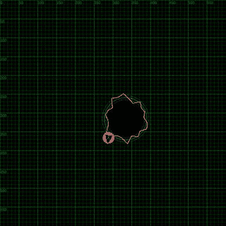
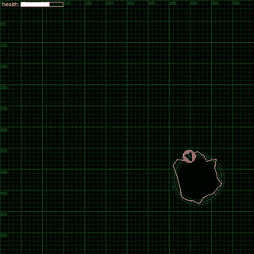
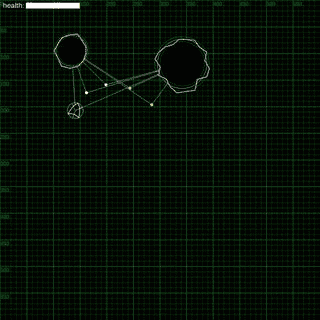
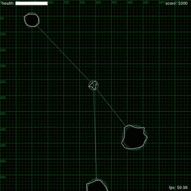

# 12. 碰撞检测

Graeme Stuart¹ (1) 英国莱斯特郡马基特哈伯勒

本章我们将探讨如何检测对象之间的碰撞。现在我们已经能够控制飞船并发射投射物，接下来需要考虑承受伤害和获取分数的问题。这要求我们检测飞船与小行星之间的碰撞（涉及伤害），以及投射物与小行星之间的碰撞（涉及得分）。我们将采用简单的圆形碰撞检测方法，因此所有对象都必须近似为圆形。计算方法非常简单：首先，你需要计算两个圆心之间的距离。如果该距离小于两个圆半径之和，那么这两个圆就是重叠的。

## 快速重构

我们将增加复杂性，因此首先将现有功能封装到一个`AsteroidsGame`类中。这有很多优点，主要好处是整理全局作用域。我们希望尽可能保持全局作用域清晰，以便游戏能够与页面上可能存在的其他代码良好协作。以这种方式保持代码整洁迫使我们保持组织性，并允许我们以可控的方式增加复杂性。

创建一个新文件夹，并将样式表以及`drawing.js`和`objects.js`库复制过来。添加一个名为`exercise12.html`的新文件。让我们从编写我们希望能够使用的代码开始。清单 12-1 展示了我们可能想要的工作方式。

```html
<!doctype html>
<html>
  <head>
    <title>Asteroids</title>
    <link rel="stylesheet" href="styles.css">
    <script src="drawing.js"></script>
    <script src="objects.js"></script>
    <script src="game.js"></script>
  </head>
  <body>
    <h1>Asteroids</h1>
    <canvas id="asteroids" width="600" height="600" tabindex="1"></canvas>
    <script>
      'use strict';
      var game = new AsteroidsGame("asteroids");
    </script>
  </body>
</html>
```

**清单 12-1** 我们的游戏作为一行代码

在创建`AsteroidsGame`类之前考虑它，是确保我们构建良好接口的有用方法。游戏实际上需要什么信息？它真正需要的只是知道在哪里绘制自己。我们希望游戏在给定的画布上运行，因此我们将画布元素的`id`属性传递给游戏构造函数。一个页面上可能有多个游戏和/或多个画布。注意页面头部有一个名为`game.js`的新脚本元素。我们将在这里编写新对象的代码。

当然，现在这还不行。我们的任务是获取上一个练习中的代码，并将其全部放入新库中的`AsteroidsGame`类中。我们已经定义了 API 的一个元素。让我们通过创建`AsteroidsGame`构造函数来编码到这个接口。将清单 12-2 中的代码放入新的`game.js`文件中。

```javascript
var AsteroidsGame = function(id) {
  this.canvas = document.getElementById(id);
  this.c = this.canvas.getContext("2d");
  this.canvas.focus();
  this.guide = false;
  this.ship_mass = 10;
  this.ship_radius = 15;
  this.asteroid_mass = 5000;   // Mass of asteroids
  this.asteroid_push = 500000; // max force to apply in one frame
  this.ship = new Ship(
    this.canvas.width / 2,
    this.canvas.height / 2,
    1000, 200
  );
  this.projectiles = [];
  this.asteroids = [];
  this.asteroids.push(this.moving_asteroid());
  this.canvas.addEventListener("keydown", this.keyDown.bind(this), true);
  this.canvas.addEventListener("keyup", this.keyUp.bind(this), true);
  window.requestAnimationFrame(this.frame.bind(this));
}
```

**清单 12-2** `AsteroidsGame`构造函数

构造函数接受一个参数：我们想要在其上绘制游戏的画布元素的`id`属性。我们使用它来创建对画布的引用。我们还提取了对 2D 画布上下文的引用，并将其存储为`this.c`以便于访问。然后我们将焦点设置在画布上，以便按键能够正确注册（如果运行多个画布和多个游戏，这可能最好留给调用代码处理）。然后我们设置一些属性，这些属性以前要么是全局变量，要么是代码中出现的“魔法数字”。这些在创建飞船和小行星时将会很有用。

然后我们创建一个新的飞船，并将`projectiles`和`asteroids`属性设置为空数组。通过调用新的`AsteroidsGame.prototype.moving_asteroid`辅助方法，我们将一个移动的小行星添加到`asteroids`数组中。最后，我们连接一些事件处理代码并启动游戏循环。注意，我们将这些回调函数“绑定”到游戏实例。

这仍然不行。让我们逐步构建必要的代码。在`AsteroidsGame.prototype.moving_asteroid`中，我们创建一个小行星，推动它，旋转它，然后返回它。我们使用另外两个辅助方法来实现：`AsteroidsGame.prototype.new_asteroid`和`AsteroidsGame.prototype.push_asteroid`。实现如清单 12-3 所示。

```javascript
AsteroidsGame.prototype.moving_asteroid = function(elapsed) {
  var asteroid = this.new_asteroid();
  this.push_asteroid(asteroid, elapsed);
  return asteroid;
}

AsteroidsGame.prototype.new_asteroid = function() {
  return new Asteroid(
    this.canvas.width * Math.random(),
    this.canvas.height * Math.random(),
    this.asteroid_mass
  );
}

AsteroidsGame.prototype.push_asteroid = function(asteroid, elapsed) {
  elapsed = elapsed || 0.015;
  asteroid.push(2 * Math.PI * Math.random(), this.asteroid_push, elapsed);
  asteroid.twist(
    (Math.random() - 0.5) * Math.PI * this.asteroid_push * 0.02,
    elapsed
  );
}
```

**清单 12-3** 创建小行星的辅助方法

`AsteroidsGame.prototype.new_asteroid`方法简单地使用`asteroid_mass`属性在随机位置创建一个小行星。`AsteroidsGame.prototype.push_asteroid`辅助方法使用`asteroid_push`属性作为力来推动和旋转小行星。它会在提供的经过时间上推动。如果没有提供经过时间，则假设标准帧率为 60 fps（每秒帧数）。

它仍然不行。清单 12-4 中显示的事件处理函数是`AsteroidsGame.prototype.key_handler`函数的简单包装器，它取代了旧的`key_handler`函数。在函数内部，我们引用`this.ship`而不是仅仅`ship`。同时注意添加了向下箭头处理程序，以及使用 G 键切换`this.guide`属性。

# AsteroidsGame 类实现

## 按键事件处理

```javascript
AsteroidsGame.prototype.keyDown = function(e) {
  this.key_handler(e, true);
}

AsteroidsGame.prototype.keyUp = function(e) {
  this.key_handler(e, false);
}

AsteroidsGame.prototype.key_handler = function(e, value) {
  var nothing_handled = false;
  switch(e.key || e.keyCode) {
    case "ArrowLeft":
    case 37: // left arrow
      this.ship.left_thruster = value;
      break;
    case "ArrowUp":
    case 38: // up arrow
      this.ship.thruster_on = value;
      break;
    case "ArrowRight":
    case 39: // right arrow
      this.ship.right_thruster = value;
      break;
    case "ArrowDown":
    case 40:
      this.ship.retro_on = value;
      break;
    case " ":
    case 32: //spacebar
      this.ship.trigger = value;
      break;
    case "g":
    case 71: // g for guide
      if(value) this.guide = !this.guide;
      break;
    default:
      nothing_handled = true;
  }
  if(!nothing_handled) e.preventDefault();
}
```

### 清单 12-4 按键事件处理方法

构造函数中的最后一行以`AsteroidsGame.prototype.frame`方法作为回调调用了`window.requestAnimationFrame`。清单 12-5 取代了旧的全局`frame`函数，做的事情大致相同，主要区别在于我们调用了`this.update`和`this.draw`，并将前一个时间戳存储为`this.previous`。

```javascript
AsteroidsGame.prototype.frame = function(timestamp) {
  if (!this.previous) this.previous = timestamp;
  var elapsed = timestamp - this.previous;
  this.update(elapsed / 1000);
  this.draw();
  this.previous = timestamp;
  window.requestAnimationFrame(this.frame.bind(this));
}
```

### 清单 12-5 `AsteroidsGame.prototype.frame`方法

注意，`this.frame`函数在传递给`window.requestAnimationFrame`时被绑定到游戏实例。这强制在调用`frame`函数时将`this`关键字设置为游戏实例。

清单 12-6 中的`AsteroidsGame.prototype.update`方法控制所有游戏元素。它更新所有小行星、飞船和所有抛射体。它控制死亡抛射体的移除，以及在飞船已装弹且扳机扣下时创建新的抛射体。它不包含新内容，但我们现在总是引用游戏对象的属性。

```javascript
AsteroidsGame.prototype.update = function(elapsed) {
  this.ship.compromised = false;
  this.asteroids.forEach(function(asteroid) {
    asteroid.update(elapsed, this.c);
  }, this);
  this.ship.update(elapsed, this.c);
  this.projectiles.forEach(function(p, i, projectiles) {
    p.update(elapsed, this.c);
    if(p.life <= 0) {
      projectiles.splice(i, 1);
    }
  }, this);
  if(this.ship.trigger && this.ship.loaded) {
    this.projectiles.push(this.ship.projectile(elapsed));
  }
}
```

### 清单 12-6 `AsteroidsGame.prototype.update`方法

`AsteroidsGame.prototype.update`方法多次调用`Array.prototype.forEach`方法。该方法接受两个参数：一个为数组中每个元素调用的回调函数，以及一个用于设置回调函数内部`this`关键字的值。注意，我们将`this`作为第二个参数传递，以便在回调函数内部可以正确地将游戏实例引用为`this`。你可以在所有对`Array.prototype.forEach`的调用中看到这一点。

清单 12-7 中显示的`AsteroidsGame.prototype.draw`方法负责绘制整个游戏。它绘制所有小行星、飞船和所有抛射体。它还使用了`Array.prototype.forEach`并将`this`作为第二个参数传递，与`AsteroidsGame.prototype.update`中一样。

```javascript
AsteroidsGame.prototype.draw = function() {
  this.c.clearRect(0, 0, this.canvas.width, this.canvas.height);
  if(this.guide) {
    draw_grid(this.c);
    this.asteroids.forEach(function(asteroid) {
      draw_line(this.c, asteroid, this.ship);
    }, this);
  }
  this.asteroids.forEach(function(asteroid) {
    asteroid.draw(this.c, this.guide);
  }, this);
  this.ship.draw(this.c, this.guide);
  this.projectiles.forEach(function(p) {
    p.draw(this.c);
  }, this);
}
```

### 清单 12-7 `AsteroidsGame.prototype.draw`方法

该方法与上一个例子中的`draw`函数相当相似。它可选地绘制网格，并使用新的`draw_line`函数在小行星和飞船之间绘制线条。仅当设置了`this.guide`属性时才执行此操作。`draw_line`函数位于`drawing.js`中，如清单 12-8 所示。将该函数添加到你的`drawing.js`库中。

```javascript
function draw_line(ctx, obj1, obj2) {
  ctx.save();
  ctx.strokeStyle = "white";
  ctx.lineWidth = 0.5;
  ctx.beginPath();
  ctx.moveTo(obj1.x, obj1.y);
  ctx.lineTo(obj2.x, obj2.y);
  ctx.stroke();
  ctx.restore();
}
```

### 清单 12-8 `draw_line`函数

现在我们有了一个全面的`AsteroidsGame`类，它可以在任何画布上运行游戏。我们已经将其连接到键盘事件，并通过自己的事件循环逐帧运行。没有代码在`AsteroidsGame`类之外触发。我们使用了一些非常简单的辅助函数。这一切都相当直接。刷新页面以查看游戏是否按预期运行。尝试按下 G 键切换`guide`属性。

## 飞船 vs 小行星

现在我们需要进行实际的碰撞检测。我们将检测代表飞船和小行星的圆形之间的碰撞。当飞船周围的圆与某颗小行星周围的圆接触时，我们会在飞船上设置一个新的`compromised`（受损）属性。当飞船处于`compromised`状态时，它会持续损失生命值。首先要做的是在`Ship`构造函数中初始化所需的属性。请按照清单 12-9 所示更新你的构造函数。

# 飞船构造与碰撞检测

## 清单 12-9 在飞船构造函数中初始化 `compromised` 和 `health` 属性

```javascript
function Ship(x, y, power, weapon_power) {
    this.super(x, y, 10, 20, 1.5 * Math.PI);
    this.thruster_power = power;
    this.steering_power = this.thruster_power / 20;
    this.right_thruster = false;
    this.left_thruster = false;
    this.thruster_on = false;
    this.retro_on = false;
    this.weapon_power = weapon_power;
    this.loaded = false;
    this.weapon_reload_time = 0.25; // 秒
    this.time_until_reloaded = this.weapon_reload_time;
    this.compromised = false;
    this.max_health = 2.0;
    this.health = this.max_health;
}
```

我们还可以更新 `Ship.prototype.draw` 方法，以指示（在开启引导模式时）飞船是否处于 `compromised` 状态。如清单 12-10 所示。

## 清单 12-10 当 `compromised` 时绘制一个红色圆圈

```javascript
Ship.prototype.draw = function(c, guide) {
    c.save();
    c.translate(this.x, this.y);
    c.rotate(this.angle);
    if(guide && this.compromised) {
        c.save();
        c.fillStyle = "red";
        c.beginPath();
        c.arc(0, 0, this.radius, 0, 2 * Math.PI);
        c.fill();
        c.restore();
    }
    draw_ship(c, this.radius, {
        guide: guide,
        thruster: this.thruster_on
    });
    c.restore();
}
```

我们本可以将此功能放在 `draw_ship` 函数中并添加一个参数。这样做可能会更简洁，但描述起来会花费更长时间，所以我将其留作可选练习。

现在我们需要一个通用的碰撞函数来检测任意两个对象之间的碰撞。这些对象必须具有（`x`， `y`）坐标和 `radius` 属性。在 `game.js` 的顶部添加清单 12-11 中的函数。

## 清单 12-11 碰撞检测

```javascript
function collision(obj1, obj2) {
    return distance_between(obj1, obj2) < (obj1.radius + obj2.radius);
}

function distance_between(obj1, obj2) {
    return Math.sqrt(Math.pow(obj1.x - obj2.x, 2) + Math.pow(obj1.y - obj2.y, 2));
}
```

圆形之间的碰撞很简单：如果两个圆心之间的距离小于它们半径之和，则圆相交。我们还将距离计算单独提取为一个函数。

为了实现碰撞检测，我们需要让游戏检查每颗小行星与飞船是否发生碰撞，并相应地设置 `ship.compromised` 属性。清单 12-12 展示了具体实现。

## 清单 12-12 更新 `compromised` 属性

```javascript
AsteroidsGame.prototype.update = function(elapsed) {
    this.ship.compromised = false;
    this.asteroids.forEach(function(asteroid) {
        asteroid.update(elapsed, this.c);
        if(collision(asteroid, this.ship)) {
            this.ship.compromised = true;
        }
    }, this);
    this.ship.update(elapsed, this.c);
    this.projectiles.forEach(function(p, i, projectiles) {
        p.update(elapsed, this.c);
        if(p.life <= 0) {
            projectiles.splice(i, 1);
        }
    }, this);
    if(this.ship.trigger && this.ship.loaded) {
        this.projectiles.push(this.ship.projectile(elapsed));
    }
}
```

我们将 `ship.compromised` 属性设置为 `false`，然后在遍历每颗小行星时，如果检测到碰撞，就将其设置为 `true`。注意，我们还调整了执行顺序，确保在更新小行星和飞船之前进行碰撞检测。

刷新页面并欣赏结果。按 `G` 键开启引导模式，你应该会看到，如果我们的飞船撞到小行星，飞船下方会出现一个红色圆圈！



图 12-1 碰撞检测

## 承受伤害

现在让我们更新代码，使飞船在 `compromised` 状态下承受伤害。实际上，我们是为飞船设定一个碰撞时间限制（`max_health`——假设为 2 秒）。该值将是飞船的一个属性，因此 `health` 属性可以随时被补满。

## 清单 12-13 消耗生命值

```javascript
Ship.prototype.update = function(elapsed, c) {
    this.push(this.angle,
        (this.thruster_on - this.retro_on) * this.thruster_power, elapsed
    );
    this.twist(
        (this.right_thruster - this.left_thruster) * this.steering_power, elapsed
    );
    this.loaded = this.time_until_reloaded === 0;
    if(!this.loaded) {
        this.time_until_reloaded -= Math.min(elapsed, this.time_until_reloaded);
    }
    if(this.compromised) {
        this.health -= Math.min(elapsed, this.health);
    }
    Mass.prototype.update.apply(this, arguments);
}
```

注意这与装弹时间的相似之处。还要注意反向推进器的实现方式。

现在我们看不到飞船的生命值，所以让我们把它绘制在画布上。在 `AsteroidsGame.prototype.draw` 的末尾添加以下代码：

```javascript
this.c.save();
this.c.font = "18px arial";
this.c.fillStyle = "white";
this.c.fillText("health: " + this.ship.health.toFixed(1), 10, this.canvas.height - 10);
this.c.restore();
```

现在刷新页面，欣赏你新的生命值指示器。尝试撞击一颗小行星，观察你的生命值如何减少。但我们可以做得更好！我们现在已经是 JavaScript 忍者了。

将清单 12-14 中的代码添加到 `objects.js` 的末尾。

## 指示器类

清单 12-14 展示了 `Indicator` 类的代码。

```javascript
function Indicator(label, x, y, width, height) {
    this.label = label + ": ";
    this.x = x;
    this.y = y;
    this.width = width;
    this.height = height;
}

Indicator.prototype.draw = function(c, max, level) {
    c.save();
    c.strokeStyle = "white";
    c.fillStyle = "white";
    c.font = this.height + "pt Arial";
    var offset = c.measureText(this.label).width;
    c.fillText(this.label, this.x, this.y + this.height - 1);
    c.beginPath();
    c.rect(offset + this.x, this.y, this.width, this.height);
    c.stroke();
    c.beginPath();
    c.rect(offset + this.x, this.y, this.width * (max / level), this.height);
    c.fill();
    c.restore()
}
```

新的 `Indicator` 构造函数接受一个 `label`（标签）、一个位置 (`x`、`y`) 和一个尺寸 (`width`、`height`) 作为参数。可以将其视为一个带标签的矩形。它有一个 `draw` 方法，该方法接受一个上下文以及两个数值：`max`（最大值）和 `level`（当前值）。它会计算出标签的宽度，并在指定位置（正下方）写入标签。它测量标签的宽度，以便在标签右侧绘制一个指定大小的空心矩形。它还会在空心矩形内部绘制一个填充矩形，该填充矩形的大小根据给定的 `level` 占 `max` 的比例确定。

在 `AsteroidGame` 构造函数的末尾，添加以下属性：

```javascript
this.health_indicator = new Indicator("health", 5, 5, 100, 10);
```

要绘制指示器，请将以下代码添加到 `AsteroidGame.prototype.draw` 方法中。这将替换我们第一次尝试的代码：

```javascript
this.health_indicator.draw(this.c, this.ship.health, this.ship.max_health);
```

现在我们真的被震撼了。与小行星碰撞，看看你的生命值下降，如图 12-2 所示。



图 12-2 生命值指示器

## 小行星 vs 射弹

下一步是检测小行星与炮弹之间的碰撞。如果击中小行星，我们将扣除部分质量，分裂小行星，并增加得分。目前我们每摧毁一个质量单位计为 1 分。每次命中将移除 500 个单位质量并获得 500 分。我们将这些新值作为 `AsteroidsGame` 的属性添加到构造函数中：`this.mass_destroyed = 500; this.score = 0;`。为了实现碰撞检测并在小行星被击中时触发分裂，我们需要在 `AsteroidsGame.prototype.update` 方法中添加一些逻辑。清单 12-15 展示了新的方法：

```javascript
AsteroidsGame.prototype.update = function(elapsed) {
  this.ship.compromised = false;
  this.asteroids.forEach(function(asteroid) {
    asteroid.update(elapsed, this.c);
    if(collision(asteroid, this.ship)) {
      this.ship.compromised = true;
    }
  }, this);
  this.ship.update(elapsed, this.c);
  this.projectiles.forEach(function(p, i, projectiles) {
    p.update(elapsed, this.c);
    if(p.life <= 0) {
      projectiles.splice(i, 1);
    } else {
      this.asteroids.forEach(function(asteroid, j) {
        if(collision(asteroid, p)) {
          projectiles.splice(i, 1);
          this.asteroids.splice(j, 1);
          this.split_asteroid(asteroid, elapsed);
        }
      }, this);
    }
  }, this);
  if(this.ship.trigger && this.ship.loaded) {
    this.projectiles.push(this.ship.projectile(elapsed));
  }
}
```

清单 12-15 命中时触发小行星分裂

在 `if(p.life <= 0)` 块中添加 `else` 子句，确保我们只测试游戏中当前存活的炮弹。对于每个存活的炮弹，我们遍历所有（已更新过的）小行星并检测碰撞。如果检测到碰撞，我们从游戏中移除该小行星和炮弹。然后，我们调用一个新的辅助方法 `split_asteroid`，并将受损的小行星传入。

这个新的辅助方法需要创建子小行星并相应更新得分。它需要从父小行星中移除适当的质量，生成两个总质量正确的子小行星，并给它们施加一个推力使其分离。清单 12-16 展示了一个基本实现。

```javascript
AsteroidsGame.prototype.split_asteroid = function(asteroid, elapsed) {
  asteroid.mass -= this.mass_destroyed;
  this.score += this.mass_destroyed;
  var split = 0.25 + 0.5 * Math.random(); // 不均匀分裂
  var ch1 = asteroid.child(asteroid.mass * split);
  var ch2 = asteroid.child(asteroid.mass * (1 - split));
  [ch1, ch2].forEach(function(child) {
    if(child.mass < this.mass_destroyed) {
      this.score += child.mass;
    } else {
      this.push_asteroid(child, elapsed);
      this.asteroids.push(child);
    }
  }, this);
}
```

清单 12-16 分裂小行星

该函数做了很多工作。首先，它从给定的小行星中移除部分质量并为游戏增加分数。然后，它确定一个（大致均匀的）分裂比例，用于在两个新小行星之间分配质量。创建两个小行星，每个小行星的总质量由原始小行星的剩余质量和分裂比例决定。我们使用 `Asteroid.child` 辅助方法来创建与父小行星具有相同属性（位置、速度等）的小行星。对于每个新的子小行星，我们给它施加推力并将其添加到游戏中。

我们为小行星设置了最小尺寸，因为太小的小行星很难被击中，并且在受到推力时往往会高速飞行。如果子小行星太小，就不会被添加到游戏中——其质量会直接转化为分数。

新的子小行星是使用另一个辅助方法 `Asteroid.child` 创建的。该方法简单地用与父小行星相同的速度、旋转角度和位置来初始化新的小行星。清单 12-17 展示了该函数。

```javascript
Asteroid.prototype.child = function(mass) {
  return new Asteroid(
    this.x, this.y, mass,
    this.x_speed, this.y_speed,
    this.rotation_speed
  )
}
```

清单 12-17 生成子小行星

现在，刷新你的浏览器并射击小行星！为了在每一帧都能看到碰撞检测的比较结果，我们在炮弹和小行星之间绘制连线。更新`AsteroidsGame.prototype.draw`方法中的`if(this.guide)`块。在现有的小行星循环内嵌套一个炮弹循环，并调用现有的`draw_line`函数。按下 G 键切换指南模式并射击，即可看到新的参考线。你应该会看到类似图 12-3 的效果。



**图 12-3 炮弹击碎小行星**

本练习中我们要做的最后一件事是添加一个得分指示器和一个帧率指示器。得分和帧率应以数字形式呈现，因此我们将清单 12-18 中的新`NumberIndicator`类添加到`objects.js`文件中。

```javascript
function NumberIndicator(label, x, y, options) {
  options = options || {}
  this.label = label + ": ";
  this.x = x;
  this.y = y;
  this.digits = options.digits || 0;
  this.pt = options.pt || 10;
  this.align = options.align || 'end';
}
NumberIndicator.prototype.draw = function(c, value) {
  c.save();
  c.fillStyle = "white";
  c.font = this.pt + "pt Arial";
  c.textAlign = this.align;
  c.fillText(
    this.label + value.toFixed(this.digits),
    this.x, this.y + this.pt - 1
  );
  c.restore();
}
```

**清单 12-18 `NumberIndicator`**

该类允许我们为指示器指定标签和位置。它还接收一个可选的`options`参数，该参数可以覆盖默认值。`options.digits`属性设置要显示的小数位数（默认为 0），`options.pt`属性设置字体大小（默认为 10 磅），`options.align`属性决定文本对齐方式。它有一个`draw`方法，接受两个参数：一个用于绘制的画布上下文（canvas context），以及要显示的值。它简单地打印标签和用冒号分隔的值。

与`Indicator`类一样，`NumberIndicator`类避免了在我们的主`AsteroidsGame`类中编写底层绘图代码。这避免了杂乱，有助于我们组织代码并跟踪每个部分的功能。我们还将两次使用它，这避免了重复相似的代码（重复代码是不好的）。

我们需要在`AsteroidsGame`构造函数中添加几行代码，如清单 12-19 所示。

```javascript
this.score_indicator = new NumberIndicator("score",
  this.canvas.width - 10, 5
);
this.fps_indicator = new NumberIndicator("fps",
  this.canvas.width - 10,
  this.canvas.height - 15,
  {digits: 2}
);
```

**清单 12-19 一些指示器**

然后我们更新`AsteroidsGame.prototype.draw`方法，如清单 12-20 所示。我们仅在指南模式开启时显示帧率。

```javascript
AsteroidsGame.prototype.draw = function() {
  this.c.clearRect(0, 0, this.canvas.width, this.canvas.height);
  if(this.guide) {
    draw_grid(this.c);
    this.asteroids.forEach(function(asteroid) {
      draw_line(this.c, asteroid, this.ship);
      this.projectiles.forEach(function(p) {
        draw_line(this.c, asteroid, p);
      }, this);
    }, this);
    this.fps_indicator.draw(this.c, this.fps);
  }
  this.asteroids.forEach(function(asteroid) {
    asteroid.draw(this.c, this.guide);
  }, this);
  this.ship.draw(this.c, this.guide);
  this.projectiles.forEach(function(p) {
    p.draw(this.c);
  }, this);
  this.health_indicator.draw(this.c, this.ship.health, this.ship.max_health);
  this.score_indicator.draw(this.c, this.score);
}
```

**清单 12-20 更多指示器**

最后需要做的是计算帧率。在`AsteroidsGame.prototype.frame`方法中添加一行代码，如清单 12-21 所示。

```javascript
AsteroidsGame.prototype.frame = function(timestamp) {
  if (!this.previous) this.previous = timestamp;
  var elapsed = timestamp - this.previous;
  this.fps = 1000 / elapsed;
  this.update(elapsed / 1000);
  this.draw();
  this.previous = timestamp;
  window.requestAnimationFrame(this.frame.bind(this));
}
```

**清单 12-21 计算帧率**

就是这样！刷新页面，欣赏你的新得分指示器。图 12-4 展示了你应该看到的效果。注意，摧毁所有小行星后，你的得分等于一颗小行星的质量。所有的质量都已转化为分数。你还可以切换指南模式并欣赏新的帧率指示器。



**图 12-4 显示得分和帧率**

## 总结

我们为游戏添加了新的功能。现在我们可以四处飞行并摧毁小行星。与此同时，我们也为代码增加了显著的复杂性——在 `update` 和 `draw` 函数中，我们现在管理着游戏本身。我们检测碰撞并对碰撞后果进行编码。这里的主要经验是，新代码始终应该在结构中有其专属的位置。我们在本章开头重构了代码，为新增的复杂逻辑创建了一个安放之处。我们并非必须这样做，但这样做了会带来许多微小的好处并简化工作。这些函数本身在 `game` 对象内部提供了结构。当阅读这些函数时，我们能够理解发生了什么。将复杂代码直接声明在全局作用域中，始终是一个信号，表明应该考虑通过重构来增加结构。© Graeme Stuart 2017 Graeme Stuart 著《JavaScript 游戏开发入门》[`doi.org/10.1007/978-1-4842-3252-1_13`](https://doi.org/10.1007/978-1-4842-3252-1_13)