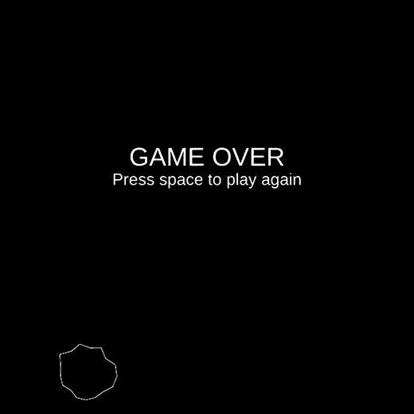

# 13. 绝地求生

Graeme Stuart^(1 ) (1) 英国莱斯特郡马基特哈伯勒

我们的游戏已接近完成。本章中，我们将添加最后的润色。我们将添加一个“游戏结束”状态，当生命值降为零时结束游戏。接着，我们将添加无需重新加载页面即可重新开始游戏的功能。最后，我们将添加关卡，让我们能够持续游玩，难度逐渐增加，得分倍率也随之提高。请将你的代码复制到一个新文件夹中，这是最后一次了。保存一份 `exercise12.html` 文件的副本，并将其重命名为 `exercise13.html`。

## 游戏结束

当飞船生命值耗尽时，没有任何反应。我们需要修改这一点，让游戏结束。我们将通过设置一个 `game_over` 属性来表示游戏已结束。首先，我们需要在 `AsteroidsGame` 构造函数中添加该属性：`this.game_over = false;` 现在，当处于“游戏结束”状态时，我们希望显示剩余的小行星仍在太空中移动，但其他所有元素都可以停止更新，并且不会被绘制出来。在 `AsteroidsGame.prototype.update` 方法中，在完成小行星更新之后、飞船和发射物更新之前，添加以下几行代码：

```
if(this.ship.health <= 0) {
  this.game_over = true;
  return;
}
```

这里，如果飞船生命值降为零，我们设置“游戏结束”状态。同时我们从该方法返回，因此此行之后的代码都不会被处理。类似地，在 `AsteroidsGame.prototype.draw` 方法中，在绘制完小行星之后、绘制飞船之前，添加以下几行代码：

```
if(this.game_over) {
  return;
}
```

这样可以确保游戏结束时我们不会绘制飞船。小行星将继续漂浮。刷新浏览器并尝试一下。如果你失去所有生命值，你的飞船将消失，剩余的小行星将傲慢地庆祝它们的胜利。任何希望始终显示的内容应放在包含 `return` 语句的 `if` 块之前。任何仅在“游戏结束”状态下显示的内容应放在 `if` 块内部，并在 `return` 语句之前。任何仅在游戏运行期间显示的内容应放在 `if` 块之后。我们需要告知用户游戏结束。按清单 13-1 所示进行修改。

```
if(this.game_over) {
  this.message.draw(this.c, "游戏结束", "按空格键重新开始");
  return;
}
```

**清单 13-1** 发送消息

现在将清单 13-2 中的 `Message` 对象添加到 `objects.js` 中。

```
function Message(x, y, options) {
  options = options || {};
  this.x = x;
  this.y = y;
  this.main_pt = options.main_pt || 28;
  this.sub_pt = options.sub_pt || 18;
  this.fill = options.fill || "white";
  this.textAlign = options.align || 'center';
}

Message.prototype.draw = function(c, main, sub) {
  c.save();
  c.fillStyle = this.fill;
  c.textAlign = this.textAlign;
  c.font = this.main_pt + "pt Arial";
  c.fillText(main, this.x, this.y);
  c.font = this.sub_pt + "pt Arial";
  c.fillText(sub, this.x, this.y + this.main_pt);
  c.restore();
}
```

**清单 13-2** 传递消息

最后，更新游戏对象构造函数以设置消息对象：`this.message = new Message(this.canvas.width / 2, this.canvas.height * 0.4);` 现在刷新页面，欣赏一下当你生命值耗尽时出现的精美“游戏结束”消息。你应该能看到类似图 13-1 的画面。



**图 13-1** 引入风险

## 重新开始游戏

我们需要处理空格键按下事件以重置游戏。我们将实现一个 `reset_game` 方法，因此需要更新 `AsteroidsGame.prototype.key_handler` 方法，当按下空格键且 `game_over` 属性被设置时，调用此方法。

```
case " ":
case 32: //空格键
  if(this.game_over) {
    this.reset_game();
  } else {
    this.ship.trigger = value;
  }
  break;
```

**清单 13-3** 使用空格键重新开始游戏

现在，我们需要将游戏构造函数划分为两部分：一部分是只需执行一次的初始化操作，可以保留在构造函数中；另一部分是每次游戏重新启动时都需要调用的操作。我们现在在构造函数末尾调用 `AsteroidsGame.prototype.reset_game` 方法，如清单 13-4 所示。

```
var AsteroidsGame = function(id) {
  this.canvas = document.getElementById(id);
  this.c = this.canvas.getContext("2d");
  this.canvas.focus();
  this.guide = false;
  this.ship_mass = 10;
  this.ship_radius = 15;
  this.asteroid_mass = 10000; // 小行星质量
  this.asteroid_push = 5000000; // 单帧内施加的最大力
  this.mass_destroyed = 500;
  this.health_indicator = new Indicator("health", 5, 5, 100, 10);
  this.score_indicator = new NumberIndicator("score", this.canvas.width - 10, 5);
  this.message = new Message(this.canvas.width / 2, this.canvas.height * 0.4);
  this.canvas.addEventListener("keydown", this.keyDown.bind(this), true);
  this.canvas.addEventListener("keyup", this.keyUp.bind(this), true);
  window.requestAnimationFrame(this.frame.bind(this));
  this.reset_game();
}

AsteroidsGame.prototype.reset_game = function() {
  this.game_over = false;
  this.score = 0;
  this.ship = new Ship(
    this.canvas.width / 2,
    this.canvas.height / 2,
    1000, 200
  );
  this.projectiles = [];
  this.asteroids = [];
  this.asteroids.push(this.moving_asteroid());
}
```

**清单 13-4** 分离出 `AsteroidsGame.prototype.reset_game` 方法

这仅仅是对现有代码的一次简单重组。尝试刷新浏览器并耗尽所有生命值。现在按下空格键会调用我们的新方法，游戏重新开始了！太棒了。

## 实现关卡

目前，当我们摧毁所有小行星后，游戏没有任何反应。我们只是漂浮在空旷的太空中，无事可做。我们期望的是能够进入下一关卡，并出现更多小行星。随着关卡推进，我们应面对越来越多的小行星。

首先，为游戏添加一个 `level` 属性。我们在新的 `reset_game` 方法中设置关卡等级：`this.level = 1`。此外，我们还需要一个关卡指示器，因此根据代码清单 13-5 在构造函数中添加一个：`this.level_indicator = new NumberIndicator("level", this.canvas.width / 2, 5, { align: "center" });`。

别忘了在 `AsteroidsGame.prototype.draw` 方法中将其绘制到画布上：`this.level_indicator.draw(this.c, this.level);`。

现在，我们需要在 `asteroids` 数组为空时更新等级属性。在 `AsteroidsGame.prototype.update` 方法的开头添加以下代码：`if(this.asteroids.length == 0) { this.level_up(); }`。

新的 `AsteroidsGame.prototype.level_up` 方法将递增 `level` 属性并生成更多小行星。添加代码清单 13-6 所示的新方法。

```javascript
AsteroidsGame.prototype.level_up = function() {
  this.level += 1;
  for(var i = 0; i < this.level; i++) {
    this.asteroids.push(this.moving_asteroid());
  }
}
```

现在，我们可以通过将等级初始化为 0 并调用 `level_up` 来整理 `AsteroidsGame.prototype.reset_game` 方法。代码清单 13-7 展示了新的方法。

```javascript
AsteroidsGame.prototype.reset_game = function() {
  this.score = 0;
  this.level = 0;
  this.game_over = false;
  this.ship = new Ship(
    this.canvas.width / 2,
    this.canvas.height / 2
  );
  this.projectiles = [];
  this.asteroids = [];
  this.level_up();
}
```

刷新浏览器，试玩你完整的游戏吧。当所有小行星被摧毁后，它们会被更大的一批所取代。游戏开始时很简单，但会迅速变难。一旦你失去所有生命值，“游戏结束”状态就会显示，按下空格键后游戏会重新开始。

坐下来，回顾一下你所做的一切。据我估算，你现在已有超过 700 行代码，并且拥有一个非常扎实、可扩展的游戏。代码组织得非常好，添加诸如用于爆炸和推进器尾迹的粒子系统、道具以及音效等功能将非常容易。

## 总结

在本章中，我们通过引入状态机制，将游戏完善为完整的用户体验。我们的游戏之前有两个死胡同。如果玩家被击杀，游戏会像什么都没发生一样继续。如果玩家摧毁了最后一颗小行星，游戏只是继续，没有目标可以射击。通过添加“游戏结束”状态，我们引入了风险。通过添加关卡系统并让更多小行星进入游戏，我们引入了进取心和潜力。现在游戏中不再存在让玩家卡死的状态了。

当然，游戏仍然非常简单，除了与朋友挑战最高分之外，长期可玩性不高。这种情况可以通过引入诸如道具（尤其是当稀有道具能够帮助在后期关卡中推进时）等功能来改善。你还可以进行改进，例如添加一个记分板来精确记录谁是最高分得主，这能让游戏更具吸引力。通过为推进器尾迹和被击中时的小行星爆炸添加炫酷的粒子系统，可以改善游戏的外观和感觉。最后，为此类游戏添加音效可以带来巨大变化，使体验更丰富、更具沉浸感。

刚才提到的改进只是建议，但对于热情且有创造力的读者来说，这些将是进一步拓展知识的优秀项目。

## 结论

JavaScript 是一款构建游戏及类游戏系统的出色工具。Web 提供了绝佳的方式，能让你将作品交付给数百万翘首以待的用户。当然，其他技术栈也同样可行；掌握多种语言和系统能带来巨大的好处。希望我在本书中涵盖的一些关键点能对你未来的发展有所帮助，无论你选择哪条道路。

你已经经历了一个漫长的过程，我希望你学到了关于代码结构以及构建游戏所需逻辑的一些知识。这为你打开一个空白文本文件，并着手创建自己的项目奠定了良好基础。

如果要说一些临别建议，那就是：尝试将软件工程视为一个管理复杂性的过程。任何有一定规模的软件都会很复杂。重要的是要一步步地设计代码，逐步构建复杂性，并在这个过程中持续进行重构。这意味着要从没有结构开始，只有在你确信函数、类和继承会有所帮助时才去添加它们。当我们创建新代码时，需要自由发挥的空间来激发创造力。在早期阶段过多的结构会限制选择，并减少我们找到优秀解决方案的机会。真正的诀窍在于，要在这种自由与构建结构以使复杂性能够增长这一绝对必要性之间取得平衡。我们应该允许结构通过试错的过程自然地浮现出来。添加的结构应该能简化使用该结构的代码。它应该能为你处理当前问题创建一个有效的接口。

我想提一些你可以着手开始的指导方针。在实验阶段，将代码写在全局作用域中。始终从简单开始。识别你需要的组件（在我们的例子中，我们从陨石和飞船开始），并逐个开发它们。尝试先从最简单组件的独立行为开始，稍后再考虑它们如何交互。只有当代码看起来不错时，才添加诸如函数和对象之类的结构。不要过于频繁地修改函数和对象内部的代码。研究混乱的代码并尝试简化它。添加更多函数，将大块代码分解成更小的片段。实验很重要。一旦你对某些内容感到满意，就添加结构，将该组件固化，提炼成它所提供的功能。将优秀的代码移入库中——质量控制很重要。通过这种方式构建你所有的底层组件。在每个阶段，将你最好的代码从全局作用域移至函数和对象中，并将你最好的函数和对象移入库中。尽早重构，经常重构。通过自信地试验你的做事方式来培养你的直觉（请确保总是保存一个副本以备不时之需）。使用版本控制，并提交每一个增量改进。对你的组件进行实验，看看它们能做什么。一旦你的对象稳定下来，就开始考虑它们的交互。通过实验来组合组件的交互。一旦你感到满意，就构建更多的结构——也许是一个主控对象。再次重构并改进你的组件结构，以满足你正在识别的需求。

优秀的开发者能够驾驭混沌与秩序之间的相互作用。真正的精通来自于我们培养出的直觉，这种直觉能在多个层面上引导我们走向对整个系统有益而非有害的结构。这些直觉只能通过实践来获得。请记住，代码不会以完美的结构凭空出现。盲目地复制书中的例子结构，并不能帮助你理解这些例子是如何产生的。秘诀在于，在实验时要有一个目标。通过尝试许多不同的结构来培养你的直觉，直到你找到一个你认为当前目标足够优秀的结构。这样做得足够多，就会变得更容易。

到此，我不得不停笔了。感谢你花时间阅读我的书。如果你喜欢它，请把它推荐给朋友；如果你不喜欢，请告诉我你的意见。

## 附录：项目列表

*   `Animation`

*   `Bouncing Ball`

    *   重力效果

    *   移动的圆

*   `Pac-Man`

    *   位于原点的`Pac-Man`

*   `Asteroids`

    *   添加随机性

    *   基本形状

    *   绘制帧

    *   游戏循环

    *   多个噪声参数

    *   对象

    *   对象构造函数

    *   原型

    *   规则形状

    *   线段

    *   线段参数

    *   形状数据

    *   更新

*   `B`

    *   `贝塞尔曲线`

*   `C`

    *   `Canvas`元素

    *   花式文本

    *   `fillStyle`

    *   矩形

    *   脚本

    *   渲染

    *   文本

    *   火柴人样式

    *   `Canvas`网格系统

        *   更改线条粗细

        *   基本图案

        *   代码

        *   `context.stroke()`方法

        *   `for`循环

        *   主/次网格线

        *   三元运算符

*   `Collision detection`

    *   `AsteroidsGame`

    *   陨石与投射物

    *   伤害

    *   `health`属性

    *   `Indicator`类

        *   `draw`

        *   `draw`_line

        *   事件处理器

        *   帧

        *   辅助方法

# 飞船与陨石

## `D`, `E`

- `Detecting collisions` 参见 `Collision detection`

## `F`

- `花式文本`

## `G`

- `游戏结束`
- `game_over`属性
- `level`属性
- `Message`对象
- 重新开始

## `Ghost`对象

- 构造函数
- 控制
- 创建
- `prototype.draw`
- `prototype.update`

## `H`

- `超文本标记语言(HTML)`
- 基本模板
- 样式表

## `I`, `J`, `K`, `L`

- `继承`
- 陨石创建
- 扩展
- 运动定律
- `Mass`类 参见 `Mass`类
- 飞船

## `M`, `N`, `O`

### `Mass`类

- 构造函数
- 绘制
- 推动
- 测试
- 旋转
- 更新

## `P`

### `Pac-Man`游戏

- `context.arc`方法
- 创建`draw_pacman`函数
- 随机化
- `Pac-Man`对象
    - 动画
    - API
    - 构造函数
    - 控制
    - 创建
    - `onkeydown`
    - `prototype.draw`
    - `prototype.turn`
    - `prototype.update`

### `路径`

- `贝塞尔曲线`
- 闭合形状
    - 闭合
    - 绘制一些线条
    - 用直线填充
- `二次曲线`

## `Q`

- `二次曲线`

## `R`

### `重构代码库`

- 创建空文件
- `draw_grid`函数

## `S`

### `Ship`质量射击构造函数

- `Projectile`重新加载时间
- 转向
- 推进器控制
- 更新与绘制

### `Spaceship`

- 添加曲线
- 结合旋转和平移
- 旋转画布上下文控制变量
- 当前原点
- 曲线飞船
- `draw_ship`函数
- 多种变体
- 对象字面量
- 选项集
- 二次曲线
- 后角
- 绘制飞船模板

### `火柴人`

## `T`, `U`, `V`, `W`, `X`, `Y`, `Z`

- `三元运算符`
- `三角学`