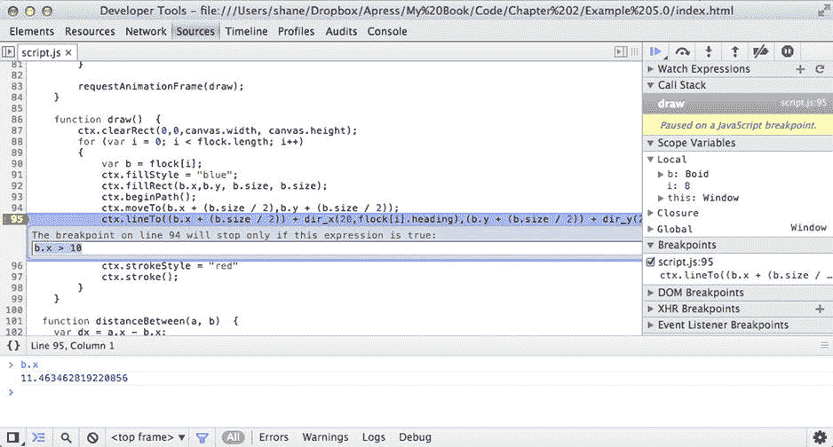
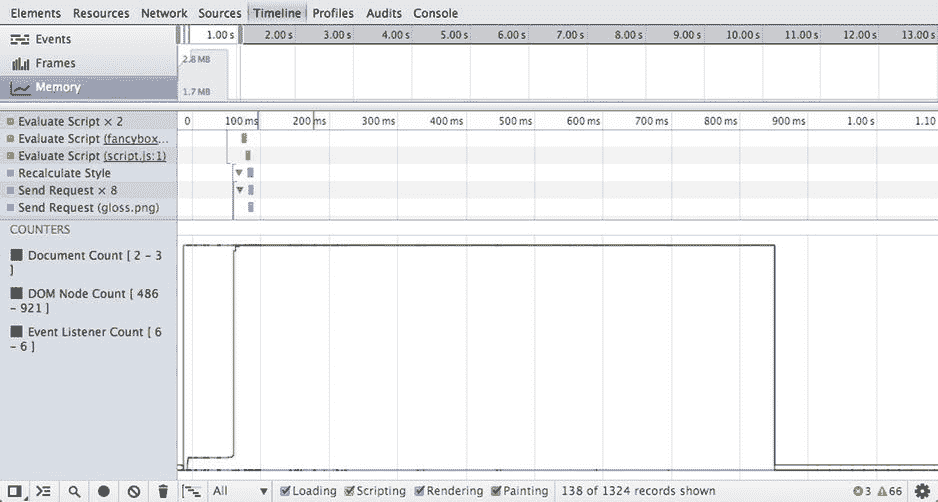
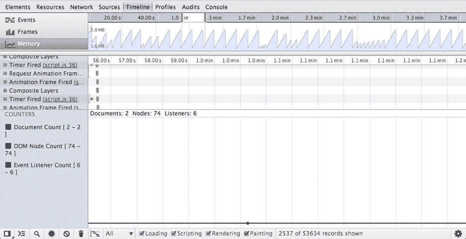
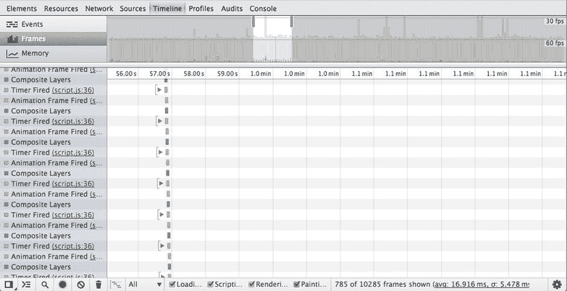
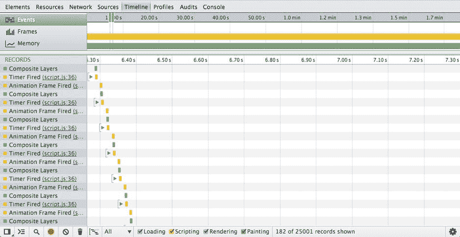
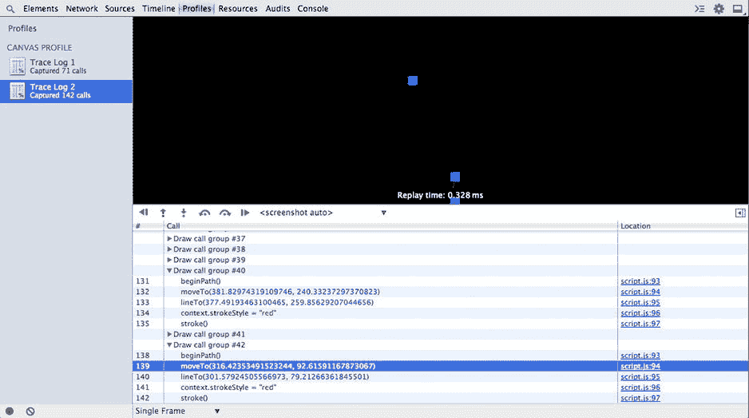

# 1. 引言

在本书中，我们将深入探索 HTML5 与现代 JavaScript 的“兔子洞”，沿途涉猎众多不同主题。我们将从 `canvas` 开始（许多读者可能已经很熟悉它了），并利用它完成两个示例：一个群集动画应用和一个涂色书应用。每一章都会展示每个主题如何在现实世界中落地；HTML5 和 JavaScript 如何协同工作，创建实用的应用程序，而不仅仅用于制作游戏或酷炫演示（尽管它也能为此提供助力）。本书分为三个主要项目，并在行文中穿插了其他示例。每个示例（尤其是主要项目）都力求成为你探索和实验的良好起点，因为尽管结构化学习的书籍很有用，但没有什么比亲自动手编写代码更好的了。

在结束 `canvas` 章节后，我们将于第 3 章深入探讨如何在网页上使用音频和视频；这一章主要聚焦于 `Web Audio API`，以及音频和视频的 HTML 元素。该 API 功能极其强大，因此本章仅作简要介绍，主要关注音频可视化，这与第 2 章以 `canvas` 作为图形基础的内容衔接得很好。随后我们将转向 3D 图形，探索网页上 3D 技术的基础。我决定使用广受欢迎的 `Three.js` 库来处理 `WebGL`，因为纯 `WebGL` 的“着色器代码”相当复杂，且与 C 语言非常相似。第 4 章沿途包含了多个示例，但主要示例是一个 3D 节点图，展示了电影与演员/女演员之间的关系。我选择这个示例是因为数据可视化是一项极其有用的技术，也是我深感兴趣的领域之一；同时，它也能很好地展示这些新技术如何让我们在网页上实现原生功能。

在第 5 章中，我们将稍微偏离主线，进入音乐理论的领域，因为第一个主要项目将是一个包含 3D 可视化和音乐创作的音乐播放器；这将把截至目前的各章内容很好地串联起来。本章大量建立在第 3 章对 `Web Audio API` 的介绍之上，不过，这里并非进行可视化，而是生成声音（希望这能作为音乐创作的一个起点）。当然，与所有章节一样，这仅是对一个庞大领域的管窥，因此我力求使其成为一个良好的起点，而非全面的指南。第 3 章中的音乐理论部分，是本书得名《JavaScript 创造力》的原因之一；本书并非关于设计，甚至不局限于 `canvas` 能做什么——而是关于将 Web 技术创造性地应用于博客或在线商店之外的更多领域。

音乐播放器项目将在第 6 章中整合完成。我使用 `Backbone` 来绑定所有数据，当然，你也可以将其转换，改用 `Ember` 甚至 ES6 等其他工具。

下一个项目涵盖第 7 章和第 8 章。该项目是一个使用 `WebRTC` 和 `Node.js` 的视频聊天应用。第 7 章将简要介绍如何使用 `Node.js` 构建一个基于文本的聊天室，第 8 章将较为深入地探讨 `WebRTC` 的工作原理及使用方法。这对许多人来说将是一个有用的章节，因为视频聊天是人们（尤其是一些企业内部）想要实现的常见项目。该项目还介绍了 `getUserMedia`，这将是最后一个项目（第 9 章和第 10 章）所需的基础，该最后一个项目涉及使用网络摄像头进行运动和物体检测。

物体检测在 Web 行业并非特别常见的领域，但这一直是我的兴趣所在；既然我们现在已经拥有了访问网络摄像头的原生能力（甚至还有更复杂的技术，如 `Web Workers`——尽管本书不会使用它们），那么我在 Web 上做计算机视觉也就顺理成章了！最后一个涉及物体检测的项目可能不如其他项目实用，但更有趣，希望能为任何对此感兴趣的人提供一个完美的起点，同时也展示 Web 平台真正强大的能力。大多数计算机视觉算法都基于数学，令人困惑，因此我选择了朴素算法（易于理解但存在许多未处理的边界情况），同时也使用了一个库来处理更高级的物体检测，这样你可以在不受学术轰炸的情况下获得入门体验。

最后一个项目将各章节串联起来。它是一个实时的、多用户参与的、由计算机生成并由手势控制的音乐乐队。这是一个雄心勃勃的项目，绝非完美。它是练习本书所有内容的好方法，而且（我希望）是一个有趣且独特的项目。生成的音乐不会很动听，可能会有延迟，音效也不佳，但我认为它是本书完美的结尾；毕竟，本书的主要目的是让你参与到那些你可能从未想过的项目中去！

## 你需要了解的知识

现在你已经知道了我们将随本书展开的旅程，那么能够顺利启程就很重要了。本书的定位是要求读者具备一定的 JavaScript 实用知识。这基本属实，但本书的编写方式使得，尽管某些代码相当复杂，但任何有一定编程背景的人应该都能较为轻松地理解。

注意

本章将专注于基础知识，即调试，因此大多数读者可能想直接跳到第 2 章，了解 `canvas` 的介绍。

### CSS

我只想说，本书预期读者了解 CSS，但这并非必需。我在某些章节中会使用 CSS 来设计页面部分元素的样式，但我倾向于将重点放在全书代码上，因此设计上未做打磨，CSS 的使用也极少。即使你不懂 CSS 也能顺利完成阅读，但请注意，如果我在某些地方使用了 CSS，也不会进行解释。

### 调试

至少在我看来，调试是程序员最好的技能，因为代码经常不能按预期工作（尤其是在不同浏览器之间），即使它能工作，也总有改进的空间。本书中的大部分代码依赖于前沿技术，许多规范甚至在我在撰写本书期间就已经发生了变化——因此，如果任何内容无法工作，可能是由于我编写代码之后实现方式已发生改变，或者你使用的浏览器不支持该功能。

### 浏览器兼容性

首先要检查的是你的浏览器是否支持所使用的功能。如果你曾在生产环境中使用过任何现代技术，这一点应该已经很熟悉了，因为许多用户仍在使用的浏览器并不支持这些功能。当然，在这种情况下，你应该以“渐进增强”的方式编写代码，让现代浏览器获得现代功能，同时不破坏老旧浏览器。不过，在本书中（因为本书涉及的是前沿技术和功能），我不支持老旧浏览器，而且在编写代码时，这些代码常常只在一两种浏览器上有效。除非另有说明，我都是使用 Google Chrome 31 测试所有代码。大多数代码在 Mozilla Firefox 中应该也能运行。

如今浏览器发展迅速，事实上，在我写这本书期间，Chrome 将 Webkit 分支成了 Blink，这已经影响了相关规范，因为它们不再总是同意走同一条路。因此，我们需要一种方法来了解不同版本的浏览器何时更改了实现。遗憾的是，除了查看变更日志或问题追踪器之外，没有其他方法能知道某些内容是否已被更改。幸运的是，由于两个开源项目，我们确实能知道新功能何时添加（这对大多数情况来说已经足够）：[`www.html5please.com`](http://www.html5please.com/) 和 [`www.caniuse.com`](http://www.caniuse.com/)。HTML5 Please 用于轻松了解是否推荐在生产环境中使用某项功能，而 Can I Use 用于了解某项功能在哪些浏览器中得到支持。

### JavaScript 控制台

每个浏览器都有不同的开发者工具，有些相似，有些则完全不同，但所有浏览器的一个共同点是 JavaScript 控制台。所有错误都会记录在这里，但它通常远比仅仅作为错误日志强大得多。我将从 Google Chrome 的角度来讨论它，但大多数浏览器都有非常相似的命令。

#### 访问变量

你常常会想知道某个变量的值，以便验证它是否符合预期，或者仅仅是为了了解数据的结构（尤其是对象）。要实现这一点，只需在 JavaScript 控制台中输入变量名，其值就会显示在名称下方。这对于包括对象和数组在内的所有类型都有效。有几种通过控制台访问变量的方法：

- 代码运行后 – 如果你只对最终结果感兴趣，只需按照我上面解释的方法输入变量名即可。

- 断点 – 我稍后会详细讨论断点，但与其他许多语言中的调试器一样，你可以添加一个断点，以便在断点处的代码被执行时检查变量。

- 调试器语句 – 你可以在代码中手动添加断点，只需在代码中写入 `debugger;`。通常使用断点更容易，但了解 `debugger` 语句也是很有价值的。

- 代码内部 – 你可以从代码内部记录到控制台。通常使用断点更容易，但如果愿意，你也可以在代码内通过写入 `console.log('foo');` 来记录。

- 以表格形式 – 目前这仅在 Google Chrome 和 Firebug 中可用，但它是一种将数组以表格数据形式查看（每个索引对应一行）的非常有用的方法。通过运行 `console.table(array);`，无论是从代码内部还是从控制台内部（我建议在断点期间直接从控制台运行，因为它与其他浏览器不兼容）都可以实现。

#### 提示符

控制台中可供输入的区域被称为提示符，因为它的使用方式与 shell（命令行）提示符非常相似。这对于访问控制台 API（如 `console.log` 和 `console.table`）非常有用。但它也更加强大，因为它可以计算表达式。这些表达式可以是简单计算（结果会立即输出），也可以是与你当前所在页面更相关的内容，例如修改 DOM。实际上，你可以在提示符中编写任何 JavaScript，这使其成为调试中不可或缺的工具，因为你可以，例如，将一个未能按预期工作的函数提取出来并加以修改，而不影响脚本的其余部分。

### 源代码

与控制台一样，大多数 JavaScript 调试工具（浏览器内和/或插件）都提供查看源代码的方式——这很合理，因为你通常需要查看代码才能理解和调试它——但它不仅仅是只读的。这些工具允许你逐行操作和调试代码。在 Google Chrome 中，它位于“Sources”选项卡下，尽管大多数功能在其他大多数工具中也是可用的。

### 实时编辑

有时你想要编写一行代码或测试一个函数，这正是提示符的用途；但有时你想要多次更改代码本身，并查看它如何影响整个代码库。与其使用提示符或反复在文本编辑器中保存，你可以进入源代码选项卡并直接编辑代码。这将在 JavaScript 虚拟机的新实例中运行代码，以便你可以测试和调试所有需要的内容，而不会覆盖原始文件（覆盖后需刷新，且你可能丢失有用的代码等）。

### 断点

你可能已经熟悉基本的断点了，无论是通过使用 JS 开发者工具还是之前的编程语言。它是开发者工具包中最有用的工具之一。在代码视图（Chrome 中的 Sources 选项卡）中，你可以通过点击行号来添加断点，这会在该行留下一个标记（即断点）。正如我之前解释的，这种默认类型的断点会暂停 JavaScript 的执行，并允许你查看当前状态，包括变量的值。还有其他几种类型的断点，并非所有调试器都能处理所有类型的断点，这些断点在不同的情况下可能非常有用。

图 1-1. 添加条件断点

- **DOM 断点**：这些断点允许你在发生更改（例如修改属性或移除元素）时暂停代码。在 Chrome 中，可以通过右键单击 DOM 节点，然后选择“Break on…”下列出的选项之一来找到。

- **异常**：你常常会遇到代码设置了抛出异常的情况，但与其在代码中处理它，不如正确地调试它并找出导致异常的原因。与其为每个异常设置断点（这很快就会变得烦人），你可以将调试器设置为在“所有异常”或“仅未捕获的异常”时暂停。在 Chrome 中，通过点击带有六边形背景的暂停按钮来访问此功能。颜色会根据其设置的模式而变化。

- **事件**：可以为事件被触发时设置断点，例如 `click` 或 `mousemove`，这对于确保事件在应该触发的地方被触发并执行预期操作非常有用。在 Chrome 中，这些断点位于 Sources 面板下的 Event Listener Breakpoints 标题下。

- **条件断点**：这与默认断点相同，只是你可以设置断点暂停的条件，其工作方式与在 `if` 语句中设置断点相同。在我看来，这是最有用的断点类型，因为你可以用它只在结果不符合预期时暂停代码。要放置条件断点，请右键单击行号，它会给你一个文本字段来输入条件，如图 1-1 所示。

## 时间线

到目前为止，我们已经讨论了调试器中用于修复代码并确保其按预期工作的功能。然而，有时让代码运行起来是容易的部分——让代码运行得*快*往往困难得多。我们仍在讨论调试器，但此时不再是为了检查代码的每个部分是否正常工作而进行检查，而是需要记录整个过程，以便我们能发现性能上的模式（着眼于代码的整体运行情况，而非每个单独的函数/行）。这个主题很容易就能写满一整本书，所以我将介绍基础知识，这应该能为你理解并提升性能提供一个良好的起点。

在 Chrome 中，我们用于衡量代码性能的工具是时间线。我应该指出，网络面板也与此相关，因为它能让我们看到哪些资源导致了延迟。但我将要重点关注代码的运行，而不是资源，因为与代码性能测试（这对于更具创造性的 Web 应用至关重要）相比，你更可能对资源（在普通网站上）有经验。

要开始使用时间线，你需要通过点击圆形按钮来记录代码的运行。一旦开始记录，你会注意到一些图表被创建出来。在撰写本文时，会记录三个方面：事件、帧和内存；所有这些都是同时记录的，但只能通过选择它们来分别查看。在基本层面上，这些功能为你提供了一种测试代码各部分速度的好方法，因为它像栈一样分解代码，向你展示每个函数调用。这是一个相当简单的寻找瓶颈的方法，但这仅仅触及了时间线功能的皮毛。

它不仅仅显示函数花费的时间，还将其分解为加载、脚本、渲染和绘制。这对于了解为什么一个函数花费的时间比预期要长极其有用。加载类别包含任何 XHR（AJAX）调用以及 HTML 解析。函数内的逻辑包含在脚本类别中。渲染是进行 DOM 操作的地方，主要是重新计算样式和布局。绘制是浏览器更新显示内容以匹配渲染结果的地方，包括对画布和其他不直接与 DOM 相关的元素的任何更改。

在第二章中，我们使用画布模拟鸟群（称为 Boids），所以我使用时间线记录了它，以向你展示其工作原理。图 1-2 展示了事件时间线，有助于函数计时并直观地看到它们产生的栈。截图中只显示了两种不同的颜色。这是因为使用画布时 DOM 元素极少，因此不需要加载和渲染。DOM 的缺失也是时间线内模式形成的相同原因，如果我们记录一个普通网站的性能，那么可能会看到滚动或悬停在按钮上时的变化；所以时间线对于画布动画之外的功能肯定也很强大！图 1-3 展示了帧时间线。它测量页面的每秒帧数 (FPS)，因为低 FPS 会使站点或动画看起来“卡顿”，而不是人们期望的流畅体验。本节的第三张截图，图 1-4，展示了内存时间线；你可以从峰值看出，内存存储的数据越来越多，直到垃圾回收器介入并清除存储旧数据的内存。你会注意到时间线下方有相当多的空白区域。这个空间用于显示 DOM 节点和事件处理程序数量的图表（正如你在图 1-5 中所见，它展示了我曾经制作的一个基本作品集网站的时间线）。

**图 1-5.** 显示作品集网站上 DOM 元素渲染的内存时间线

**图 1-4.** 显示 Chrome 开发者工具的内存时间线

**图 1-3.** 显示 Chrome 开发者工具的帧时间线

**图 1-2.** 显示 Chrome 开发者工具的事件时间线

### 画布分析

时间线是一个非常强大的工具，但在调试画布动画时，它常常感觉像是猜测（因为大多数动画都是通过脚本动态生成的，我们并不真正知道每个函数实际上在做什么）。幸运的是，Chrome 开发者工具中有一个全新的工具，可以让你捕获画布帧（在撰写本文时，它仍仅在 Chrome Canary 版本中可用）。它在“分析”选项卡下（你可能需要在开发者工具设置中启用实验性功能）。

捕获的帧分析与断点非常相似，不同之处在于它不会暂停代码，而是记录一帧，并允许你逐步执行每个发出的调用。这非常强大，因为它能让你看到确切的执行顺序，并显示该特定步骤下画布的状态，如图 1-6 所示。

**图 1-6.** 捕获画布帧

## 总结

这开篇一章希望能为你阅读本书的其余部分做好准备。我坚信仅仅通过阅读书本是无法学会的，所以我写作的方式是希望引导你掌握不同的技巧和了解每个主题的方法，而不是写一本“操作指南”式的书。因此，本章的调试部分在本书余下部分应该对你非常有用，因为调试不仅仅是修复损坏的代码，更是探索代码实际如何工作以及如何改进它。